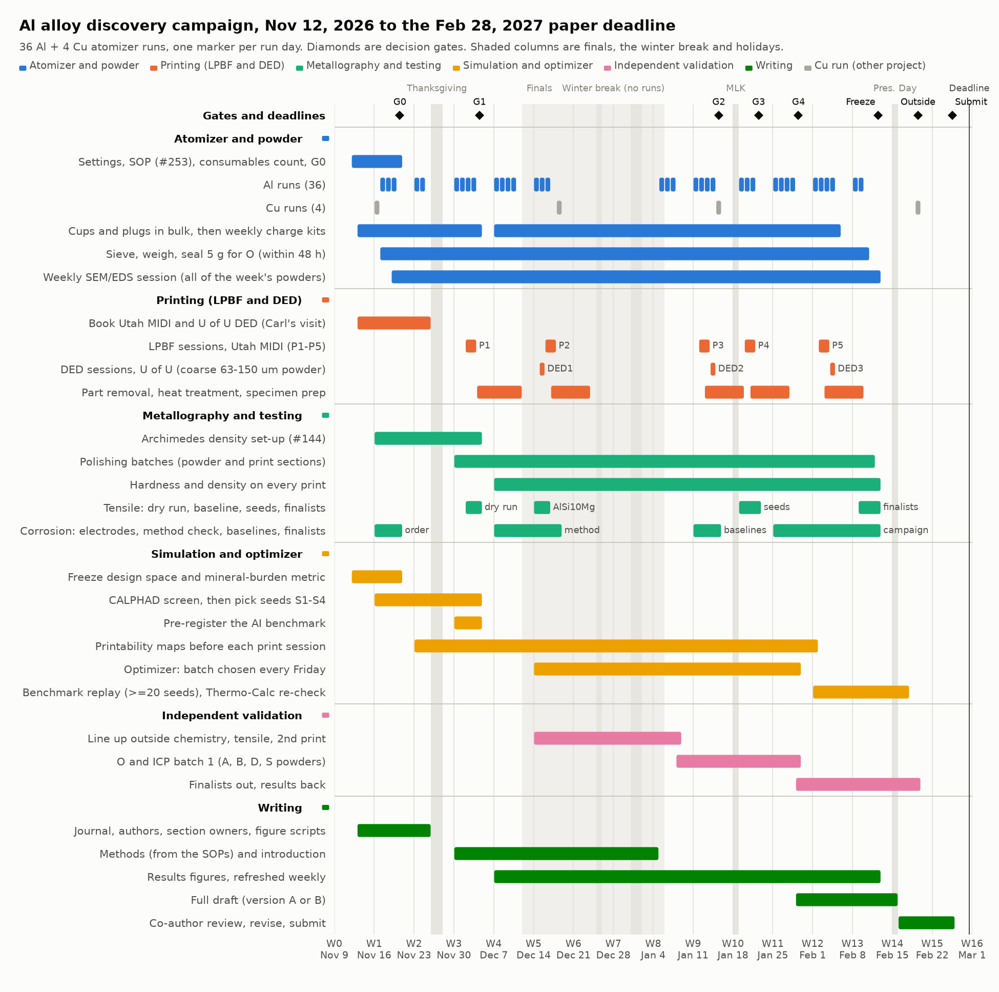
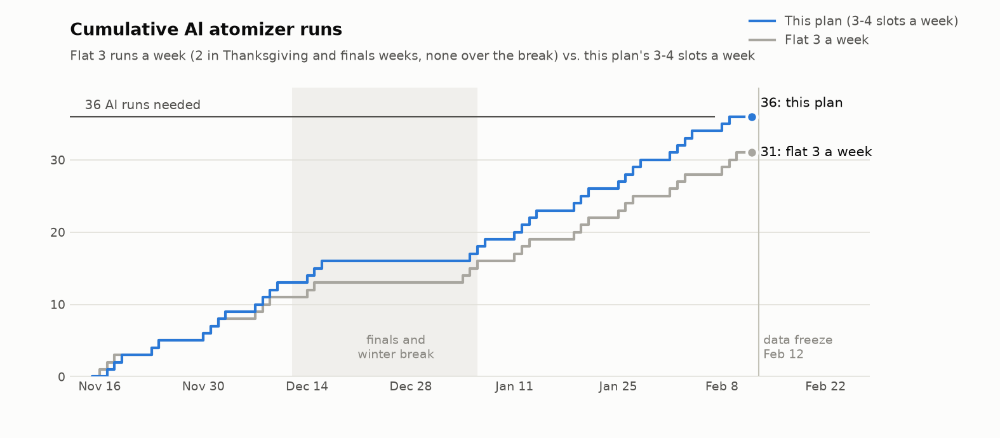

# Al alloy discovery campaign: schedule to the Feb 28, 2027 paper

The schedule asked for in [#256](https://github.com/vertical-cloud-lab/digital-alloy-lab/issues/256)
for the campaign in [#255](https://github.com/vertical-cloud-lab/digital-alloy-lab/issues/255):
36 Al-family and 4 Cu atomizer runs, with printing, testing, modelling, outside checks and the
paper, all by **Sun Feb 28, 2027**. Every date here comes from [`schedule.py`](schedule.py). It
checks the plan and redraws the charts and tables, so change dates there and re-run it.

<picture>
  <source media="(prefers-color-scheme: dark)" srcset="gantt-dark.png">
  
</picture>

## In short

- **3 runs a week gets about 31 Al runs, not 36.** Thanksgiving, finals and the winter break take
  out about 2.5 weeks. Even counting runs up to the Feb 12 data freeze, a flat 3 a week gives 31.
  This plan uses **4 run slots (Mon–Thu) in five weeks** and 2–3 in the others. That gives 36 Al and
  4 Cu runs, with the last Al run on Feb 9. Six of the 36 are **flex slots** for runs that fail.
  The Oct 2, 6 and 8 runs all went wrong where the melt meets the plate, so expect some failures.
- **The atomizer isn't the bottleneck. The work after each run is.** One run takes about
  10–15 person-hours from charge to SEM, or 12–19 if the charge uses machined cups
  ([below](#what-one-run-costs-in-time)). At 4 runs a week, that's 40–60 hours before any
  printing, testing, modelling or writing. That needs a **third trained operator** and **one or
  two more SEM users by early December**.
- **Printing decides how many alloys get tensile data.** Each LPBF composition is its own build,
  with a powder changeover. The plan has five Utah MIDI sessions (P1–P5) and three U of U DED
  sessions. DED takes the 63–150 µm powder that LPBF can't use, which is most of what the
  atomizer has made so far ([#157](https://github.com/vertical-cloud-lab/digital-alloy-lab/issues/157)).
  About 20 compositions get atomized. Tensile data goes to the benchmarks, the seed alloys and
  two finalists.
- **Decisions happen on Fridays.** Using data through Thursday's SEM session, the optimizer
  picks next week's batch. Charges are dosed Friday or Monday, and runs go Mon–Thu.
- **Gates:** G0 Nov 20 · G1 Dec 4 · G2 Jan 15 · G3 Jan 22 · G4 Jan 29 · data freeze Feb 12 ·
  outside results Feb 19 · **submit Thu Feb 25**, three days before the deadline.

## What has to happen every week, besides the runs

1. **Charges for next week.** Dose 3–4 charges and pack them, or cut bar and weigh
   master-alloy pieces ([#250](https://github.com/vertical-cloud-lab/digital-alloy-lab/issues/250)).
   Cups don't depend on the composition, so machine them in bulk before December. Don't make
   them one charge at a time: a charge takes 3–5 cups at about 40 min a set.
2. **Powder handled within 48 h of each run.** Weigh the six-part mass balance. Sieve two splits
   at 250/63/45 µm on the Al-only sieve set ([#234](https://github.com/vertical-cloud-lab/digital-alloy-lab/issues/234)).
   Seal a 5 g sample for oxygen. Label, log and post to [#159](https://github.com/vertical-cloud-lab/digital-alloy-lab/issues/159).
3. **One SEM session for all of the week's powders** (Thursday, about 4–5 h). Size at least 1000
   particles, measure shape on at least 400, and take EDS at the top, middle and bottom of the
   jar. Run the image analysis the same day
   ([#225](https://github.com/vertical-cloud-lab/digital-alloy-lab/issues/225)).
4. **One polishing batch.** Powder cross-sections of each new composition, plus whatever came back
   from printing: track sections, cubes, corrosion coupons.
5. **Hardness and density on everything printed that week.** This is the fast strength screen
   the optimizer uses before tensile data exists.
6. **A print trip, on alternate weeks:** a Utah MIDI session or U of U DED. Bring back last
   session's parts, then remove, heat-treat and prep them.
7. **The Friday optimizer update.** Refit on the new data, pick next week's batch, and make
   printability maps (Eagar–Tsai or the AM Module) for anything going to Utah.
8. **Corrosion or tensile on whatever is ready.** Corrosion runs are daytime only, on the
   EZstat-Pro through the CubXL, until someone decides on overnight runs
   ([#221](https://github.com/vertical-cloud-lab/digital-alloy-lab/issues/221)).
9. **Logging that the paper needs.** Every step's start and end time goes into the run record.
   Fig. 1 is the per-step cost of the loop, and the optimizer needs costs. Re-run the figure
   scripts every Friday.
10. **2–4 hours of writing.** Methods first, written while the SOPs are fresh.
11. **Consumables and argon checked every Friday** against the 40-run list
    ([Do now](#do-now-by-g0-fri-nov-20)).
12. **The 30-minute meeting** ([#255](https://github.com/vertical-cloud-lab/digital-alloy-lab/issues/255)),
    on Friday so it is also the decision meeting:
    - 5 min: this week's runs. Were they valid? How do they compare with the bar? Why did any fail?
    - 10 min on computers: trigger the run-analysis and figure prompts, and record.
    - 10 min: approve next week's batch and the print and test plan.
    - 5 min: orders, people and blockers.

## A standard week

January, with four run slots:

| Day | Atomizer | Powder and SEM | Everything else |
| --- | --- | --- | --- |
| Mon | Run 1 | Sieve Thursday's run | Dose Tue–Wed charges if not done Friday |
| Tue | Run 2 | Sieve Monday's run; SEM stubs | Utah or DED trip (alternate weeks, Tue–Wed) |
| Wed | Run 3 | Sieve Tuesday's run | Polishing batch; hardness and density |
| Thu | Run 4 (flex) | SEM session for the week's powders | Tensile or corrosion (daytime) |
| Fri | No Al run: deep clean, BN-coat the crucible for Monday, check consumables and argon. Cu runs go here at block boundaries | Image analysis, run records, data upload | 30-min meeting, the optimizer's batch, dose Monday's charge, re-run figures, writing |

BN coats have to dry overnight, so coat the evening before each run. With one crucible that
means coating right after the clean. A second crucible would make back-to-back days easier.

## What one run costs in time

These are estimates from the run threads. Nothing in the chain has been timed end to end, so
time the W1 runs and update the plan.

| Step | When | Time per run | Basis |
| --- | --- | --- | --- |
| Dose, pack, press the plug, clean with IPA | day before | 1–1.5 h | doser and cup threads |
| Cups and plugs (only if cups are used) | ahead, in bulk | 2–3.5 h (3–5 sets at ~40 min) | [#250](https://github.com/vertical-cloud-lab/digital-alloy-lab/issues/250), never timed |
| BN-coat the crucible | evening before | 15 min + overnight dry | [SOP](https://github.com/vertical-cloud-lab/digital-alloy-lab/pull/253) |
| Start-up, loading, three washes, melt, pour | run day | 2.5–3.5 h | SOP. AMAZEMET's trainer put a trial at about 1 h; the washes add the rest |
| Cool to 400 °C and vent | run day | ~1 h | SOP |
| Collect, weigh, clean, rebuild the furnace | run day | 1–2 h | ~50 min on Nov 7 ([#219](https://github.com/vertical-cloud-lab/digital-alloy-lab/issues/219)); a day lost to an empty tank and a leak on Oct 20 ([#159](https://github.com/vertical-cloud-lab/digital-alloy-lab/issues/159)) |
| Run log, videos, post to #159 | run day | 0.5 h | SOP |
| Sieve two splits, seal 5 g | within 48 h | 1–1.5 h | [runs plan](https://github.com/vertical-cloud-lab/byu-vcl/blob/cad4e6d/atomizer-runs/plan-adv-mater/measurements.md) |
| Doser flowability, Hausner ratio | within a week | 0.5–1 h | runs plan |
| SEM stubs and SEM time | weekly session | 2–3 h | [byu-vcl PR 284](https://github.com/vertical-cloud-lab/byu-vcl/pull/284) |
| Image analysis, run record | weekly | 0.5–1 h | |
| **Total** | | **~10–15 h; 12–19 with cups** | |

## The 36 Al runs

Run by run in [`runs.csv`](runs.csv). The blocks follow the byu-vcl
[runs plan](https://github.com/vertical-cloud-lab/byu-vcl/tree/cad4e6d/atomizer-runs/plan-adv-mater),
cut down to fit, with the optimizer rounds added:

| Block | Runs | When | What it shows |
| --- | --- | --- | --- |
| **A** baseline | A1–A5 | Nov 17–24 | Run-to-run spread at fixed settings: 6063, 250 g, Mo plate, 1.5:1 booster, amplitude 90. Checked against the repeatability bar (n ≥ 5, D50 CV ≤ 10 %, …). No feedstock order needed |
| **D** benchmarks | D1, D2, D1-r | Nov 30, Dec 2, Feb 8 | AlSi10Mg-type (4047 + Mg), the alloy to beat; Scalmalloy-type (Al-Mg-Sc-Zr), the mineral-burden reference; a repeat of D1 |
| **B** dosing check | B30, B15 | Dec 1, Dec 3 | 4047 powder in 6063 cups at a known Si: does measured Si follow the charge? |
| **S** seeds | S1–S4 | Dec 7–10 | Four compositions from the CALPHAD screen, e.g. Al-Mn-Cr-Zr and Al-Zr(-Er) as in FLAIME |
| **R** optimizer rounds | R1–R4, 3 each | Jan 5 – Feb 3 | Batches picked on Dec 18, Jan 8, Jan 15 and Jan 29. R4's results stop at powder data and single tracks |
| **F** finalists | F1 ×2, F2 ×2 | Jan 25–28 | Powder for ≥3 tensile specimens each, DED walls and the outside checks |
| **X** flex | X1–X6 | Dec 14–16, Jan 11, Feb 4, Feb 9 | Redo a failed run. If none failed: A6–A8 if the bar needs them, then one more candidate |
| Cu (ONR) | Cu1–Cu4 | Nov 16, Dec 18, Jan 15, Feb 19 | On Fridays (Cu1 on the Monday, since the machine is still set up for copper), each followed by the ~1 h full clean |

Runs per week (Al / Cu): W1 3/1 · W2 2 · W3 4 · W4 4 · W5 3/1 · W6–W7 0 · W8 3 · W9 4/1 ·
W10 3 · W11 4 · W12 4 · W13 2 · W14 0/1.

<picture>
  <source media="(prefers-color-scheme: dark)" srcset="runs-cumulative-dark.png">
  
</picture>

If the flex slots run out (more than six failed runs), cut in this order: R4 down to 2 runs,
then B15, then D1-r.

## Week by week

**W0 · Thu Nov 12 – Sat Nov 14 (now)**
- Gage: confirm ME Order 13301 (shipping Nov 12), and whether the expired Thermo Fisher order
  (13300: Si, Fe, Ni, Cu) needs placing again ([#146](https://github.com/vertical-cloud-lab/digital-alloy-lab/issues/146)).
- Gage and Ronnie: count consumables against 40 runs ([list](#do-now-by-g0-fri-nov-20)).
- Sterling and Nate: decide on the Thermo-Calc licence and the desktop printer.
- Carl: set up the U of U visit.
- Xavier: start the design-space freeze.
- Sterling: confirm the journal details ([#120](https://github.com/vertical-cloud-lab/digital-alloy-lab/issues/120)): collection, article type, length and exact due date.

**W1 · Nov 16–21**
- *Atomizer:* Mon: Cu1, the full clean, then switch to the Al set-up. Tue–Thu: A1–A3. Before A1,
  settle the five open SOP questions and merge [#253](https://github.com/vertical-cloud-lab/digital-alloy-lab/pull/253),
  and check the landing point with the [#164](https://github.com/vertical-cloud-lab/digital-alloy-lab/issues/164) gauge.
- *Powder/SEM:* A1–A3 sieved on the new Al sieve set. Train one or two more SEM users.
- *Printing:* Carl's U of U visit about DED and the MIDI. Questions for Utah:
  - Is there a reduced-build kit? (~30 g of powder a build, vs ~440 g for the full cylinder)
  - Can they run single tracks on a groove plate, several compositions per plate?
  - What PSD do they want?
  - Dates for P1 and P2, and who removes parts.
- *Testing:* order the reference electrodes. Find or build the Archimedes set-up
  ([#144](https://github.com/vertical-cloud-lab/digital-alloy-lab/issues/144)). Check the grips
  and extensometer for sub-size tensile specimens on the 20 kip frame.
- *Modelling:* freeze the design space and the mineral-burden metric. Start the CALPHAD screen.
  It runs on pycalphad and open databases until Thermo-Calc is licensed
  ([#235](https://github.com/vertical-cloud-lab/digital-alloy-lab/issues/235)).
- *Cups:* bulk machining starts if cups stay in the plan.
- **Fri Nov 20: G0.**

**W2 · Nov 23–25 (Thanksgiving Thu–Fri)**
- *Atomizer:* A4 Mon, A5 Tue; maintenance Wed.
- *Powder/SEM:* A1–A5 fully measured by Wed Dec 2.
- *Modelling:* CALPHAD screen. Printability window for commercial AlSi10Mg for P1.
- *Writing:* author list, section owners, and figure scripts that redraw from the run records.

**W3 · Nov 30 – Dec 5**
- *Atomizer:* D1 Mon, B30 Tue, D2 Wed, B15 Thu.
- *Printing:* **P1 (Wed–Thu Dec 2–3):** commercial AlSi10Mg (the 15–45 µm powder on hand):
  a single-track power–speed grid, density cubes and tensile bars. This is the MIDI baseline.
- *Testing:* tensile dry run on wrought 6063. Archimedes set-up working.
- *Modelling:* pick S1–S4. Pre-register the AI benchmark: baselines, seeds and metrics,
  committed before any optimizer round.
- **Fri Dec 4: G1.**

**W4 · Dec 7–12 (last day of classes Thu Dec 10)**
- *Atomizer:* S1–S4 Mon–Thu.
- *Printing:* P1 parts: remove them, stress-relieve, prep.
- *Testing:* density and hardness on the P1 cubes. Corrosion method check on wrought 6063 and
  commercial AlSi10Mg (3.5 wt% NaCl: OCP, then linear polarization, then a polarization scan).
- *Polishing:* powder sections of A, B30, B15, D1 and D2.
- *Modelling:* printability maps for in-house 6063, D1 and S1–S4.

**W5 · Dec 14–19 (finals through Thu Dec 17)**
- *Atomizer:* X1–X3 Mon–Wed, Cu2 Fri. If finals get in the way, move X3 to Dec 21–22 or drop it.
- *Printing:* DED1 Tue (the 63–150 µm fraction of 6063 and D1). **P2 (Wed–Thu Dec 16–17):**
  in-house 6063 and D1, plus groove-plate single tracks of S1–S4.
- *Testing:* tensile on the P1 AlSi10Mg bars.
- *Modelling:* **Fri Dec 18: R1 batch picked**, so the charges can be dosed on Jan 4.
- *Validation:* line up outside chemistry (ICP-OES, O/N by inert-gas fusion), an outside tensile
  lab, and a second print site (3D Powder Tech or Mines). Get accounts and POs in place now.

**W6–W7 · Dec 21 – Jan 2 (winter break)**
- No runs. Clean after Cu2.
- *Writing weeks:*
  - Methods: atomizer, powder characterization, CALPHAD, optimizer, LPBF and DED, testing.
  - The introduction.
  - Fig. 1 (the loop and per-step times) and a draft of Fig. 3 (Block A repeatability).
- All run records complete. Fit the first optimizer model on the A, B, D and S data.
- If anyone is around: P2 part removal and sections.

**W8 · Jan 4–9 (classes start Wed Jan 6)**
- *Atomizer:* dose the R1 charges Mon; R1 Tue–Thu.
- *Validation:* **ship O/ICP batch 1 Fri Jan 8:** the sealed 5 g samples from A, B, D and S.
- *Testing:* density and hardness on the P2 cubes.
- *Modelling:* **Fri Jan 8: R2 batch picked.**

**W9 · Jan 11–16**
- *Atomizer:* X4 Mon, R2 Tue–Thu, Cu3 Fri.
- *Printing:* **P3 (Tue–Wed Jan 12–13):** cubes of S1–S4 and D2, and groove-plate tracks of R1.
  Add mini-tensile bars of the best seeds if there's powder. DED2 Thu (S1–S4).
- *Testing:* corrosion baselines on printed AlSi10Mg, in-house 6063 and wrought 6063.
- **Fri Jan 15: G2.** R3 batch picked.

**W10 · Jan 18–23 (MLK Day Mon)**
- *Atomizer:* R3 Tue–Thu.
- *Printing:* **P4 (Wed–Thu Jan 20–21):** R2 and R3 tracks and cubes.
- *Testing:* tensile on the seeds from P3.
- **Fri Jan 22: G3:** finalists F1 and F2 picked, outside checks booked.

**W11 · Jan 25–30**
- *Atomizer:* F1-a, F1-b, F2-a, F2-b Mon–Thu.
- *Testing:* corrosion on seed and finalist coupons from P3/P4, 3 per alloy.
- *Validation:* finalist powder and P3/P4 coupons go to outside chemistry. A specimen set goes to
  the outside tensile lab.
- **Fri Jan 29: G4** (paper version A or B) and the R4 batch. The full draft starts.

**W12 · Feb 1–6**
- *Atomizer:* R4 Mon–Wed, X5 Thu.
- *Printing:* **P5 (Tue–Wed Feb 2–3):** F1 and F2 tensile bars (≥3 each, plus spares), cubes and
  corrosion coupons, with AlSi10Mg in the same window if P1's set isn't enough. DED3 Thu
  (F1 and F2 walls).
- *Modelling:* replay the optimizer policies on the real data (≥20 seeds, bootstrap CIs) for the
  acceleration factor. Re-check the finalists in Thermo-Calc (Scheil, precipitation).

**W13 · Feb 8–13**
- *Atomizer:* D1-r Mon, X6 Tue. The last Al run is Feb 9.
- *Testing:* finalist heat treatment, then tensile Feb 9–12. Finalist corrosion.
- **Fri Feb 12: data freeze.**

**W14 · Feb 15–20 (Presidents' Day Mon)**
- Tue Feb 16: full draft to all co-authors, including Utah.
- Final figures and the SI. Mineral-burden table against Scalmalloy and AlSi10Mg.
- **Fri Feb 19:** outside results cut-off and co-author comments due. Cu4.

**W15 · Feb 22–28**
- Mon–Tue: revise.
- Wed: references, SI, data deposit (Zenodo DOI), cover letter, author details.
- **Thu Feb 25: submit.** Fri–Sun is buffer.

## Gates

| Gate | Date | Pass | If it fails |
| --- | --- | --- | --- |
| G0 | Fri Nov 20 | Fixed settings and SOP questions settled; Al sieves on hand; consumables counted and ordered; design space frozen; P1, P2 and DED dates held; Thermo-Calc and printer decided; electrodes ordered | Run Block A anyway (it needs no orders); the S runs slip |
| G1 | Fri Dec 4 | A1–A5 checked against the repeatability bar; S1–S4 picked; benchmark pre-registered; P1 printed | Bar not met: A6–A8 in the W5 flex slots, and report the spread as measured |
| G2 | Fri Jan 15 | FLAIME's G2: one full CALPHAD → atomize → print → test → optimizer loop; ≥2 in-house powders print ≥99 % dense | Run the stages separately; DED carries the printing result |
| G3 | Fri Jan 22 | Finalists picked on hardness, density and early tensile, with mineral burden below Scalmalloy's | Take the best two anyway; version B becomes likely |
| G4 | Fri Jan 29 | FLAIME's G3: ≥1 alloy at or above AlSi10Mg's yield strength (tensile, or hardness until bars are tested) with less mineral burden than Scalmalloy | Write version B |
| Freeze | Fri Feb 12 | All experimental data in | Late data goes to the SI or is cut |
| Outside | Fri Feb 19 | Outside chemistry and tensile back | Report as pending, or cut |
| Submit | Thu Feb 25 | | Fri–Sun buffer |

**Version A** leads with the new alloy. **Version B** leads with custom feedstock across about
20 compositions, plus a replay of the optimizer on the real data. Both are in the
[#120](https://github.com/vertical-cloud-lab/digital-alloy-lab/issues/120) outline. Version B is
weaker for *Adv. Mater.* but can be submitted on time.

## Do now (by G0, Fri Nov 20)

- [ ] **Powders:** confirm ME Order 13301 and decide on the expired 13300 (Gage, [#146](https://github.com/vertical-cloud-lab/digital-alloy-lab/issues/146)).
- [ ] **Atomizer consumables for 40 runs** (Gage and Ronnie):
  - Mo plates: 4–6 runs each, so 6–9 plates plus spares. They're an AMAZEMET consumable, so ask
    about lead time now.
  - Graphite nozzles, sealing rods and pins, crucible(s), BN spray, filters, pump oil.
  - hBN nozzles and W-coated plates for the 4 Cu runs.
  - Argon: an Al run uses about 100–160 psi and a Cu run 300–350, so about 6,000 psi in all, or
    2–3 cylinders. At most two cylinders are allowed in the booth.
- [ ] **A separate Al sieve set**, including the No. 325 (45 µm) sieve
  ([#234](https://github.com/vertical-cloud-lab/digital-alloy-lab/issues/234),
  [byu-vcl PR 262](https://github.com/vertical-cloud-lab/byu-vcl/pull/262)).
- [ ] **6063 bar from one lot:** 36 × 250 g is 9 kg, so about 10–12 kg with losses. Or choose a
  purer base Al for the campaign compositions as part of the design-space freeze.
- [ ] **Master alloys** where they can replace cups ([#250](https://github.com/vertical-cloud-lab/digital-alloy-lab/issues/250)).
- [ ] **Two Ag/AgCl reference electrodes** and cell parts. They are what corrosion is blocked on
  ([#221](https://github.com/vertical-cloud-lab/digital-alloy-lab/issues/221)).
- [ ] Conductive mounting powder, SEM stubs and tabs, polishing consumables, and long tweezers
  ([#219](https://github.com/vertical-cloud-lab/digital-alloy-lab/issues/219)).
- [ ] **Thermo-Calc licence and desktop printer** (Sterling and Nate, #255).
  - Without Thermo-Calc, the screen runs on pycalphad and Thermo-Calc only re-checks the finalists.
  - A printer that can't arrive and be commissioned by mid-January won't help this paper.
- [ ] **U of U visit** (Carl): DED, plus the MIDI questions in W1.
- [ ] **People:** a third atomizer operator signed off by Dec 4. Only trained people touch the
  machine ([#160](https://github.com/vertical-cloud-lab/digital-alloy-lab/issues/160)). Also one
  or two more SEM users.
- [ ] **Standing slots:** SEM on Thursdays, plus a polishing slot.
- [ ] **Archimedes set-up** ([#144](https://github.com/vertical-cloud-lab/digital-alloy-lab/issues/144)),
  and the tensile grips and extensometer.
- [ ] **The paper:** collection, article type, length and due date (Sterling, [#120](https://github.com/vertical-cloud-lab/digital-alloy-lab/issues/120)).

## Suggested leads

These come from the action items in #255 and the current roles in
[#160](https://github.com/vertical-cloud-lab/digital-alloy-lab/issues/160) and the TMS
abstracts. They're also in [`tasks.csv`](tasks.csv); change them there.

| Stream | Lead |
| --- | --- |
| Atomizer runs and consumables | Gage, with Ronnie and the new operator |
| Cups, plugs and bar | Paul |
| Powder processing and SEM | Ronnie, with the new SEM users |
| U of U DED and the MIDI sessions | Carl and Ronnie |
| Polishing, hardness, density, tensile | Carl and the testing team |
| Corrosion (EZstat-Pro on the CubXL) | Ben and Jarrett |
| CALPHAD, printability, optimizer, benchmark | Xavier |
| Purchases, outside checks, the paper | Sterling, with Gage on orders |

## How this compresses FLAIME

The FLAIME proposal plans 9 months. Here is what fits in 15 weeks:

| FLAIME | Here |
| --- | --- |
| M1: CALPHAD and the network model running; focus compositions chosen | W1–W3 (G1, Dec 4), on pycalphad if Thermo-Calc isn't licensed |
| M2: first powders characterized; benchmark pre-registered | W1–W3 |
| G1: ≥50 compositions screened computationally | Thousands, by Dec 4 |
| G2: one full loop; ≥2 compositions ≥99 % dense | Jan 15 |
| G3: ≥1 alloy above family thresholds, SRI ≥25 % below Scalmalloy, ≥3 tensile replicates | Decided Jan 29; data by Feb 12 |
| M6: digital thread, CMDRI vs Scalmalloy and AlSi10Mg, AI benchmark report | Feb 12–19 |
| 100–200 compositions at up to 16 a week | About 20 compositions at 3–4 runs a week |
| Tracks → thin walls → cubes → E8 sub-size | Tracks → cubes → tensile for benchmarks, seeds and finalists; walls come from DED |
| ICP-MS check of composition | Batch 1 on Jan 8; finalists on Jan 29 |
| Not by Feb 28 | Elevated-temperature tests at three temperatures (hot hardness on the finalists at most), gas atomization at Valimet, the multi-site print network, ISO 52902 artifacts, cryogenic tests ([#254](https://github.com/vertical-cloud-lab/digital-alloy-lab/issues/254)) |

## Paper figures and when each is final

The figure list follows the [#120](https://github.com/vertical-cloud-lab/digital-alloy-lab/issues/120) outline:

| Figure | Needs | Draft | Final |
| --- | --- | --- | --- |
| 1 The loop and per-step costs | Step times from every run | Jan 4 | Feb 12 |
| 2 Dosing and composition fidelity | B, D, S, R runs and ICP batch 1 | Jan 29 | Feb 12 |
| 3 Atomization repeatability and process window | A1–A5 (A6–A8), D1 and D1-r, failed runs | Jan 4 | Feb 12 |
| 4 Characterization (CALIBER) | SEM/EDS with acquisition settings, ICP | Jan 29 | Feb 12 |
| 5 Printing in-house powder vs. commercial AlSi10Mg | P1–P5, DED1–3, density, hardness, tensile | Jan 29 | Feb 15 |
| 6 The campaign | R1–R4, F, mineral burden, the replay | Feb 5 | Feb 17 |

## Risks and what to cut first

| Risk | Early sign | Response |
| --- | --- | --- |
| Runs keep failing: landing point, clogged nozzle, generator trip (Nov 5) | More than one failed run in a week | Flex slots. Landing-point gauge and nozzle check every run. Past six failures, cut R4, then B15 |
| Little powder in 15–45 µm (the Oct powders were mostly 40–110 µm) | In-range yield under ~10 % on A1–A5 | DED takes the coarse fraction; groove-plate tracks and the reduced-build kit need little powder. Don't change settings in the middle of Block A |
| Additions don't melt in (the AlSi10Mg core didn't on Sep 30) | EDS spread, lumps in the skull | Master alloys, a 5-min hold, or arc-melt a master at the U ([#153](https://github.com/vertical-cloud-lab/digital-alloy-lab/issues/153)) |
| No Utah dates | Nothing booked by Nov 25 | 3D Powder Tech as backup; DED carries the printing; fewer alloys tensile-tested |
| Not enough people for SEM and processing | A week's powders not measured by Friday | Third operator, more SEM users. Drop flex runs before dropping measurements |
| No Thermo-Calc | No licence by Dec 4 | pycalphad and open databases for the screen |
| Outside results late | Not back by Feb 19 | Pending in the SI, or cut |
| Corrosion not ready | No electrodes by Dec 7 | Corrosion goes to the SI or future work. It is the first thing to cut |

**Cut order if behind:**
1. Corrosion beyond the finalists.
2. DED3.
3. Round R4.
4. B15.
5. The second-site print.

**Never cut:** Block A measurements, the two benchmarks, and finalist tensile tests with ≥3
specimens.

## Assumptions to confirm

- **The paper** is the Advanced Materials collection article
  ([#120](https://github.com/vertical-cloud-lab/digital-alloy-lab/issues/120)). The Oct 23 note
  on [#160](https://github.com/vertical-cloud-lab/digital-alloy-lab/issues/160) says late
  February; #255 says Feb 28.
- **Runs:** 36 Al and 4 Cu ([#255](https://github.com/vertical-cloud-lab/digital-alloy-lab/issues/255)).
  The Cu runs are for the ONR copper work, and their dates can move.
- **Calendar:** from BYU's 2026–27 [dates and deadlines](https://catalog26byu.catalog.prod.coursedog.com/policy/dates-and-deadlines):
  Thanksgiving Nov 26–27, finals Dec 12–17, Christmas Dec 25, New Year Dec 31–Jan 1, classes
  from Jan 6, MLK Day Jan 18, Presidents' Day Feb 15. No runs are planned Dec 18 – Jan 4.
- **Printing:** LPBF on the Spear lab's Aconity MIDI at the U of U; DED on the U of U's small DED
  system. Neither has been booked yet.
- **Durations** are estimates. Time the W1 runs and update `schedule.py`.

## Files

| File | What |
| --- | --- |
| [`schedule.py`](schedule.py) | Every date, run and gate. It checks the plan (36 Al + 4 Cu, no runs on weekends, holidays or the break, all Al runs by the freeze, everything by Feb 28) and writes the files below |
| [`runs.csv`](runs.csv) | One row per run: date, week, block, purpose |
| [`tasks.csv`](tasks.csv) | One row per bar in the chart, plus the gates. Imports into a spreadsheet |
| `gantt.png`, `gantt-dark.png` | The chart at the top |
| `runs-cumulative.png`, `runs-cumulative-dark.png` | Cumulative runs, this plan vs. a flat 3 a week |

```bash
pip install matplotlib
python al-campaign-schedule/schedule.py
```

## Sources

- The campaign ([#255](https://github.com/vertical-cloud-lab/digital-alloy-lab/issues/255)) and
  the paper ([#120](https://github.com/vertical-cloud-lab/digital-alloy-lab/issues/120)).
- [FLAIME proposal](../genesis-mission-proposal/flaime-genesis-proposal.tex): methods, milestones,
  gates, facilities.
- Run records and lessons: [#159](https://github.com/vertical-cloud-lab/digital-alloy-lab/issues/159),
  [#160](https://github.com/vertical-cloud-lab/digital-alloy-lab/issues/160),
  [#157](https://github.com/vertical-cloud-lab/digital-alloy-lab/issues/157),
  [#219](https://github.com/vertical-cloud-lab/digital-alloy-lab/issues/219), and the SOP
  ([#251](https://github.com/vertical-cloud-lab/digital-alloy-lab/issues/251),
  [#253](https://github.com/vertical-cloud-lab/digital-alloy-lab/pull/253)).
- The byu-vcl runs plan, [`atomizer-runs/plan-adv-mater/`](https://github.com/vertical-cloud-lab/byu-vcl/tree/cad4e6d/atomizer-runs/plan-adv-mater):
  blocks, the repeatability bar, what to measure, the reduced-build kit question.
- Parameters in scope: [#111](https://github.com/vertical-cloud-lab/digital-alloy-lab/issues/111).
- Feedstock: [#146](https://github.com/vertical-cloud-lab/digital-alloy-lab/issues/146),
  [#250](https://github.com/vertical-cloud-lab/digital-alloy-lab/issues/250).
- Sieves: [#234](https://github.com/vertical-cloud-lab/digital-alloy-lab/issues/234).
- Corrosion: [#221](https://github.com/vertical-cloud-lab/digital-alloy-lab/issues/221).
- DED and costed stages: [#205](https://github.com/vertical-cloud-lab/digital-alloy-lab/issues/205).
- Simulation tools: [#235](https://github.com/vertical-cloud-lab/digital-alloy-lab/issues/235),
  [#91](https://github.com/vertical-cloud-lab/digital-alloy-lab/issues/91).
- LPBF test ladder: the [TMS LPBF abstract](../tms-2027-lpbf-process-parameter-optimization-abstract.md).
