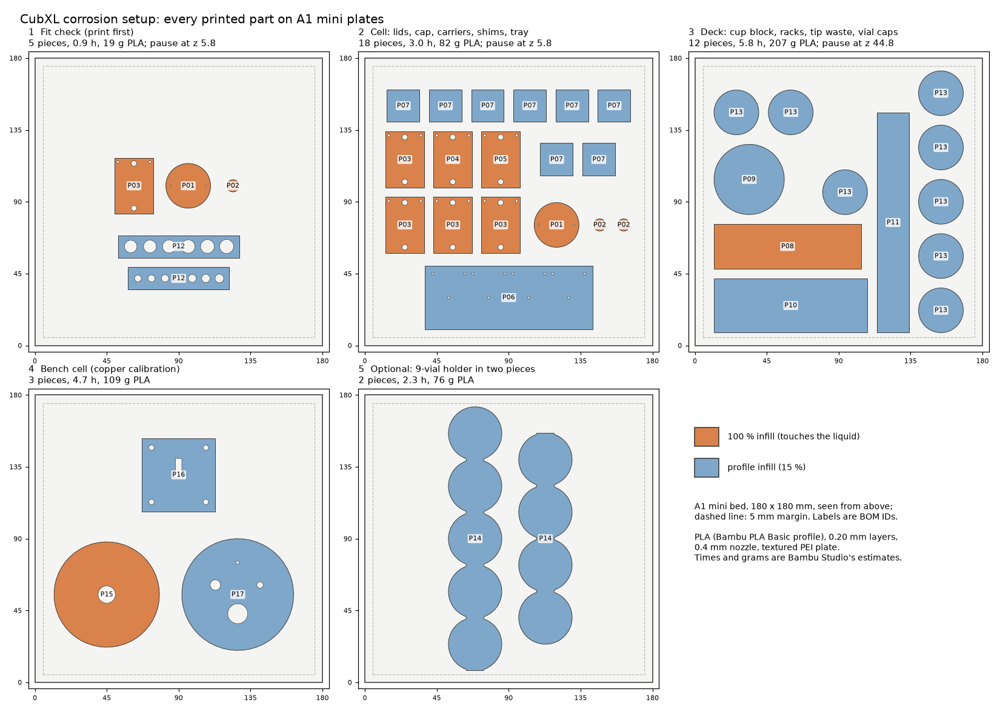

# Printing the corrosion setup on the A1 mini, in PLA

On [#180](https://github.com/vertical-cloud-lab/digital-alloy-lab/pull/180) (2026-11-06) Ben asked
for every printed part of this setup on the A1 mini's build plate, in PLA, split into batches if
they don't all fit. They don't fit on one plate:
- before any spacing, the parts cover about 1.3 of the A1 mini's 180 × 180 mm beds;
- the 9-position vial holder is 297 mm long, more than the bed's 255 mm diagonal.

So they are on **four plates, plus an optional fifth**. Each plate is laid out, checked and sliced
for the A1 mini by [`make_plates.py`](make_plates.py). **Nothing has been printed yet.** Times and
grams are Bambu Studio's estimates.



| Plate | On it | Time | PLA | Magnet pause | When to print |
| --- | --- | --- | --- | --- | --- |
| [1 Fit check](plate1-fit-check.gcode.3mf) | 1 well lid (P03), 1 electrode cap (P01), 1 carrier (P02), both fit strips (P12) | 0.9 h | 19 g | 0.6 h in: 2 magnets | first |
| [2 Cell parts](plate2-cell.gcode.3mf) | 4 more P03 lids, the 008 and 010 lids (P04, P05), the second cap, 2 more carriers, 8 shims (P07), the coupon tray (P06) | 3.0 h | 82 g | 1.8 h in: 12 magnets | once plate 1's cap slides over its lid |
| [3 Deck parts](plate3-deck.gcode.3mf) | cup block (P08), tube rack (P10), tip rack (P11), tip waste cup (P09), 8 vial caps (P13) | 5.8 h | 207 g | 5.2 h in: 6 magnets | once plate 1's fit strips have picked the rack holes |
| [4 Bench cell](plate4-bench-cell.gcode.3mf) | body (P15), clamp plate (P16), cover (P17) | 4.7 h | 109 g | none | any time |
| [5 Optional](plate5-vial-holder-optional.gcode.3mf) | the 9-position vial holder (P14), cut in two | 2.3 h | 76 g | none | only if the deck has no holder yet |
| **Plates 1–4** | every part the BOM asks for | **14.3 h** | **417 g** | **20 magnets** | |

All five plates together take 16.6 h and 494 g, so one 1 kg spool is enough. Plates 1 and 2
together give the BOM's quantities: 5 + 1 + 1 lids, 2 caps and 3 carriers. The fallback O-ring
cap (P18) isn't on any plate, since the BOM's quantity for it is 0.

## Printing a plate

Each plate comes as two files:
- `plateN-….gcode.3mf` is already sliced. Open it in Bambu Studio and press *Print plate*, or
  copy it to the A1 mini's microSD card.
- `plateN-….3mf` is the Bambu Studio project it was sliced from. Open it to change something,
  then slice and print. It keeps the per-part infill, the scarf seams and the pause.

They were sliced in Bambu Studio 02.09.01.70 with these settings:
- printer: A1 mini, 0.4 mm nozzle;
- plate: textured PEI, at 65 °C;
- filament: the *Bambu PLA Basic* profile, at 220 °C;
- process: *0.20mm Standard @BBL A1M*.

If you use a different plate or PLA, open the project, pick yours, and slice again. The sliced
files carry no preview picture, because the slicer ran without a display.

**The pauses.** The printer stops by itself (Bambu's `M400 U1`) just before the layer that
closes the magnet pockets:

| Plate | Pause | Pockets | Magnets |
| --- | --- | --- | --- |
| 1 and 2 | before the z 5.8 layer | lid pockets, Ø4.1 × 2.1 mm, under the boss | two per lid |
| 3 | before the z 44.8 layer | cup block pockets | two per cup |

At the pause:
1. Drop a 4 × 2 mm magnet (B08) into each pocket, **same pole up in every part**.
2. Make sure each magnet sits fully down, and fix it with a small drop of cyanoacrylate so the
   nozzle can't pull it out.
3. Press *Resume*.

The plate-3 pause comes near the end, so time that print for when someone is there.

## After plate 1: the fit checks

1. **Cap over boss.** The cap's skirt (bore Ø16.24) should slide over the lid's Ø16.0 boss by
   hand with slight play. That 0.12 mm clearance is what the build guide asks you to calibrate.
   - If it binds, open plates 1 and 2 in Bambu Studio and give the cap a small positive *X-Y hole
     compensation* (for example 0.05 mm), or the lid a small negative *X-Y contour
     compensation*. Then reprint the cap and lid.
   - If it rattles, do the opposite.
2. **Carrier in cap.** The carrier's Ø5.95 plug should press into the cap's Ø6.0 socket and stay
   there.
3. **Fit strips.** Each strip's holes run from smallest to largest, left to right as printed:
   tube 7.8 → 8.8 mm, tip 4.2 → 5.4 mm, in 0.2 mm steps. Mark the small end before taking them
   off the plate. Pick the hole that holds a real 0.5 mL tube, or a real 20 µL tip, by its collar
   without play ([`../README.md` §1](../README.md#1-what-to-print), item 2).
   - Plate 3's racks are drawn with 8.2 mm tube holes and 5.0 mm tip holes.
   - If the strips pick other sizes, set `TUBE["hole_d"]` or `TIP["hole_d"]` in
     [`../cad/cad_build_parts.py`](../cad/cad_build_parts.py) and rerun it (CadQuery). Then rerun
     `make_plates.py` to lay out and slice plate 3 again.
   - If the file for Ben's tip rack 1 exists, print another of those instead of P11 (BOM).
4. **The lid's counterbore ceiling,** where the O-ring seals, is a short bridge. If it came out
   rough, face it flat ([`../../build-guide.md` §2](../../build-guide.md#the-well-lids-p03p05)).

The rest of the post-processing and assembly is in
[`../../build-guide.md` §2](../../build-guide.md#2-post-process-and-assemble): the reference bore,
the pin holes, the steel slugs, the heat-set inserts, and the pads.

## What differs from the BOM

1. **PLA, not PETG.** The BOM asks for PETG wherever a part touches the liquid. These plates are
   all PLA, as asked. With PLA:
   - **Keep the parts cool.** PLA softens at about 55–60 °C, so no hot water, dishwasher or
     drying oven. Rinse in DI water at room temperature.
   - **Watch the fits.** PLA takes up water slowly. After the cell parts have soaked for weeks,
     check the cap's fit on the boss and the lids' counterbores, and reprint any that have
     changed.
   - **Use a plain PLA:** white, black or natural.
     - Not blue or green: their pigment is usually copper phthalocyanine, and copper is what
       the ICP-MS measures.
     - Not metallic or silk-effect PLA.
     - The PTFE blank on S4 shows whether a lid adds metal to the wells, but it is simpler not
       to add any.
2. **100 % infill only where the BOM asks for it:**
   - the lids, the caps and the carriers;
   - the cup block (the BOM asks for four walls around the bores; this is solid);
   - the bench cell body.

   Everything else uses the profile's 15 %.
3. **0.20 mm layers, not 0.12–0.16 mm.** At 0.20 mm, every key height falls on a layer boundary:
   the lid's 1.40 mm counterbore, its neck at 1.60–2.00 and its pocket tops at 5.6, and the cup
   block's pocket tops at 44.6. At 0.12 mm the neck's 1.60 falls inside a layer; at 0.16 mm none
   of them lands on a boundary.
4. **The racks print upside down,** hole plate on the bed. That way their holes form on the bed,
   as the fit strips' holes do, so the strip's answer carries over to the rack. The solid base is
   bridged at the top instead: 16 mm across inside the tip rack, and about 44 mm between the tube
   rack's walls. The deck heights don't change.
5. **Scarf seams on the lids and caps.** The CAD README asks for no seam on the boss, since the
   cap slides on it. A round boss always has a seam, so these parts use Bambu Studio's scarf seam
   (`seam_slope_type = all`), which keeps the seam flat. Feel the boss after printing, and sand
   off any bump.
6. **The vial holder is cut in two.** PANDA-BEAR's
   [`9VialHolder20mL_TightFit.step`](https://github.com/vertical-cloud-lab/byu-vcl/blob/f1b4666/modules/electromagnetic-capper/cad/9VialHolder20mL_TightFit.step)
   is one 297.4 mm piece.
   - Plate 5 cuts it through the web between positions 5 and 6, into a 165.2 mm piece and a
     132.2 mm piece.
   - Butt the two end to end at x 318 on the deck: the vials stay at a 33 mm pitch. Tape them
     down like the other deck parts.
   - To have it in one piece, print the original on a larger printer, such as the H2D.

## Before you start

- A 1 kg spool of plain PLA. Plates 1–4 use 417 g.
- 20 magnets, 4 × 2 mm (B08): 2 for plate 1, 12 for plate 2, 6 for plate 3. Also cyanoacrylate.
- For assembly afterwards: the steel slugs (B10), the heat-set inserts (B13), the pins and the
  foil, all in [`../README.md` §2](../README.md#2-what-to-buy).

## How the plates were made

[`make_plates.py`](make_plates.py) does the following:
1. Loads each part's STL from `../cad/` and `../../copper/cad/`, and meshes PANDA-BEAR's two STEP
   files.
2. Turns each part to its print orientation (the *on the bed* column of
   [`plates.json`](plates.json)) and places it on its plate.
3. Checks the layout:
   - every part is at least 5 mm inside the bed edge and at least 5 mm from its neighbours (the
     closest pair is 6 mm);
   - in the meshes, the magnet pockets close exactly at the pause heights.
4. Writes the project for each plate:
   - 100 % infill and scarf seams set per part;
   - the pause in `Metadata/custom_gcode_per_layer.xml`.
5. Slices each project and sets the printer model to `N1` (the A1 mini; the command-line slicer
   leaves it blank).
6. Reads the G-code back and checks it:
   - one pause per plate that needs one;
   - every extrusion on the bed;
   - at each magnet pocket, the last layer before the pause stays clear (nearest extrusion 2.25 mm
     from the pocket's centre, which is the wall around the Ø4.1 mm pocket), and the first layer
     after it covers the pocket (0.19 mm).

The results are in [`plates.json`](plates.json), and the drawing is [`plates.png`](plates.png).

```bash
# PANDA-BEAR's vial cap and vial holder, from byu-vcl at f1b4666
mkdir -p /tmp/capper-cad
for f in VialCap16mm.step 9VialHolder20mL_TightFit.step; do
  gh api "repos/vertical-cloud-lab/byu-vcl/contents/modules/electromagnetic-capper/cad/$f?ref=f1b4666" \
    -H "Accept: application/vnd.github.raw" > /tmp/capper-cad/$f
done
# sha256: VialCap16mm.step ca8706ab…cb322, 9VialHolder20mL_TightFit.step cbc3cc53…90099

# Bambu Studio for Linux: the BambuStudio_ubu24-v02.09.01.70 AppImage from
# github.com/bambulab/BambuStudio/releases, unpacked; it slices without a display
cd /tmp/bambu && ./BambuStudio_ubu24-v02.09.01.70-*.AppImage --appimage-extract
sudo apt-get install -y libwebkit2gtk-4.1-0 libjavascriptcoregtk-4.1-0 \
  libgstreamer-plugins-base1.0-0 libwayland-server0
pip install trimesh cascadio shapely matplotlib numpy

python make_plates.py --capper-cad /tmp/capper-cad                                    # layout, checks, plates.png
python make_plates.py --capper-cad /tmp/capper-cad --bambu /tmp/bambu/squashfs-root   # and the .3mf / .gcode.3mf files
```

To move a part, edit its line in `PLATES` and rerun: the checks fail if it ends up too close to
the edge or to another part. A full run takes about a minute.

## Licence of the PANDA-BEAR parts

Plates 3 and 5 contain meshes of two files from the
[electromagnetic capper module](https://github.com/vertical-cloud-lab/byu-vcl/tree/f1b4666/modules/electromagnetic-capper):
`VialCap16mm.step` and `9VialHolder20mL_TightFit.step`. They come from BU-KABlab's PANDA-BEAR and
are GPL-2.0-or-later, not this repo's MIT. [`LICENSE-GPL-2.0.txt`](LICENSE-GPL-2.0.txt) and
[`NOTICE.txt`](NOTICE.txt) are copied here unchanged from that module. The only change made here
is plate 5's cut of the holder in two (2026-11-06).
