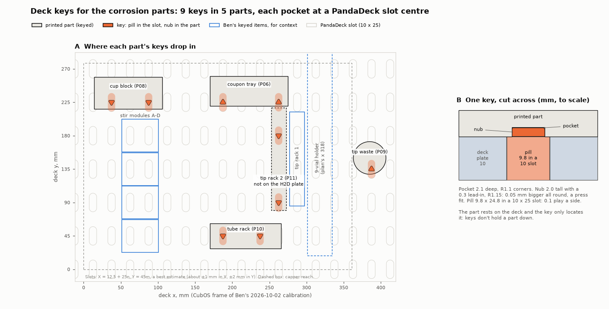

# Deck keys for the corrosion parts

On [#180](https://github.com/vertical-cloud-lab/digital-alloy-lab/pull/180) (2026-11-09) Ben asked for
key slots under every printed part that goes on the CubXL deck, with matching deck keys, using the
press fit that worked for the stir modules ([#236](https://github.com/vertical-cloud-lab/digital-alloy-lab/issues/236)).
Every deck part now has them. **Nothing has been printed yet.**



## The key

It is the stir module's key, redrawn in CadQuery from byu-vcl's dimensions
([`hardware/vial-stirrer-cubxl`, "The key nub and pocket"](https://github.com/vertical-cloud-lab/byu-vcl/blob/4d5446c/hardware/vial-stirrer-cubxl/README.md#the-key-nub-and-pocket)).
Its sections match byu-vcl's `stl/deck_key.stl` to within the mesh tolerance.

- **A pill, 9.8 × 24.8 × 10 mm,** long axis along deck Y. It drops into one of the PandaDeck's
  10 × 25 mm slots with 0.1 mm of play a side.
- **On top, a 2.0 mm rounded-triangle nub** that presses into a 2.1 mm pocket under the part. The
  pocket's corners are R1.1. The nub's are R1.15, so it is **0.05 mm bigger all round**. It has a
  0.3 mm lead-in round its top.
- **Dimples** in the pill's top, one per 0.05 mm of press, tell the keys apart.

**0.05 mm, not 0.5 mm.** Ben's comment says 0.5 mm, but the fit test on 2026-10-22 printed keys at
0.05, 0.10 and 0.15 mm a side, and Ben picked
[0.05](https://github.com/vertical-cloud-lab/byu-vcl/blob/4d5446c/hardware/vial-stirrer-cubxl/print/2026-10-22-a1mini-keys/README.md).
0.5 mm a side would not press in.

**That fit was found in PETG on the A1 mini;** these parts are PLA on the H2D. So the H2D plate also
carries one 0.10 and one 0.15 mm key. Try the 0.05 key in a pocket first. If it is loose, try the
other two, and reprint the keys at the size that fits (`KEY_PRESS` in
[`cad/deck_keys.py`](cad/deck_keys.py), then rerun it). A set of keys prints in about 20 minutes.

| Key | File | Nub A / B (mm) | Dimples |
| --- | --- | --- | --- |
| 0.05 mm, to use | [STEP](cad/deck_key.step) · [STL](cad/deck_key.stl) | 6.95 / 7.67 | 1 |
| 0.10 mm, fit test | [STEP](cad/deck_key_fit_0.10.step) · [STL](cad/deck_key_fit_0.10.stl) | 7.05 / 7.77 | 2 |
| 0.15 mm, fit test | [STEP](cad/deck_key_fit_0.15.step) · [STL](cad/deck_key_fit_0.15.stl) | 7.15 / 7.87 | 3 |
| The pocket | in each part | 6.85 / 7.57 | |

A is the span from a corner to the opposite flat, and B is the span across two corners. Print
the keys pill-down, nub up, as the STLs are. The H2D plate prints them solid.

## Where they go

Each pocket is at a slot centre under the part, in the deck frame the part is drawn in, so a keyed
part lands where the deck plan puts it. Pairs are whole slot pitches apart. That makes **9 keys for
the 5 parts**; the H2D plate has 7 of them, since the lab has a tip rack.

| Part | Pockets (deck x, y) | Keys | What changed to make room |
| --- | --- | --- | --- |
| Coupon tray (P06) | (187.5, 225), (262.5, 225) | 2 | **2 mm taller** (below). The pockets are 5 mm from its front edge, so they are turned with a flat toward the edge |
| Cup block (P08) | (37.5, 225), (87.5, 225) | 2 | It sat between two slot rows, so its 3.2 mm base now reaches forward to y 216 |
| Tube rack (P10) | (187.5, 45), (237.5, 45) | 2 | The y 45 row ran under the back row's tube tips, so **the tube rows moved 8 mm back, to y 36 and 54** (rack y 28–62). Base 3 mm |
| Tip waste cup (P09) | (387.5, 135) | 1 | Flange 3.2 mm thick. One key: the cup is round |
| Tip rack 2 (P11) | (262.5, 90), (262.5, 180) | 2 | Now drawn on the slot column one left of Ben's rack 1: A1 (266.75, 89). Base 3.2 mm. Not on the H2D plate |

[`cad/deck_keys.py`](cad/deck_keys.py) checks every pocket in the exported parts:
- it is on a slot centre and empty;
- at least 1.5 mm of the part surrounds it and 0.8 mm covers it;
- the part sits flat on the deck all round it.

All 9 pass ([`cad/deck_keys.json`](cad/deck_keys.json)). The sliced H2D plate confirms the 7 printed
pockets: each is open at mid-depth (the nearest toolpath is 2.85 mm from its centre, the modelled
wall) and roofed above.

### The tray is 2 mm taller

The P75-B1 spring pins (B07) are 16 mm long, not the 11 mm the CAD had drawn
([`../build-animation/parts-check.md`](../build-animation/parts-check.md)). With its tip 1 mm above
the pocket floor, a working-electrode pin's tail ended 1 mm below the tray's underside. On 11-09 the
fix was "give the tray 2 mm feet". Feet would have lifted the pockets off the keys, so instead **the
whole tray is 2 mm taller**, with a flat underside:

- The pocket floors are at deck z 16, so **the coupon face is at z 22**. The lid top is at 28 and the
  boss top at 32. With the cap seated, its flange is at 40 and its disc top at 44.
- Each WE pin's tail now ends 1 mm above the deck, inside its bus channel.
- The channel is 2 mm deeper under each pad pin, so a pad pin's tail sits 1.5 mm up its hole, as
  before.
- The CAD now draws the pins at 16 mm.

The deck checks were rerun with the new heights and the moved tube rack (below). The copper deck
still has no problems in 118 tool-down events, the aluminium deck in 99, and the stirrer deck in 124.
All 24 staged well fills pass.

## Fitting them

1. **Press a key into each pocket** with the nub's triangle matching the pocket's. The tray's
   pockets are turned 180° from the others, so its keys go in the other way round. That changes
   nothing in the slot, since the pill is symmetric.
2. **Lower the part so its keys drop into their slots.**
3. **Hold the tray and the cup block down as well (see below).** The tube rack, the tip waste and
   the tip rack need nothing more.
4. **Teach every position** once the parts are in: the stations, cups, tubes, tip racks and tip
   waste. The slot grid's place in Ben's coordinates is an estimate (below), so a part can land up to
   about 2 mm from its planned spot. After that, it goes back to the same place every time.

### Keys don't hold a part down

The pill sits loose in its slot. Only the part's weight keeps it on the deck. That is enough for every
part except the two that the electrode cap's magnets pull on:

| | Weight, loaded (N) | Tips up when the cap pulls above (N) | The cap pulls (N) |
| --- | --- | --- | --- |
| Coupon tray, with 3 Cu–Ni coupons, the PTFE blank, 4 lids and screws | 1.35 | 0.79 at S1 or S4, 1.09 at S2 or S3 | 1.03–1.72 |
| Cup block, rinse cups full | 0.96 | 0.58 at the park cup, 0.96 at rinse 1 | 1.03–1.72 |

The pull is the two hold-down magnets (1.62–2.31 N, estimated in
[`../copper/cad/cad_check.json`](../copper/cad/cad_check.json)) less the cap's two 30 gf spring pins.
The weights are estimates: the PLA parts from their CAD volumes, and the loads from the BOM.

**So keep the double-sided tape the build guide already called for, under the tray and the cup
block:**
- **Thin tape only, 0.15 mm or less** (for example 3M 468MP). Thicker foam tape would lift the
  pockets off the nubs and raise the coupon face.
- **Keep it clear of the pockets.**
- The keys then set where the part goes, and the tape holds it there.

Bench test 1 in the build guide measures the real pull. The alternatives are:
- about 170 g of ballast in the tray, or 190 g in the cup block;
- a key that hooks under the plate, like PANDA-BEAR's `Pill_Slider` and `PillRetainingPin`. This
  hasn't been drawn.

## Where the slot grid is

**Updated 2026-11-10: rack 1's key pockets now set the grid, at X = 12.45 + 25n, Y = 43.13 + 45m**
([`tip-rack-1.md`](tip-rack-1.md)). That is 1.87 mm in front of the estimate below. The parts are still
drawn on the estimate. Each lands 1.87 mm forward of its drawn position, and nothing needs reprinting.
The rest of this section is the original estimate.

The PandaDeck's slots are on a 25 mm (X) × 45 mm (Y) grid ([Cubware `PandaDeck.step`](https://github.com/Ursa-Laboratories/Cubware/blob/352aa95/cubxl_plus/deck/polycarbonate_deck/PandaDeck.step)).
Nobody has measured where that grid sits in the CubOS frame of Ben's 2026-10-02 calibration. Three
keyed things he taught place it:

| Taught | What it says about the slots | Slot X, mod 25 | Slot Y, mod 45 |
| --- | --- | --- | --- |
| 10-02 deck: vial_1 of the 9-vial holder at (136.668, 45) | Cubware's `9VialHolder.step` has a key pocket right under its first vial | 11.67 | 0 |
| Tip rack 1, A1 (291.332, 89) and A2 (282.832, 89) | Cubware's `TipRack.stl` has two pockets 90 mm apart, 0.86 mm past its A1 row. Tip pick-up needs about 1 mm, so this is the most precise of the three | 12.45 | 43.1 |
| 11-05 stir-module trial: the stirred vial at (126, 45) | The compact stirrer's keys are 12.5 mm either side of its vial, on its row | 13.5 | 0 |

**The parts use X = 12.5 + 25n and Y = 45m.** That is within 1 mm of all three in X, and within 2 mm
in Y. A part keyed onto the real grid ends up where its pockets say. If the estimate is off, every new
part is off by the same amount, so teach the positions after the parts go in. To pin the grid down,
jog the pipette over two slot centres and set `GRID_X0` and `GRID_Y0` in
[`cad/deck_keys.py`](cad/deck_keys.py).

## Two things this turned up about Ben's own items

- **Ben's tip rack 1 is very likely Cubware's
  [`TipRack.stl`](https://github.com/Ursa-Laboratories/Cubware/tree/352aa95/cubxl_plus/labware/tip_rack_holder).**
  His deck file names it `panda_2x15_tip_rack`, Cubware's model name. The STL is 138 × 21 × 66 mm
  with 2 × 15 holes at 8.5 mm, and it already has two key pockets. The build guide asked whether the
  file for rack 1 exists: this is probably it. A second copy would be a keyed rack 2 that fits like
  rack 1, so print it instead of P11. Check rack 1's underside for two triangular pockets 90 mm apart.
  **2026-11-10:** Ben's rack 1 is the Onshape document "20uL tip rack": Cubware's rack with Ben's
  20 µL bores from byu-vcl#151. His current version, which adds a window in each side wall, is
  [`cad/tip_rack_1_20ul.step`](cad/tip_rack_1_20ul.step) ([`tip-rack-1.md`](tip-rack-1.md)).
- **If the 9-vial holder has its keys in, it can't sit at the plan's x 318.** The nearest slot
  columns are x 312.5 and 337.5.
  - At 312.5 it would overlap tip rack 1 by about 1.3 mm.
  - At 337.5, with vial 1 on the y 45 row, its vials are at y 45 + 33k. The stirrer deck's
    tool-shadow check still finds no problems there (124 events; a what-if, not committed).

  Teach the holder where it actually lands.

## Files

| File | What |
| --- | --- |
| [`cad/deck_keys.py`](cad/deck_keys.py) | The key, the pockets, the slot grid, the pocket checks and the hold-down estimate. Writes the key STEP/STLs and [`cad/deck_keys.json`](cad/deck_keys.json) |
| [`cad/plot_deck_keys.py`](cad/plot_deck_keys.py) | Draws [`cad/deck-keys.png`](cad/deck-keys.png) |
| [`cad/cad_build_parts.py`](cad/cad_build_parts.py), [`../copper/cad/cad_cu_cell.py`](../copper/cad/cad_cu_cell.py) | Cut the pockets, from `deck_keys.POCKETS` |
| [`h2d/`](h2d/README.md) | The H2D plate, with the keys, re-sliced |

```bash
cd alloy-corrosion/copper/cad && python cad_cu_cell.py   # the tray (and the rest of the cell)
cd ../../bom/cad && python cad_build_parts.py            # cup block, tube rack, tip waste, tip rack
python deck_keys.py                                      # the keys, and the checks on every pocket
python plot_deck_keys.py                                 # deck-keys.png
cd ../h2d && python make_h2d_plate.py --bambu /tmp/bambu/squashfs-root
```
