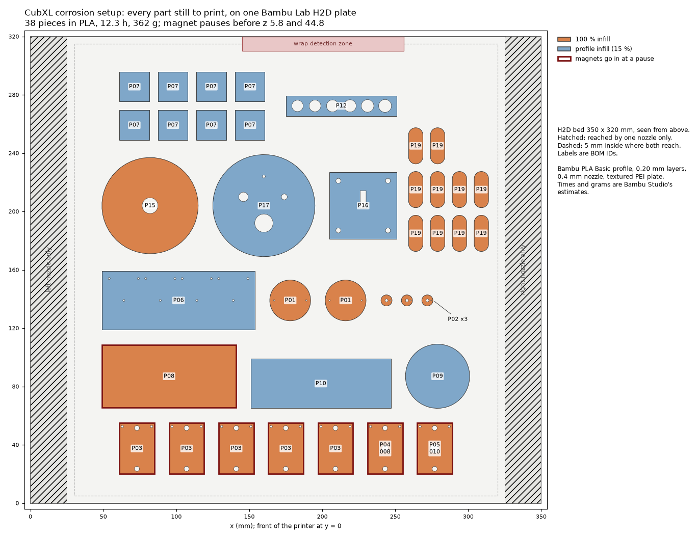

# Printing the corrosion setup on the H2D: one plate, in PLA

On [#180](https://github.com/vertical-cloud-lab/digital-alloy-lab/pull/180) (2026-11-06) Ben asked
whether all the parts would print at once on the H2D. He left out what the lab already has: the vial
caps, a tip rack, the stir modules and a vial rack. **Everything else fits on one H2D plate:** 38
pieces, laid out, checked and sliced by [`make_h2d_plate.py`](make_h2d_plate.py). **Nothing has been
printed yet.** Times and grams are Bambu Studio's estimates.

**Re-sliced 2026-11-09 with deck keys** ([`../deck-keys.md`](../deck-keys.md)), for Ben on #180:
- the tray, cup block, tube rack and tip waste cup now have key pockets underneath;
- the tray is 2 mm taller;
- ten keys are on the plate: seven to fit, a spare, and one each of 0.10 and 0.15 mm to test the fit.

It was 28 pieces, 11.4 h and 326 g.



| | |
| --- | --- |
| **Print this** | [`h2d-corrosion-all.gcode.3mf`](h2d-corrosion-all.gcode.3mf), already sliced |
| **To change something** | the Bambu Studio project [`h2d-corrosion-all.3mf`](h2d-corrosion-all.3mf) |
| Pieces | 38 |
| Time | **12.3 h** |
| PLA | **362 g** (120 m) |
| Pause 1 | before the z 5.8 layer, **4.2 h in**: 14 magnets, two in each of the 7 lids |
| Pause 2 | before the z 44.8 layer, **10.4 h in**, with 1.9 h left: 6 magnets in the cup block |
| Nozzle | sliced for the right nozzle; the left one also works (checked) |

**Start it in the morning.** The second pause comes 10.4 h in. Started at 7:00, the print reaches pause
1 at about 11:15 and pause 2 at about 17:25, and ends at about 19:20. The printer waits at each pause
until someone presses *Resume*.

## What's on the plate

| BOM | Part | Qty | Infill |
| --- | --- | --- | --- |
| P03 | Well lid v2, AS568-006 | 5 | 100 % |
| P04 | Well lid v2, AS568-008 (calibration) | 1 | 100 % |
| P05 | Well lid v2, AS568-010 (calibration) | 1 | 100 % |
| P01 | Electrode cap | 2 | 100 % |
| P02 | Electrode carrier | 3 | 100 % |
| P06 | Coupon tray | 1 | 15 % |
| P07 | Shims, 1 mm and 3 mm | 4 + 4 | 15 % |
| P08 | Cup block | 1 | 100 % |
| P09 | Tip waste cup | 1 | 15 % |
| P10 | Tube rack 2 × 8 | 1 | 15 % |
| P12 | Fit strip for the tube rack's holes | 1 | 15 % |
| P15 | Bench cell body | 1 | 100 % |
| P16 | Bench cell clamp plate | 1 | 15 % |
| P17 | Bench cell cover | 1 | 15 % |
| P19 | Deck key, 0.05 mm press: 7 to fit and a spare | 8 | 100 % |
| P19 | Deck keys, 0.10 and 0.15 mm press, to test the fit | 1 + 1 | 100 % |

These are the BOM's quantities ([`../README.md` §1](../README.md#1-what-to-print)), and the same
parts, orientations and infill as the A1 mini plates.

**Left off, because the lab has them or doesn't need them:**

| BOM | Part | Why |
| --- | --- | --- |
| P11 | Tip rack 2 × 15 (now keyed) | the lab has a tip rack. For a second one, Cubware's `TipRack.stl` is very likely Ben's rack 1 and is already keyed ([`../deck-keys.md`](../deck-keys.md#two-things-this-turned-up-about-bens-own-items)) |
| P12 (tip) | Fit strip for the tip rack's holes | it only sizes P11's holes |
| P13 | Magnetic vial caps (8) | the lab has vial caps |
| P14 | 9-position vial holder | the lab has a vial rack |
| P18 | Fallback electrode cap with an O-ring | the BOM's quantity is 0 |
| | Stir-module prints ([`../../stirrers/BOM.md` §3](../../stirrers/BOM.md#3-print)) | the lab has the stir modules |

## Why it fits

- The H2D's bed is 350 × 320 mm. Each nozzle reaches 325 mm of the width: the left nozzle x 0–325,
  the right one x 25–350.
- The parts' footprints add up to 362 cm², under 40 % of the 300 × 320 mm that both nozzles reach.
- Every part sits at least 5 mm inside the area both nozzles reach, so the plate prints from either
  nozzle. Every part is also clear of the H2D's nozzle-wrap detection zone at the back
  (x 145–256, y 310–320).
- The parts are at least 6 mm apart.
- The tallest part, the bench cell body (P15), is 90 mm, well under the H2D's 325 mm.

The lids are in the front row, so they're easy to reach at the first pause. The cup block is right
behind them, in front of the taller bench cell body, for the second pause.

## Printing it

1. Open [`h2d-corrosion-all.gcode.3mf`](h2d-corrosion-all.gcode.3mf) in Bambu Studio and send it to
   the H2D.
2. When it asks which spool to use, pick a PLA on the **right nozzle's** side.
3. **If your PLA is on the left side,** open the project [`h2d-corrosion-all.3mf`](h2d-corrosion-all.3mf)
   instead, set the filament to the left nozzle, and slice again. I sliced it that way too, as a
   check: 12.3 h, the same 362 g, both pauses in place, and every extrusion inside the left
   nozzle's reach.

It was sliced in Bambu Studio 02.09.01.70 with:
- printer: H2D, 0.4 mm standard nozzles on both sides;
- plate: textured PEI, at 55 °C (the H2D's PLA profile; the A1 mini's is 65 °C);
- filament: the *Bambu PLA Basic* profile, at 220 °C;
- process: *0.20mm Standard @BBL H2D*.

With a high-flow nozzle, a different plate or another PLA, open the project, select yours and slice
again. The project keeps the per-part infill, the scarf seams and both pauses. The sliced file has no
preview picture, because the slicer ran without a display.

**At each pause:**
1. Drop a 4 × 2 mm magnet (B08) into each pocket, **with the same pole up in every part**: 14 in the
   lids at pause 1, 6 in the cup block at pause 2.
2. Make sure each magnet sits fully down, and fix it with a small drop of cyanoacrylate so the
   nozzle can't pull it out.
3. Press *Resume*.

`make_h2d_plate.py` checked both pauses in the sliced G-code. In the last layer before each pause,
the nearest plastic is 2.26 mm from each pocket's centre, which is the wall around the Ø4.1 mm
pocket, so the pocket is still open. In the next layer it is 0.19 mm, so the pocket gets covered.

## After it prints: the fit checks

The A1 mini plan printed a small fit-check plate first. Here everything prints at once, so check the
fits afterwards, and reprint only a part that fails.

1. **Mark the calibration lids before taking them off the plate.** The 008 (P04) and 010 (P05) lids
   are the two at the right end of the front row. From the outside they look like the five 006 lids.
2. **Cap over boss.** Each cap's skirt (bore Ø16.24) should slide over a lid's Ø16.0 boss by hand,
   with slight play.
   - If it binds, open the project, delete everything but the two caps, give them a small positive
     *X-Y hole compensation* (for example 0.05 mm), and reprint them.
   - If it rattles, use a small negative value instead.
3. **Carrier in cap.** The carrier's Ø5.95 plug should press into the cap's Ø6.0 socket and stay
   there.
4. **Tube strip.** Its holes run from smallest to largest, left to right as printed: 7.8 → 8.8 mm,
   in 0.2 mm steps. Mark the small end before taking it off. The tube rack's holes are 8.2 mm.
   - If a different hole holds a real 0.5 mL tube by its rim without play, set `TUBE["hole_d"]` in
     [`../cad/cad_build_parts.py`](../cad/cad_build_parts.py) and rerun it (CadQuery). Then reprint
     only the rack.
5. **The lid's counterbore ceiling,** where the O-ring seals, is a short bridge. If it came out rough,
   face it flat ([`../../build-guide.md` §2](../../build-guide.md#the-well-lids-p03p05)).

6. **The deck keys.** Press a 0.05 mm key (one dimple) into one of the tray's pockets. It should go in
   with thumb pressure and stay in when the tray is lifted.
   - If it is loose, try the 0.10 (two dimples) and the 0.15 (three dimples).
   - Then reprint all the keys at the size that fits: set `KEY_PRESS` in
     [`../cad/deck_keys.py`](../cad/deck_keys.py) and rerun it. A set of keys takes about 20 minutes.
   - The 0.05 mm size was picked in PETG on the A1 mini, not in PLA on the H2D.

To check the fits before committing 12 hours, delete everything in the project except one P03 lid,
one cap, one carrier and the tube strip, and print just those first.

The rest of the post-processing and assembly is in
[`../../build-guide.md` §2](../../build-guide.md#2-post-process-and-assemble).

## PLA, and the other print choices

These are the same as on the A1 mini plates; [`../a1-mini/README.md`](../a1-mini/README.md#what-differs-from-the-bom)
explains each.
- **PLA, not the BOM's PETG.** Keep the parts below about 50 °C: no hot water and no dishwasher.
  Recheck the cap's fit after weeks of soaking. Use plain white, black or natural PLA, not blue or
  green (their pigment is usually copper phthalocyanine, and copper is what the ICP-MS measures), and
  not metallic or silk PLA.
  - To print in PETG instead, pick a PETG profile in the project and slice again. The layer height,
    and so the pause heights, stay the same.
- **100 % infill only where the BOM asks for it:** the lids, caps, carriers, cup block and bench cell
  body.
- **0.20 mm layers,** so that the lid's counterbore, its neck and both pause heights fall on layer
  boundaries.
- **The tube rack prints upside down,** with the hole plate on the bed, like the fit strip. Its key
  pockets are then open at the top of the print. The other parts' pockets are on the bed, under a
  bridged roof; the sliced G-code shows each one open at mid-depth and roofed above.
- **The deck keys print solid,** pill down and nub up, like the four-wall keys of byu-vcl's fit test.
- **Scarf seams on the lids and caps,** because the cap slides on the boss. Feel the boss after
  printing, and sand off any bump.

## How the plate was made

[`make_h2d_plate.py`](make_h2d_plate.py) takes the parts, their print orientations and infill, and
the mesh and G-code checks from [`../a1-mini/make_plates.py`](../a1-mini/make_plates.py). It then:
1. places each part at its line in `ITEMS`;
2. checks the layout: inside where both nozzles reach with a 5 mm margin, clear of the wrap zone, at
   least 5 mm between parts, and each magnet pocket closing exactly at its pause height;
3. checks the bed numbers it uses against Bambu Studio's H2D profile;
4. writes the project, with the infill and scarf seams set per part and both pauses in
   `Metadata/custom_gcode_per_layer.xml`;
5. slices it for the right nozzle (the file to print), and again for the left nozzle as a check;
6. reads the G-code back: two pauses at the right layers, every extrusion inside the nozzle's reach,
   and each pocket open before its pause and covered after it.

The results are in [`plate.json`](plate.json), and the drawing is [`plate.png`](plate.png).

```bash
# Bambu Studio for Linux: the BambuStudio_ubu24-v02.09.01.70 AppImage from
# github.com/bambulab/BambuStudio/releases, unpacked; it slices without a display
cd /tmp/bambu && ./BambuStudio_ubu24-v02.09.01.70-*.AppImage --appimage-extract
sudo apt-get update && sudo apt-get install -y libwebkit2gtk-4.1-0 libjavascriptcoregtk-4.1-0 \
  libgstreamer-plugins-base1.0-0 libwayland-server0
pip install trimesh shapely matplotlib numpy scipy networkx

python make_h2d_plate.py                                   # layout, checks, plate.png
python make_h2d_plate.py --bambu /tmp/bambu/squashfs-root  # and the .3mf and .gcode.3mf files
```

The command-line slicer doesn't know how many nozzles an H2D extruder holds. Without
`--extruder-nozzle-count 1,1 --extruder-nozzle-volume-type Standard,Standard` it stops with "No valid
nozzle found", so the script passes both. A full run takes about a minute and a half.

To move a part, edit its line in `ITEMS` and rerun. The checks fail if it ends up too close to an
edge, to the wrap zone or to another part.

None of the PANDA-BEAR parts (P13, P14) are on this plate, so unlike the A1 mini plates it has no
GPL-licensed meshes.
