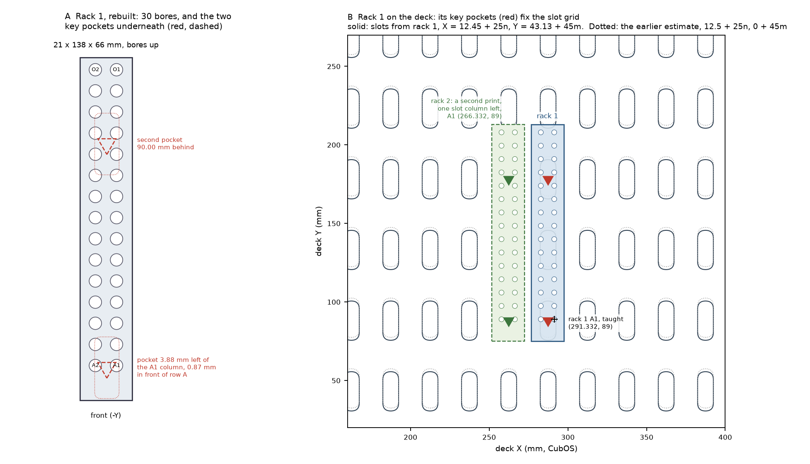

# Tip rack 1: a printable STEP, and where its key pockets put the deck

On [#180](https://github.com/vertical-cloud-lab/digital-alloy-lab/pull/180) (2026-11-10) Ben pointed to the
tip rack on the CubXL now, the Onshape document "20uL tip rack" (vcl-shared > CubXL). He asked for it
as a printable STEP, and for the deck to be placed from where its key pills sit. **Nothing has been
printed or moved.**



## The Onshape document couldn't be opened from the runner

The link redirects to Onshape's sign-in page, and Onshape's API answers 403. The document is private to
the lab's account, and the runner has no Onshape login or API keys. Either of these would let a run
use the document itself:
- **Export it:** in Onshape, right-click the Part Studio tab → *Export* → STEP. Then zip it and attach
  it to a comment, or commit it to this branch.
- **API keys:** an Onshape API key pair stored as repo secrets, and passed to the job in `claude.yml`.
  The runner can't edit workflows, so an admin would have to add them.

## What `cad/tip_rack_1_20ul.step` is

It is a rebuild of the rack that rack 1 was most likely made from:
- **The source:** Cubware's 2 × 15 tip rack for 300 µL tips
  ([`TipRack.stl`](https://github.com/Ursa-Laboratories/Cubware/tree/352aa95/cubxl_plus/labware/tip_rack_holder),
  model name `panda_2x15_tip_rack`, the name Ben's deck files use for rack 1).
- **The bores:** re-bored to Ben's 20 µL profile on
  [byu-vcl#151](https://github.com/vertical-cloud-lab/byu-vcl/issues/151#issuecomment-5148534624) (2026-08-01).
  That re-bore didn't touch the key pockets
  ([byu-vcl `ursa_tip_rack_20ul`](https://github.com/vertical-cloud-lab/byu-vcl/tree/f25e2ed/hardware/cubxl/ursa_tip_rack_20ul)).

[`cad/tip_rack_1.py`](cad/tip_rack_1.py) measured the dimensions from Cubware's mesh and drew a clean
CadQuery solid from them; no mesh is copied. Cubware has no licence file.

| | |
| --- | --- |
| Envelope | 21 × 138 × 66 mm: an 18 mm tip plate, two 2 mm side walls and a 5 mm base, open at both ends |
| Bores | 2 columns × 15 rows at 8.5 mm. Each tapers Ø5.0 → Ø4.6 over 16 mm from the top, then a Ø3.1 exit bore for the last 2 mm |
| Rows | Row A is 14 mm from the front end and row O is 5 mm from the back. A1 is the right-hand column |
| Key pockets | Two, 90.00 mm apart, each with a corner toward the front. The front one is 0.87 mm in front of row A, and 3.88 mm left of the A1 column (0.37 mm right of the rack's centreline) |

**It matches byu-vcl's `TipRack20uL.stl` to 31 mm³ out of 81,100 (0.04 %).** The differences are:
- the bore facets;
- the pockets. They are this branch's standard deck-key pocket, about 0.06 mm larger all round and
  0.05 mm deeper than Cubware's, so the 0.05 mm deck keys
  ([`deck-keys.md`](deck-keys.md)) press into it as they do into every other part.

`tip_rack_1.py` also checks the solid: one valid solid, all 30 bores open and walled at Ø5.0, at mid-taper,
at Ø4.6 and at Ø3.1, and both pockets empty.

**Print it** base down, bores up, with no supports. The plate bridges the 17 mm cavity. Any 0.2 mm
PLA or PETG profile works.

**Before you trust it, check it against the Onshape document or the rack on the deck:**
- the overall size, 21 × 138 × 66 mm;
- the bores, Ø5.0 at the top;
- row A, 14 mm from its end of the rack;
- the pocket centres underneath, 13.1 mm from the row-A end and 34.9 mm from the other end.

If any of these differ, send the Onshape export (above). Then both the STEP and the grid below get
redone from it.

## Where the slots are

Rack 1's taught A1 (291.332, 89) and A2 (282.832, 89) are unchanged from 2026-10-02 to the 11-05
stir-module deck ([byu-vcl `stir_module_trial.yaml`](https://github.com/vertical-cloud-lab/byu-vcl/blob/88fc07a/cubos/configs/deck/stir_module_trial.yaml)).
With the rack's geometry, they put its pockets, and so two slot centres, at **(287.45, 88.13) and
(287.45, 178.13)** in CubOS coordinates. So:

**The slots are at X = 12.45 + 25n, Y = 43.13 + 45m.** Rack 1 itself spans x 276.58–297.58,
y 75–213.

- **The earlier estimate in [`deck-keys.md`](deck-keys.md#where-the-slot-grid-is) was X = 12.5 + 25n,
  Y = 45m.** X was right to 0.05 mm. Y was 1.87 mm too far back.
- **Rack 1 is the better reference.** Tip pick-up only works to about 1 mm. The two keyed vials that
  pointed to Y = 45m were both taught at exactly y 45, on 28 mm vials, where 2 mm makes no difference.

## Where the rest of the deck sits

Every keyed part was drawn on the earlier grid. **So each one lands 1.87 mm further forward (−Y) and
0.05 mm further left than its planned coordinates.** The parts themselves don't change: nothing needs
reprinting or re-slicing. Only the coordinates in the CubOS deck file change. On the stirrer deck
([`../stirrers/README.md`](../stirrers/README.md)):

| Keyed part | Planned (CubOS x, y) | Lands at |
| --- | --- | --- |
| Wells S1–S4 | 185 / 210 / 235 / 260, y 240 | 184.95 / 209.95 / 234.95 / 259.95, y **238.13** |
| Cups: rinse 2, rinse 1, park | (30, 245), (60, 245), (90, 245) | (29.95, **243.13**), (59.95, 243.13), (89.95, 243.13) |
| ICP-MS tubes | x 176 + 12k, y 36 / 54 | x 175.95 + 12k, y **34.13 / 52.13** |
| Tip waste | (385, 150) | (384.95, **148.13**) |
| Stirred vials A–D | x 76, y 45 / 90 / 135 / 180 | x **74.95**, y 43.13 / 88.13 / 133.13 / 178.13 |
| Tip rack 2, a second print of this rack keyed one column left | A1 (266.33, 89) | A1 **(266.332, 89)**, A2 (257.832, 89), exactly |
| Tip rack 1, the 9-position holder | taught | unchanged |

- **The stirred vials move 1.05 mm in X, not 0.05.** Their planned x 76 came from the stirrer Ben taught
  at x 126, not from the grid. Keyed, a stirrer's vial sits midway between two slot columns, at
  x 74.95 + 25n.
- **Print rack 2 from this STEP rather than P11.** Keyed one slot column left of rack 1, its A1 lands at
  exactly rack 1's minus 25 mm. P11's pockets are 1.0 mm behind its row A, so it would land with A1 at
  (266.70, 87.13).
- **Teach every position once the parts are in,** as before. These numbers say where to start jogging.

**The deck check, rerun with this placement** (`deck_check()` in `tip_rack_1.py`):
- Every keyed part was moved onto rack 1's grid.
- Both racks were drawn at their real outline. They reach 10 mm further forward than the earlier
  drawing, to y 75, not 85.

| Check | Result |
| --- | --- |
| Rigid-head check, 124 tool-down events | **0 problems** |
| Staged well fills | **24 of 24 pass**. The tip comes no closer than 32.1 mm to a capped vial's axis (keep-out 24 mm), and a carried cap no closer than 34.0 mm (keep-out 28) |
| Unstaged fills, for comparison | 3 of 24 pass, as before. Keep staging |

## Files

| File | What |
| --- | --- |
| [`cad/tip_rack_1_20ul.step`](cad/tip_rack_1_20ul.step), [`.stl`](cad/tip_rack_1_20ul.stl) | The rack, in print orientation |
| [`cad/tip_rack_1.py`](cad/tip_rack_1.py) | Builds and checks the rack, places it from the taught A1/A2, finds the grid, reruns the deck check, and draws the figure |
| [`cad/tip_rack_1.json`](cad/tip_rack_1.json) | All of the numbers above |
| [`cad/tip-rack-1.png`](cad/tip-rack-1.png) | The figure |

```bash
cd alloy-corrosion/bom/cad
python tip_rack_1.py                                # STEP/STL, JSON, figure (CadQuery 2.8, matplotlib)
python tip_rack_1.py --measure TipRack.stl          # re-measure Cubware's mesh (trimesh, shapely, networkx)
python tip_rack_1.py --compare TipRack20uL.stl      # compare with byu-vcl's 20 uL mesh (also manifold3d)
```
