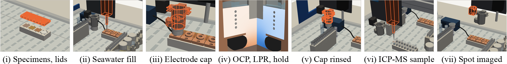
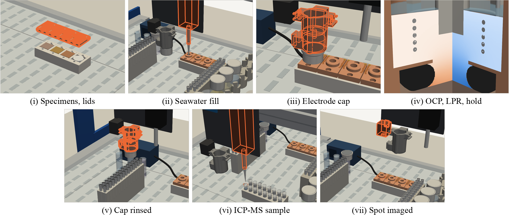

# Keyframes of the copper spot animation, for print

Seven moments from [`../cubxl-cu-spot.mp4`](../cubxl-cu-spot.mp4), the one-spot copper corrosion
workflow on the CubXL, laid out as a reel for the ONR YIP proposal's Equipment attachment.
Written 2026-10-28 for Sterling's request on
[#180](https://github.com/vertical-cloud-lab/digital-alloy-lab/pull/180).

[`make_keyframes.py`](make_keyframes.py) re-renders each moment with
[`../render_cubxl_cu.py`](../render_cubxl_cu.py)'s own scene, deck state and camera, at 2560 × 1440
(twice the video's size) and without the video's text: the top bar, the "working now" panel, the
caption, the tool labels, and the plot and colour bars in the close-up. The orange outline and
the orange ring are the animation's own. They mark the tool that is working and its target.
The reel then crops each frame around the work and adds one line of text.

**This is a proposal. Nothing in it has been printed, bought or tested** (see
[What is not built yet](#what-is-not-built-yet)).





| File | What |
| --- | --- |
| [`reel.png`](reel.png) | One strip, 1950 × 249 px: 6.5 × 0.83 in at 300 dpi. Seven 0.89 in panels |
| [`reel_2rows.png`](reel_2rows.png) | The same panels, four over three: 1950 × 824 px, 6.5 × 2.75 in at 300 dpi |
| [`frames/`](frames/) | The seven full frames, 2560 × 1440, no text |
| [`keyframes.json`](keyframes.json) | Each panel's MP4 frame, time, sub-step and crop |
| [`check_vs_mp4.json`](check_vs_mp4.json) | Each moment, re-rendered with the video's text, against the MP4 frame |
| [`make_keyframes.py`](make_keyframes.py) | Makes all of the above |

Labels are Times New Roman at 8 pt (33.3 px at 300 dpi), one line per panel. The widest, (iv),
is 3 px (0.01 in) wider than its 268 px panel in the one-strip reel. The nearest two labels are
still 24 px apart.

## The panels

Times are in the 142 s video at 30 fps (time = frame / 30). The sub-step is the script's own
caption for that stretch of the video (the numbered steps of `build_story()`), or the placement
label in the chapter where the modules are placed. The action is the tool label the video shows
at that frame.

| Panel | Line | MP4 frame (time) | The script's sub-step | What is happening |
| --- | --- | --- | --- | --- |
| (i) | Specimens, lids | 449 (14.97 s) | "Placing the modules" chapter: deck module 4 of 14, "Well lids, FKM O-rings", coming down onto module 2, "Specimens: Cu–Ni, NAB, DED", and module 3, "PTFE blank on S4" | The four lids, lit, are halfway down onto the coupon tray. The three specimens and the PTFE blank show beneath them |
| (ii) | Seawater fill | 2236 (74.53 s) | 2 "The capper lifts the seawater cap; the P20 builds the well from 135 µL of ASTM D1141 seawater (7 transfers)" | P20 pipette: "dispenses into well S1, above the meniscus". The capper holds the seawater vial's cap |
| (iii) | Electrode cap | 2805 (93.50 s) | 5 "The capper carries the electrode cap (leak-free Ag/AgCl, Pt coil) from its park cup and sets it over S1's boss: 0.12 mm clearance, no O-ring, two small lid magnets hold it" | Capper: "sets the cap over S1's boss". The cap is seated and the magnet is still down |
| (iv) | OCP, LPR, hold | 3154 (105.13 s) | 6 "Measured with the cap on: OCP 30 min, LPR ±10 mV, rest 5 min, +50 mV hold 10 min, OCP 5 min. The head is free meanwhile" | Potentiostat: "OCP, LPR, hold: the head is free". A cut-away of well S1 at 51.3 simulated minutes, in the last OCP after the hold. The video labels the parts as the 2 mm Ag/AgCl capillary (grey, centre), the Pt coil (the dots), the FKM O-ring squeezed 21 % (black) and the C71500 specimen. The left cut face shows dissolved Cu, the right one O₂ |
| (v) | Cap rinsed | 3254 (108.47 s) | 7 "The magnet lifts the cap off S1 (about 2.4 N against the lid magnets); it is dipped in DI water, then seawater, and parked" | Capper: "dips the cap in DI water" |
| (vi) | ICP-MS sample | 3510 (117.00 s) | 8 "A new tip moves the 150 µL, then a 150 µL DI rinse, into tube 1 for ICP-MS" | P20 pipette: "dispenses into tube 1" |
| (vii) | Spot imaged | 3867 (128.90 s) | 10 "The head camera images the spot. Next spot: S2" | Head camera: "images the spot". It sits above S1, which is ringed |

**Left out of the reel:**
- Sub-step 1, picking up a tip.
- 3, the sulfide spike. In print it looks like (ii).
- 4, the camera's leak check. It looks like (vii).
- 9, acidifying tube 1 with 20 µL of 1 M HNO₃. It looks like (vi).
- The video's photo, its before-the-night and after-the-night cards, and its outro. They are 2D, so there is no scene to re-render.

**EIS is not in the animation.** Its electrochemistry is OCP, LPR, a +50 mV hold and OCP again
([`../protocol.md`](../protocol.md)). Panel (iv) is labelled with what the video shows.

## What is not built yet

The whole video is marked "proposal, not built", and the
[build guide](../../build-guide.md) says nothing has been printed, bought or tested. Every deck
position is a proposal in the frame of Ben's 2026-10-02 calibration, still to be re-jogged. Per
panel:

| Panel | Exists on the real CubXL | Not built, or drawn differently from the plan |
| --- | --- | --- |
| all | The PROVerXL 4030 V2 frame and gantry, the P20 pipette, the head camera and the electromagnetic capper ([BOM](../../bom/README.md#3-already-on-hand-borrowed-or-shared) H01, H02), and Ben's tip rack 1 | The frame, gantry, Z carriage, P20 body and camera are schematic in the video, drawn to the photos' proportions. No CubOS deck file or protocol for this workflow has been written |
| (i) | — | The printed coupon tray, the specimens (C71500, C95800 NAB, DED pads), the PTFE blank and the well lids with FKM O-rings. The lids come down from above because that is how the video places every module. In the plan they are screwed down by hand the evening before (video card 4). The lids drawn are the first design ([`../cad/well_lid.stl`](../cad/well_lid.stl)). The build guide replaces it with the v2 lid ([`../../bom/cad/well_lid_v2_006.step`](../../bom/cad/well_lid_v2_006.step)), which differs only inside the bore, so it looks the same from outside |
| (ii) | The P20 and the capper | The seawater and sulfide stocks. The full 9-position holder at x 318 is printed only if the deck doesn't have one yet (BOM P14). The video shows one aspirate and one dispense. The caption says the well is built from 135 µL in 7 transfers |
| (iii) | The capper | The electrode cap: the printed clearance cap (P01), the leak-free Ag/AgCl reference (not yet quoted), the Pt coil and the pogo pins, the lid's pads and magnets, and the three-wire bus to a potentiostat. The ±0.15 mm decap height has not been jogged |
| (iv) | — | No potentiostat is wired to the CubXL. The bench potentiostat in view, Dr. Porter's EZstat-Pro, runs only from its own Windows PC, and the CubXL's own potentiostat hasn't been chosen. CubOS still needs a linear-sweep technique and scan rates below its 1 mV/s minimum: the LPR runs at 0.167 mV/s ([`../protocol.md`](../protocol.md)). **The colours are simulated** by [`../sim_well_hf.py`](../sim_well_hf.py), not measured. The simulation and this cut-away use the first lid's bore. It hasn't been rerun for the v2 lid |
| (v) | The capper | The DI and seawater rinse cups and the park cup |
| (vi) | The P20 | The printed tube rack and the 0.5 mL tubes. The video shows one pickup from the well and one dispense. The caption's 150 µL plus a 150 µL DI rinse takes several 20 µL transfers. Who runs the ICP-MS isn't settled (BOM H11: a quote) |
| (vii) | The head camera | Imaging the spot is planned, not tried. "Next spot: S2" appears only in the caption. The video ends this spot here |

## Commands

As run on the GitHub Actions runner (Ubuntu 24.04, Python 3.12, PyVista 0.49, VTK 9.7, gmsh 4.15), from the repository root:

```bash
# Python packages, the GL libraries gmsh needs, and Microsoft's core fonts (Times New Roman)
pip install pyvista gmsh matplotlib imageio imageio-ffmpeg numpy pillow
echo "ttf-mscorefonts-installer msttcorefonts/accepted-mscorefonts-eula select true" | sudo debconf-set-selections
sudo DEBIAN_FRONTEND=noninteractive apt-get install -y libglu1-mesa libxcursor1 libxinerama1 libxft2 libxrender1 libgl1 ttf-mscorefonts-installer

# The capper module's three STEP files. render_cubxl_cu.py looks for them in
# modules/electromagnetic-capper/cad/, which stayed in byu-vcl when this folder moved here.
# They are unchanged there since c129db5 (2026-07-02).
mkdir -p /tmp/byu-vcl-capper-cad
for f in 9VialHolder20mL_TightFit PAW-V2-ElectromagnetMount VialCap16mm; do
  curl -sfL -o /tmp/byu-vcl-capper-cad/$f.step \
    https://raw.githubusercontent.com/vertical-cloud-lab/byu-vcl/c129db521599fa86569174ff9fcf4aa205a9cf55/modules/electromagnetic-capper/cad/$f.step
done

cd alloy-corrosion/copper/keyframes
# The frames, both reels and keyframes.json: under a minute
xvfb-run -a -s "-screen 0 2600x1500x24" python make_keyframes.py --capper-cad /tmp/byu-vcl-capper-cad
# Re-render each moment at 1280 x 720 with the video's text and compare it with the MP4's frames
xvfb-run -a -s "-screen 0 2600x1500x24" python make_keyframes.py --capper-cad /tmp/byu-vcl-capper-cad --check
# Change a label or a crop in KEYS, then re-lay out the reels without rendering
python make_keyframes.py --reel-only
```

To choose other moments, `--probe 74.5,93.5` renders full frames at those times (s) to
`/tmp/kf_probe_<t>.png`. Then add a row to `KEYS` with the MP4 frame number (time × 30), the
sub-step, the line and a crop: the centre and the width in the video's 1280 × 720 pixels, at
4:3.

## Check against the video

`--check` re-renders each moment at the video's 1280 × 720 with its text and compares it with
MP4 frames n − 1, n and n + 1 ([`check_vs_mp4.json`](check_vs_mp4.json)). Every moment matches its
own frame at 35–40 dB PSNR. The MP4 is lossy (CRF 21), so a perfect copy wouldn't score higher.
Where something is moving, the neighbouring frames score lower: for (iii) the camera is zooming,
and frames n ± 1 score 18 dB. (v)–(vii) fall during a pause, so all three frames match equally.
So the panels are the video's own frames, without the text.

| Panel | MP4 frame n | PSNR vs n − 1, n, n + 1 (dB) |
| --- | --- | --- |
| (i) | 449 | 34.0, **39.6**, 34.0 |
| (ii) | 2236 | 33.0, **36.9**, 33.6 |
| (iii) | 2805 | 18.1, **35.1**, 18.4 |
| (iv) | 3154 | 36.5, **40.0**, 35.7 |
| (v) | 3254 | 39.3, 39.3, 39.3 |
| (vi) | 3510 | 37.7, 37.7, 37.7 |
| (vii) | 3867 | 39.3, 39.3, 39.3 |
