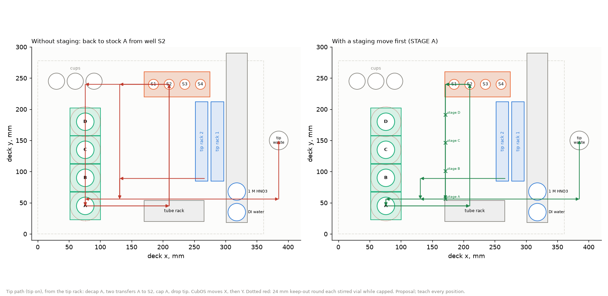

# Four stir modules on the corrosion deck

Ben asked on [#180](https://github.com/vertical-cloud-lab/digital-alloy-lab/pull/180)
(2026-11-06) about adding the stir module from
[byu-vcl#269](https://github.com/vertical-cloud-lab/byu-vcl/pull/269), so the solutions used in
the corrosion tests stay evenly mixed. His layout: four stir modules in a line along y where the
left tip rack (P11) was planned, with the two tip racks side by side, so the pipette tip never
crosses a capped vial. He asked for a BOM and build guide to start ordering from. The EZstat-Pro
is already set up, and there are enough tips for a few tests, so neither is in the BOM.

**Nothing here has been ordered, built or run.** Every position is a proposal in the CubOS deck
frame of Ben's 2026-10-02 calibration, to be taught.

| File | What |
| --- | --- |
| [`BOM.md`](BOM.md) | **What to order**, by vendor: $2,072.79 at 2026-10-19 prices, plus three rows still to price. What's on hand from the stirrer order, and what to print |
| [`BUILD.md`](BUILD.md) | **The build guide**, from the parts arriving to the first run |
| [`deck_stir.py`](deck_stir.py) → [`deck-stir.png`](deck-stir.png), [`deck-stir-check.json`](deck-stir-check.json) | The deck, and two plan checks of it |
| [`order_list.py`](order_list.py) → [`order-list.csv`](order-list.csv), [`order-totals.json`](order-totals.json) | The order list, read from [`../bom/bom.csv`](../bom/bom.csv) plus the stirrer rows |

## The deck

| Item | Where (deck x, y) |
| --- | --- |
| Stirrers A–D (compact, 49 × 44 mm) | vials at x ≈ 76, y 45 / 90 / 135 / 180: the deck's slot grid, two slot pairs left of where Ben taught his first one (126, 45) |
| Tip rack 1 (Ben's) | unmoved: A1 (291.332, 89) |
| Tip rack 2 (P11) | A1 (266.332, 89), A2 (257.832, 89): one slot column left of rack 1, 5 mm apart |
| 9-position holder | x 318, with only DI water (y 35) and 1 M HNO₃ (y 68) |
| Tray, cups, tube rack, tip waste | as in [`../build-guide.md` §4](../build-guide.md#4-on-the-deck) |

The stirred vials hold the three copper stocks and a spare: ASW, ASW + 0.1 mg/L S, ASW + 10 mg/L S,
and FeSO₄ on non-sulfide nights. On aluminium nights they hold the three NaCl stocks.

Three things moved from Ben's sketch, because the check found clashes:

- **The column is at x ≈ 76, not 101.** At 101, the capper would land on stirrer A whenever the
  pipette fills a tube at x 176.
- **Tip rack 2 is on rack 1's left.** On the right it would overlap the 9-position holder.
- **The holder keeps only its two front positions,** for DI water and acid. Drawing from y 101 or
  further back puts the capper on tip rack 2.

## What the checks say

[`deck_stir.py`](deck_stir.py) runs two checks, both in plan:

1. **The rigid-head check.** This is [`../plot_deck_layout.py`](../plot_deck_layout.py)'s check,
   run through [`../copper/deck_cu.py`](../copper/deck_cu.py) with the stirrers added. For each
   tool-down event, it places the other tool and reports what it lands on. **124 events, 0
   problems.** The tightest passes are the bare pipette 16 mm over the park cup and the capper
   22 mm over the tube rack.
2. **The moves.** CubOS moves X first, then Y. So a move into the column ends with a Y leg along
   the column, over the other stirred vials, and a tipped pipette doesn't clear their caps (Ben,
   byu-vcl#269, 2026-11-05).

   The check walks every well fill: each stock to each of S1–S3, eight transfers, with the stock
   opened before or after the tip goes on.
   - **Without staging, 21 of 24 fills take the tip straight over a capped stirred vial.** Only
     fills from D, at the back, pass, and only when D is opened after the tip goes on.
   - **With a staging move, all 24 pass.** Before each draw and each recap, the pipette moves to
     (vial x + 95, vial y + 11), which puts the capper in the vial's own row. The tip then stays
     at least 34 mm from every capped vial's axis (24 mm needed). A carried vial cap stays
     34 mm away too (28 mm means no overlap in plan).

   So **the side-by-side racks are necessary, but not enough on their own**: protocols need the
   staging move ([`BUILD.md` §8](BUILD.md#8-the-rules-every-protocol-follows)).

The check's limits:
- It is a plan check in this folder's own geometry, not CubOS's.
- Heights are the model's: rim 67.6, cap top 82.6.
- Before a run, byu-vcl's `capped_vial_keepout.py` on the real deck and protocol files is the check
  that counts ([`BUILD.md` §7](BUILD.md#7-teach-and-check)).

## Still open

- **The four-stirrer firmware isn't written.** Until it is, the Uno drives stirrer A only. B–D can
  each be tested on A's socket ([`BUILD.md` §5](BUILD.md#5-the-four-stirrer-firmware)).
- **Stirring during a run** needs a CubOS `set_stirrer` step, or a XIAO per stirrer. Until then,
  stir between runs.
- **What stirring buys.** A stock mixed before it goes on the deck doesn't separate on its own.
  Stirring matters for anything added to a vial on the deck, such as making the 0.1 mg/L sulfide
  stock from the 10 mg/L one, and for re-mixing after a long wait
  ([`BUILD.md` §8](BUILD.md#8-the-rules-every-protocol-follows)).
- **The 2026-11-05 trial's speed loss** after a decap and recap, on the same spacer height, isn't
  explained yet.
