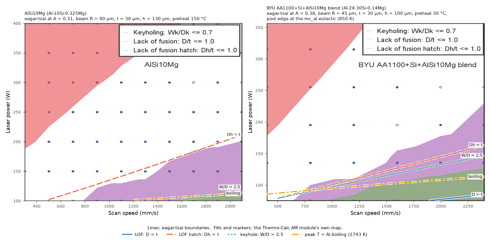
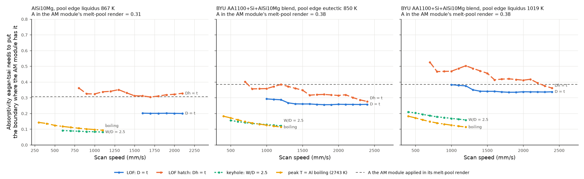
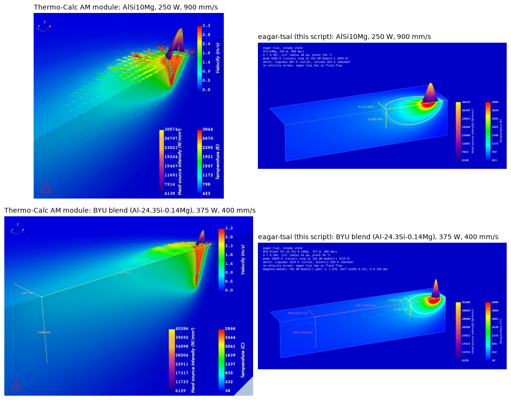
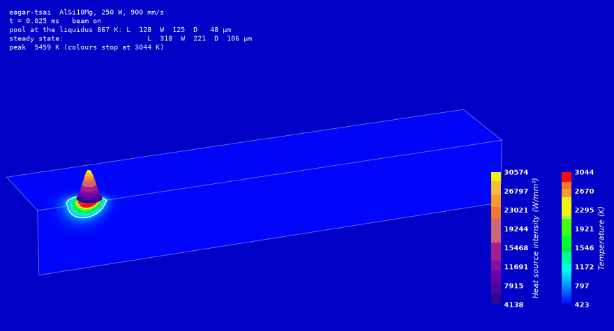
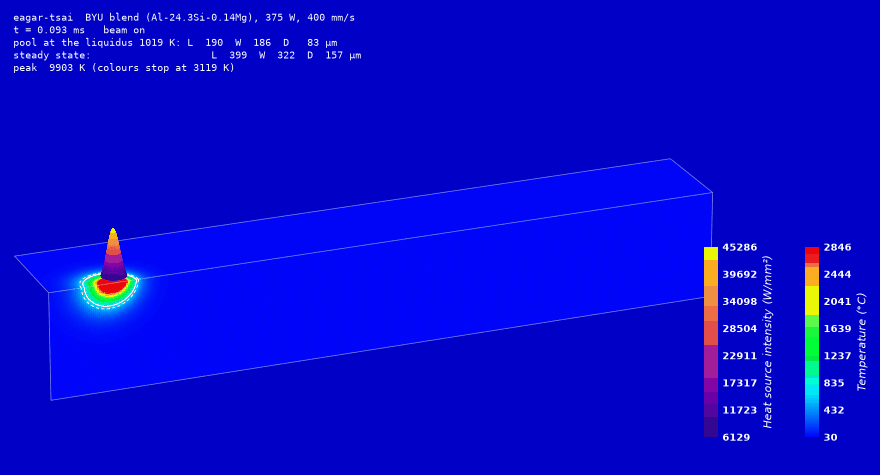
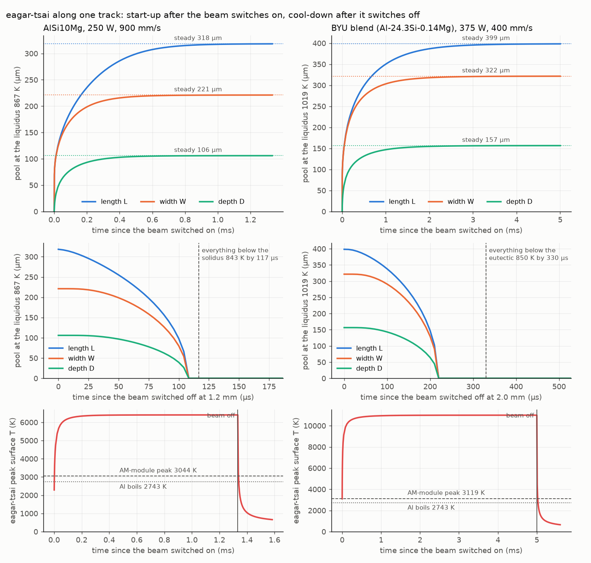
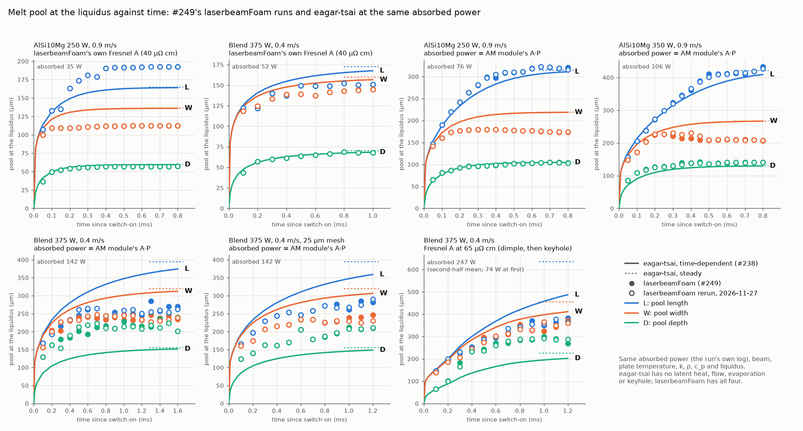
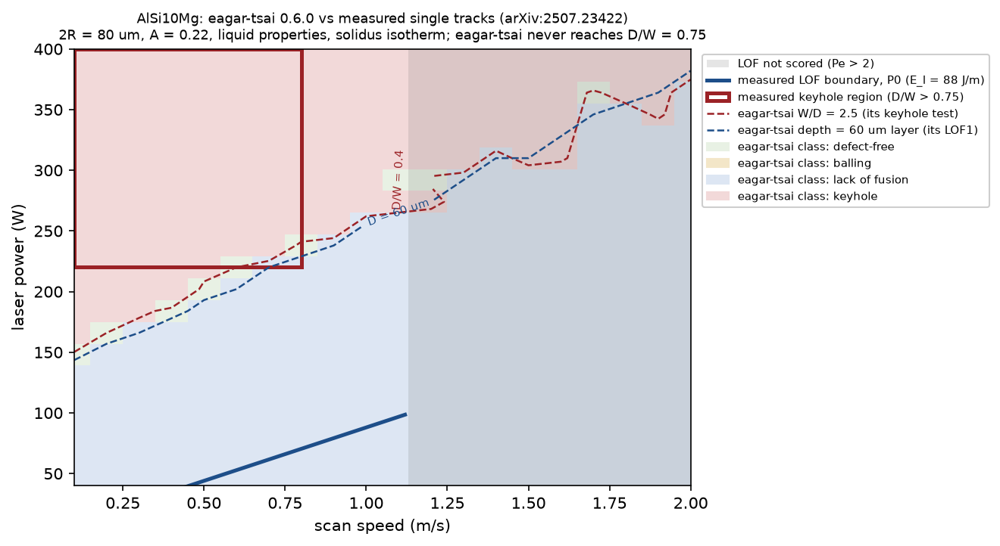

# eagar-tsai: tests, and a check against measured AlSi10Mg tracks and the Thermo-Calc AM module (#235)

[ArroyaveLab/eagar-tsai](https://github.com/ArroyaveLab/eagar-tsai) 0.6.0 (commit `7639a79`) is a fast
Eagar–Tsai moving-heat-source model. It gives melt-pool width, depth and length, and printability maps
classified by the criteria of Sheikh et al. 2024. Issue #235 asked us to run it and compare it with our
preliminary Genesis Mission results from the Thermo-Calc AM module. For Xavier's Sobol sweep, the unit
error, and the slow-integrand problem in the Linux wheels, see
[`../../edison-trajectories/eagar-tsai-alsi10mg-inputs/sobol-check/`](../../edison-trajectories/eagar-tsai-alsi10mg-inputs/sobol-check/).

**Later work:** #249, stacked on this PR, takes the AM-module comparison further. It runs CFD, writes our own
keyhole model, and corrects the boiling point of Al used here. See
[What #249's later testing changes here](#what-249s-later-testing-changes-here), and the comparison of eagar-tsai
with its CFD runs [at the same absorbed power and time](#against-249s-laserbeamfoam-runs-at-the-same-absorbed-power-and-time).

## Install and tests

Built from the clone with `uv pip install -e ".[plot]" pytest` (Python 3.12). The compiled integrand loads:
`_INTEGRAND` is a `LowLevelCallable`.

| Run | Result |
|---|---|
| `pytest --deselect tests/test_plot.py` | **91 passed** in 3.9 s ([log](logs/pytest-noplot.log)) |
| `pytest tests/test_plot.py` with no display | the whole pytest process **segfaults** in `test_plot_3d_returns_figure`, which calls pyvista/VTK ([log](logs/pytest-no-display-segfault.log)) |
| `xvfb-run pytest tests/test_plot.py` | 10 passed, 1 failed: `test_plot_3d_returns_figure`, `RenderWindowUnavailable: Render window is not current`, because the runner has no OpenGL or EGL ([log](logs/pytest-plot-xvfb.log), [error](logs/pytest-plot3d-xvfb-error.log)) |

So 101 of 102 tests pass. The failure is the runner's missing OpenGL, not the model. Upstream could skip the 3D test
when no render window is available, so that it can't take down the whole run.

Two things to know before using it for AlSi10Mg:
- **`beam_diameter` is 2σ** (twice the Gaussian standard deviation), i.e. half the 1/e² diameter.
- **The ambient temperature is fixed at 298 K** (`_T0_K` in `_types.py`). There is no input for a heated build plate,
  and AlSi10Mg is often printed on one at 150–200 °C.

## Comparing with our in-house Thermo-Calc AM-module results

### What the in-house results are

They are four PNGs that Thermo-Calc's account manager ran for us. They were imported into this repo on the
[`consolidation-2`](https://github.com/vertical-cloud-lab/digital-alloy-lab/tree/consolidation-2/figures/thermo-calc-am-module-prelim-results)
branch, in `figures/thermo-calc-am-module-prelim-results/`:
- printability maps for stock AlSi10Mg and the BYU AA1100 + Si + AlSi10Mg blend (copied into
  [`am-module-inhouse/`](am-module-inhouse/));
- 3D melt pools at 250 W / 900 mm/s (AlSi10Mg) and 375 W / 400 mm/s (blend).

The inputs were the settings we asked for, in
[`scanparams_summary.csv`](https://github.com/vertical-cloud-lab/digital-alloy-lab/blob/consolidation-2/edison-trajectories/results/scanparams/scanparams_summary.csv).
The rendered grids and the minimum temperatures in the melt-pool renders (423 K and 30 °C) match them.

| | AlSi10Mg | BYU blend |
|---|---|---|
| Composition (wt %) | Al 89.675, Si 10.0, Mg 0.325 | Al 75.56, Si 24.30, Mg 0.14 |
| Beam | Gaussian, radius 40 µm | Gaussian, radius 45 µm |
| Layer t / hatch h | 30 / 130 µm | 30 / 100 µm |
| Build plate | 150 °C | 30 °C |
| Absorptivity | calculated (prefactor 1.0), keyhole model on | same |
| Grid | 100–400 W × 300–2100 mm/s, 7 × 10 | 75–315 W × 400–2400 mm/s, 5 × 6 drawn |
| Melt-pool liquidus / solidus (MatCalc mc_al, [csv](../pycalphad-al-cu/data/am_module_alloys_mc_al.csv)) | 868.6 / 842.7 K | 1019.3 K (primary Si) / 846.7 K |

No CSV came with the images, so
[`scripts/eagar_tsai_vs_am_module_inhouse.py`](../../scripts/eagar_tsai_vs_am_module_inhouse.py) reads the numbers off
them:
- the class of each grid point, from the fill colour around its marker;
- the three boundaries, traced pixel column by pixel column.

12 of the 70 AlSi10Mg points and 3 of the 30 blend points are under the legend and are left out.

There are no in-house Thermo-Calc equilibrium or Scheil numbers anywhere in the repo or its branches. `thermocalc-desktop-initial-tests.md`
(on `copilot/can-calphad-thermocalc-run-high-throughput`) holds the TC-Python scripts but no results. So the pycalphad
comparison in [`../pycalphad-al-cu/`](../pycalphad-al-cu/) still rests on published Thermo-Calc numbers.

### Setting eagar-tsai up the same way

- **Beam.** A 1/e² radius R is 2σ, so eagar-tsai's `beam_diameter` (2σ) is R: 40 and 45 µm.
- **Preheat.** eagar-tsai fixes T0 at 298 K. Its field is linear in T − T0, so a plate at T_p is the same as moving
  the pool-edge isotherm down by T_p − 298 K. Peak temperatures below include the preheat.
- **Properties.** I used the Edison AlSi10Mg values from Xavier's sweep (k 110 W/m/K, ρ 2650 kg/m³,
  c 1040 J/kg/K, edge 867 K). The blend has no measured properties, so it gets the same ones, with its edge at
  either mc_al's eutectic (850 K) or its liquidus (1019 K). For a 24 % Si alloy those two isotherms are 169 K apart.
- **Absorptivity.** The AM module calculates A, and the keyhole model raises it, but the PNGs don't print it. I read
  it off the melt-pool renders instead:
  - Their heat-source colour bars run from q0 down to exactly q0/e² (30574/4138 and 45286/6129 are both 7.39).
    That is a Gaussian 2AP/(πR²)·exp(−2r²/R²) drawn out to r = R.
  - So A = q0·πR²/(2P): **0.31** at 250 W / 900 mm/s (AlSi10Mg) and **0.38** at 375 W / 400 mm/s (blend).
  - The maps below use these values. The AM module's A will differ elsewhere on the map.
- **Criteria.** Thermo-Calc's help page is behind a login, so these definitions come from its search-engine summary.
  - The AM module's tests are D/t ≤ 1 (lack of fusion) and Dh/t ≤ 1 (lack of fusion at the hatch), where Dh is the
    pool's depth at half the hatch distance from the track centre line.
  - Its keyhole test, Wk/Dk ≤ 0.7, uses the width and depth of the **keyhole** (the vapour cavity), not of the pool.
    eagar-tsai has no keyhole. Thermo-Calc's fallback for a heat source without keyhole geometry is pool W/D ≤ 1,
    and a conduction pool never gets there: eagar-tsai's W/D is 2.02–2.62 on the AlSi10Mg grid.
  - So I compared keyholing against eagar-tsai's own W/D ≤ 2.5 and against the peak temperature reaching Al's
    boiling point (2743 K). #249 later showed that 2743 K is an out-of-range extrapolation; NIST-JANAF gives
    2,791 K. The numbers here keep 2743 K. [The boiling-point check](#what-249s-later-testing-changes-here) shows
    that no count below moves by more than one grid point, and no share by more than one percentage point.
- **Dh.** eagar-tsai only evaluates the surface and the centre-line planes. So the script uses eagar-tsai's own
  compiled integrand and scaling to build max-over-x temperature profiles per absorbed watt, and reads W, D, L, Dh and
  the peak off them for any A·P.
  - Against `compute_single_point` on a 1 µm grid, it agrees to within 1.6 µm in W, 0.8 µm in D, 1 µm in L and
    1 K in peak T ([check](am-module-inhouse/profile-shortcut-vs-compute_single_point.csv)).
  - All three runs take 23 s on 4 vCPUs.

### Results



For AlSi10Mg at A = 0.31, eagar-tsai's D = t line falls below the plotted 100 W. The second figure shows, at each
speed, the absorptivity eagar-tsai would need to put each boundary where the AM module drew it:



| At the A from the AM module's own render | AlSi10Mg (A 0.31) | Blend, edge at eutectic (A 0.38) | Blend, edge at liquidus (A 0.38) |
|---|---|---|---|
| Visible grid points on the AM map: keyhole / LOF / LOF hatch / none | 15 / 3 / 9 / 31 | 5 / 4 / 5 / 13 | same |
| The AM module's own LOF tests applied to eagar-tsai's pools: same class at non-keyhole points | **37 of 43** | 17 of 22 | **20 of 22** |
| eagar-tsai's Dh = t line minus the AM module's, in power | −2 to +19 W (median +8), 800–2100 mm/s | −64 to +4 W (median −20) | −14 to +34 W (median +18) |
| eagar-tsai's D = t line minus the AM module's | −41 to −35 W, 1600–2100 mm/s | −41 to −19 W | −16 to 0 W |
| A needed along Dh = t, median (range) | 0.32 (0.30–0.36) | 0.33 (0.28–0.40) | 0.44 (0.36–0.53) |
| A needed along D = t | 0.20 (0.20–0.20) | 0.26 (0.26–0.29) | 0.34 (0.34–0.38) |
| eagar-tsai's W/D = 2.5 line, as a share of the AM module's keyhole power | 26–30 % | 32–40 % | 41–54 % |
| eagar-tsai's peak = 2743 K line, as a share of the same | 30–47 % | 30–48 % | 30–48 % |
| eagar-tsai's default classifier (W/D ≤ 2.5 keyhole): same class as the AM map | **18 of 58**: 55 called keyhole | 12 of 27: 20 keyhole | 13 of 27: 17 keyhole |

| Melt-pool render | AM module | eagar-tsai at the AM module's A | A eagar-tsai would need to match the AM module |
|---|---|---|---|
| AlSi10Mg, 250 W, 900 mm/s | peak 3044 K. No length scale in the render; the AM map has this point in the defect-free window | W 221, D 106, L 317 µm; peak **6405 K**; W/D 2.09, so eagar-tsai's default calls it keyhole | peak: 0.135 |
| Blend, 375 W, 400 mm/s | D **349 µm**, L **1470 µm**, half-width 231 µm (W ≈ 462 µm); peak 2846 °C (3119 K) | edge at liquidus: W 322, D 157, L 397 µm. Edge at eutectic: W 384, D 188, L 501 µm. Peak 10,995 K | edge at liquidus / eutectic: D 1.35 / 1.03 and L 1.69 / 1.29 (all above 1, so impossible); W 0.67 / 0.52; peak 0.10 |

The 231 µm is the y-axis of a render that shows the half-domain cut through the keyhole, so I read it as the
half-width. The AM render's D/W is then 0.76.

**What it means**

1. **On the lack-of-fusion side, eagar-tsai agrees well with the AM module.**
   - For AlSi10Mg, with the AM module's own A (0.31), eagar-tsai's Dh = t line sits within 20 W of the AM module's
     over 800–2100 mm/s, and 37 of 43 points get the same class.
   - For the blend, putting the pool edge at the liquidus fits better: 20 of 22 points, and D = t within 16 W.
   - One A can't place both lines, though. AlSi10Mg needs 0.20 for D = t and 0.32 for Dh = t. At equal A,
     eagar-tsai's pools are deeper but narrower at low power than the AM module's.
   - That fits what eagar-tsai leaves out: Marangoni flow, which widens Al pools, the powder layer, and latent heat.
     It also fits the AM module's calculated A being lower at the low-power D = t line than at the 250 W render point.
     The images can't separate the two.
2. **On keyholing, they don't agree.**
   - The AM module only calls keyholes at 2 to 4 times the power at which eagar-tsai's pools reach W/D = 2.5 or the
     boiling point.
   - At A = 0.31, eagar-tsai's default classifier calls 55 of 58 points keyhole, including all 31 the AM module calls
     defect-free.
   - eagar-tsai has nothing that caps its peak temperatures: 2,486–10,960 K on the grid, against 3,044 K from the AM
     module (which models evaporation) at 250 W / 900 mm/s.
3. **In keyhole mode, eagar-tsai can't reproduce the AM module's pool.** At 375 W / 400 mm/s the AM module's pool is
   349 µm deep and 1.47 mm long. eagar-tsai can't reach either at any absorptivity up to 1.
4. **For Xavier's question ("can this replace the AM module?"):** for the lack-of-fusion side of a printability map,
   yes, as a cheap low-fidelity stand-in.
   - It needs the AM module's Dh/t test, an A of about 0.3, and our own preheat.
   - eagar-tsai takes about a second per point, and milliseconds once this script's per-speed profiles are built.
     The proposal budgets 0.5–2 CPU-hours per AM-module evaluation.
   - Not for keyholing, or for pool size anywhere near keyhole mode. Its W/D ≤ 2.5 keyhole test shouldn't be used with
     these beams at all.
   - #249 has since found open methods for the keyhole side, and showed that the absorptivity behind this point is
     still open ([below](#what-249s-later-testing-changes-here)).

**Caveats.**
- Everything is read off images. The boundaries are Thermo-Calc's contours between grid points 50–60 W and
  200–400 mm/s apart, so each is uncertain by up to about one grid step.
- A comes from one render per alloy.
- The blend's properties are AlSi10Mg's.
- A few points are drawn as open circles: 300 W / 1700 mm/s on the AlSi10Mg map, and 195 W / 1600 mm/s and
  255 W / 2000 mm/s on the blend map. The figures don't say why; Thermo-Calc's account manager would know.
- If they can export the grids as CSV (W, D, L, Dh, Wk, Dk and the calculated A at every point),
  `scripts/eagar_tsai_vs_am_module.py private` compares them directly. That would remove the digitizing and the
  inferred A.

```bash
# get the two maps, then rerun everything (23 s on 4 vCPUs)
pip install --no-binary eagar-tsai eagar-tsai pandas matplotlib pillow scipy
python scripts/eagar_tsai_vs_am_module_inhouse.py all --png-dir arroyave-orchid-tools/eagar-tsai/am-module-inhouse \
    --out arroyave-orchid-tools/eagar-tsai/am-module-inhouse
```

### Time-dependent melt pools, drawn like the AM module's renders

The AM module's two melt-pool renders (copied into [`am-module-inhouse/`](am-module-inhouse/)) are 3D snapshots of one
track. Each shows half the domain, cut along the track centre line and coloured by temperature, with:
- the heat-source intensity drawn as a Gaussian above the beam;
- Marangoni velocity arrows;
- the pool outline as contour lines.

[`scripts/eagar_tsai_transient_meltpool.py`](../../scripts/eagar_tsai_transient_meltpool.py) draws eagar-tsai's pool
the same way, at the same settings and on the same colour scales, and makes it time-dependent.

**How eagar-tsai becomes time-dependent.** eagar-tsai only returns the steady state. But its temperature is an
integral over how long ago each bit of heat was deposited: its integrand's variable is that time, in units of σ/v.
- Integrating from 0 to ∞, as the package does, assumes the beam has always been on.
- Integrating only over the time the beam has actually been on gives the field at any moment of a single track: the
  start-up after the beam switches on at X = 0, and the cool-down after it switches off at the end of the track.
- The script uses eagar-tsai's own compiled integrand and scaling and changes nothing else. It is still a Gaussian
  source on a semi-infinite plate with constant properties, and no latent heat, fluid flow or evaporation.
- **Check:** run long enough, the transient converges to eagar-tsai's own steady state. After 50 σ/v (1.6 ms for
  AlSi10Mg, 4.0 ms for the blend) it is within 0.05 µm and 2 µm, and after 100 σ/v within 0.01 µm. That steady
  state matches `compute_single_point` on a 1 µm grid to within 1.6 µm in W, D and L and 0.6 K in peak temperature
  ([check](am-module-inhouse/transient/transient-check-vs-compute_single_point.csv)).

**Settings**, as in the comparison above:
- A is read off each AM render's heat-source colour bar: 0.307 for AlSi10Mg and 0.384 for the blend.
- eagar-tsai's `beam_diameter` is set to the AM module's 1/e² radius (40 and 45 µm).
- The build plate (150 °C and 30 °C) is used as T0.
- The colour scales are the AM module's own, over the same ranges. Its temperature bar is an even
  blue-cyan-green-yellow-red rainbow, sampled off the render; its heat-source bar is matplotlib's `plasma`. Like the
  AM module's, the blend's temperature is in °C.



**One track, start to finish.** The beam switches on at X = 0, runs along the track, and switches off at the end;
then the pool freezes. The cool-down is shown in slow motion: 8 µs (AlSi10Mg) and 21 µs (blend) per frame, against
25 µs and 93 µs while the beam is on.

| AlSi10Mg, 250 W, 900 mm/s, 1.2 mm track | Blend, 375 W, 400 mm/s, 2.0 mm track |
|---|---|
|  |  |



| eagar-tsai, one track ([csv](am-module-inhouse/transient/eagar-tsai-transient-history.csv), [summary](am-module-inhouse/transient/eagar-tsai-transient-history-summary.json)) | AlSi10Mg | Blend (pool edge at the liquidus) |
|---|---|---|
| Steady pool: L / W / D | 318 / 221 / 106 µm | 399 / 322 / 157 µm |
| Surface passes Al's boiling point (2743 K) | 1.4–2.0 µs after switch-on | within 1 µs |
| W and D reach 95 % of steady | after 0.30–0.33 ms (0.27–0.30 mm of track) | after 1.1 ms (0.43–0.45 mm) |
| L reaches 95 % / 99 % of steady | after 0.54 / 0.82 ms (0.49 / 0.74 mm) | after 1.7 / 2.8 ms (0.67 / 1.13 mm) |
| Peak falls below boiling after switch-off | 4–8 µs | 20–30 µs |
| Whole pool below the liquidus after switch-off | 108 µs | 220 µs |
| Whole pool below the solidus (blend: the eutectic) | 117 µs | 330 µs |

Cool-down times are to the nearest sample (4 µs for AlSi10Mg, 10 µs for the blend).

**What the pictures show**
1. **eagar-tsai can make the same kind of picture, and a time-dependent one, in seconds.**
   - The two steady renders take 2 s; the 156 frames of the two animations take 33 s on 4 vCPUs; the time history
     (374 time steps on 2 µm grids) takes 110 s.
   - Its start-up and cool-down follow from the same model, with no extra inputs.
2. **The shapes differ the way the printability maps already suggested.**
   - The AM module's cut shows a narrow, deep V of near-boiling liquid under the beam (red), where its keyhole model
     carries heat down, feeding a long, shallow tail. Marangoni flow sweeps that tail back, with velocity arrows up
     to 3.2–3.3 m/s.
   - The V doesn't by itself make a keyhole defect: the AM map puts AlSi10Mg's 250 W / 900 mm/s in its defect-free
     window. The blend's 375 W / 400 mm/s pool is keyhole-shaped (D/W 0.76).
   - eagar-tsai's pool is a smooth half-ellipsoid, because it models conduction only.
   - Where the AM render gives a scale (the blend), its pool is 3.7× longer and 2.2× deeper than eagar-tsai's but
     only 1.4× wider: half-width 231 µm against 161 µm. The magenta dashes in the blend render draw the AM module's
     pool at the same scale.
3. **Peak temperature.** eagar-tsai's surface passes Al's boiling point within about 2 µs of switch-on, and its
   peak settles at 6,405 K (AlSi10Mg) and 10,995 K (blend). The AM module's peaks are 3,044 K and 3,119 K, near
   boiling, since it models evaporation. On the AM module's colour scales, everything eagar-tsai puts above those
   peaks is drawn red.
4. **Start-up and freezing are quick.** eagar-tsai's pool reaches its steady width and depth within 0.3 mm
   (AlSi10Mg) and 0.45 mm (blend) of track, and its steady length within 0.5–0.7 mm.
   - So the steady-state numbers behind the maps above hold over most of any track longer than about 1 mm. On scan
     vectors shorter than about 0.3 mm (AlSi10Mg) or 0.45 mm (blend), the pool never reaches 95 % of its steady width
     and depth.
   - Once the beam switches off, the last pool is fully solid within 0.12 ms (AlSi10Mg) and 0.33 ms (blend).
5. **What the eagar-tsai renders can't show:**
   - velocity arrows, because there is no fluid flow;
   - the keyhole, because there is no vapour cavity or recoil pressure;
   - a temperature cap at boiling;
   - latent heat, the powder layer, and temperature-dependent properties.

   So the pictures show where heat conduction alone would put the pool. Most of the visible difference from the AM
   module's renders is the keyhole and the flow.

**Caveats.**
- The settings carry over every caveat of the comparison above: A comes from one render per alloy, and the blend
  uses AlSi10Mg's thermal properties.
- The AM render doesn't say how long its track had run, or whether it came from the AM module's steady-state or
  transient mode. I drew eagar-tsai's steady state for the side-by-side; its pool is within 1 % of that size after
  0.8 ms (AlSi10Mg) and 2.8 ms (blend).
- If the renders did come from the transient mode, the AM module's pool size against time, or its animation frames,
  would compare directly with the history plot above. That would be worth asking Thermo-Calc's account manager for,
  along with the CSV export.

```bash
# the two AM-module renders are in am-module-inhouse/ (copied from consolidation-2); about 2.5 min on 4 vCPUs
pip install --no-binary eagar-tsai eagar-tsai pandas matplotlib pillow scipy
python scripts/eagar_tsai_transient_meltpool.py all --out arroyave-orchid-tools/eagar-tsai/am-module-inhouse/transient \
    --am-png-dir arroyave-orchid-tools/eagar-tsai/am-module-inhouse
```

### Against #249's laserbeamFoam runs, at the same absorbed power and time

[#249](https://github.com/vertical-cloud-lab/digital-alloy-lab/pull/249) ran the open CFD code laserbeamFoam at the
AM module's two render points (7 runs, 0.8–1.6 ms of track, 15–25 µm cells). Its tables compare each run's pool,
averaged over the second half of the run, with eagar-tsai's *steady* pool. But eagar-tsai's pool takes 0.8 ms
(AlSi10Mg) to 2.8 ms (blend) to reach 99 % of its steady length (above), as long as the runs or longer.
[`scripts/eagar_tsai_transient_vs_laserbeamfoam.py`](../../scripts/eagar_tsai_transient_vs_laserbeamfoam.py)
compares them at the same time after switch-on instead, using the time-dependent eagar-tsai above.
- **Same inputs as the CFD:** the absorbed power each run logged (taken from its log over time, so the 65 µΩ cm run's
  change from dimple to keyhole is included), the beam, the plate temperature, the same constant k, ρ and c_p, and the
  CFD's own mc_al liquidus and solidus.
- **So the difference is the physics laserbeamFoam adds:** latent heat, melt flow, evaporation and a free surface
  that can open a keyhole, plus its finite domain and mesh.
- **Checks:** the code first reproduces three rows of the committed eagar-tsai history to 0.001 µm. Splitting a
  constant power into time bins changes the field by under 10⁻⁵ K.
- **Run time:** 2.3 min on 4 vCPUs.
- **Data:** #249's results at `cc25b6f`, its original runs and its 2026-11-27 reruns.



| laserbeamFoam run (#249) | Absorbed | CFD keyhole | Pool depth / width / length at the liquidus: CFD ÷ eagar-tsai at the same times | Length: CFD ÷ eagar-tsai's steady pool (#249's comparison) |
|---|---|---|---|---|
| AlSi10Mg 250 W, own Fresnel A (40 µΩ cm) | 35 W | 10 µm dimple | 0.96 / 0.83 / 1.18 | 1.17 |
| Blend 375 W, own Fresnel A (40 µΩ cm) | 52 W | 13 µm dimple | 1.00 / 0.92 / 0.91 | 0.87 |
| AlSi10Mg 250 W, AM module's A·P | 76 W | 40 µm dimple | 0.99 / 0.81 / 1.04 | 1.01 |
| AlSi10Mg 350 W, AM module's A·P | 106 W | 83 µm (Wk/Dk 1.4) | 1.09 / 0.79 / 1.06 | 0.98 |
| Blend 375 W, AM module's A·P | 142 W | 172 µm | 1.52 / 0.78 / 0.72 | 0.66 |
| Same, 25 µm mesh | 142 W | 131 µm | 1.37 / 0.79 / 0.80 | 0.69 |
| Blend 375 W, Fresnel A at 65 µΩ cm | 74 W at first, 247 W in the second half | 211 µm | 1.48 / 0.87 / 0.80 | 0.56 |

Ratios are means over the second half of each original run, as in #249's tables. The reruns give the same to within
0.03, apart from the blend's depth at the AM module's A·P (1.43 instead of 1.52), whose keyhole changed between runs.
Per write: [csv](am-module-inhouse/transient/vs-laserbeamfoam/laserbeamfoam-vs-eagar-tsai-per-write.csv). At the
solidus: [figure](am-module-inhouse/transient/vs-laserbeamfoam/eagar-tsai-vs-laserbeamfoam-solidus.png),
[summary](am-module-inhouse/transient/vs-laserbeamfoam/summary.json).

**What it shows**
1. **Without a real keyhole, eagar-tsai's time-dependent pool tracks the CFD at every write.** That covers the first
   four rows: conduction mode, or a dimple.
   - **Depth:** within 4 % after the first 0.1 ms in the three conduction and dimple runs. At 350 W, where
     laserbeamFoam opens an 83 µm keyhole, the CFD's pool is 7–20 % deeper.
   - **Length:** the CFD's is 0.87–1.18× eagar-tsai's at every write. At the AM module's 250 W render point, given
     the AM module's absorbed power, the CFD's pool lengthens along eagar-tsai's start-up curve: 0.96–1.09× at every
     write from 0.05 to 0.8 ms.
   - That is an independent check of the start-up times above: about 0.5 mm of track to 95 % of the steady length,
     for AlSi10Mg.
2. **Width is where they differ.** laserbeamFoam's pools end 8–21 % narrower. Their width stops growing after
   0.1–0.2 ms, while eagar-tsai's keeps growing. This comparison can't say why: latent heat, flow and the 15–17.5 µm
   cells are all candidates.
3. **Where laserbeamFoam keyholes (the blend runs), its pool has a different shape from eagar-tsai's at the same
   power and time.**
   - It is 37–52 % deeper, 13–22 % narrower and 20–28 % shorter.
   - The keyhole carries heat down, as the AM module's render suggests.
4. **Comparing at the same time matters for the blend.**
   - Against eagar-tsai's steady pool, as #249 compared, the CFD's keyhole-mode pools look 31–44 % shorter. At the
     same time they are 20–28 % shorter.
   - So between a fifth and over half of that shortfall is eagar-tsai's own start-up. At 0.8–1.6 ms its blend pool
     is still 9–30 % short of its steady length; for the 65 µΩ cm run, part of that is the lower power before the
     keyhole opened.
   - For AlSi10Mg, whose pools settle sooner, the two ways of comparing differ by 0.08 at most.
5. **At the solidus, laserbeamFoam's AlSi10Mg pools are 1.30–1.37× eagar-tsai's length.** In the two runs at the
   AM module's absorbed power, they are still growing when the runs stop.
   - eagar-tsai has no latent heat, so its solidus pool is barely longer than its liquidus pool.
   - For the blend, whose solidus is 173 K below its liquidus, the solidus lengths agree to within 7 %.
6. **Neither gets near the AM module's 1.47 mm blend pool.** Over the last 0.4 ms of the runs at the AM module's
   absorbed power, laserbeamFoam's liquidus pool is 245–285 µm long. eagar-tsai's reaches 374 µm by 1.6 ms, and its
   steady pool is 394 µm.

```bash
# #249's results, from its branch at cc25b6f (once #249 merges: arroyave-orchid-tools/keyhole-alternatives/cfd)
git fetch origin claude/issue-235-keyhole-open-alternatives
mkdir -p /tmp/lbf && git archive cc25b6f arroyave-orchid-tools/keyhole-alternatives/cfd | tar -x -C /tmp/lbf
python scripts/eagar_tsai_transient_vs_laserbeamfoam.py --self-check \
    --cfd-dir /tmp/lbf/arroyave-orchid-tools/keyhole-alternatives/cfd \
    --out arroyave-orchid-tools/eagar-tsai/am-module-inhouse/transient/vs-laserbeamfoam
```

## What #249's later testing changes here

[#249](https://github.com/vertical-cloud-lab/digital-alloy-lab/pull/249) is stacked on this PR, and starts where
the AM-module comparison above stops.
- It ran laserbeamFoam at the AM module's render points.
- It wrote a first-principles keyhole model of our own. Version 2 adds its own melt-flow solver.
- It reran everything on 2026-11-27.

Its write-ups (at `cc25b6f`) are
[keyhole alternatives](https://github.com/vertical-cloud-lab/digital-alloy-lab/blob/cc25b6f/arroyave-orchid-tools/keyhole-alternatives/README.md)
and the
[first-principles model, version 2](https://github.com/vertical-cloud-lab/digital-alloy-lab/blob/cc25b6f/arroyave-orchid-tools/keyhole-alternatives/first-principles/v2/README.md).
Here is what that work changes in this folder's conclusions.

- **Keyholing now has an answer.** This folder only says what not to use: eagar-tsai's W/D ≤ 2.5, and the boiling
  line.
  - #249 found that the AM module's keyhole boundary follows a near-constant keyhole number
    ([Gan et al. 2021](https://doi.org/10.1038/s41467-021-22704-0)). So the keyhole number gives the boundary's
    shape, and one threshold, calibrated on our own tracks, sets its level.
  - Its first-principles model, with nothing fitted, makes the AM module's keyhole-or-not call at 58 of 58 AlSi10Mg
    points and 25 of 27 blend points.
  - For keyhole depth it recommends Gan et al.'s depth law. For keyhole-mode pool width and length, it recommends a
    CFD code (laserbeamFoam first), run a few times for calibration.
- **Lack of fusion: of the models tried, eagar-tsai still matches the AM module best, but only at the AM module's
  absorptivity.**
  - At A = 0.307 and 250 W / 0.9 m/s, three models give pools within about 30 % of each other. eagar-tsai, with the
    AM module's own tests, and #249's version 2 both call this point no defect, as the AM module does:

    | Model at the AM module's absorbed power | Depth / width / length at the liquidus (µm) |
    |---|---|
    | eagar-tsai (this folder) | 106 / 221 / 317 |
    | laserbeamFoam (#249) | 103 / 176 / 314 |
    | #249's version 2: temperature-dependent properties, latent heat, Marangoni flow | 77 / 182 / 322 |

  - In conduction mode, laserbeamFoam's pool depth agrees with eagar-tsai's to within 4 % at the same time
    ([above](#against-249s-laserbeamfoam-runs-at-the-same-absorbed-power-and-time)).
  - #249's own model computes its own absorptance, and it agrees with far fewer of the AM module's classes: 18–25
    of 58 AlSi10Mg points and 7–8 of 27 blend points (versions 1 and 2, with and without melt flow or raised
    optics). Its pools at the AM module's no-defect points come out too narrow for the hatch, mainly because its
    liquid surface absorbs 0.18–0.20, where the AM module has 0.31.
  - Measurements don't settle which is right for our machine. In a commercial LPBF machine (a Renishaw AM 400),
    [Allen 2023](https://hdl.handle.net/1974/32579) measured AlSi10Mg in conduction mode at 0.16–0.23 on an as-built
    surface, and 0.65–0.76 with a powder layer. The AM module's 0.31 is in between.
  - #249's
    [single-track plan](https://github.com/vertical-cloud-lab/digital-alloy-lab/blob/cc25b6f/arroyave-orchid-tools/keyhole-alternatives/first-principles/v2/README.md#what-would-settle-it-single-tracks-on-our-own-machine)
    would settle it, with the low-power AlSi10Mg tracks run on both surfaces.
  - Until then, point 4 under [Results](#results) holds as "a cheap stand-in for the AM module's lack-of-fusion
    side", not yet as "a prediction of our machine's lack of fusion".
- **Keyhole-mode pools.**
  - At the AM module's absorbed power, laserbeamFoam's blend pool is deeper than eagar-tsai's but shorter
    ([above](#against-249s-laserbeamfoam-runs-at-the-same-absorbed-power-and-time)).
  - Neither laserbeamFoam nor #249's melt-flow solver reaches the AM module's 1.47 mm.
  - #249 points to a synchrotron study it couldn't read (Guo et al. 2020), which suggests AlSi10Mg pools that long are
    real. If so, every model here is short.
- **Al's boiling point is 2,791 K, not 2,743 K.**
  - #249 traced 2,743 K to Alcock et al. 1984's vapour-pressure equation, extrapolated beyond its 1,800 K range.
    NIST-JANAF and the CRC Handbook give 2,790.8 K. Raoult's law on Al gives 2,814 K for AlSi10Mg and 2,852 K for the
    blend, at 1 atm.
  - The committed files here keep 2,743 K, because #249's scorer reads their `et_boiling` column.
  - [`scripts/eagar_tsai_boiling_point_check.py`](../../scripts/eagar_tsai_boiling_point_check.py) recounts every
    number that uses the boiling point, from the committed CSVs ([table](boiling-point-check.csv)). No conclusion
    changes:
    - **AM-module maps:** eagar-tsai's boiling line moves from 30–47 % to 31–48 % of the AM module's keyhole power
      for AlSi10Mg, and one fewer AlSi10Mg point boils (52 of 58). The blend's counts don't change.
    - **One track:** no change at the history's sampling. The surface boils within 1–2 µs of switch-on, and the
      peak drops back below boiling 4–8 µs (AlSi10Mg) and 20–30 µs (blend) after switch-off.
    - **Xavier's Sobol sweep:** the share of the 4,096 rows that boil goes from 26.8 % to 26.2 %. The share that are
      defect-free and below boiling goes from 17.0 % to 17.4 %.
- **What the AM module does,** from the public pages #249 read:
  - It gets absorptivity from a Lorentz–Drude model of the liquid's electrical resistivity and the wavelength.
  - Its keyhole is an "analytic" model. Its absorption comes from "multiple reflections of laser rays" (thermocalc.com's
    AM-module page and the TC-Python docs).
  - The printability criteria used here (D/t, Dh/t, Wk/Dk ≤ 0.7) still come from search-engine summaries.
    help.thermocalc.com still needs a login.

## Comparing with measured AlSi10Mg single tracks

Thermo-Calc's own AM-module worked examples on help.thermocalc.com need a login, so I couldn't take numbers from
them. Two public points matter:
- The proposal already notes the AM module's weak spot for Al: it computes absorptivity from the liquid's electrical
  resistivity, and that ignores the oxide film (`genesis-mission-proposal/flaime-genesis-proposal.tex`, "Thermo-Calc
  Partnership & AM Module Feedback").
- Thermo-Calc's AlSi10Mg example **AM_11** compares single tracks on cast and LPBF substrates with experiment. Its
  public search-engine summary says the calculated absorptivity had to be **scaled by 1.8** to match the measured
  pools, and that measured pools are deeper than simulated ones, more so as depth grows. I could only see that
  summary, not the
  [page](https://help.thermocalc.com/2025b/content/examples/am/am_11_batch_al10sim.htm) itself.

Like the AM module, eagar-tsai needs a calibrated absorptivity for Al. So I tested eagar-tsai against what an
AM-module printability map is meant to predict: measured AlSi10Mg single tracks.

### eagar-tsai against measured AlSi10Mg single tracks

The data come from Solyaev et al., *On the influence of powder particle size on single-track formation in laser
powder bed fusion of AlSi10Mg alloy*, [arXiv:2507.23422](https://arxiv.org/abs/2507.23422) (2025). That study fitted
its own Eagar–Tsai model to its tracks, so its inputs can be reused directly:
- beam 2R = 80 µm with q ∝ exp(−r²/R²), which is `beam_diameter` = 56.6 µm in eagar-tsai's convention;
- liquid properties (k = 120 W/m/K, ρ = 1800 kg/m³, c = 1800 J/kg/K), with the pool edge at the solidus (836 K);
- A = 0.22, its fit for standard powder (d50 = 44 µm);
- a 60 µm effective layer.

I ran a 21 × 20 grid (40–400 W, 0.1–2.0 m/s, 2 µm cells; 136 s on 4 vCPUs) and drew the study's measured
boundaries over it:



| Defect | Measured (Solyaev et al.) | eagar-tsai 0.6.0, default criteria |
|---|---|---|
| Keyhole | P > 220 W **and** v < 0.8 m/s, classed by D/W > 0.75 | Its keyhole test (W/D ≤ 2.5) flags 157 of 420 points. That includes 79 of the 80 measured-keyhole points, but **78 points outside the region**: 13 at 166–220 W below 0.8 m/s, and 65 above 0.8 m/s. The boundary runs diagonally (166 W at 0.1 m/s, 256 W at 0.9 m/s, 382 W at 1.7 m/s) instead of along the measured box. **eagar-tsai never reaches the study's D/W = 0.75**: its largest D/W on the grid is 0.48, because a conduction model can't make keyhole-shaped pools. |
| Lack of fusion | Tracks are continuous above E_l = P/v = 88 J/m (for v < 1.13 m/s, Pe < 2) | Below 1.13 m/s its LOF test (depth ≤ 60 µm layer) flags 108 of 231 points. That covers all 16 measured-LOF points, plus **92 points where the measured tracks were continuous**. On the measured boundary it predicts pools only 0–18 µm deep. Its LOF tests are meant for bulk parts (layer and hatch overlap), so they are stricter than single-track continuity by construction. |
| Stable | 135 of the 231 scored points | **9 of 420 points** are "defect-free". The keyhole and LOF lines nearly coincide, leaving only a thin band between them. |

At the study's keyhole cross-sections (328 W, 0.335 m/s), eagar-tsai gives W = 236 µm and D = 108 µm (D/W = 0.46),
with a peak of 4,164 K, far above aluminium's boiling point (2,743 K). The earlier AlSi10Mg run on this branch found
the same thing: with the default thresholds, eagar-tsai's map has almost no window for Al. **To use it as a
printability screen for Al, the W/D threshold and the LOF depth rule have to be refit to our own single-track
cross-sections, just as the AM module needed its absorptivity scaled.** Fitting the 2.5 threshold against these
measured keyhole tracks would be a good first test.

The higher-speed branch of the study's LOF boundary (a constant enthalpy density of 8.9 J/mm³ above Pe = 2) is not
drawn. Rebuilding it from the paper's formula did not join the E_l branch at Pe = 2, so speeds of 1.13 m/s and above
are not scored for LOF.

### Stock vs Si-enriched AlSi10Mg

The proposal's AM-module figure compares stock AlSi10Mg with a Si-enriched variant. In eagar-tsai, composition
enters only through the isotherm temperature and four constant properties.
[Sweeping the isotherm](alsi10mg-isotherm-sensitivity.csv) from 836 K (solidus) to 870 K (liquidus) at
200–370 W shrinks W by 4 µm and D by 3–4 µm. A Si-enriched variant lowers the liquidus by roughly 15–20 K, which
moves W and D by about 2 µm. **eagar-tsai can't separate the two alloys**; the differences the AM-module figure
shows (solidification range, phase fractions) come from the CALPHAD side.

### Running it on an AM-module CSV export

[`scripts/eagar_tsai_vs_am_module.py`](../../scripts/eagar_tsai_vs_am_module.py) `private` runs eagar-tsai on every
row of an AM-module export and writes a parity table and plot (width, depth, length):

```bash
pip install --no-binary eagar-tsai eagar-tsai pandas matplotlib     # Linux; plain pip elsewhere
python scripts/eagar_tsai_vs_am_module.py private am_module_results.csv \
    --beam-convention one_over_e2_radius --out private/eagar-vs-am
```

The CSV needs `power_w`, `velocity_m_s`, `beam_size_um` and `absorptivity`; use the absorptivity the AM module
actually applied. Optional columns are `T_melt_k`, `k_w_mk`, `rho_kg_m3`, `cp_j_kgk` (otherwise the Edison AlSi10Mg
values: 867 K, 110 W/m/K, 2650 kg/m³, 1040 J/kg/K) and `am_width_um` / `am_depth_um` / `am_length_um`, which are what
gets compared. `--beam-convention` says what `beam_size_um` is: `two_sigma`, `one_over_e2_radius`,
`one_over_e2_diameter` or `one_over_e_radius`. The script refuses beams outside 1 µm–1 mm, the unit error behind the
762 GiB arrays. I tested it on a throwaway CSV but haven't committed one: the in-house AM-module results came as
images, so there are no AM-module rows yet.

```bash
python scripts/eagar_tsai_vs_am_module.py published --out arroyave-orchid-tools/eagar-tsai   # regenerates this folder
```

## Files

| File | What it is |
|---|---|
| `alsi10mg-printability-vs-solyaev2025.csv` | the 420 grid points: eagar-tsai W, D, L, its five defect flags and class, D/W, E_l and the measured class |
| `alsi10mg-printability-vs-solyaev2025.png` | the map above |
| `alsi10mg-printability-vs-solyaev2025-summary.txt` | the agreement counts |
| `alsi10mg-isotherm-sensitivity.csv` | W, D, L and peak T vs melt isotherm (820–880 K) at three process points, 1 µm grid |
| `logs/` | pytest and run logs |
| `am-module-inhouse/*-am-module-grid-points.csv` | the AM module's class at each grid point, read off its map (`hidden` = under the legend), and the marker style |
| `am-module-inhouse/*-am-module-boundaries.csv` | the AM module's keyhole, LOF and LOF-hatch boundaries, one power per pixel column |
| `am-module-inhouse/*-eagar-tsai-grid-*.csv` | eagar-tsai's W, D, L, Dh, peak T and three classifications at every grid point, at the A from the AM render and at A = 0.10–0.95 every 0.05 |
| `am-module-inhouse/*-eagar-tsai-boundary-absorptivity-*.csv` | per speed: the AM boundary powers, the absorbed power at which eagar-tsai crosses each criterion, and the A that matches |
| `am-module-inhouse/*-agreement-vs-absorptivity-*.csv` | grid-point agreement counts at A = 0.05–0.95 every 0.01 |
| `am-module-inhouse/summary.json` | the numbers quoted above |
| `am-module-inhouse/profile-shortcut-vs-compute_single_point.csv` | the check of the profile shortcut against eagar-tsai itself |
| `am-module-inhouse/*.png` | the two AM-module maps and two melt-pool renders (copied from `consolidation-2`), and the two map figures above |
| `am-module-inhouse/transient/am-module-vs-eagar-tsai-meltpools.png` | the AM module's melt-pool renders next to eagar-tsai's |
| `am-module-inhouse/transient/eagar-tsai-meltpool-*-steady.png` | eagar-tsai's steady pool drawn like the AM renders, with its W/2, D and L |
| `am-module-inhouse/transient/eagar-tsai-meltpool-*-transient.gif` | one track from switch-on to a frozen pool |
| `am-module-inhouse/transient/eagar-tsai-transient-history.*` | L, W, D (both isotherms) and peak T at 374 times along one track; the plot; the start-up and freezing times |
| `am-module-inhouse/transient/transient-check-vs-compute_single_point.csv` | the transient's convergence to eagar-tsai's own steady state |
| `am-module-inhouse/transient/transient-render-summary.json` | A, q0 and the steady pool at each render's settings |
| `am-module-inhouse/transient/vs-laserbeamfoam/laserbeamfoam-vs-eagar-tsai-per-write.csv` | every write of #249's 7 laserbeamFoam runs and their reruns: the CFD pool (liquidus and solidus), eagar-tsai's at the same time and absorbed power, and eagar-tsai's steady pool |
| `am-module-inhouse/transient/vs-laserbeamfoam/eagar-tsai-at-laserbeamfoam-times.csv` | eagar-tsai's pool at each time computed (the CFD writes plus a finer grid for the curves) |
| `am-module-inhouse/transient/vs-laserbeamfoam/eagar-tsai-vs-laserbeamfoam-{liquidus,solidus}.png`, `summary.json` | the two figures, and the second-half means and ratios quoted above |
| `boiling-point-check.csv` | every number that uses Al's boiling point, recounted at 2743 K (as committed), 2,791 K (NIST-JANAF) and the alloys' 1 atm values |
