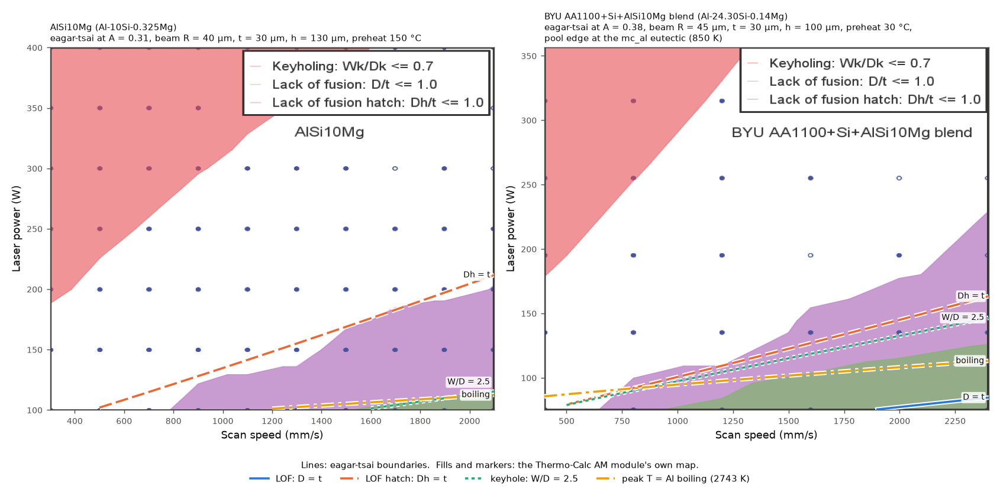
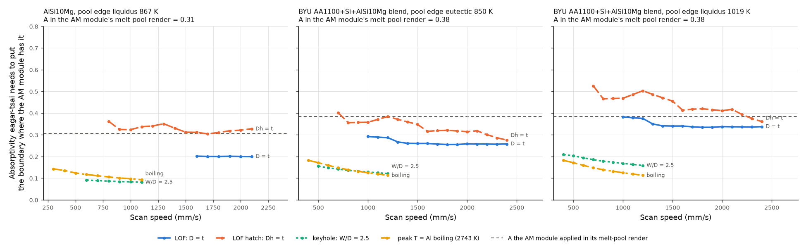
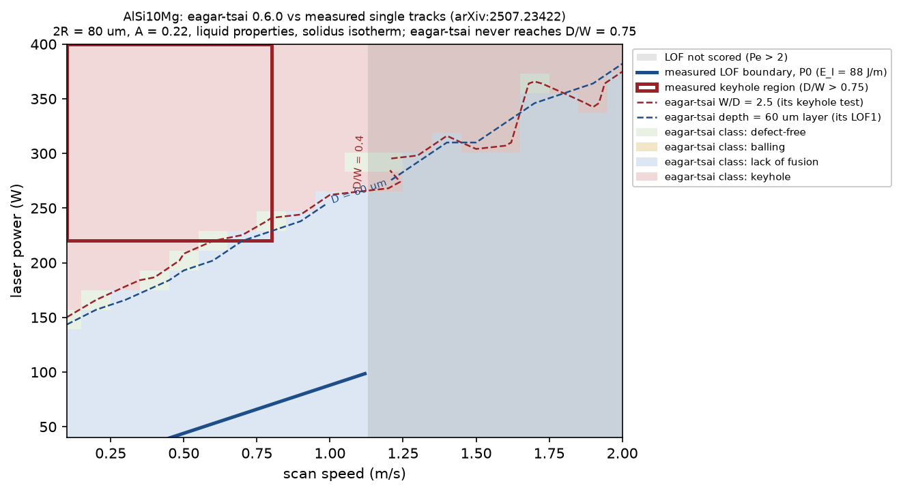

# eagar-tsai: tests, and a check against measured AlSi10Mg tracks and the Thermo-Calc AM module (#235)

[ArroyaveLab/eagar-tsai](https://github.com/ArroyaveLab/eagar-tsai) 0.6.0 (commit `7639a79`) is a fast
Eagar–Tsai moving-heat-source model. It gives melt-pool width, depth and length, and printability maps
classified by the criteria of Sheikh et al. 2024. Issue #235 asked us to run it and compare it with our
preliminary Genesis Mission results from the Thermo-Calc AM module. For Xavier's Sobol sweep, the unit
error, and the slow-integrand problem in the Linux wheels, see
[`../../edison-trajectories/eagar-tsai-alsi10mg-inputs/sobol-check/`](../../edison-trajectories/eagar-tsai-alsi10mg-inputs/sobol-check/).

## Install and tests

Built from the clone with `uv pip install -e ".[plot]" pytest` (Python 3.12). The compiled integrand loads:
`_INTEGRAND` is a `LowLevelCallable`.

| Run | Result |
|---|---|
| `pytest --deselect tests/test_plot.py` | **91 passed** in 3.9 s ([log](logs/pytest-noplot.log)) |
| `pytest tests/test_plot.py` with no display | the whole pytest process **segfaults** in `test_plot_3d_returns_figure`, which calls pyvista/VTK ([log](logs/pytest-no-display-segfault.log)) |
| `xvfb-run pytest tests/test_plot.py` | 10 passed, 1 failed: `test_plot_3d_returns_figure`, `RenderWindowUnavailable: Render window is not current`, because the runner has no OpenGL or EGL ([log](logs/pytest-plot-xvfb.log), [error](logs/pytest-plot3d-xvfb-error.log)) |

So 101 of 102 tests pass. The failure is the runner's missing OpenGL, not the model. Upstream could skip the 3D test
when no render window is available, so that it can't take down the whole run.

Two things to know before using it for AlSi10Mg:
- **`beam_diameter` is 2σ** (twice the Gaussian standard deviation), i.e. half the 1/e² diameter.
- **The ambient temperature is fixed at 298 K** (`_T0_K` in `_types.py`). There is no input for a heated build plate,
  and AlSi10Mg is often printed on one at 150–200 °C.

## Comparing with our in-house Thermo-Calc AM-module results

### What the in-house results are

They are four PNGs that Thermo-Calc's account manager ran for us. They were imported into this repo on the
[`consolidation-2`](https://github.com/vertical-cloud-lab/digital-alloy-lab/tree/consolidation-2/figures/thermo-calc-am-module-prelim-results)
branch, in `figures/thermo-calc-am-module-prelim-results/`:
- printability maps for stock AlSi10Mg and the BYU AA1100 + Si + AlSi10Mg blend (copied into
  [`am-module-inhouse/`](am-module-inhouse/));
- 3D melt pools at 250 W / 900 mm/s (AlSi10Mg) and 375 W / 400 mm/s (blend).

The inputs were the settings we asked for, in
[`scanparams_summary.csv`](https://github.com/vertical-cloud-lab/digital-alloy-lab/blob/consolidation-2/edison-trajectories/results/scanparams/scanparams_summary.csv).
The rendered grids and the minimum temperatures in the melt-pool renders (423 K and 30 °C) match them.

| | AlSi10Mg | BYU blend |
|---|---|---|
| Composition (wt %) | Al 89.675, Si 10.0, Mg 0.325 | Al 75.56, Si 24.30, Mg 0.14 |
| Beam | Gaussian, radius 40 µm | Gaussian, radius 45 µm |
| Layer t / hatch h | 30 / 130 µm | 30 / 100 µm |
| Build plate | 150 °C | 30 °C |
| Absorptivity | calculated (prefactor 1.0), keyhole model on | same |
| Grid | 100–400 W × 300–2100 mm/s, 7 × 10 | 75–315 W × 400–2400 mm/s, 5 × 6 drawn |
| Melt-pool liquidus / solidus (MatCalc mc_al, [csv](../pycalphad-al-cu/data/am_module_alloys_mc_al.csv)) | 868.6 / 842.7 K | 1019.3 K (primary Si) / 846.7 K |

No CSV came with the images, so
[`scripts/eagar_tsai_vs_am_module_inhouse.py`](../../scripts/eagar_tsai_vs_am_module_inhouse.py) reads the numbers off
them:
- the class of each grid point, from the fill colour around its marker;
- the three boundaries, traced pixel column by pixel column.

12 of the 70 AlSi10Mg points and 3 of the 30 blend points are under the legend and are left out.

There are no in-house Thermo-Calc equilibrium or Scheil numbers anywhere in the repo or its branches. `thermocalc-desktop-initial-tests.md`
(on `copilot/can-calphad-thermocalc-run-high-throughput`) holds the TC-Python scripts but no results. So the pycalphad
comparison in [`../pycalphad-al-cu/`](../pycalphad-al-cu/) still rests on published Thermo-Calc numbers.

### Setting eagar-tsai up the same way

- **Beam.** A 1/e² radius R is 2σ, so eagar-tsai's `beam_diameter` (2σ) is R: 40 and 45 µm.
- **Preheat.** eagar-tsai fixes T0 at 298 K. Its field is linear in T − T0, so a plate at T_p is the same as moving
  the pool-edge isotherm down by T_p − 298 K. Peak temperatures below include the preheat.
- **Properties.** I used the Edison AlSi10Mg values from Xavier's sweep (k 110 W/m/K, ρ 2650 kg/m³,
  c 1040 J/kg/K, edge 867 K). The blend has no measured properties, so it gets the same ones, with its edge at
  either mc_al's eutectic (850 K) or its liquidus (1019 K). For a 24 % Si alloy those two isotherms are 169 K apart.
- **Absorptivity.** The AM module calculates A, and the keyhole model raises it, but the PNGs don't print it. I read
  it off the melt-pool renders instead:
  - Their heat-source colour bars run from q0 down to exactly q0/e² (30574/4138 and 45286/6129 are both 7.39).
    That is a Gaussian 2AP/(πR²)·exp(−2r²/R²) drawn out to r = R.
  - So A = q0·πR²/(2P): **0.31** at 250 W / 900 mm/s (AlSi10Mg) and **0.38** at 375 W / 400 mm/s (blend).
  - The maps below use these values. The AM module's A will differ elsewhere on the map.
- **Criteria.** Thermo-Calc's help page is behind a login, so these definitions come from its search-engine summary.
  - The AM module's tests are D/t ≤ 1 (lack of fusion) and Dh/t ≤ 1 (lack of fusion at the hatch), where Dh is the
    pool's depth at half the hatch distance from the track centre line.
  - Its keyhole test, Wk/Dk ≤ 0.7, uses the width and depth of the **keyhole** (the vapour cavity), not of the pool.
    eagar-tsai has no keyhole. Thermo-Calc's fallback for a heat source without keyhole geometry is pool W/D ≤ 1,
    and a conduction pool never gets there: eagar-tsai's W/D is 2.02–2.62 on the AlSi10Mg grid.
  - So I compared keyholing against eagar-tsai's own W/D ≤ 2.5 and against the peak temperature reaching Al's
    boiling point (2743 K).
- **Dh.** eagar-tsai only evaluates the surface and the centre-line planes. So the script uses eagar-tsai's own
  compiled integrand and scaling to build max-over-x temperature profiles per absorbed watt, and reads W, D, L, Dh and
  the peak off them for any A·P.
  - Against `compute_single_point` on a 1 µm grid, it agrees to within 1.6 µm in W, 0.8 µm in D, 1 µm in L and
    1 K in peak T ([check](am-module-inhouse/profile-shortcut-vs-compute_single_point.csv)).
  - All three runs take 23 s on 4 vCPUs.

### Results



For AlSi10Mg at A = 0.31, eagar-tsai's D = t line falls below the plotted 100 W. The second figure shows, at each
speed, the absorptivity eagar-tsai would need to put each boundary where the AM module drew it:



| At the A from the AM module's own render | AlSi10Mg (A 0.31) | Blend, edge at eutectic (A 0.38) | Blend, edge at liquidus (A 0.38) |
|---|---|---|---|
| Visible grid points on the AM map: keyhole / LOF / LOF hatch / none | 15 / 3 / 9 / 31 | 5 / 4 / 5 / 13 | same |
| The AM module's own LOF tests applied to eagar-tsai's pools: same class at non-keyhole points | **37 of 43** | 17 of 22 | **20 of 22** |
| eagar-tsai's Dh = t line minus the AM module's, in power | −2 to +19 W (median +8), 800–2100 mm/s | −64 to +4 W (median −20) | −14 to +34 W (median +18) |
| eagar-tsai's D = t line minus the AM module's | −41 to −35 W, 1600–2100 mm/s | −41 to −19 W | −16 to 0 W |
| A needed along Dh = t, median (range) | 0.32 (0.30–0.36) | 0.33 (0.28–0.40) | 0.44 (0.36–0.53) |
| A needed along D = t | 0.20 (0.20–0.20) | 0.26 (0.26–0.29) | 0.34 (0.34–0.38) |
| eagar-tsai's W/D = 2.5 line, as a share of the AM module's keyhole power | 26–30 % | 32–40 % | 41–54 % |
| eagar-tsai's peak = 2743 K line, as a share of the same | 30–47 % | 30–48 % | 30–48 % |
| eagar-tsai's default classifier (W/D ≤ 2.5 keyhole): same class as the AM map | **18 of 58**: 55 called keyhole | 12 of 27: 20 keyhole | 13 of 27: 17 keyhole |

| Melt-pool render | AM module | eagar-tsai at the AM module's A | A eagar-tsai would need to match the AM module |
|---|---|---|---|
| AlSi10Mg, 250 W, 900 mm/s | peak 3044 K. No length scale in the render; the AM map has this point in the defect-free window | W 221, D 106, L 317 µm; peak **6405 K**; W/D 2.09, so eagar-tsai's default calls it keyhole | peak: 0.135 |
| Blend, 375 W, 400 mm/s | D **349 µm**, L **1470 µm**, half-width 231 µm (W ≈ 462 µm); peak 2846 °C (3119 K) | edge at liquidus: W 322, D 157, L 397 µm. Edge at eutectic: W 384, D 188, L 501 µm. Peak 10,995 K | edge at liquidus / eutectic: D 1.35 / 1.03 and L 1.69 / 1.29 (all above 1, so impossible); W 0.67 / 0.52; peak 0.10 |

The 231 µm is the y-axis of a render that shows the half-domain cut through the keyhole, so I read it as the
half-width. The AM render's D/W is then 0.76.

**What it means**

1. **On the lack-of-fusion side, eagar-tsai agrees well with the AM module.**
   - For AlSi10Mg, with the AM module's own A (0.31), eagar-tsai's Dh = t line sits within 20 W of the AM module's
     over 800–2100 mm/s, and 37 of 43 points get the same class.
   - For the blend, putting the pool edge at the liquidus fits better: 20 of 22 points, and D = t within 16 W.
   - One A can't place both lines, though. AlSi10Mg needs 0.20 for D = t and 0.32 for Dh = t. At equal A,
     eagar-tsai's pools are deeper but narrower at low power than the AM module's.
   - That fits what eagar-tsai leaves out: Marangoni flow, which widens Al pools, the powder layer, and latent heat.
     It also fits the AM module's calculated A being lower at the low-power D = t line than at the 250 W render point.
     The images can't separate the two.
2. **On keyholing, they don't agree.**
   - The AM module only calls keyholes at 2 to 4 times the power at which eagar-tsai's pools reach W/D = 2.5 or the
     boiling point.
   - At A = 0.31, eagar-tsai's default classifier calls 55 of 58 points keyhole, including all 31 the AM module calls
     defect-free.
   - eagar-tsai has nothing that caps its peak temperatures: 2,486–10,960 K on the grid, against 3,044 K from the AM
     module (which models evaporation) at 250 W / 900 mm/s.
3. **In keyhole mode, eagar-tsai can't reproduce the AM module's pool.** At 375 W / 400 mm/s the AM module's pool is
   349 µm deep and 1.47 mm long. eagar-tsai can't reach either at any absorptivity up to 1.
4. **For Xavier's question ("can this replace the AM module?"):** for the lack-of-fusion side of a printability map,
   yes, as a cheap low-fidelity stand-in.
   - It needs the AM module's Dh/t test, an A of about 0.3, and our own preheat.
   - eagar-tsai takes about a second per point, and milliseconds once this script's per-speed profiles are built.
     The proposal budgets 0.5–2 CPU-hours per AM-module evaluation.
   - Not for keyholing, or for pool size anywhere near keyhole mode. Its W/D ≤ 2.5 keyhole test shouldn't be used with
     these beams at all.

**Caveats.**
- Everything is read off images. The boundaries are Thermo-Calc's contours between grid points 50–60 W and
  200–400 mm/s apart, so each is uncertain by up to about one grid step.
- A comes from one render per alloy.
- The blend's properties are AlSi10Mg's.
- A few points are drawn as open circles: 300 W / 1700 mm/s on the AlSi10Mg map, and 195 W / 1600 mm/s and
  255 W / 2000 mm/s on the blend map. The figures don't say why; Thermo-Calc's account manager would know.
- If they can export the grids as CSV (W, D, L, Dh, Wk, Dk and the calculated A at every point),
  `scripts/eagar_tsai_vs_am_module.py private` compares them directly. That would remove the digitizing and the
  inferred A.

```bash
# get the two maps, then rerun everything (23 s on 4 vCPUs)
pip install --no-binary eagar-tsai eagar-tsai pandas matplotlib pillow scipy
python scripts/eagar_tsai_vs_am_module_inhouse.py all --png-dir arroyave-orchid-tools/eagar-tsai/am-module-inhouse \
    --out arroyave-orchid-tools/eagar-tsai/am-module-inhouse
```

## Comparing with measured AlSi10Mg single tracks

Thermo-Calc's own AM-module worked examples on help.thermocalc.com need a login, so I couldn't take numbers from
them. Two public points matter:
- The proposal already notes the AM module's weak spot for Al: it computes absorptivity from the liquid's electrical
  resistivity, and that ignores the oxide film (`genesis-mission-proposal/flaime-genesis-proposal.tex`, "Thermo-Calc
  Partnership & AM Module Feedback").
- Thermo-Calc's AlSi10Mg example **AM_11** compares single tracks on cast and LPBF substrates with experiment. Its
  public search-engine summary says the calculated absorptivity had to be **scaled by 1.8** to match the measured
  pools, and that measured pools are deeper than simulated ones, more so as depth grows. I could only see that
  summary, not the
  [page](https://help.thermocalc.com/2025b/content/examples/am/am_11_batch_al10sim.htm) itself.

Like the AM module, eagar-tsai needs a calibrated absorptivity for Al. So I tested eagar-tsai against what an
AM-module printability map is meant to predict: measured AlSi10Mg single tracks.

### eagar-tsai against measured AlSi10Mg single tracks

The data come from Solyaev et al., *On the influence of powder particle size on single-track formation in laser
powder bed fusion of AlSi10Mg alloy*, [arXiv:2507.23422](https://arxiv.org/abs/2507.23422) (2025). That study fitted
its own Eagar–Tsai model to its tracks, so its inputs can be reused directly:
- beam 2R = 80 µm with q ∝ exp(−r²/R²), which is `beam_diameter` = 56.6 µm in eagar-tsai's convention;
- liquid properties (k = 120 W/m/K, ρ = 1800 kg/m³, c = 1800 J/kg/K), with the pool edge at the solidus (836 K);
- A = 0.22, its fit for standard powder (d50 = 44 µm);
- a 60 µm effective layer.

I ran a 21 × 20 grid (40–400 W, 0.1–2.0 m/s, 2 µm cells; 136 s on 4 vCPUs) and drew the study's measured
boundaries over it:



| Defect | Measured (Solyaev et al.) | eagar-tsai 0.6.0, default criteria |
|---|---|---|
| Keyhole | P > 220 W **and** v < 0.8 m/s, classed by D/W > 0.75 | Its keyhole test (W/D ≤ 2.5) flags 157 of 420 points. That includes 79 of the 80 measured-keyhole points, but **78 points outside the region**: 13 at 166–220 W below 0.8 m/s, and 65 above 0.8 m/s. The boundary runs diagonally (166 W at 0.1 m/s, 256 W at 0.9 m/s, 382 W at 1.7 m/s) instead of along the measured box. **eagar-tsai never reaches the study's D/W = 0.75**: its largest D/W on the grid is 0.48, because a conduction model can't make keyhole-shaped pools. |
| Lack of fusion | Tracks are continuous above E_l = P/v = 88 J/m (for v < 1.13 m/s, Pe < 2) | Below 1.13 m/s its LOF test (depth ≤ 60 µm layer) flags 108 of 231 points. That covers all 16 measured-LOF points, plus **92 points where the measured tracks were continuous**. On the measured boundary it predicts pools only 0–18 µm deep. Its LOF tests are meant for bulk parts (layer and hatch overlap), so they are stricter than single-track continuity by construction. |
| Stable | 135 of the 231 scored points | **9 of 420 points** are "defect-free". The keyhole and LOF lines nearly coincide, leaving only a thin band between them. |

At the study's keyhole cross-sections (328 W, 0.335 m/s), eagar-tsai gives W = 236 µm and D = 108 µm (D/W = 0.46),
with a peak of 4,164 K, far above aluminium's boiling point (2,743 K). The earlier AlSi10Mg run on this branch found
the same thing: with the default thresholds, eagar-tsai's map has almost no window for Al. **To use it as a
printability screen for Al, the W/D threshold and the LOF depth rule have to be refit to our own single-track
cross-sections, just as the AM module needed its absorptivity scaled.** Fitting the 2.5 threshold against these
measured keyhole tracks would be a good first test.

The higher-speed branch of the study's LOF boundary (a constant enthalpy density of 8.9 J/mm³ above Pe = 2) is not
drawn. Rebuilding it from the paper's formula did not join the E_l branch at Pe = 2, so speeds of 1.13 m/s and above
are not scored for LOF.

### Stock vs Si-enriched AlSi10Mg

The proposal's AM-module figure compares stock AlSi10Mg with a Si-enriched variant. In eagar-tsai, composition
enters only through the isotherm temperature and four constant properties.
[Sweeping the isotherm](alsi10mg-isotherm-sensitivity.csv) from 836 K (solidus) to 870 K (liquidus) at
200–370 W shrinks W by 4 µm and D by 3–4 µm. A Si-enriched variant lowers the liquidus by roughly 15–20 K, which
moves W and D by about 2 µm. **eagar-tsai can't separate the two alloys**; the differences the AM-module figure
shows (solidification range, phase fractions) come from the CALPHAD side.

### Running it on an AM-module CSV export

[`scripts/eagar_tsai_vs_am_module.py`](../../scripts/eagar_tsai_vs_am_module.py) `private` runs eagar-tsai on every
row of an AM-module export and writes a parity table and plot (width, depth, length):

```bash
pip install --no-binary eagar-tsai eagar-tsai pandas matplotlib     # Linux; plain pip elsewhere
python scripts/eagar_tsai_vs_am_module.py private am_module_results.csv \
    --beam-convention one_over_e2_radius --out private/eagar-vs-am
```

The CSV needs `power_w`, `velocity_m_s`, `beam_size_um` and `absorptivity`; use the absorptivity the AM module
actually applied. Optional columns are `T_melt_k`, `k_w_mk`, `rho_kg_m3`, `cp_j_kgk` (otherwise the Edison AlSi10Mg
values: 867 K, 110 W/m/K, 2650 kg/m³, 1040 J/kg/K) and `am_width_um` / `am_depth_um` / `am_length_um`, which are what
gets compared. `--beam-convention` says what `beam_size_um` is: `two_sigma`, `one_over_e2_radius`,
`one_over_e2_diameter` or `one_over_e_radius`. The script refuses beams outside 1 µm–1 mm, the unit error behind the
762 GiB arrays. I tested it on a throwaway CSV but haven't committed one: the in-house AM-module results came as
images, so there are no AM-module rows yet.

```bash
python scripts/eagar_tsai_vs_am_module.py published --out arroyave-orchid-tools/eagar-tsai   # regenerates this folder
```

## Files

| File | What it is |
|---|---|
| `alsi10mg-printability-vs-solyaev2025.csv` | the 420 grid points: eagar-tsai W, D, L, its five defect flags and class, D/W, E_l and the measured class |
| `alsi10mg-printability-vs-solyaev2025.png` | the map above |
| `alsi10mg-printability-vs-solyaev2025-summary.txt` | the agreement counts |
| `alsi10mg-isotherm-sensitivity.csv` | W, D, L and peak T vs melt isotherm (820–880 K) at three process points, 1 µm grid |
| `logs/` | pytest and run logs |
| `am-module-inhouse/*-am-module-grid-points.csv` | the AM module's class at each grid point, read off its map (`hidden` = under the legend), and the marker style |
| `am-module-inhouse/*-am-module-boundaries.csv` | the AM module's keyhole, LOF and LOF-hatch boundaries, one power per pixel column |
| `am-module-inhouse/*-eagar-tsai-grid-*.csv` | eagar-tsai's W, D, L, Dh, peak T and three classifications at every grid point, at the A from the AM render and at A = 0.10–0.95 every 0.05 |
| `am-module-inhouse/*-eagar-tsai-boundary-absorptivity-*.csv` | per speed: the AM boundary powers, the absorbed power at which eagar-tsai crosses each criterion, and the A that matches |
| `am-module-inhouse/*-agreement-vs-absorptivity-*.csv` | grid-point agreement counts at A = 0.05–0.95 every 0.01 |
| `am-module-inhouse/summary.json` | the numbers quoted above |
| `am-module-inhouse/profile-shortcut-vs-compute_single_point.csv` | the check of the profile shortcut against eagar-tsai itself |
| `am-module-inhouse/*.png` | the two AM-module maps (copied from `consolidation-2`) and the two figures above |
