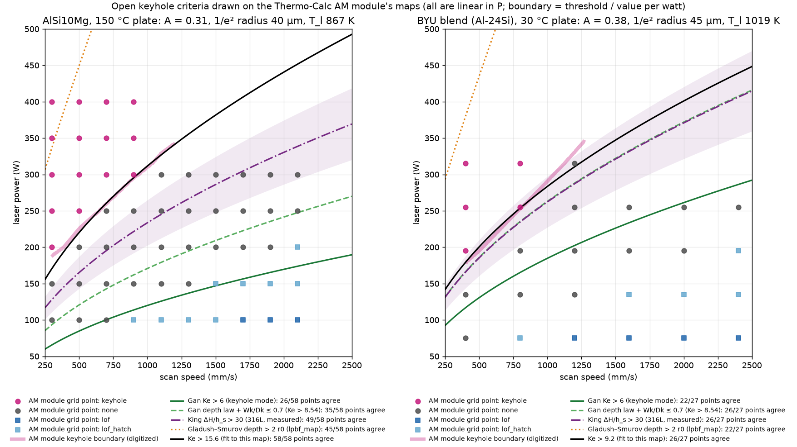
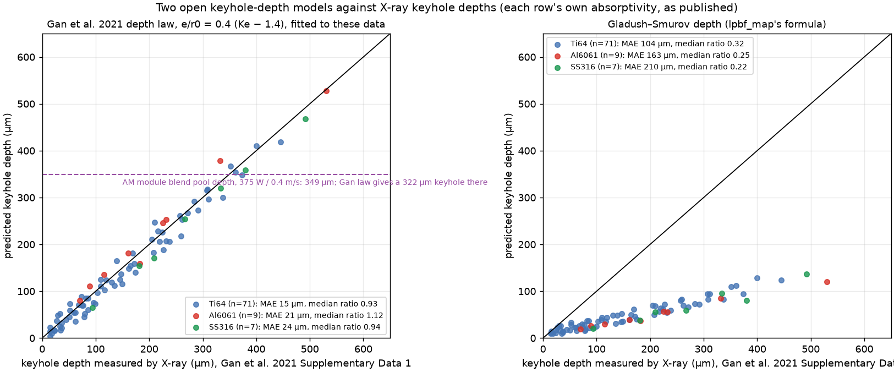
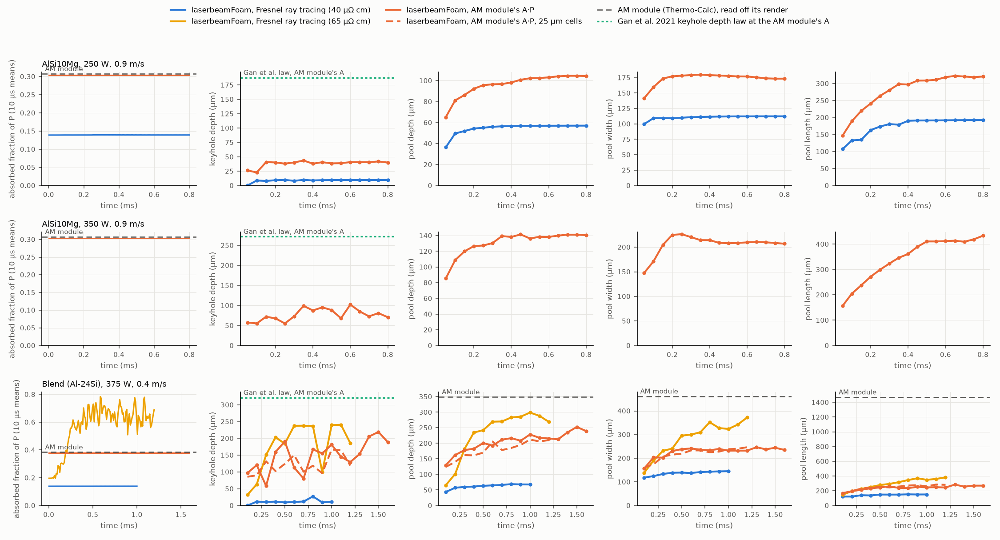
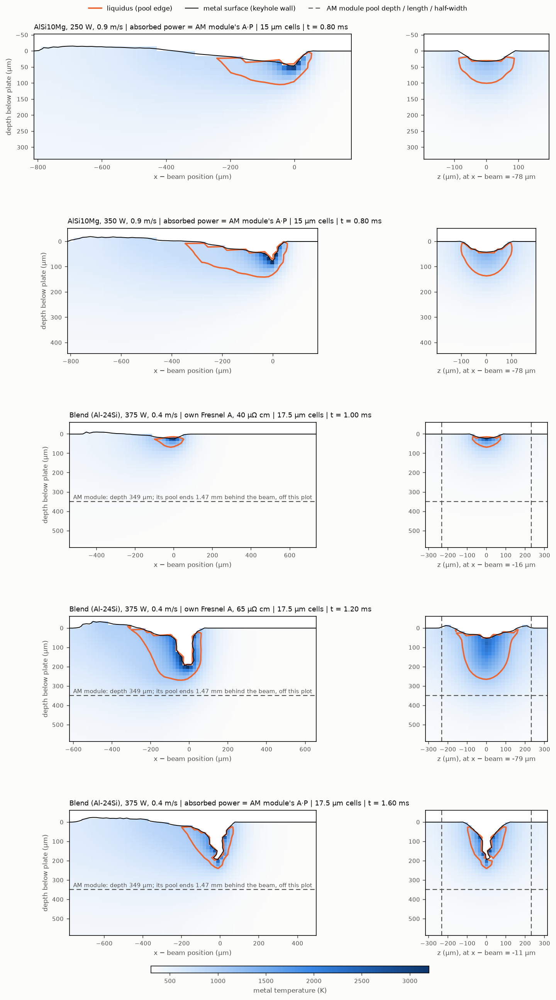
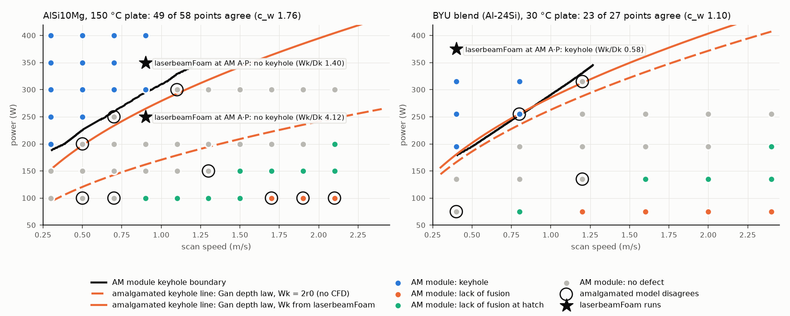

# Open-source alternatives to the AM module for keyholing and keyhole-mode pool size (#235)

The eagar-tsai comparison in [#238](../eagar-tsai/README.md#comparing-with-our-in-house-thermo-calc-am-module-results)
ended with: *"It can't replace the AM module for keyholing or keyhole-mode pool size, and its width/depth ≤ 2.5
keyhole test shouldn't be used with these beams."* This folder asks what open-source model, or approach, could. I
looked in three ways:
- Edison literature searches: four queries that came back ungrounded twice, then three grounded rounds for the
  first-principles model;
- reading the primary sources through a headed browser tunnelled out through a lab Pi;
- testing the cheap candidates against the same in-house AM-module maps and melt-pool renders that #238 used.
- then, as asked in #249, running the open CFD code (laserbeamFoam) at the AM module's melt-pool points and
  combining it with the cheap models ([below](#laserbeamfoam-runs-and-the-methods-combined-against-the-am-module));
- and, also asked in #249, writing our own first-principles keyhole and melt-pool model
  ([below](#our-own-first-principles-model), full write-up in [`first-principles/`](first-principles/README.md)).

## Answer

| What we need | Best open option | How well it does here | Cost per point |
|---|---|---|---|
| **Keyhole boundary on a printability map** | **The keyhole number** Ke = ηP / ((T_l − T0) π ρ c_p √(α v r0³)) of [Gan et al. 2021](https://doi.org/10.1038/s41467-021-22704-0), or the normalized enthalpy of [King et al. 2014](https://doi.org/10.1016/j.jmatprotec.2014.06.005), which differs only in its constants and temperature scale. Use one threshold, calibrated on our own single tracks. | The AM module's keyhole boundary lies along a near-constant Ke on both maps (Ke stays within −3 % and +10 % of its median from 0.3 to 1.3 m/s). So the boundary's *shape* is reproduced, and only its level needs fitting. One fitted threshold per map gets 58 of 58 and 26 of 27 grid points; eagar-tsai's W/D test gets 18 and 15. Unfitted, with the keyhole width taken from laserbeamFoam, Gan's depth law and the AM module's own Wk/Dk ≤ 0.7 test give the same keyhole-or-not call at 55 of 58 and 25 of 27 points ([below](#the-combined-model-on-the-am-modules-maps)). | microseconds |
| **Keyhole depth** | **Gan et al.'s depth law** e / r0 = 0.4 (Ke − 1.4) | On Gan et al.'s published X-ray keyhole depths (Ti-6Al-4V, Al6061, SS316) it is within 6–13 % (median). At the AM module's keyhole-mode render it gives a 322 µm keyhole under a 349 µm pool. eagar-tsai can't reach that pool depth at any absorptivity (#238). | microseconds |
| **Keyhole-mode pool width and length, keyhole porosity** | **An open thermal-fluid code that resolves the keyhole**: [laserbeamFoam](https://github.com/laserbeamfoam/LaserbeamFoam) first (OpenFOAM, Fresnel ray tracing, recoil pressure, GPL-3.0, active); [meltPoolFoam](https://github.com/meltPoolFoam/meltPoolFoam), [MeltPoolDG](https://github.com/MeltPoolDG/MeltPoolDG) and [Lethe](https://github.com/chaos-polymtl/lethe) as alternatives | Run here, coarse (15–25 µm cells, 0.8–1.6 ms of track; [below](#laserbeamfoam-runs-and-the-methods-combined-against-the-am-module)). Given the AM module's absorbed power, laserbeamFoam's blend pool is about two-thirds as deep and half as wide as the AM module's, and its length settles near 250 µm against 1.47 mm. Its own Fresnel absorptivity either stays in conduction mode or keyholes and absorbs ~0.7, depending on the liquid's resistivity. The value sourced later for our first-principles model, about 75 µΩ cm at the keyhole wall, points to the keyhole. No cheap open model gives keyhole-mode length or width. | CPU-hours to days per track, so use it to calibrate, not for maps |
| **Our own model, from first principles** ([`first-principles/`](first-principles/README.md); version 2, the current one, in [`first-principles/v2/`](first-principles/v2/README.md)) | Drude–Fresnel optics of the liquid alloy, a ray tracer for the keyhole's multiple reflections, an energy balance at a tilted keyhole wall at the alloy's boiling point (3D moving point sources; Mg and Si in the vapour), a powder layer, and the melt pool as an isotherm of the same sources or from our own 3D melt-flow solver. Properties from cited measurements (read through the Pi) and pycalphad + mc_al. Nothing fitted to keyhole or melt-pool data | **Keyhole boundary:** the power where a stable keyhole first appears is 0.96–1.01× the AM module's boundary for AlSi10Mg, and 1.16–1.25× for the blend. Calling a keyhole wherever one is stable makes the AM module's keyhole-or-not call at **58 of 58 and 25 of 27** grid points: all 15 of its AlSi10Mg keyholes and 3 of its 5 blend ones, none extra. **Keyhole depth:** median 0.87× the X-ray depths for Ti-6Al-4V (R² 0.93) and 0.73× for 316L, but 2.3× too deep for Al6061, because deep Al keyholes absorb about twice too much. **Lack of fusion:** disagrees with the AM module at every one of its no-defect points, even with melt flow. The AM module's absorptivity at its one no-defect render (0.31) lies between what AlSi10Mg was measured to absorb on an as-built surface (0.16–0.23) and on a powder layer (0.65–0.76), so the model's powder coupling is the likelier shortfall. **Pool length:** nothing reaches the AM module's 1.47 mm blend pool. Version 1's 0.315 at the AlSi10Mg render, which matched the AM module's 0.307, is one of several stable states there | 0.2–3 s; melt flow 10 s–6 min |
| **The approach** | **An ORCHID-style open benchmark.** Curate the measured keyhole data (X-ray depths, onset and porosity thresholds, our own tracks) with uncertainties, and score every cheap model against it, including the AM module. [`scripts/keyhole_open_models.py`](../../scripts/keyhole_open_models.py) is a first scorer. | See [below](#an-orchid-style-benchmark-for-keyhole-models) | |

**Don't use:**
- eagar-tsai's W/D ≤ 2.5 test (#238);
- the Gladush–Smurov depth in [`lpbf_map`](https://github.com/ilidio-costa/lpbf_map). It comes out 3–4.5× too shallow against X-ray keyhole depths ([below](#2-keyhole-depth)), and lpbf_map's "King" test ignores scan speed;
- a power-density threshold on its own. Cunningham et al.'s 0.4 MW/cm² is for a stationary beam, and every point on both of our maps is above it.

**The catch is the absorptivity, not the model.** Ke is linear in ηP, so every threshold above trades off one-for-one
against the absorptivity, and Al's absorptivity rises steeply once a keyhole opens. The AM module calculates it at
every point, but our PNGs show it at only two points. The biggest step forward would be the grid as a CSV from
Thermo-Calc's account manager (W, D, L, Dh, Wk, Dk and the calculated absorptivity at every point), already asked
for in #238, together with our own single-track cross-sections.

## Tests

[`scripts/keyhole_open_models.py`](../../scripts/keyhole_open_models.py) runs everything below in about 2 s. It
reads #238's digitized AM-module boundaries and grid classes, and downloads Gan et al.'s Supplementary Data 1
(CC BY 4.0) into a cache, checking its sha256. Settings are #238's:
- AlSi10Mg: A = 0.31, beam 1/e² radius 40 µm, T_l 867 K, 150 °C plate;
- blend: A = 0.38, 45 µm, T_l 1019 K, 30 °C plate;
- properties: k 110 W/m/K, ρ 2650 kg/m³, c_p 1040 J/kg/K;
- Al boiling point 2743 K.

### 1. The AM module's keyhole boundary is a line of constant keyhole number



Along the digitized keyhole boundary, power rises as v^0.46 (AlSi10Mg) and v^0.59 (blend), close to the v^0.5 of a
constant Ke. So each criterion's boundary is a fixed fraction of the AM module's:

| Criterion (keyhole if…) | AlSi10Mg: boundary power ÷ AM's | AlSi10Mg: grid points agreeing (of 58) | Blend: boundary power ÷ AM's | Blend: grid points agreeing (of 27) |
|---|---|---|---|---|
| Gan Ke > 6 ("keyhole mode", X-ray) | 0.35–0.39 | 26 | 0.60–0.67 | 22 |
| Gan's depth law + the AM module's own Wk/Dk ≤ 0.7, taking Wk = 2r0 (→ Ke > 8.54) | 0.50–0.55 | 35 | **0.86–0.96** | **26** |
| King ΔH/h_s > 30 (316L, measured) | 0.69–0.76 | **49** | **0.86–0.95** | **26** |
| Gladush–Smurov depth > 2r0 (lpbf_map's geometric test) | 1.8–2.4 | 45 (13 of 15 keyholes missed) | 2.1–2.4 | 22 (all 5 missed) |
| Ke above the median on this map's boundary (15.6 / 9.2) | 0.91–1.01 (RMS 4 W) | **58** | 0.92–1.03 (RMS 10 W) | **26** |
| eagar-tsai W/D ≤ 2.5, from #238 | – | 18 | – | 15 |
| eagar-tsai peak T ≥ T_b, from #238 | – | 20 | – | 11 |

Along the AM module's boundary:

| | AlSi10Mg | Blend |
|---|---|---|
| Ke | 15.5–17.1 | 8.9–10.0 |
| King ΔH/h_s | 39.7–43.8 | 31.5–35.1 |
| Ke with the boiling point in place of the liquidus, ηP / ((T_b − T0) π ρ c_p √(α v r0³)) | 2.96–3.26 | 2.62–2.93 |
| Gan keyhole depth | 225–251 µm | 136–154 µm |

What this says:
- **The open laws reproduce the boundary's shape; the level is one number.** Ke's level differs between the two
  maps (15.6 against 9.2).
- **Most of that difference is the denominator T_l − T0.** It is 444 K for AlSi10Mg on its 150 °C plate, and 716 K
  for the blend, which has a higher liquidus and a 30 °C plate.
  - King's normalized enthalpy divides by the absolute T_m instead, and its values on the two maps are 1.2× apart.
  - Normalizing by T_b − T0 instead, as for a keyhole that opens when the surface boils, brings them to within 1.1×
    (2.7–3.0).
  - With two maps and an absorptivity read at only one point each, that is a hint, not a result.
- **The blend boundary is where the AM module's own Wk/Dk ≤ 0.7 test lands if Gan's depth law sets the keyhole
  depth:** 0.86–0.96× the AM power, 26 of 27 points. That is the closest an uncalibrated open model gets.
  - For AlSi10Mg, the same construction keyholes at half the AM module's power.
  - Two explanations fit: the AM module's absorptivity along that boundary is lower than the 0.31 read off its
    250 W render, or it keyholes later relative to Gan's X-ray-calibrated law.
  - The CSV export would settle it.

### 2. Keyhole depth



Gan et al.'s Supplementary Data 1 has 87 keyhole depths measured by X-ray at Argonne's APS:
- Ti-6Al-4V, 71 rows: 103–522 W, 0.4–1.2 m/s, r0 47.5 and 70 µm;
- Al6061, 9 rows: 416–520 W, 0.35–0.9 m/s, r0 44 µm;
- SS316, 7 rows.

Each row comes with the absorptivity Gan et al. used.

| Model | Ti-6Al-4V | Al6061 | SS316 |
|---|---|---|---|
| Gan et al. depth law (fitted to these data) | MAE 15 µm, median ratio 0.93 | MAE 21 µm, median ratio 1.12 | MAE 24 µm, median ratio 0.94 |
| Gladush–Smurov, as in lpbf_map | MAE 104 µm, ratio 0.32 | MAE 163 µm, ratio 0.25 | MAE 210 µm, ratio 0.22 |

- **The depth law is a fit to these data, so the left panel checks the implementation and the scatter, not
  predictive power.** My Ke reproduces Gan et al.'s: a refit gives e/r0 = 0.397 Ke − 0.40, against their 0.4 Ke − 0.56.
  - It still matters that Al6061 is in the fit, with keyholes from 70 to 530 µm.
  - Gan et al. also show the absorptivity rising with Ke, through their Eq. 6, η = 0.7 [1 − exp(−0.6 Ke_m L_d*)].
  - Their Al6061 absorptivities don't follow that equation with any physical flat-surface value. Inverting it on
    their own rows gives 0.007 for Al6061, against 0.24–0.30 for the Ti-6Al-4V and SS316 rows. So for Al, the
    absorptivity has to come from elsewhere: calorimetry, the AM module, or a fit to our own tracks.
- **The Gladush–Smurov depth is 3–4.5× too shallow on every material.** lpbf_map reports it only when it is deeper
  than eagar-tsai's conduction depth. At both AM-module render points, the conduction depth is the deeper one.
  - At the AM module's blend render it gives 89 µm, against the AM module's 349 µm pool.
  - I checked that my implementation matches lpbf_map's own function to 0.01 µm
    ([log](logs/lpbf_map-crosscheck.log)).

**The AM module's keyhole-mode render (blend, 375 W, 0.4 m/s, A = 0.38).**
- The render shows a pool 349 µm deep and 1.47 mm long, with a half-width of 231 µm.
- Gan's law gives a **322 µm keyhole** with the pool edge at the liquidus, or 429 µm with it at the eutectic.
- For the keyhole to reach the full pool depth, the law would need A = 0.415.
- In the render, the V-shaped region near Al's boiling point (the vapour cavity) reaches most of the way down the
  349 µm axis, so 322 µm is consistent with it.
- Nothing cheap gives the 1.47 mm length.
  - A point source's trailing isotherm sits at q/(2πkΔT) = 0.29 mm.
  - eagar-tsai gives 0.40–0.50 mm (#238).
  - The AM render's velocity arrows show surface liquid running backwards from the keyhole at around 1 m/s. That
    convection is what stretches the pool.

At the AlSi10Mg render (250 W, 0.9 m/s), which the AM map calls defect-free:
- Ke is 13.2, and the depth law gives a 189 µm keyhole, deep enough for Gan's keyhole mode (e* = 4.7 > 2).
- The render does show a V-shaped hot cavity.
- Whether that counts as a defect depends on the threshold. This is the same calibration question as above.

### 3. Measured AlSi10Mg single tracks

[Solyaev et al. 2025](https://arxiv.org/abs/2507.23422) found keyhole-shaped pools (D/W > 0.75) for P > 220 W
and v < 0.8 m/s, with an 80 µm spot. On the 231 scored points of #238's grid (A = 0.22, the study's own
conduction fit; 1/e² radius 56.6 µm; room-temperature plate assumed):

| Criterion | Boundary power at 0.8 m/s (measured: 220 W) | Points agreeing (of 231) | Measured keyholes missed (of 80) | Extra keyholes |
|---|---|---|---|---|
| Gan Ke > 6 | 325 W | **196** | 14 | 21 |
| Gan's depth law + Wk/Dk ≤ 0.7 (Ke > 8.54) | 462 W | 181 | 46 | 4 |
| King ΔH/h_s > 30 | 493 W | 177 | 51 | 3 |
| Gladush–Smurov depth > 2r0 | 1,542 W | 151 | 80 | 0 |
| eagar-tsai W/D ≤ 2.5 (#238) | – | 193 | 1 | 37 |

- At the measured corner (220 W, 0.8 m/s), Ke = 4.1, inside Gan's transition range (1.4–6).
- The measured region is a box, and every single-number criterion draws a diagonal line, so none does much better
  than about 85 %.
- The measured class is pool shape (D/W), not keyhole presence. At low speed the pool widens, so its D/W stays low
  even at high Ke.
- **Two things follow.**
  - Against the measured Al tracks, the AM module's levels (Ke 9–16 at its own A) and King's 316L value look late.
    Even at the AM module's A of 0.31–0.38, the measured corner would sit at Ke ≈ 6–7. The beams and absorptivities
    differ, so this is a pointer, not a verdict.
  - Our own calibration should use X-ray-free measurements we can make: keyhole porosity and D/W in cross-sections
    of single tracks on our machine.

## Open thermal-fluid codes that resolve the keyhole

Checked on GitHub on 2026-11-10 (licence, last push, and the physics in each README or docs):

| Code | Licence, activity | Keyhole physics | Keyhole case shipped | Fit for us |
|---|---|---|---|---|
| [laserbeamFoam](https://github.com/laserbeamfoam/LaserbeamFoam) ([SoftwareX 2023](https://doi.org/10.1016/j.softx.2022.101299)) | GPL-3.0; pushed 2026-11-09; 108 stars | OpenFOAM VOF, phenomenological recoil pressure, and a Gaussian beam split into rays. Each ray's absorption comes from the Fresnel equations, with the metal's optical response from a Drude model of its free-electron density and local electrical resistivity (`src/laserHeatSource/laserHeatSource.C`). A compressible variant tracks the vapour. | `cunninghamValidation` (set up after Cunningham et al. 2019: 70 µm beam radius, 1070 nm), `LPBF_small`, `LPBF_large`, `PowderBed` | **First choice** for a reference keyhole-mode pool. Its absorptivity is the same kind of model as the AM module's (Lorentz–Drude, from resistivity and wavelength), and it adds the multiple reflections inside the keyhole that Al's absorptivity depends on |
| [meltPoolFoam](https://github.com/meltPoolFoam/meltPoolFoam) | GPL-3.0; pushed 2026-08-08 | OpenFOAM melt-pool solver | `Cunningham2019`, a 3D keyhole reference case | Second choice; small project |
| [MeltPoolDG](https://github.com/MeltPoolDG/MeltPoolDG) | LGPL-3.0; pushed 2026-11-05 | deal.II, conservative level set with CutFEM; evaporation, recoil pressure, powder | keyhole work listed in its publications | Research-grade, heavier to set up |
| [Lethe](https://github.com/chaos-polymtl/lethe) | Apache-2.0; pushed 2026-11-10 | deal.II; evaporation model with recoil pressure and evaporative cooling | `static-irradiation`: 2D, stationary Ti-6Al-4V keyhole after Cunningham et al. 2019 | Good for a quick stationary keyhole check; not a moving track |
| [MOOSE](https://github.com/idaholab/moose) navier_stokes | LGPL-2.1; active | vapour-recoil-pressure boundary conditions | `examples/laser-welding` (2D) | Possible, but no LPBF keyhole case |
| [AdditiveFOAM](https://github.com/ORNL/AdditiveFOAM) | ORNL licence; pushed 2026-11-06 | heat and mass transfer in a fixed domain, no free surface | none | Not a keyhole model |
| [3DThesis](https://github.com/ORNL-MDF/3DThesis) | BSD-3-Clause | semi-analytic conduction, like eagar-tsai | none | Not a keyhole model |

None of the cases I found is for an Al alloy. Each needs temperature-dependent Al–Si properties, which the
pycalphad/MatCalc `mc_al` work in [`../pycalphad-al-cu/`](../pycalphad-al-cu/) could supply. The AM module gets
them from its Scheil calculator.

## laserbeamFoam runs, and the methods combined, against the AM module

Sterling asked for the CFD and the other simulations recommended above to be run, the methods combined, and the
result compared with the AM module. This section does that. Everything ran on the 4-vCPU Actions runner (2 physical
cores) inside one ~2.5 h job, so the CFD meshes are coarse (15–25 µm) and the tracks short (0.8–1.6 ms). Read its
numbers as indicative, not converged.

**What ran:**
- [laserbeamFoam](https://github.com/laserbeamfoam/LaserbeamFoam) (commit `38a6d38`), built against OpenFOAM v2506
  from openfoam.com's Ubuntu packages. [`scripts/keyhole_cfd_laserbeamfoam.py`](../../scripts/keyhole_cfd_laserbeamfoam.py)
  writes the cases ([`cfd/cases/`](cfd/cases/)), measures the pool and keyhole at every write, and draws the figures.
- eagar-tsai (from #238's grids), Gan et al.'s keyhole number and depth law, and the AM module's own tests, combined
  in [`scripts/keyhole_amalgamation.py`](../../scripts/keyhole_amalgamation.py).
- **Not run:** meltPoolFoam, MeltPoolDG and Lethe. Each needs its own build, MeltPoolDG and Lethe on deal.II, and the
  job's time went to laserbeamFoam.

| Run | Point | Absorptivity | Mesh | Track simulated | Steps | Wall-clock on 2 ranks, sharing the runner with one other run |
|---|---|---|---|---|---|---|
| `alsi10mg-fresnel` | AlSi10Mg, 250 W, 0.9 m/s (AM render; AM map: no defect) | Fresnel, 40 µΩ cm | 15 µm, 48,843 cells | 0.80 ms | 1,628 | 5 min (an 80 s test run, continued) |
| `alsi10mg-matchedA` | AlSi10Mg, 250 W, 0.9 m/s (AM render; AM map: no defect) | fixed at the AM module's A·P (0.31 × 250 W) | 15 µm, 48,843 cells | 0.80 ms | 1,733 | 7 min |
| `alsi10mg-350W-matchedA` | AlSi10Mg, 350 W, 0.9 m/s (AM map: keyhole) | fixed at the AM module's A·P (0.31 × 350 W) | 15 µm, 61,506 cells | 0.80 ms | 2,210 | 12 min |
| `blend-fresnel` | Blend, 375 W, 0.4 m/s (AM render; AM map: keyhole) | Fresnel, 40 µΩ cm | 17.5 µm, 104,044 cells | 1.00 ms | 2,028 | 15 min |
| `blend-fresnel-rho65` | Blend, 375 W, 0.4 m/s (AM render; AM map: keyhole) | Fresnel, 65 µΩ cm | 17.5 µm, 104,044 cells | 1.20 ms | 4,862 | 41 min (restarted once from 0.3 ms) |
| `blend-matchedA` | Blend, 375 W, 0.4 m/s (AM render; AM map: keyhole) | fixed at the AM module's A·P (0.38 × 375 W) | 17.5 µm, 104,044 cells | 1.60 ms | 4,454 | 38 min (stopped at 1.27 ms by the harness's 30-min limit, restarted from 1.2 ms) |
| `blend-matchedA-25um` | Blend, 375 W, 0.4 m/s (AM render; AM map: keyhole) | fixed at the AM module's A·P (0.38 × 375 W) | 25 µm, 37,856 cells | 1.20 ms | 2,451 | 7 min |

**Set-up, the same for every run:**
- 3D and full width (the ray tracer has no symmetry-plane reflection), bare plate with no powder layer, a gas layer
  four cells thick above it, the plate's bottom held at the plate temperature and its sides adiabatic.
- k 110 W/m/K, ρ 2650 kg/m³ and c_p 1040 J/kg/K, the same as the cheap models, so differences come from the physics.
- Liquidus and solidus from MatCalc mc_al: 868.6 / 842.7 K for AlSi10Mg, 1019.3 / 846.7 K for the blend. Latent heat
  of fusion is the mass-weighted Al and Si value, 536 and 736 kJ/kg.
- Surface tension 0.86 N/m, dσ/dT −3.5×10⁻⁴ N/m/K, viscosity 1.3 mPa s. Pure-Al vapour (2743 K, 10.9 MJ/kg) sets the
  recoil pressure and evaporative cooling.
- The beam is the AM module's: Gaussian, 1/e² radius 40 or 45 µm, 1070 nm, split into 1,440 rays out to 1.5 r0
  (which leaves out 1.1 % of the power).
- **Absorptivity, two ways:**
  - *Fresnel*: at every bounce a ray loses the Fresnel fraction for a Drude metal (three free electrons per Al atom)
    and reflects the rest. This is laserbeamFoam's own model, the same kind as the AM module's. The one input is the
    liquid's electrical resistivity: 40 µΩ cm, or 65 µΩ cm for liquid Al near its boiling point.
  - *Matched-A*: the beam power is set to the AM module's A·P, and each ray deposits all of it where it first meets
    the metal. That fixes the absorbed power at the AM module's, so what differs is the flow and the keyhole.
- **What is measured:**
  - the pool is the connected liquid around the beam, above the liquidus (the solidus in brackets below);
  - the keyhole is gas below the original plate surface within 4 r0 of the beam;
  - its width Wk is taken across the track at a quarter of its depth. The opening at the plate surface also picks up
    any dip of the pool surface around it.

### At the three CFD points

laserbeamFoam rows are means over the second half of each run (writes every 0.05 or 0.1 ms), with the pool at the
solidus in brackets. Each eagar-tsai row "at a run's absorbed power" is the grid point with the nearest A·P at the
same speed, since eagar-tsai's field depends on A·P only.

**AlSi10Mg, 250 W, 0.9 m/s (AM render; AM map: no defect)**

| Method | Absorbed fraction | Keyhole depth (µm) | Keyhole width (µm) | Pool depth (µm) | Pool width (µm) | Pool length (µm) | Peak T (K) | Keyhole? |
|---|---|---|---|---|---|---|---|---|
| AM module (Thermo-Calc) | 0.307 | – | – | – | – | – | 3,044 | no defect (its map) |
| eagar-tsai at the AM module's A | 0.307 | – | – | 106 | 221 | 317 | 6,405 | keyhole (its W/D ≤ 2.5 test) |
| Gan et al. depth law at the AM module's A | 0.307 | 189 | – | – | – | – | – | keyhole by the AM test if Wk = 2r0 (Wk/Dk 0.42) |
| eagar-tsai at alsi10mg-fresnel's absorbed power | 0.139 | – | – | 60 | 137 | 165 | 3,148 | (grid point 350 W, A 0.1) |
| Gan et al. depth law at alsi10mg-fresnel's A | 0.139 | 73 | – | – | – | – | – |  |
| laserbeamFoam, own Fresnel absorptivity (40 µΩ cm), to 0.80 ms | 0.139 | 10 | 75 | 57 (60) | 112 (116) | 192 (222) | 1,891 | no keyhole (surface dimple) |
| laserbeamFoam, absorbed power fixed at the AM module's A·P, to 0.80 ms | 0.304 | 40 | 165 | 103 (106) | 176 (186) | 314 (426) | 2,894 | no keyhole by the AM test (Wk/Dk 4.12) |

**AlSi10Mg, 350 W, 0.9 m/s (AM map: keyhole)**

| Method | Absorbed fraction | Keyhole depth (µm) | Keyhole width (µm) | Pool depth (µm) | Pool width (µm) | Pool length (µm) | Peak T (K) | Keyhole? |
|---|---|---|---|---|---|---|---|---|
| AM module (Thermo-Calc) | 0.307 | – | – | – | – | – | – | keyhole (its map) |
| eagar-tsai at the AM module's A | 0.307 | – | – | 131 | 270 | 425 | 8,799 | keyhole (its W/D ≤ 2.5 test) |
| Gan et al. depth law at the AM module's A | 0.307 | 273 | – | – | – | – | – | keyhole by the AM test if Wk = 2r0 (Wk/Dk 0.29) |
| laserbeamFoam, absorbed power fixed at the AM module's A·P, to 0.80 ms | 0.304 | 83 | 117 | 140 (142) | 210 (232) | 407 (513) | 3,175 | no keyhole by the AM test (Wk/Dk 1.40) |

**Blend, 375 W, 0.4 m/s (AM render; AM map: keyhole)**

| Method | Absorbed fraction | Keyhole depth (µm) | Keyhole width (µm) | Pool depth (µm) | Pool width (µm) | Pool length (µm) | Peak T (K) | Keyhole? |
|---|---|---|---|---|---|---|---|---|
| AM module (Thermo-Calc) | 0.384 | – | – | 349 | 462 | 1,470 | 3,119 | keyhole (its map) |
| eagar-tsai at the AM module's A | 0.384 | – | – | 157 | 322 | 397 | 11,000 | keyhole (its W/D ≤ 2.5 test) |
| Gan et al. depth law at the AM module's A | 0.384 | 322 | – | – | – | – | – | keyhole by the AM test if Wk = 2r0 (Wk/Dk 0.28) |
| eagar-tsai at blend-fresnel's absorbed power | 0.139 | – | – | 71 | 161 | 172 | 4,200 | (grid point 75 W, A 0.7) |
| Gan et al. depth law at blend-fresnel's A | 0.139 | 100 | – | – | – | – | – |  |
| laserbeamFoam, own Fresnel absorptivity (40 µΩ cm), to 1.00 ms | 0.139 | 13 | 122 | 67 (82) | 142 (174) | 150 (205) | 2,519 | no keyhole (surface dimple) |
| eagar-tsai at blend-fresnel-rho65's absorbed power | 0.658 | – | – | 222 | 450 | 624 | 18,280 | (grid point 255 W, A 0.95) |
| Gan et al. depth law at blend-fresnel-rho65's A | 0.658 | 569 | – | – | – | – | – |  |
| laserbeamFoam, own Fresnel absorptivity (65 µΩ cm, near-boiling liquid), to 1.20 ms | 0.658 | 211 | 102 | 281 (300) | 333 (436) | 346 (496) | 3,251 | keyhole by the AM test (Wk/Dk 0.49) |
| laserbeamFoam, absorbed power fixed at the AM module's A·P, to 1.60 ms | 0.380 | 172 | 99 | 225 (241) | 237 (346) | 257 (448) | 3,233 | keyhole by the AM test (Wk/Dk 0.58) |
| laserbeamFoam, absorbed power fixed at the AM module's A·P (25 µm mesh), to 1.20 ms | 0.380 | 131 | 107 | 199 (217) | 235 (320) | 268 (415) | 3,090 | no keyhole by the AM test (Wk/Dk 0.82) |





**What the runs show:**
1. **On its own absorptivity at 40 µΩ cm, laserbeamFoam stays in conduction mode at both render points.**
   - The plate absorbs 0.139 of the beam. That is the Drude–Fresnel value for a flat liquid surface (0.141 at normal
     incidence).
   - The peak stays below Al's 2,743 K boiling point (AlSi10Mg 1,890 K; blend 2,180–2,680 K after the first 0.1 ms).
     The surface dips by 10–13 µm and no keyhole forms.
   - Gan's law at these absorptivities (Ke 6.0 and 7.0) gives 73 and 100 µm keyholes. Its Ke is meant to be fed the
     absorptivity measured with the keyhole in place, not a flat-surface value.
   - The AM module calls the blend point a keyhole. So do Solyaev et al.'s measured AlSi10Mg tracks, which are
     keyhole-shaped for P > 220 W and v < 0.8 m/s.
   - For a flat surface to absorb the AM module's 0.31–0.38, the Drude model would need 137–217 µΩ cm. Liquid Al is
     24 µΩ cm at its melting point and about 50 µΩ cm near boiling, so the AM module's absorptivity can't be
     flat-surface Fresnel absorption.
2. **At 65 µΩ cm the blend point does keyhole, and the absorbed fraction climbs well past the AM module's.**
   - The flat-surface value is 0.20.
   - A dimple deepens into a keyhole between 0.2 and 0.3 ms. Multiple reflections then take the absorbed fraction to
     0.66 on average over the second half of the run (0.51–0.78 in 10 µs means over its last 0.2 ms). The AM
     module's is 0.38.
   - That is the ~0.7 at which calorimetry finds keyhole-mode absorptivity saturating for other alloys (Ye et al. 2019).
   - So whether laserbeamFoam predicts a keyhole here at all turns on a liquid resistivity somewhere between 40 and
     65 µΩ cm. When these runs were made, it hadn't been looked up for this alloy.
   - Our first-principles model later sourced it. Leitner et al. 2017's liquid Al, with Brandt & Neuer 2007's Si
     increment (checked against Sun et al. 2019 to 20 wt % Si), gives the blend 43 µΩ cm at its liquidus and about
     75 µΩ cm at a keyhole wall's 2,890 K ([`first-principles/v2/`](first-principles/v2/README.md#1-properties)).
   - So the 65 µΩ cm run, the one that keyholes, is the closer of the two. laserbeamFoam takes one resistivity for
     the whole melt, though, and at 24 wt % Si the formula is a short extrapolation.
3. **Given the AM module's absorbed power, laserbeamFoam agrees with the AM map's keyhole call at two of the three
   points, one of them narrowly, and disagrees at the third.** Each is judged by the AM module's own test,
   Wk/Dk ≤ 0.7, applied to the CFD keyhole:
   - **AlSi10Mg at 250 W, which the AM map calls defect-free: agrees.** A dimple 40 µm deep and 165 µm across
     (Wk/Dk 4.1), so no keyhole. Peak 2,894 K, against the AM module's 3,044 K.
   - **AlSi10Mg at 350 W, which the AM map calls keyhole: disagrees.** A keyhole 70–102 µm deep and about 120 µm wide
     (Wk/Dk 1.4 on average, 0.7–1.9 between writes).
   - **Blend at 375 W, which the AM map calls keyhole: agrees, narrowly.** Averaged over 0.8–1.6 ms the keyhole is
     172 µm deep and 99 µm wide (Wk/Dk 0.58). It was still deepening, though.
     - Over 0.6–1.2 ms Wk/Dk was 0.79, and the 25 µm mesh gives 0.82.
     - Between writes Wk/Dk swings from 0.3 to 1.0 over 0.8–1.6 ms (up to 2.1 earlier) as the keyhole collapses and
       reopens.
   - **With reflections (65 µΩ cm) the blend keyhole is clearly a keyhole:** 211 µm deep and 102 µm wide over
     0.6–1.2 ms (Wk/Dk 0.49). But it is absorbing 1.7× the AM module's power.
4. **The keyholes are 2–5× shallower than Gan's depth law, even where the law is inside its fitted range.**
   - Matched-A: 40 against 189 µm (AlSi10Mg, 250 W), 84 against 273 µm (350 W), and 172 against 322 µm (blend).
     Gan et al.'s Al6061 data span Ke 6–31, and these points are at Ke 13–19.
   - Two things in these runs push the keyholes shallow and wide:
     - every ray deposits all its power where it first hits, so none is reflected down the keyhole;
     - the keyholes are only 3–7 cells wide.
   - Reflections alone don't close the gap. The 65 µΩ cm run keeps them, and its keyhole averages 211 µm against
     569 µm from Gan's law at its own absorbed fraction of 0.66 (Ke 34, a little past the fitted range).
   - So the mesh is the likelier culprit. Keep Gan's law for depth, and treat these depths as lower bounds.
5. **laserbeamFoam's pools are shallower, narrower and far shorter than the AM module's, even when they absorb more
   power.**
   - Blend at the AM module's A·P, averaged over 0.8–1.6 ms: 225 µm deep, 237 µm wide and 257 µm long at the
     liquidus. At the solidus they are 241, 346 and 449 µm, and the solidus length is still growing (503 µm at the last
     write). The AM module shows 349, 462 and 1,470 µm.
   - Blend at 65 µΩ cm (absorbed fraction 0.66), averaged over 0.6–1.2 ms: 281, 333 and 346 µm at the liquidus. At
     1.2 ms it is 269, 372 and 383 µm (solidus 298, 508 and 591 µm), still lengthening.
   - The AM module's 1.47 mm can't be tested in these runs. By the end the beam has moved at most 0.65 mm, with at
     most 0.8 mm of plate behind it.
   - AlSi10Mg at 250 W: the CFD pool is 103 µm deep, 176 µm wide and 314 µm long. eagar-tsai at the same A gives
     106, 221 and 317 µm. The AM render has no length scale.
6. **In conduction mode, laserbeamFoam and eagar-tsai agree to within about 20 %.**
   - Blend at 52 W absorbed: laserbeamFoam's pool is 68 µm deep, 145 µm wide and 151 µm long. eagar-tsai gives 71,
     161 and 172 µm.
   - AlSi10Mg at 35 W absorbed: 57, 112 and 193 µm, against eagar-tsai's 60, 137 and 165 µm.
   - laserbeamFoam's pools are a little shallower and narrower, which fits the latent heat that eagar-tsai leaves
     out.
   - So the cheap model is sound on the lack-of-fusion side, where #238 found it agrees with the AM module.
7. **Coarsening the blend matched-A mesh from 17.5 to 25 µm moves the pool by under 10 %.**
   - Over 0.6–1.2 ms: keyhole depth −6 %, pool depth −7 %, width 0 %, length +9 %.
   - So at this level the mesh doesn't set the pool-scale numbers. Both meshes are coarse, though, and a finer one was
     out of reach here.

### The combined model on the AM module's maps

The combined model ("amalgamated" in the tables and scripts) is what the [answer](#answer) recommends, with
laserbeamFoam supplying the one thing Gan's law lacks.
- **Lack of fusion:** eagar-tsai with the AM module's D/t and Dh/t tests, as in #238.
- **Keyhole depth:** Gan et al.'s law, Dk = 0.4 (Ke − 1.4) r0.
- **Keyhole width:** from laserbeamFoam's matched-A keyholes, as a multiple c_w of the beam diameter, so
  Wk = c_w · 2r0. For AlSi10Mg it is the mean of the 250 W and 350 W runs (2.06 and 1.46).
- **Keyhole test:** the AM module's own, Wk/Dk ≤ 0.7, i.e. Ke ≥ 1.4 + 7.14 c_w.

The absorptivity is the AM module's render value, as in #238. The "fully open" rows use laserbeamFoam's own
flat-surface value instead.

**AlSi10Mg**: 58 visible grid points (31 no defect, 15 keyhole, 9 lack of fusion at the hatch, 3 lack of fusion)

| Model | Absorptivity | Keyhole if Ke ≥ | All four classes agree | Keyhole or not agrees | AM keyholes missed | Extra keyholes |
|---|---|---|---|---|---|---|
| eagar-tsai with the AM module's LOF tests, no keyhole test (#238) | 0.307 | – | **37** | 43 | 15 | 0 |
| Ke threshold fitted to this map's own boundary (Ke 15.6; not open) | 0.307 | 15.6 | **52** | 58 | 0 | 0 |
| amalgamated: Gan depth law, Wk = 2r0 (no CFD) | 0.307 | 8.5 | **29** | 35 | 0 | 23 |
| amalgamated: Gan depth law, Wk from laserbeamFoam (c_w 1.76) | 0.307 | 14.0 | **49** | 55 | 0 | 3 |
| fully open: laserbeamFoam's flat-surface A at 40 µΩ cm (0.139) | 0.139 | 14.0 | **7** | 45 | 13 | 0 |
| fully open: laserbeamFoam's flat-surface A at 65 µΩ cm (0.196) | 0.196 | 14.0 | **29** | 50 | 8 | 0 |

**Blend**: 27 visible grid points (13 no defect, 5 lack of fusion at the hatch, 5 keyhole, 4 lack of fusion)

| Model | Absorptivity | Keyhole if Ke ≥ | All four classes agree | Keyhole or not agrees | AM keyholes missed | Extra keyholes |
|---|---|---|---|---|---|---|
| eagar-tsai with the AM module's LOF tests, no keyhole test (#238) | 0.384 | – | **20** | 22 | 5 | 0 |
| Ke threshold fitted to this map's own boundary (Ke 9.2; not open) | 0.384 | 9.2 | **24** | 26 | 0 | 1 |
| amalgamated: Gan depth law, Wk = 2r0 (no CFD) | 0.384 | 8.5 | **24** | 26 | 0 | 1 |
| amalgamated: Gan depth law, Wk from laserbeamFoam (c_w 1.10) | 0.384 | 9.3 | **23** | 25 | 1 | 1 |
| fully open: laserbeamFoam's flat-surface A at 40 µΩ cm (0.139) | 0.139 | 9.3 | **4** | 22 | 5 | 0 |
| fully open: laserbeamFoam's flat-surface A at 65 µΩ cm (0.196) | 0.196 | 9.3 | **5** | 22 | 5 | 0 |



How the agreement moves with the keyhole width, at the AM module's absorptivity (all four classes):

| c_w (keyhole width ÷ beam 1/e² diameter) | 0.75 | 1.00 | 1.25 | 1.50 | 1.75 | 2.00 | 2.25 | 2.50 |
|---|---|---|---|---|---|---|---|---|
| AlSi10Mg, of 58 | 23 | 29 | 37 | 45 | 49 | **52** | 51 | 47 |
| Blend, of 27 | 21 | **24** | 23 | 22 | 21 | 21 | 20 | 20 |

- **With laserbeamFoam's keyhole widths, the combined model comes close to a threshold fitted to the maps
  themselves:**
  - 49 of 58 points for AlSi10Mg (c_w 1.76) and 23 of 27 for the blend (c_w 1.10), against 52 and 24 for a
    keyhole-number threshold fitted to each map.
  - With the keyhole only as wide as the beam (Wk = 2r0, no CFD), the AlSi10Mg map gets 29 of 58.
  - No single width fits both maps. AlSi10Mg is best near c_w = 2.0 and the blend near 1.0. laserbeamFoam
    puts each alloy within about 0.25 of its own best: AlSi10Mg's keyholes come out wider relative to the beam than
    the blend's.
  - Most remaining disagreements are on the lack-of-fusion side, which is eagar-tsai's, as in #238.
- **The keyhole width is the least certain number in the chain.**
  - It comes from one run (blend) or two (AlSi10Mg), on 15–17.5 µm cells, so ±1 cell is ±0.2 in c_w.
  - How it is measured matters. For the blend, c_w is 1.10 at a quarter of the keyhole's depth, 2.81 at the plate
    surface and 0.65 at half depth.
  - With reflections (the 65 µΩ cm run) the blend keyhole is about as wide (102 µm at a quarter depth, c_w 1.14) but
    deeper.
  - The AM module's own definition of Wk isn't public.
- **The fully open rows use laserbeamFoam's own flat-surface absorptivity in place of the AM module's.** They
  show what an uncalibrated open model would draw: 7 of 58 and 4 of 27 at A = 0.139; 29 of 58 and 5 of 27 at
  A = 0.196. At a flat-surface absorptivity, most of both maps falls to lack of fusion.

### What this changes in the answer

- **Keyhole boundary: the recommendation holds, and laserbeamFoam supplies its missing piece.**
  - Combined, the keyhole number, Gan's depth law, a keyhole width from laserbeamFoam and the AM module's own
    Wk/Dk test come within one to three grid points of a threshold fitted to the AM module's own boundary, on both
    maps. They make the AM module's keyhole-or-not call at 55 of 58 and 25 of 27 points without being fitted to
    them.
  - That holds at the AM module's absorptivity.
- **Absorptivity is still the open question, and laserbeamFoam doesn't settle it on its own.**
  - With its own Fresnel absorptivity on a bare plate, it either stays in conduction mode (40 µΩ cm) or keyholes and
    absorbs more than the AM module (65 µΩ cm), at the same point.
  - The outcome turns on the liquid resistivity, and on the powder layer these runs leave out. The resistivity our
    first-principles model later sourced, about 75 µΩ cm at the keyhole wall, favours the 65 µΩ cm run that keyholes.
  - Our own single tracks, or the AM module's CSV with A at every point, are still what would pin A down.
- **Keyhole depth: keep Gan's law.** These coarse CFD keyholes come out 2–5× shallower than Gan's X-ray-fitted law,
  and are the less trustworthy of the two.
- **Keyhole-mode pool width and length need a bigger CFD run than this runner allows.**
  - At the AM module's absorbed power, laserbeamFoam's blend pool is about two-thirds of the AM module's depth and
    half its width at the liquidus. Its length settles at about 250 µm, against 1.47 mm.
  - At the solidus it reaches 503 µm by the last write, about twice as long, and is still growing.
  - Even absorbing 1.7× the AM module's power (the 65 µΩ cm run), the pool reaches only 80 % of the AM module's
    depth, 72 % of its width and a quarter of its length.
  - Either the AM module's flow carries far more heat backwards than laserbeamFoam's does, or the two draw the pool
    edge at different temperatures. A run that settles would tell which.
  - The next step: 3–5 ms of track at ≤ 10 µm, with Fresnel reflections and a powder layer. At the cost measured
    here (about 7.5 µs of core time per cell per step) that is 100–200 core-hours, a few hours on a 64-core node.
    Check its pool length against the AM-Bench and MeltpoolNet lengths in the benchmark table.

**To rerun** (about an hour on 4 vCPUs for all seven runs, two at a time):

```bash
# OpenFOAM v2506 from openfoam.com's apt repository (dl.openfoam.com/add-debian-repo.sh), then laserbeamFoam
sudo apt-get install openfoam2506-dev
git clone https://github.com/laserbeamfoam/LaserbeamFoam && cd LaserbeamFoam && git checkout 38a6d38
source /usr/lib/openfoam/openfoam2506/etc/bashrc
(cd src && ./Allwmake -j 4) && (cd applications/solvers/laserbeamFoam && wmake -j 4) && cd ..
# each run: copy its case under its own name, run it on 2 ranks, reconstruct, measure
R=blend-matchedA; OUT=arroyave-orchid-tools/keyhole-alternatives/cfd
cp -r $OUT/cases/$R /tmp/$R && (cd /tmp/$R && ./Allrun 2 && reconstructPar -fields '(T alpha.metal U)')
python scripts/keyhole_cfd_laserbeamfoam.py post --case-dir /tmp/$R --out $OUT
# then the figures and the combined model
python scripts/keyhole_cfd_laserbeamfoam.py figures --post-dir $OUT --case-dirs /tmp/<each run> --out $OUT
python scripts/keyhole_amalgamation.py --cfd-dir $OUT --out $OUT
```

## Our own first-principles model

Sterling asked in #249 for our own implementation from first principles, using the Pi for articles and databases
and Edison as needed. [`scripts/keyhole_first_principles.py`](../../scripts/keyhole_first_principles.py) is written
from scratch, and [`first-principles/README.md`](first-principles/README.md) has the physics, every property with its
source, the checks and all the results. In short:

- **The physics:**
  - Drude–Fresnel optics of the liquid from its measured resistivity;
  - a Monte Carlo ray tracer for multiple reflections in a conical keyhole opening one beam radius wide;
  - the keyhole depth from an energy balance at a wall held at the boiling point (moving point sources on the axis,
    with images, plus vapour outflow);
  - the pool as the liquidus isotherm of the same sources, with latent heat from pycalphad + mc_al.
- **Properties** are cited measurements read through the Pi: Leitner et al. 2017 (liquid Al), Brandt & Neuer 2007
  (Al–Si resistivity), NIST-JANAF (boiling point and vaporisation), Kobatake et al. 2015 (Al–Si surface tension) and
  Krishnan et al. 1993 (liquid Al optics). Kaplan 1994 and Lankalapalli et al. 1996 are checked against the papers.
- **Against the AM module:**
  - keyhole-or-not agrees at 58 of 58 AlSi10Mg and 25 of 27 blend grid points, unfitted;
  - its keyhole line is at 0.95–1.02× (AlSi10Mg) and 1.16–1.22× (blend) the AM module's power;
  - at the AlSi10Mg render it absorbs 0.315, against the AM module's 0.307.
- **Against X-ray keyhole depths** (Gan et al., 87 rows), on its own absorptance:
  - Ti-6Al-4V median 0.88× (R² 0.93); SS316 0.66×;
  - Al6061 2.2× too deep, because the cone traps ~0.85 of the beam where Gan et al.'s η is 0.18.
  - Its Ti-6Al-4V absorptance (median 0.77) is in the range Simonds et al. 2021 measured (0.66–0.84).
- **What it can't do yet:**
  - Lack of fusion is over-predicted: a flat liquid absorbs only 0.18–0.20.
  - Keyhole-mode pool length is 473 µm at the liquidus at the blend render (1,129 µm at the solidus), against the AM
    module's 1,470 µm. It has no melt flow.
  - Deep Al keyholes absorb 0.87 against the AM module's 0.38. A paraboloidal keyhole gives 0.39, so the keyhole's
    shape is the open question.
- **The one measured aluminium point.** NIST's AM-Bench 2022 Al 5182 track (Simonds et al. 2024; 473 W, 0.7 m/s)
  measured an absorbed fraction of 0.43 in the keyhole; the model gives 0.30. Its pool is 109 µm deep and 218 µm wide
  against the measured 88.8 and 326. So the fixed-cone keyhole traps too little there, and too much at the blend
  render.
- **Edison's round 3 came back grounded** (51 of 52 DOIs correct). It found that Al 5182 lead.

### Version 2: the items version 1 left out

Sterling asked for version 1's "not done" items. They are in
[`first-principles/v2/`](first-principles/v2/README.md), with nothing fitted to keyhole or melt-pool data:
- **Mg evaporation.**
  - JANAF vapour pressures and mc_al activities, with Mg depletion at the wall.
  - The wall keeps only 0.5–3 % of the bulk Mg, so it is 1–7 K cooler for our alloys and 28–96 K for Al 5182.
  - No map class changes.
- **A powder layer.**
  - A radiative-transfer model over-traps light against Boley et al.'s ray tracing and Rubenchik et al.'s measurement, so the measured 0.53 is used.
  - The melt front runs ahead of the beam, so only 3–24 % of the beam lands on powder. No class changes.
- **A tilted keyhole.**
  - Kaplan's front-wall balance gives front walls 7–26° from vertical, and changes absorptance and depth very little.
  - A free-form shape from the point-by-point balance becomes a funnel that makes the X-ray depths worse, so it isn't used.
- **Melt flow, with our own 3D beam-frame solver** (Marangoni flow on a flat surface, keyhole as a cavity at T_w; 5 validation checks pass).
  - Flow widens pools by 7–12 % and barely changes depth or length.
  - Resolving the temperature-dependent properties, which the analytic model averages, lengthens them by 21–65 %.
  - An imposed recoil-driven flow round the keyhole, at 3–7 m/s, changes pools by 10 % or less.
  - Nothing reaches the AM module's 1.47 mm blend pool.
- **Sourced properties:**
  - Sun et al. 2019 confirms the blend's resistivity formula to 20 wt % Si;
  - Boivineau et al. 2006 and Pichler et al. 2020 supply Ti-6Al-4V and 316L;
  - Yang et al. 2018 supplies LPBF AlSi10Mg's k(T).
- **New: more than one stable keyhole.**
  - Above the power where the surface first boils, both a shallow dimple and deeper keyholes are stable.
  - The power where a stable keyhole with Wk/Dk ≤ 0.7 first exists is **0.96–1.01× the AM module's boundary for AlSi10Mg** (1.16–1.25× for the blend). At the AM module's own 0.9 m/s render speed it appears at 285–290 W, against the AM module's 295 W.
  - The AM module's 0.307 absorptivity at its 250 W render is close to the model's 0.32 state, which first appears at 260 W. At 250 W the model has only the dimple, absorbing 0.18.
  - Calling a keyhole wherever one is stable agrees with the AM module at 58 of 58 and 25 of 27 points: all 15 of its AlSi10Mg keyholes and 3 of its 5 blend ones, with none extra.
  - NIST's Al 5182 track shows the same jump. It measured 0.24 before the keyhole and 0.43 in it. At that power the model has stable states absorbing 0.17, 0.30, 0.42 and 0.53.
- **Still wrong:**
  - **Lack of fusion at every AM "no defect" point.** That holds with the powder, with melt flow, and with the melt's absorptance raised to NIST's 0.24.
    - The dimple there absorbs 0.18 where the AM module has 0.31.
    - Measured pre-keyhole absorptance is 0.06–0.24 on bare plates, near the model's 0.18. But in a commercial LPBF machine, AlSi10Mg absorbs 0.16–0.23 on an as-built surface and 0.65–0.76 with a powder layer ([Allen 2023](https://hdl.handle.net/1974/32579), read in the source). So on a powder bed the model's powder coupling, which drops the powder once the surface boils, is the likelier shortfall, not the AM module's 0.31.
  - Deep aluminium keyholes absorb 0.82–0.87 in the model, about twice the 0.4 that the AM module's blend render, NIST's Al 5182 and Gan et al.'s Al6061 depths point to. That is the likeliest reason Al6061 keyholes come out 2.3× too deep; Ti-6Al-4V's absorptance is right.
  - The AM module's long blend pool isn't explained by melt flow or the recoil-driven experiment. An unread synchrotron study, Guo et al. 2020, suggests AlSi10Mg pools that long are real, which would make our models short.
- **What would settle it:** a short single-track matrix on our machine at the AM module's render speeds, in [`first-principles/v2/README.md`](first-principles/v2/README.md#what-would-settle-it-single-tracks-on-our-own-machine). The low-power AlSi10Mg tracks should be run both on an as-built surface and on a powder layer.

## An ORCHID-style benchmark for keyhole models

ORCHID ([`../orchid/`](../orchid/)) is useful because it pairs open models with curated, accepted reference values and
scores the models against them. Keyholing needs the same: a cheap model is only as good as its threshold and its
absorptivity, and both are calibration problems.

**Open data to start from** (all checked to exist and be public):

| Data | What it has | Licence and access |
|---|---|---|
| Gan et al. 2021 Supplementary Data 1 and 2 ([doi](https://doi.org/10.1038/s41467-021-22704-0)) | 87 X-ray keyhole depths (Ti-6Al-4V, Al6061, SS316), each with the absorptivity used, a length and a front-wall angle (tan θ); plus 28 rows of simulated energy balance (absorbed, reflected, evaporated) | CC BY 4.0, XLSX |
| [LLNL Keyhole-mode Microscopy Dataset](https://doi.org/10.2172/1878448) (OSTI 1878448, 2022) | 600+ single-track cross-section micrographs, 316L on a Concept Laser M2, spanning conduction and keyhole mode; same LLNL group and machine type as King et al. 2014 | LLNL Open Data Initiative |
| King et al. 2014 ([OSTI manuscript](https://www.osti.gov/biblio/1502044)) | 316L keyhole threshold ΔH/h_s = 30 ± 4 at two beam sizes, with melt-pool depths | DOE public access |
| Solyaev et al. 2025 ([arXiv](https://arxiv.org/abs/2507.23422)) | AlSi10Mg single-track classes (keyhole, stable, lack of fusion) for six powders | arXiv |
| Cunningham et al. 2019 ([Science](https://doi.org/10.1126/science.aav4687)) | Ti-6Al-4V keyhole drilling and moving-beam depths; ~0.4 MW/cm² onset | subscription; BYU has access |
| [MeltpoolNet](https://github.com/BaratiLab/MeltpoolNet) ([Akbari et al. 2022](https://doi.org/10.1016/j.addma.2022.102817)) | Literature-compiled melt-pool data: 1,796 rows of P, v, beam, properties and pool depth, width and length, each with a shape label (317 keyhole); plus 1,249 rows for classification. Mostly 316L and Ti-6Al-4V; 29 AlSi10Mg rows | CSV on GitHub with no licence file, so cite it and ask before redistributing |
| [AM-Bench 2018, AMB2018-02](https://www.nist.gov/ambench/amb2018-02-description) ([doi:10.18434/M32050](https://doi.org/10.18434/M32050)) | IN625 bare-plate single tracks, three power–speed settings with replicates: in-situ melt-pool length and cooling rate, and cross-sections | NIST public data. Conduction mode, so it checks pool length rather than keyholing |
| The AM module's two maps and renders (#238) | one more "model" to score, not ground truth | in-house |

**What to build:**
1. One table of measurements. Each row gets the alloy, the beam (with its definition: 1/e² radius, D4σ or Gaussian σ),
   P, v, plate temperature, measured keyhole depth and/or class, the absorptivity if measured, the uncertainty and
   the source.
2. A scorer for each model's predictions (MAE in depth, class agreement), per alloy family. The script here already
   does this for four models and three references.
3. Our own rows: single tracks on the Aconity at the AM module's grid points, sectioned for depth, D/W and keyhole
   pores. Those rows are what decide the Al threshold and absorptivity.
4. Later, if useful, an MCP server over the table, as ORCHID has.

## Sources checked through the lab's browser route

The literature checks used headed Chrome on a virtual display on the runner, driven with real pointer and keyboard
events (xdotool), and tunnelled out through the CubXL Pi over SSH. It's the Onshape route in CLAUDE.md, with two changes:
- a local filter refuses any address that isn't public, and any port other than 80 and 443, so pages can't reach
  the lab network through the Pi;
- Chrome's local-network protections stay on.

The tunnel exits on BYU's network, which is what gives subscription access. The three camera Pis had been offline
for 6 h, so the CubXL Pi relayed. Nothing was installed or written on it.

| Claim | Source read | Result |
|---|---|---|
| Ke = ηP / ((T_l − T0) π ρ c_p √(α v r0³)); e* = e/r0 = 0.4 (Ke − 1.4); modes: conduction Ke < 1.4, transition 1.4–6, keyhole > 6; little porosity below Ke ≈ 16, chaotic above about 30; data 100–520 W, 0.3–1.2 m/s, r0 44–70 µm, Ti-6Al-4V, Al6061, SS316 | Gan et al. 2021, full text (open) | confirmed |
| King: ΔH/h_s = AP / (h_s √(πDuσ³)), with h_s = ρcT_m and σ the Gaussian standard deviation (D4σ = 4σ); theory gives πT_b/T_m ≈ 6; measured 316L threshold 30 ± 4 at D4σ = 52 and 130 µm | King et al. 2014, accepted manuscript on OSTI | confirmed (ScienceDirect itself served a CAPTCHA) |
| Keyholes occur across the LPBF power and speed range; the onset is a power-density threshold, about 0.4 MW/cm² for stationary drilling of Ti-6Al-4V | Cunningham et al. 2019, Science, through BYU's subscription | confirmed |
| AlSi10Mg keyhole region P > 220 W, v < 0.8 m/s, classed by D/W > 0.75 from cross-sections, nearly independent of powder size | Solyaev et al. 2025, arXiv | confirmed |
| The AM module solves conduction, fluid flow and evaporation; gets laser absorptivity from a Lorentz–Drude model of electrical resistivity and wavelength; takes properties from the Scheil calculator; shows a keyhole in steady state | thermocalc.com AM-module page | confirmed; help.thermocalc.com still needs a login |
| The LLNL keyhole dataset is 316L (CL 20ES) single tracks on a Concept Laser M2 | OSTI 1878448 report | confirmed |
| Calorimetric absorptivity jumps across the conduction–keyhole threshold and saturates near 0.7 in keyhole mode (Ti-6Al-4V, IN625, 316L; no Al); melt-pool depth d/a = K·β·L*_th with one prefactor (0.6) once the measured absorptivity is used, assuming the thermal diffusion length is below the beam radius (L*_th < 0.9) | Ye et al. 2019, *Adv. Eng. Mater.*, accepted manuscript on [OSTI](https://www.osti.gov/biblio/1569671) | confirmed. For our Al at 0.4 m/s, L*_th ≈ 1.5, outside that assumption, so I didn't use the law |
| lpbf_map's King test matches its README's formula | lpbf_map 2.0.1 source (`defects/keyhole_king.py`) | **no**: the code uses a speed-independent power threshold, πk r0 (T_m − T0)(T_b/T_m)/A, which is 78 W at our blend settings ([log](logs/lpbf_map-crosscheck.log)). Its Al6061 entry also has k = 331.84 W/m/K, about twice solid Al6061's |

Google Scholar served a reCAPTCHA on the first request through this route, and ScienceDirect served one on the
first article. I didn't try to get past either.

## Edison searches

I submitted four LITERATURE_HIGH queries at 05:16 UTC
([`scripts/edison_keyhole_alternatives.py`](../../scripts/edison_keyhole_alternatives.py)):
- open models of keyhole onset and depth;
- how the AM module models the keyhole;
- open measurements for a benchmark;
- Al–Si keyhole data.

**All four came back ungrounded.** Each report says no papers were retrieved because Edison's literature search
returned nothing during the run, so the answers were written from the model's own knowledge. They are committed as
fetched in
[`../../edison-trajectories/keyhole-open-alternatives/`](../../edison-trajectories/keyhole-open-alternatives/):
the reports, their artifacts as markdown, and the full trajectories. I used none of their claims without checking
them.

- **DOIs** ([table](../../edison-trajectories/keyhole-open-alternatives/doi-check-round1.csv), checked against
  Crossref). Of 30 distinct DOIs:
  - 11 resolve to the paper cited;
  - 12 resolve to unrelated papers. King et al. 2014 is given as a quantum Monte Carlo paper, and the "Ye et al. 2019,
    *Phys. Rev. Applied*" keyhole scaling law that the Thermo-Calc report ranks first resolves to a photonic-circuit
    paper;
  - 7 don't exist.
- **Claims that the sources contradict:**
  - King's keyhole threshold "≈ 6". That is King's theory; the measured value is 30 ± 4.
  - Ke "does not predict dimensions". Gan et al.'s Eq. 2 is a keyhole-depth law.
  - Cunningham's onset "~10⁶ W/cm²". The paper says about 0.4 MW/cm².
  - Lethe "LGPL-2.1, lethe-cfd/lethe". It is Apache-2.0 at chaos-polymtl/lethe.
  - Gan et al.'s spots "25–250 µm". Their r0 is 44–70 µm.
- **What held up is the ranking:**
  - a keyhole-number screen for maps;
  - laserbeamFoam as the open CFD starting point;
  - AdditiveFOAM is not a keyhole solver;
  - conduction-model W/D and T_max ≥ T_b tests only as heuristics.

  The sources above support all four.

**Round 2 was ungrounded too.** I resubmitted the same four queries at 05:48 UTC; they finished at 06:12. Edison's
retrieval returned nothing for the whole session, and one report notes that even control queries ("the", "cancer")
came back empty.
- **DOIs** ([table](../../edison-trajectories/keyhole-open-alternatives/doi-check-round2.csv)). Of 28:
  - 11 resolve to the cited paper or dataset;
  - 13 resolve to unrelated papers;
  - 4 don't exist.
- **Two leads checked out** and are now in the [benchmark table](#an-orchid-style-benchmark-for-keyhole-models):
  MeltpoolNet's literature-compiled melt-pool data and NIST's AM-Bench 2018 single tracks.
- **To retry** once Edison's search is back: `python scripts/edison_keyhole_alternatives.py submit --round 3`, then
  `wait --round 3`.

**Edison's later rounds 3–5 were different queries**, for the first-principles model, and all three came back
grounded ([round 3](first-principles/README.md#edison), [round 4](first-principles/v2/README.md#edison-round-4),
[round 5](first-principles/v2/README.md#edison-round-5)). The four queries above haven't been rerun; the retry
command's `--round 3` is that script's own numbering.

## Caveats

- The AM-module numbers are read off images, as in #238. Each boundary is uncertain by up to about one grid step.
- The absorptivity is the one read off each map's render. The AM module calculates a different one at every point.
- The blend has AlSi10Mg's thermal properties. All criteria use one set of properties (k 110 W/m/K, ρ 2650 kg/m³,
  c_p 1040 J/kg/K) for both α and ρc_p; liquid values would move every number by tens of per cent, but not the shapes.
- King's D is the liquid's thermal diffusivity. I used the same α as for Ke.
- Gan's depth law is for the keyhole (vapour cavity), not the melt pool. Gan et al. note that pool depth does not
  scale linearly with keyhole depth.
- Wk = 2r0 in the Wk/Dk construction is an assumption: a keyhole opening as wide as the beam's 1/e² diameter.
- Solyaev et al.'s plate temperature isn't stated for the main study. I assumed room temperature.
- The laserbeamFoam runs are coarse and short:
  - 15–25 µm cells, so the beam's 1/e² diameter spans 3.6–5.3 cells;
  - 0.8–1.6 ms of track, and one run per variant;
  - the blend pool's length had not settled at the solidus when its run stopped.
- The matched-A runs put all of each ray's power where it first meets the metal. That fixes the absorbed power, but
  sends none of it down the keyhole by reflection, which biases those keyholes shallow and wide.
- Every run is a bare plate with no powder layer, constant k, ρ and c_p, pure-Al vapour, and one constant liquid
  resistivity.
- The keyhole width depends on where it is measured (see [above](#the-combined-model-on-the-am-modules-maps)). The
  AM module's own Wk definition isn't public.

## Files

| File | What it is |
|---|---|
| [`../../scripts/keyhole_open_models.py`](../../scripts/keyhole_open_models.py) | all the tests above (`python scripts/keyhole_open_models.py all --out arroyave-orchid-tools/keyhole-alternatives`, ~2 s) |
| `summary.json` | every number quoted above |
| `am-module-keyhole-boundary-normalized.csv` | each digitized AM-module boundary point with Ke, King ΔH/h_s, the boiling-normalized Ke, and the Gan and Gladush–Smurov depths |
| `gan2021-xray-keyhole-depths-vs-open-models.csv` | the 87 X-ray keyhole depths of Gan et al. 2021 (CC BY 4.0), with Ke and both models' predictions |
| `am-module-maps-with-open-keyhole-criteria.png`, `open-keyhole-depth-models-vs-xray.png` | the two figures |
| `logs/lpbf_map-crosscheck.{py,log}` | lpbf_map 2.0.1 (commit `32a5089`) run on the same inputs, with the job's secrets stripped from its environment |
| [`../../edison-trajectories/keyhole-open-alternatives/`](../../edison-trajectories/keyhole-open-alternatives/) | the Edison reports (round 1 ungrounded, and round 2), their artifacts as markdown, the full trajectories in `raw/`, and the round-1 DOI check |
| [`../../scripts/edison_keyhole_alternatives.py`](../../scripts/edison_keyhole_alternatives.py) | the Edison queries (`submit`, `wait`, `fetch`; `--round 2` for the resubmission) |
| [`../../scripts/keyhole_cfd_laserbeamfoam.py`](../../scripts/keyhole_cfd_laserbeamfoam.py) | writes the laserbeamFoam cases (`setup`), measures the pool and keyhole at every write (`post`), and draws the CFD figures (`figures`) |
| [`../../scripts/keyhole_amalgamation.py`](../../scripts/keyhole_amalgamation.py) | the combined model and its scores against the AM module's maps and renders |
| `cfd/cases/<run>/` | each laserbeamFoam case as run (`./Allrun 2` after sourcing OpenFOAM v2506) |
| `cfd/<run>-pool-vs-time.csv`, `cfd/<run>-absorbed-power-vs-time.csv`, `cfd/<run>-summary.json` | each run's pool and keyhole at every write, its absorbed power every few steps, and a summary |
| `cfd/logs/<run>-log.laserbeamFoam.digest.txt` | the start and end of each solver log (the full logs ran to gigabytes) |
| `cfd/amalgamation-render-points.csv`, `cfd/amalgamation-map-classes.csv`, `cfd/amalgamation-summary.json` | the combined model at the CFD points and at every map grid point, and its scores |
| `cfd/cfd-histories.png`, `cfd/cfd-sections.png`, `cfd/amalgamation-maps-vs-am-module.png` | the three CFD figures |
| [`first-principles/`](first-principles/README.md) | our own first-principles model: write-up, per-point tables, sensitivity runs and figures |
| [`../../scripts/keyhole_first_principles.py`](../../scripts/keyhole_first_principles.py), [`../../scripts/test_keyhole_first_principles.py`](../../scripts/test_keyhole_first_principles.py), [`../../scripts/keyhole_fp_enthalpy_mc_al.py`](../../scripts/keyhole_fp_enthalpy_mc_al.py) | the model, its 8 checks, and the pycalphad enthalpy table it reads |
| [`../../edison-trajectories/keyhole-first-principles/`](../../edison-trajectories/keyhole-first-principles/) | Edison round 3 (grounded): three reports, raw trajectories and the DOI check ([`../../scripts/edison_keyhole_first_principles.py`](../../scripts/edison_keyhole_first_principles.py), [`../../scripts/edison_doi_check.py`](../../scripts/edison_doi_check.py)) |
| [`first-principles/v2/`](first-principles/v2/README.md) | version 2 of our model: write-up, per-point tables, sensitivity runs, melt-flow runs, the single-track plan and figures |
| [`../../scripts/keyhole_first_principles_v2.py`](../../scripts/keyhole_first_principles_v2.py), [`keyhole_fp_shaped.py`](../../scripts/keyhole_fp_shaped.py), [`keyhole_fp_powder.py`](../../scripts/keyhole_fp_powder.py), [`keyhole_meltflow.py`](../../scripts/keyhole_meltflow.py), [`keyhole_fp_liquid_activities_mc_al.py`](../../scripts/keyhole_fp_liquid_activities_mc_al.py), [`keyhole_fp_v2_figures.py`](../../scripts/keyhole_fp_v2_figures.py) | version 2, its ray tracer for tilted and free-form keyholes, the powder model, our melt-flow solver, the activity table and the figures |
| [`../../scripts/test_keyhole_first_principles_v2.py`](../../scripts/test_keyhole_first_principles_v2.py), [`../../scripts/test_keyhole_meltflow.py`](../../scripts/test_keyhole_meltflow.py) | version 2's 6 checks and the melt-flow solver's 5 |
| [`../../edison-trajectories/keyhole-not-done/`](../../edison-trajectories/keyhole-not-done/), [`../../edison-trajectories/keyhole-not-done-round5/`](../../edison-trajectories/keyhole-not-done-round5/) | Edison rounds 4 and 5 (grounded): reports, raw trajectories and DOI checks ([`../../scripts/edison_keyhole_not_done.py`](../../scripts/edison_keyhole_not_done.py)) |
