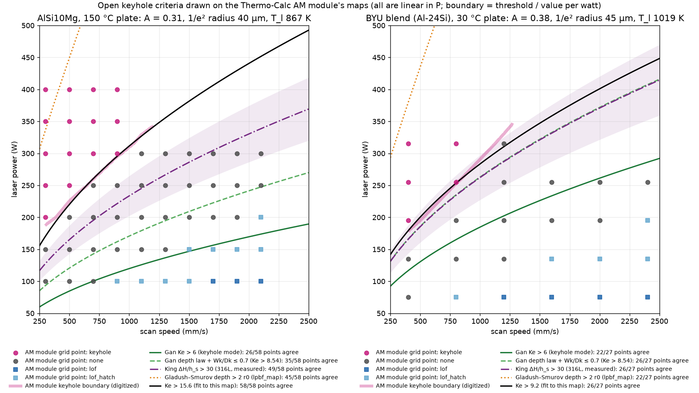
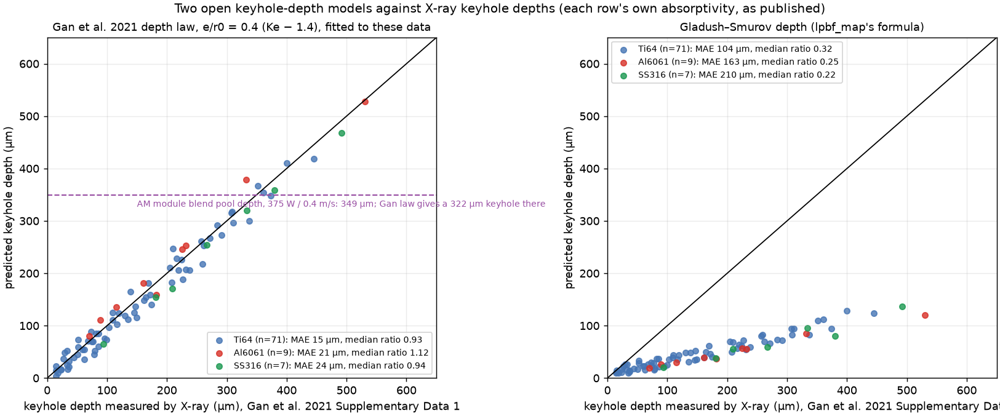

# Open-source alternatives to the AM module for keyholing and keyhole-mode pool size (#235)

The eagar-tsai comparison in [#238](../eagar-tsai/README.md#comparing-with-our-in-house-thermo-calc-am-module-results)
ended with: *"It can't replace the AM module for keyholing or keyhole-mode pool size, and its width/depth ≤ 2.5
keyhole test shouldn't be used with these beams."* This folder asks what open-source model, or approach, could. I
looked in three ways:
- four Edison literature searches;
- reading the primary sources through a headed browser tunnelled out through a lab Pi;
- testing the cheap candidates against the same in-house AM-module maps and melt-pool renders that #238 used.

## Answer

| What we need | Best open option | How well it does here | Cost per point |
|---|---|---|---|
| **Keyhole boundary on a printability map** | **The keyhole number** Ke = ηP / ((T_l − T0) π ρ c_p √(α v r0³)) of [Gan et al. 2021](https://doi.org/10.1038/s41467-021-22704-0), or the equivalent normalized enthalpy of [King et al. 2014](https://doi.org/10.1016/j.jmatprotec.2014.06.005). Use one threshold, calibrated on our own single tracks. | The AM module's keyhole boundary lies along a near-constant Ke on both maps (Ke stays within −3 % and +10 % of its median from 0.3 to 1.3 m/s). So the boundary's *shape* is reproduced, and only its level needs fitting. One fitted threshold per map gets 58 of 58 and 26 of 27 grid points; eagar-tsai's W/D test gets 18 and 15. | microseconds |
| **Keyhole depth** | **Gan et al.'s depth law** e / r0 = 0.4 (Ke − 1.4) | On Gan et al.'s published X-ray keyhole depths (Ti-6Al-4V, Al6061, SS316) it is within 6–13 % (median). At the AM module's keyhole-mode render it gives a 322 µm keyhole under a 349 µm pool. eagar-tsai can't reach that depth at any absorptivity. | microseconds |
| **Keyhole-mode pool width and length, keyhole porosity** | **An open thermal-fluid code that resolves the keyhole**: [laserbeamFoam](https://github.com/laserbeamfoam/LaserbeamFoam) first (OpenFOAM, Fresnel ray tracing, recoil pressure, GPL-3.0, active); [meltPoolFoam](https://github.com/meltPoolFoam/meltPoolFoam), [MeltPoolDG](https://github.com/MeltPoolDG/MeltPoolDG) and [Lethe](https://github.com/chaos-polymtl/lethe) as alternatives | Not run here. No cheap open model gives keyhole-mode length or width. The AM module's 1.47 mm length is 3–5× what any conduction solution gives, because its flow carries heat backwards. | CPU-hours to days per track, so use it to calibrate, not for maps |
| **The approach** | **An ORCHID-style open benchmark.** Curate the measured keyhole data (X-ray depths, onset and porosity thresholds, our own tracks) with uncertainties, and score every cheap model against it, including the AM module. [`scripts/keyhole_open_models.py`](../../scripts/keyhole_open_models.py) is a first scorer. | See [below](#an-orchid-style-benchmark-for-keyhole-models) | |

**Don't use:**
- eagar-tsai's W/D ≤ 2.5 test (#238);
- the Gladush–Smurov depth in [`lpbf_map`](https://github.com/ilidio-costa/lpbf_map). It comes out 3–4× too shallow against X-ray keyhole depths ([below](#2-keyhole-depth)), and lpbf_map's "King" test ignores scan speed;
- a power-density threshold on its own. Cunningham et al.'s 0.4 MW/cm² is for a stationary beam, and every point on both of our maps is above it.

**The catch is the absorptivity, not the model.** Ke is linear in ηP, so every threshold above trades off one-for-one
against the absorptivity, and Al's absorptivity rises steeply once a keyhole opens. The AM module calculates it at
every point, but our PNGs show it at only two points. The biggest step forward would be the grid as a CSV from
Thermo-Calc's account manager (W, D, L, Dh, Wk, Dk and the calculated absorptivity at every point), already asked
for in #238, together with our own single-track cross-sections.

## Tests

[`scripts/keyhole_open_models.py`](../../scripts/keyhole_open_models.py) runs everything below in about 10 s. It
reads #238's digitized AM-module boundaries and grid classes, and downloads Gan et al.'s Supplementary Data 1
(CC BY 4.0) into a cache, checking its sha256. Settings are #238's:
- AlSi10Mg: A = 0.31, beam 1/e² radius 40 µm, T_l 867 K, 150 °C plate;
- blend: A = 0.38, 45 µm, T_l 1019 K, 30 °C plate;
- properties: k 110 W/m/K, ρ 2650 kg/m³, c_p 1040 J/kg/K;
- Al boiling point 2743 K.

### 1. The AM module's keyhole boundary is a line of constant keyhole number

Along the digitized keyhole boundary, power rises as v^0.46 (AlSi10Mg) and v^0.59 (blend), close to the v^0.5 of a
constant Ke. So each criterion's boundary is a fixed fraction of the AM module's:

| Criterion (keyhole if…) | AlSi10Mg: boundary power ÷ AM's | AlSi10Mg: grid points agreeing (of 58) | Blend: boundary power ÷ AM's | Blend: grid points agreeing (of 27) |
|---|---|---|---|---|
| Gan Ke > 6 ("keyhole mode", X-ray) | 0.35–0.39 | 26 | 0.60–0.67 | 22 |
| Gan's depth law + the AM module's own Wk/Dk ≤ 0.7, taking Wk = 2r0 (→ Ke > 8.54) | 0.50–0.55 | 35 | **0.86–0.96** | **26** |
| King ΔH/h_s > 30 (316L, measured) | 0.69–0.76 | **49** | **0.86–0.95** | **26** |
| Gladush–Smurov depth > 2r0 (lpbf_map's geometric test) | 1.8–2.4 | 45 (13 of 15 keyholes missed) | 2.1–2.4 | 22 (all 5 missed) |
| Ke above the median on this map's boundary (15.6 / 9.2) | 0.91–1.01 (RMS 4 W) | **58** | 0.92–1.03 (RMS 10 W) | **26** |
| eagar-tsai W/D ≤ 2.5, from #238 | – | 18 | – | 15 |
| eagar-tsai peak T ≥ T_b, from #238 | – | 20 | – | 11 |

Along the AM module's boundary:

| | AlSi10Mg | Blend |
|---|---|---|
| Ke | 15.5–17.1 | 8.9–10.0 |
| King ΔH/h_s | 39.7–43.8 | 31.5–35.1 |
| Ke with the boiling point in place of the liquidus, ηP / ((T_b − T0) π ρ c_p √(α v r0³)) | 2.96–3.26 | 2.62–2.93 |
| Gan keyhole depth | 225–251 µm | 136–154 µm |

What this says:
- **The open laws reproduce the boundary's shape; the level is one number.** Ke's level differs between the two
  maps (15.6 against 9.2).
- **Most of that difference is the denominator T_l − T0.** It is 444 K for AlSi10Mg on its 150 °C plate, and 716 K
  for the blend, which has a higher liquidus and a 30 °C plate.
  - King's normalized enthalpy divides by the absolute T_m instead, and its values on the two maps are 1.2× apart.
  - Normalizing by T_b − T0 instead, as for a keyhole that opens when the surface boils, brings them to within 1.1×
    (2.7–3.0).
  - With two maps and an absorptivity read at only one point each, that is a hint, not a result.
- **The blend boundary is where the AM module's own Wk/Dk ≤ 0.7 test lands if Gan's depth law sets the keyhole
  depth:** 0.86–0.96× the AM power, 26 of 27 points. That is the closest an uncalibrated open model gets.
  - For AlSi10Mg, the same construction keyholes at half the AM module's power.
  - Two explanations fit: the AM module's absorptivity along that boundary is lower than the 0.31 read off its
    250 W render, or it keyholes later relative to Gan's X-ray-calibrated law.
  - The CSV export would settle it.

### 2. Keyhole depth

Gan et al.'s Supplementary Data 1 has 87 keyhole depths measured by X-ray at Argonne's APS:
- Ti-6Al-4V, 71 rows: 103–522 W, 0.4–1.2 m/s, r0 47.5 and 70 µm;
- Al6061, 9 rows: 416–520 W, 0.35–0.9 m/s, r0 44 µm;
- SS316, 7 rows.

Each row comes with the absorptivity Gan et al. used.

| Model | Ti-6Al-4V | Al6061 | SS316 |
|---|---|---|---|
| Gan et al. depth law (fitted to these data) | MAE 15 µm, median ratio 0.93 | MAE 21 µm, median ratio 1.12 | MAE 24 µm, median ratio 0.94 |
| Gladush–Smurov, as in lpbf_map | MAE 104 µm, ratio 0.32 | MAE 163 µm, ratio 0.25 | MAE 210 µm, ratio 0.22 |

- **The depth law is a fit to these data, so the left panel checks the implementation and the scatter, not
  predictive power.** My Ke reproduces Gan et al.'s: a refit gives e/r0 = 0.397 Ke − 0.40, against their 0.4 Ke − 0.56.
  - It still matters that Al6061 is in the fit, with keyholes from 70 to 530 µm.
  - Gan et al. also show the absorptivity rising with Ke, through their Eq. 6, η = 0.7 [1 − exp(−0.6 Ke_m L_d*)].
  - Their Al6061 absorptivities don't follow that equation with any physical flat-surface value. Inverting it on
    their own rows gives 0.007 for Al6061, against 0.24–0.30 for the Ti-6Al-4V and SS316 rows. So for Al, the
    absorptivity has to come from elsewhere: calorimetry, the AM module, or a fit to our own tracks.
- **The Gladush–Smurov depth is 3–4× too shallow on every material.** lpbf_map reports it only when it is deeper
  than eagar-tsai's conduction depth. At both AM-module render points, the conduction depth is the deeper one.
  - At the AM module's blend render it gives 89 µm, against the AM module's 349 µm pool.
  - I checked that my implementation matches lpbf_map's own function to 0.01 µm
    ([log](logs/lpbf_map-crosscheck.log)).

**The AM module's keyhole-mode render (blend, 375 W, 0.4 m/s, A = 0.38).**
- The render shows a pool 349 µm deep and 1.47 mm long, with a half-width of 231 µm.
- Gan's law gives a **322 µm keyhole** with the pool edge at the liquidus, or 429 µm with it at the eutectic.
- For the keyhole to reach the full pool depth, the law would need A = 0.415.
- In the render, the V-shaped region near Al's boiling point (the vapour cavity) reaches most of the way down the
  349 µm axis, so 322 µm is consistent with it.
- Nothing cheap gives the 1.47 mm length.
  - A point source's trailing isotherm sits at q/(2πkΔT) = 0.29 mm.
  - eagar-tsai gives 0.40–0.50 mm (#238).
  - The AM render's velocity arrows show surface liquid running backwards from the keyhole at around 1 m/s. That
    convection is what stretches the pool.

At the AlSi10Mg render (250 W, 0.9 m/s), which the AM map calls defect-free:
- Ke is 13.2, and the depth law gives a 189 µm keyhole, deep enough for Gan's keyhole mode (e* = 4.7 > 2).
- The render does show a V-shaped hot cavity.
- Whether that counts as a defect depends on the threshold. This is the same calibration question as above.

### 3. Measured AlSi10Mg single tracks

[Solyaev et al. 2025](https://arxiv.org/abs/2507.23422) found keyhole-shaped pools (D/W > 0.75) for P > 220 W
and v < 0.8 m/s, with an 80 µm spot. On the 231 scored points of #238's grid (A = 0.22, the study's own
conduction fit; 1/e² radius 56.6 µm; room-temperature plate assumed):

| Criterion | Boundary power at 0.8 m/s (measured: 220 W) | Points agreeing (of 231) | Measured keyholes missed (of 80) | Extra keyholes |
|---|---|---|---|---|
| Gan Ke > 6 | 325 W | **196** | 14 | 21 |
| Gan's depth law + Wk/Dk ≤ 0.7 (Ke > 8.54) | 462 W | 181 | 46 | 4 |
| King ΔH/h_s > 30 | 493 W | 177 | 51 | 3 |
| Gladush–Smurov depth > 2r0 | 1,542 W | 151 | 80 | 0 |
| eagar-tsai W/D ≤ 2.5 (#238) | – | 193 | 1 | 37 |

- At the measured corner (220 W, 0.8 m/s), Ke = 4.1, inside Gan's transition range (1.4–6).
- The measured region is a box, and every single-number criterion draws a diagonal line, so none does much better
  than about 85 %.
- The measured class is pool shape (D/W), not keyhole presence. At low speed the pool widens, so its D/W stays low
  even at high Ke.
- **Two things follow.**
  - Against measured Al tracks, the AM module's thresholds (Ke 9–16 at its own A) and King's 316L value look late.
  - Our own calibration should use X-ray-free measurements we can make: keyhole porosity and D/W in cross-sections
    of single tracks on our machine.

## Open thermal-fluid codes that resolve the keyhole

Checked on GitHub on 2026-11-10 (licence, last push, and the physics in each README or docs):

| Code | Licence, activity | Keyhole physics | Keyhole case shipped | Fit for us |
|---|---|---|---|---|
| [laserbeamFoam](https://github.com/laserbeamfoam/LaserbeamFoam) ([SoftwareX 2023](https://doi.org/10.1016/j.softx.2022.101299)) | GPL-3.0; pushed 2026-11-09; 108 stars | OpenFOAM VOF, Gaussian beam split into rays absorbed by the Fresnel equations, phenomenological recoil pressure; a compressible variant tracks the vapour | `cunninghamValidation` (against Cunningham et al. 2019), `LPBF_small`, `LPBF_large`, `PowderBed` | **First choice** for a reference keyhole-mode pool: it computes the multiply-reflected absorptivity that Al's keyholes depend on |
| [meltPoolFoam](https://github.com/meltPoolFoam/meltPoolFoam) | GPL-3.0; pushed 2026-08-08 | OpenFOAM melt-pool solver | `Cunningham2019`, a 3D keyhole reference case | Second choice; small project |
| [MeltPoolDG](https://github.com/MeltPoolDG/MeltPoolDG) | LGPL-3.0; pushed 2026-11-05 | deal.II, conservative level set with CutFEM; evaporation, recoil pressure, powder | keyhole work listed in its publications | Research-grade, heavier to set up |
| [Lethe](https://github.com/chaos-polymtl/lethe) | Apache-2.0; pushed 2026-11-10 | deal.II; evaporation model with recoil pressure and evaporative cooling | `static-irradiation`: 2D, stationary Ti-6Al-4V keyhole after Cunningham et al. 2019 | Good for a quick stationary keyhole check; not a moving track |
| [MOOSE](https://github.com/idaholab/moose) navier_stokes | LGPL-2.1; active | vapour-recoil-pressure boundary conditions | `examples/laser-welding` (2D) | Possible, but no LPBF keyhole case |
| [AdditiveFOAM](https://github.com/ORNL/AdditiveFOAM) | ORNL licence; pushed 2026-11-06 | heat and mass transfer in a fixed domain, no free surface | none | Not a keyhole model |
| [3DThesis](https://github.com/ORNL-MDF/3DThesis) | BSD-3-Clause | semi-analytic conduction, like eagar-tsai | none | Not a keyhole model |

None of these ships an AlSi10Mg keyhole case. Each needs temperature-dependent Al–Si properties, which the
pycalphad/MatCalc `mc_al` work in [`../pycalphad-al-cu/`](../pycalphad-al-cu/) could supply. The AM module gets
them from its Scheil calculator.

## An ORCHID-style benchmark for keyhole models

ORCHID ([`../orchid/`](../orchid/)) is useful because it pairs open models with curated, accepted reference values and
scores the models against them. Keyholing needs the same: a cheap model is only as good as its threshold and its
absorptivity, and both are calibration problems.

**Open data to start from** (all checked to exist and be public):

| Data | What it has | Licence and access |
|---|---|---|
| Gan et al. 2021 Supplementary Data 1 and 2 ([doi](https://doi.org/10.1038/s41467-021-22704-0)) | 87 X-ray keyhole depths (Ti-6Al-4V, Al6061, SS316), each with the absorptivity used, a length and a front-wall angle (tan θ); plus 28 rows of simulated energy balance (absorbed, reflected, evaporated) | CC BY 4.0, XLSX |
| [LLNL Keyhole-mode Microscopy Dataset](https://doi.org/10.2172/1878448) (OSTI 1878448, 2022) | 600+ single-track cross-section micrographs, 316L on a Concept Laser M2, spanning conduction and keyhole mode; same LLNL group and machine type as King et al. 2014 | LLNL Open Data Initiative |
| King et al. 2014 ([OSTI manuscript](https://www.osti.gov/biblio/1502044)) | 316L keyhole threshold ΔH/h_s = 30 ± 4 at two beam sizes, with melt-pool depths | DOE public access |
| Solyaev et al. 2025 ([arXiv](https://arxiv.org/abs/2507.23422)) | AlSi10Mg single-track classes (keyhole, stable, lack of fusion) for six powders | arXiv |
| Cunningham et al. 2019 ([Science](https://doi.org/10.1126/science.aav4687)) | Ti-6Al-4V keyhole drilling and moving-beam depths; ~0.4 MW/cm² onset | subscription; BYU has access |
| The AM module's two maps and renders (#238) | one more "model" to score, not ground truth | in-house |

**What to build:**
1. One table of measurements. Each row gets the alloy, the beam (with its definition: 1/e² radius, D4σ or Gaussian σ),
   P, v, plate temperature, measured keyhole depth and/or class, the absorptivity if measured, the uncertainty and
   the source.
2. A scorer for each model's predictions (MAE in depth, class agreement), per alloy family. The script here already
   does this for four models and three references.
3. Our own rows: single tracks on the Aconity at the AM module's grid points, sectioned for depth, D/W and keyhole
   pores. Those rows are what decide the Al threshold and absorptivity.
4. Later, if useful, an MCP server over the table, as ORCHID has.

## Sources checked through the lab's browser route

The literature checks used headed Chrome on a virtual display on the runner, driven with real pointer and keyboard
events (xdotool), and tunnelled out through the CubXL Pi over SSH. It's the Onshape route in CLAUDE.md, with two changes:
- a local filter refuses any address that isn't public, and any port other than 80 and 443, so pages can't reach
  the lab network through the Pi;
- Chrome's local-network protections stay on.

The tunnel exits on BYU's network, which is what gives subscription access. The three camera Pis had been offline
for 6 h, so the CubXL Pi relayed. Nothing was installed or written on it.

| Claim | Source read | Result |
|---|---|---|
| Ke = ηP / ((T_l − T0) π ρ c_p √(α v r0³)); e* = e/r0 = 0.4 (Ke − 1.4); modes: conduction Ke < 1.4, transition 1.4–6, keyhole > 6; little porosity below Ke ≈ 16, chaotic above about 30; data 100–520 W, 0.3–1.2 m/s, r0 44–70 µm, Ti-6Al-4V, Al6061, SS316 | Gan et al. 2021, full text (open) | confirmed |
| King: ΔH/h_s = AP / (h_s √(πDuσ³)), with h_s = ρcT_m and σ the Gaussian standard deviation (D4σ = 4σ); theory gives πT_b/T_m ≈ 6; measured 316L threshold 30 ± 4 at D4σ = 52 and 130 µm | King et al. 2014, accepted manuscript on OSTI | confirmed (ScienceDirect itself served a CAPTCHA) |
| Keyholes occur across the LPBF power and speed range; the onset is a power-density threshold, about 0.4 MW/cm² for stationary drilling of Ti-6Al-4V | Cunningham et al. 2019, Science, through BYU's subscription | confirmed |
| AlSi10Mg keyhole region P > 220 W, v < 0.8 m/s, classed by D/W > 0.75 from cross-sections, nearly independent of powder size | Solyaev et al. 2025, arXiv | confirmed |
| The AM module solves conduction, fluid flow and evaporation; gets laser absorptivity from a Lorentz–Drude model of electrical resistivity and wavelength; takes properties from the Scheil calculator; shows a keyhole in steady state | thermocalc.com AM-module page | confirmed; help.thermocalc.com still needs a login |
| The LLNL keyhole dataset is 316L (CL 20ES) single tracks on a Concept Laser M2 | OSTI 1878448 report | confirmed |
| lpbf_map's King test matches its README's formula | lpbf_map 2.0.1 source (`defects/keyhole_king.py`) | **no**: the code uses a speed-independent power threshold, πk r0 (T_m − T0)(T_b/T_m)/A, which is 78 W at our blend settings ([log](logs/lpbf_map-crosscheck.log)). Its Al6061 entry also has k = 331.84 W/m/K, about twice solid Al6061's |

Google Scholar served a reCAPTCHA on the first request through this route, and ScienceDirect served one on the
first article. I didn't try to get past either.

## Edison searches

EDISON_SECTION_PLACEHOLDER

## Caveats

- The AM-module numbers are read off images, as in #238. Each boundary is uncertain by up to about one grid step.
- The absorptivity is the one read off each map's render. The AM module calculates a different one at every point.
- The blend has AlSi10Mg's thermal properties. All criteria use one set of properties (k 110 W/m/K, ρ 2650 kg/m³,
  c_p 1040 J/kg/K) for both α and ρc_p; liquid values would move every number by tens of per cent, but not the shapes.
- King's D is the liquid's thermal diffusivity. I used the same α as for Ke.
- Gan's depth law is for the keyhole (vapour cavity), not the melt pool. Gan et al. note that pool depth does not
  scale linearly with keyhole depth.
- Wk = 2r0 in the Wk/Dk construction is an assumption: a keyhole opening as wide as the beam's 1/e² diameter.
- Solyaev et al.'s plate temperature isn't stated for the main study. I assumed room temperature.

## Files

| File | What it is |
|---|---|
| [`../../scripts/keyhole_open_models.py`](../../scripts/keyhole_open_models.py) | all the tests above (`python scripts/keyhole_open_models.py all --out arroyave-orchid-tools/keyhole-alternatives`, ~10 s) |
| `summary.json` | every number quoted above |
| `am-module-keyhole-boundary-normalized.csv` | each digitized AM-module boundary point with Ke, King ΔH/h_s, the boiling-normalized Ke, and the Gan and Gladush–Smurov depths |
| `gan2021-xray-keyhole-depths-vs-open-models.csv` | the 87 X-ray keyhole depths of Gan et al. 2021 (CC BY 4.0), with Ke and both models' predictions |
| `am-module-maps-with-open-keyhole-criteria.png`, `open-keyhole-depth-models-vs-xray.png` | the two figures |
| `logs/lpbf_map-crosscheck.{py,log}` | lpbf_map 2.0.1 (commit `32a5089`) run on the same inputs, with the job's secrets stripped from its environment |
| [`../../edison-trajectories/keyhole-open-alternatives/`](../../edison-trajectories/keyhole-open-alternatives/) | the four Edison reports and their full trajectories |
| [`../../scripts/edison_keyhole_alternatives.py`](../../scripts/edison_keyhole_alternatives.py) | the Edison queries (`submit`, `wait`, `fetch`) |
