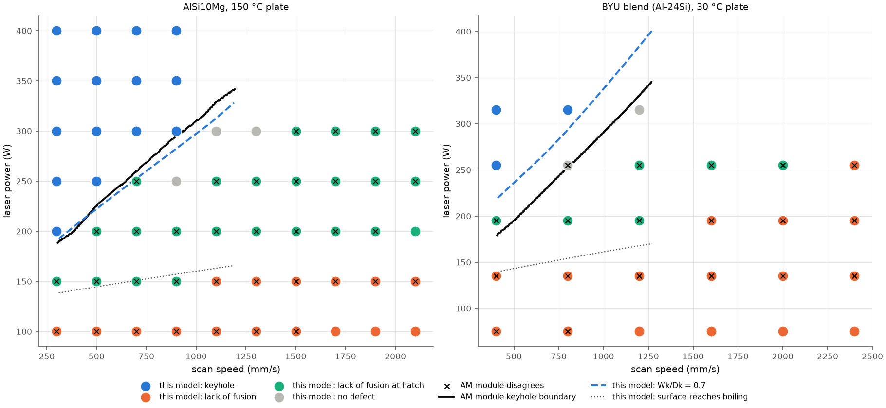
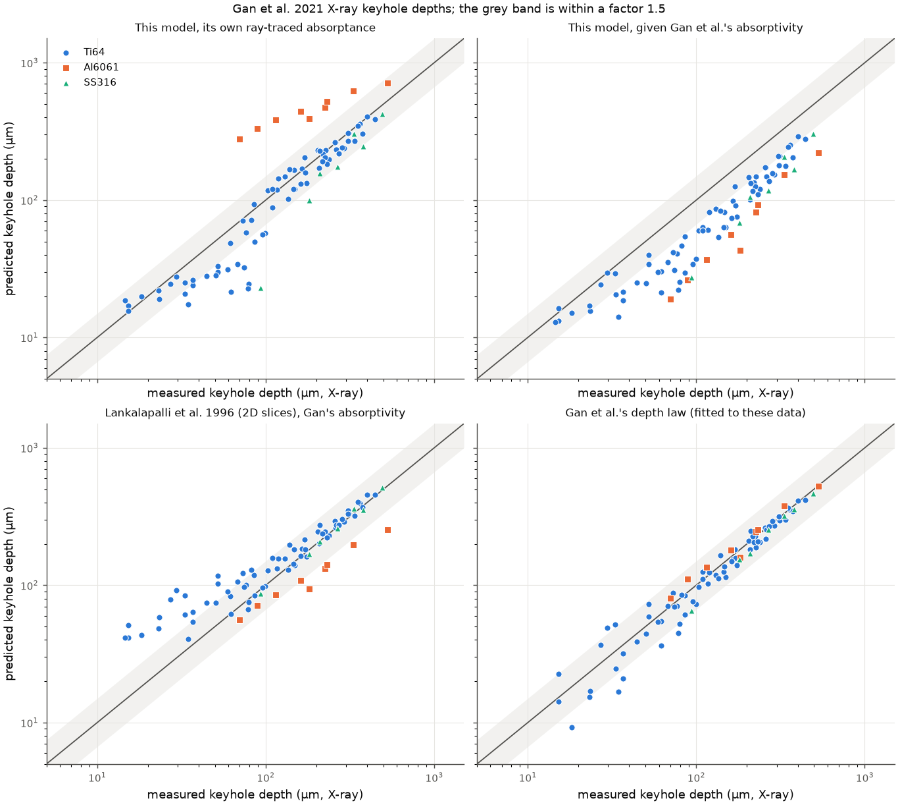

# Our own first-principles keyhole and melt-pool model (#249)

> **Version 2 is in [`v2/`](v2/README.md).** It adds what this version lists as left out:
> - Mg evaporation;
> - a powder layer;
> - a tilted keyhole, and an attempt at a free-form shape;
> - melt flow (our own 3D solver);
> - sourced resistivities and solid conductivity.
>
> It also finds that the AM module's keyhole boundary is where a stable keyhole first appears. One correction to this
> page: the 0.315 at the AlSi10Mg render is one of several stable depths there. The shallowest is a 16 µm dimple
> absorbing 0.18 ([v2, section 3](v2/README.md#3-the-keyhole-its-tilt-its-stable-states-and-the-am-modules-boundary)).

Sterling asked in #249 for our own implementation, from first principles, of what the AM module does for keyholing
and keyhole-mode pool size. The sources were to be read through the Pi, and databases used with citations, with
Edison's help. This folder has the result.

[`scripts/keyhole_first_principles.py`](../../../scripts/keyhole_first_principles.py) is a reduced-order model
written from scratch. Its inputs are the beam, the scan and measured material properties. **Nothing in it is fitted
to keyhole or melt-pool data.** One point solves in about 0.2 s, so it can draw whole printability maps.

## Summary

| Question | Answer from this model | Where it stands |
|---|---|---|
| Does it reproduce the AM module's keyhole boundary? | **Yes.** Keyhole-or-not agrees at **58 of 58** AlSi10Mg grid points and **25 of 27** blend points (2 AM keyholes missed, none extra). Its Wk/Dk = 0.7 line sits at 0.95–1.02× the AM module's power for AlSi10Mg and 1.16–1.22× for the blend. | As good as the Ke threshold fitted to each map (58 and 26 of 27), with nothing fitted. The combined model with laserbeamFoam's keyhole widths got 55 and 25 |
| Absorptivity | From first principles: 0.18–0.20 on the flat liquid, rising to 0.3–0.9 as the keyhole deepens. At the AM module's AlSi10Mg render it gives **0.315**, against the AM module's 0.307 | Too high in deep Al keyholes: 0.87 at the blend render, against 0.38 (AM module) and 0.66 (laserbeamFoam). This depends on the keyhole shape assumed: a cone traps light, a paraboloid doesn't |
| Keyhole depth against X-ray (Gan et al. 2021, 87 rows) | On its own absorptance: Ti-6Al-4V median 0.88× measured (R² 0.93), SS316 0.66×, Al6061 2.2× too deep | Gan's fitted law is better (0.93–1.12×). Al is the weak case, because no keyhole-mode absorptance has been measured for Al6061 to check against |
| Keyhole-mode pool size at the blend render (AM: 349 / 462 / 1,470 µm) | 420 µm deep, 277 µm wide, 473 µm long at the liquidus; 1,129 µm long at the solidus | Depth about right, width and length short. The model has no melt flow, and the AM module's pool is stretched by convection |
| Measured aluminium (NIST AM-Bench 2022, Al 5182, 473 W, 0.7 m/s) | Absorbs 0.30 against the measured 0.43. Pool 109 µm deep and 218 µm wide, against 88.8 and 326 | The cone traps too little here and too much at the blend render, so the keyhole's shape is the open question |
| Lack of fusion | Over-predicted: all-class agreement is 22 of 58 and 8 of 27 | A flat liquid absorbs 0.18–0.20, so conduction pools come out too small. #238's eagar-tsai with the AM module's A is better there |

The three things that decide the answers, in order:
1. **The keyhole's shape**, which sets how much light it traps.
2. **The keyhole opening** (one beam radius).
3. **The liquid's optics.**

None of them can be pinned down without measurements the model doesn't make: the keyhole's geometry in X-ray, and
its absorptance. Those, and our own single tracks, are what would turn it from "matches the AM module's boundary" into
a validated tool.

## The model

At each (P, v) point:

1. **Optics.** The liquid alloy's complex index comes from a Drude free-electron model:
   - the electron density is the valence (Al 3, Si 4, Mg 2) times the atom density of the liquid;
   - the damping is γ = ε0 ωp² ρ_el, from the measured liquid resistivity ρ_el at the wall temperature;
   - the Fresnel absorptance for s and p light at any incidence is then averaged, since a fibre laser is unpolarised.

   This is the same kind of model as the AM module's (Lorentz–Drude from resistivity and wavelength) and
   laserbeamFoam's. It reproduces laserbeamFoam's flat-surface 0.141 and 0.196 (unit test).
2. **Multiple reflections.** A Monte Carlo ray tracer, written for this, sends a Gaussian beam (1/e² radius r0) into
   the keyhole and absorbs Fresnel's share at every bounce.
   - **Shape:** a cone r = a0 (1 − z/d), the geometry of Lankalapalli et al. 1996.
   - **Light outside the opening** meets the flat liquid at normal incidence.
   - **A paraboloid is the alternative.** It sends every vertical ray through its focus and back out after two hits,
     so it is the low-absorptance limit.
3. **Wall temperature.** T_w is where the saturated vapour pressure equals the ambient pressure plus the opening's
   Laplace pressure, σ/a0. That gives 2,847 K for AlSi10Mg and 2,882 K for the blend.
   - The vapour pressure obeys Clausius–Clapeyron through JANAF's normal boiling point of Al (2,791 K, 294 kJ/mol), with
     Raoult's law for the Al in the alloy.
4. **Conduction from the wall.** Point sources on the keyhole axis carry the heat. Each is Rosenthal's moving point
   source, with an image above the plate for its adiabatic top surface.
   - Their strengths (non-negative least squares) hold the mean temperature of each wall circle at T_w.
   - The beam's wings, absorbed outside the opening, enter as known surface sources.
   - For a long keyhole this is Kaplan's (1994) moving-cylinder loss 2πkΔT·Pe·K1(Pe)/K0(Pe) per unit depth. It is
     also three-dimensional, so the keyhole's tip conducts heat downwards too.
5. **Evaporation.** Vapour leaves through the opening, driven by the Laplace overpressure (Bernoulli, capped at
   choked flow), and carries the enthalpy of vaporisation with it. That comes to 3.6–4.2 W, 1–5 % of the absorbed
   power at the points below.
6. **Depth.** The opening a0 is the beam's 1/e² radius, as in Lankalapalli et al. The depth d is then the one at
   which the power absorbed inside the keyhole equals the power conducted and evaporated from its wall.
7. **Mode.** A keyhole opens if the flat liquid surface, at its own Fresnel absorptance, would reach T_b under the
   moving Gaussian beam (an exact time integral of the Gaussian source). Otherwise the track stays in conduction mode.
8. **Melt pool.** The pool is the liquidus or solidus isotherm of the same sources, found by bisection.
   - Depth and width are the maxima over the track.
   - Length runs front to rear along the centre line.
   - Dh is the depth at half the hatch.
9. **Latent heat and temperature-dependent properties.** The linear heat equation is solved in an enthalpy variable:
   - c̄ is the secant heat capacity (H(T_w) − H(T0)) / (T_w − T0). H(T) comes from pycalphad on MatCalc mc_al, so it
     includes the enthalpy of fusion, spread over each alloy's freezing range.
   - k̄ is the Kirchhoff mean of the solid conductivity and the liquid's Wiedemann–Franz conductivity.
   - Isotherms sit at θ_l = (H(T_l) − H(T0)) / c̄.
10. **Classes.** These are the AM module's tests:
    - keyhole if the model is in keyhole mode and Wk/Dk ≤ 0.7, with Wk = 2a0 and Dk = d;
    - otherwise lack of fusion if D ≤ 30 µm;
    - lack of fusion at the hatch if Dh ≤ 30 µm.

Left out, and so a source of error:
- **melt flow:** no Marangoni or recoil-driven convection, so pool length is a lower bound;
- **powder:** no powder layer;
- **transients:** the keyhole is steady, so its collapse and porosity aren't modelled;
- **the keyhole's tilt** and its non-circular cross-section;
- **a hotter front wall:** the wall is one temperature, where CFD and the AM module put the front wall 200–400 K
  hotter;
- **Mg evaporation:** Mg's high vapour pressure is ignored.

## Properties, and where each comes from

Read in the source through the lab Pi's browser route (exits on BYU's network; a local filter allows only public
addresses on ports 80/443), except where noted.

| Quantity | Value used | Source |
|---|---|---|
| Liquid Al electrical resistivity | ρ_VE = 0.097 + 1.681×10⁻⁴ T µΩ m (933–1,491 K, ±4 %; extrapolated to T_w) | [Leitner et al. 2017](https://doi.org/10.1007/s11661-017-4053-6), Table I (open access) |
| Si and Mg in the liquid | +0.675 µΩ cm per wt % Si (0–12 wt % at 700 °C; our linear fit to the table), +0.92 per wt % Mg | [Brandt & Neuer 2007](https://doi.org/10.1007/s10765-006-0144-0), Tables I–II (BYU). No data above 12 wt % Si, so the blend's 24.3 % is an extrapolation |
| Liquid conductivity | Wiedemann–Franz, L = 2.45×10⁻⁸ W Ω K⁻² | Leitner et al. 2017, Eq. 7 |
| Liquid density (for the electron density) | 2,670 − 0.299 T kg m⁻³ | Leitner et al. 2017, Table I |
| Surface tension at T_w | 0.993 − 1.27×10⁻⁴ T N m⁻¹ (oxygen-saturated Al); 0.63 N m⁻¹ at T_b | Leitner et al. 2017. Al–Si is within about 0.1 N m⁻¹ of it near the liquidus ([Kobatake et al. 2015](https://doi.org/10.1007/s10853-015-8883-6), Table 4, BYU) |
| Boiling point of Al, enthalpy of vaporisation | 2,790.8 K; 381.667 − 87.665 = 294.0 kJ mol⁻¹ | NIST-JANAF table Al-001 (the CRC Handbook agrees: 2,791 K, 294 kJ mol⁻¹) |
| Vapour pressure | Clausius–Clapeyron through that point; Raoult on x_Al. Gives T_b = 2,814 K (AlSi10Mg) and 2,852 K (blend) at 1 atm | Alcock et al. 1984 (via the CRC Handbook, BYU) is valid only to 1,800 K, and extrapolated it gives 2,743 K, the value #238 and the cheap models used |
| Enthalpy H(T), liquidus, solidus | Equilibrium HM every 5 K from 290 to 1,400 K, then linear ([`mc_al-enthalpy-vs-T.csv`](mc_al-enthalpy-vs-T.csv)). Liquid c_p 1.13–1.16 kJ kg⁻¹ K⁻¹, matching Leitner et al.'s 1.127 for Al | pycalphad 0.11.2 with MatCalc mc_al v2.032 ([`scripts/keyhole_fp_enthalpy_mc_al.py`](../../../scripts/keyhole_fp_enthalpy_mc_al.py); the database as in [`../../pycalphad-al-cu/`](../../pycalphad-al-cu/)) |
| Solid conductivity | 110 W m⁻¹ K⁻¹ | the AlSi10Mg value #238 used. Not checked in a source |
| Solid density | rule of mixtures from Al 2,700, Si 2,330, Mg 1,738 kg m⁻³ | handbook values |
| Liquid Al optics, as a check | n = 0.91, k = 6.33 at 632.8 nm and 1,800 K (emissivity 0.083) | [Krishnan et al. 1993](https://doi.org/10.1007/BF02669604), Table I (BYU) |
| Keyhole-wall heat flux | q = (T_v − T_a) λ Pe′ (cos φ + K1(Pe′r)/K0(Pe′r)), Pe′ = v/2κ | [Kaplan 1994](https://doi.org/10.1088/0022-3727/27/9/002), Eqs. 8–10 (BYU) |
| Conical-keyhole depth | d = P_i / (k(T_V − T0) Σ (c_i/i) Pe0^(i−1)), c = 2.1995, 6.2962, −0.4994, 0.0461 | [Lankalapalli et al. 1996](https://doi.org/10.1088/0022-3727/29/7/018), Eqs. 10 and 18 (BYU) |
| Measured keyhole absorptance | Ti-6Al-4V: 0.33 in conduction, 0.66 once the keyhole forms, 0.84 at 201 W | [Simonds et al. 2021](https://doi.org/10.1016/j.apmt.2021.101049) (NIST author copy) |
| Measured Al keyhole absorptance and pool | Al 5182, 473 W, 0.7 m/s, 122.5 µm: ≈0.24 → ≈0.43 (read off Fig. 8); pool 88.8 ± 0.4 µm deep, 326 ± 16 µm wide | [Simonds et al. 2024](https://doi.org/10.1007/s40192-023-00336-0) (open access) |
| What the AM module does | TC-Python's `KeyholeModel` is an "analytic" keyhole whose only setting is beam quality M²; `get_effective_absorption()` is absorption "due to multiple reflections of laser rays"; the optics are Lorentz–Drude from resistivity | Thermo-Calc's public TC-Python docs and product page |
| Gan et al.'s three alloys | their own k, ρ, c_p, T_l, T_v, L_v and L_m (Supplementary Data 1); liquid resistivity near boiling 1.75 µΩ m (Ti-6Al-4V), 1.35 (SS316) and 0.50 (Al6061), with valence 4, 2 and 3 | **The resistivities and valences are approximate handbook values, not checked in a source.** They only set the optics for these rows |

Three primary sources were behind Cloudflare checks I didn't try to get past: Assael et al. 2006 (liquid Al
density and viscosity), the Alcock et al. 1984 PDF and Krishnan & Nordine 1993 (liquid Al optics at 1.2–3.5 eV).
The values above use the readable alternatives listed.

## Checks of the code

[`scripts/test_keyhole_first_principles.py`](../../../scripts/test_keyhole_first_principles.py) passes all 8:
- **Optics.**
  - Drude–Fresnel at 40 and 65 µΩ cm matches laserbeamFoam's flat-surface 0.141 and 0.196, to within 0.01.
  - The Drude fit to Krishnan et al. reproduces their n and k.
  - The Fresnel limits are exact.
- **Moving Gaussian source.** Far from the beam it reduces to Rosenthal's point source, within 2 %.
- **Ray tracer.** A flat keyhole absorbs like a flat surface, and a deep cone traps more light than a shallow one.
- **Lankalapalli et al.'s worked example** (mild steel, 4,500 W, 2 cm/s) gives their 0.465 cm.
- **Collocation for that cone.** It needs 34 % more power than Lankalapalli et al.'s 2D slices.
  - About 12 points of that is the line-source approximation; Kaplan's is 12 % above the exact 2D cylinder at
    Pe = 1.27.
  - The rest is most likely the tip, which in 3D also conducts downwards.

## Results

`python scripts/keyhole_first_principles.py all` runs everything below in about 3 minutes on the runner.
[`fp-summary.json`](fp-summary.json) has every number; the per-point tables are the `fp-*.csv` files.

### 1. The AM module's keyhole boundary



| | AlSi10Mg (58 points) | Blend (27 points) |
|---|---|---|
| Keyhole or not, agreeing with the AM module | **58** (0 missed, 0 extra) | **25** (2 missed, 0 extra) |
| All four classes agreeing | 22 | 8 |
| This model's Wk/Dk = 0.7 line ÷ the AM module's keyhole boundary, in power | **0.95–1.02** | **1.16–1.22** |
| Where a flat surface first reaches boiling ÷ the AM module's boundary | 0.49–0.73 | 0.49–0.77 |
| For comparison: a Ke threshold fitted to each map (#249) | 58 | 26 |
| For comparison: eagar-tsai's W/D ≤ 2.5 (#238) | 18 | 15 |
| For comparison: combined model with laserbeamFoam's keyhole widths (#249) | 55 | 25 |

- **The surface boils well before the AM module's keyhole boundary**, at half to three-quarters of its power. The
  keyhole that opens there is a shallow dimple that absorbs no more than the flat liquid.
- **The boundary is where the dimple runs away.** Deepening traps light, and trapping deepens it further. 50–230 W
  above onset, the keyhole is deeper than 1.4 opening widths.
  - That feedback is what Cunningham et al. 2019 and Simonds et al. 2021 saw as a jump in absorptance at keyhole
    onset.
  - It is also why the boundary comes out close to the AM module's without a fitted threshold.
- **Lack of fusion is where the model is wrong.** At 0.18–0.20 a flat liquid absorbs too little, so the model calls
  lack of fusion, at the hatch or outright, at most points the AM module calls defect-free.
  - The AM module's A at its renders, 0.31–0.38, is near-keyhole absorptance.
  - What it uses in conduction mode isn't known.
  - A powder layer, which this model leaves out, would raise conduction-mode absorptance.

### 2. At the AM module's melt-pool renders and the laserbeamFoam points

Pool sizes are at the liquidus, with the solidus length in brackets. The keyhole width is the opening, 2a0.

**AlSi10Mg, 250 W, 0.9 m/s (AM: no defect)**

| Method | Absorbed | Keyhole depth (µm) | Keyhole width (µm) | Pool depth / width / length (µm) | Class |
|---|---|---|---|---|---|
| AM module | 0.307 | – | – | (render has no length scale) | no defect |
| **This model, cone, own absorptance** | **0.315** | 40 | 80 | 74 / 150 / 231 (405) | **no defect** (Wk/Dk 2.0) |
| This model, paraboloid, own absorptance | 0.180 | 9 | 80 | 49 / 117 / 130 | lack of fusion at hatch |
| laserbeamFoam, absorbed power fixed at the AM module's | 0.304 | 40 | 165 | 103 / 176 / 314 | no keyhole |
| eagar-tsai at the AM module's A (#238) | 0.307 | – | – | 106 / 221 / 317 | – |

**AlSi10Mg, 350 W, 0.9 m/s (AM: keyhole)**

| Method | Absorbed | Keyhole depth (µm) | Keyhole width (µm) | Pool depth / width / length (µm) | Class |
|---|---|---|---|---|---|
| **This model, cone, own absorptance** | **0.796** | 236 | 80 | 240 / 258 / 596 (1,230) | **keyhole** (Wk/Dk 0.34) |
| This model, paraboloid, own absorptance | 0.322 | 53 | 80 | 96 / 184 / 307 | no defect |
| This model, cone, at the AM module's A | 0.307 | 69 | 80 | 95 / 177 / 293 | no defect |
| laserbeamFoam, absorbed power fixed at the AM module's | 0.304 | 83 | 117 | 140 / 210 / 407 | no keyhole (Wk/Dk 1.4) |

**Blend, 375 W, 0.4 m/s (AM: keyhole)**

| Method | Absorbed | Keyhole depth (µm) | Keyhole width (µm) | Pool depth / width / length (µm) | Class |
|---|---|---|---|---|---|
| AM module | 0.384 | – | – | **349 / 462 / 1,470** | keyhole |
| **This model, cone, own absorptance** | 0.873 | 424 | 90 | **420 / 277 / 473 (1,129)** | **keyhole** (Wk/Dk 0.21) |
| This model, paraboloid, own absorptance | **0.389** | 123 | 90 | 153 / 220 / 301 (602) | no defect (Wk/Dk 0.73) |
| This model, cone, at the AM module's A | 0.384 | 157 | 90 | 167 / 213 / 290 (588) | keyhole (Wk/Dk 0.57) |
| laserbeamFoam, Fresnel at 65 µΩ cm | 0.658 | 211 | 102 | 281 / 333 / 346 (496) | keyhole |
| laserbeamFoam, absorbed power fixed at the AM module's | 0.380 | 172 | 99 | 225 / 237 / 257 (448) | keyhole |
| Gan et al.'s depth law at the AM module's A | 0.384 | 322 | – | – | – |
| eagar-tsai at the AM module's A (#238) | 0.384 | – | – | 157 / 322 / 397 | – |

- **The absorptance is the swing factor.**
  - The cone takes the blend to 0.87, above laserbeamFoam's 0.66 and the AM module's 0.38.
  - The paraboloid gives 0.39, the AM module's value to within 0.01.
  - On the AlSi10Mg render, the cone gives 0.315 against the AM module's 0.307.
  - One reading is that the AM module's "analytic" keyhole behaves like a cone when shallow and traps less light
    when deep. Its geometry isn't public, so that is a guess.
- **Given the same absorbed power, this model and laserbeamFoam roughly agree.** At the blend point with A fixed at
  the AM module's, this model's keyhole is 157 µm deep against laserbeamFoam's 172. Its pool is 167 µm deep against
  225, and 290 µm long against 257.
- **Nothing here reaches the AM module's 1.47 mm pool length at the liquidus.**
  - The solidus length does get there when the keyhole absorbs most of the beam: 1,129 µm at the blend point, and
    1,230 µm at AlSi10Mg 350 W.
  - The blend freezes over 173 K, and which edge the AM module draws isn't stated.
  - The AM render's 1 m/s rearward surface flow, which this model lacks, would stretch the pool further.

### 3. Keyhole depth against Gan et al.'s X-ray data



Gan et al.'s Supplementary Data 1 (CC BY 4.0) has 87 keyhole depths: Ti-6Al-4V (71 rows), Al6061 (9) and SS316 (7),
each with its own properties and the absorptivity η Gan et al. used.

| Model | Ti-6Al-4V | Al6061 | SS316 | All 87 |
|---|---|---|---|---|
| **This model, its own absorptance** | median 0.88×, 18 % median error, R² 0.93 | 2.24×, R² < 0 | 0.66×, 34 % | 0.88×, 19 %, R² 0.47 |
| This model, given Gan et al.'s η | 0.57× | 0.35× | 0.44× | 0.55×, 45 % |
| Lankalapalli et al. 1996 (2D slices), given Gan et al.'s η | 1.14×, 15 %, R² 0.92 | 0.61×, 39 % | 0.97×, 7 %, R² 0.98 | 1.09×, 17 %, R² 0.85 |
| Lankalapalli et al. 1996, given this model's absorptance | 1.68× | 2.49× | 1.35× | 1.68× |
| Gan et al.'s depth law (fitted to these data) | 0.93×, 11 %, R² 0.97 | 1.12×, 13 % | 0.94×, 6 % | 0.94×, 12 %, R² 0.97 |

Two pairs fit the data about equally well:
- this model's 3D conduction with its own ray-traced absorptance (median 0.78 on these rows);
- Lankalapalli et al.'s 2D slices, which lose about a quarter less heat, with Gan et al.'s η (median 0.46).

The measurement favours the first, at least for Ti-6Al-4V. Simonds et al. 2021 measured 0.66–0.84 in Ti-6Al-4V
keyholes, which is this model's range, not η's.

**Al6061 is the weak case.**
- The cone traps 0.76–0.93 of the beam in these keyholes, and the depths come out 2.2× too deep.
- Gan et al.'s η for the same rows is 0.12–0.32, even for keyholes 530 µm deep. With η, this model is 0.35× too
  shallow.
- To match the measured depths, this model's energy balance would need roughly 0.4–0.5.
- No one has measured it together with the keyhole depth for Al6061 or AlSi10Mg. Edison found none either.
- The nearest measured aluminium point is NIST's AM-Bench 2022 Al 5182 track, in [section 5](#5-a-measured-aluminium-point-nist-am-bench-2022-al-5182).

### 4. Solyaev et al. 2025's AlSi10Mg tracks

231 scored points. Measured: keyhole-shaped pools (D/W > 0.75) for P > 220 W and v < 0.8 m/s.

| Criterion | Points agreeing | Measured keyholes missed (of 80) | Extra |
|---|---|---|---|
| This model: keyhole mode (the surface boils) | **199** | 2 | 30 |
| This model: pool D/W > 0.75, the study's own test | 177 | 54 | 0 |
| This model: Wk/Dk ≤ 0.7, the AM module's test | 177 | 54 | 0 |
| Gan Ke > 6 (#249) | 196 | 14 | 21 |
| eagar-tsai W/D ≤ 2.5 (#238) | 193 | 1 | 37 |

The surface-boiling onset catches all but 2 of the measured keyhole-shaped pools. Just past onset, though, the model
predicts a shallow dimple with a conduction-shaped pool, so its own D/W and Wk/Dk tests miss the 54 points closest to
the boundary.

### 5. A measured aluminium point: NIST AM-Bench 2022, Al 5182

[Simonds et al. 2024](https://doi.org/10.1007/s40192-023-00336-0) (open access, read through the Pi) measured
absorptance with an integrating sphere while X-raying a scanned track. The set-up:
- a bare, polished Al 5182 (Al-4.5Mg) plate;
- 473 W at 0.7 m/s;
- a 122.5 µm 1/e² diameter.

The absorptance values are read off their Fig. 8 (±0.01); the pool size is stated in their text.
[`fp-ambench2022-al5182.csv`](fp-ambench2022-al5182.csv) has the model's rows. The Al 5182 inputs are:
- this folder's liquid-Al data, with Brandt & Neuer's Mg increment extrapolated to 4.5 wt %;
- Leitner et al.'s c_p and enthalpy of fusion;
- a solidus of 850 K, a liquidus of 911 K and a solid conductivity of 120 W m⁻¹ K⁻¹, which are approximate handbook
  values.

| | Absorbed | Keyhole depth (µm) | Pool depth (µm) | Pool width (µm) |
|---|---|---|---|---|
| Measured (Simonds et al. 2024) | ≈0.24 before the keyhole, ≈0.43 in it | – | **88.8 ± 0.4** | **326 ± 16** |
| This model, cone, own absorptance | **0.30** | 64 (Wk/Dk 1.9) | 109 (solidus 149) | 218 (solidus 298) |
| This model, paraboloid, own absorptance | 0.17 | 14 | 71 (101) | 178 (211) |
| This model, cone, absorbed fraction fixed at the measured 0.43 | 0.43 | 117 | 147 (191) | 261 (359) |

- **Here the cone under-traps.** It absorbs 0.30 where the measurement says 0.43, the reverse of the blend render,
  where it gave 0.87 against the AM module's 0.38. So no single fixed shape is right. The keyhole's shape has to come
  out of the physics.
- **The pool is too deep and too narrow.** At the liquidus it is 109 µm deep against 88.8, and 218 µm wide against
  326. Given the measured 0.43 it is deeper still (147 µm).
  - Too deep and too narrow is what a model without melt flow should get wrong. Marangoni flow carries heat outwards
    along the surface and widens the pool.
  - That is the same gap as at the blend render.
- **The alloy's Mg is ignored.** At 5 at % its vapour would hold the wall below the Al boiling point used here.
- **Simonds et al. also found that every challenge simulation under-predicted absorption before the keyhole formed.**
  The same holds here: the flat liquid gives 0.17 against the measured 0.24.

### 6. How much the answers move

| Change | AlSi10Mg map (keyhole or not / all classes) | Blend map | X-ray depths, own absorptance |
|---|---|---|---|
| As above: cone, opening a0 = r0, Drude from DC resistivity | **58** / 22 | **25** / 8 | 0.88×, 19 % |
| Opening = the part of the surface that would boil (cross-track half-width of the T_b isotherm) | 39 / 18 (19 extra keyholes) | 23 / 9 | 0.79×, 35 % |
| Drude parameters anchored on Krishnan et al.'s measured liquid Al instead of the DC resistivity (flat A 0.13 and 0.145) | 52 / 12 (6 missed); boundary 1.26–1.34× the AM module's | 23 / 5; 1.44–1.62× | – |
| Paraboloid instead of cone | (render points only, table 2) | | |

- **The opening was chosen by checking both choices against the X-ray depths.** a0 = r0 fits them better: on
  Ti-6Al-4V, R² 0.93 against 0.61. That is the only choice made by looking at data, and both are published
  assumptions.
  - a0 = r0 also matches the AM module's maps better, but it was picked on the X-ray depths.
- **The optics matter as much as the shape.**
  - Krishnan et al.'s liquid Al at 632.8 nm absorbs 0.083. The DC-resistivity Drude model gives 0.137 there, 1.65×
    too much.
  - Anchoring the Drude parameters on that measurement lowers the flat absorptance at 1,070 nm by about 28 %. That
    moves the keyhole boundary to 1.26–1.34× the AM module's power for AlSi10Mg and 1.44–1.62× for the blend.
  - The default keeps the DC-resistivity Drude model, which is what the AM module and laserbeamFoam use, so the
    comparison with them is like-for-like.
  - The measurement says Al's real absorptance is likely lower still.

## Edison

Three LITERATURE_HIGH queries ([`scripts/edison_keyhole_first_principles.py`](../../../scripts/edison_keyhole_first_principles.py))
submitted at 06:35 UTC and fetched at 07:07:
- properties of liquid and solid Al and Al–Si;
- physics-based keyhole models;
- measured absorptance against keyhole depth.

Reports, artifacts and full trajectories are in
[`../../../edison-trajectories/keyhole-first-principles/`](../../../edison-trajectories/keyhole-first-principles/).

**Unlike rounds 1 and 2, this round was grounded.** The reports cite retrieved pages, and the DOI check
([`doi-check.csv`](../../../edison-trajectories/keyhole-first-principles/doi-check.csv),
[`scripts/edison_doi_check.py`](../../../scripts/edison_doi_check.py)) found 51 of 52 DOIs resolving to the work
cited. The one wrong DOI is Knight 1979's, which resolves to an unrelated AIAA paper (Oved 1979).

**What it added:**
- the leads to measured Al keyhole absorptance:
  - **Simonds et al. 2024** (AM-Bench 2022, Al 5182): checked in the source and used in
    [section 5](#5-a-measured-aluminium-point-nist-am-bench-2022-al-5182).
  - **Trapp et al. 2017**, said to show Al 1100 at about 0.10 in conduction and 0.55 in keyhole mode: not checked.
    - Every route to its text was blocked: ScienceDirect's CAPTCHA, a metadata-only OSTI record, Cloudflare on
      CORE.
    - Crossref's author list (Trapp, Rubenchik, Guss, Matthews) differs from Edison's.
    - Ye et al. 2019 cite Matthews et al. 2018 (J. Laser Appl. 30, 032302) for aluminium, not Trapp, so the number
      may come from there. Neither is used here.
- its own assessment, which agrees with what these tests found:
  - absorptivity is the most limiting assumption in reduced-order keyhole models;
  - 2D slices underestimate the loss at the tip;
  - a fixed boiling-point wall underestimates drilling.

I used no Edison number unless it was checked in the source, and every number in the property table was read in a
source.

## Files

| File | What it is |
|---|---|
| [`../../../scripts/keyhole_first_principles.py`](../../../scripts/keyhole_first_principles.py) | the model and every comparison (`all`, `point --alloy blend --P 375 --v 0.4`, `figures`) |
| [`../../../scripts/test_keyhole_first_principles.py`](../../../scripts/test_keyhole_first_principles.py) | 8 checks against exact or published results |
| [`../../../scripts/keyhole_fp_enthalpy_mc_al.py`](../../../scripts/keyhole_fp_enthalpy_mc_al.py), [`mc_al-enthalpy-vs-T.csv`](mc_al-enthalpy-vs-T.csv) | the alloys' enthalpy from pycalphad + mc_al |
| `fp-map-classes.csv`, `fp-keyhole-boundary-vs-am.csv` | the model at every AM-map grid point, and its boundaries against the AM module's |
| `fp-render-points.csv` | the three points above, both shapes, own and AM absorptance |
| `fp-gan2021-xray-keyhole-depths.csv` | the 87 X-ray rows with every model's depth |
| `fp-solyaev2025-alsi10mg.csv` | the 231 Solyaev et al. points |
| `fp-ambench2022-al5182.csv` | the AM-Bench 2022 Al 5182 point (`python scripts/keyhole_first_principles.py ambench`) |
| `fp-summary.json`, `fp-run.log` | every number quoted, and the run log |
| `sensitivity-footprint-opening/`, `sensitivity-measured-optics/` | the two sensitivity runs |
| `fp-*.png` | the figures |

To rerun (Python 3.12; pycalphad only for the enthalpy table, which is committed):

```bash
pip install numpy scipy pandas matplotlib openpyxl
python scripts/test_keyhole_first_principles.py
python scripts/keyhole_first_principles.py all --out arroyave-orchid-tools/keyhole-alternatives/first-principles
# only to regenerate the enthalpy table:
pip install pycalphad==0.11.2 && git clone https://github.com/orchid-calphad/orchid-project.org /tmp/orchid
OPEN_TDB_ROOT=/tmp/orchid/data/databases python scripts/keyhole_fp_enthalpy_mc_al.py
```

**Reproducibility, checked in the final review (2026-11-27).** Rerun from a fresh checkout into an empty folder,
under Python 3.14.4 with numpy 2.5.5, scipy 1.18.1 and pandas 3.1.1:
- the 8 checks pass;
- `all` reproduces every committed file;
- the enthalpy table, regenerated with pycalphad 0.11.2 under Python 3.13 (symengine has no 3.14 wheel), is identical.

`fp-summary.json` needed one fix first: its AM-Bench entry had been written by an earlier version of `run_ambench`, which the current code now matches.
