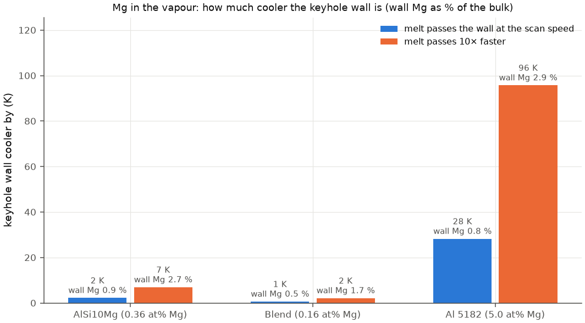
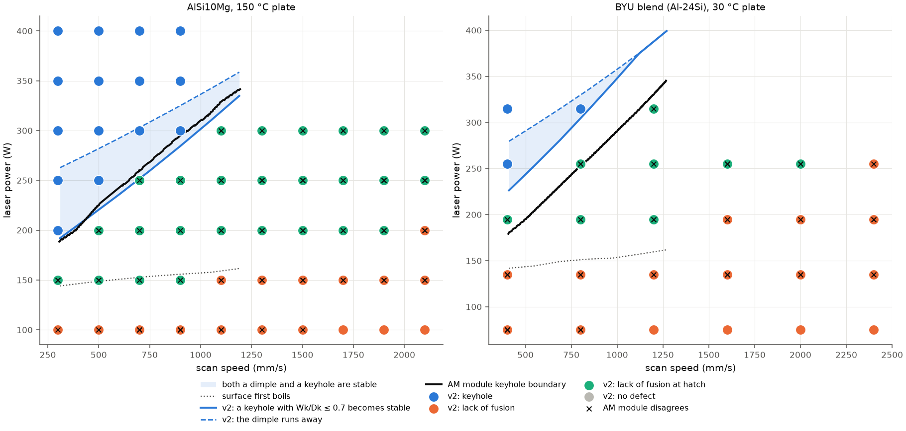
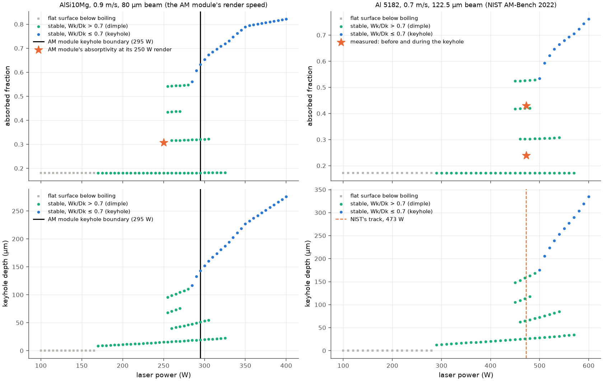
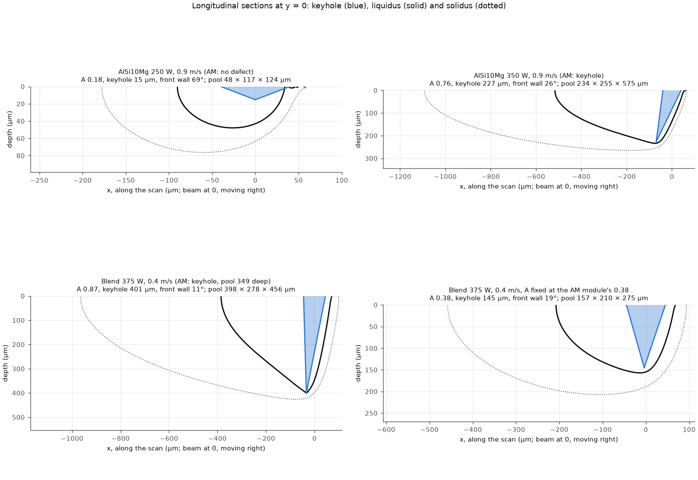
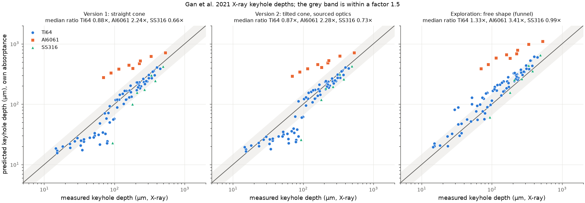
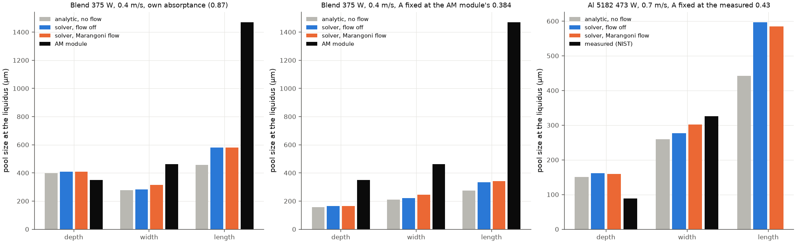

# Version 2 of our first-principles keyhole model: what version 1 left out (#249)

Version 1 ([`../README.md`](../README.md)) ended with a list of what it didn't do:
- Mg evaporation, a powder layer, a tilted keyhole and melt flow;
- the blend's liquid resistivity, extrapolated from data that stop at 12 wt % Si;
- handbook resistivities for Gan et al.'s three alloys;
- a solid conductivity, 110 W/m/K, that wasn't checked in a source.

Sterling asked in #249 for those items. This folder is the result. As before, **nothing is fitted to keyhole or
melt-pool data**. The sources were read through the lab Pi's browser route; Edison's round 4 supplied leads.

| Code | What it is |
|---|---|
| [`scripts/keyhole_first_principles_v2.py`](../../../../scripts/keyhole_first_principles_v2.py) | version 2 and every comparison (`all`, `explore`, `meltflow`, `conduction`, `figures`, `point`) |
| [`scripts/keyhole_fp_shaped.py`](../../../../scripts/keyhole_fp_shaped.py) | a ray tracer for any keyhole with circular cross-sections (numba), Kaplan's front-wall tilt, and the free-shape solver of section 4 |
| [`scripts/keyhole_fp_powder.py`](../../../../scripts/keyhole_fp_powder.py) | radiative transfer in a powder layer (Monte Carlo) and the powder's share of the beam in conduction mode |
| [`scripts/keyhole_meltflow.py`](../../../../scripts/keyhole_meltflow.py) | our own 3D steady-state melt-flow solver in the beam frame (section 6) |
| [`scripts/keyhole_fp_liquid_activities_mc_al.py`](../../../../scripts/keyhole_fp_liquid_activities_mc_al.py) | activity coefficients of Al, Mg and Si in the liquid, from pycalphad + mc_al |
| [`scripts/test_keyhole_first_principles_v2.py`](../../../../scripts/test_keyhole_first_principles_v2.py), [`scripts/test_keyhole_meltflow.py`](../../../../scripts/test_keyhole_meltflow.py) | 6 and 5 checks against exact or published results, all passing |

## Summary

| Version 1's open item | What version 2 does | What it changed |
|---|---|---|
| **Mg evaporation** | The wall temperature is where the alloy's total vapour pressure equals the keyhole pressure. Pure-element vapour pressures come from JANAF, activities from mc_al, and Mg at the wall from a supply-against-outflow mass balance | **Little.** The melt can't resupply Mg as fast as the vapour carries it out, so the wall keeps 0.5–3 % of the bulk Mg. It is 1–7 K cooler for AlSi10Mg and the blend, and 28–96 K cooler for Al 5182. No map class changes |
| **Powder layer** | Radiative transfer in the layer was checked against published values. It over-traps light, so the measured powder absorptance (0.53) is used for the part of the beam ahead of the melt | **Little.** The melt front runs ahead of the beam centre, so only 3–24 % of the beam lands on powder. The conduction-mode absorptance moves from 0.18–0.20 to 0.19–0.28. No map class changes |
| **Tilted keyhole** | The front wall leans back at Kaplan's (1994) angle, where the direct beam it catches balances its conduction loss. A new ray tracer handles the tilted shape | Front walls 7–26° from vertical in AlSi10Mg keyholes. Absorptance and depth barely move: X-ray depths 0.87× against version 1's 0.88× for Ti-6Al-4V |
| **The keyhole's shape from the physics** | A free-form point-by-point wall balance (Kaplan's, with the reflections ray-traced) | **Not adopted.** It drives the keyhole to a funnel with a 20–34 µm shaft, which traps more light and makes the X-ray depths worse (Ti-6Al-4V 1.33×, Al6061 3.4×). Section 4 |
| **Melt flow** | Our own 3D steady Navier–Stokes and energy solver in the beam frame. It has Marangoni shear on a flat surface, a mushy zone, and the keyhole as a fixed cavity at T_w | **Modest.** Marangoni flow widens pools by 7–12 % and moves depth and length by 6 % or less. Solving the conduction with the real temperature-dependent properties, which version 1 averaged, matters more: it lengthens the pools by 21–65 %. A recoil-driven experiment that pushes the melt round the keyhole at 3–7 m/s changes the pools by 10 % or less. Nothing reaches the AM module's 1.47 mm blend pool. Section 6 |
| **Blend resistivity above 12 wt % Si** | Sun et al. 2019 measured liquid Al–Si to 20 wt % Si | Version 1's formula holds to 20 wt %: 40.4 against the measured 39 µΩ cm at 750 °C. The blend's 24.3 % is now a short extrapolation |
| **Gan et al.'s resistivities** | Ti-6Al-4V: Boivineau et al. 2006. 316L: Pichler et al. 2020. Al6061: no data, so built like our alloys | Flat absorptance 0.35 → 0.37 (Ti-6Al-4V), 0.30 → 0.34 (316L), 0.16 → 0.18 (Al6061). X-ray depths: 316L 0.66× → 0.73×, the others unchanged |
| **Solid conductivity** | As-built LPBF AlSi10Mg k(T), Yang et al. 2018 | Mean conductivity +7–10 %. Pools slightly smaller |

**What version 2 adds that wasn't asked for:**
- **Two stable keyholes.** Above the power where the surface first boils, the energy balance has more than one stable depth. There is a shallow dimple that absorbs like the flat liquid, and one or more keyholes deep enough to trap light.
- **The AM module's keyhole boundary is where a stable keyhole first appears.** For AlSi10Mg, that is the power where a stable keyhole with Wk/Dk ≤ 0.7 first exists. It is 0.96–1.01× the AM module's boundary at every speed, with nothing fitted. For the blend it is 1.16–1.25×.
  - Counting a point as a keyhole wherever one is stable gives keyhole-or-not agreement at **58 of 58** AlSi10Mg points and **25 of 27** blend points.
- **NIST's measured Al 5182 track shows the same jump.** It absorbed about 0.24 before its keyhole formed and 0.43 in it. At that point version 2 has four stable states, absorbing 0.17 (the dimple), 0.30, 0.42 and 0.53. The measured 0.43 matches the third, a keyhole about 115 µm deep.

**What is still wrong:**
- **Lack of fusion is over-predicted, now at every AM "no defect" point.** The liquid's own absorptance (0.18–0.20) is too low. Neither the powder nor melt flow fixes it. Fixing the conduction-mode absorptance at 0.24 or the AM module's 0.307 moves at most one point. Most of the AM module's no-defect points are where our surface already boils, so our dimple there absorbs like the flat liquid, 0.18, where the AM module has 0.31.
- **Al6061 keyholes are 2.3× too deep**, as in version 1.
- **The AM module's 1.47 mm blend pool** is out of reach of every model here, with or without melt flow.

## 1. Properties

| Quantity | Version 1 | Version 2 | Source (read in the source) |
|---|---|---|---|
| Blend liquid resistivity | Leitner et al.'s Al + Brandt & Neuer's +0.675 µΩ cm per wt % Si, extrapolated from 12 to 24.3 wt % | unchanged, now checked to 20 wt % | [Sun et al. 2019](https://doi.org/10.1007/s10765-019-2497-1), Int. J. Thermophys. 40, 31: "At 750 °C, the electrical resistivity of liquid Al–Si alloys increased from 26 µΩ·cm to 39 µΩ·cm as the silicon content increased from 0 at% to 19.4 at%" (19.4 at % = 20.0 wt %). The formula gives 40.4 there. Liquid Si is 75.2 µΩ cm at its melting point ([Schnyders & Van Zytveld 1996](https://doi.org/10.1088/0953-8984/8/50/013)) |
| Ti-6Al-4V liquid resistivity | 1.75 µΩ m (handbook) | 1.92 µΩ m | [Boivineau et al. 2006](https://doi.org/10.1007/PL00021868): 1.90 at the solidus and 1.92 at the liquidus, corrected for expansion. No corrected fit is given, so it is held constant |
| 316L liquid resistivity | 1.35 µΩ m (handbook) | 1.154 + 1.893×10⁻⁴ T µΩ m (1.74 at Gan et al.'s T_v) | [Pichler et al. 2020](https://doi.org/10.1007/s10853-019-04261-6), Table 3, corrected for expansion, 1,708–2,900 K (open access) |
| Al6061 liquid resistivity | 0.50 µΩ m (handbook) | 0.58 µΩ m | none found. Leitner et al.'s liquid Al with Brandt & Neuer's increments for 0.6 wt % Si and 1.0 wt % Mg, as for our alloys |
| Solid conductivity, AlSi10Mg and blend | 110 W/m/K | 94 at −50 °C, 120 at 150 °C, 154–162 at 350–500 °C | [Yang et al. 2018](https://doi.org/10.1557/jmr.2018.405), Fig. 5: as-built LPBF AlSi10Mg, first heating, mean of the X and Z directions, read off the figure. The dip at 175–350 °C is skipped; the authors attribute it to the heat capacity of exothermic events. **No hypereutectic LPBF Al–Si was found, so the blend uses the same table** |
| Liquid viscosity (melt flow) | – | η = η∞ exp(E_A/RT). Al: 0.281 mPa s, 12.3 kJ/mol. The blend is interpolated towards Al50Si50 (0.169 mPa s, 16.3 kJ/mol) | [Kobatake et al. 2014](https://doi.org/10.1007/s10853-014-8072-z), J. Mater. Sci. 49, 3541 |
| Vapour pressure of Al, Mg, Si | Al only, Clausius–Clapeyron | each element, Kirchhoff-integrated from its JANAF 1-bar boiling point: Al 2,790.8 K, 294.0 kJ/mol; Mg 1,366.1 K, 127.9 kJ/mol; Si 3,504.6 K, 384.5 kJ/mol | NIST-JANAF tables Al-001, Mg-001, Si-001 |
| Activities in the liquid | Raoult, Al only | γ from mc_al: γ_Al ≈ 1, γ_Si ≈ 0.6–0.7 and γ_Mg ≈ 1.4 at 2,800 K. γ_Mg is 0.25–0.7 near the liquidus; above about 2,000 K these values are an extrapolation | pycalphad 0.11.2 + MatCalc mc_al ([`mc_al-liquid-activity-coefficients.csv`](mc_al-liquid-activity-coefficients.csv)) |
| Mg diffusivity in liquid Al | – | **proxy**: Cu in liquid Al80Cu20, D0 = 1.3×10⁻⁷ m²/s, Q = 0.34 eV | [Zhang, Griesche & Meyer 2009](https://doi.org/10.62721/diffusion-fundamentals.11.552) (X-ray radiography, open access). No open measurement for Mg was found; Du et al. 2003 is closed |
| Powder absorptance | – | 0.53 | [Rubenchik et al. 2015](https://doi.org/10.1364/AO.54.007230), Fig. 5c (OSTI accepted manuscript): Al powder by calorimetry at 970 nm, 0.51–0.55 from 40 to 450 °C, read off the figure |

## 2. Mg and Si in the vapour



The wall temperature T_w satisfies Σ γ_i x_i p_i°(T_w) = p_amb + σ/a0, summed over Al, Si and Mg.
- **Mg's own vapour pressure is high.** At 2,800 K it is 228 bar, against Al's 1.04 bar. At the bulk composition, AlSi10Mg's 0.36 at % Mg alone would supply more than a bar.
- **The wall is depleted.** Mg leaves in the vapour flowing out of the opening. The melt resupplies it as it flows past the wall, with Boussinesq's potential-flow mass transfer Sh = 1.128 Pe^½.
  - Supply equals outflow at a surface fraction of 0.5–3 % of the bulk.
  - A 10× faster melt (a stand-in for flow around the keyhole) only triples it.
- **At keyhole onset on the flat surface, the depletion is stronger still.** There the Hertz–Knudsen flux is set against diffusion over the beam's dwell time. That gives 0.2–0.3 % of the bulk.

| Alloy (x_Mg) | Onset T, no Mg → Mg (K) | Wall T_w, no Mg (K) | with Mg, melt at v | with Mg, melt at 10 v | Wall Mg / bulk | Mg in the vapour | Mg lost from the keyhole |
|---|---|---|---|---|---|---|---|
| AlSi10Mg (0.36 at %) | 2,817 → 2,817 | 2,850 | 2,848 | 2,843 | 0.9–2.7 % | 1–3 % | 3–9 µg/s |
| Blend (0.16 at %) | 2,858 → 2,858 | 2,889 | 2,888 | 2,886 | 0.5–1.7 % | 0.3–0.9 % | 1–3 µg/s |
| Al 5182 (5.0 at %) | 2,805 → 2,798 | 2,827 | 2,799 | 2,731 | 0.8–2.9 % | 12–35 % | 66–202 µg/s |

**What it changes:**
- On the AM maps and at the render points, almost nothing. A few kelvin changes the wall's temperature rise by about 0.1 %.
- At NIST's Al 5182 track the wall is 20 K cooler, but the pool doesn't move (section 7).
- **Al 5182's Mg loss, as a check on scale.**
  - The model's keyhole loses 66–202 µg/s of Mg at 473 W. Over NIST's measured pool cross-section that is 3.5–11 % of the Mg melted.
  - [Zhao & DebRoy 2001](https://doi.org/10.1007/s11663-001-0018-6) measured 12–16 % in conduction-mode welds of Al 5182 (1.5–3 kW, 0.32–0.58 mg/s).
  - That is a different process, so this only says the model's evaporation is the right order of magnitude.
  - Mg lost from the open pool surface is not included.

## 3. The keyhole: its tilt, its stable states, and the AM module's boundary



**The keyhole.** As in version 1, it is a cone whose opening is the beam's 1/e² radius, and its depth comes from the
global balance: power absorbed in the keyhole equals the power conducted (3D moving point sources) plus the power evaporated.
- **New here: the cone tilts.** Its front wall leans back until the direct beam it catches equals its conduction loss.
  - This is Kaplan 1994's balance A(θ) I tan θ = k θ_w Pe′ (1 + K1(Pe′r)/K0(Pe′r)), taken at mid-depth.
  - At high Péclet number it reduces to Fabbro & Chouf's tan θ = v / v_drill.
  - [`scripts/keyhole_fp_shaped.py`](../../../../scripts/keyhole_fp_shaped.py) traces rays through the tilted cone, and the point sources sit on its tilted axis.
- **Also new: every root of the balance.** Version 2 scans depths from 2 % of the opening to 60 beam radii and finds all roots, not just one.

**More than one stable keyhole.**
- **Above the power where the surface first boils, the balance (absorbed − lost) crosses zero more than once.** A root where it falls through zero is stable.
  - The first stable root is a dimple, shallower than its opening is wide. It absorbs about the flat liquid's 0.18–0.20.
  - Deeper stable roots are keyholes that trap light.
- **Why there are several.** A cone's absorptance rises in steps as it deepens, one step per extra reflection. At AlSi10Mg 250 W, 0.9 m/s, version 1's own balance has stable roots at 16, 40, 69 and 98 µm.
- **This corrects version 1.** Its 0.315 there, which matched the AM module's 0.307, was the second of these (40 µm), not a unique answer.
- **The steps are an idealisation.** Beam divergence and a rough, moving wall would smooth them, but the band where a dimple and a keyhole are both stable would remain.



The figure (`states` command, [`v2-stable-states-vs-power.csv`](v2-stable-states-vs-power.csv)) traces every stable
state against power at one speed.
- **AlSi10Mg at the AM module's 0.9 m/s.**
  - Below 170 W the surface doesn't boil.
  - From 170 to 250 W there is only the dimple, 9–15 µm deep, absorbing 0.18.
  - From 255 to 325 W, the dimple coexists with states absorbing 0.32, 0.43 and 0.54–0.72.
  - Above 325 W only the deep keyhole is left.
  - The first state deep enough to count as a keyhole (Wk/Dk ≤ 0.7) appears at 285–290 W, at the AM module's 295 W boundary.
  - The AM module's 0.307 at its 250 W render is next to the 0.32 state, which appears at 260 W.
- **Al 5182 at NIST's 0.7 m/s.**
  - At 473 W the model has four stable states, absorbing 0.17, 0.30, 0.42 and 0.53.
  - NIST measured about 0.24 before the keyhole formed and 0.43 in it. The 0.43 matches the third state (0.42, a keyhole about 115 µm deep).

Three lines on each map, as ratios to the AM module's keyhole boundary power over its speed range:

| | AlSi10Mg | Blend |
|---|---|---|
| The surface first boils | 0.47–0.76 | 0.47–0.79 |
| **A stable keyhole with Wk/Dk ≤ 0.7 first exists** | **0.96–1.01** | **1.16–1.25** |
| The dimple runs away (no stable dimple is left) | 1.05–1.39 | 1.16–1.55 |

**The AM module's boundary lies on the first-keyhole line for AlSi10Mg, and 16–25 % below it for the blend.** So version 2 calls a keyhole wherever a stable one with Wk/Dk ≤ 0.7 exists. In a real track, fluctuations would carry the melt from the dimple to the keyhole once both are available.

| Grid points agreeing with the AM module | AlSi10Mg (58) keyhole or not / all classes | Blend (27) |
|---|---|---|
| Version 1 (one root, found by Brent's method) | 58 / 22 | 25 / 8 |
| **Version 2, a keyhole wherever a stable one exists** | **58 / 18** | **25 / 7** |
| Version 2, the shallowest stable state only | 53 / 13 (5 missed) | 23 / 5 (4 missed) |
| Version 2 without the powder layer | same | same |

All-class agreement is lower than version 1's because every AM "no defect" point becomes lack of fusion:
- AlSi10Mg: 26 at the hatch and 5 outright, of 31.
- Blend: 6 at the hatch and 7 outright, of 13.

The points version 1 called no defect sat on a deeper root, like the 40 µm one at 250 W, absorbing about 0.3. The stable dimple below it absorbs 0.18, so the pool there is too small.

**What the lack-of-fusion side needs is a dimple that absorbs more** (`conduction` command, `v2-conduction-sensitivity-summary.json`).
- Fixing the conduction-mode absorptance at 0.24 (NIST's bare Al 5182 before its keyhole formed) or at 0.307 (the AM module's render) gives all-class agreement of 18–19 and 7. That is one point more at most.
- Most of the AM module's no-defect points are above the power where our surface boils. There version 2 has a dimple, not a flat surface, so the fixed value doesn't apply.
- Given the AM module's 0.307, the dimple at its 250 W render is 35 µm deep, and the pool (72 µm deep, 145 µm wide) is no defect, which agrees.
- Putting the 9 bistable points on their deepest stable state instead, for the pool as well as the class, changes one point. All-class agreement goes to 19 and 7 (`v2-map-classes-deepest-state.csv`). Most no-defect points have only the dimple.
- So the gap is the dimple's absorptance: about 0.31 in the AM module against 0.18 here. A specular, clean liquid surface can't absorb that much in a dish this shallow. An oxidised or rippled surface might.

**At the render points** (pool at the liquidus, solidus length in brackets; µm):

| Point | Version | Absorbed | Keyhole depth | Front wall | Tip behind the opening's centre | Pool depth / width / length | Class |
|---|---|---|---|---|---|---|---|
| AlSi10Mg 250 W, 0.9 m/s (AM: no defect, A 0.307) | v1 | 0.315 | 40 | – | – | 74 / 150 / 231 (405) | no defect |
| | **v2** | **0.18** | 15 (dimple) | 69° | 0 | 48 / 117 / 124 (237) | lack of fusion at hatch |
| | v2, A fixed at 0.307 | 0.307 | 35 | 48° | 0 | 72 / 145 / 216 (374) | no defect |
| AlSi10Mg 350 W, 0.9 m/s (AM: keyhole) | v1 | 0.796 | 236 | – | – | 240 / 258 / 596 (1,230) | keyhole |
| | **v2** | **0.76** | 227 | 26° | 69 | 234 / 255 / 575 (1,158) | keyhole |
| Blend 375 W, 0.4 m/s (AM: keyhole, A 0.384, pool 349 / 462 / 1,470) | v1 | 0.873 | 424 | – | – | 420 / 277 / 473 (1,129) | keyhole |
| | **v2** | **0.87** | 401 | 11° | 34 | 398 / 278 / 456 (1,065) | keyhole |
| | v2, A fixed at 0.384 | 0.384 | 145 | 19° | 4 | 157 / 210 / 275 (552) | keyhole |



## 4. Letting the physics set the whole shape: a funnel (exploration, not adopted)

The tilted cone fixes the shape and lets the physics set two numbers, the depth and the tilt.
[`solve_shaped`](../../../../scripts/keyhole_fp_shaped.py) goes further: it sets the wall's slope at every depth from
Kaplan's local balance.
- **The rule.** At each of 40 depths, the front and rear walls each lean until the direct beam they catch, plus the reflections the ray tracer delivers there, equals their share of the conduction loss. The depth still comes from the global balance.
- **What comes out is a funnel.** The rim, where the Gaussian beam is weak, has to lean far over (60–70° from vertical) to catch enough light. Below it the walls stand nearly vertical in a shaft only 20–34 µm wide.
- **The funnel traps more light and loses less heat per unit depth, so the keyhole runs deeper.** On Gan et al.'s X-ray depths:

| Own absorptance, median predicted / measured | Ti-6Al-4V (71) | Al6061 (9) | 316L (7) | All 87 |
|---|---|---|---|---|
| Version 1, straight cone | 0.88× (R² 0.93) | 2.24× | 0.66× | 0.88× |
| **Version 2, tilted cone, sourced optics** | **0.87× (R² 0.93)** | **2.28×** | **0.73×** | **0.88×** |
| Version 2, deepest stable keyhole wherever there is more than one | 0.91× (R² 0.94) | 2.28× | 0.73× | 0.93× |
| Free shape (funnel) | 1.33× (R² 0.57) | 3.41× | 0.99× | 1.33× |
| Gan et al.'s depth law (fitted to these data) | 0.93× | 1.12× | 0.94× | 0.94× |



- **The funnel makes Ti-6Al-4V and Al6061 worse, so it isn't used.**
- **The free-form iteration is also fragile.**
  - 31 of 87 rows didn't settle within 40 iterations and were averaged over their last 20.
  - A version that moved the walls' positions rather than their slopes diverged.
  - A three-parameter version (depth, tilt, and a profile exponent from the depth centroid of the balance) ran to its bounds.
- **The probable missing piece is the melt.** The real keyhole's wall is pushed open by recoil and swept by the melt, which local conduction alone doesn't capture. Section 6 tests both with the melt-flow solver. Marangoni flow changes the wall's heat loss by 1–5 %, and the recoil-driven experiment by 1–10 %, so neither explains it.

## 5. The powder layer

[`scripts/keyhole_fp_powder.py`](../../../../scripts/keyhole_fp_powder.py) treats the layer as a homogeneous
scattering medium (Gusarov & Kruth 2005):
- the extinction coefficient is β = 3(1 − ε)/(2εD), from their Eqs. 20–22 read in the KU Leuven manuscript;
- rays reflect specularly off spheres, with Fresnel or a fixed absorptance;
- the bottom of the layer is a flat substrate.

| Check | Homogeneous model | Published |
|---|---|---|
| Al's textbook index, n = 1.244 + 10i (flat 0.047), a layer 1.5–2 particles thick, porosity 0.4–0.5 | 0.37–0.46 | 0.22, ray-traced close-packed bilayer on Al ([Boley et al. 2015](https://doi.org/10.1364/AO.54.002477), Table 1, OSTI manuscript) |
| Real, oxidised Al: flat absorptance 0.20, 2–20 particles thick | 0.67–0.72 | 0.51–0.55, Al powder by calorimetry at 970 nm ([Rubenchik et al. 2015](https://doi.org/10.1364/AO.54.007230), Fig. 5c) |

**The homogeneous model over-traps light in a layer only a couple of particles thick, by 1.3–2×.** So version 2 uses the measured 0.53 for the powder. Edison also pointed to Boley et al. 2016's 0.53 for Al powder and 0.58 for Al6061, but I didn't read that paper.

**Coupling into the melt.**
- In conduction mode, the beam's share ahead of the melt front lands on powder, at 0.53. The rest lands on the liquid. The melt front is the liquidus on the centre line, iterated with the absorptance.
- The front runs ahead of the beam centre, by up to a beam radius at the slower speeds, so only **3–14 %** (AlSi10Mg) and **5–24 %** (blend) of the beam lands on powder.
- The conduction-mode absorptance rises from 0.18 to 0.19–0.23 (AlSi10Mg), and from 0.20 to 0.22–0.28 (blend).
- **No class changes on either map** (`v2-map-classes-no-powder.csv`).
- **So the powder isn't what the lack-of-fusion side is missing.** Section 3's sensitivity points to the liquid's own absorptance in conduction mode.
  - NIST measured 0.24 on bare Al 5182 before its keyhole formed.
  - Rubenchik et al. measured "over 20 %" on flat Al.
  - The AM module used 0.307 at its no-defect render.
- The powder's packing (0.5) and particle size (35 µm) are assumed; no measured AlSi10Mg values were found that could be read. Edison's lead, Solyaev et al. 2026 (packing 0.38–0.43), wasn't checked.

## 6. Melt flow: our own 3D solver

[`scripts/keyhole_meltflow.py`](../../../../scripts/keyhole_meltflow.py) solves the steady Navier–Stokes and
energy equations in the beam's frame.
- **Numerics.** Collocated finite volumes with Rhie–Chow fluxes and SIMPLEC, numba line sweeps for the flow, and the
  enthalpy equation solved with algebraic multigrid. The grid is r0/8 near the beam.
- **Physics:**
  - Marangoni shear on a flat top surface (dσ/dT = −1.27×10⁻⁴ N/m/K, Leitner et al. 2017);
  - a Carman–Kozeny mushy zone, where C from 10⁸ to 10¹⁰ changes pool sizes by under 0.6 %;
  - the sourced viscosities;
  - Hertz–Knudsen evaporative cooling on the free surface;
  - the material's full H(T) and k(T).
- **The keyhole** is version 2's tilted cone, held at T_w. It is blocked to the flow, so the liquid goes round it, and
  the beam's power outside the opening enters as a surface flux.
- **Checks** ([`scripts/test_keyhole_meltflow.py`](../../../../scripts/test_keyhole_meltflow.py), all 5 pass in 1.5–2.5 min):
  - with flow off and constant properties, pool size matches the exact moving-Gaussian solution to 0.14 %;
  - a cone at T_w delivers 0.945× the collocation's heat, and its pool depth is 1.005×;
  - the energy balance closes;
  - 100 % of the surface liquid flows outward, at 4.4 m/s against the scaling estimate's 9.3;
  - refining the grid from r0/6 to r0/8 changes pool sizes by 1.7 %.

At version 2's states, liquidus pool depth / width / length (solidus length in brackets), µm:

| Case | Keyhole | Version 2 (analytic) | Solver, flow off | Solver, Marangoni flow | Peak surface speed | Reference |
|---|---|---|---|---|---|---|
| AlSi10Mg 250 W, 0.9 m/s, A fixed at 0.307 | 35 µm | 72 / 145 / 216 (374) | 80 / 170 / 326 (358) | 77 / 182 / 322 (354) | 3.2 m/s | AM: no defect |
| AlSi10Mg 350 W, 0.9 m/s, own A 0.76 | 227 µm, 26° | 234 / 255 / 575 (1,158) | 248 / 265 / 948 (1,153) | 247 / 285 / 894 (1,081) | 3.5 m/s | AM: keyhole |
| Blend 375 W, 0.4 m/s, own A 0.87 | 401 µm, 11° | 398 / 278 / 456 (1,065) | 409 / 283 / 580 (1,009) | 408 / 316 / 581 (980) | 3.3 m/s | **AM: 349 / 462 / 1,470** |
| Blend 375 W, 0.4 m/s, A fixed at 0.384 | 145 µm, 19° | 157 / 210 / 275 (552) | 165 / 222 / 334 (471) | 164 / 247 / 341 (469) | 3.2 m/s | **AM: 349 / 462 / 1,470** |
| Al 5182 473 W, 0.7 m/s, A fixed at the measured 0.43 | 123 µm, 35° | 150 / 259 / 442 (694) | 162 / 277 / 597 (681) | 160 / 302 / 585 (661) | 2.6 m/s | **measured 88.8 / 326** |
| *AlSi10Mg 250 W, own A 0.18 (dimple)* | *15 µm* | *48 / 117 / 124 (237)* | *65 / 148 / 253 (275)* | *63 / 159 / 254 (275)* | *3.1 m/s* | *AM: no defect* |
| *Al 5182, own A 0.17 (dimple)* | *26 µm* | *71 / 178 / 187 (322)* | *90 / 211 / 340 (375)* | *87 / 227 / 345 (377)* | *2.4 m/s* | *measured 88.8 / 326* |

**The two dimple rows (italics) overstate their pools.** A dimple 15–26 µm deep spans only 3–5 cells, so its T_w cells deliver 35–42 % more heat than the absorbed power allows. In the other rows the cavity delivers 0.91–1.02× the analytic balance's heat.



- **Marangoni flow on a flat surface does little to these aluminium pools.**
  - It widens them by 7–12 % and makes them 0–4 % shallower. Length changes by −6 to +2 %.
  - The keyhole wall delivers 1–5 % less heat with flow, so flow wouldn't move the keyhole depth much either.
  - The liquid's high thermal diffusivity keeps the Péclet number of a 3 m/s surface flow modest.
- **The analytic model's averaged properties matter more than flow.** Version 1 and version 2 use one
  Kirchhoff-mean conductivity and one secant heat capacity for the whole range, and the solver resolves k(T) and H(T)
  instead. With flow off, that alone lengthens the liquidus pool by 21–65 % and widens it by 2–17 %. The pool tail
  forms near the liquidus, where the averages are furthest from the local values.
- **Against the AM module's blend pool, nothing here gets close.**
  - At its own absorptance the pool is deeper (408 µm against 349) but narrower (316 against 462) and much shorter (581 against 1,470; 980 at the solidus).
  - At the AM module's absorptance it is half the depth.
  - The AM module's pool looks like one stretched by a strong rearward flow. The recoil-driven experiment below tests that.
- **Against NIST's measured Al 5182 pool:**
  - flow brings the width to 302 µm, within 7 % of the measured 326 ± 16;
  - the depth stays at 160 µm against the measured 88.8, because the keyhole itself is 123 µm deep at the measured absorptance;
  - so for this aluminium, the keyhole for a given absorbed power is too deep, as it is for Gan et al.'s Al6061 (section 4).

Melt-flow figures for two cases are in [`v2-meltflow-blend-375W-0.4-own.png`](v2-meltflow-blend-375W-0.4-own.png)
and [`v2-meltflow-al5182-473W-0.7-A_measured.png`](v2-meltflow-al5182-473W-0.7-A_measured.png).

**A recoil-driven experiment** (`meltflow --drive`). The recoil pressure that holds the keyhole open pushes the melt
round it from the front to the rear. The solver can't compute that (its surface is flat and its keyhole fixed), so
this experiment imposes it.
- **The imposed flow.** The liquid next to the keyhole is driven round it at V(z) sin φ.
  - V(z) = √(2σ / ρ r(z)) is Bernoulli's speed for the Laplace overpressure σ/r. The recoil must supply at least that overpressure to hold a cross-section of radius r open; r is floored at a quarter of the opening.
  - That comes to 3.4 m/s at the opening and up to 5.6–6.9 m/s deeper down.
  - It is applied as a penalty on the liquid cells touching the keyhole. A no-slip shear alone barely coupled at this grid, where the cell Reynolds number is about 70.
- This is a closure, not a solution. It asks what a melt pushed round the keyhole at that speed does to the pool.

| Case | Marangoni only: depth / width / length (solidus) | With the driven keyhole wall | Peak melt speed | Keyhole wall heat |
|---|---|---|---|---|
| AlSi10Mg 350 W, 0.9 m/s, own A | 247 / 285 / 894 (1,081) | 248 / 287 / 974 (1,169) | 3.5 → 5.2 m/s | 238 → 254 W |
| Blend 375 W, 0.4 m/s, own A | 408 / 316 / 581 (980) | 408 / 300 / 569 (1,078) | 3.3 → 5.5 m/s | 300 → 329 W |
| Blend 375 W, 0.4 m/s, A fixed at 0.384 | 164 / 247 / 341 (469) | 165 / 233 / 347 (501) | 3.2 → 5.5 m/s | 129 → 138 W |
| Al 5182 473 W, 0.7 m/s, A fixed at 0.43 | 160 / 302 / 585 (661) | 163 / 293 / 620 (702) | 2.6 → 4.3 m/s | 172 → 180 W |

**Driving the melt round the keyhole changes the pool by 10 % or less.**
- The liquidus length moves by −2 to +9 %, the solidus length grows by 6–10 %, and the width shrinks by 3–6 %.
- It doesn't reach the AM module's 1.47 mm blend pool either.
- (The blend run at the AM module's absorptance hadn't settled after 60 outer iterations. Its pool sizes were steady to about 1 %.)
- So a melt flow of the size these closures give doesn't explain the AM module's long pool.
- That leaves the AM module's own inputs to check, which aren't public: the properties it uses for the blend, its absorptivity at every point, and which pool edge it draws. The AM module's CSV export would show all three.

## 7. Measured tracks

**Solyaev et al. 2025's AlSi10Mg tracks** (231 points, 80 measured keyholes):

| Criterion | Agree | Measured keyholes missed | Extra |
|---|---|---|---|
| The surface boils (v2) | 200 | 1 | 30 |
| Wk/Dk ≤ 0.7, keyhole wherever one is stable (v2) | 178 | 53 | 0 |
| Wk/Dk ≤ 0.7, shallowest state only (v2) | 154 | 77 | 0 |
| Version 1, surface boils / Wk/Dk ≤ 0.7 | 199 / 177 | 2 / 54 | 30 / 0 |

34 of the 231 points have both a dimple and a keyhole.

**NIST AM-Bench 2022, Al 5182, 473 W, 0.7 m/s** ([Simonds et al. 2024](https://doi.org/10.1007/s40192-023-00336-0)):

| | Absorbed | Keyhole depth (µm) | Pool depth / width (µm), liquidus |
|---|---|---|---|
| Measured | ≈0.24 before the keyhole, ≈0.43 in it | – | **88.8 / 326** |
| v2, the dimple | 0.17 | 26 | 71 / 178 |
| v2, the other stable states at the same point (`states`, 470–480 W) | 0.30, 0.42, 0.53 | about 65, 115, 160 | – |
| v2, absorbed fraction fixed at the measured 0.43 | 0.43 | 123 (front wall 35°) | 150 / 259 |
| the same, without Mg in the vapour | 0.43 | 121 | 149 / 259 |
| version 1, cone, own absorptance | 0.30 | 64 | 109 / 218 |

- **The model has the jump the measurement shows.** The measured absorptance went from 0.24 to 0.43 when the keyhole formed. The model's states run from 0.17 to 0.53, and one of them is 0.42.
- **Given the measured 0.43, the pool is too deep and too narrow**: 150 µm against 88.8 µm, and 259 µm against 326. Melt flow widens it (section 6) but doesn't make it shallower.

## What is still not done

- **A free surface.** The solver has Marangoni flow on a flat surface and a fixed keyhole. Imposing a recoil-driven flow round the keyhole changes the pools by 10 % or less (section 6). A deforming surface, with the melt ejected up the rear wall, is still untested. So is whether the AM module's long blend pool comes from its own inputs instead (properties, absorptivity, which edge it draws).
- **Lack of fusion.** The dimple, where the surface boils but no keyhole has formed, needs to absorb about the AM module's 0.3, not the clean liquid's 0.18. A measured absorptance for AlSi10Mg tracks in that regime would settle it, as would our own single tracks.
- **Al6061 keyholes are still 2.3× too deep.** Neither the sourced optics, the tilt nor the Mg changes that.
- **The free-form keyhole shape** (section 4) doesn't converge reliably, and the shape it reaches doesn't help.
- **Inputs not found in a source:**
  - Mg's diffusivity in liquid Al (an Al–Cu proxy is used);
  - a hypereutectic Al–Si solid conductivity (the blend uses AlSi10Mg's);
  - Al6061's liquid resistivity;
  - the powder's packing.

## Edison, round 4

Three LITERATURE_HIGH queries ([`scripts/edison_keyhole_not_done.py`](../../../../scripts/edison_keyhole_not_done.py)),
submitted at 03:42 UTC and fetched at 04:10. The reports, raw trajectories and DOI check are in
[`edison-trajectories/keyhole-not-done/`](../../../../edison-trajectories/keyhole-not-done/).
- **Grounded, like round 3.** Of 45 DOIs, 43 match the work cited by title or first author. Two were checked by hand.
  - The one cited as Assael et al. 2012 resolves to an unrelated AIP conference paper.
  - The OSTI report (Turchi 2018) is correct.
- **What it added:**
  - the Sun et al. 2019 and Chikova et al. 2016 leads for hypereutectic Al–Si. Sun et al. checked out. Chikova et al.'s Fig. 1b implies half of pure Al's resistivity, so it isn't used.
  - Boley et al. 2016's measured powder absorptance (not read);
  - Solyaev et al. 2026's AlSi10Mg packing (not read);
  - Zhao & DebRoy's Mg-loss model, read through the Pi.
- Nothing from Edison is used unless it was read in the source.

## Files and rerunning

| File | What it is |
|---|---|
| `v2-summary.json`, `v2-all.log` | every number above, and the run log |
| `v2-map-classes.csv`, `v2-map-classes-no-powder.csv`, `v2-keyhole-boundary-vs-am.csv` | the AM maps and the three keyhole lines |
| `v2-render-points.csv`, `v2-render-point-shapes.json` | the render points, with the keyhole geometry |
| `v2-gan2021-xray-keyhole-depths.csv`, `v2-explore-free-shape-gan2021.csv`, `v2-explore-free-shape-summary.json` | X-ray depths, version 2 and the free shape |
| `v2-solyaev2025-alsi10mg.csv`, `v2-ambench2022-al5182.csv` | the measured tracks |
| `v2-mg-vapour.csv`, `mc_al-liquid-activity-coefficients.csv` | Mg in the vapour, and the activities |
| `v2-powder-check.csv` | the powder model against Boley and Rubenchik |
| `v2-meltflow-runs.csv`, `v2-meltflow-*.png`, `../meltflow/` | the melt-flow runs at version 2's states, and the solver's own validation runs |
| `v2-conduction-sensitivity-summary.json`, `v2-map-classes-A_cond-*.csv`, `v2-map-classes-deepest-state.csv` | the maps with the conduction-mode absorptance fixed, and with bistable points on their deepest state |
| `v2-stable-states-vs-power.csv`, `v2-stable-states-vs-power.png` | every stable state against power (AlSi10Mg at 0.9 m/s, Al 5182 at 0.7 m/s) |
| `v2-meltflow-runs-recoil-driven.csv` | the recoil-driven melt-flow experiment (section 6) |

```bash
pip install numpy scipy pandas matplotlib openpyxl numba pyamg
python scripts/test_keyhole_first_principles_v2.py          # 6 checks, about 1 min
python scripts/test_keyhole_meltflow.py                     # 5 checks, about 2.5 min
python scripts/keyhole_first_principles_v2.py all           # everything in sections 1-5 and 7, about 13 min on 2 cores
python scripts/keyhole_first_principles_v2.py explore       # section 4, about 3 min
python scripts/keyhole_first_principles_v2.py conduction    # the conduction-absorptance and deepest-state sensitivities
python scripts/keyhole_first_principles_v2.py states        # every stable state against power, about 3 min
python scripts/keyhole_first_principles_v2.py meltflow --drive   # the recoil-driven experiment, about 15 min
python scripts/keyhole_first_principles_v2.py meltflow      # section 6, about 11 min on 3 threads
python scripts/keyhole_first_principles_v2.py figures
# only to regenerate the activity table (pycalphad 0.11.2 and the orchid-project.org databases):
OPEN_TDB_ROOT=/tmp/orchid/data/databases python scripts/keyhole_fp_liquid_activities_mc_al.py
```
