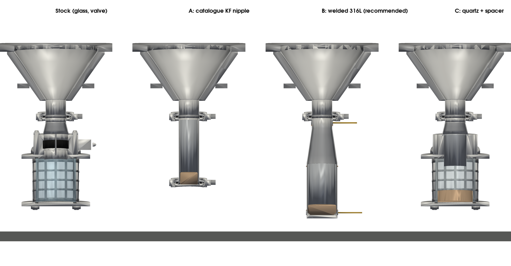
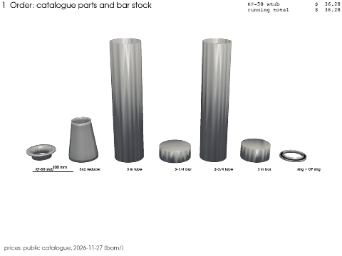
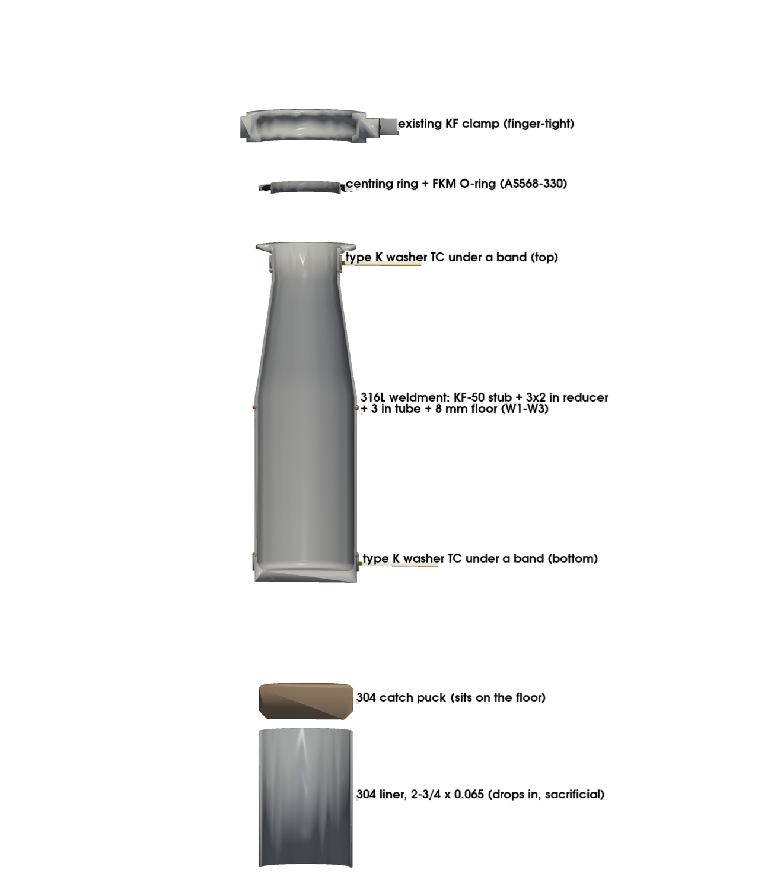

# A lab-built collection cup for the rePowder atomizer (#269)

On Nov 13 2026 a C63000 bronze run made shot instead of powder. The shot piled up on the stock cup's splash
plate and butterfly valve, just under its seals: it burned the EPDM valve seat and cracked the borosilicate tube
(`atomizer-runs/2026-11-13/` on the analysis branches). AMAZEMET can't give a date for a replacement, so this
folder designs one the lab can make in days to weeks.

**Recommendation: option B, a TIG-welded 316L cup.** It has one KF-50 seal at the water-cooled cone and nothing
else that can burn. Below the seal the bore only widens: a 2 in stub, a catalogue 3×2 in reducer, a 3 in tube,
then a turned end cap with an 8 mm floor and an R6 inside corner. A loose 304 catch puck and liner take the hot
metal. Two clamp-on thermocouples feed a 2-channel alarm. About $466 in catalogue parts, plus four lathe parts and
a milled welding fixture.

**Before buying, measure the room under the cone**: the distance from the KF face to the mat with the cone
latched. No photo or video showed it at a known scale. B is drawn 250 mm long for an assumed 300 mm of room.

| | Stock (Nov 13) | **B: welded 316L** | A: catalogue KF nipple | C: quartz rebuild |
|---|---|---|---|---|
| What it is | KF flange, reducer, DN65 butterfly valve (EPDM seat), borosilicate tube between plates | KF-50 stub + 3×2 in reducer + 3 in tube + turned end cap (R6 inside); puck and liner | KF-50 nipple 160 mm, blank on the bottom; puck and liner | stock plates, fused-quartz tube, a spacer in place of the valve, a sleeve over the top seal, a pan over the bottom seal |
| Seals near the hot metal | valve seat right under the inlet, glass seals top and bottom | **none**: one O-ring at the cooled cone, 160+ mm above the pile | bottom O-ring next to the puck | glass seals at both ends |
| Shot it takes before its hottest seal reaches 150 °C / 200 °C | the seat burns at once; glass cracks if shot reaches it (S cases) | **more than 816 g** both ways: O-ring 44 °C, floor 345 °C | about 120 g / 220 g | under 400 g: bottom glass seal 264 °C at 400 g |
| Usable volume above the puck | — | 522 cm³ | 159 cm³ | about 600 cm³ |
| Catalogue cost (priced lines) | — | **$466** | $198 | about $520 |
| Build | — | 4 lathe parts, 3 TIG welds, 1 milled fixture, hydro and leak tests | order and assemble | turn a spacer and sleeve, cut the quartz; valve removal not checked |
| Edison's ranking | — | best long-term | fastest interim | not recommended |

## What the analyses show

| Check | Result | Where |
|---|---|---|
| Thermal FEA, CalculiX, 18 cases | B keeps the joint O-ring at 26 / 32 / 44 °C for 100 / 400 / 816 g of shot landing at 1050 °C. The pile conductivity (2–20 W/m K), the liner or a copper puck move it by about 2 K. **What B can't take is shot held near the seal:** 25 g fused in the bore under the joint takes the O-ring to 195 °C, 100 g to 389 °C. That is why nothing goes inside its top and the shields must be in. A's bottom O-ring passes 200 °C at about 220 g. C's bottom glass seal reaches 264 °C at 400 g. A good run (816 g of powder at 400 °C) leaves B's bottom at 86 °C | `analysis/thermal.py`, [`thermal_summary.md`](analysis/out/thermal_summary.md) |
| The Nov 13 failure, reconstructed | 120 g of shot against the stock cup's EPDM seat puts the seat at 1013 °C, but the glass stays at 50 °C. 300 g that falls into the glass puts it at 931 °C, the bottom EPDM seal at 412 °C, and at least 55 MPa of tension in the borosilicate (short-term strength ~40 MPa): it cracks, as it did | `S_seat_120`, `S_glass_300` |
| Model checks | steady film, radiation and surface-flux cases match closed-form answers to 0.001 K. A 0.55× finer mesh moves the hang-up O-ring peak from 195 to 188 °C, so the standard mesh errs on the safe side; for B_816 the O-ring moves from 43.8 to 43.6 °C and the floor from 345 to 338 °C | `analysis/verify_axifea.py`, `B_*_fine` |
| Structural FEA, B | 4.4 MPa at +1.2 bar (1.5 × relief), 3.7 MPa under full vacuum. Worst thermal stress with 816 g of shot: 61 MPa, at most 0.52 of yield (56 MPa at 310 °C). The first design's sharp welded floor corner reached 87 MPa (0.82 of yield), so the floor became a turned end cap with an R6 corner and W3 moved 20 mm up, as Edison's final check advised | `analysis/structural.py`, [`structural_summary.md`](analysis/out/structural_summary.md) |
| Hand calculations | buckling under vacuum ×180+; UG-34 flat head needs 1.4 mm (8 used); the KF clamp gives ~1.8 kN finger-tight against 0.84 kN of separating force at +1.2 bar; the liner and puck keep ≥1.2 mm of gap when hot | `analysis/handcalcs.py`, [`handcalcs.md`](analysis/out/handcalcs.md) |
| Glass (C) | with the pan and sleeve, the glass itself is fine (quartz 0.8–1.3 MPa, borosilicate 5.6 MPa); its bottom seal is what fails. By hand: borosilicate cracks at a ~150 K step, quartz at ~1000 K | `analysis/structural.py`, `handcalcs.md` |
| KF under pressure | standard rings are rated to ~1.5 bar abs (Pfeiffer, Edwards); the relief opens at ~1.8 bar abs, so an over-pressure ring (50 psig) is part of the design | `bom/README.md` |
| Collisions, install and removal | clear with the clamp off; a hinged clamp left hanging open hits the cup's flange (38 positions) | `cad/build_gif.py`, `cad/out/build_collisions.json` |
| Lathe CAM | every turned part (end cap as a blind pocket, puck, liner, tube) cut in a 2D stock-removal simulation: no gouges, at most 0.1 mm left, no rapids through stock | `cam/lathe_cam.py`, `cam/out/lathe_*.png` |
| CAD against the vendors' STEP models | KF-50 stubs and the 139.7 mm nipple within 1 % of McMaster's volumes (1–2 % unshared). The blank, centring ring and clamp differences are explained by McMaster's approximate models (no recess, 6.19 mm O-ring, simplified clamp). McMaster's reducer has no straight ends | `cad/vendor_check.py`, [`vendor_check.md`](cad/out/vendor_check.md) |
| Edison final design check | agrees with the ledge-free design and the alarms. Asked for: no sharp welded floor corner (done), a hydro-test instead of a 1.5× pneumatic proof (in the procedure), rate-of-rise targets of about 0.04 / 0.004 mbar/min, low heat input with a chill on the KF flange, a safety lanyard, and logging the thermocouples | `edison/literature_high_final_design_check.md` |
| Mill CAM | the weld fixture cut in CAMotics 1.2.0 matches the CAD within the 0.5 mm grid; the first run found a real bug (nested comments skipped a tool change) | `cam/mill_cam.py`, `cam/out/mill_fixture_sections.png` |

## Build it

- [`procedure.md`](procedure.md): measure, order, machine, weld in the fixture with a back-purge, a hydro proof
  test, a bench soap test, rate-of-rise on the machine, thermocouple alarms (top 120 °C, bottom 150 °C), a safety
  lanyard, install with the clamp off, run limits, removal.
- [`BOM.md`](BOM.md): every line linked to its catalogue page (prices 2026-11-27); alternatives in
  [`bom/README.md`](bom/README.md).
- [`cad/drawings/collection_cup_drawings.pdf`](cad/drawings/collection_cup_drawings.pdf): the weldment, the
  turned parts, the fixture, and A.
- `cam/gcode/`: lathe programs for the end cap, puck, liner and tube; mill programs for the fixture.
- `cad/out/option_b.step`, `option_a.step`, `machine_cone_section.step`, `cam/out/fixture_b.step`.

## Rules this design depends on

1. AMAZEMET's shields lie in the cone's mouth on every run: one for aluminium, more for copper alloys.
2. Nothing sits inside the top of the cup: no splash plate, no valve, no ledge. On Nov 13 the shot burned the
   seal because it was held right under it.
3. The O₂ hard stop and the plate stop rule from the Nov 13 analysis still apply. B survives a bad run; it
   doesn't prevent one.

## Still open

- **(measure)** The joint's height above the mat, and the cone flange's OD. Then set `Z_JOINT_FACE` and
  `B["body_len"]` in `params.py` and re-run `cad/build.py`.
- The centring-ring recess depth. McMaster's approximate STEP says 2.6 mm, but that would leave too thin a face
  gap for the 3.81 mm over-pressure ring and would squash the O-ring by half. 2.0 mm (≤ 2.09 mm by the ring) is
  used. Check it on a flange; it changes nothing in B except the drawing.
- Option C assumes the stock valve can be unbolted from its reducer and top plate. Nobody has checked.
- Whether to add an isolation valve. It isn't needed for the lab's routine (cap with a KF blank after removal),
  and any valve puts a seal back near the hot metal.

## Files

| Path | What |
|---|---|
| `params.py` | every size, load and property; the source of each interface number |
| `dims/` | interface sizes measured from the photos and training/teardown video frames |
| `bom/` | 175 catalogue lookups, vendor dimensions from drawings and STEP files, `make_bom.py` |
| `edison/` | design review, precedent search and a final design check (Edison Scientific), with full trajectories; AMAZEMET and national-lab staff names redacted |
| `cad/` | CadQuery model (`parts.py`), checks (`build.py`), renders, drawings, build GIF |
| `cam/` | lathe and mill CAM with their simulations |
| `analysis/` | CalculiX thermal and structural FEA, hand calculations, verification |
