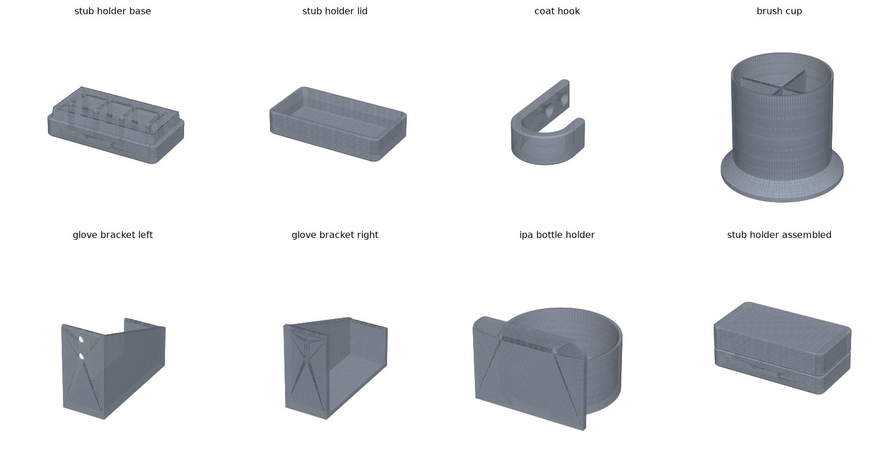
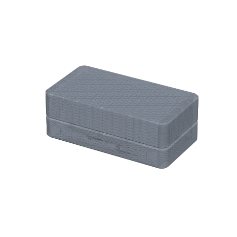
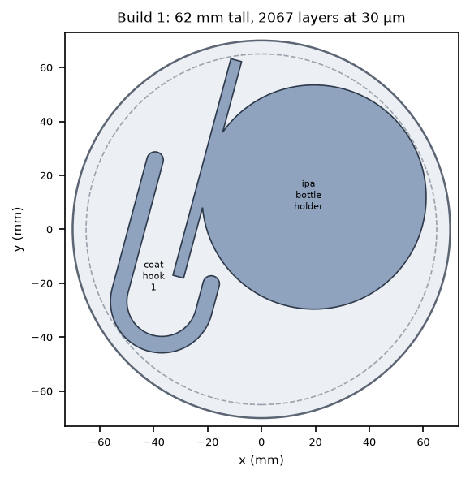
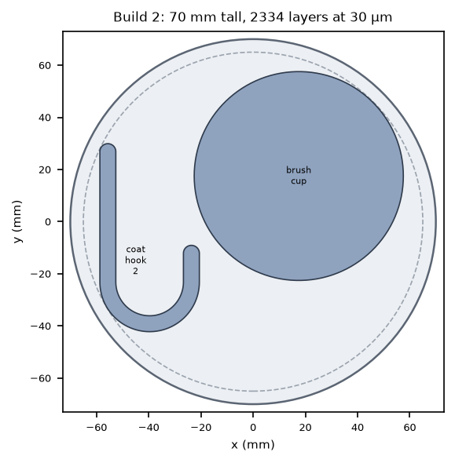
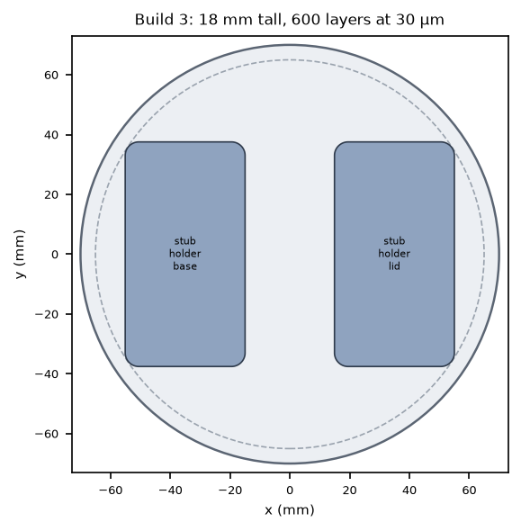
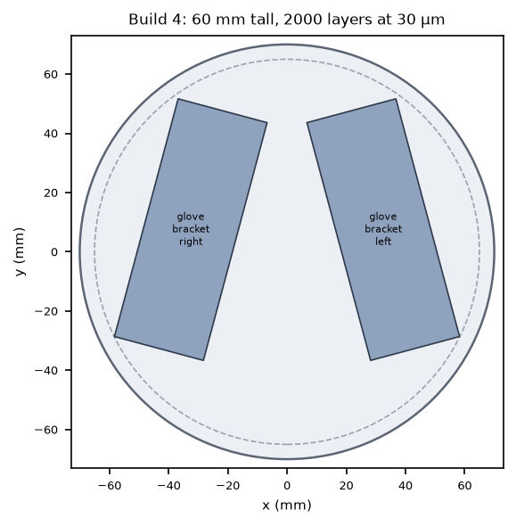

# Atomizer enclosure accessories, printed in metal on an AconityMINI

These are the parts from issue #231, drawn so they can be printed by laser powder bed fusion
(LPBF) on an AconityMINI: an SEM stub holder, lab coat hooks, a brush cup, glove box brackets and
an IPA bottle holder. They are all for use inside the atomizer's powder enclosure. The stub holder
is Ronnie's Onshape draft, adapted for metal. The other parts are new.



| Part | Files | Print | What it is |
| --- | --- | --- | --- |
| SEM stub holder, base | `stub_holder_base` | 1 | Holds 8 pin stubs (12.7 mm head, 3.2 mm pin), numbered 1–8 |
| SEM stub holder, lid | `stub_holder_lid` | 1 | Dust cover. It rests on a ledge on the base |
| Lab coat hook | `coat_hook` | 2+ | J hook with a 26 mm throat that sticks out 38 mm. Mounts with 2 screws |
| Brush cup | `brush_cup` | 1 | Ø64 × 70 mm cup with a 4-cell divider and an 80 mm foot |
| Glove box brackets | `glove_bracket_left`, `glove_bracket_right` | 1 each | A pair that cradles the two ends of a glove box |
| IPA bottle holder | `ipa_bottle_holder` | 1 | Wall cup for a 500 mL wash bottle up to 78 mm across |

Each part has an STL in [`stl/`](stl/) and a STEP in [`step/`](step/). The STEP files can be
imported into Onshape for further editing. [`builds/`](builds/) has one STL per build, with the
parts already laid out on the plate. The numbers for every part and build (size, volume, mass,
layer count, overhang check, plate layout) are in [`parts-summary.md`](parts-summary.md), which
`make_parts.py` writes.

## The stub holder

The [Onshape draft](https://cad.onshape.com/documents/bfba88d428bcc884c26d492d/w/2a20dc7be49f7a68f2619dcb/e/796613a788f3e26c9957e3d0)
is public, so its dimensions were read from the document's feature list rather than from the
screenshot. These are kept:

- Base: 70 × 35 mm body, 18 mm tall.
- Pin holes: 8 holes, Ø3.3 mm and 15 mm deep, on a 17.5 × 16 mm grid.
- Lid seat: the top 6 mm of the base tapers at 10°.
- Lid: 75 × 40 × 15 mm with a 3 mm top, which leaves 6 mm of headroom over the stubs.

What changed for metal:

- **The lid now sits on a ledge, not on the taper.** Below the seat, the base is widened to the
  lid's 75 × 40 mm, so the lid stops on a flat 2.5 mm ledge and the box closes flush. A 10° taper
  is self-locking once friction exceeds tan 10° ≈ 0.18, and rough, bead-blasted aluminum on
  aluminum is well above that. If the lid rested on the taper alone, pressing it down could jam it.
  Now the taper only centres the lid, with 0.25 mm of clearance per side. `make_parts.py` checks
  that the seated lid doesn't touch the base.
- **Small fixes:**
  - The hole pattern is centred. In the Onshape sketch it is 0.25 mm off in x.
  - Each pin hole has a 0.4 mm lead-in chamfer.
  - The outer edges have 0.8 mm chamfers, and the two at the parting line form a groove for a
    fingernail.
- **Position numbers** are engraved 0.5 mm deep on the outside of the base, below the lid, so they
  can be read with the lid on. Looking down with the front toward you, the front row is 1–4 from
  left to right and the back row is 5–8. 1–4 are on the front face and 5–8 on the back face.
- **The lid prints upside down.** Its top goes on the plate and the pocket opens upward, so
  nothing inside needs support.
- Sketch 3 in Onshape (Ø12.7 circles at each hole) isn't used by any feature, so it isn't modelled.
  If you meant it as shallow pockets for the stub heads, it's a quick addition.



## Why metal, and when not to bother

Aluminum powder is a combustible dust (see #150). In the enclosure, a metal part can be bonded to
ground through its mounting screws and won't hold a static charge the way an FDM plastic part can.
It also survives IPA wipe-downs and sheds nothing into the powder. The stub holder gets the most
out of this, and it's also the cheapest build (18 mm tall, 600 layers). If machine time or powder
is short, the brush cup and the hooks are easy to buy or to print in plastic.

## Printing on the AconityMINI

**Envelope.** The parts assume a Ø140 mm build cylinder with 5 mm kept clear at the edge. Published
heights for the AconityMINI are 190 or 200 mm, and nothing here is taller than 70 mm. Everything
also fits the University of Utah AconityMIDI (Ø170 mm, #138), with room to spare.

**Orientation.** Each STL is in mm and already in print orientation: +Z is the build direction
and the plate face is at z = 0. The parts were drawn to need no support except at the plate:

- Every wall is vertical or leans less than 45°, and there are no closed cavities to trap powder.
- The coat hook prints lying on its side, so the J lies in the plate plane.
- Horizontal screw holes have 45° teardrop tops, which print without sagging.
- The overhang check in `parts-summary.md` finds only the roofs of the 0.5 mm engraved digits and
  tessellation facets of the 45° chamfers and countersinks (43.9°).

**Builds.** The 8 parts don't fit on one Ø140 plate. They pack onto 4 builds, with short parts
filling space on tall builds; on a tall build a short part adds no layers. The layout comes from a
simple packer in `make_parts.py`, so re-arrange freely in the build processor. Turn parts a few
degrees if a long wall ends up parallel to the recoater.

| Build | Height | Layers at 30 µm | AlSi10Mg to load | Parts |
| --- | --- | --- | --- | --- |
| 1 | 62 mm | 2067 | ~4.9 kg | IPA bottle holder, coat hook |
| 2 | 70 mm | 2334 | ~5.5 kg | brush cup, coat hook |
| 3 | 18 mm | 600 | ~1.4 kg | stub holder base and lid |
| 4 | 60 mm | 2000 | ~4.7 kg | glove brackets, left and right |

|  |  |  |  |
| --- | --- | --- | --- |

**Powder.** The "to load" column uses the rule from #138: fill the supply to 3× the build height,
at 1.7 g/cm³, over the whole Ø140 mm cylinder. Most of that powder isn't melted and can be sieved
and reused. Still, each build except build 3 needs far more than the ~800 g of AlSi10Mg noted in
#138, so plan on the machine owner's stock powder. Build 3 is the obvious first print. Part masses
are in `parts-summary.md`: the whole set is about 700 g in AlSi10Mg, or about 2 kg in 316L.

**Material and parameters.** Use the machine's qualified parameter set for AlSi10Mg, which is what
the masses and powder estimates assume. 316L works just as well, at about 3× the mass. Nothing here
needs special parameters. The thinnest wall is 1.4 mm (the cup's dividers) and the smallest feature
is the 0.5 mm engraving.

**Supports and removal.** Put the parts on 2–3 mm block supports, or build them directly on the plate
if they'll be cut off by wire EDM. The stub holder and hooks have 0.8 mm chamfers on their
plate-side edges. The other parts' plate-side edges need deburring after the cut.

**Post-processing:**

1. Stress-relieve on the plate, using the operator's usual cycle for the alloy (for AlSi10Mg this
   is commonly around 300 °C for 2 h).
2. Cut the parts off the plate and remove the supports.
3. Blow out the 8 stub pin holes. No other part has a pocket that can hold loose powder.
4. Bead-blast, then deburr the cut faces. Glove-safe edges matter here, since a burr can tear
   nitrile.
5. Try a stub in each pin hole. LPBF holes this small come out slightly undersize and rough, so if
   a pin binds, run a 3.3 mm drill (or a #30 drill, 3.26 mm) through by hand.
6. Check that the lid drops onto the ledge freely.

## Installing

The wall parts take M4 or #8 flat-head screws (Ø4.5 mm holes, 90° countersinks with Ø9 mm heads;
82° imperial heads also seat). On the coat hooks and glove brackets, the screws run vertically,
18 mm and 12 mm apart, so they line up along one slot of a vertical T-slot extrusion. T-slot needs
bigger holes, though: for 1/4-20 screws on 1" extrusion, set `screw_d = 6.6` and `csk_d = 13`
and rerun.

- **Glove brackets.** Each bracket cradles one end of the box, which drops in from above. For a
  240 mm long box, set the inside faces of the two side walls 243 mm apart. That puts the two
  columns of screws **215 mm** apart, centre to centre. The screws sit above the 30 mm front lip,
  so a screwdriver can reach them. "Left" and "right" are as seen facing the wall. The cradle takes
  boxes up to 76 mm deep, front to back.
- **IPA holder.** Two screws, 40 mm apart, 12 mm above the cup rim.
- **Coat hooks.** The flat back of the hook goes against the wall, with the J at the bottom.

## Changing the design

All the dimensions are in the dicts at the top of [`make_parts.py`](make_parts.py), with comments
pointing back to the Onshape features they came from. To regenerate the STL and STEP files,
previews, build layouts and `parts-summary.md`:

```bash
pip install -r requirements.txt   # CadQuery 2.8 was used
python make_parts.py
```

Measure before printing. The glove box (240 × 125 × ≤76 mm, a typical 100-count box) and the
bottle (≤78 mm, a typical 500 mL wash bottle) are typical sizes, not the lab's actual ones. Change
`GLOVE["box_len"]`, `GLOVE["box_depth"]` and `IPA["bottle_d"]` to match.

## Still open

- **Which machine and powder.** The repo's only LPBF access so far is the Utah AconityMIDI (#138).
  If there's a separate AconityMINI, its owner's platform size, powder (AlSi10Mg or 316L) and
  support and removal practice decide the final layout.
- **The mounting surface.** The enclosure's walls or frame (T-slot, sheet metal, panel) decide the
  screw size, or whether to use magnets or adhesive instead.
- **No support or slice files.** The STLs are ready for the build processor, but supports and
  scan files are left to the operator.
