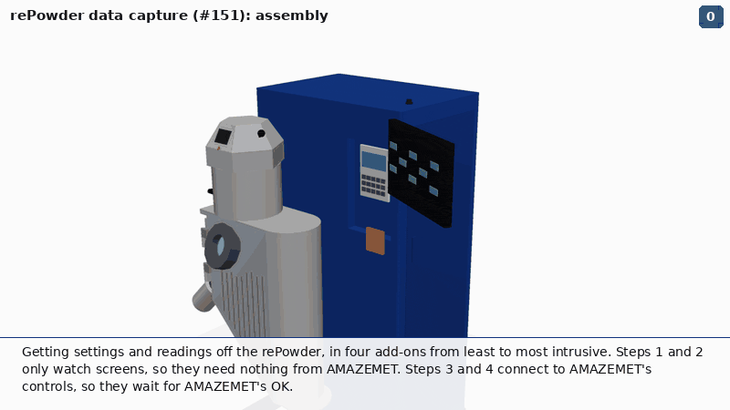
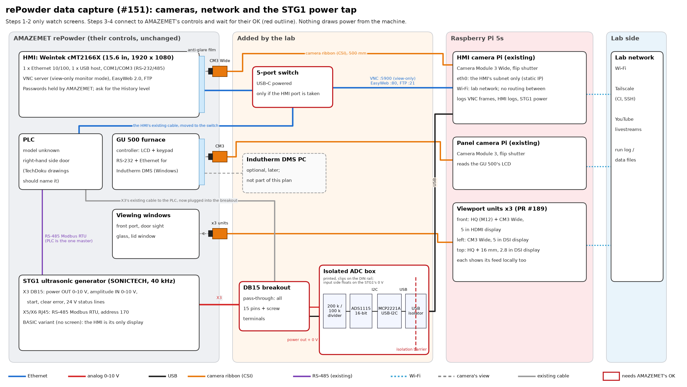
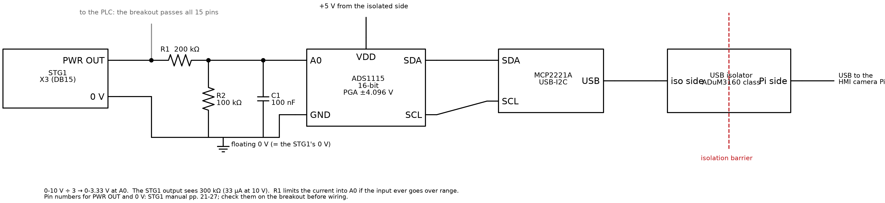
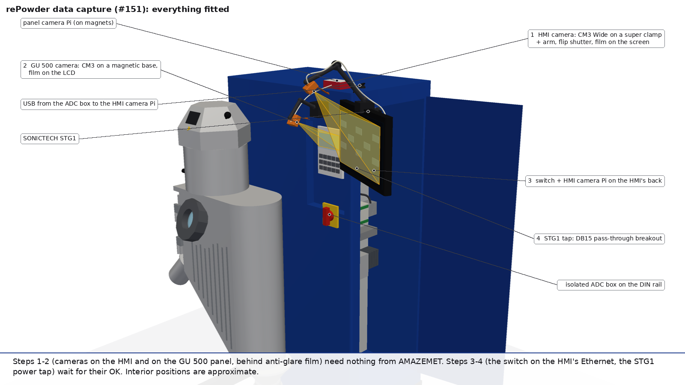
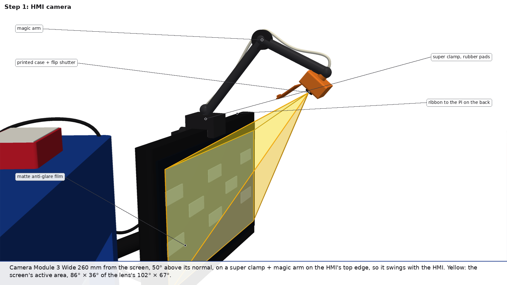
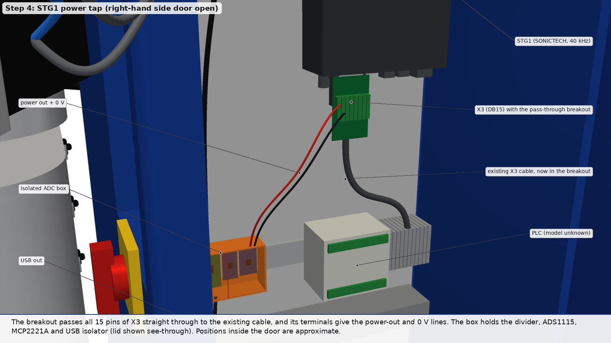
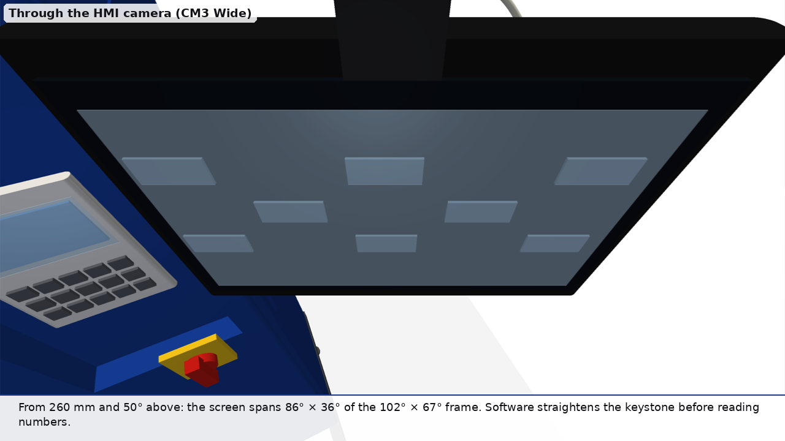
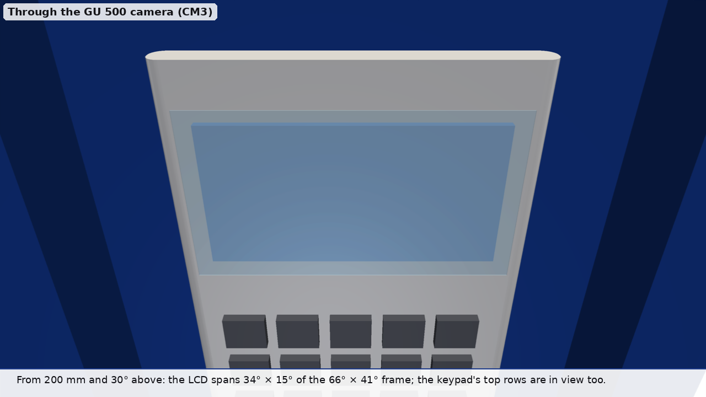

# rePowder data capture: screen cameras, the HMI's Ethernet and an STG1 power tap (#151)

This folder is for [#151](https://github.com/vertical-cloud-lab/digital-alloy-lab/issues/151). It draws the steps from
that thread for getting settings and readings off the rePowder. It has four parts: a schematic, a 3-D visualization,
an animated assembly (MP4 and GIF), and a priced order list fetched through a lab Pi. The specs it rests on are in the
[HMI and generator write-up](https://github.com/vertical-cloud-lab/byu-vcl/blob/83b939b/docs/repowder-hmi-and-generator.md).
The machine is PR #173's CadQuery model.

The three viewport camera units (front port, door sight glass, lid window), each with its own display, are already
designed. Their Onshape model, assembly animation and BOM are in PR #189, so they are only referred to here.

**Nothing here has been bought, printed or tried on the machine.** Positions inside AMAZEMET's cabinet are estimates.

*79 s, 800 × 450 at 8 fps. The MP4 is [`renders/mp4/integration_steps.mp4`](renders/mp4/integration_steps.mp4)
(1280 × 720, 15 fps). [`renders/integration_steps.json`](renders/integration_steps.json) gives each sub-step's
frame range, for narration.*

## The steps, least to most intrusive

| Step | What | Needs from AMAZEMET | Parts |
|---|---|---|---|
| 1. HMI camera | Matte anti-glare film on the 15.6 in Weintek cMT2166X. A super clamp on the HMI's own top edge holds a magic arm, so the camera swings with the HMI. A Camera Module 3 Wide in a printed case sits about 260 mm from the screen, 50° above it, with a flip shutter that goes down whenever someone types a password. The existing HMI camera Pi rides on the HMI's back. | Nothing | $90.76 |
| 2. GU 500 panel camera | Film on the furnace controller's LCD. A Camera Module 3 in the same printed case, about 200 mm from the LCD, 30° above it, on a magnetic base stuck to the painted cabinet. The existing panel camera Pi sits on the cabinet's top, on magnets. | Nothing | $60.85 |
| 3. HMI Ethernet | If the HMI's only Ethernet port is free, one patch cable to the Pi. If it already goes to the PLC (likely), a 5-port switch goes on that link, on the HMI's back. Then VNC in view-only *monitor mode* (port 5900) gives a pixel-exact copy of the screen, and EasyWeb 2.0 or FTP exports the HMI's logs. The Pi's Ethernet sits on the HMI's subnet only. Its Wi-Fi stays on the lab network, and it routes nothing between the two. | OK for the switch, a History-level password, VNC turned on | $31.42 |
| 4. STG1 power tap | A DB15 pass-through breakout between the STG1's X3 port and its existing cable, so the PLC still gets every pin. Two wires from its power-out and 0 V terminals go to a printed box on the DIN rail. The box holds a 3:1 divider, an ADS1115 ADC, an MCP2221A USB-to-I2C bridge and a USB isolator. A USB cable runs from the box to the HMI camera Pi. | OK for the tap, and which cable entry to use | $118.56 |

Nothing draws power from the machine. The Pis and the switch run on their own USB-C or 5 V supplies. The ADC's input
side is powered across the isolator from the Pi's USB, and floats on the STG1's 0 V.

## Schematic

The STG1 tap ([`schematic/stg1_tap.svg`](schematic/stg1_tap.svg)):

- **Divider.** R1 200 kΩ over R2 100 kΩ brings 0–10 V down to 0–3.33 V at A0. That sits inside the ADS1115's
  ±4.096 V range and under its 5 V supply. On that range one count is 125 µV at A0, or 0.375 mV at the STG1.
- **Load and protection.** The STG1's output sees 300 kΩ, which is 33 µA at 10 V. R1 limits the current into A0 if
  the line ever goes over range. C1 (100 nF) and the divider make a low-pass filter with a corner near 24 Hz. That is
  fine for logging at up to about 10 Hz. Use a smaller C1 to log faster.
- **Isolation.** The isolator is the only path between the field side and the Pi. Its isolated 5 V output gives
  100 mA, and the ADS1115 and MCP2221A draw well under 20 mA.
- **Software.** Adafruit's Blinka supports the MCP2221A over USB (`BLINKA_MCP2221=1`), and
  `adafruit-circuitpython-ads1x15` reads the ADS1115, so the Pi needs no wiring of its own.

## Visualization

| Everything fitted (right-hand door open) | Step 1, the HMI camera |
|---|---|
|  |  |
| **Step 4, inside the right-hand door** | **Through the HMI camera's lens** |
|  |  |

The two lens views are rendered from each camera's position and axis, with its vertical field of view, at a 16:9
frame.

## Camera framing

From [`renders/framing.json`](renders/framing.json), which `cad/integration.py` computes from the screen sizes and
the lenses' fields of view:

| Camera | Target | Distance | Target spans | Lens | Fits? |
|---|---|---|---|---|---|
| HMI: Camera Module 3 Wide | the active area, 344 × 194 mm | 258 mm, 50° above | 86° × 36° | 102° × 67° | yes |
| GU 500: Camera Module 3 | the LCD, about 112 × 58 mm | 199 mm, 30° above | 34° × 15° | 66° × 41° | yes |
| GU 500: Camera Module 3 | the whole panel, LCD and keypad | 229 mm | 43° × 48° | 66° × 41° | no: only the top rows of the keypad |

- **HMI camera position.** 50° above the screen keeps the camera above the operator's line of sight to the top of the
  screen. Mirror-like reflections then come from below the screen, where it is darker than the ceiling lights. The
  film diffuses the rest.
- **Resolution.** Seen from 50° above, the screen is a trapezoid in a 1920 × 1080 frame: about 1450 px wide along its
  top edge, 800 px along its bottom edge and 425 px tall. That is 0.24–0.46 mm per camera pixel, against the screen's
  0.179 mm pixel pitch. It is enough for normal-size numbers. For small text, use full-resolution stills (4608 × 2592),
  at 0.10–0.19 mm per pixel.
- **The trade-off.** Lowering the camera to about 35° above the screen would cut the keystone and sharpen the bottom
  rows, but bring the camera closer to the operator's line of sight. Try both on the bench.
- **GU 500.** The LCD fills about 780–900 × 365 px of a 1080p frame, about 0.14 mm per pixel, so it reads easily.
- **Keystone.** Both views are oblique, so straighten them in software (a perspective warp from the four screen
  corners) before reading text. The film must be plain matte: privacy film would black out a camera looking from 50°.

## Order list

All 45 vendor pages were loaded through the CubXL Pi, the only lab Pi online that day. 23 were fetched with curl on the
Pi, and the Amazon pages with a headless browser tunnelled through the same Pi. Prices are from 28 November 2026.
The full list, alternatives, connector details and what to check first are in
[`shopping/order_list_2026-11-28.md`](shopping/order_list_2026-11-28.md). Every candidate, with URL, stock and
fetch time, is in [`shopping/order_list_2026-11-28.json`](shopping/order_list_2026-11-28.json).

| Group | Needs AMAZEMET's OK? | Subtotal |
|---|---|---|
| 1. HMI camera: film 3-pack, Camera Module 3 Wide, 500 mm cable, magic arm + super clamp, inserts, magnets | No | $90.76 |
| 2. GU 500 camera: Camera Module 3, 500 mm cable, magnetic base with arm (film from the 3-pack) | No | $60.85 |
| 3. TP-Link TL-SG105 switch, Cat6 patch cables | Yes | $31.42 |
| 4. DB15 pass-through breakout (DIN rail), USB isolator, MCP2221A, ADS1115, divider parts, shielded cable, USB cables | Yes | $118.56 |
| **Total, before tax and shipping** | | **$301.59** |

Check before ordering:
1. Is X3 a 2-row DB15 or a 3-row HD-15? The row count decides which breakout to buy.
2. Do the HMI and panel camera Pis already have cameras? Both timed out over SSH today.
3. Does the super clamp open to 30 mm? The listing doesn't say.
4. Is the HMI's Ethernet port free? If it is, skip the switch.

## Assumed, not checked

- **Inside the right-hand door.** Positions come from one 720p frame of training video 1 at 9:58: the STG1 at the top,
  DIN rails with the PLC lower down. X3's place on the STG1's underside is a guess, and so is the cable entry used for
  the USB cable.
- **Which X3 pins** carry the power output and its 0 V is in the STG1 manual (pp. 21–27, not public). Check the pins
  on the breakout's terminals with a meter before wiring.
- **The HMI's back.** The Ethernet port's position, and whether the HMI can carry a Pi and a switch, are guesses. A
  bracket on the HMI's arm would do as well.
- **The printed case is drawn, not designed for printing.** It is a box with a lens hole, a 1/4-20 boss and a hinged
  flap. There is no STL. The case and the magic arm are sized from typical parts, not from the listings.
- **The model.** `cad/integration.py` hollows PR #173's cabinet behind the right-hand door, turns the door into a part
  that swings open, and moves the HMI arm's pivot post behind the HMI. The model had that post poking through the
  screen. The heat exchanger, argon, vacuum pump and utility lines are hidden, as in PR #189's renders.

## Files

| Path | What it is |
|---|---|
| [`cad/integration.py`](cad/integration.py) | The new parts as CadQuery solids placed on the model, the cable routes, and the framing check (`python integration.py`) |
| [`cad/common.py`](cad/common.py) | Loads the model and the new parts into a `Scene`; views, shutter and door poses, view cones |
| [`cad/assembly.py`](cad/assembly.py) | The animation: `xvfb-run -a -s "-screen 0 1920x1080x24" python assembly.py` (`PREVIEW=1` for one frame per step) |
| [`cad/render.py`](cad/render.py) | The stills, the lens views and `framing.json` |
| [`cad/viz3d/`](cad/viz3d/README.md) | PR #173's `model.py` and `scene.py`, copied unchanged |
| [`schematic/schematic.py`](schematic/schematic.py) | Both schematics, PNG and SVG (matplotlib and schemdraw) |
| [`shopping/`](shopping/order_list_2026-11-28.md) | The order list, its JSON, and `fetch_via_pi.py`, which fetches a page through a lab Pi without printing its address |
| `renders/` | GIF, MP4, stills, `framing.json` |

To rebuild: Python 3.12 with `cadquery pyvista pillow numpy matplotlib schemdraw`, plus `ffmpeg`, `gifsicle` and
`xvfb`. The animation takes about 6 minutes on 4 cores.
