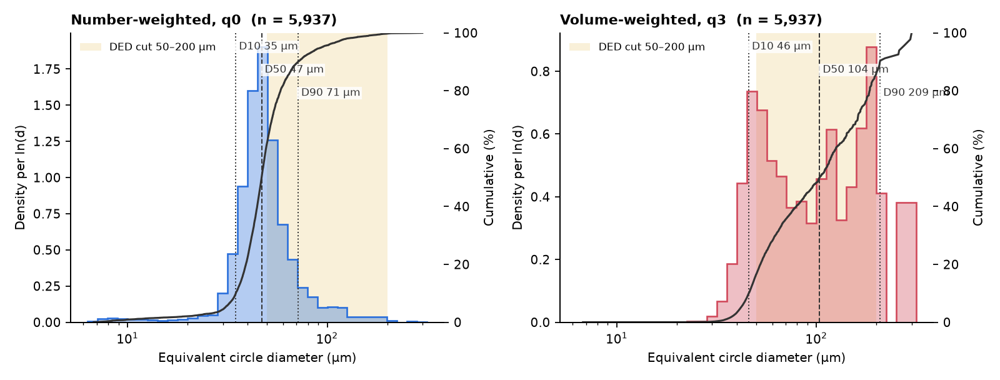
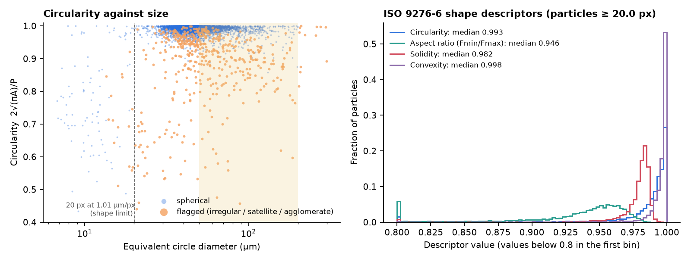
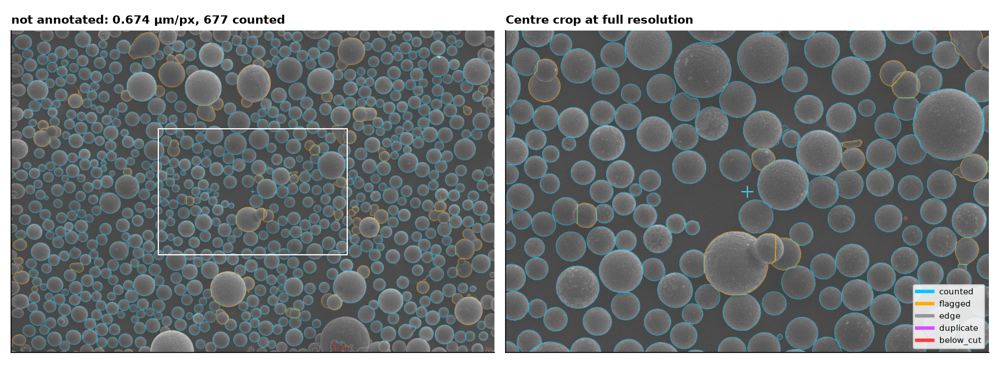
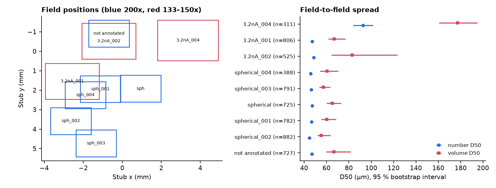

# Particle size and shape distribution of NAB powder k7m2q9 from SEM images

Issue #225. Powder `k7m2q9` is the first copper-alloy lot from the lab's ultrasonic atomizer
(AMAZEMET rePOWDER): wrought 630 bronze, UNS C63000, a nickel-aluminium bronze, atomized on 2026-10-27
(#219). The powder was sprinkled on carbon tape on one stub and imaged in secondary electrons (ETD) at
5 kV on the BYU Apreo C. This folder holds a particle size and shape distribution from those images,
an Edison Scientific literature review of best practice, and a reusable tool for the next lots.

**Bottom line.** Across 9 fields, with overlaps counted once, 5,937 particles were counted:

- **By number:** the powder is a narrow distribution centred near 47 µm, so most particles are finer than
  the 50–200 µm DED cut (37.6 % inside it).
- **By volume:** the coarse tail dominates. Volume D50 is about 104 µm, 70 % of the volume lies in the cut,
  and about 13 % lies in a few spheres larger than 200 µm.
- **Shape:** particles are close to round (median form factor 0.987).
- **Caveat:** the volume numbers rest on a dozen large particles, mostly in one coarser region of the stub,
  so their field-level uncertainty is wide. This is a good first look, not an ISO 13322-1 measurement
  (see [Limits](#limits)).

## Results

Equivalent circle (projected-area) diameter, µm. Each 95 % interval is given twice: first from resampling
particles, then from resampling whole fields. Following the literature, the field interval is the honest
one, because the powder segregated by size across the stub.

| Weighting | D10 | D50 | D90 | Span (D90−D10)/D50 |
|---|---|---|---|---|
| Number (q0) | **34.8** (34.5–35.3; 34.4–35.4) | **46.9** (46.6–47.2; 46.1–48.3) | **71.5** (69.5–73.7; 64.6–102.5) | 0.78 |
| Volume (q3, equivalent spheres) | **45.8** (45.1–46.6; 42.1–54.2) | **103.7** (91.8–116.3; 60.3–156.8) | **208.5** (188.6–289.8; 132.4–275.1) | 1.57 |

| Size range | By number | By volume |
|---|---|---|
| 50–200 µm (DED cut) | **37.6 %** (36.4–38.8; fields 33.5–43.6) | **69.8 %** (63.4–75.8; fields 66.1–73.5) |
| < 20 µm | **2.1 %** (1.7–2.5; fields 1.4–2.9) | < 0.1 % |
| > 200 µm | 0.3 % (12 particles) | 13.5 % (6.5–21.4; fields 0–23.1) |

The fines share counts only particles above the resolution limit of 10 px across: at least 6.7 µm in the
200x fields and 9.0–10.1 µm in the 133–150x fields. Particles smaller than that are not counted.

**Shape (ISO 9276-6).** These are 5,858 counted particles of at least 20 px. Medians, with interquartile ranges:

| Descriptor | Median | IQR | Bias for an ideal disc of 70 px (median particle) |
|---|---|---|---|
| Form factor 4πA/P² (the common "circularity") | **0.987** | **0.970–0.995** | none (1.000) |
| Circularity 2√(πA)/P (square-root form) | 0.993 | 0.985–0.998 | none (1.000) |
| Aspect ratio, Feret min/max | 0.946 | 0.921–0.960 | reads 0.98 |
| Aspect ratio, moment-ellipse minor/major | 0.968 | 0.946–0.981 | reads 0.998 |
| Solidity A/A_hull | 0.982 | 0.976–0.985 | reads 0.985 |
| Convexity P_hull/P | 0.998 | 0.994–1.000 | none (1.000) |

The perimeter P uses the Crofton estimator. Restricting to the 3,667 particles of at least 3,000 px
(the literature threshold for perimeter-based shape) gives the same form factor: 0.987 (IQR 0.971–0.995).

In plain terms: most particles are round. Their solidity sits almost exactly at the value pixelation
alone gives a perfect disc (`pixelation_bias.csv`), so the solidity deficit from real shape is about
0.3 %. 8.3 % of particles by number are flagged as irregular, satellite-bearing or agglomerated (see
the galleries). The Feret aspect ratio (median 0.946, 0.965 after pixelation correction) shows the
particles are slightly oval in projection.

### Figures

| | |
|---|---|
|  |  |
| Number- and volume-weighted histograms (density per ln d) and cumulative curves, with the 50–200 µm band | Circularity against size (flagged particles in orange), and the shape-descriptor distributions |
|  |  |
| Segmentation of `not annotated` (200x). Cyan: counted; orange: flagged; gray: touching the frame; violet: owned by another field; red: below 10 px | Field positions on the stub and per-field D50. `3.2nA_004`, at stub x ≈ +3.4 mm, is far coarser than the rest |

Every field's overlay is in `results/figures/overlay_*.jpg`. `gallery_largest.png` and
`gallery_flagged.png` show the 24 largest and the 36 largest flagged particles with their contours. They
were checked by eye (see [Validation](#validation)).

## Files

| Path | What it is |
|---|---|
| `sem_psd.py` | The reusable CLI (below) |
| `results/particles.csv` | One row per segmented region (8,828), with its class, flag, weight, sizes, shape descriptors, and position in field and stub coordinates |
| `results/summary.json`, `summary.md` | Everything above, plus per-field results, registration, cross-field matches and sensitivity variants |
| `results/fields.csv` | Per-field metadata: pixel size, stage position, threshold, edge offset, registration shift |
| `results/cross_field_matches.csv` | 1,398 particles seen whole in two overlapping fields, with both sizes |
| `results/pixelation_bias.csv` | Descriptors of ideal digitised discs, 4–200 px across |
| `results/sensitivity.md` | Results under other threshold and split settings |
| `validation/` | Hand-measurement comparison (`validate_hand.py`), table, summary and gallery |
| `cellpose_crosscheck.py`, `results/cellpose_crosscheck.*` | Pretrained Cellpose on one field, against the watershed |
| `edison/` | Edison `LITERATURE_HIGH` query script, answer, metadata and full trajectory |

The 16 source TIFFs (6.8 MB each) are not committed. They came from the
`sgbaird/agent-staging` drop `2026-10-28-nab-c63000-sem-psd` at commit `485dd7b`, and all 16 matched
the sha256 list in its manifest.

## Data used

| Field | Mag | µm/px | Stub x, y (mm) | Regions | Counted | Role |
|---|---|---|---|---|---|---|
| `not annotated` | 200x | 0.6745 | −0.69, 0.91 | 889 | 727 | sizing; same field as `annotated` |
| `spherical` | 200x | 0.6745 | 0.94, −1.93 | 877 | 725 | sizing |
| `spherical_001` | 200x | 0.6745 | −1.12, −1.94 | 889 | 782 | sizing |
| `spherical_002` | 200x | 0.6745 | −2.64, −3.58 | 1,007 | 882 | sizing |
| `spherical_003` | 200x | 0.6745 | −1.37, −4.72 | 986 | 791 | sizing; overlaps `_002` |
| `spherical_004` | 200x | 0.6745 | −1.88, −2.25 | 934 | 388 | sizing; about half overlaps `_001`; same field as `annotated2` |
| `3.2nA_001` | 150x | 0.8993 | −2.53, −1.55 | 1,514 | 806 | sizing; overlaps `_001` and `_004` |
| `3.2nA_002` | 150x | 0.8993 | −0.69, 0.53 | 1,324 | 525 | sizing; contains most of `not annotated` |
| `3.2nA_004` | 133x | 1.0128 | 3.37, 0.56 | 408 | 311 | sizing; holds the ~260 µm sphere of the `3.2nA_003` close-up |
| `annotated`, `annotated2`, `3.2nA_005`, `3.2nA_006` | 133–200x | | | | | validation only (hand measurements) |
| `3.2nA`, `3.2nA_003`, `moon sphere` | 650x and up | | | | | close-ups, not sized |

Stage coordinates come from the FEI metadata. They show that `annotated` was taken at the same position as
`not annotated` (3.5 min later), and `annotated2` at the same position as `spherical_004`.

## Method

The steps are those of ISO 13322-1 static image analysis, with ISO 9276-1/-2 representation and
ISO 9276-6 descriptors. Every parameter is a CLI option, recorded in `summary.json`.

1. **Calibration and cropping.** Pixel size comes from `[Scan] PixelWidth` in TIFF tag 34682, frame size
   from `[Image] ResolutionX/Y` (3072 x 2048), which also cuts off the databar. Pixels are square. No
   traceable stage-micrometer check was made in this session (see [Limits](#limits)).
2. **Foreground.** The image is smoothed with a 1 px Gaussian. A quadratic background surface is fitted to
   carbon-tape pixels (below the first histogram valley) and subtracted. Foreground is anything more than
   5 robust sigmas above the background: 9–11 gray levels here. The carbon tape sits at about 74, the
   particle interiors at 90–160.
   - Otsu put its threshold inside the particle mode (about 93), so it was not used.
   - Holes are filled only if they are tiny or not background-dark. Filling every hole merged whole
     rings of touching particles into one blob; the first version had this fault and the gallery
     exposed it.
3. **Splitting touching particles.** Marker-controlled watershed runs on the smoothed distance transform.
   Markers are maxima of log(distance) that rise 15 % above their saddle. Because the criterion is
   relative, it splits touching spheres of any size but leaves a teardrop or a fused satellite whole.
   Circle detection was not used.
4. **Edge offset.** In each field, about 24–49 isolated round particles give a median radial intensity
   profile. The threshold contour sits 0.50–0.86 px outside the half-maximum edge, and ECD is corrected
   by twice that offset.
   - The correction moves number D50 by −0.9 µm (47.8 → 46.9).
   - The ~260 µm sphere measures 259.6 µm both in the 650x close-up (`3.2nA_003`, 0.21 µm/px) and in the
     133x field (`3.2nA_004`, 1.01 µm/px).
5. **Measurements.** These follow ISO 9276-6:
   - ECD = 2√(A/π);
   - Feret max and min from the convex hull of pixel corners;
   - the Crofton perimeter;
   - form factor and circularity, solidity, convexity (hull perimeter by the same estimator), both
     aspect ratios.

   A RANSAC circle fitted to each outline gives a "sphere-fit" diameter. It is used only as a sensitivity
   check for regions where a sphere has a neighbour or satellite merged into it.
6. **Overlapping fields.** The fields were taken seconds apart and overlap heavily. Each is placed on the
   stub from its stage coordinates. The axis signs were chosen by image correlation (+x, −y), and each
   overlapping pair was refined by phase correlation: stage errors were 1–30 µm, correlation 0.42–0.65.
   - Each patch of stub belongs to the finest-pixel field covering it.
   - A particle is counted only in the field whose patch holds its centroid, so nothing is counted twice:
     1,682 detections were dropped as duplicates.
7. **Frame edges.** The 928 particles touching a frame are excluded. Each counted particle gets a
   Horvitz–Thompson weight, w = A_total / Σ_i |R_i ∩ F_i ⊖ box|: the stub area analysed divided by the
   area over which a particle with its x/y extents could have been counted whole. This is the
   Miles–Lantuéjoul guard-frame correction, w = WH/((W−a)(H−b)), generalised to a union of overlapping
   fields of different sizes.
8. **Lower size limit.** A particle is countable only in fields where it is at least 10 px across:
   6.7 µm at 200x and 9.0–10.1 µm at 133–150x. Its admissible area includes only those fields, so mixing
   magnifications does not bias the fines. The same machinery would combine a proper magnification ladder.
9. **Statistics.**
   - Weighted quantiles of ECD: number weight w; volume weight w·d³ (equivalent spheres, ISO 9276-2).
   - 2,000 bootstrap resamples, of particles and of whole fields.
   - Shape statistics use particles of at least 20 px.
10. **Flags.** These are listed, not dropped:
   - **irregular:** moment-ellipse ratio below 0.85, or solidity below 0.96 of the ideal-disc value at
     that size;
   - **agglomerate or elongated:** ratio below 0.70 or normalised solidity below 0.90;
   - **oversize:** ECD above 200 µm.

   Flagged particles stay in the distribution. Excluding them gives number D50 46.8 µm and volume D50
   88.9 µm.

## Validation

**Against Ronnie's hand measurements** (`validation/`). The four annotated images carry 49 xT
measurement labels on 37 different particles; `3.2nA_005` and `_006` show the same 14 labels at 133x and
150x. The line search does not use the hand value except to set the line's length.

- **Locating particles.** For each label, `validate_hand.py` finds the text strokes (gray 143) and
  searches for the dashed measurement line of that length and direction. Where an unannotated twin
  exists, it uses the difference from the twin. It then takes the sem_psd particle under the line.
- **Hand corrections.** In 13 cases the search locked onto a particle edge instead. Those particles were
  located by eye on full-resolution crops; they are marked `manual` in the table.
- **Not located:** one label (25.94 µm).

| Check | Result |
|---|---|
| Particles compared | 32 of 36 located (4 segmentation failures, below) |
| Median relative difference, sem_psd / hand − 1 | **+3.6 %** |
| Mean ± SD | +4.7 ± 5.2 % |
| Within ±5 % / ±10 % | 19 / 28 of 32 |
| Bland–Altman bias (95 % limits) | +2.9 µm (−3.3 to +9.0) |
| Hand < 60 µm / ≥ 60 µm | +6.9 % (n = 13) / +1.8 % (n = 19) |
| Same particles at 133x vs 150x | +0.5 ± 0.8 % (n = 9) |

- **Large particles** agree closely: 113.3 → 113.6, 109.1 → 109.4, 115.5 → 114.8 and 84.51 → 84.3 µm.
- **Smaller particles** read a few µm larger than the hand value. On the crops, the end ticks of several
  hand lines sit a few pixels inside the particle's bright rim. For example, the 75.54 µm particle spans
  about 120 px edge to edge, but the line spans about 112 px. So part of the bias is likely the hand
  measurement; the rest is unresolved.
- **The 4 failures** are a sphere with neighbours merged into its region and no dominant circle
  (142.4, 161.9, 52.71 µm) and one fragment (30.45 µm). Four more merged regions are recovered by the
  sphere fit (151.2, 176.8, 116.4 and 137.7 µm).
- **What this means:** 7 of the 36 located particles, mostly large ones picked for being prominent, had a
  neighbour or satellite merged into their region. The sphere fit recovers 4 of them.

**Other checks.**

- **Repeat imaging.** 1,398 particles appear whole in two overlapping fields, taken at different times,
  currents and magnifications. Their ECDs agree to −0.4 ± 1.6 %.
- **Hand-checked overlays.** The `not annotated` overlay, and galleries of the 24 largest and 36 largest
  flagged particles, were inspected by eye. This is how the hole-filling fault was found and fixed. The
  largest particles are now real single spheres, except one merged cluster that is flagged and one piece
  of fibrous debris that is flagged.
- **Sensitivity** (`results/sensitivity.md`). Varying the threshold (4–7 σ) and the split depth
  (h = 0.10–0.25) moves:
  - number D50 by 46.4–47.1 µm;
  - volume D50 by 102–108 µm;
  - volume D90 by 208–214 µm;
  - the 50–200 µm number share by 36–38 %.
- **Pixelation** (`results/pixelation_bias.csv`). On ideal digitised discs, ECD is unbiased down to
  4 px. Crofton circularity stays within 2 % of 1 before clipping. The Feret aspect ratio reads 0.89 at 10 px, 0.94 at 20 px and
  0.98 at 60 px, and solidity reads 0.957, 0.966 and 0.983 at the same sizes. These biases are why
  flagging uses size-normalised values.
- **Cellpose cross-check** (`results/cellpose_crosscheck.*`). Pretrained `cyto3`, without fine-tuning,
  on `not annotated` (107 s on CPU):
  - 98.8 % of the 727 watershed particles have a Cellpose mask with IoU ≥ 0.5, and 93.7 % of the 766
    Cellpose masks have a watershed match; median IoU 0.95.
  - Cellpose diameters read 4.2 % larger (IQR 3.2–5.3 %), so its boundaries sit about 1 px further out.
  - Number D10/D50/D90: 36.6/48.2/66.6 µm (Cellpose) against 35.3/46.8/66.6 µm (watershed, same
    unweighted basis).

  Two independent methods find the same particles, and the watershed sits closer to the hand values.
  Edison found no metal-powder benchmark for Cellpose, StarDist or SAM, so this is a consistency check only.

## Edison literature review (summary)

`edison/literature_high_sem_psd_best_practice.md` holds the full answer (~70 k characters, 29 cited
passages); `_trajectory.json` holds the full trajectory.

- **Standards.** ISO 13322-1 makes projected-area ECD the primary size. It requires:
  - representative sampling and dispersion;
  - traceable calibration (stage micrometer or certified beads);
  - documented segmentation and border rules;
  - a report of basis, size classes and procedure.

  The other standards fill in around it:
  - ISO 9276-1/-2 set Q0/Q3 notation and the d³ conversion, under an equivalent-sphere assumption that
    must be stated.
  - ISO 9276-6 defines the descriptors, with guidance of about 100–5,000 px per particle.
  - ISO 14488 requires rotary or riffle splitting.
  - ASTM F3049 points to ISO 13322-1, B822 (laser diffraction) and B214 (sieving) as complementary methods.
  - ASTM F3571 recommends pairing aspect ratio with solidity to separate spherical from non-spherical
    particles.
- **Counts.**
  - OECD TG 125 asks for at least 300 particles for narrow distributions and 700 for wide ones; ISO 21363
    and ISO 19749 ask for about 500.
  - Wouters et al. 2025 find that tail percentiles need far more particles than D50.
  - The practical target is at least 1,000 accepted particles for the Q0 distribution, and at least 10,000
    for morphology and Q3 tails.
  - Bootstrap whole fields or stubs, not particles.
- **Resolution.** At least 10 px across (100 px area) for size. About 3,000 px for perimeter-based
  shape (Charbonneau et al. 2025): at 0.67–1.01 µm/px, that is about 35–55 µm and up.
- **Segmentation.**
  - On 50 metal-powder SEM images (Li et al. 2023):
    - distance-transform watershed: 99.3 % precision, 89.2 % recall, failing on heavy overlap;
    - full-field circular Hough transform: 95.2 % precision, 93.8 % recall;
    - region segmentation followed by a local Hough transform: 99.3 % and 99.5 %.
  - Mask R-CNN models beat classical methods (Rettenberger et al. 2024: AJI+ 0.81 against 0.55 for U-Net).
  - Cellpose, StarDist and SAM have no metal-powder benchmarks; treat them as exploratory or as
    annotation aids.
  - Validate on at least 50 hand-measured particles, accepting if the mean bias is under 2 % and
    precision and recall are at least 0.95.
- **Edges and duplicates.** Use an unbiased counting frame, or exclude frame-touching particles with
  Miles–Lantuéjoul weights using x/y extents. Remove duplicates by stage coordinates. Exclude or
  separately report occluded particles.
- **SEM against laser diffraction.** Static image analysis tends to report more fines and fewer coarse
  particles than laser diffraction, with the largest disagreement below 20 µm (Grubbs et al. 2021). The
  two give different weightings, so their percentiles are not interchangeable.
- **Satellites.** Flag with convexity below 0.95 (Clemex) or 0.90 (ImageJ); these thresholds are
  software-specific. Ultrasonic atomization usually gives fewer satellites and a narrower spread (span
  0.37–0.43) than gas atomization (0.81).
- **Imaging.**
  - BSE for segmentation, with SE kept for morphology.
  - Sparse dispersion, under 10 % area coverage.
  - At least 3 stubs from independent splits, on a systematic-random stage grid.
  - A magnification ladder of about 75x, 200x and 500x.
  - At most 0.5 µm/px for the main tier and 0.2 µm/px for fines and shape.
- **What fails ISO 13322-1 here:** the single sprinkled stub, the dense packing, the single magnification
  tier, SE-only segmentation, no traceable calibration, and too few particles for Q3 tails and morphology.

## Limits

- **Sampling.**
  - **One stub, one portion.** One unsplit portion was sprinkled on one stub, and the fields were chosen
    by the operator.
  - **Size segregation.** The powder segregated across the stub. `3.2nA_004`, the field farthest toward
    +x, has number D50 93 µm and volume D50 177 µm; the other eight fields give 45–49 µm and 55–83 µm.
  - **Effect on the pooled numbers.** The pooled volume numbers depend on how much stub area is imaged in
    coarse regions like it, which is why the field-bootstrap interval on volume D50 runs 60–157 µm. The
    number-weighted results are robust to this, the volume-weighted ones are not.
- **Dense packing.**
  - Particles cover 48–64 % of each field, against the under 10 % that is recommended.
  - Touching and stacked particles cause merges: 7 of 36 hand-checked particles, and 8 % of all
    particles flagged.
  - Occluded particles are measured as seen.
- **SE contrast on carbon tape.** It segments well here: the tape is uniform, at 74 ± 2 gray levels.
  BSE would be more robust, and would separate debris such as the fibrous flake in `3.2nA_004`.
- **2D projection.** Q3 assumes equal-density equivalent spheres. That is reasonable for this powder,
  but it is a model, not a mass measurement. Sieving (ASTM B214) is the direct check of the 50–200 µm cut.
- **Large-particle statistics.** Only 12 counted particles exceed 200 µm and 64 exceed 150 µm, so volume
  D90 and the share above 200 µm are uncertain to about ±50 %.
- **Resolution.**
  - At 0.67–1.01 µm/px, particles under about 7–10 µm are not counted, and fines under 20 µm are poorly
    resolved.
  - Shape below about 40 µm (3,000 px) leans on the pixelation correction.
- **Calibration and validation.**
  - The scale relies on the instrument's calibration, with no stage-micrometer check.
  - The hand check covers 32 particles, below the 50 recommended, and its +3.6 % median bias does not meet
    the provisional acceptance of under 2 %.
- **Cellpose.** Only a pretrained Cellpose was tried, as a cross-check. No fine-tuned instance model
  (Mask R-CNN, StarDist) was trained.

**How much more is needed.**

- **Number-weighted results.** At the current density (about 214 counted particles per mm²), the
  number-weighted D-values already exceed the 1,000-particle target with ±1 % precision.
- **Volume-weighted tail.** It needs about 100 particles above 200 µm to pin D90 to about ±10 %, eight
  times the current 12. At the 0.43 per mm² seen here, that means about 230 mm² of stub:
  - about 80 fields at 200x (about 70 more than now);
  - or about 11–20 fields at 75–100x (1.4–2 µm/px, 11–20 mm² each), where only particles above about
    15–20 µm need sizing.
- **Morphology and Q3 at the 10,000-particle level.** That is about 2x the current count at 200x. The
  morphology should come from a 500x tier, so that 30–50 µm particles reach 3,000 px.
- **Representativeness.** None of these counts fixes it; only independent splits and stubs on a
  systematic grid do.

## Protocol for the next lots (Al, Cu)

1. **Split.** Riffle or rotary-split the lot (ISO 14488) into at least 3 independent portions, and keep
   an archive split.
2. **Mount.** Make one stub per portion on fresh carbon tape. Sprinkle sparsely and tap off the excess,
   aiming for under 10–20 % area coverage, with most particles not touching.
3. **Calibrate.** Image a traceable stage micrometer or certified beads at each magnification used, at
   the start and end of the session. Record the scale error.
4. **Image with BSE and SE.** Use BSE as the segmentation channel (15–20 kV). Grab the SE image of the
   same field for morphology review. Keep detector, contrast and dwell fixed within each tier.
5. **Use a magnification ladder on a systematic grid.** Use a stage grid with spacing larger than the
   field, so fields do not overlap; the tool removes duplicates anyway.
   - **Coarse tier:** about 100x (about 1.4 µm/px), 15–20 fields per lot, for particles above 20 µm and
     the volume tail.
   - **Main tier:** 200x (0.67 µm/px), 10 fields per stub.
   - **Fines and shape tier:** 500x (about 0.27 µm/px), 10 fields per stub.

   Name the files by tier, for example `t1_*.tif`, `t2_*.tif` and `t3_*.tif`.
6. **Validate by hand.** Save an unannotated copy of every image before annotating. Hand-measure at least
   50 particles edge to edge, stratified by size, including small ones. Compare with
   `validation/validate_hand.py`: add the labels to its table, or annotate a copy of an already-saved
   field.
7. **Run the tool unchanged** on all tiers at once:

   ```bash
   python atomizer-runs/2026-10-27-nab-k7m2q9/psd/sem_psd.py <tiff-folder> <out-folder> --include 't*.tif'
   ```

   Pixel size comes from each TIFF. Each particle is counted only in fields that resolve it at 10 px, and
   overlaps are removed.
8. **Audit.** Look at `gallery_largest.png`, `gallery_flagged.png` and the overlays before quoting
   numbers. Re-run with `--k-sigma 4` and `7` as a sensitivity check.
9. **Report.**
   - **Basis and counts:** n, the field and stub list, pixel sizes, the lower cut-off, and the settings
     (`summary.json` has all of them).
   - **Size:** number and volume D10/D50/D90 with field-bootstrap intervals, span, the band and fines
     shares, and Q0 and Q3 curves.
   - **Shape:** descriptors with their formulas, and the flag rate.
   - **Checks:** the validation statistics, and the sieve (B214) or laser-diffraction (B822) comparison
     where available.

## The tool

`sem_psd.py` takes a folder of Thermo Fisher / FEI TIFFs and writes `particles.csv`, `fields.csv`,
`summary.json`, `summary.md` and `figures/`. It reads the pixel size, frame and stage position from each
TIFF, so it needs no per-lot settings. It needs numpy, scipy, scikit-image, tifffile, pandas, matplotlib
and pillow. A 9-field run takes about 3 minutes on 4 CPU cores.

Re-running this lot:

```bash
python sem_psd.py <dir-with-the-16-tiffs> results \
  --include "not annotated.tif" "spherical*.tif" "3.2nA_00[124].tif" --overlay-field "not annotated"
python validate_hand.py <dir-with-the-16-tiffs> validation
python cellpose_crosscheck.py "<dir>/not annotated.tif" results   # optional; needs cellpose 3 and torch
```

`--help` lists the options. The ones that matter most:

| Option | Default | What it sets |
|---|---|---|
| `--k-sigma` | 5 | threshold above background |
| `--h-rel` | 0.15 | split depth |
| `--min-px` | 10 | size cut-off |
| `--shape-min-px` | 20 | shape cut-off |
| `--band` | 50 200 | DED band |
| `--fines` | 20 | fines limit |
| `--mask-annotations` | off | inpaint burned-in xT text |
| `--no-dedupe` | off | treat fields as independent |

Close-ups are skipped automatically (HFW under 1 mm).
