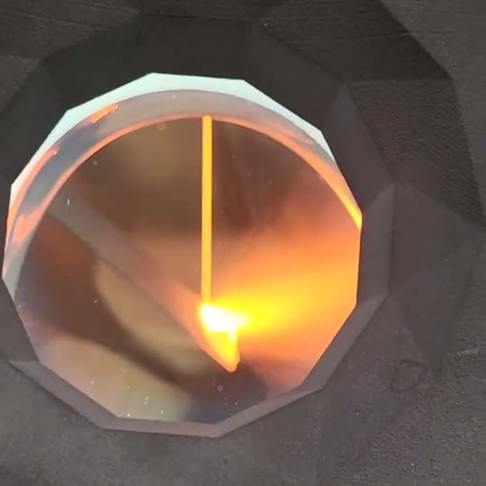
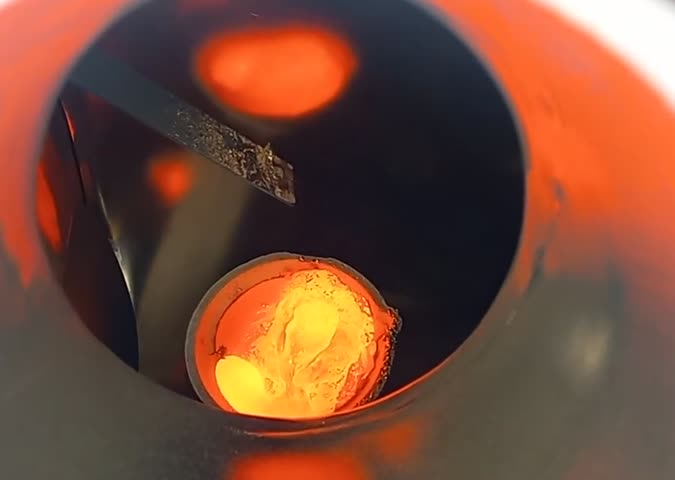
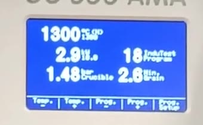
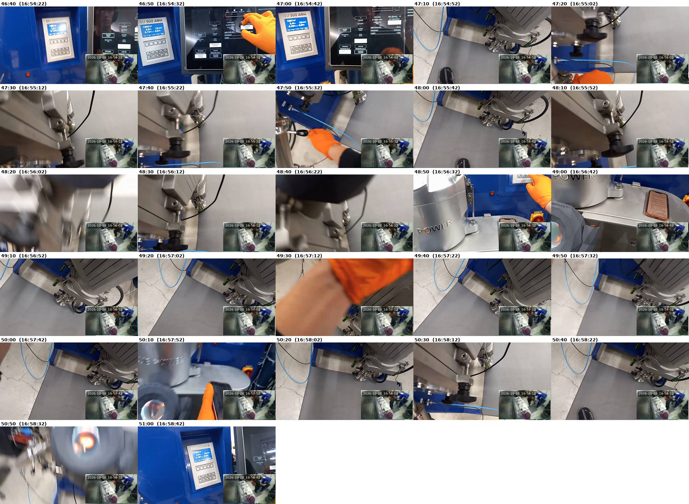

# Oct 28, 2026: second 630 bronze run; most of the melt ended up in the catch crucible

Issue [#219](https://github.com/vertical-cloud-lab/digital-alloy-lab/issues/219). Operator: Gage.
858.4 g of 630 bronze (UNS C63000, Cu-10Al-5Ni-3Fe) at 1300 °C, on the W-coated carbon-fibre plate
from the Oct 27 run (k7m2q9). No powder code. Sources:

- Gage's video of the run, [NZWmk5PqQhg](https://youtu.be/NZWmk5PqQhg) (55 min), transcribed in
  [`transcript-oct28-video1.md`](transcript-oct28-video1.md).
- For comparison, the public Oct 27 video of the pour through the ports,
  [2brsz-90seg](https://youtu.be/2brsz-90seg) (12 min), transcribed in
  [`transcript-oct27-video5.md`](transcript-oct27-video5.md).
- Gage's notes and photos on #219, the room livestream (see [Room stream](#room-stream)), the
  training transcripts and SOP (PR #173, #178), and the earlier runs (#157, #159, #160, PR #176, #182).
- Three Edison tasks in
  [`../../edison-trajectories/atomizer-nab-oct28-run-diagnosis/`](../../edison-trajectories/atomizer-nab-oct28-run-diagnosis/).

## Summary

The failure was at the plate, not at the nozzle. The melt left the crucible, and the crucible
drained in about 3.7 minutes, but from the first seconds of the pour the plate did not atomize it:
"For some reason it's not atomizing this time" (video 47:26, about 20 s into the pour). It began to
atomize about two minutes in, only on and off, and most of the charge ran off into the catch crucible.

The biggest difference from Oct 27 is how the pour was started:

- **Oct 27:** the turbo was held from the start. Gage says so on the Oct 27 video ("I'm holding my
  finger on the turbo pressure", 08:36), and the induction generator reads **1.48 bar** in the
  crucible at 2.6 and 3.5 min into the pour. The stream was a thin, straight jet, it hit the tip of
  the plate, and it atomized at once. Once the plate was running, it kept going without the turbo
  for a while ("now it's going on its own without it", 09:49).
- **Oct 28:** the pour was started at graining pressure. The display reads **0.30 bar** at 0.8 min,
  Gage's notes say 0.23 bar, and the narration never mentions the turbo. That leaves the stream
  three to four times slower as it leaves the nozzle (about 1.5–2 m/s against 6 m/s;
  [`estimates.md`](estimates.md)).

AMAZEMET's trainer said repeatedly that a carbon-fibre plate needs a strong first pour to heat up
and wet, and that the turbo is the tool for it:
- the turbo "also helps to heat up the plate more at the very beginning" (training video 2, 19:44);
- "It's gathering. It's not atomizing. The plate cannot heat up … I just poured more" (video 2, 20:29);
- in his Oct 13 WhatsApp message: carbon-fibre plates "require high initial flow to heat up";
- in his Oct 17 message: "a bit more pouring at the beginning to heat it up but after it wets, it will
  atomize continuously".

Oct 27's start matched that advice. Oct 28's didn't: the plan was to start at 0.23 bar and use the
turbo as a fallback (video 13:28).

Five other things changed at the same time, and each makes it harder for the plate to start:

1. **The plate was on its second use** after a full 1.08 kg pour at 1300 °C, and it was **raised**
   so the stream landed farther from the tip. The trainer warned about both:
   - coated plates lose their coating "after a few trials … and there is too little wetting";
   - a plate that ran once "may not work" the next time;
   - a full crucible may be more than one plate survives.

   After the pour, the end of the plate is crusted (see the frames below). Edison ranks the moved
   landing point first, since it may now sit on a low-amplitude part of the plate, and the reused
   plate second.
2. **The melt was barely held.**
   - On Oct 28 the charge was "all melted" at 1257 °C (video 45:45), and the wall thermocouple was
     back at 1300 °C only about 15 s before the pour (46:50).
   - On Oct 27 the hold was about 2 min, which is the trainer's rule: wait 2 min so that the melt
     catches up with the wall reading.
3. **The nozzle was reused.**
   - Gage wondered mid-pour whether it was "screwed up" (49:46).
   - The pour was too fast for a 0.5 mm bore at 0.23–0.30 bar. It fits a bore of about 0.7–0.9 mm,
     while the same calculation puts Oct 27's nozzle at 0.47 mm.
   - So either the bore opened up during the first run, or the turbo was used on Oct 28 without
     being mentioned. hBN is soft, and the Al in the melt wets and attacks BN at 1300 °C.
4. **Graining was turned down** to 0.19 bar halfway through, which cuts the flow further. The
   trainer's advice for a plate that isn't atomizing is the opposite: more flow, from the turbo.
5. **Amplitude was raised** from 90 to 100 % mid-pour. That adds little vibration and more stress on
   the plate, and it didn't help.

**The bare patches of BN in the crucible probably did not cause the atomization failure.**
- Gage raised them himself ("you can see the graphite through it", video 51:29). Edison rates them a
  compounding factor at most, through debris that could reach the nozzle.
- They matter for contamination (Al₄C₃, C and B in the powder) and for how long the crucible lasts.
- Edison's recoating procedure is summarized [below](#re-applying-the-bn-coat).

Oxygen was not the problem either. It was 11–33 ppm around the start of the pour and 69 ppm at the
end, against 24 ppm at the start of Oct 27's pour and 240 ppm during it.

## Oct 27 against Oct 28

| | Oct 27 (k7m2q9) | Oct 28 |
|---|---|---|
| Charge | 1,079.9 g, 4 rod pieces | 858.4 g, 5 pieces |
| Crucible (graphite, BN-coated inside) | fresh BN coat; the chamber "filled with smoke" at 500 °C (Oct 27 video 00:55), so the coat's binder burned off in the chamber | same coat; patches of BN pulled off with the Oct 27 skull, graphite visible, not recoated; no smoke at 505 °C |
| Nozzle (hBN, 0.5 mm planned) | new | reused; "looks perfectly clear" (08:36) |
| Plate (W-coated carbon fibre) | new; stream hit the very tip | second use; raised "because it was like around the edge last time" (20:28) |
| O₂ (as spoken) | 22–24 ppm before the pour, 240 ppm during it | 19 → 11 ppm before, about 33 ppm as the charge melted, 69 ppm at the end |
| Hold after melting | ~2 min at 1300 °C | ~75 s after "all melted, 1257 °C"; ~15 s after the wall thermocouple reached 1300 °C |
| Ultrasonics | ~40 kHz, 90 % | scan 40,123 Hz; running 40,188 → 40,164 Hz; 88–90 % then 100 %; 15 W at start (HMI) |
| Pour pressure | turbo held: **1.48 bar** on the display at 2.6 and 3.5 min; briefly self-sustaining without it | graining: **0.30 bar** on the display at 0.8 min (notes: 0.23 → 0.19 bar halfway); turbo not mentioned |
| Pour time | ~3.5 min ("3.5 Min. Grain"; "we're out", 11:27) | ~3.7 min (47:03 to 50:46) |
| First seconds | "Woo! … That is working so good" | "For some reason it's not atomizing this time" |
| Result | ~97 % collected as powder, with flakes | some powder, "splattering an awful lot"; most of the melt in the catch crucible |
| Argon cylinder | not logged | 1,500 psi at the start (18:58); 1,150 psi that evening, so ~350 psi against 100–160 psi per run for the aluminium runs (`atomizer-runs/2026-10-20/argon.md`, PR #182) |

## Timeline, Oct 28

Lab time is Mountain Daylight Time: the video time plus 16:07:42, from aligning the video with the
room stream ([Room stream](#room-stream)). Gage says "Your time right now is 4.07" as the video starts.

| Video | Lab time | What happens |
|---|---|---|
| 00:00 | 16:07:42 | Start. Charge weighed: 858.4 g |
| 04:22–08:06 | 16:12:04–16:15:48 | Cleaning. A grey layer on the white insulation, a charred thermocouple sheath. The Oct 27 skull "just came right out" (06:36). "Some spots where the boron nitride layer has … chipped off. It looks more like it chipped off than like burned off" (06:55) |
| 08:36 | 16:16:18 | Nozzle "looks perfectly clear … I think we're good to use it again" |
| 12:47–13:44 | 16:20:29–16:21:26 | Program set-up: turbo 1.5 bar; graining set to 0.23 bar. "If 0.23 doesn't work, you can just take it back up to the 1.5 with the turbo pressure" |
| 18:30–18:58 | 16:26:12–16:26:40 | Pressure control, vacuum pump, gas wash. Argon cylinder at 1,500 psi |
| 19:58 | 16:27:40 | Ultrasonic test |
| 20:28 | 16:28:10 | "I brought up the plate just a little bit because it was like around the edge last time" |
| 25:25–29:25 | 16:33:07–16:37:07 | 250 °C, then a 505 °C hold ("we'll see if it off-gases again"; "I think we're chilling this time") |
| 34:25–38:42 | 16:42:07–16:46:24 | O₂ "a little high", one more gas wash; at ~19 ppm the setpoint goes to 1300 °C |
| 42:50–43:20 | 16:50:32–16:51:02 | O₂ 11 ppm; the charge starts to melt |
| 45:14–45:51 | 16:52:56–16:53:33 | The melting charge pulls the wall reading down to 1257–1265 °C at 10 kW; "now it's all melted, 1257"; O₂ about 33 ppm |
| 46:01 | 16:53:43 | "I'll just give it 30 more seconds or so" |
| 46:50–46:58 | 16:54:32–16:54:40 | Generator at 1300 °C, 3.9 kW. Ultrasonics on: scan 40,123 Hz, 88–89 %, 40,188 Hz, 15 W |
| 47:03 | 16:54:45 | Graining pressure, sealing rod up: the pour starts |
| 47:26 | 16:55:08 | "For some reason it's not atomizing this time, turning up the amplitude" |
| 47:47 | 16:55:29 | Display 1300 °C, 3.2 kW, 0.30 bar, 0.8 min into the pour; HMI 90 %, 40,164 Hz |
| 48:23–48:56 | 16:56:05–16:56:38 | "Why would it work last time but not this time?" Thinks about closing the sealing rod ("can't … it needs to keep going"); presses keys on the generator panel |
| 49:16 | 16:56:58 | "Hey, now it's atomizing. Wow, it's really going crazy" |
| 49:31–49:46 | 16:57:13–16:57:28 | "Temperamental … sometimes it's going and then it's not." "I wonder if the nozzle is screwed up" |
| 50:16 | 16:57:58 | "Now it's doing better" |
| 50:46 | 16:58:28 | Pour over: "we got a lot less that time" |
| 51:10–52:10 | 16:58:52–16:59:52 | Viewport: the catch crucible is full of glowing melt, the plate end is crusted, splats on the wall |
| 51:05–52:08 | 16:58:47–16:59:50 | Gage lists what changed: reused plate and nozzle; BN spots ("you can see the graphite through it"); graining raised to 0.23. "Maybe I should have just kept everything the same because that worked really well." "Splattering an awful lot but not making a lot of powder" |
| 55:23 | 17:03:05 | Final O₂ 69 ppm; the video ends |

## Room stream

The room camera's afternoon broadcast,
[FYp3AgZ9UDU](https://www.youtube.com/watch?v=FYp3AgZ9UDU) (13:00–21:00 MDT), covers the run. I took
fragments 5350–7400 of its 144p DASH stream, which run from 15:59:46 to 17:08 MDT. The burned-in clock
read cleanly on 125 of 137 crops, every 30 s, and all of them give the same start, so the stream has no
steps in this window
([`room-stream/stream-clock-ocr.csv`](room-stream/stream-clock-ocr.csv)).

Matching the head camera's motion against the room's motion (`stream_sync.py align` from PR #173) puts
the video's start at **16:07:42 MDT**.
- The match is strong: r = 0.76 against a runner-up of 0.18, and the two halves of the video give the
  same offset ([`room-stream/alignment.json`](room-stream/alignment.json)).
- It agrees with Gage's spoken "4:07".
- The pour started at about **16:54:45** and was over by **16:58:28**. Gage stays at the machine for
  the whole pour.

The two sheets below show the video frames with the room frame for the same second inset in each, and
the inset's burned-in clock matches the label.

- [`room-stream/oct28-whole-video-every-150s.jpg`](room-stream/oct28-whole-video-every-150s.jpg)
- [`room-stream/oct28-pour-every-10s.jpg`](room-stream/oct28-pour-every-10s.jpg)

**One thing to ask Gage.** Between 47:12 and 48:18 (16:54:54–16:56:00), the head camera points
several times at the black T-handle under the atomization chamber, with his glove near it. If that is
the stack clamp, the plate was also moved during the pour, which would add to the on-and-off
atomization. His notes say he "messed with some things"; the video doesn't show which.

The Oct 27 video ([2brsz-90seg](https://youtu.be/2brsz-90seg)) did not align with that afternoon's
broadcast ([sDPzso4-tP0](https://www.youtube.com/watch?v=sDPzso4-tP0), checked 14:31–17:36 MDT):
- the best peaks were all r ≈ 0.43–0.45, and the overall best would end after the video was uploaded
  (17:26 MDT);
- most of that video is a hand-held close-up of the ports.

So the Oct 27 pour isn't timed here.

How the footage was fetched:
- YouTube refuses CI runners ("Sign in to confirm you're not a bot"), so every download went through
  an SSH SOCKS tunnel to one of the lab Pis (`ssh -N -D 127.0.0.1:1080` and
  `yt-dlp --proxy socks5://127.0.0.1:1080 --js-runtimes node`). Nothing was installed or changed on
  the Pi.
- The googlevideo segment URLs only worked through the same proxy, and without a custom User-Agent.
- A broadcast that has just ended offers only DASH, so
  [`tools/dash_frags.py`](tools/dash_frags.py) fetches `&sq=N` fragments (2 s each from the start).
  An archived one serves HLS, which [`tools/hls_window_par.py`](tools/hls_window_par.py) cuts by time.

## What the training says

Transcripts are in `atomizer-training/transcripts/whisper/` on the PR #173 branch. In the citations
below, "Video N" is a training video, with timestamps in minutes:seconds.

- **The turbo heats the plate at the start.**
  - "Sometimes, especially at the beginning, you need to push it through the nozzle … It also helps
    to heat up the plate more at the very beginning … If the stream starts to move a lot, using
    turbo pressure can help to like push it and unclog the nozzle from any small debris" (video 2,
    19:31–19:56).
  - "It's gathering. It's not atomizing. The plate cannot heat up" (video 2, 20:29). The fix there
    was to pour more.
- **How long to hold.** "Two minutes is how much it takes for the temperature of the crucible at the
  wall to be the same as the temperature of the metal" (video 5, 57:33).
- **Plate wear and reuse.**
  - "Copper and some alloys, then we use carbon fiber with coatings. So the issue may be that after a
    few trials, the coating just wears off. And there is too little wetting and atomization"
    (video 5, 72:37).
  - "Even if it cracks a little bit … usually once it runs, it's able to run. But then if you try to
    run it again, it may not work" (commissioning walk-around, 09:06).
  - "If you try to have a full, full [crucible], the plate may not survive it" (video 9, 29:20).
- **Where to land the stream.**
  - "We want it to fall as high as possible. But if it goes too high, it will start going on the top
    [sonotrode]" (video 5, 28:58).
  - "When the plate gets hot, if you have the stable stream, you should get everything atomized"
    (video 5, 63:14).
  - All of this was said about aluminium on a bare carbon-fibre plate. The usable window is 68–108
    mm from the mounting hole (stack model, PR #173), and the plate tip is at about 110 mm.
- **Which coated plate.**
  - The Mo-coated plate has its coating "on the tip … used mostly for copper … where copper doesn't
    want to wet".
  - The W plasma-coated plates are "fully coated" (video 9, 39:01–39:22).
  - It's worth checking which of these the "W-dipped" plate is. If only the tip is coated, raising
    the plate may have put the stream on bare carbon fibre.
- **Nozzle reuse.** A nozzle that looks clear can still hold solidified metal "that the new material
  is not able to melt … and push through" (video 9, 30:20–30:51). Oxide on the nozzle bends the
  stream (video 5, 62:40).

## Edison

| Task | Question | Answer in one line |
|---|---|---|
| [`literature_high_ultrasonics.md`](../../edison-trajectories/atomizer-nab-oct28-run-diagnosis/literature_high_ultrasonics.md) | Why run B failed, from the ultrasonics | Ranks the moved landing point first, a reused plate that is detuned or coated with metal or oxide second, and a loosened plate joint third. Flow, hold time and O₂ come out low. |
| [`literature_high_bn_recoat.md`](../../edison-trajectories/atomizer-nab-oct28-run-diagnosis/literature_high_bn_recoat.md) | Why the skull pulled the BN off, and how to recoat | The Al in the melt makes BN wettable above about 900–1000 °C. Strip the coat fully and recoat; don't patch. |
| [`precedent_failed_runs.md`](../../edison-trajectories/atomizer-nab-oct28-run-diagnosis/precedent_failed_runs.md) | Published failed runs | No published Cu or Al-alloy case of melt running off a plate. The closest is 316L runs stopped when metal built up on the sonotrode because the feed outran atomization ([Bałasz 2024](https://doi.org/10.3390/ma17225642)). The NAB rePOWDER paper recovered 77 % and found shed carbon fibres ([Müller 2023](https://doi.org/10.1088/1757-899X/1296/1/012036)). |

**Where I'd discount Edison.**
- The queries went in before the videos had been watched, so Edison didn't know that Oct 27 ran on
  turbo from the start or that Oct 28 failed within seconds. It treats high flow only as a way to
  overload the plate, and rates the 0.19–0.23 bar pour "low–medium". The trainer's and AMAZEMET's
  own advice is about the opposite failure, too little flow to heat the plate. That advice fits the
  timing, failing at once and recovering after about two minutes, better than a node does.
- Its node argument is plausible: by my estimate the flexural wavelength in a ~2 mm carbon-fibre
  plate at 40 kHz is around 2 cm. But the argument is generic, and a melt film spreads across several
  centimetres and crosses several antinodes.
- Its numbers for the BN cure (a 400 °C burnout, then 800–900 °C under argon) are marked as
  estimates. Follow the data sheet for the BN spray we actually have.

## Re-applying the BN coat

From Edison's answer, cut to what we can do here:

1. **Find out what the spray is.** Get the data sheet for the BN aerosol we use, with its binder and
   cure schedule.
   - Edison advises against silicate, B₂O₃-rich and phosphate binders for an Al-bearing melt.
   - A coat that smokes at 500 °C in the chamber, as on Oct 27, was not cured before the run.
2. **Strip, don't patch.**
   - Lift the old skull warm, without levering against the wall.
   - Brush or vacuum off loose BN, and abrade lightly only where needed.
   - Wipe with IPA. Never use water.
3. **Recoat.**
   - Apply two to four light coats, drying between coats, to about 50–150 µm in total.
   - Keep the coat out of the nozzle seat and bore. The trainer warns that a thick coat on the
     sealing rod can block the nozzle.
4. **Cure before the run day.**
   - Follow the data sheet.
   - If it gives a burnout temperature, run that program in the atomizer under argon with the
     crucible empty, so the smoke doesn't happen with metal in it.
5. **Inspect, and recoat after every NAB run.** Look for bare graphite, pinholes and lifted edges
   under strong side light, and recoat after every NAB run or two.
6. **Drain completely.**
   - Use the turbo to push out the last of the melt.
   - Keep the induction on until the crucible is empty.

   This is what keeps a skull from forming and pulling the coat off.

## Before the next run

Repeat Oct 27 exactly, then change one thing per run:

- [ ] New plate (or confirm with AMAZEMET that a W-coated plate can be reused after a 1 kg NAB pour). Note which plate it is (fully coated W plasma, or W-dipped tip).
- [ ] Plate at the Oct 27 position (stream at the tip). Mark the stack position so it can be repeated.
- [ ] New hBN nozzle. Measure the old nozzle's bore with a pin gauge or a #76 (0.51 mm) and #70 (0.71 mm) drill shank.
- [ ] Crucible stripped, recoated and cured (above).
- [ ] Hold 2 min after the wall reading returns to 1300 °C.
- [ ] Start the pour on the turbo and hold it until the plate is clearly atomizing, then drop to graining pressure if it keeps going on its own.
- [ ] Don't change amplitude or pressure mid-pour unless it's a planned abort.
- [ ] Log the cylinder pressure before and after, the generator display (pressure, Min. Grain) and the HMI (frequency, amplitude, power) every 30 s, and weigh the catch-crucible puck and the powder.
- [ ] New 630 bronze. The 3 ft rod is used up (1,080 g + 858 g). The Oct 28 puck could be remelted, as the trainer allows for catch-bowl metal, but only after cleaning, and its O, C and B pickup is unknown.
- [ ] Ask AMAZEMET three things: whether the W-coated plate is meant to be reused after a ~1 kg copper-alloy pour, which part of it is coated, and whether they start NAB pours on the turbo.

## Files

- `transcript-oct28-video1.md`, `transcript-oct27-video5.md`: Whisper transcripts with links into the videos.
- `estimates.py`, `estimates.md`: head, capillary threshold, flow, drain time, and the bore that fits each observed pour.
- `frames/`: the five frames above, cropped from the two videos.
- `room-stream/`: the alignment, the overlay-clock OCR, and the two sheets with the room stream inset.
- `tools/`: the two fetch scripts used through the Pi tunnel. The alignment used
  `atomizer-training/tools/stream_sync.py` from the PR #173 branch.
