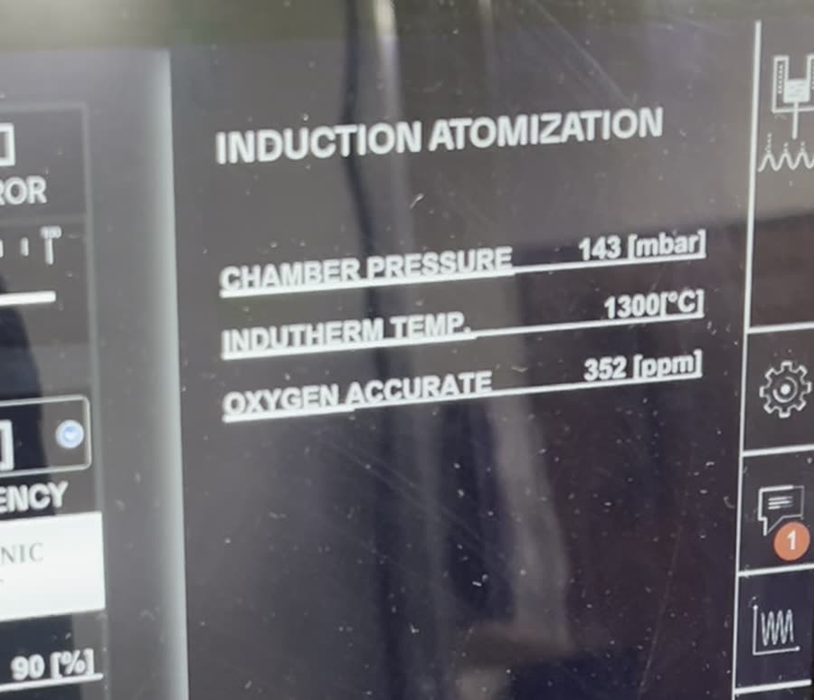
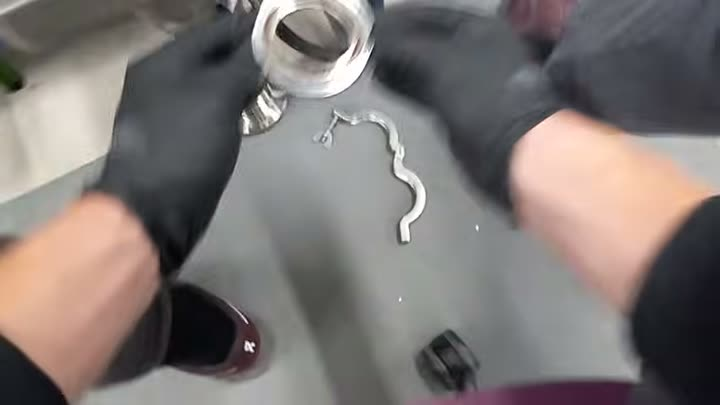

# Nov 13 2026: 630 bronze run that burned the collection-cup seals and cracked its glass

Run record and failure analysis for
[#269](https://github.com/vertical-cloud-lab/digital-alloy-lab/issues/269). The run log is in
[#219](https://github.com/vertical-cloud-lab/digital-alloy-lab/issues/219#issuecomment-6869334131).
Sources are the photos and two clips in #269, the 11 Nov 13 and Nov 17 videos in the *Atomizer Runs*
playlist, the earlier copper-run records, and two Edison tasks
([`edison-trajectories/atomizer-nab-nov13-cup-failure/`](../../edison-trajectories/atomizer-nab-nov13-cup-failure/)).
The numbers behind each claim are in [`estimates.md`](estimates.md) (generated by
[`estimates.py`](estimates.py)).

## Short answer

1. **The plate never made powder, so the melt left it as 1–3 mm shot that was still liquid when it
   reached the cone.** Fine powder (about 100 µm) freezes within a few centimetres of the plate and
   lands cool. Drops of 1–3 mm need 2–9 s to freeze, and the fall takes about 0.4 s. So the shot
   landed liquid, stuck together around the cone outlet, and piled up and slid into the collection cup,
   bringing most of the charge's ~0.7 MJ with it.
2. **The seals and the glass were just what that pile touched.** Bronze at about 1000 °C puts the
   surface of a seal it touches at about 950 °C, and silicone and FKM seals are rated to about 200–250 °C.
   It puts touched glass at about 900 °C, while borosilicate cracks at a temperature step of about 150 K.
   On earlier runs, metal the plate didn't atomize either became powder or ran off into the catch bowl
   as one puck (Oct 28), or froze in the nozzle (Nov 5). None of it reached the cup.
3. **The O₂ was high from the moment the machine came back on after being switched off by accident, and
   no amount of purging brought it down.** Each pump-down and refill took it back to the 1000 ppm
   limit. The likeliest cause is air getting in during every pump-down through a leak that had not
   been there before. A one-off gulp of air would have been purged to under 1 ppm by the third cycle.
   The leak can't be pinned on one joint from the evidence. The suspect is the cup's top joint: it was
   taken apart on Nov 11, never leak-checked, and it later smoked. A sensor fault that started with the
   power cut is the other possibility.
4. **The −830 mbar vacuum reading doesn't show a leak either way.** The gauge reads relative to the room,
   and the room's pressure on Nov 13 was 7–18 mbar lower than on the four earlier bronze run days
   (849 hPa against 856–867 hPa). The weather alone accounts for most of the shortfall from −850.
5. **Two things led to the failure: the plate, and the decision to pour.** The plate was the Nov 10
   plate, flipped and scraped. On Nov 10 its W coat wore through in seconds wherever the stream landed.
   Then the pour went ahead at about 500 ppm O₂ on the reasoning that "the sensor's not working
   properly". AMAZEMET's trainer's limit is 100 ppm. At that level a melt with 10 % Al grows an
   Al₂O₃ skin, which also works against atomization. The evidence can't tell which of the two
   mattered more.

**To prevent it:**
- Stop a pour that isn't making powder.
- Don't pour above the O₂ limit.
- Leak-check the cup after it has been opened.
- Keep hot metal away from the cup's seals and glass.

The list is [below](#prevention).

## What the cup is

From the Nov 13 cleaning video (`boWsO0rxHvU`) and the Nov 17 teardown (`LpvrzaWELpE`, `FRzaz9f7L1E`), top to bottom:
- **The chamber's water-cooled cone.** Its outlet is clamped to the cup with a KF-style clamp, a
  centering ring and an O-ring.
- **A stainless conical reducer.**
- **A thick top plate.** The splash disc sits in its bore.
- **A glass cylinder.** It is about 100 mm across, sits inside a perforated steel guard, and is sealed
  at each end against the top and bottom plates. Four tie rods with acorn nuts clamp it all together.
- **The bottom plate, with a valve.** This is the part that is unclamped to empty the powder.

Gage calls the whole glass assembly the collection cup, and this record does too.

## Timeline (lab time, MST)

Video 1 is `Gm3gC8SXMo8`. Its clock comes from the HMI's settings page at 40:00, which reads 23:32
Polish time, so 15:32 MST. Video 2 is `0sDd-eE_uqE`. The clip in #269 starts at 17:16:09.

| Time | Source | What happened |
|---|---|---|
| Nov 11 | [#219](https://github.com/vertical-cloud-lab/digital-alloy-lab/issues/219#issuecomment-6808493954) | Ronnie takes "the entire top off of the collection chamber" to reach an SEM sample. That was its first disassembly since the Nov 10 run. |
| 14:52 | Video 1, 0:00 | Prep. The plate is the Nov 10 one, flipped. "We scraped this, so it's probably not as coated as before" (16:32). New nozzle. Graining set to 0.18 bar (8:28). Argon 750 psi. |
| ~15:26 | Video 1, 34:26 | Cold purge: "Seems to be struggling to get up to the full −850 this time … I don't know where it'd [leak] from, except for maybe down here." |
| ~15:27 | Video 1, 34:30–35:30 | The machine is switched off by accident, then turned on again and logged back in. |
| 15:30–15:32 | Video 1, 37:32, 40:17 | "The oxygen accurate isn't responding properly". Then the reading is "pegged at 1,000 ppm". |
| 15:34 | Video 1, 42:10 (HMI) | **+142 mbar, 21 °C, 873 ppm O₂**, before any heating. Oct 6's comparable reading was 19 ppm. |
| 15:37–15:50 | Video 1, 44:50–58:20 | 250 °C and 500 °C washes. After about six purges the reading still returns to 1000 ppm. |
| ~15:47 | Video 3 (`nRPmLzQUUBY`) | One pump-down at 500 °C. See the [trace below](#the-oxygen-trace). |
| 15:50 | Video 1, 58:20 | "I'm just going to go ahead and run … the sensor's not working properly, but we've done plenty of those things." |
| 15:52 | Video 1, 1:00:10 | "Now saying the parts per million is 864." |
| ~17:13 | Video 2, 1:44–2:56 | The O₂ was "creeping down to like 500 ppm, and after doing that purge it spiked back up to 1,000". Charge melted, 5 min hold. "I'm pretty confident it is low … pressure has been maintained." |
| ~17:15 | Video 2, 4:43 | "It is not atomizing at all right now. Just spraying lots of …". Graining goes back up to 0.19 bar. "Frequency says it's good." |
| 17:16 | Clip in #269 | Stream hitting the plate and throwing sparks. **The glass cup glows orange with shot inside it.** HMI: 143 mbar, 1300 °C, **352 ppm**; 90 %, 40,071 Hz, 77–85 W. |
| ~17:17 | Video 2, 5:48 | "Smells weird. That could be evidence that there is actually a lot of oxygen in there." |
| ~17:18 | Video 2, 6:56–7:31 | "Smells like burning rubber … one of the seals is getting melted in there from the hot bronze … majority of it just made large beads." |
| ~17:19 | Video 2, 8:19 | "There was smoke coming out of … that seal there … maybe I should have triple-checked that it was seated properly." |
| ~17:20 | Video 2, 8:54 (HMI) | End: 162 mbar, 1139 °C, 254 ppm. |
| Nov 13, after | Video 5 (`boWsO0rxHvU`) | Bagging shot and a fused mat of beads from the cone. A white curled strip comes out of the cup's top joint (7:25). The cup comes off. |
| Nov 17 | Nov 17 parts 1–6 | Teardown. O-rings and centering ring cleaned. A brown burn ring on the bottom plate where the shot sat. |

## Why the O₂ was high

### The oxygen trace

Video 3, read from the HMI at 500 °C. One pump-down, then a refill with argon:

| Video 3 time | Chamber (gauge) | O₂ reading |
|---|---|---|
| 0 s | +156 mbar | 1000 ppm (top of scale) |
| 9 s | +102 mbar | 1000 |
| 12 s | −270 mbar | 671 |
| 15 s | −441 mbar | 594 |
| 18 s | −544 mbar | 635 |
| 21 s | −625 mbar | 713 |
| 24 s | −682 mbar | 820 |
| 27 s | −726 mbar | 834 |
| 30–52 s | −760 → −834 mbar | 1000 |
| 58–76 s | refilled with argon to +156 mbar | — |
| 80 s | +151 mbar | **1000** |

On a normal day the reading after a refill is in the low 20s (Oct 6: 19 ppm before heating; Oct 27:
24; Oct 28: 11; Nov 5: 22; Nov 10: 20). The trainer's rules are not to work above 100 ppm, that 40–50
ppm is good, and that the reading means nothing under vacuum. So only the readings at overpressure
count here, and those were:
- **873 ppm** at 21 °C right after the restart;
- 1000 after every wash;
- 864 at 15:52;
- about 500 just before the melt;
- **352** in the pour;
- 254 at the end.

### What the numbers allow

- **Purging should have worked within three cycles.** Each pump-down to about 16 mbar absolute and
  refill dilutes the gas about 60×. Air that got in once, for example when the machine lost power,
  falls to about 50 ppm after two cycles and under 1 ppm after three
  ([estimates §6](estimates.md#6-what-it-takes-to-leave-about-900-ppm-o2-after-a-backfill)). Instead,
  every cycle came back to about 1000 ppm.
- **About 1000 ppm after a refill means about 4 mbar of air left at the bottom of every pump-down.** A
  normal day leaves about 0.1 mbar. Air has to be coming in while the chamber is below room
  pressure, which is what a leak does.
- **4 mbar is too little for the gauge to see.** The gauge reads relative to the room. Nov 13's room
  pressure was 849 hPa, against 856–867 hPa on the other bronze run days (ERA5 via Open-Meteo,
  [estimates §5](estimates.md#5-the-vacuum-gauge-reads-relative-to-the-room-and-the-room-pressure-changes)).
  The same pump-down therefore reads 7–18 mbar less negative. The −830/−834 mbar is mostly weather,
  and what's left is within the reading's scatter. **Use a rate-of-rise test instead:** valve off the
  pump at full vacuum and log the gauge for 5 min. The pump-down in video 3 gives a time constant of
  about 9 s, so a leak that size would raise the pressure by roughly 25–30 mbar a minute. A tight
  chamber rises by about 1 mbar a minute plus outgassing.
- **Once at overpressure, the reading fell steadily: 873 → 864 → 500 → 352 → 254 over about two
  hours.** That fits a leak that only lets air in under vacuum. At +150 mbar argon flows out through
  it, while the hot graphite and the Al in the melt soak up O₂. On a normal run the O₂ rises during
  the pour, to 121–140 ppm on Oct 6 and 240 ppm on Oct 27.
- **The sensor behaved like a working one.** It dropped within 3 s when pumping started, tracked the
  pressure, and drifted down slowly at overpressure.

### Leak or sensor fault

| Cause | For | Against |
|---|---|---|
| **A leak that admits air during pump-downs** (most likely) | Purges stopped working. The size fits about 4 mbar of air. The reading falls at overpressure. The run behaved like an oxidized one. Gage smelled something odd before the burning rubber. | No hiss was heard, but a pump runs next to it. The gauge can't show it either way. |
| …at the cup's top joint | It was opened on Nov 11 and not leak-checked, and this was the first pump-down since. Gage suspected it at 15:26. It smoked during the pour, though overheating alone would also make it smoke. | Not tested. Any seal opened since Nov 10 is a suspect too (door, stack, furnace lid, view port). |
| …caused by the power cut, such as a valve left open or in the wrong state | The reading went wrong right after the restart. | The vacuum shortfall was noticed before the power cut, but the weather explains most of it. |
| **A sensor fault after the power cut** | It started with the restart, and Gage thought so too. | A slow or stuck sensor doesn't dip at once when pumping starts and then track the pressure. And the run failed as an oxidized run would. |

To tell them apart before the next heat-up, do the rate-of-rise test above, and soap-test every
clamped joint at +150 mbar. Then check the sensor by flowing argon straight from the cylinder through
it, or ask AMAZEMET how to verify it. Use the same cylinder, which gave 11–24 ppm on the earlier runs.

## Why this run burned the seals when earlier failures didn't

| | Oct 28 (failed) | Nov 5 (failed) | Nov 10 (good) | **Nov 13** |
|---|---|---|---|---|
| Plate | 2nd use | new | new | **2nd use: flipped, scraped, a nick at one end** |
| O₂ before the pour | 11 ppm | 22 | 20 | **~500 (873–1000 earlier)** |
| Hold at 1300 °C | ~15 s | 1 min | 2 min | **5 min** |
| Graining | 0.23 → 0.19 bar | 0.19 | 0.19 | **0.18 → 0.19** |
| What the plate did | let it run off | atomized in bursts, then the nozzle froze | atomized, unstable | **threw 1–3 mm shot the whole pour** |
| Where the unatomized metal went | **a puck in the catch bowl** | a plug in the nozzle | little | **the walls, the cone and the cup** |
| Cup | fine | fine | fine | **seals burned, glass cracked** |

The difference is where the metal went. A plate that lets the melt run off sends it into the catch
bowl in one stream. A plate that is vibrating but not atomizing throws it as shot all over the
chamber, including down the cone. The shot that landed in the cone was still liquid, so it fused,
piled up at the cup's entrance, and slid down the glass. The cleaning video shows a hand-sized mat
of fused shot. The cup glowed orange in the 17:16 clip.

### The seals

The white crust in the #269 photo is a band about 20 mm tall, crusty and mud-cracked, sitting where
the top seal is. That is what silicone rubber leaves when it burns: its silica filler, plus silica
from the polymer. It came out as a white curled strip in the cleaning video.

FKM (Viton) and EPDM leave black char. **The seal material isn't known yet.** If any of the seals was
FKM, its smoke contained HF. Until the material is confirmed:
- Handle the residue and the contaminated powder with gloves and a P3 respirator.
- Wipe the parts down wet.
- Keep the residue off skin.

The seal at the bottom of the glass looks dark and deformed, but not white.

### The glass

A scallop-shaped piece is missing from the top rim, and the yellow-brown film is heaviest right
around the break. That puts the heat source on that part of the rim. For borosilicate 3.3 the
allowable temperature step is about 150 K. Bronze touching it at 1000 °C gives about 900 K, so the
rim would have cracked even with perfect clamping. A burned-away gasket, which leaves glass bearing
on steel, or uneven tie-rod torque after the Nov 11 reassembly would have made it worse. The brown
film is most likely condensed smoke from the seals.

Fused quartz takes a step of about 840 K. **Ask AMAZEMET whether the glass is borosilicate or quartz.**

## Prevention

**Before the next run (Gage and Ronnie):**
1. **Replace the glass and every seal in the cup**, with the seal material confirmed from AMAZEMET's
   parts list. Don't use the Nov 13 powder: it contains the white residue.
2. **Leak-check after any part of the vacuum envelope has been opened.** That means the
   rate-of-rise test plus soap on the clamped joints. Log the rate on a good day as the baseline.
   The −850 mbar target changes with the weather, so drop it as a leak check.
3. **Treat the O₂ limit as a hard stop.** The SOP's numbers:
   - no melt above 29 ppm after the 500 °C wash;
   - if two extra purges don't fix it, don't heat further: find the leak.

   Never assume the sensor is wrong without checking it.
4. **After any power interruption, start over.** Check that the valves are in their normal states,
   then repeat the whole cold purge. Ask AMAZEMET what the machine does on power loss, including
   which valves fail open, and how long the O₂ sensor needs to settle.
5. **Use a new W-coated plate every run**, as the SOP already says. Don't flip or scrape plates for a
   full charge.

**During the pour:**

6. **Stop rule:** if the plate isn't making powder within about 20–30 s, close the sealing rod and
   end the pour. Signs are shot or sparks instead of mist, or metal piling on the plate or walls.
   Don't "salvage" the run by changing pressure or amplitude. Ask AMAZEMET to confirm that closing
   the rod mid-pour is safe.
7. **Watch the cup.** It is visible through the guard. An orange glow inside means hot metal has
   reached it: stop the pour.

**Hardware (ask AMAZEMET first; it's their design):**

8. **The newer collection container** that Sterling has asked them about (his message is on screen in the Nov 17 part-4 video). Ask for a quartz
   cylinder or an all-metal pot for copper alloys, and higher-temperature seals (FFKM, or
   graphite/metal) at the cone joint and the top of the glass.
9. **A sacrificial liner** at the cup's entrance, such as a thin stainless sleeve, so that shot
   sliding in can't touch the top seal or the glass rim. Also consider a deflector that sends runoff
   into the catch bowl instead of the cone.
10. **A temperature check on the cup's top plate:** a thermocouple with an alarm at about 150 °C, or
    at least a temperature label.

## Open questions for Gage and Ronnie

1. Which seal turned white, and what colour was it new? Which one smoked: the cone-to-cup clamp
   O-ring, or the gasket under the top plate?
2. What exactly was taken apart on Nov 11, and how were the tie rods re-tightened?
3. Was the chamber under vacuum when the power went off? What was switched off: the main switch, or
   the outlet the machine is on?
4. Where did the 816 g end up: catch bowl, cone, cup, walls? A rough split would help.
5. Is the glass labelled (Borofloat, Duran, quartz)?

## Edison

Two tasks, submitted 00:11 UTC Nov 19:
- a `LITERATURE_HIGH` failure analysis covering seals, heat, glass, oxygen and prevention;
- a `PRECEDENT` search for collector and seal failures in atomizers.

See [`edison-trajectories/atomizer-nab-nov13-cup-failure/`](../../edison-trajectories/atomizer-nab-nov13-cup-failure/).
EDISON_SUMMARY_PLACEHOLDER

## Files

- [`estimates.py`](estimates.py) / [`estimates.md`](estimates.md): heat in the charge, droplet
  freezing times, contact temperatures, glass thermal shock, barometric correction of the gauge, and
  O₂ after a refill.
- `frames/`: the HMI and the glowing cup from the #269 clip, and two frames from the cleaning video.
- Videos (*Atomizer Runs* playlist):

  | ID | Video | Captions? |
  |---|---|---|
  | `Gm3gC8SXMo8` | Nov 13, prep and run, video 1 | captioned |
  | `0sDd-eE_uqE` | video 2: the pour | captioned |
  | `nRPmLzQUUBY` | video 3: O₂ during a purge | captioned |
  | `0YEtnlsrLMo` | video 4: atomizing | |
  | `boWsO0rxHvU` | video 5: cleaning | no speech |
  | `ZpxmPxR995g`, `rvXQ87AALTM`, `LpvrzaWELpE`, `FRzaz9f7L1E`, `3tZqXeIqPDU`, `4g59T8JxwsU` | Nov 17 clean-up, parts 1–6 | parts 1–4 have little or no speech |

  They were fetched through a lab Pi's SOCKS tunnel (YouTube blocks CI runners).
