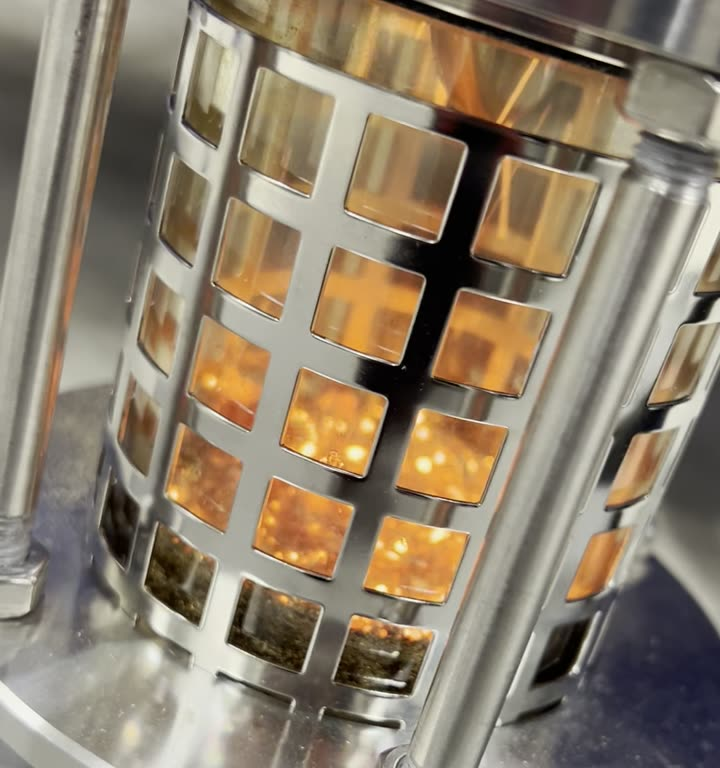
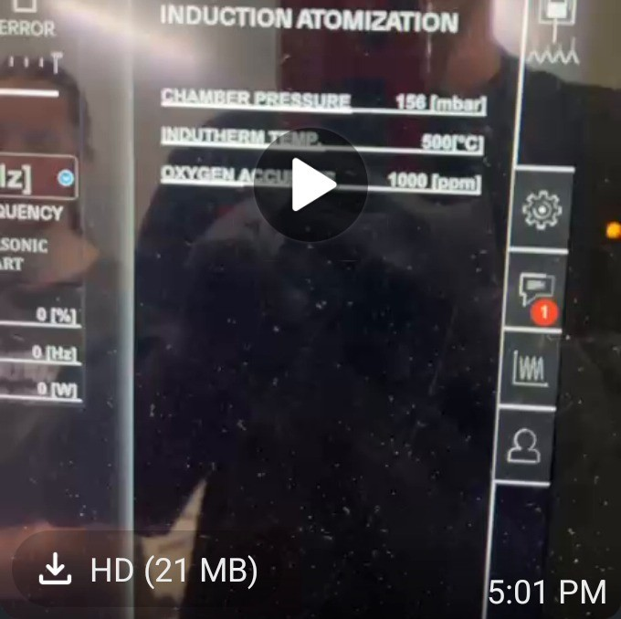
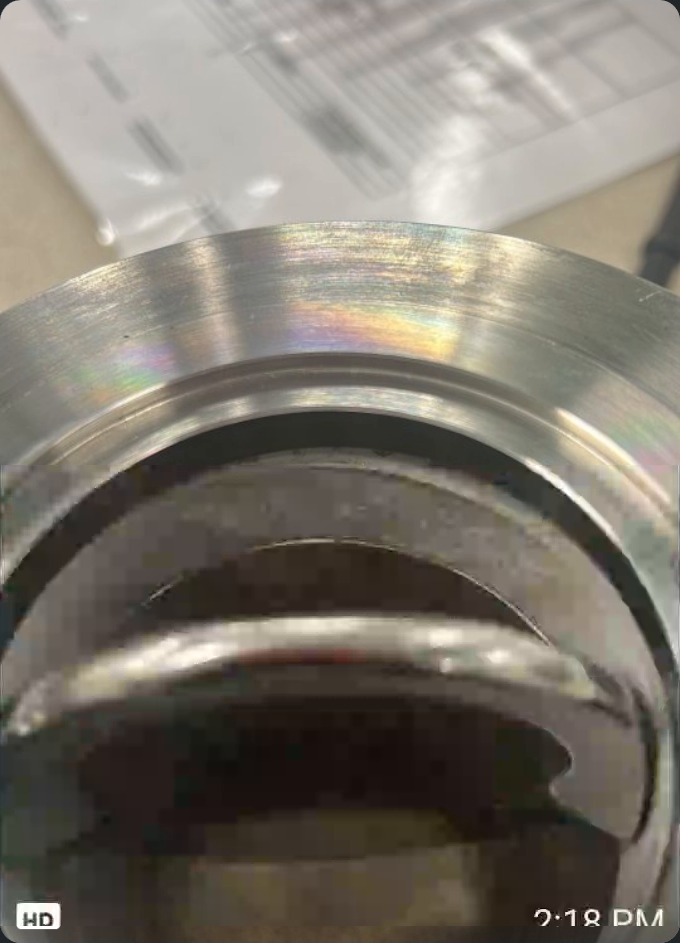
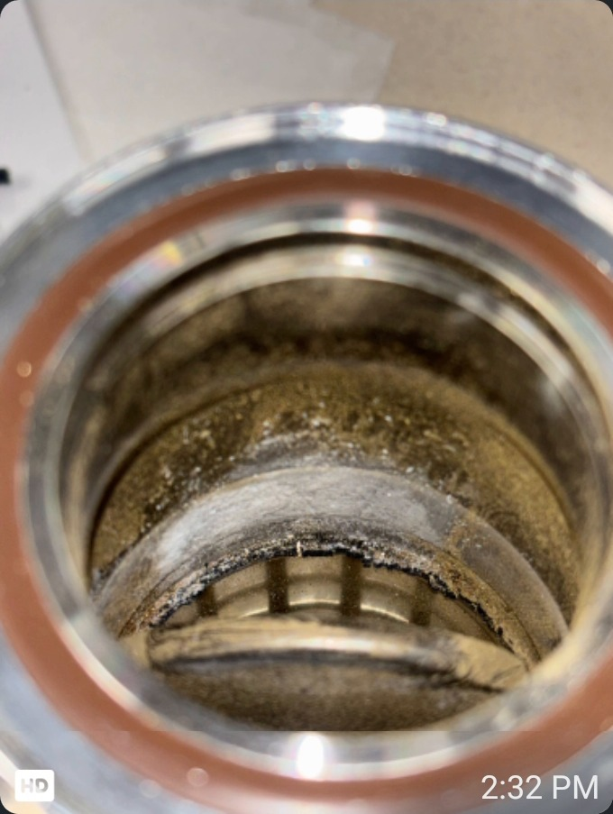
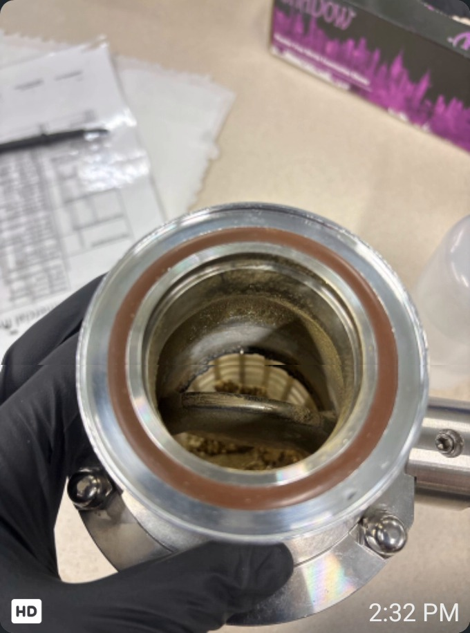
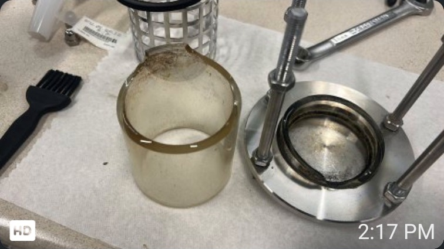
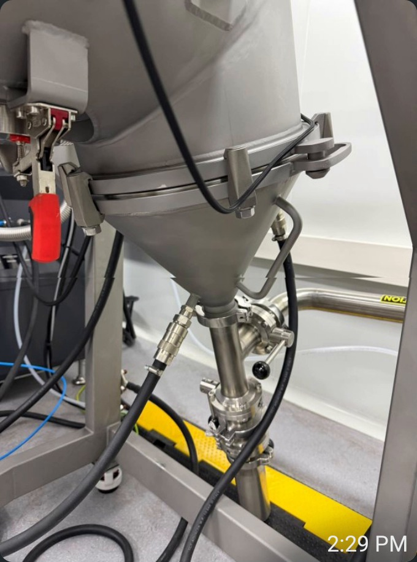
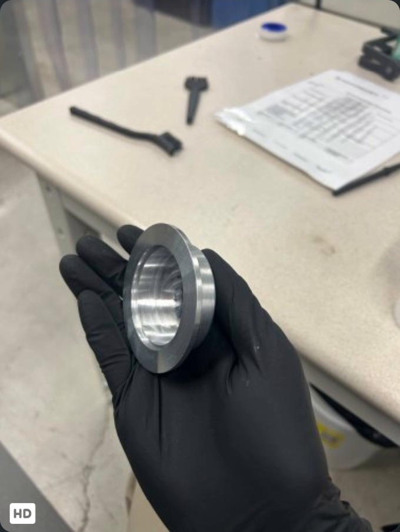

# Nov 13 2026: 630 bronze run that burned the collection-cup seals and cracked its glass

Run record and failure analysis for
[#269](https://github.com/vertical-cloud-lab/digital-alloy-lab/issues/269). The run log is in
[#219](https://github.com/vertical-cloud-lab/digital-alloy-lab/issues/219#issuecomment-6869334131).
Sources are the photos and two clips in #269, the 11 Nov 13 and Nov 17 videos in the *Atomizer Runs*
playlist, the earlier copper-run records, two Edison tasks
([`edison-trajectories/atomizer-nab-nov13-cup-failure/`](../../edison-trajectories/atomizer-nab-nov13-cup-failure/)),
and the lab's WhatsApp group with AMAZEMET from Nov 13 to Nov 20
([`amazemet-chat/transcript.md`](amazemet-chat/transcript.md), with its photos in
[`amazemet-chat/media/`](amazemet-chat/media/); phone numbers removed, AMAZEMET staff named by role).
The numbers behind each claim are in [`estimates.md`](estimates.md) (generated by
[`estimates.py`](estimates.py)).

## Short answer

1. **The plate never made powder, so the melt left it as 1–3 mm shot that was still liquid when it
   reached the cone.** Fine powder (about 100 µm) freezes within a few centimetres of the plate and
   lands cool. Drops of 1–3 mm need seconds to freeze (2–9 s by my estimate, 0.5–5 s by Edison's), and the fall takes about 0.4 s. So the shot
   landed liquid, stuck together around the cone outlet, and piled up and slid into the collection cup,
   bringing most of the charge's ~0.7 MJ with it.
2. **The seals and the glass were just what that pile touched, and nothing stood in its way.** Bronze
   at about 1000 °C puts the surface of a seal it touches at about 950 °C. AMAZEMET recalls the seal
   that burned as EPDM, which is rated to about 150 °C (silicone and FKM to about 200–250 °C). It puts
   touched glass at about 900 °C, while borosilicate cracks at a temperature step of about 150 K.
   AMAZEMET saw in the cleaning video that "the shields that are put in the cone were not used", and
   says "They always managed to protect the system from damage". Gage reads the photos as showing the
   splash plate installed backwards, and thinks the cup would have suffered less with it turned 180°.
   On earlier runs, metal the plate didn't atomize either became powder or ran off into the catch bowl
   as one puck (Oct 28), or froze in the nozzle (Nov 5). None of it reached the cup.
3. **The O₂ was high from the moment the machine came back on after being switched off by accident, and
   no amount of purging brought it down. The chat with AMAZEMET reopens the question of why.** Each
   refill took the reading back to the top of its scale, 1000 ppm. Three explanations are left, and
   the evidence so far doesn't separate them:
   - **A leak that lets air in during every pump-down.** AMAZEMET's rule points here: at
     overpressure the reading should fall below 1000 ppm, and "If it does not go under 1000ppm after
     a minute, I would assume that there is a leak". They would check "the cone sealing and the
     powder container" first. The cup is the powder container, and it was taken apart on Nov 11 and
     never leak-checked.
   - **A sensor that wasn't being flushed.** Chamber gas only flows through the sensor above
     +50 mbar, and "The flow is needed to ensure the measurement". Gage had adjusted that flow, in the
     blue cabinet, while trying to get the sensor to read properly, and on Nov 18 he heard no gas
     coming out. With too little flow the reading would also sit near 1000 after every purge and
     creep down slowly, which is what it did. That pattern no longer points to a leak on its own.
   - **A sensor fault that started with the power cut**, which Edison ranks first.

   The earlier case for a leak rested partly on how the reading moved under vacuum, and AMAZEMET
   says no chamber gas reaches the sensor there. Set the sensor's flow first. Then a 5-minute rate-of-rise
   test, which doesn't depend on the sensor, and a check against cylinder argon will settle it.
4. **The −830 mbar vacuum reading doesn't show a leak either way.** The gauge reads relative to the room,
   and the room's pressure on Nov 13 was 7–18 mbar lower than on the four earlier bronze run days
   (849 hPa against 856–867 hPa). The weather alone accounts for most of the shortfall from −850.
5. **Three things led to the failure: the plate, the cup's missing protection, and the decision to
   pour.** The plate was the Nov 10 plate, flipped and scraped. On Nov 10 its W coat wore through in
   seconds wherever the stream landed. The cone shields, which AMAZEMET says weren't fitted, and a
   splash plate facing the right way would have kept the shot off the cup's seal and glass. Then the
   pour went ahead with the reading at 1000 ppm a quarter of an hour before it and 352 ppm during it,
   on the reasoning that "the sensor's not working properly".
   AMAZEMET's trainer's limit is 100 ppm. If the O₂ really was a few hundred ppm, a melt with 10 % Al
   grows an Al₂O₃ skin, which also works against atomization. The oxygen added no heat of its own: if every O₂ molecule
   in the chamber had reacted with the melt, it would have released at most about 2 % of the heat
   the charge carried ([estimates §7](estimates.md#7-could-the-oxygen-have-added-heat)). That
   agrees with AMAZEMET's "Can't confirm that the oxygen could matter here". The evidence can't
   tell which of the three mattered most.

**To prevent it:**
- Stop a pour that isn't making powder.
- Fit the cone shields every run, and turn the splash plate to face the right way.
- Don't pour above the O₂ limit, and check that the sensor has its flow before trusting the reading.
- Leak-check the cup after it has been opened.
- Keep hot metal away from the cup's seals and glass.

The list is [below](#prevention).

## What the cup is

From the Nov 13 cleaning video (`boWsO0rxHvU`) and the Nov 17 teardown (`LpvrzaWELpE`, `FRzaz9f7L1E`), top to bottom:
- **The chamber's water-cooled cone.** Its outlet is clamped to the cup with a KF-style clamp, a
  centering ring and an O-ring.
- **A stainless conical reducer.**
- **A thick top plate.** The splash plate, a curved stainless deflector, sits in its bore.
- **A glass cylinder.** It is about 100 mm across, sits inside a perforated steel guard, and is sealed
  at each end against the top and bottom plates. Four tie rods with acorn nuts clamp it all together.
- **The bottom plate, with a valve.** This is the part that is unclamped to empty the powder.

Gage calls the whole glass assembly the collection cup, and this record does too. AMAZEMET calls it
the powder container. Its engineer names two kinds of rubber in it: "the rubber that is around the
valve part" and "the rubber seal that the glass presses into". AMAZEMET also says "the shields that
are put in the cone were not used". Two days later Gage wrote "We used the splash plate in the
collection cone", so it isn't settled yet whether the splash plate is one of those shields or they
are separate parts.

## Timeline (lab time, MST)

Video 1 is `Gm3gC8SXMo8`. Its clock comes from the HMI's settings page at 40:00, which reads 23:32
Polish time, so 15:32 MST. Video 2 is `0sDd-eE_uqE`. The clip in #269 starts at 17:16:09.

| Time | Source | What happened |
|---|---|---|
| Nov 11 | [#219](https://github.com/vertical-cloud-lab/digital-alloy-lab/issues/219#issuecomment-6808493954) | Ronnie takes "the entire top off of the collection chamber" to reach an SEM sample. That was its first disassembly since the Nov 10 run. |
| 14:52 | Video 1, 0:00 | Prep. The plate is the Nov 10 one, flipped. "We scraped this, so it's probably not as coated as before" (16:32). New nozzle. Graining set to 0.18 bar (8:28). Argon 750 psi. |
| ~15:26 | Video 1, 34:26 | Cold purge: "Seems to be struggling to get up to the full −850 this time … I don't know where it'd [leak] from, except for maybe down here." |
| ~15:27 | Video 1, 34:30–35:30 | The machine is switched off by accident, then turned on again and logged back in. |
| 15:30–15:32 | Video 1, 37:32, 40:17 | "The oxygen accurate isn't responding properly". Then the reading is "pegged at 1,000 ppm". |
| 15:34 | Video 1, 42:10 (HMI) | **+142 mbar, 21 °C, 873 ppm O₂**, before any heating. Oct 6's comparable reading was 19 ppm. |
| 15:37–15:50 | Video 1, 44:50–58:20 | 250 °C and 500 °C washes. After about six purges the reading still returns to 1000 ppm. |
| 15:50 | Video 1, 58:20 | "I'm just going to go ahead and run … the sensor's not working properly, but we've done plenty of those things." |
| 15:52 | Video 1, 1:00:10 | "Now saying the parts per million is 864." |
| 16:54–16:59 | WhatsApp | Gage asks AMAZEMET: "our oxygen accurate sensor seems to be sticking. How can I check it?", then "It is sitting at 1000 ppm, and drops then goes back up on each purge". It is nearly 1 AM in Poland. Sterling suggests sending a video. |
| ~17:00 | Video 3 (`nRPmLzQUUBY`); WhatsApp, 17:01 | One pump-down at 500 °C. See the [trace below](#the-oxygen-trace). At 17:01 Gage sends AMAZEMET a video of the HMI. Its thumbnail (below the table) shows the readings video 3 starts with (+156 mbar, 500 °C, 1000 ppm), and video 3's title says it was made "to show weird oxy", so they are probably the same video. If so, this was the last purge before the melt, not one of the 15:37–15:50 washes, where the first version of this record put it. |
| ~17:13 | Video 2, 1:44–2:56 | The O₂ was "creeping down to like 500 ppm, and after doing that purge it spiked back up to 1,000". Charge melted, 5 min hold. "I'm pretty confident it is low … pressure has been maintained." |
| ~17:15 | Video 2, 4:43 | "It is not atomizing at all right now. Just spraying lots of …". Graining goes back up to 0.19 bar. "Frequency says it's good." |
| 17:16 | Clip in #269 | Stream hitting the plate and throwing sparks. **The glass cup glows orange with shot inside it.** HMI: 143 mbar, 1300 °C, **352 ppm**; 90 %, 40,071 Hz, 77–85 W. |
| ~17:17 | Video 2, 5:48 | "Smells weird. That could be evidence that there is actually a lot of oxygen in there." |
| ~17:18 | Video 2, 6:56–7:31 | "Smells like burning rubber … one of the seals is getting melted in there from the hot bronze … majority of it just made large beads." |
| ~17:19 | Video 2, 8:19 | "There was smoke coming out of … that seal there … maybe I should have triple-checked that it was seated properly." |
| ~17:20 | Video 2, 8:54 (HMI) | End: 162 mbar, 1139 °C, 254 ppm. |
| Nov 13, after | Video 5 (`boWsO0rxHvU`) | Bagging shot and a fused mat of beads from the cone. A white curled strip comes out of the cup's top joint (7:25). The cup comes off. |
| Nov 14, 02:18–02:19 | WhatsApp | AMAZEMET's first reply, after the pour: the reading only counts above +50 mbar, and if it doesn't get under 1000 ppm within a minute there is a leak; check the cone sealing and the powder container. See [below](#what-amazemet-said-on-whatsapp-nov-1420). |
| Nov 15–16 | WhatsApp | AMAZEMET: the cone shields weren't used. Which rubber burned? Gage: "the rubber around the valve part". Gage and Ronnie send photos of the cup (14:32) and a video (14:43). |
| Nov 17 | Nov 17 parts 1–6 | Teardown. O-rings and centering ring cleaned. A brown burn ring on the bottom plate where the shot sat. Part 6, 19:12: "the metal going in was so hot that it melted all of the seals and broke the glass … what's really a problem, I think, is this cup … we're getting another cup and it's gonna be a lot simpler." The new argon regulator goes on, and the borrowed one used since October is returned. |
| Nov 17, 14:15–14:29 | #269's second clip; WhatsApp | Gage films the cracked glass (the second clip in #269, recorded at 14:15:51; `media/06` is its WhatsApp thumbnail) and sends the two photos in #269. AMAZEMET: the seal is EPDM "if I remember correctly", it can't confirm that the oxygen mattered, the parts are in stock, and the newer cup is a much simpler metal one. |
| Nov 17–18 | WhatsApp | AMAZEMET: a little argon constantly bleeds out through the O₂ sensor, in the blue cabinet. Gage, Nov 18: he had adjusted it while trying to get the sensor to read properly, and now hears no gas coming out. AMAZEMET: "The flow is needed to ensure the measurement". |
| Nov 20, 06:27 | WhatsApp | Sterling asks when a replacement cup could come. No reply yet. |

The HMI at 17:01, while Gage asked AMAZEMET about the sensor: 156 mbar, 500 °C, 1000 ppm (the
thumbnail of the video he sent, cropped to the readouts):

## Why the O₂ was high

### What AMAZEMET says about the sensor

From the WhatsApp group ([transcript](amazemet-chat/transcript.md)). The first reply came at 02:18 on
Nov 14, after the pour:
- "During underpressure, the value may be higher and that is fine. After reaching the overpressure, it
  should start stabilising quickly"
- "Only when chamber is over 50 mbar, the small release valve inside opens and the gas flows through
  the sensor"
- "If it does not go under 1000ppm after a minute, I would assume that there is a leak"
- "Best to check the cone sealing and the powder container"

On Nov 17 Gage asked whether a little argon should always be flowing into the melting chamber when the
atomizer is on. The answer: "Yes, there is a small amount constantly leaking too - through the oxygen
sensor on the right side. In the blue cabinet". Gage, Nov 18: "I was adjusting this in the blue cabinet
when I was trying to get the oxygen sensor to read properly. Right now I don't hear any gas coming out,
so I'll have to adjust it again until there is a sound." AMAZEMET: "Definitely", and "The flow is
needed to ensure the measurement".

So the reading is chamber gas only above +50 mbar on the HMI, and only while gas is flowing out
through the sensor. Below +50 mbar the sensor sits without flow and can read anything up to the top
of its scale. Two things aren't known yet: when, and which way, the valve was turned, and whether the
chamber was above +50 mbar on Nov 18 when no gas could be heard. If it wasn't, no flow is expected
anyway.

### The oxygen trace

Video 3, read from the HMI at 500 °C. One pump-down, then a refill with argon. It is probably the
video Gage sent AMAZEMET at 17:01 (see the timeline):

| Video 3 time | Chamber (gauge) | O₂ reading |
|---|---|---|
| 0 s | +156 mbar | 1000 ppm (top of scale) |
| 9 s | +102 mbar | 1000 |
| 12 s | −270 mbar | 671 |
| 15 s | −441 mbar | 594 |
| 18 s | −544 mbar | 635 |
| 21 s | −625 mbar | 713 |
| 24 s | −682 mbar | 820 |
| 27 s | −726 mbar | 834 |
| 30–52 s | −760 → −834 mbar | 1000 |
| 58–76 s | refilled with argon to +156 mbar | — |
| 80 s | +151 mbar | **1000** |

From 12 s to 52 s the chamber is below +50 mbar, so by AMAZEMET's account no chamber gas reaches the
sensor. The dip to 594 and the climb back to 1000 are the sensor sitting without flow, not the
chamber. The 80 s reading came 4 s after the refill, too soon for AMAZEMET's one-minute rule.

On a normal day the reading after a refill is in the low 20s (Oct 6: 19 ppm before heating; Oct 27:
24; Oct 28: 11; Nov 5: 22; Nov 10: 20). The trainer's rules are not to work above 100 ppm, that 40–50
ppm is good, and that the reading means nothing under vacuum, which AMAZEMET's engineer now confirms.
So only the readings at overpressure count here, and those were:
- **873 ppm** at 21 °C right after the restart (15:34);
- 1000 after every wash;
- 864 at 15:52;
- "creeping down to like 500 ppm", then back to 1000 after the last purge: "It is sitting at 1000
  ppm" (16:58), and 1000 at +156 mbar at 17:01;
- **352** in the pour (17:16);
- 254 at the end (17:20).

All of them count only if gas was flowing through the sensor at the time.

### What the numbers allow

- **Purging should have worked within three cycles.** Each pump-down to about 16 mbar absolute and
  refill dilutes the gas about 60×. Air that got in once, for example when the machine lost power,
  falls to about 50 ppm after two cycles and under 1 ppm after three
  ([estimates §6](estimates.md#6-what-it-takes-to-leave-about-900-ppm-o2-after-a-backfill)). Instead,
  every cycle came back to about 1000 ppm.
- **If the sensor was seeing chamber gas, about 1000 ppm after a refill means about 4 mbar of air left
  at the bottom of every pump-down.** A normal day leaves about 0.1 mbar. Air would have to be coming
  in while the chamber was below room pressure, which is what a leak does.
- **A sensor without enough flow would give the same pattern.** It sits without flow through every
  pump-down, and its reading climbs to the top of the scale (video 3, 18–52 s). After the refill it
  needs gas flowing through it to clear. With little or none, it would stay near 1000, creep down
  slowly, and go back to 1000 at the next purge. That is what Gage described: "It is sitting at 1000
  ppm, and drops then goes back up on each purge", and "creeping down to like 500 ppm, and after
  doing that purge it spiked back up to 1,000". So the reset after every purge doesn't point to a
  leak on its own any more.
- **4 mbar is too little for the gauge to see.** The gauge reads relative to the room. Nov 13's room
  pressure was 849 hPa, against 856–867 hPa on the other bronze run days (ERA5 via Open-Meteo,
  [estimates §5](estimates.md#5-the-vacuum-gauge-reads-relative-to-the-room-and-the-room-pressure-changes)).
  The same pump-down therefore reads 7–18 mbar less negative. The −830/−834 mbar is mostly weather,
  and what's left is within the reading's scatter. **Use a rate-of-rise test instead:** valve off the
  pump at full vacuum and log the gauge for 5 min. The pump-down in video 3 gives a time constant of
  about 9 s, so a leak that size would raise the pressure by roughly 25–30 mbar a minute. A tight
  chamber rises by about 1 mbar a minute plus outgassing.
- **At overpressure the reading fell slowly: 873 → 864 → about 500 over an hour, then 1000 → 352 →
  254 between the last purge and the end of the pour.** A leak that only lets air in under vacuum
  fits: at +150 mbar argon flows out through it, while the hot graphite and the Al in the melt soak
  up O₂. A sensor being flushed by a trickle fits too. On a normal run the O₂ rises during the pour,
  to 121–140 ppm on Oct 6 and 240 ppm on Oct 27.
- **The dip under vacuum says nothing about the chamber.** The first version of this record took the
  drop within 3 s of the pump starting, and the way the reading then followed the pressure, as signs
  of a working sensor. By AMAZEMET's account, those readings show the sensor with its flow stopped.

### Leak, sensor fault, or no flow through the sensor

| Cause | For | Against |
|---|---|---|
| **A leak that admits air during pump-downs** | AMAZEMET's rule: after refills the reading didn't come down from 1000 ppm ("It is sitting at 1000 ppm"). The size fits about 4 mbar of air. Gage smelled something odd before the burning rubber. | The rule assumes gas was flowing through the sensor. No hiss was heard, but a pump runs next to it. The gauge can't show it either way. |
| …at the cup or the cone joint | AMAZEMET's first places to check are "the cone sealing and the powder container". The cup was opened on Nov 11 and not leak-checked, and this was the first pump-down since. Gage suspected it at 15:26. It smoked during the pour, though overheating alone would also make it smoke. | Not tested, and replacing the cup's seals will remove the evidence. Any seal opened since Nov 10 is a suspect too (door, stack, furnace lid, view port). |
| …caused by the power cut, such as a valve left open or in the wrong state | The reading went wrong right after the restart. | The vacuum shortfall was noticed before the power cut, but the weather explains most of it. |
| **Too little flow through the sensor** | "The flow is needed to ensure the measurement". Gage adjusted it while trying to get the sensor to read properly, and on Nov 18 heard no gas coming out. A sensor that isn't flushed stays near 1000 after each purge and creeps down slowly, as on Nov 13. | When it was turned, and which way, isn't recorded. If it was only after the first bad readings (15:30–15:34), it can't have started the problem, only kept the reading from recovering. On Nov 18 the chamber may have been below +50 mbar, when no flow is expected. |
| **A sensor fault after the power cut** | It started with the restart, and Gage thought so at the time. Edison ranks it first: a galvanic cell soaked in air can take hours to recover. | Nothing specific. The first version's argument against it used the readings under vacuum, which don't count. |

These can combine. For example, air let in by the power cut could have started the high reading, and
a flow that was turned down while chasing it could have kept it high.

To tell them apart before the next heat-up, in this order:
1. **Set the sensor's flow.** With the chamber above +50 mbar, open the valve in the blue cabinet
   until gas can be heard, as AMAZEMET says. Better still, put a flowmeter or a bubbler on the
   outlet, ask AMAZEMET what the flow should be, and mark the valve's position.
2. **Do the rate-of-rise test** above, which doesn't depend on the sensor. Don't pump down on the
   cracked glass: test the chamber with a blank on the cone outlet if one fits, and again once the
   new cup is on. If the leak was in the old cup, a tight result now won't rule it out.
3. **Do AMAZEMET's one-minute test.** Pump down, refill to above +50 mbar, and time how long the
   reading takes to fall below 1000 ppm. It should then keep falling, to the low 20s as on Oct 28 to
   Nov 10.
4. **Check the sensor against cylinder argon**, or ask AMAZEMET how to verify it. Use the same
   cylinder, which gave 11–24 ppm on the earlier runs.
5. **Soap-test every clamped joint at +150 mbar**, the cone sealing and the cup first.

A fast rise means a leak. A normal rise, with a reading that comes down within a minute once the flow
is set, points to the flow. A normal rise, with a reading that stays high even with the flow set,
points to the sensor.

## Why this run burned the seals when earlier failures didn't

| | Oct 28 (failed) | Nov 5 (failed) | Nov 10 (good) | **Nov 13** |
|---|---|---|---|---|
| Plate | 2nd use | new | new | **2nd use: flipped, scraped, a nick at one end** |
| O₂ before the pour | 11 ppm | 22 | 20 | **1000 at 17:01, 352 in the pour (873–1000 all afternoon)** |
| Hold at 1300 °C | ~15 s | 1 min | 2 min | **5 min** |
| Graining | 0.23 → 0.19 bar | 0.19 | 0.19 | **0.18 → 0.19** |
| What the plate did | let it run off | atomized in bursts, then the nozzle froze | atomized, unstable | **threw 1–3 mm shot the whole pour** |
| Where the unatomized metal went | **a puck in the catch bowl** | a plug in the nozzle | little | **the walls, the cone and the cup** |
| Cone shields | ? | ? | ? | **not fitted, according to AMAZEMET** |
| Splash plate | ? | ? | ? | **in, but installed backwards, Gage thinks** |
| Cup | fine | fine | fine | **seals burned, glass cracked** |

The difference is where the metal went. A plate that lets the melt run off sends it into the catch
bowl in one stream. A plate that is vibrating but not atomizing throws it as shot all over the
chamber, including down the cone. The shot that landed in the cone was still liquid, so it fused,
piled up at the cup's entrance, and slid down the glass. The cleaning video shows a hand-sized mat
of fused shot. The cup glowed orange in the 17:16 clip.

Nothing stopped it on the way. AMAZEMET says the shields that go in the cone weren't used, and that
they "always managed to protect the system from damage". Gage thinks the splash plate was in
backwards: "The cup probably would have suffered less if the splash plate was oriented 180 degrees
from what it is in the image." In his close-up, the white band left by the burned seal is on the
half of the bore that the splash plate doesn't cover. Whether the shields and the splash plate were
in place and the right way round on Oct 28, Nov 5 and Nov 10 isn't recorded.

### The seals

The white crust in the #269 photo is a band about 20 mm tall, crusty and mud-cracked, sitting where
the top seal is. Gage described it on Nov 14 as "a thick white powder substance about 3/4" tall on
the wall of the entrance to the collection cup". It came out as a white curled strip in the cleaning
video.

**What it was, according to AMAZEMET.** Asked whether the burned rubber was "the rubber that is
around the valve part" or "the rubber seal that the glass presses into", Gage answered "I believe it
is the rubber around the valve part". AMAZEMET's engineer: "The material is epdm if I remember
correctly". On Nov 17 Gage found that the heat had melted "all the seals in the cup", so the others
are damaged too.

**What that changes.** The first version of this record, and Edison, read the white crust as burnt
silicone and said EPDM chars black. That was too strong. EPDM's polymer burns away almost
completely, leaving the compound's fillers and zinc oxide (the ash that rubber analysis by TGA,
ASTM D6370, weighs). If the fillers are white minerals, or if the carbon black burned off in the
heat, that ash is pale. So a white crust doesn't rule out EPDM. EPDM leaves far less residue than
silicone, though, which keeps a third or more of its weight as silica, so a thick crust still fits
silicone a little better. Two checks would settle it:
- the colour of a new seal of the same kind, from the spares or AMAZEMET's replacement. EPDM is
  usually black, and silicone usually white, translucent or red;
- EDS of a scraping. Silicone ash is mostly Si and O. EPDM ash is mostly Zn, plus Ca, Si or Al from
  its fillers.

The conclusion stands either way: EPDM is rated to about 150 °C, lower than silicone or FKM, and no
elastomer survives being touched by bronze at about 1000 °C
([estimates §3](estimates.md#3-surface-temperature-the-moment-hot-bronze-touches-each-material)).

**Handling.** EPDM smoke carries no HF. The other seals haven't been identified, though, and an FKM
seal would give off HF. Until they are:
- handle the residue and the contaminated powder with gloves and a P3 respirator;
- wipe the parts down wet;
- keep the residue off skin.

The seal at the bottom of the glass looks dark and deformed, but not white.

### The glass

A scallop-shaped piece is missing from the top rim, and the yellow-brown film is heaviest right
around the break. That puts the heat source on that part of the rim. For borosilicate 3.3 the
allowable temperature step is about 150 K. Bronze touching it at 1000 °C gives about 900 K, so the
rim would have cracked even with perfect clamping. A burned-away gasket, which leaves glass bearing
on steel, or uneven tie-rod torque after the Nov 11 reassembly would have made it worse. The brown
film is most likely condensed smoke from the seals. Edison suggests copper and aluminium oxide fume as
well. EDS of a scraping would tell them apart.

Fused quartz takes a step of about 840 K. **Ask AMAZEMET whether the glass is borosilicate or quartz.**

The second clip in #269 (recorded at 14:15:51 on Nov 17) is the video of the cracked glass that Gage
sent AMAZEMET at 14:16. Its WhatsApp thumbnail is
[`media/06`](amazemet-chat/media/06-2026-11-17_1416_gage_video_3_8MB_cracked_glass.jpg).

## Prevention

**Before the next run (Gage and Ronnie):**
1. **Replace the glass and every seal in the cup.** AMAZEMET says the seal "definitely needs to be
   changed", "you should have the replacements available", and "All the parts are fortunately
   available in stock". Check the spares that came with the machine first, and confirm each seal's
   material from AMAZEMET's parts list. Don't pump down on the cracked glass, even inside its guard.
   Don't use the Nov 13 powder: it contains the white residue.
2. **Fit the cone shields and check the splash plate, every run.** AMAZEMET says the shields "always
   managed to protect the system from damage", and that they weren't used on Nov 13. Ask AMAZEMET
   which parts they are and which way the splash plate should face. Then mark the splash plate so it
   only goes in one way, add both to the pre-run checklist, and photograph them before the chamber
   is closed.
3. **Check the O₂ sensor's flow before trusting it.** With the chamber above +50 mbar, gas should be
   heard coming out through the sensor in the blue cabinet: "The flow is needed to ensure the
   measurement". Ask AMAZEMET what the flow should be, and mark the valve's setting once it's right.
   Don't turn that valve to get a better number.
4. **Leak-check after any part of the vacuum envelope has been opened.** That means the
   rate-of-rise test plus soap on the clamped joints. Log the rate on a good day as the baseline.
   The −850 mbar target changes with the weather, so drop it as a leak check.
5. **Treat the O₂ limit as a hard stop.** The SOP's numbers, plus AMAZEMET's rule:
   - after a refill, the reading has to fall below 1000 ppm within a minute. If it doesn't, assume a
     leak, and check the cone sealing and the cup first;
   - no melt above 29 ppm after the 500 °C wash;
   - if two extra purges don't fix it, don't heat further: find the leak.

   Never assume the sensor is wrong without checking it.
6. **After any power interruption, start over.** Check that the valves are in their normal states,
   then repeat the whole cold purge. Ask AMAZEMET what the machine does on power loss, including
   which valves fail open, and how long the O₂ sensor needs to settle.
7. **Use a new W-coated plate every run**, as the SOP already says. Don't flip or scrape plates for a
   full charge.
8. **Settle go/no-go questions before the run.** On Nov 13 the question to AMAZEMET went out at 16:54,
   nearly 1 AM in Poland, and the answer came at 02:18, after the pour. Rules 3 and 5 answer that
   question without waiting: if the reading won't come down with the flow set, the run stops.

**During the pour:**

9. **Stop rule:** if the plate isn't making powder within about 20–30 s, close the sealing rod and
   end the pour. Signs are shot or sparks instead of mist, or metal piling on the plate or walls.
   Don't "salvage" the run by changing pressure or amplitude. Ask AMAZEMET to confirm that closing
   the rod mid-pour is safe.
10. **Watch the cup.** It is visible through the guard. An orange glow inside means hot metal has
    reached it: stop the pour. A metal cup can't be watched this way, so item 13 becomes the warning.

**Hardware (ask AMAZEMET first; it's their design):**

11. **The newer, simpler collection cup.** Sterling asked about it on Nov 17 (his message is on screen
    in the Nov 17 part-4 video), and the lab plans to get it (part 6, 19:48). AMAZEMET's answers:
    - "The other one is just much simpler metal cup, without the glass etc." It "can come with a
      valve or without. The valve is a separate piece" (photo below).
    - The glass one "will take some" time. "A metal one could be available much sooner, though I
      currently don't have anyone on site in the company who can help with shipping and so on".
    - The engineer would suggest that a colleague bring the pieces to the US from the trade-show
      machine, though "Not sure if that will succeed".
    - Sterling asked for its dimensions and specs on Nov 17 and got the photo, but no numbers yet.
      His Nov 20 question about a timeline has no reply yet.

    A metal cup does away with the glass that cracked and the gaskets the glass presses into. Its
    clamp seals, and its valve's seal if it has one, are still elastomer, so it needs the shields as
    much as the glass cup did. For a glass cup, ask for quartz, and for higher-temperature seals
    (FFKM, or graphite/metal) at the cone joint and the top of the glass.
12. **If the shields and the splash plate aren't enough,** a sacrificial liner at the cup's entrance,
    such as a thin stainless sleeve, so that shot sliding in can't touch the top seal or the glass
    rim. Also consider a deflector that sends runoff into the catch bowl instead of the cone.
13. **A temperature check on the cup's top plate:** a thermocouple with an alarm at about 150 °C, or
    at least a temperature label.

## What AMAZEMET said on WhatsApp (Nov 14–20)

Every reply from AMAZEMET's engineer after the run, word for word (times MST). The whole chat is in
[`amazemet-chat/transcript.md`](amazemet-chat/transcript.md).

| When | AMAZEMET's engineer | Used in |
|---|---|---|
| Nov 14, 02:18–02:19 | "During underpressure, the value may be higher and that is fine. After reaching the overpressure, it should start stabilising quickly" / "Only when chamber is over 50 mbar, the small release valve inside opens and the gas flows through the sensor" / "If it does not go under 1000ppm after a minute, I would assume that there is a leak" / "Best to check the cone sealing and the powder container" | [The sensor](#what-amazemet-says-about-the-sensor), prevention 5 |
| Nov 15, 13:40 | "Hi, could you send a few photos? The video did not tell me too much. One comment is that I see that the shields that are put in the cone were not used? They always managed to protect the system from damage. If the seal is the only damaged part, you should have the replacements available" | Short answer 2 and 5, prevention 1–2 |
| Nov 15, 13:41 | "Or do you mean the rubber that is around the valve part? Or the rubber seal that the glass presses into?" (Gage: "I believe it is the rubber around the valve part.") | [The seals](#the-seals) |
| Nov 16, 22:31 | "Does the system seal at all now?" (Gage: "Yes I think so") | |
| Nov 17, 13:57 | "That's some good news, but that definitely needs to be changed. I don't think that I have seen that situation before though" | Prevention 1 |
| Nov 17, 13:58 | "The material is epdm if I remember correctly" | [The seals](#the-seals) |
| Nov 17, 14:20 | Asked whether oxygen from a leak could have added to the heat: "Can't confirm that the oxygen could matter here. All the parts are fortunately available in stock" | Short answer 5, [estimates §7](estimates.md#7-could-the-oxygen-have-added-heat) |
| Nov 17, 14:20–14:29 | "The other one is just much simpler metal cup, without the glass etc." / "I should see [a colleague] tomorrow and will discuss with him the best approach now" / "Not sure if that will succeed but I will try to suggest a possibility of him bringing those pieces with him to US, from the tradeshow machine" / "The glass one will take some. A metal one could be available much sooner, though I currently don't have anyone on site in the company who can help with shipping and so on" / a photo of the metal cup, "Please see the photo here. It can come with a valve or without. The valve is a separate piece" | Prevention 11 |
| Nov 17, 23:24 | "Yes, there is a small amount constantly leaking too - through the oxygen sensor on the right side. In the blue cabinet" | [The sensor](#what-amazemet-says-about-the-sensor) |
| Nov 17, 23:25 | About the black cap Gage found (photo below): "If you remove the ultrasonic system completely, this is the cap for the door mounting. A regular one would not fit" | Not related to the failure |
| Nov 18, 11:05–11:39 | "Definitely" (to Gage adjusting the sensor's flow "until there is a sound") / "The flow is needed to ensure the measurement" | [The sensor](#what-amazemet-says-about-the-sensor), prevention 3 |

Sterling's Nov 20 question about a timeline for a replacement cup has no reply yet.

The other photos and thumbnails from the chat are in [`amazemet-chat/media/`](amazemet-chat/media/),
including Ronnie's Nov 16 video of the cup (`05`, thumbnail only) and the cap:

## Open questions

**For Gage and Ronnie:**
1. The seal that turned white is "the rubber around the valve part", which AMAZEMET recalls as EPDM.
   What colour is a new one: black or white? Is there a spare to compare?
2. When was the valve in the blue cabinet turned, which way, and was the reading already wrong by
   then? On Nov 18, was the chamber above +50 mbar when no gas could be heard?
3. Were the cone shields fitted on Oct 28, Nov 5 and Nov 10, and where are they now? Which way did
   the splash plate face on those runs?
4. What exactly was taken apart on Nov 11, and how were the tie rods re-tightened?
5. Was the chamber under vacuum when the power went off? What was switched off: the main switch, or
   the outlet the machine is on?
6. Where did the 816 g end up: catch bowl, cone, cup, walls? A rough split would help.
7. Is the glass labelled (Borofloat, Duran, quartz)?

**For AMAZEMET:**
1. Which parts are "the shields that are put in the cone", and is the splash plate one of them?
   Which way should the splash plate face?
2. What flow should go through the O₂ sensor, and how should it be set and checked? If the +50 mbar
   valve didn't close fully, could room air reach the chamber through the sensor line during a
   pump-down?
3. What does the machine do on power loss: which valves fail open, and how long does the sensor need
   to settle afterwards?
4. Is the glass borosilicate or quartz, and what is each seal in the cup made of?
5. The metal cup's dimensions, specs and timeline (asked on Nov 17 and Nov 20).

## Edison

Two tasks, submitted 00:11 UTC Nov 19:
- a `LITERATURE_HIGH` failure analysis covering seals, heat, glass, oxygen and prevention;
- a `PRECEDENT` search for collector and seal failures in atomizers.

See [`edison-trajectories/atomizer-nab-nov13-cup-failure/`](../../edison-trajectories/atomizer-nab-nov13-cup-failure/).
Both tasks succeeded at 00:41 UTC.

**Where it agrees:**
- **The causal chain.** The plate failed to atomize, so 1–3 mm shot and runoff arrived near the
  solidus and piled up at the cup's entrance. That overheated the seal and the clamped glass rim.
  Runs that made powder, or that left a puck in the catch bowl, put almost no heat into the cup.
- **The white crust, which this record no longer pins on silicone.** Edison called it "the diagnostic
  signature of silicone that has thermally decomposed to amorphous silica", and said FKM and EPDM
  char black. AMAZEMET has since recalled the seal as EPDM, and [The seals](#the-seals) explains why
  the crust's colour doesn't settle it. Edison's figures for silicone still hold: it begins to
  decompose at about 415 °C in N₂ and leaves about 30 wt% residue, which is about 70 at% O, 22 at% Si
  and 8 at% C ([doi:10.1007/s10973-015-4829-0](https://doi.org/10.1007/s10973-015-4829-0),
  [doi:10.3390/ma12010088](https://doi.org/10.3390/ma12010088)). Overheated FKM gives off HF
  ([doi:10.1016/j.polymdegradstab.2023.110271](https://doi.org/10.1016/j.polymdegradstab.2023.110271)).
  Its handling advice:
  - a P2/N95 respirator or better, and nitrile gloves;
  - wet-wipe, don't sweep;
  - quarantine the powder;
  - if any seal could be FKM, decontaminate with bicarbonate.
- **The heat.** About 0.6 MJ in the charge (this record's estimate is 0.7 MJ). Its allowable
  temperature steps: borosilicate 120–170 K, soda-lime 60–80 K, fused quartz about 1000 K.
- **The vacuum reading.** The 20 mbar gap "can easily" be day-to-day barometric change, so it isn't
  evidence of a leak.
- **Prevention, ranked by benefit for cost:**
  1. the stop rule;
  2. the O₂ go/no-go rule, with a sensor check against cylinder argon after any power cut;
  3. a leak check after every disturbed joint;
  4. a top-flange thermocouple alarm at about 150 °C;
  5. a sacrificial sleeve;
  6. a bigger catch bowl or deflector;
  7. seals set back behind a shielded lip, or FFKM or metal C-rings ("FFKM … does not survive molten bronze");
  8. fused quartz;
  9. an all-metal pot;
  10. a water-cooled flange.

**Where it differs: oxygen.** Edison ranks a sensor artifact from the power cut first and a real leak
as a possible contributor. Its reasons:
- a zirconia cell needs to reheat, and a galvanic trace cell saturated by air can take hours to recover;
- air could be trapped in the sensor line while the bleed valve is shut.

It didn't have the HMI trace above. The first version of this record leaned towards a real leak
instead, for three reasons, and the WhatsApp chat takes the force out of all three:
- the reading dropped within 3 s when pumping started and then tracked the pressure. AMAZEMET says
  no chamber gas reaches the sensor below +50 mbar, so this shows nothing about the chamber;
- every purge reset it to about 1000 ppm, and a one-off dose of air should have cleared by the third
  cycle. A sensor without enough flow would reset the same way;
- it fell steadily for two hours at overpressure. A galvanic cell recovering from an air soak, or one
  flushed by a trickle, would also do that.

Edison's second reason, a shut bleed valve, is close to what Gage found on Nov 18. AMAZEMET's
one-minute rule still points to a leak if the flow was right. The tests in
[Leak, sensor fault, or no flow through the sensor](#leak-sensor-fault-or-no-flow-through-the-sensor)
decide it, and every explanation calls for the same steps before the next run.

**Precedent search.** Edison found no published case of hot shot burning a collector seal, cracking a
glass collector or raising O₂ through one. Related cases:
- a Savannah River Pd-alloy atomizer run in which a thermocouple fault ruined the crucible parts
  ([doi:10.1007/s11668-020-00887-w](https://doi.org/10.1007/s11668-020-00887-w));
- Howmet's Spraycast-X, which fitted special seals to stop leaks after evacuation and backfill;
- a 2017 LLNL gas-atomizer specification
  ([doi:10.2172/1411699](https://doi.org/10.2172/1411699)) that calls for stainless collection
  hoppers with isolation valves, three redundant O₂ analyzers, and a leak rate below
  1 × 10⁻⁶ atm·cm³/s.

For the rate-of-rise test: a rise that stays linear means a leak, and one that levels off means
outgassing. After a power cut, Edison suggests confirming the analyzer's self-test, its sample flow
and a low-O₂ reference before trusting the reading again.

## Files

- [`estimates.py`](estimates.py) / [`estimates.md`](estimates.md): heat in the charge, droplet
  freezing times, contact temperatures, glass thermal shock, barometric correction of the gauge, O₂
  after a refill, and the most heat the chamber's O₂ could have added.
- `frames/`: the HMI and the glowing cup from the #269 clip, and two frames from the cleaning video.
- [`amazemet-chat/`](amazemet-chat/): the lab's WhatsApp group with AMAZEMET from Nov 13 to Nov 20.
  `transcript.md` has every message word for word, with phone numbers removed and AMAZEMET staff
  named by role. `media/` has the 10 photos and video thumbnails sent in it; the videos themselves
  weren't in the recording the transcript was made from. `media/01` is cropped to the HMI readouts.
- Videos (*Atomizer Runs* playlist):

  | ID | Video | Captions? |
  |---|---|---|
  | `Gm3gC8SXMo8` | Nov 13, prep and run, video 1 | captioned |
  | `0sDd-eE_uqE` | video 2: the pour | captioned |
  | `nRPmLzQUUBY` | video 3: O₂ during a purge | captioned |
  | `0YEtnlsrLMo` | video 4: atomizing | |
  | `boWsO0rxHvU` | video 5: cleaning | no speech |
  | `ZpxmPxR995g`, `rvXQ87AALTM`, `LpvrzaWELpE`, `FRzaz9f7L1E`, `3tZqXeIqPDU`, `4g59T8JxwsU` | Nov 17 clean-up, parts 1–6 | parts 1–4 have little or no speech |

  They were fetched through a lab Pi's SOCKS tunnel (YouTube blocks CI runners).
