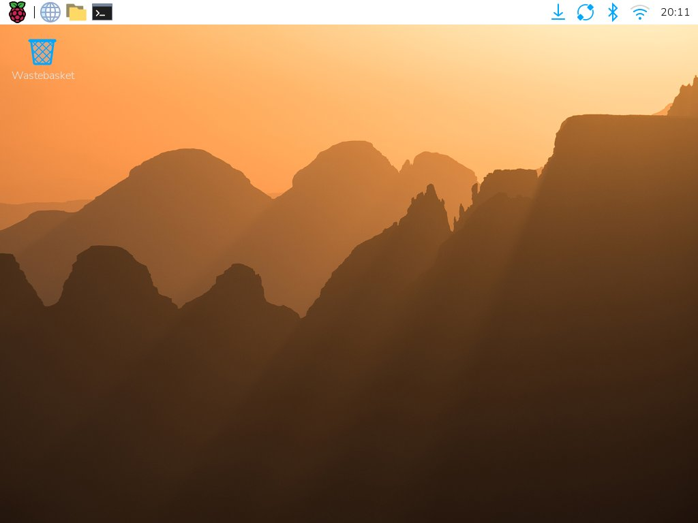
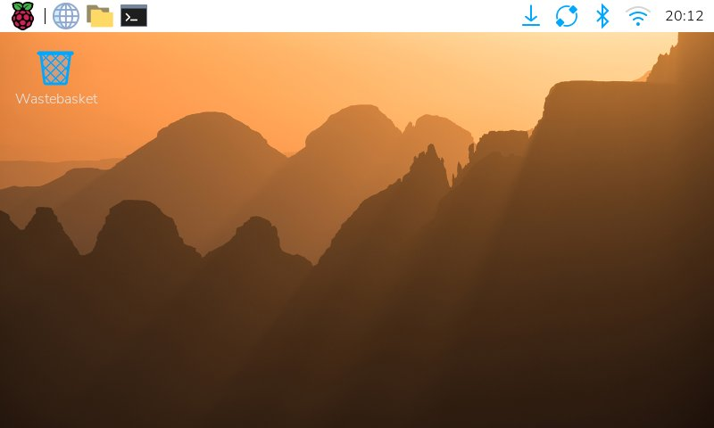
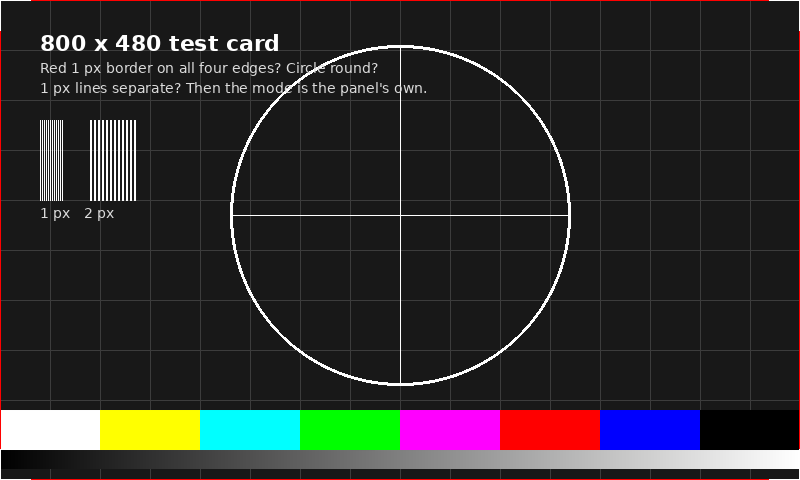
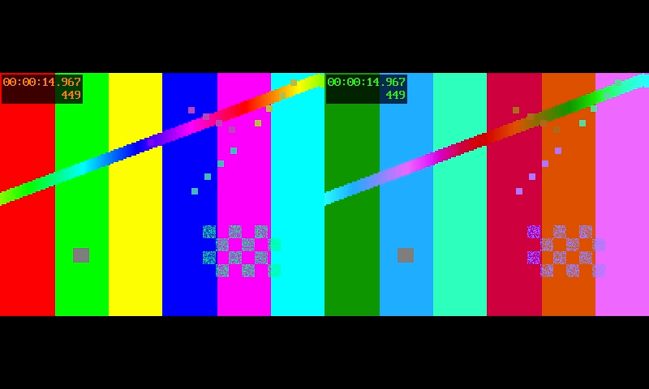

# Display bench test, 13 November 2026

The 5 in HDMI display from Amazon (the front unit's, in
[PR 189](https://github.com/vertical-cloud-lab/digital-alloy-lab/pull/189)'s design) arrived and was plugged into
the atomizer HMI Pi (`tag:rpi-5-6ktj`) with the micro-HDMI adapter. No camera was connected. Everything here was run
over SSH from a CI runner, so it tests what the Pi sends to the panel, not what the panel shows. Nobody was looking
at the panel during the test, and no camera faces it.

## What was found

| | Result |
|---|---|
| Pi | Raspberry Pi 5, **1 GB** (the BOM picks 4 GB), Debian 13 (Trixie) desktop, labwc, kernel 6.18.50 |
| Port | HDMI-A-2, the Pi's HDMI1 port (the one further from the USB-C power socket) |
| EDID | **None: 0 bytes.** The panel doesn't tell the Pi its resolution |
| Mode as found | 1024 × 768 at 60 Hz, the kernel's fallback when there is no EDID: a 4:3 picture on a 5:3, 800 × 480 panel |
| 800 × 480 | Works from the Pi's side, set at run time. The output matches the test card pixel for pixel |
| Touch | Not connected: no USB device on the Pi, so the panel's USB touch (on its micro-USB) isn't plugged into the Pi. Nothing to switch off |
| Two feeds side by side, 30 fps | 0 frames dropped in 20 s, 38 % of one core |
| Two 1080p30 H.264 encodes plus that display | Both keep up; 1 display frame dropped in 19 s; 67 % of the 4 cores; 52.7 °C, no throttling |

### No EDID, so the Pi picked 1024 × 768

`/sys/class/drm/card1-HDMI-A-2/edid` is empty, and the kernel log shows no EDID errors, so the panel most likely has
no EDID at all. That fits the Elecrow from the shopping list: its
[wiki](https://elecrow.com/wiki/rc050-5-inch-hdmi-800-x-480-capacitive-touch-lcd-display-for-raspberry-pi-pc-sony-ps4.html)
says "the resolution must be set manually, otherwise, it will be recognized as the system default resolution", and
sets it on the old firmware stack with `hdmi_cvt 800 480 60 6 0 0 0`. (With no EDID the Pi can't name the panel, so
this assumes it is that Elecrow.) With no EDID, the kernel offers only 1024 × 768, 800 × 600, 848 × 480 and
640 × 480, and the desktop came up at 1024 × 768:



Whether the panel scales 1024 × 768 down to fit or crops it isn't known from here. Either way it isn't the panel's own
mode.

### 800 × 480 at 60 Hz

```bash
WAYLAND_DISPLAY=wayland-0 XDG_RUNTIME_DIR=/run/user/$(id -u) wlr-randr --output HDMI-A-2 --custom-mode 800x480@60Hz
```

This sets the CVT timing for 800 × 480: a 29.5 MHz pixel clock, horizontal 800/24/72/96 and vertical 480/3/7/10, at
59.48 Hz (from `kmsprint`). It's the same timing as Elecrow's `hdmi_cvt` line. The desktop at 800 × 480:



The test card ([`testcard.py`](testcard.py)) has a red 1 px border on the outermost pixels, a circle, and 1 px and
2 px line pairs. Shown full screen, the frame captured back from the output with `grim` differs from the source by
at most 4 levels out of 255 (colour conversion in the player), so the Pi sends it 1:1 with nothing cropped or scaled:



**Still to check by eye:** that the panel shows all four red edges, a round circle and separate 1 px lines. If it
does, 800 × 480 is the panel's own mode.

### Frame rate and CPU, with synthetic video

[`bench.sh`](bench.sh) runs each case for 20 s. The two "camera" feeds are FFmpeg test patterns, 400 × 300 each,
side by side and shown full screen with `ffplay`. The streams are 1080p30 test patterns encoded with libx264
(`-tune zerolatency`, 4 Mb/s, a keyframe every 2 s), paced in real time. Raw output:
[`results/bench_20s.txt`](results/bench_20s.txt).

| Case | Keeps up? | Pi CPU (4 cores) | Test processes (% of one core) | Temp. |
|---|---|---|---|---|
| Display only, two feeds at 30 fps | yes, 0 frames dropped | 9 % | 38 % | 44 °C |
| 1080p30 test pattern alone, no encode | yes | 9 % | 35 % | 44 °C |
| One encode, `ultrafast` | yes | 20 % | 84 % | 44 °C |
| Two encodes, `ultrafast` | yes, both | 60 % | 238 % | 49 °C |
| Two encodes, `veryfast` | **no**: 28 fps each (0.93 ×) | 89 % | 355 % | 52 °C |
| Two encodes, `ultrafast`, plus the display | yes, both; display dropped 1 frame in 19 s | 67 % | 259 % | 53 °C |



*The display during the last case: frame 449 at 14.967 s, so it was running at 30 fps.*

What this says, and what it doesn't:
- **A 1 GB Pi 5 can show two feeds and encode two 1080p30 streams at once,** with `ultrafast`. 408 MB of RAM was in
  use after the test. `veryfast` is too slow for two streams.
- **These numbers are rough.** About 35 % of a core per stream is the synthetic pattern itself, which a camera's ISP
  would do in hardware. But real frames carry sensor noise, which makes x264 work harder, and picamera2 adds its own
  copying. It's an estimate, not a substitute for the test with cameras.
- **`ffplay` through the desktop isn't the planned viewer.** PR 189 plans picamera2's preview or a small full-screen
  viewer. The test shows only that the display path holds 30 fps while the encodes run.
- **Nothing about the cameras is tested,** since none is connected.

## What was changed on the Pi

- **The 800 × 480 mode, for the current desktop session only.** A reboot or log-out goes back to 1024 × 768. To go
  back now: `wlr-randr --output HDMI-A-2 --mode 1024x768` (with the same two variables as above).
- Nothing was installed, and no config file was changed. The test files were in `/tmp` (a tmpfs) and were deleted.

## Making 800 × 480 stick (not done, untested)

Either of these, then reboot:
- **Kernel command line,** which also fixes the text console: add `video=HDMI-A-2:800x480M@60` to the single line in
  `/boot/firmware/cmdline.txt`. `M` means CVT timing. If the panel moves to the other port (HDMI0, next to the USB-C
  socket), it's `HDMI-A-1`.
- **Desktop only:** `~/.config/kanshi/config` exists and is empty. Put this in it:
  ```
  profile {
    output HDMI-A-2 mode --custom 800x480@60Hz
  }
  ```

## Next, once a camera is connected

The Pi has to be powered off to plug the camera's ribbon in, so that's a good time to make the mode stick.
1. Run [`probe.sh`](probe.sh) again: board, mode, EDID, cameras, USB and input devices. It changes nothing and prints
   no host names or addresses.
2. Look at the test card on the panel, or point a camera at it.
3. Show the camera on the panel with picamera2's preview while it encodes a 1080p30 stream, and replace the synthetic
   numbers above with real ones.

## Rerunning

From a runner on the tailnet, with the HMI Pi's variables from CLAUDE.md:

```bash
ssh "$HMI_CAM_USERNAME@$HMI_CAM_HOSTNAME" 'bash -s' < probe.sh
python3 testcard.py testcard_800x480.png
ssh "$HMI_CAM_USERNAME@$HMI_CAM_HOSTNAME" 'mkdir -p /tmp/vpd && cat > /tmp/vpd/bench.sh' < bench.sh
ssh "$HMI_CAM_USERNAME@$HMI_CAM_HOSTNAME" \
  'export WAYLAND_DISPLAY=wayland-0 XDG_RUNTIME_DIR=/run/user/$(id -u); cd /tmp/vpd && bash bench.sh 20'
```

`bench.sh` needs `ffmpeg`, `ffplay`, `grim` and `vcgencmd`, all already on Raspberry Pi OS's desktop image.
