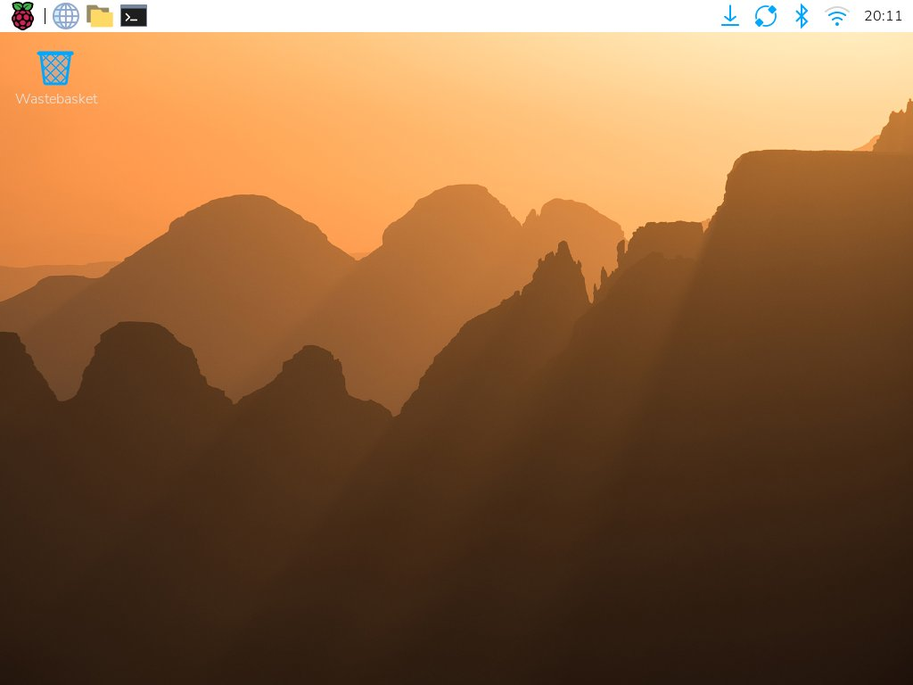
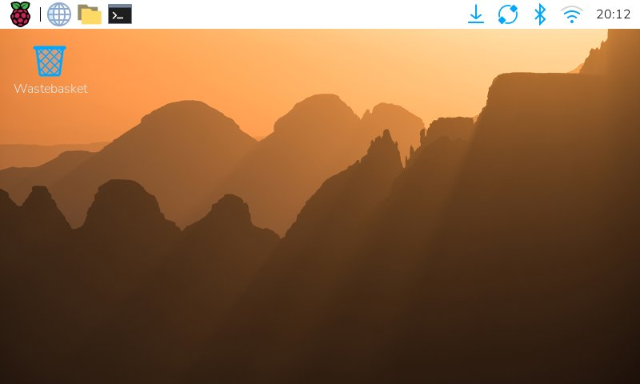
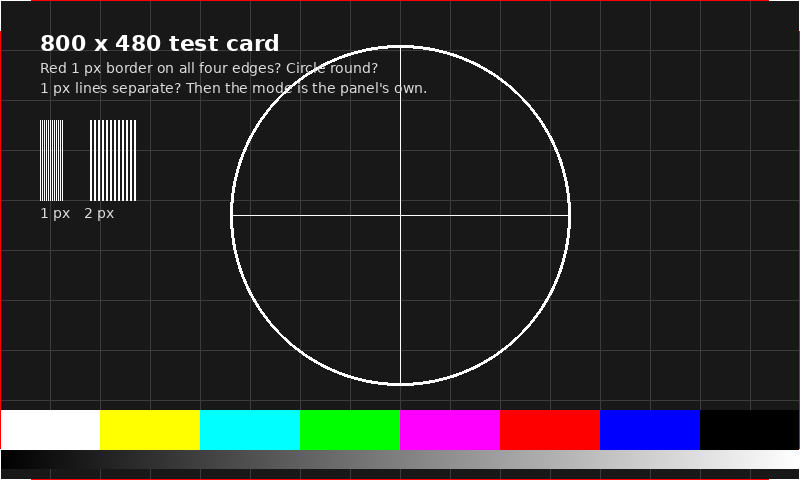
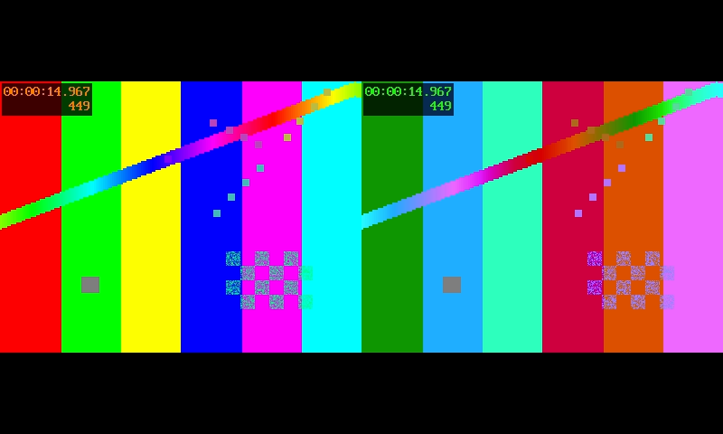

# Display bench test, 13 November 2026

The 5 in HDMI display from Amazon (the front unit's, in
[PR 189](https://github.com/vertical-cloud-lab/digital-alloy-lab/pull/189)'s design) arrived and was plugged into
the atomizer HMI Pi (`tag:rpi-5-6ktj`) with the micro-HDMI adapter. No camera was connected. Everything here was run
over SSH from a CI runner, so it tests what the Pi sends to the panel, not what the panel shows. Nobody was looking
at the panel during the test, and no camera faces it.

## What was found

| | Result |
|---|---|
| Pi | Raspberry Pi 5, **1 GB** (the BOM picks 4 GB), Debian 13 (Trixie) desktop, labwc, kernel 6.18.50 |
| Port | HDMI-A-2, the Pi's HDMI1 port (the one further from the USB-C power socket) |
| EDID | **None: 0 bytes.** The panel doesn't tell the Pi its resolution |
| Mode as found | 1024 × 768 at 60 Hz, the kernel's fallback when there is no EDID: a 4:3 picture on a 5:3, 800 × 480 panel |
| 800 × 480 | Works from the Pi's side, set at run time. The output matches the test card pixel for pixel. Set on 14 November to come up at every boot; [not yet tested by a reboot](#making-800--480-stick-applied-14-november-not-yet-rebooted) |
| Touch | Not connected: no USB device on the Pi, so the panel's USB touch (on its micro-USB) isn't plugged into the Pi. Nothing to switch off |
| Two feeds side by side, 30 fps | 0 frames dropped in 20 s, 38 % of one core |
| Two 1080p30 H.264 encodes plus that display | Both keep up; 1 display frame dropped in 19 s; 67 % of the 4 cores; 52.7 °C, no throttling |

### No EDID, so the Pi picked 1024 × 768

`/sys/class/drm/card1-HDMI-A-2/edid` is empty, and the kernel log shows no EDID errors, so the panel most likely has
no EDID at all. That fits the Elecrow from the shopping list: its
[wiki](https://elecrow.com/wiki/rc050-5-inch-hdmi-800-x-480-capacitive-touch-lcd-display-for-raspberry-pi-pc-sony-ps4.html)
says "the resolution must be set manually, otherwise, it will be recognized as the system default resolution", and
sets it on the old firmware stack with `hdmi_cvt 800 480 60 6 0 0 0`. (With no EDID the Pi can't name the panel, so
this assumes it is that Elecrow.) With no EDID, the kernel offers only 1024 × 768, 800 × 600, 848 × 480 and
640 × 480, and the desktop came up at 1024 × 768:



Whether the panel scales 1024 × 768 down to fit or crops it isn't known from here. Either way it isn't the panel's own
mode.

### 800 × 480 at 60 Hz

```bash
WAYLAND_DISPLAY=wayland-0 XDG_RUNTIME_DIR=/run/user/$(id -u) wlr-randr --output HDMI-A-2 --custom-mode 800x480@60Hz
```

This sets the CVT timing for 800 × 480: a 29.5 MHz pixel clock, horizontal 800/24/72/96 and vertical 480/3/7/10, at
59.48 Hz (from `kmsprint`). It's the same timing as Elecrow's `hdmi_cvt` line. The desktop at 800 × 480:



The test card ([`testcard.py`](testcard.py)) has a red 1 px border on the outermost pixels, a circle, and 1 px and
2 px line pairs. Shown full screen, the frame captured back from the output with `grim` differs from the source by
at most 4 levels out of 255 (colour conversion in the player), so the Pi sends it 1:1 with nothing cropped or scaled:



**Still to check by eye:** that the panel shows all four red edges, a round circle and separate 1 px lines. If it
does, 800 × 480 is the panel's own mode.

### Frame rate and CPU, with synthetic video

[`bench.sh`](bench.sh) runs each case for 20 s. The two "camera" feeds are FFmpeg test patterns, 400 × 300 each,
side by side and shown full screen with `ffplay`. The streams are 1080p30 test patterns encoded with libx264
(`-tune zerolatency`, 4 Mb/s, a keyframe every 2 s), paced in real time. Raw output:
[`results/bench_20s.txt`](results/bench_20s.txt).

| Case | Keeps up? | Pi CPU (4 cores) | Test processes (% of one core) | Temp. |
|---|---|---|---|---|
| Display only, two feeds at 30 fps | yes, 0 frames dropped | 9 % | 38 % | 44 °C |
| 1080p30 test pattern alone, no encode | yes | 9 % | 35 % | 44 °C |
| One encode, `ultrafast` | yes | 20 % | 84 % | 44 °C |
| Two encodes, `ultrafast` | yes, both | 60 % | 238 % | 49 °C |
| Two encodes, `veryfast` | **no**: 28 fps each (0.93 ×) | 89 % | 355 % | 52 °C |
| Two encodes, `ultrafast`, plus the display | yes, both; display dropped 1 frame in 19 s | 67 % | 259 % | 53 °C |



*The display during the last case: frame 449 at 14.967 s, so it was running at 30 fps.*

What this says, and what it doesn't:
- **A 1 GB Pi 5 can show two feeds and encode two 1080p30 streams at once,** with `ultrafast`. 408 MB of RAM was in
  use after the test. `veryfast` is too slow for two streams.
- **These numbers are rough.** About 35 % of a core per stream is the synthetic pattern itself, which a camera's ISP
  would do in hardware. But real frames carry sensor noise, which makes x264 work harder, and picamera2 adds its own
  copying. It's an estimate, not a substitute for the test with cameras.
- **`ffplay` through the desktop isn't the planned viewer.** PR 189 plans picamera2's preview or a small full-screen
  viewer. The test shows only that the display path holds 30 fps while the encodes run.
- **Nothing about the cameras is tested,** since none is connected.

## What was changed on the Pi

- **13 November: the 800 × 480 mode, for the current desktop session only,** set with `wlr-randr`. Nothing was
  installed and no config file was changed. The test files were in `/tmp` (a tmpfs) and were deleted.
- **14 November: two config files, so that 800 × 480 comes up at every boot.** See the next section. Nothing was
  installed, and the helper script copied to `/tmp` was deleted.

## Making 800 × 480 stick (applied 14 November, not yet rebooted)

Applied over SSH on 14 November 2026, after Sterling's go-ahead in
[PR 258](https://github.com/vertical-cloud-lab/digital-alloy-lab/pull/258). It takes two changes, because the console
and the desktop each pick their own mode:

- **Kernel command line, for the text console.** `video=HDMI-A-2:800x480M@60` was added to the end of the single line
  in `/boot/firmware/cmdline.txt`, which went from 176 to 203 bytes, still one line. `M` means CVT timing. The
  original is kept next to it as `/boot/firmware/cmdline.txt.bak-2026-11-14`. If the panel moves to the other port
  (HDMI0, next to the USB-C socket), change the entry to `HDMI-A-1`.
- **A kanshi profile, for the desktop.** `~/.config/kanshi/config`, which was empty, now reads:
  ```
  profile {
  	output HDMI-A-2 mode --custom 800x480@60Hz
  }
  ```
  (plus three comment lines saying why). labwc starts kanshi from `/etc/xdg/labwc/autostart` at every login, and the
  desktop logs in automatically.

**Why it takes both.** The `video=` entry adds an 800 × 480 mode to the kernel's list for HDMI-A-2, and the console
uses it. But the kernel marks that mode only as user-defined, not as preferred
([`drm_probe_helper.c`](https://github.com/raspberrypi/linux/blob/rpi-6.18.y/drivers/gpu/drm/drm_probe_helper.c#L146-L183)).
With no EDID, no mode is preferred, so labwc (wlroots 0.20, including Raspberry Pi's patches) starts in the first one,
the largest: 1024 × 768. kanshi then switches it. The console's and the desktop's 800 × 480 timings differ slightly.
The kernel's CVT gives 800 × 480 a 10-line vertical sync, and wlroots gives it a 7-line one (they disagree on whether
800 × 480 counts as 15:9). The pixel clock (29.5 MHz) and totals (992 × 500) are the same. The desktop uses the
wlroots timing, the same one the test card was shown at on 13 November.

**Tested live: the kanshi profile.** With the desktop switched to 1024 × 768, sending kanshi `SIGHUP` (which makes it
reread its config) put it back to 800 × 480 at 29.5 MHz, 800/24/72/96 and 480/3/7/10, the same as before.

**Not tested: a reboot.** The Claude session that made the changes couldn't reboot the Pi: its permission check
blocked the `systemctl reboot` sent over SSH. So neither change has been through a boot yet. The next boot is the
test, for example when the Pi is powered off to plug the camera in, or when the 4 GB Pi takes over: both changes are
on the SD card, so they go with it. After that boot,
[`probe.sh`](probe.sh) should show:
- `video=HDMI-A-2:800x480M@60` on the kernel command line, and `800x480` in HDMI-A-2's mode list
- `800x480@59.48 29.500` as the KMS mode, and `800x480 px` as the current Wayland mode
- `fb0 800x480` as the console framebuffer. Before the change it was `fb0 1024x768`

(`probe.sh` gained the framebuffer line on 14 November, so `results/probe.txt` from the day before doesn't have it.)

**To undo:**
- Console: `sudo cp /boot/firmware/cmdline.txt.bak-2026-11-14 /boot/firmware/cmdline.txt`, then reboot.
- Desktop: empty the profile with `: > ~/.config/kanshi/config` and log in again. To go back straight away, run
  `wlr-randr --output HDMI-A-2 --mode 1024x768` (with the same two variables as above).

Raspberry Pi's Screen Configuration tool writes `~/.config/kanshi/config` when you save a layout in it, keeping the
previous file as `config.bak`. So setting the screen there replaces this profile.

## Next, once a camera is connected

The Pi has to be powered off to plug the camera's ribbon in, so that boot is also the first test of the 800 × 480
settings above.
1. Run [`probe.sh`](probe.sh) again: board, mode, EDID, cameras, USB and input devices. It changes nothing and prints
   no host names or addresses. Check the display lines against the list above.
2. Look at the test card on the panel, or point a camera at it.
3. Show the camera on the panel with picamera2's preview while it encodes a 1080p30 stream, and replace the synthetic
   numbers above with real ones.

## Rerunning

From a runner on the tailnet, with the HMI Pi's variables from CLAUDE.md:

```bash
ssh "$HMI_CAM_USERNAME@$HMI_CAM_HOSTNAME" 'bash -s' < probe.sh
python3 testcard.py testcard_800x480.png
ssh "$HMI_CAM_USERNAME@$HMI_CAM_HOSTNAME" 'mkdir -p /tmp/vpd && cat > /tmp/vpd/bench.sh' < bench.sh
ssh "$HMI_CAM_USERNAME@$HMI_CAM_HOSTNAME" \
  'export WAYLAND_DISPLAY=wayland-0 XDG_RUNTIME_DIR=/run/user/$(id -u); cd /tmp/vpd && bash bench.sh 20'
```

`bench.sh` needs `ffmpeg`, `ffplay`, `grim` and `vcgencmd`, all already on Raspberry Pi OS's desktop image.
