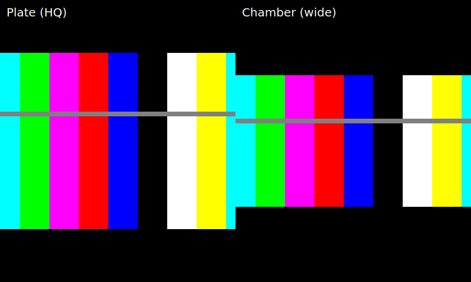

# Viewport camera viewer

Puts each viewport unit's camera picture full screen on the unit's own display, from boot on, so the operator sees
the plate next to the window ([PR 189](https://github.com/vertical-cloud-lab/digital-alloy-lab/pull/189)'s design).
It records nothing and streams nothing. Streaming to YouTube is a later step.

- [`viewer.py`](viewer.py) shows one or two cameras with picamera2 and PyQt5 (or PyQt6). With two cameras it puts
  them side by side on a landscape panel, or one above the other on a portrait panel.
- [`install.sh`](install.sh) makes it a systemd user service for the desktop user, so it starts at every boot. It
  needs no root, installs no package, and writes only to `~/.config` and `~/.local/share`.

This is what the front unit's 5 in panel should look like, with test patterns standing in for the cameras (rendered
on a CI runner, not on the Pi):



- **Each tile shows its camera's whole field of view at 30 fps.** That means the HQ's 2028 × 1520 sensor mode and
  the Module 3's 2304 × 1296 mode. Left to choose for itself, libcamera would pick the cropped high-speed modes
  for a picture this small.
- **A tile shows a red note** if its camera is missing, fails to open, or stops sending frames.
- **It restarts itself** if a camera fails or sends nothing for 30 s: the viewer exits and systemd starts it again
  5 s later.
- **A camera that wasn't there at boot stays missing.** Cameras are only found at boot, so after plugging one in,
  power the Pi off and on again.

## Plugging in

**Power the Pi off before plugging or unplugging any ribbon cable.**

| Unit | Pi | Cameras | Display | Viewer settings |
|---|---|---|---|---|
| **Front** (round port, looks down at the plate) | The HMI Pi, the one the 5 in HDMI panel is on. It already has the panel's 800 × 480 settings. | HQ Camera M12 and Camera Module 3 Wide, one in each CAM/DISP port | 5 in HDMI panel, on **HDMI1**: the micro-HDMI port further from the USB-C socket. It takes 5 V from one of the Pi's USB ports. | `--cameras imx477 imx708` (HQ on the left) |
| **Left** (door sight glass, side view of nozzle and plate) | not chosen yet | Camera Module 3 Wide in **CAM/DISP 0** | Touch Display 2 (5 in) in **CAM/DISP 1**, with its red 5 V lead on GPIO pin 2 and black on pin 6 | `--rotate 90` or `270` (the panel is 720 × 1280, portrait) |
| **Top** (furnace lid window) | not chosen yet | HQ Camera (C/CS) with the 16 mm lens in **CAM/DISP 0** | Waveshare 2.8 in DSI in **CAM/DISP 1** | `--rotate 90` or `270` (480 × 640, portrait) |

- **Cables.** The Pi 5's two CAM/DISP connectors are the narrow 22-pin kind. The cable in a camera's box is
  the 15-pin one for older Pis, so a Pi 5 needs a
  [Standard–Mini camera cable](https://www.raspberrypi.com/products/camera-cable/) (200, 300 or 500 mm). Raspberry Pi's
  [camera install guide](https://www.raspberrypi.com/documentation/accessories/camera.html#install-a-raspberry-pi-camera)
  shows which way the contacts face. The Touch Display 2 comes with its own Pi 5 cable, and Raspberry Pi's
  [guide](https://www.raspberrypi.com/documentation/accessories/touch-display-2.html) covers it and its power lead.
  A Pi 5 detects the Touch Display 2 by itself. The Waveshare panel also needs a line in `config.txt`, which the
  set-up run adds.
- **Power.** Use a 27 W (5 V, 5 A) USB-C supply for each Pi. This matters most for the front unit, which runs two
  cameras and powers the panel from a USB port. On a 3 A supply, the Pi limits all its USB ports together to 600 mA.
- **Network.** Each Pi has to be on the network. It rejoins the tailnet by itself once it boots. If you move the HMI
  Pi's SD card into the 4 GB Pi, the panel settings and the tailnet identity go with it.
- **Label each Pi** with its unit, and say in the PR which is which.

## Setting it up

Once the Pi is on the tailnet with its cameras in, a `@claude` run does this from CI, using the Pi's variables in
CLAUDE.md (here, the HMI Pi's for the front unit):

```bash
P="$HMI_CAM_USERNAME@$HMI_CAM_HOSTNAME"
ssh "$P" 'bash -s' < ../bench/2026-11-13-display/probe.sh          # cameras, display, read-only
ssh "$P" 'mkdir -p /tmp/vpv && cat > /tmp/vpv/viewer.py' < viewer.py
ssh "$P" 'cat > /tmp/vpv/install.sh' < install.sh
ssh "$P" 'bash /tmp/vpv/install.sh --cameras imx477 imx708 --labels "Plate (HQ)" "Chamber (wide)"'
ssh "$P" 'WAYLAND_DISPLAY=wayland-0 XDG_RUNTIME_DIR=/run/user/$(id -u) grim -o HDMI-A-2 -' > panel.png   # what the panel shows
```

`install.sh` copies `viewer.py` to `~/.local/share/viewport-viewer/`, so `/tmp/vpv` can go afterwards. Running it
again replaces the settings, and `bash install.sh --uninstall` removes it all. Other options:

- `--no-blanking` (for `install.sh`): stops the desktop blanking the screen after 10 minutes without input. It does
  what Raspberry Pi Configuration's *Screen Blanking: off* does for that user: it deletes the `swayidle` line from
  `~/.config/labwc/autostart`, keeping a copy of the old file. The installer reports whether blanking is on.
- `--rot180 imx708`: turns one camera's picture upside down, for a camera mounted that way.
- `--control ExposureTime=2000 --control AnalogueGain=1.0`: fixes the exposure instead of leaving it automatic,
  for example if the glow of the melt makes the picture pump.
- `python3 viewer.py --help` lists the rest.

On the Pi: `systemctl --user status viewport-viewer` shows its state, and `journalctl --user -u viewport-viewer`
shows its log, with each camera's measured frame rate once a minute. `systemctl --user stop viewport-viewer` frees
the cameras (for `rpicam-still`, say) until the next boot or `start`.

Frames from these cameras stay off the issue tracker unless someone asks for them, since this repo is public.

## What has been tested

Only on a CI runner, so far: no Pi, no camera and no labwc.

- **Drawing, under PyQt5 5.15 and PyQt6 6.12.** Raspberry Pi OS installs PyQt5 alongside picamera2. With test
  patterns, the layouts come out right on 800 × 480 with two cameras, 1280 × 720, 720 × 1280 with `--rotate 90`,
  480 × 640 with `--rotate 270`, and 480 × 800 with two cameras stacked.
- **The camera code, against a stand-in for picamera2.** The stand-in has the real IMX477 and IMX708 sensor-mode
  lists.
  - The viewer picks 2028 × 1520 and 2304 × 1296, and matches cameras by model in the order given.
  - A missing camera gets a note in its tile, and the viewer keeps running.
  - A camera that is busy, or stops sending frames, makes the viewer exit with status 1.
  - `SIGTERM` stops it cleanly.
- **`install.sh`, under a real systemd user manager**, with a virtual X display:
  - The service starts with no `DISPLAY` in its environment and finds the display itself.
  - Started before the display exists, it waits for it.
  - After `kill -9`, systemd starts it again.
  - Arguments with spaces, quotes, `$` and `%` reach the viewer unchanged.
  - `--uninstall` removes everything.

This run fixed one bug the test found: without a window manager the window didn't go full screen, and the second
tile was cut off. On the Pi, labwc handles full screen anyway.

**Likely snag on the Pi:** Raspberry Pi OS doesn't install Qt 5's Wayland plugin (`qtwayland5`), so PyQt5 will draw
through Xwayland. The viewer looks for both displays. If the journal says Qt can't connect to a display,
`sudo apt install qtwayland5` gives it the Wayland route.
