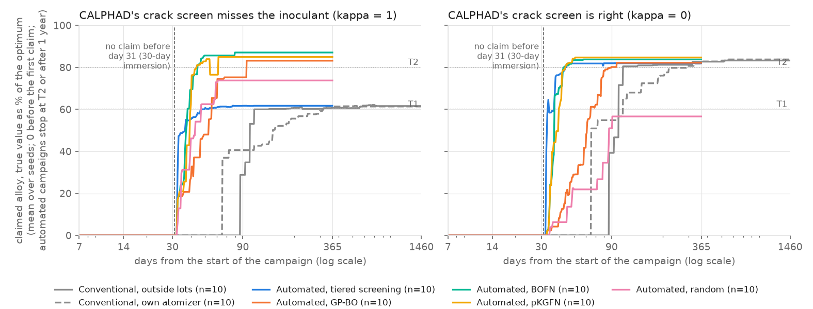
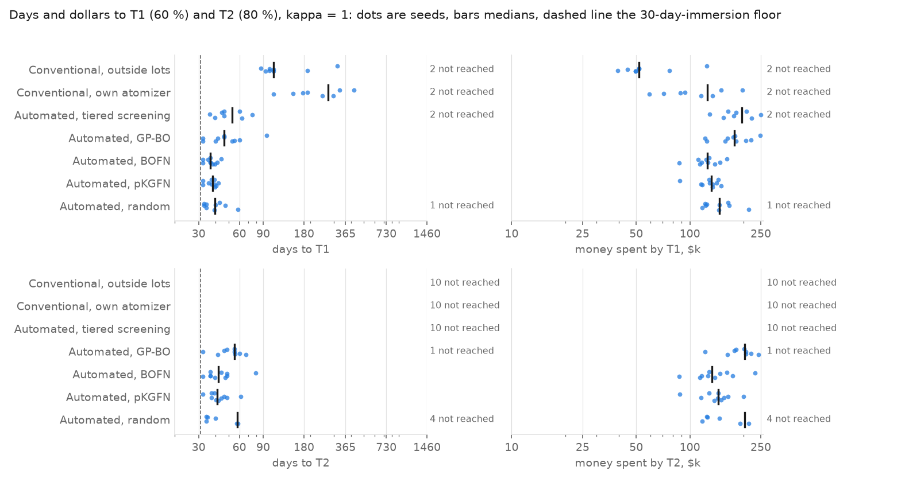

# bofn-clocked: days and dollars to a discovered alloy, on a clocked synthetic lab

Issue 283. This is bofn-prelim's alloy network with a clock on it. Stations have capacities, calendars, lead times
and turnaround. Measurements are noisy, and powders, builds and bars can fail. Evaluation is asynchronous and can stop
early, with pending work, interim immersion readings and queues. There are several routes per stage, records that
carry over between campaigns and labs, and a corrosion test that every discovery has to pass. Wall time to discovery
is the headline, and money is the budget.

**Everything here is synthetic.** The truth is invented, the instruments are noise models, and the durations,
capacities and prices are assumptions. The results say how policies, routes and records interact *in this model*.

- What each experiment was meant to show was written down and committed before any run:
  [`PREREGISTRATION.md`](PREREGISTRATION.md). That file also lists everything changed afterwards, with the reason.
- The model, every assumption and its source: [`MODEL.md`](MODEL.md).
- All tables: [`results/summary.md`](results/summary.md), generated by [`analyze.py`](analyze.py) from one JSON file
  per campaign.

## Bottom line

- **Neither "ten times faster" nor "a tenth of the cost" holds against a baseline that gets there.** The automated
  lab reached T1 (60 % of the optimum) and T2 (80 %) in 36-42 days (median, BOFN). The conventional baseline with
  outside powder lots took 90-107 days to T1. That is 2.5-2.9× faster, and the automated lab spent 2.2-2.5× *more*
  money getting there ($108-125k against $49-51k). Against the conventional baseline that uses DAL's own atomizer on
  DAL #256's schedule, the automated lab was 1.8-7.4× faster. No seed of any automated policy reached T1 in a tenth of a conventional
  baseline's median time, and none reached any target for a tenth of its money.
- **The 30-day immersion sets the floor.** Every claim needs a passed 30-day corrosion test, so nothing can be
  claimed before day 31. The fastest policies sat at 37-42 days. Against a baseline that gets there in its first
  round (about 100 days), the best possible ratio is about 3×. Ten times needs a baseline that takes 300+ days.
- **Ten times happens only where the baseline never arrives.** When CALPHAD's screen misses the inoculant
  (`kappa = 1`), neither conventional baseline reached T2 in four years, and neither did tiered screening on the
  automated lab in one. BOFN and pKGFN reached T2 on every seed (median 41-42 days), so they "reached a tenth" on
  every seed. That says the screen can't find the alloy, not that the lab is ten times faster.
- **The lab, not the algorithm, buys most of the days.** The same tiered screening was 60-69 days sooner to T1 on
  the automated lab than with outside lots, on every seed that got there. In E2, the in-house printer and bars running
  round the clock cut BOFN's time to T1 by 115 ± 37 days against today's stations, sooner on 10 of 10 seeds. The partner's
  printer added nothing once the in-house one ran round the clock.
- **The algorithm buys the alloy the screen can't see, and it saves money.** At `kappa = 1`, BOFN reached T1 sooner
  than tiered screening on the same lab on 10 of 10 seeds. The medians were 37 days against 53; the mean gap of
  77 ± 41 days counts tiered screening's 2 seeds that never got there at its one-year horizon. It was cheaper by
  $65k ± 12k on the 8 seeds where both got there (8 of 8). It reached T2, which tiered screening never did. It beat
  GP-BO by 13 ± 6 days to T1 (p = 0.016) and $52k ± 12k (p = 0.002).
- **Where the network methods don't win:**
  - At `kappa = 0` (the screen is right), tiered screening on the automated lab reached T1 4 ± 1 days *sooner* than
    BOFN, on 10 of 10 seeds (p = 0.002). BOFN was level on time to T2 (−32 ± 33 days, p = 0.49) and $18-39k
    cheaper.
  - pKGFN, even after the fix, did no better than BOFN anywhere. On 64-71 % of its decisions every KG was flat, and
    its EI-per-cost fallback decided.
  - Another lab's data (E3a) didn't help in days, pooled naively or with site terms.
  - Ordering the production lot early (E2b) didn't confirm sooner.
- **Provenance pays in money, and the immersion floor caps what it can save in days.** Over three campaigns with
  changing goals (E3b), keeping node-level records reached T2 for about $50k less than starting cold or than keeping
  the usual final-result records ($48-56k on matched seeds, p ≤ 0.039; 8 of 8 seeds against the poor records). It cut
  the long tail of slow campaigns: day 37 ± 1 against 59 ± 15 in the third campaign. Poorly documented history was
  no better than none.
- **pKGFN (E4).** bofn-prelim's pKGFN doesn't have round 3's zero incumbent, but it shows the same symptom. KG of a
  tensile test was exactly 0 for 73 % of candidates, so it kept printing a few powders. The composition restriction
  wasn't the limit. Its own any-alloy variant fixes it.
- **Moving to production powder (E2b) adds about three months.** A claim confirmed on a gas-atomized lot printed on
  the partner's machine came at day 133-142 (median), against day 37-42 for the claim itself.
- **Stretch (E5).** Over three alloy families whose best alloys lie between them, one search across all six elements
  was 18-22 points of the optimum ahead of the best single-family campaign at days 60-180 (8 of 8 seeds). The truth
  was built that way.

**A claim the model supports, with its conditions:**

> In a synthetic, noisy benchmark where a discovery needs three tensile bars and a passed 30-day immersion, an
> automated lab with in-house powder, printing and testing reached 60-80 % of the optimum in about 40 days, 2.5-3×
> sooner than a conventional campaign with outside powder lots (about 100 days) but at 2-2.5× its marginal cost. It
> was ten times faster only where the conventional screen never found the alloy at all; network BO found that alloy
> on every seed, and tiered screening on the same lab never did.

## E1. Days and dollars to T1 and T2, against the conventional baselines

`kappa = 1` (CALPHAD's crack screen misses the inoculant) and `kappa = 0` (it doesn't), 10 seeds each. Budget
$250k. Horizons are 1 year (automated) and 4 years (conventional). Automated campaigns stop at T2.



*The claimed alloy's true value against days (log scale), mean over 10 seeds. Each campaign claims a coupon with 3
bars and a passed 30-day immersion; before its first claim it counts as 0. Automated campaigns stop at T2 or after a
year (their lines end at day 365); the conventional ones run four years or until the money runs out.*

**`kappa = 1`**

| Lab and policy | T1 reached | days to T1, median (mean ± SE) | $k to T1 | T2 reached | days to T2, median (mean ± SE) | $k to T2 |
|---|---|---|---|---|---|---|
| Conventional, outside powder lots | 8/10 | 107 (402 ± 178) | 51 | 0/10 | >1460 | – |
| Conventional, own atomizer (DAL #256 schedule) | 8/10 | 272 (484 ± 165) | 105 | 0/10 | >1460 | – |
| Automated lab, tiered screening | 8/10 | 53 (114 ± 42) | 179 | 0/10 | >365 | – |
| Automated lab, GP-BO | 10/10 | 46 (50 ± 6) | 177 | 9/10 | 55 (83 ± 32) | 201 |
| Automated lab, BOFN | 10/10 | 37 (37 ± 1) | 125 | 10/10 | 42 (45 ± 4) | 133 |
| Automated lab, pKGFN (fixed) | 10/10 | 38 (38 ± 1) | 132 | 10/10 | 41 (43 ± 3) | 144 |
| Automated lab, random | 9/10 | 40 (73 ± 33) | 146 | 6/10 | 58 (172 ± 53) | 136 |

**`kappa = 0`**

| Lab and policy | T1 reached | days to T1, median (mean ± SE) | $k to T1 | T2 reached | days to T2, median (mean ± SE) | $k to T2 |
|---|---|---|---|---|---|---|
| Conventional, outside powder lots | 10/10 | 90 (93 ± 3) | 49 | 9/10 | 100 (297 ± 137) | 49 |
| Conventional, own atomizer (DAL #256 schedule) | 10/10 | 65 (97 ± 16) | 42 | 9/10 | 265 (404 ± 127) | 95 |
| Automated lab, tiered screening | 10/10 | 32 (33 ± 0) | 127 | 9/10 | 42 (73 ± 32) | 156 |
| Automated lab, GP-BO | 10/10 | 59 (60 ± 3) | 184 | 9/10 | 79 (104 ± 29) | 246 |
| Automated lab, BOFN | 10/10 | 36 (37 ± 1) | 108 | 10/10 | 40 (41 ± 2) | 109 |
| Automated lab, pKGFN (fixed) | 10/10 | 39 (38 ± 1) | 106 | 10/10 | 40 (42 ± 2) | 108 |
| Automated lab, random | 6/10 | 86 (188 ± 49) | 244 | 0/10 | >365 | – |

Means count a campaign that never got there at its horizon. Money is the median over the seeds that got there.

**Reaching a tenth.** This is the fraction of each policy's seeds at or under a tenth of a conventional baseline's
median.
- **Days to T1:** 0 % for every automated policy against both baselines, at both `kappa`. The bootstrap intervals
  against the own-atomizer baseline at `kappa = 1` reach up to 0-100 %, because 2 of its seeds never got there and
  its median moves a lot between draws.
- **Money to T1 or T2:** 0 % everywhere.
- **Days to T2 at `kappa = 1`:** BOFN 100 %, pKGFN 100 %, GP-BO 90 %, random 60 %. The baselines never got there,
  so their four-year horizon stands in for their time, which makes these lower bounds.
- **Days to T2 at `kappa = 0`:** 0 % for every policy.

The full table, with 90 % bootstrap intervals, is in [`results/summary.md`](results/summary.md).

**Paired differences on matched seeds** (A − B; days are censored at the horizon; money is over the seeds where both
got there; two-sided Wilcoxon signed-rank):

| `kappa` | A | B | target | days, A − B | A sooner / later | p | $k, A − B | p |
|---|---|---|---|---|---|---|---|---|
| 1 | BOFN | tiered, same lab | T1 | −77 ± 41 | 10 / 0 | 0.002 | −65 ± 12 | 0.008 |
| 1 | BOFN | GP-BO | T1 | −13 ± 6 | 7 / 1 | 0.016 | −52 ± 12 | 0.002 |
| 1 | BOFN | GP-BO | T2 | −38 ± 33 | 6 / 3 | 0.20 | −47 ± 16 | 0.027 |
| 1 | pKGFN | BOFN | T2 | −2 ± 4 | 4 / 5 | 0.91 | +0 ± 12 | 0.63 |
| 1 | tiered, automated lab | conventional, outside lots | T1 | −69 ± 26 | 8 / 0 | 0.008 | +125 ± 20 | 0.008 |
| 0 | BOFN | tiered, same lab | T1 | **+4 ± 1** | 0 / 10 | 0.002 | −18 ± 8 | 0.049 |
| 0 | BOFN | tiered, same lab | T2 | −32 ± 33 | 6 / 4 | 0.49 | −39 ± 13 | 0.039 |
| 0 | BOFN | GP-BO | T2 | −63 ± 27 | 10 / 0 | 0.002 | −116 ± 12 | 0.004 |
| 0 | pKGFN | BOFN | T2 | +1 ± 2 | 4 / 5 | 0.57 | −1 ± 11 | 0.77 |
| 0 | tiered, automated lab | conventional, outside lots | T2 | −114 ± 47 | 9 / 0 | 0.004 | +81 ± 17 | 0.012 |

With 10 seeds the smallest possible two-sided Wilcoxon p is 0.002 (all ten pairs one way). So no single test
survives a Bonferroni correction across E1's 32 paired day tests (0.05 / 32 ≈ 0.0016). Read the p-values as
descriptive; the sign counts (10 of 10, 8 of 8) are the stronger evidence. Means that include a campaign that never
got there count it at the horizon, so read them alongside the medians in the tables above.



*Days (left) and money (right) to T1 (top) and T2 (bottom) at `kappa = 1`, one dot per seed; bars are medians when
more than half the seeds got there. The same at `kappa = 0`: [`clocked_days_dollars_k0.png`](clocked_days_dollars_k0.png).*

**Why the automated lab spends more.** It doesn't wait. Every policy keeps about three powders and four builds in
flight, and during the 30-day immersion it keeps making and testing candidates. That is what makes it fast, and it
costs money. To T2 at `kappa = 1`, BOFN made 55 powders and 73 builds and tested 179 bars ($142k on average). The
conventional baseline with outside lots made 4 lots and 72 builds over four years. The automated lab could spend less
by waiting more; the benchmark doesn't map that trade-off yet. (Over its four years, the conventional baseline
spent its whole $250k without reaching T2.)

## E2. Routes: in-house and partner printing, today's stations

`kappa = 1`, BOFN and tiered screening, 10 seeds, all with asynchronous decisions:
- `nearterm` is today's stations: the atomizer runs Mon-Thu on DAL #256's schedule, the partner prints everything,
  and an outside EDM cuts the bars.
- `vertical_ih` has the in-house printer only.
- `vertical` (E1) has both printers.

| Lab and policy | T1 reached | days to T1, median | T2 reached | days to T2, median |
|---|---|---|---|---|
| Today's stations, BOFN | 8/10 | 95 | 4/10 | >365 |
| Today's stations, tiered screening | 6/10 | 111 | 0/10 | >365 |
| In-house printer only, BOFN | 10/10 | 37 | 10/10 | 42 |
| In-house and partner printers, BOFN | 10/10 | 37 | 10/10 | 42 |

- Today's stations took 115 ± 37 days longer to T1 than the automated lab (BOFN; later on 10 of 10 seeds,
  p = 0.002) and 213 ± 47 days longer to T2. Tiered screening on today's stations was 80 ± 37 days slower than on the
  automated lab.
- The partner's printer added nothing once the in-house one ran round the clock: +1 ± 1 day to T1 without it
  (p = 0.67).
- On today's stations, BOFN against tiered screening: −42 ± 70 days to T1 (p = 0.63), and T2 on 4 seeds against
  none.

### E2b. Moving to production powder: confirmation on a gas-atomized lot at the partner

Discovery here uses small ultrasonic lots. A qualification-track claim needs the alloy on production-representative
powder from a second machine, so E2b adds that step. It orders a gas-atomized lot (outside, 30-day booking lead and
21-day turnaround, one run a month, $20k assumed) and prints it on the partner's machine. Then the same claim rule
applies (3 bars and a passed 30-day immersion). The partner's machine and gas powder both shift the laser ridge, and
the network learns that shift from the first confirmation build (route and machine are inputs of the density node).
Discovery stops once an alloy is claimed and its production lot is on order. BOFN, `kappa = 1`, 10 seeds.

| Ordering rule | days to T1 / T2, median | days to confirmed T1 / T2, median (reached) | $k to confirmed T2 |
|---|---|---|---|
| order after the claim | 37 / 42 | 133 (10/10) / 142 (10/10) | 182 |
| order early (3 bars at the top + a passing day-7 reading) | 37 / 42 | 140 (9/10) / 156 (9/10) | 169 |

- **Confirmation takes about three more months.** The gas lot alone takes 51 days, then comes the partner's 7-day
  booking lead and build, then another 30-day immersion.
- **Ordering early didn't help** (the pre-registered expectation wasn't met). It confirmed T2 18 ± 27 days *later*
  on average (sooner on 5 seeds, later on 5, p = 0.92), and on 9 of 10 seeds instead of 10.
  - The trigger fires only a couple of weeks before the claim anyway.
  - When the early candidate isn't the alloy that gets claimed, the second lot waits for the supplier's next monthly
    slot.
  - A slot booked in advance and filled with whatever is best on the day the run starts is the version to test next.

## E3. The value of provenance

### E3a. Another lab's data

`kappa = 1`, BOFN, 10 seeds. Every campaign starts with records of 8 alloys (6 coupons each, bars on the two
densest) from another lab. That lab's printer runs on a ridge shifted by ±0.08 and reads 0.03 less dense, and its
frames read 0.04 high. There are also two reference alloys both labs have made. The models compared:
- `separate`: ignore the other lab;
- `naive`: pool its data as if it were your own;
- `site`: pool it with a per-site offset on the density and strength nodes, and the other printer as its own
  machine.

| Model | days to T1, median (mean ± SE) | days to T2, median (mean ± SE) |
|---|---|---|
| separate | 38 (38 ± 1) | 39 (39 ± 1) |
| naive | 36 (37 ± 1) | 36 (38 ± 1) |
| site | 35 (37 ± 1) | 36 (37 ± 1) |

**No measurable effect either way.** The pre-registered expectation was that naive pooling would mislead, and it
didn't.
- `site` against `separate`: −2 ± 2 days to T2 (p = 0.20).
- `naive` against `separate`: −2 ± 1 days (p = 0.055).
- Money differed by less than $10k.

Three reasons:
- The 30-day floor leaves only a few days to save.
- The other lab's alloys are random, so they say little about where the optimum is.
- The automated lab makes hundreds of its own coupons within weeks, which swamps 48 outside ones.

A slower lab (today's stations) or outside data concentrated near good alloys is where this would show; neither
was run.

### E3b. A time machine: building on your own well-documented records

There are three campaigns in a row on the same physics (`kappa = 1`), each with a different goal: mineral weight
0.3, then 0.6, then 0.1 with a tighter corrosion limit. Each goal has its own optimum, so T1 and T2 move. The lab's
density and strength readings drift between campaigns (N(0, 0.03) each). Every campaign re-makes two reference alloys
at random days in its first month, so the repeats are shuffled through time. Campaign 0 is shared; campaigns 1 and 2
run under three histories, with 8 seeds each:
- `none`: every campaign starts cold.
- `documented`: every node-level record of the earlier campaigns (powder quality, each coupon's laser settings and
  density, each bar, each immersion reading), labelled by campaign. A per-campaign offset on the density and strength
  nodes is pinned down by the repeats.
- `poor`: the same experiments recorded the usual way. Laser and atomizer settings weren't written down (nominal
  values are filled in), there are no campaign labels, only the parts that worked are kept (density ≥ 0.8 and their
  bars), and only final corrosion results.

| History | campaign | days to T1, median (mean ± SE) | $k to T1 | days to T2, median (mean ± SE) | $k to T2 |
|---|---|---|---|---|---|
| (shared) | 0 | 37 (37 ± 2) | 132 | 38 (40 ± 2) | 140 |
| none | 1 | 36 (37 ± 2) | 124 | 41 (52 ± 8) | 144 |
| documented | 1 | 34 (35 ± 1) | 97 | 40 (41 ± 2) | 99 |
| poor | 1 | 36 (37 ± 1) | 129 | 44 (46 ± 3) | 152 |
| none | 2 | 39 (41 ± 3) | 136 | 43 (59 ± 15) | 150 |
| documented | 2 | 35 (35 ± 1) | 105 | 35 (37 ± 1) | 111 |
| poor | 2 | 36 (37 ± 2) | 122 | 42 (47 ± 5) | 141 |

- **Documented history pays mostly in money.** Against starting cold it reached T2 for $56k ± 17k less in campaign 1
  and $48k ± 21k less in campaign 2 (cheaper on 7 of 8 seeds both times, p = 0.016 and 0.039). Against the poor
  records it was $47-49k cheaper, on 8 of 8 seeds in both campaigns (p = 0.008).
- **In days, the 30-day immersion caps what any history can save.** The fastest possible claim is about day 32. In
  campaign 2, documented campaigns sat close to it: T2 at day 37 ± 1, against 59 ± 15 cold (sooner on 7 of 8 seeds,
  p = 0.031). Most of the gain is in the long tail: cold campaigns sometimes took 63-162 days.
- **Poorly documented history bought nothing measurable** against starting cold: −12 ± 16 days and −$1k ± 23k to T2
  in campaign 2 (p = 0.95 and 1).
- The records here are perfect apart from what `poor` strips out, and the goals change but the physics doesn't.
  What this shows is that node-level records, with process settings and campaign labels, stay useful when the goal
  changes, and the usual final-result record mostly doesn't.

## E4. Why bofn-prelim's pKGFN falls behind when the screen is right

Sterling asked whether bofn-prelim's pKGFN has the problem byu-vcl's round 3 found in its port: with an incumbent of
0 and a utility that is never negative, the knowledge gradient of finishing a part is exactly 0. I re-ran
bofn-prelim's own `run_pkgfn`, unchanged, at `kappa = 0` on seeds 0-7, with probes added from outside. The replay of
seed 0 matches the stored run action for action.
- Script: [`pkgfn_diagnosis/diagnose.py`](pkgfn_diagnosis/diagnose.py)
- Per-step logs: [`pkgfn_diagnosis/out/`](pkgfn_diagnosis/out/)
- Summary: [`pkgfn_diagnosis/summary.txt`](pkgfn_diagnosis/summary.txt)

**Not that problem, but the same symptom.**
- Its incumbent is never 0. The inner max runs over about 100 designs (the top posterior-mean designs, the top
  network-EI designs and every candidate), and every run starts with five tested alloys.
- Even so, **KG of a tensile test was exactly 0 for 73 % of the tensile candidates it scored** (3,835 of 5,265). An
  untested design that the model rates higher holds the inner max, and no single tensile result on a built part can
  move it. Finishing a part is worth nothing to the acquisition, while the score counts only tested parts.
- Printing never hit that wall: its best KG was 0 on 1 % of steps, because a print informs the density node that
  every design passes through. KG of a CALPHAD call was 0 on 94 % of steps, and KG of a new powder on 32 %.
- So pKGFN spent its money printing. Each $100k run bought 35.6 prints, 6.0 new powders, 7.9 tensile tests and 1.8
  CALPHAD calls, so about 89 % of the money went into printing a handful of powders.

**It isn't the composition restriction either.** From the start, the compositions it could atomize (the 32 seed
compositions plus anything it simulates) allowed 82 % of the optimum (69-94 % by seed), with the atomizer and laser
settings at their best. It finished at 52 ± 9 % on these 8 seeds (bofn-prelim's 12 stored seeds give 57 %), so on 7
of 8 seeds it stopped far below what it could have reached.

**What fixes it, among bofn-prelim's own variants** (same 8 seeds, matched):
- Valuing a new powder by what its first print would reveal (`pkgfn_la`, still restricted) didn't help
  significantly: 60 ± 9 %, +8.5 ± 11.3 points, ahead on 6 seeds and behind on 2 (p = 0.46).
- Letting it atomize any alloy (`pkgfn_free`, CALPHAD first, with the same lookahead) did: 91 % against 52 %, ahead
  on all 8 seeds (+39 ± 8 points, p = 0.008; stored runs).
- The restriction matters even though good compositions aren't missing, because KG only scores a few candidates per
  stage, and with the restriction those candidates are rarely the promising ones.

**The fix in this benchmark's pKGFN** ([`policies.py`](policies.py), `PKGFN`):
- Any composition may be atomized (CALPHAD runs first, $10).
- A new powder is valued together with its first build.
- A build's six coupons are fantasized jointly, because that is what a print returns. Valuing one coupon left every
  KG at 0 on 95 % of decisions in a smoke test.
- Finishing (replicate bars, immersion, stopping) follows the shared claim-aware rules, so a part that could beat
  the claim is always finished.
- When every KG is flat, EI per cost of the remaining path decides.

The result is in E1: the fixed pKGFN ties BOFN at both `kappa`, and at `kappa = 0` it is level with tiered screening
on time to T2. But every KG was flat on 64 % (`kappa = 1`) and 71 % (`kappa = 0`) of its decisions, so the
EI-per-cost fallback made most of its choices. The fix removes the failure. It doesn't show that KG adds anything
over EI here.

## E5. Stretch: one search across alloy families

`CrossTruth` (in [`truth.py`](truth.py)) puts three invented families in one six-element composition space:
- 7xxx-like: crack-prone, rescued by Zr as in the core truth;
- Al-Si: Si narrows the freezing range, so it prints, with modest strength;
- Al-Mg-Sc: strong and printable, but Sc carries the heaviest mineral burden.

The cross-family optimum mixes the 7xxx base with Si, extra Mg and Sc. The best 7xxx-only alloy reaches 84 % of it,
Al-Si 65 % and Al-Mg-Sc 59 %. The two set-ups compared, on the automated lab with BOFN and 8 seeds each:
- `global`: one campaign over all six elements, with the whole budget.
- `per_family`: three campaigns, one per family corner, run at the same time, each with a third of the budget and a
  third of the batch. Each has its own lab, which is generous to them.

| Campaign | claim at day 60 / 120 / 180, % of the cross-family optimum | T1 reached | T2 reached |
|---|---|---|---|
| global | 92 ± 1 / 95 ± 1 / 97 ± 1 | 8/8 | 8/8 |
| 7xxx only | 65 ± 10 / 67 ± 10 / 67 ± 10 | 8/8 | 3/8 |
| Al-Si only | 62 ± 0 / 64 ± 0 / 64 ± 0 | 8/8 | 0/8 |
| Al-Mg-Sc only | 56 ± 0 / 57 ± 0 / 57 ± 0 | 0/8 | 0/8 |

- The global search was ahead of the best of the three family campaigns on all 8 seeds: +18 ± 3, +20 ± 3 and
  +22 ± 3 points at days 60, 120 and 180 (p = 0.008 each).
- This result was built into the truth, which puts the best alloys between the families. What it shows is that the
  network model finds them in a 9-dimensional design space as fast as it solves the 7-dimensional problem. It does
  not show that real alloy families blur this way.

## Where this leaves "ten times"

In this model, the time to a discovered alloy has three parts:
- the fixed waits: the 30-day immersion here, and the supplier's 51 days for production powder;
- the cycle: powder, print and bars, which take days in house against weeks outside;
- the number of cycles, which is the algorithm's part.

The automated lab shrinks the cycle, the algorithm cuts the number of cycles, and records carried between campaigns
cut it further. None of them touches the fixed waits. So "ten times" depends on the baseline more than on the lab:
- A conventional campaign that hits in its first round takes about 100 days, and the best possible ratio is about 3×.
- A campaign that needs several rounds, or never gets there because its screen is wrong, gives 10× or more.

"A tenth of the cost" doesn't happen on marginal cost in this model, because the automated lab buys its speed by
running many candidates in parallel. What would change these numbers:
- a shorter qualifying corrosion test, or accepting interim readings;
- a measured conventional baseline, which is the first thing to measure (step 1 of the earlier reply on issue 283);
- a pacing policy that trades days for dollars on purpose.

## Caveats

- **Synthetic.** The truth is bofn-prelim's invented network plus an invented corrosion branch. The noise, failure
  rates, durations and prices are assumptions ([`MODEL.md`](MODEL.md)).
- **The 30-day immersion is part of the definition of discovery.** That puts a floor of about 31 days under every
  claim. Without it the ratios would be larger, and they would depend even more on how slow the baseline is.
- **The conventional baselines are models of a process, not measurements.** Their decision rule is tiered
  screening, the powder lead time was chosen to match the Genesis draft's 8-32-week cycle, and they start from an
  experienced metallurgist's laser settings. No time-and-motion record of a real campaign exists yet.
- **Money is marginal.** Capital, commissioning and people's time are left out, which favours the automated lab;
  counting capital, its first campaigns would cost more than a conventional one.
- **One objective plus one pass/fail constraint**, not the abstract's four objectives. One alloy family per campaign,
  except in E5.
- **Implementations.** BOFN, pKGFN and GP-BO are this benchmark's own numpy implementations, with discrete candidate
  pools, a batch limit and shared finishing rules. pKGFN's KG is a one-step estimate with a discrete inner max.
  Policy fixes made while writing the code are listed in the pre-registration's "Changes after registration".
- **Seeds.** 10 seeds per cell in E1, E2, E2b and E3a, and 8 in E3b and E5. "Matched seeds" share the truth, the
  starting CALPHAD set and the lab's random stream. But the noise each campaign draws depends on what it buys, so a
  pair isn't identical apart from the policy.

## Reproduce

```bash
python -m venv /tmp/venv && /tmp/venv/bin/pip install numpy scipy matplotlib pytest
cd benchmarks/bofn-clocked
/tmp/venv/bin/python -m pytest -q tests          # 8 checks (the bofn-prelim port check also needs torch + botorch)
/tmp/venv/bin/python run.py optima                # optima.json
/tmp/venv/bin/python run.py all --workers 4      # every experiment; about 75 minutes on 4 cores
/tmp/venv/bin/python analyze.py                  # results/summary.md and summary.json
/tmp/venv/bin/python plot.py                     # the figures
# the pKGFN diagnosis runs bofn-prelim's own code, so it needs bofn-prelim's environment (torch, botorch):
python pkgfn_diagnosis/diagnose.py ../bofn-prelim 0.0 0 out.json [--kind pkgfn_la]
python pkgfn_diagnosis/summarize.py pkgfn_diagnosis/out
```

Each campaign's JSON (targets hit with day and spend, the claim's value over time, purchases, station hours) is in
`results/<experiment>/`.
