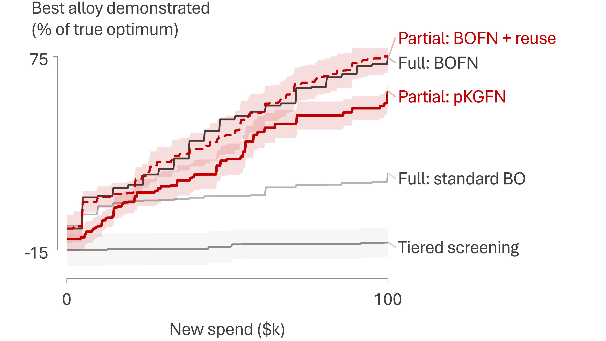
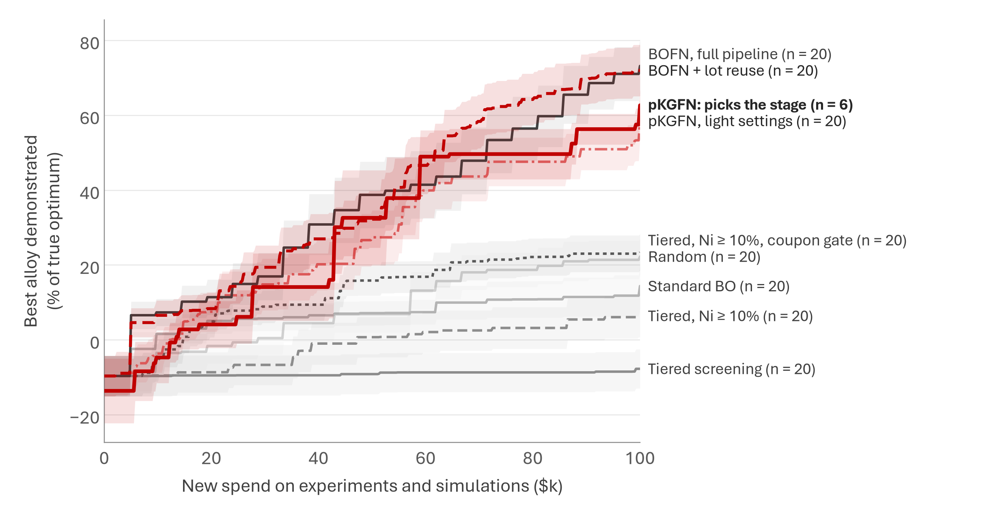
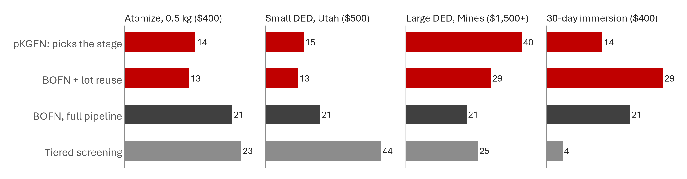
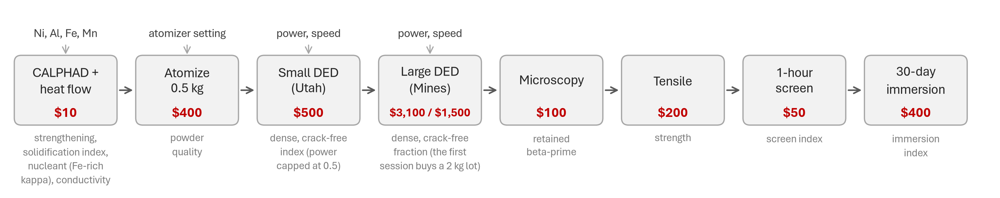
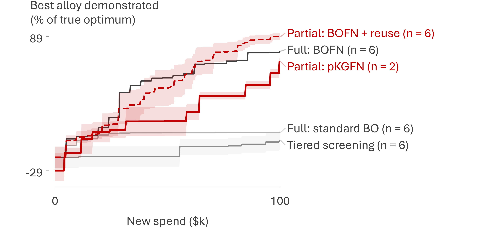
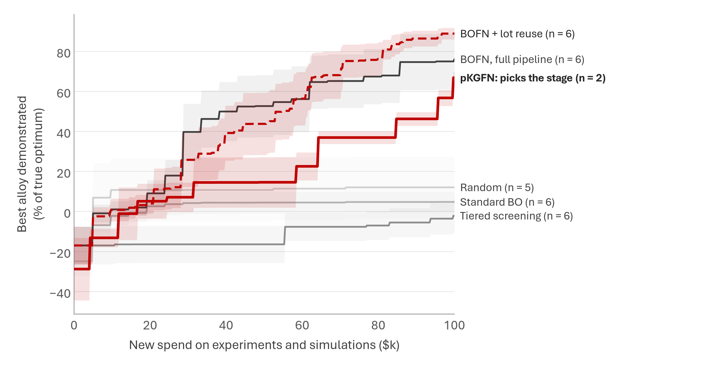

# BOFN on a copper/DED network: does choosing the stage beat tiered screening?

Copper and blown-powder DED version of [`../bofn-prelim/`](../bofn-prelim/README.md), the aluminum LPBF benchmark behind the MS&T26 preliminary results, built for the ONR YIP copper proposal (`near-term-submissions/onr-yip/onr-yip-technical-proposal-cu-ded.tex`, Figs. `fig:synth` and `fig:sim`; issue 205). It asks the same question on the copper workflow: with eight priced stages from a $10 calculation to a $3,100 deposition session, does cost-aware partial evaluation (pKGFN, [Buathong et al., ICML 2024](https://proceedings.mlr.press/v235/buathong24a.html)) reach good alloys with less money than tiered screening or whole-pipeline BO? `bofn-prelim/` and its 292 stored runs are unchanged.

<!-- RESULTS -->
## Bottom line

**Oct 28 update.** Four changes, each with its own section below.

1. **pKGFN now runs at the aluminum production settings**: 64 base samples, 16 candidates, a 512-point pool, 24 perturbations and 32 + 16 anchors, plus Edison's fixes F2 and F4. 6 of 20 seeds have finished at (1, 1). They end at 63% of the optimum at $100k, against 66% for the light settings on the same seeds ([`quality/compare_light_hq.md`](quality/compare_light_hq.md)), so there is no clear change yet. Until the other 14 finish ([`logs/plan.sh`](logs/plan.sh)), the 20-seed pKGFN numbers below and in the proposal's Fig. `fig:sim` are the light settings' (59%).
2. **Corrosion-aware tiered screening finds alloys that pass immersion once its shortlist has nickel, but stays far behind the network-aware searches.**
   - A shortlist of compositions with at least 10 wt% Ni ends at 6% ± 6 of the optimum.
   - The same shortlist with a dense 90-10 reference coupon as the one-hour screen's gate ends at 23% ± 5.
   - These are 20 seeds each, against -8% for the spec's shortlist and 73% for BOFN.
3. **The "dense index" of 0.40 is the lack-of-fusion factor alone.** It is a strength knockdown, not a density; the section lists the options.
4. **A physics-based truth**: a pycalphad grid, a corrosion model fitted to 30 same-test seawater rates, and the proposal's search-space limits.
   - **Nickel floor:** 1.6 wt% against dense 90-10 (2.6 wt% against 70-30) in the base fit, but anywhere from 0 to 10 wt% (0 to 30 wt%) across defensible refits. An independent Edison review found the same and advises against restricting the space.
   - **Runs at (1, 1):** BOFN reaches 76% ± 14 of that truth's optimum and BOFN + reuse 89% ± 3. Standard BO reaches 5% ± 5, random 12% ± 15 and tiered screening -2% ± 8 (5 to 6 seeds). pKGFN reaches 67% ± 3.

**First sweep (Oct 25 to 26, the hand-written truth, pKGFN at the light settings).** The aluminum headline does not carry over. On the copper network at `(kappa, eta) = (1, 1)` (both screens biased), the policy that chooses the stage is not the one that wins, and the tiered baseline as specified never finds an alloy that passes immersion:

- **Network-aware BO is far ahead of the model-free baselines.** BOFN reaches 73% of the optimum by $100k when it runs every candidate through the full chain and 72% when it also redeposits existing lots (EI per dollar), against 14% for standard BO on the seven inputs and 22% for random designs. The seed alloys start at -10% on average (most fail immersion).
- **pKGFN at the light settings reaches 59%**: ahead of standard BO (+44 points, 17 wins, 0 ties and 3 losses on 20 matched seeds, Wilcoxon p = 4.8e-05) and random, behind both BOFN policies (against the full pipeline: -15 points, 4 wins, 0 ties and 16 losses on 20 matched seeds, Wilcoxon p = 0.024; against lot reuse: -13 points, 2 wins, 0 ties and 18 losses on 20 matched seeds, Wilcoxon p = 0.0094). It is behind from the start (12% at $25k against 15% and 14%).
- **Why pKGFN lags.** It buys about 40 Mines sessions per $100k but only 7 tensile tests and 13 immersions, so 33 of its 40 new builds are never tensile-tested and earn nothing under the metric. Until some alloy passes immersion the objective is gated shut, one-step KG is flat, and 20% of its purchases were made by the EI fallback. A one-step gain also values a test only by its own result, not by the immersion it unlocks; pricing three test bundles was meant to cover that and does not close the gap. The KG noise check (below) adds that S = 32 base samples misses the small KG of cheap stages such as CALPHAD.
- **Tiered screening, as specified, never demonstrates an alloy that passes immersion.** Its shortlist (CALPHAD on 256 compositions, the four strongest that pass the crack screen, net of burden) is aluminum bronzes with 2 to 6 wt% Ni, which the 30-day immersion test fails in this truth however they are deposited. Over 20 seeds, 0 of its 80 immersed builds passed; it ends at -8% ± 5 of the optimum, and its small rises come from lower-burden bronzes that also fail immersion (a failing alloy scores minus 0.3 times its burden). Every other policy's mean curve reaches tiered screening's $100k level within its first $10k of new spend; so the bofn-prelim speed-up ("the spend each method needs to reach tiered screening's $100k level") measures only how soon a policy makes its first small gain, and is not reported as a headline (it is in [`tables.md`](tables.md)). This is the shortlist rule meeting an immersion-gated objective, and it makes tiered screening a weak baseline here; it is not evidence about what a careful lab would do. A nickel floor on the shortlist helps but does not rescue it (the corrosion-aware variants, below): in this truth Cu-Ni freezes wide, and only 0.2% of compositions with at least 10 wt% Ni pass the crack screen.

**What the data supports for the proposal.** "In a synthetic version of the copper workflow, with both screens biased, searches that model the linked steps reached about 73% of the optimum after $100,000, against about 14% for standard Bayesian optimization; screening on CALPHAD strength and crack index chose aluminum bronzes that fail immersion; the published one-step cost-aware rule reached 59%." The claim that choosing the stage beats running the full chain is not supported on this network at these settings.

**Not done yet** (next session; [`logs/plan.sh`](logs/plan.sh) resumes where this one stopped): pKGFN at the production settings for seeds 6 to 19 at (1, 1); more seeds of the physics-based truth (and its pKGFN); the sensitivity cells (0, 0), (1, 0) and (0, 1); the new policies (`pkgfn_screen`, `pkgfn_audit`, `mines_only`, `funnel`) and so the screen-audit and two-step tables; the S = 256 fidelity runs; the Edison analysis review of the complete results.



*Best alloy demonstrated (deposited at Mines and carried through tensile and immersion), as a percentage of the true optimum, against new spend, at `(kappa, eta) = (1, 1)`. Lines are means over seeds; partial evaluation is red (pKGFN solid, BOFN + lot reuse dashed), full-pipeline evaluation and screening gray. Bands are ±1 SE on the red traces and on screening. Placed 3.1 in wide in the proposal as Fig. `fig:sim`. Its pKGFN line is the first sweep's (light settings, 20 seeds); the same figure with the production-setting runs beside it, with n on every line, is [`variants/bofn_cu_best_vs_spend_k1_partial_vs_full_production_pkgfn.png`](variants/bofn_cu_best_vs_spend_k1_partial_vs_full_production_pkgfn.png). The variant with bands on every trace is [`variants/bofn_cu_best_vs_spend_k1_partial_vs_full_all_bands.png`](variants/bofn_cu_best_vs_spend_k1_partial_vs_full_all_bands.png).*





*Purchases per $100k (mean over seeds) at (1, 1), excluding the shared seed data.*

### Every policy, best alloy demonstrated (% of optimum, mean ± SE over seeds)

**`(kappa, eta) = (1, 1)`** (the crack screen misses the nucleant; the one-hour screen misses beta-prime). "pKGFN: picks the stage" is the production settings (6 seeds so far); "pKGFN, light settings" is the first sweep's 20 seeds:

| Policy | n | $25k | $50k | $100k | median $ to 60% | median $ to 70% | median $ to 80% |
|---|---|---|---|---|---|---|---|
| pKGFN: picks the stage | 6 | 6% ± 7 | 33% ± 13 | 63% ± 4 | >$100k (50% of seeds) | >$100k (33% of seeds) | >$100k (0% of seeds) |
| BOFN, full pipeline | 20 | 15% ± 6 | 39% ± 9 | 73% ± 7 | $67k (85% of seeds) | $74k (75% of seeds) | $88k (70% of seeds) |
| BOFN + lot reuse | 20 | 14% ± 5 | 32% ± 8 | 72% ± 7 | $54k (85% of seeds) | $65k (85% of seeds) | $81k (65% of seeds) |
| pKGFN, light settings | 20 | 12% ± 6 | 27% ± 7 | 59% ± 5 | $86k (60% of seeds) | >$100k (35% of seeds) | >$100k (5% of seeds) |
| Tiered screening | 20 | -9% ± 5 | -9% ± 5 | -8% ± 5 | >$100k (0% of seeds) | >$100k (0% of seeds) | >$100k (0% of seeds) |
| Tiered, Ni ≥ 10% | 20 | -7% ± 5 | 1% ± 5 | 6% ± 6 | >$100k (0% of seeds) | >$100k (0% of seeds) | >$100k (0% of seeds) |
| Tiered, Ni ≥ 10%, coupon gate | 20 | 8% ± 4 | 16% ± 4 | 23% ± 5 | >$100k (10% of seeds) | >$100k (0% of seeds) | >$100k (0% of seeds) |
| Standard BO | 20 | 6% ± 3 | 7% ± 3 | 14% ± 6 | >$100k (15% of seeds) | >$100k (5% of seeds) | >$100k (5% of seeds) |
| Random | 20 | -1% ± 4 | 7% ± 5 | 22% ± 5 | >$100k (5% of seeds) | >$100k (0% of seeds) | >$100k (0% of seeds) |

Scored by the deposited alloy each policy's own model ranks best (`rec_printed`), which credits builds not yet tested:

| Policy | n | $25k | $50k | $100k | median $ to 60% | median $ to 70% | median $ to 80% |
|---|---|---|---|---|---|---|---|
| pKGFN: picks the stage | 6 | 8% ± 8 | 37% ± 13 | 77% ± 2 | $61k (100% of seeds) | $64k (83% of seeds) | >$100k (33% of seeds) |
| BOFN, full pipeline | 20 | 15% ± 6 | 39% ± 9 | 73% ± 7 | $67k (85% of seeds) | $74k (75% of seeds) | $88k (70% of seeds) |
| BOFN + lot reuse | 20 | 13% ± 4 | 32% ± 8 | 72% ± 7 | $54k (85% of seeds) | $65k (85% of seeds) | $81k (65% of seeds) |
| pKGFN, light settings | 20 | 19% ± 6 | 37% ± 7 | 68% ± 4 | $52k (80% of seeds) | $78k (60% of seeds) | >$100k (25% of seeds) |
| Tiered screening | 20 | -8% ± 5 | -8% ± 5 | -6% ± 5 | >$100k (0% of seeds) | >$100k (0% of seeds) | >$100k (0% of seeds) |
| Tiered, Ni ≥ 10% | 20 | 2% ± 4 | 7% ± 4 | 9% ± 4 | >$100k (0% of seeds) | >$100k (0% of seeds) | >$100k (0% of seeds) |
| Tiered, Ni ≥ 10%, coupon gate | 20 | 8% ± 4 | 15% ± 4 | 23% ± 5 | >$100k (10% of seeds) | >$100k (0% of seeds) | >$100k (0% of seeds) |
| Standard BO | 20 | 6% ± 3 | 7% ± 3 | 14% ± 6 | >$100k (15% of seeds) | >$100k (5% of seeds) | >$100k (5% of seeds) |
| Random | 20 | -1% ± 4 | 7% ± 5 | 22% ± 5 | >$100k (5% of seeds) | >$100k (0% of seeds) | >$100k (0% of seeds) |

Matched seeds (Wilcoxon signed-rank; every pair in [`tables.md`](tables.md)):

| pKGFN: picks the stage against | n | $25k: mean difference (wins/ties/losses; p) | $50k | $100k |
|---|---|---|---|---|
| Tiered screening | 6 | +19 points (6/0/0; p = 0.031) | +45 points (6/0/0; p = 0.031) | +72 points (6/0/0; p = 0.031) |
| Tiered, Ni ≥ 10% | 6 | +20 points (6/0/0; p = 0.031) | +41 points (5/0/1; p = 0.094) | +58 points (6/0/0; p = 0.031) |
| Tiered, Ni ≥ 10%, coupon gate | 6 | -2 points (3/0/3; p = 0.84) | +13 points (3/0/3; p = 0.69) | +34 points (5/0/1; p = 0.062) |
| BOFN, full pipeline | 6 | -22 points (0/0/6; p = 0.031) | -5 points (2/0/4; p = 1) | -23 points (0/0/6; p = 0.031) |
| BOFN + lot reuse | 6 | -14 points (1/0/5; p = 0.22) | -13 points (1/0/5; p = 0.31) | -10 points (1/0/5; p = 0.44) |
| Standard BO | 6 | +2 points (2/0/4; p = 1) | +27 points (4/0/2; p = 0.16) | +49 points (5/0/1; p = 0.062) |
| Random | 6 | +8 points (5/0/1; p = 0.22) | +30 points (5/0/1; p = 0.094) | +42 points (5/0/1; p = 0.062) |
| pKGFN, light settings | 6 | -11 points (3/0/3; p = 1) | +2 points (5/0/1; p = 0.44) | -4 points (2/0/4; p = 0.69) |

Purchases per $100k:

| Policy | n | C ($10) | A ($400) | U ($500) | M ($1,500+) | S ($100) | T ($200) | K ($50) | I ($400) | new lots | Mines sessions that paid a scale-up |
|---|---|---|---|---|---|---|---|---|---|---|---|
| pKGFN: picks the stage | 6 | 8.0 | 13.8 | 14.8 | 40.0 | 17.2 | 7.7 | 15.3 | 14.0 | 13.8 | 10.8 |
| BOFN, full pipeline | 20 | 21.0 | 21.0 | 21.0 | 21.0 | 21.0 | 21.0 | 21.0 | 21.0 | 21.0 |  |
| BOFN + lot reuse | 20 | 12.6 | 12.6 | 12.6 | 29.3 | 29.3 | 29.3 | 29.3 | 29.3 | 12.6 |  |
| pKGFN, light settings | 20 | 6.7 | 12.4 | 11.3 | 40.5 | 15.7 | 7.2 | 14.0 | 12.8 | 12.4 |  |
| Tiered screening | 20 | 224.0 | 22.8 | 44.2 | 24.9 | 24.9 | 24.9 | 24.9 | 4.0 | 22.8 |  |
| Tiered, Ni ≥ 10% | 20 | 224.0 | 31.6 | 68.0 | 18.0 | 18.0 | 18.0 | 18.0 | 2.1 | 31.6 |  |
| Tiered, Ni ≥ 10%, coupon gate | 20 | 224.0 | 26.6 | 55.0 | 21.1 | 21.1 | 21.1 | 22.1 | 9.1 | 26.6 |  |
| Standard BO | 20 | 19.7 | 21.0 | 21.0 | 21.0 | 21.0 | 21.0 | 21.0 | 21.0 | 21.0 |  |
| Random | 20 | 21.0 | 21.0 | 21.0 | 21.0 | 21.0 | 21.0 | 21.0 | 21.0 | 21.0 |  |

Immersion outcomes (new builds only; the five seed builds are shared):

| Policy | n | immersions per run | passing immersions per run | seeds with a passing alloy | lowest Ni (wt%) among passing builds |
|---|---|---|---|---|---|
| pKGFN: picks the stage | 6 | 14.0 | 6.0 | 6/6 | 8.8 |
| BOFN, full pipeline | 20 | 21.0 | 7.5 | 17/20 | 8.2 |
| BOFN + lot reuse | 20 | 29.3 | 11.1 | 17/20 | 9.6 |
| pKGFN, light settings | 20 | 12.8 | 4.5 | 19/20 | 10.7 |
| Tiered screening | 20 | 4.0 | 0.0 | 0/20 | none |
| Tiered, Ni ≥ 10% | 20 | 2.1 | 0.5 | 4/20 | 11.0 |
| Tiered, Ni ≥ 10%, coupon gate | 20 | 9.1 | 2.6 | 10/20 | 10.1 |
| Standard BO | 20 | 21.0 | 1.6 | 5/20 | 12.1 |
| Random | 20 | 21.0 | 1.0 | 12/20 | 12.0 |

### Corrosion-aware tiered screening

The spec's shortlist is the four strongest compositions that pass the crack screen, net of burden. On this network that is aluminum bronzes with 2 to 6 wt% Ni, and none of its 80 immersions passed. The two variants keep the spec's loop and change only the shortlist and the gate:

| Tiered variant | n | best alloy at $100k (% of optimum) | immersions per run | passing immersions per run | seeds with a passing alloy | leanest passing alloy (wt% Ni) | Utah sessions per run |
|---|---|---|---|---|---|---|---|
| Spec: strongest that pass the crack screen | 20 | -8% ± 5 | 4.0 | 0.0 | 0/20 | none | 44 |
| `tiered_ni`: Ni ≥ 10 wt% shortlist | 20 | 6% ± 6 | 2.1 | 0.5 | 4/20 | 11.0 | 68 |
| `tiered_ni_ref`: the same, gated by a dense 90-10 coupon | 20 | 23% ± 5 | 9.1 | 2.6 | 10/20 | 10.1 | 55 |

- **With the nickel floor alone, the one-hour screen stops most builds before immersion.**
  - The screen's gate is the top quartile of everything screened so far, and seed builds richer in nickel than the shortlist set it high.
  - The Ni ≥ 10 wt% compositions also freeze wide in this truth, so few pass the crack screen, and the shortlist is topped up with the least crack-prone.
  - Many of their lots then miss the Utah density gate, and the loop atomizes new lots of the same compositions, which explains the 68 Utah sessions per run.
- **A lab would gate on a reference coupon instead.** With a dense 90-10 coupon as the gate, immersion runs about 9 times per run, and 10 of 20 seeds demonstrate an alloy that passes.
- **The shortlist caps it.** The best alloy each Ni ≥ 10 wt% shortlist allows averages 58% of the optimum (40% to 85% across seeds), because its four compositions carry little aluminum. The variant reaches about half of that ceiling.
- **The comparison:** it matches random designs (22%) and beats standard BO (14%), but stays far behind BOFN (73%). Restricting the shortlist to nickel-rich alloys fixes immersion and gives away strength.

<!-- /RESULTS -->

## The benchmark



- **Design space (7-D, all scaled to [0, 1]; copper is the balance):** Ni 0 to 30 wt%, Al 0 to 9.5, Fe 0 to 4.5, Mn 0 to 4 (the proposal's Table `tab:space`); ultrasonic atomizer setting; laser power (about 0 to 1 kW; Utah's MX-Lab is capped at 0.5 of the scale); travel speed.
- **Network:** one GP per node, and each node's output feeds its children.
  - CALPHAD and heat flow return four things in one call: strengthening potential `s`, solidification index `f`, nucleant fraction `g` (the iron-rich primary kappa particles) and a conductivity index `h`. The spec named three outputs; `h` was added so the lack-of-fusion term is a function of node inputs.
  - Atomization returns powder quality `q` from the atomizer setting, Mn and `f` (which stands in for the liquidus margin, since both rise with nickel).
  - Small DED at Utah returns a dense, crack-free index `rho_u` from power (capped at 0.5), speed, `f`, `g`, `h` and `q`.
  - Large DED at Mines returns the dense, crack-free fraction `rho_m` from the same inputs at full power. Its GP also takes `rho_u` as an input so the model can learn the small-to-large transfer; the truth links the two only through shared parents.
  - Microscopy returns retained beta-prime `beta` (Al, Ni, P, v, `rho_m`). Tensile returns strength `U` (`s`, `rho_m`, `beta`). The one-hour screen returns `w` and the 30-day immersion `m` (Ni, Al, Fe, `rho_m`, `beta`; the immersion GP also takes `w`, which the truth ignores).
  - The objective is `J = U * sigmoid((m - m_ref) / 0.05) - 0.3 B`: strength, counted only if the alloy passes immersion, minus 0.3 times the critical-mineral burden `B = 1.0 Ni + 0.3 Al + 0.2 Mn` (known and free to compute). `m_ref = 0.849` is the immersion index of 70-30 copper-nickel (C71500) deposited dense at its best settings in the headline world, so "passes immersion" means "no worse than the reference alloy", the proposal's H5 definition. It is fixed in every cell.
- **Costs per query (round all-in estimates: materials, student time, facility time, shipping):** CALPHAD and heat flow $10; ultrasonic atomization of one 0.5 kg lot $400; small DED at the University of Utah $500 (an allowance like SEM time); large DED at the Colorado School of Mines $3,100 for the first session on a composition ($1,600 for the 2 kg scale-up lot, four more atomizer runs, plus $1,500 for the session: machine time at posted external rates, a certified chemistry check and shipping) and $1,500 for each repeat session on the same lot; microscopy (SEM, EDS, EBSD) $100; tensile $200; one-hour corrosion screen $50; 30-day immersion $400. A full chain on a new composition costs $4,760, so $100k buys about 21 full cycles (PR 86's aluminum chain was $4,210, about 24).
- **Physical rules:** CALPHAD runs automatically before the first experiment on a composition; a 0.5 kg lot must exist before Utah; the scale-up (paid inside the first Mines session) before Mines; a Mines build before microscopy; microscopy before tensile and the screen; the screen before immersion. One lot supports many Utah visits and, once scaled up, four Mines sessions. Reprints and repeat sessions reuse lots.
- **Two bias knobs.** `kappa`: the iron-rich kappa particles nucleate alpha and suppress hot tearing, which a Scheil solidification index cannot see (the copper analogue of Zr inoculation in aluminum, [Martin et al., Nature 2017](https://doi.org/10.1038/nature23894)). At `kappa = 1` they cut the effective index by up to 85%; at `kappa = 0` they do nothing and the screen's physics is right. `eta`: at `eta = 1` the one-hour screen rates fresh films and is blind to the selective attack of retained beta-prime that 30-day immersion finds (welded NAB is attacked selectively in seawater, [Dobson et al. 2024](https://doi.org/10.1016/j.corsci.2024.112004); a quick measurement in air ranked NAB's phases opposite to the order in which they corroded, [Iannuzzi et al. 2017](https://doi.org/10.1149/2.0391709jes)) and to the slow-forming film of low-nickel alloys; at `eta = 0` it agrees with immersion up to its constants. Headline cell `(kappa, eta) = (1, 1)`; sensitivity cells (0, 0), (1, 0) and (0, 1).
- **New for copper: lack of fusion.** `lof = sigmoid((h - P) / 0.08)` with `h = 0.6 (1 - Ni)^2 (1 - 0.6 Al)`: copper-rich, high-conductivity compositions need more laser power than Utah's cap gives, so the small step is blind exactly where Mines can still fuse them.
- **Shared start:** every policy and seed starts from the same data: CALPHAD on 32 compositions plus five random designs carried through every stage (Utah included). That seed data is sunk, and the x-axis counts only new spend, up to $100k.
- **Scoring:** "best alloy demonstrated" is the true `J` of the best design deposited at Mines and carried through tensile *and* immersion. pKGFN gets no credit for builds it has not tested. `rec_printed` (the deposited alloy the policy's own model ranks best, tested or not) is kept as a secondary metric.

## The truth functions and the optimum

Hand-written closed forms on [0, 1] inputs, nothing fitted, as in PR 86. The spec gave the shapes and left the constants to this implementation; where the constants differ from the spec, the reason is the required property they serve (checked by [`check_truth.py`](check_truth.py), which writes [`truth_tables.md`](truth_tables.md)). `sig` is the logistic function.

| Node | Function (inputs on [0, 1]) | Differs from the spec |
|---|---|---|
| strengthening `s` | `(1 - exp(-(0.6 Ni + 0.9 Al + 3.0 Ni Al)) + 0.1 Fe + 0.05 Mn) / 1.15` | constants: a stronger Ni-Al (kappa-III, NiAl) synergy |
| solidification index `f` | `clamp(0.65 Ni + 0.30 Mn - 0.35 Al + 2.5 Ni Al + 0.05 Fe, 0, 1)` | Ni-Al term 2.5 (spec 0.6), so the Ni-Al corner freezes wide again, as the `mc_ni` composition map shows |
| nucleant `g` | `(0.7 Fe (1 + 0.5 Al) + 0.15 Al Ni) / 1.2` | Fe linear (spec Fe^1.3) |
| conductivity `h` | `0.6 (1 - Ni)^2 (1 - 0.6 Al)` | an added CALPHAD output; the spec's `cond` |
| powder quality `q` | `exp(-((a - a*)/0.28)^2) (1 - 0.35 f^2)(1 - 0.10 Mn)`, `a* = 0.35 + 0.40 f` | `f` in place of Ni (the spec's node inputs are `a` and `f`) |
| dense, crack-free `rho_m` (Mines) | `window q^0.3 (1 - 0.75 crack)(1 - lof)`, `window = exp(-(u/0.2)^2)(1 - 0.35 sig((P - 0.85)/0.05))`, `u = P - v - (0.05 + 0.25 f)`, `crack = sig((f_eff - 0.56)/0.05)`, `f_eff = f (1 - kappa 0.85 g/(g + 0.12))`, `lof = sig((h - P)/0.08)` | crack onset 0.56 (spec 0.38), so 70-30 Cu-Ni deposits dense at `kappa = 1` |
| `rho_u` (Utah) | the same at `P_u = min(P, 0.5)`, times `(0.95 + 0.05 q)` | none |
| retained beta-prime `beta` | `Al^1.5 (1 - 0.5 Ni) sig((v - P + 0.2)/0.15)` | none |
| strength `U` | `(0.25 + 0.75 s) rho_m (1 + 0.15 beta)` | none |
| immersion `m` | `clamp(0.30 + 0.55 film + 0.15 Al - 0.60 Al beta + 0.30 min(Fe, 0.4) - 0.15 relu(Fe - 0.5) - 0.30 (1 - rho_m), 0, 1)`, `film = 1 - exp(-Ni/0.15)` | the film saturates by 90-10 (spec Ni^0.7) and iron in solution helps it, so 90-10 Cu-Ni passes |
| one-hour screen `w` | `clamp(0.35 + 0.50 n + 0.25 Al - 0.10 (1 - rho_m) - (1 - eta)(0.60 Al beta - 0.30 min(Fe, 0.4)), 0, 1)`, `n = eta (0.4 Ni^0.7 + 0.6 film) + (1 - eta) film` | at `eta = 1` it also misses part of the slow-forming film |
| objective | `U sig((m - 0.849)/0.05) - 0.3 (Ni + 0.3 Al + 0.2 Mn)` | none |

The CALPHAD crack screen keeps compositions with `f <= 0.34` (about 1% crack probability at `kappa = 0`). The one-hour screen's gate, for the policies that use it, is the top quartile of every screened build so far.

**The optimum**, by multi-start local search from the 20 best of 400,000 random designs (`check_truth.py`; every "% of optimum" in this README is normalized by it):

| (kappa, eta) | J* | Ni | Al | Fe | Mn | a | P | v | s | f | g | h | q | rho_u | rho_m | beta | U | w | m | burden |
|---|---|---|---|---|---|---|---|---|---|---|---|---|---|---|---|---|---|---|---|---|
| (1, 1) headline | **0.492** | 0.43 | 0.58 | 0.50 | 0.00 | 0.64 | 0.58 | 0.34 | 0.73 | 0.74 | 0.41 | 0.12 | 0.81 | 0.79 | 0.93 | 0.15 | 0.76 | 0.88 | 0.95 | 0.61 |
| (0, 0) | **0.382** | 0.32 | 0.38 | 0.40 | 0.00 | 0.50 | 0.63 | 0.48 | 0.55 | 0.40 | 0.29 | 0.21 | 0.94 | 0.63 | 0.95 | 0.11 | 0.64 | 0.97 | 0.92 | 0.43 |
| (1, 0) | **0.492** | 0.43 | 0.58 | 0.50 | 0.00 | 0.64 | 0.58 | 0.34 | 0.73 | 0.74 | 0.41 | 0.12 | 0.81 | 0.79 | 0.93 | 0.15 | 0.76 | 1.00 | 0.95 | 0.61 |
| (0, 1) | **0.382** | 0.32 | 0.38 | 0.40 | 0.00 | 0.50 | 0.63 | 0.48 | 0.55 | 0.40 | 0.29 | 0.21 | 0.94 | 0.63 | 0.95 | 0.11 | 0.64 | 0.79 | 0.92 | 0.43 |

- At `kappa = 1` the optimum is a copper-nickel-aluminum alloy with iron and no manganese: about 13 wt% Ni, 5.6 wt% Al and 2.2 wt% Fe, in the family of the high-strength Cu-Ni-Al alloys. Its solidification index is 0.74, far above the screen's 0.34, yet it deposits 93% dense because the iron-rich nucleant cuts the effective index to about a third. `eta` changes only the one-hour screen, so (1, 0) has the same optimum, and (0, 1) the same as (0, 0).
- At `kappa = 0` the optimum is leaner (about 10 wt% Ni, 3.6 wt% Al, 1.8 wt% Fe) at `f` = 0.40, just above the screen's cutoff.

**Required property 1 (the screens and the optimum).** At (1, 1) the optimum fails the CALPHAD crack screen (`f` = 0.74 > 0.34). The best design that passes it scores 72% of the optimum (about 8.5 wt% Ni, 3.3 wt% Al, 2.3 wt% Fe), which is the ceiling for tiered screening. At (0, 0) the best design passing both screens keeps 92% of the optimum (the spec asks for at least 85%). The one-hour screen ranks the optimum at the top of the dense candidates in every cell, so it is the CALPHAD screen that cuts the optimum off (see Caveats).

**Required property 2 (reference alloys at their best settings for J, headline world).**

| Alloy | J (% of J*) | strength U | rho_m | beta | immersion m | passes immersion | burden |
|---|---|---|---|---|---|---|---|
| C71500 (70-30 Cu-Ni) | -0.073 (-15%) | 0.48 | 0.85 | 0.00 | 0.85 | yes | 1.04 |
| C70600 (90-10 Cu-Ni) | 0.120 (24%) | 0.38 | 0.96 | 0.00 | 0.87 | yes | 0.37 |
| C95800 (NAB) | -0.146 (-30%) | 0.79 | 0.92 | 0.48 | 0.55 | no | 0.49 |

C71500 passes by definition (`m_ref` is its immersion index); C70600 is weaker and passes with a third of the nickel; C95800 (NAB) is the strongest but carries retained beta-prime (0.48) and fails. C71500 and NAB score below zero because of their burden and the immersion gate. At `kappa = 0` C71500 cracks (see Caveats).

**Required property 3 (a ridge, not a point).** With the other inputs at the optimum, 17 points of a 101 × 101 (P, v) grid lie within 0.5% of J* (P from 0.53 to 0.64 along P − v ≈ 0.23) and 63 within 2% (P from 0.47 to 0.68). The ridge is shorter than the aluminum one because lack of fusion ends it at low power and keyholing at high power.

**Required property 4 (Utah's power cap).** For 200 random copper-rich compositions (Ni ≤ 0.07 and Al ≤ 0.2 scaled, under about 2 wt% each), the median best `rho_u` at Utah's cap is 0.40 against 0.88 at Mines; 15% cannot reach 0.3 at Utah, 15% still pass the Utah gate of 0.5, and 100% reach 0.7 at Mines. At the optimum's composition the cap does not bind (0.92 at Utah, 0.93 at Mines). The index is a strength knockdown, not a density (next section).

Every value above is in [`truth_tables.md`](truth_tables.md), for all four cells.

### What the "dense index" of 0.40 is: a strength knockdown, not a density

`rho_u` and `rho_m` are called a "dense, crack-free index", and the only thing they do in the objective is scale strength: `U = (0.25 + 0.75 s) rho_m (1 + 0.15 beta)`. They are not relative densities. A deposit at 40% relative density would be loose powder, not a part, so "a median dense index of 0.40 at Utah" should not be read as a density. For the 200 copper-rich compositions of property 4, at each one's best Utah setting (P at the cap, v chosen freely), the factors of `rho_u` have these medians:

| Factor of `rho_u` | Median |
|---|---|
| process window `exp(-(u/0.2)^2) (1 - 0.35 sig((P - 0.85)/0.05))` | 1.00 |
| powder `q^0.3` | 0.98 |
| cracking `1 - 0.75 crack` | 1.00 |
| thin-wall porosity `0.95 + 0.05 q` | 1.00 |
| lack of fusion `1 - lof`, with `lof = sig((h - P)/0.08)` at P = 0.5 | **0.41** |
| product, `rho_u` | **0.40** |

The 0.40 is therefore the lack-of-fusion factor alone. These compositions have a conductivity index `h` of about 0.53, just above Utah's power cap of 0.5, and the logistic puts them about halfway to "unfused". The share of them that passes the screening policies' Utah gate (`rho_u >= 0.5`) is 15%, all with `h` below about 0.5. At Mines, at full power (P of about 0.75), the same compositions reach a median of 0.88.

Read as a strength knockdown, 0.40 says that a Utah block of nearly pure copper keeps 40% of a fully fused block's strength. That is harsh but possible for a deposit riddled with lack-of-fusion voids, since in AM metals tensile strength falls by several percent for each percent of lack-of-fusion porosity. Read as a density, it is wrong. Options:

1. **Rename only.** Call the node a deposit-quality index (the share of the composition's strength that the deposit keeps), and the Utah gate a "half-strength" gate. No number changes, and every stored run stays valid.
2. **Report a relative density beside the index.** Map it to what a lab would measure, for example relative density = 1 - 0.15 (1 - index). The copper-rich Utah blocks are then about 91% dense, the optimum's Mines builds 99%, and the Utah gate (index of at least 0.5) means "at least 92.5% dense". Only labels and the gate's description change; no run changes.
3. **Make lack of fusion physical.** Replace the logistic in `h - P` with a melt-pool overlap criterion: the Rosenthal or Eagar-Tsai melt depth against the layer height, as in the lack-of-fusion model of Tang, Pistorius and Beuth (2017). The thermal diffusivity would come from the composition (Wiedemann-Franz on a Matthiessen resistivity), with copper's low absorptivity at 1 µm. The index becomes the fused fraction, and strength follows a porosity law. This changes the truth, so every run would be redone. It would also shrink the region where Utah cannot fuse to alloys with a few percent of solute at most: conductivity falls about tenfold by 10 wt% Ni (C70600 is about 40 W/m K, against about 390 for copper), while `h` here still has 60% of its copper value at 10 wt% Ni.
4. **Soften the knockdown,** for example `1 - 0.5 lof`, so an unfused deposit keeps at least half its strength. This is ad hoc, and it changes every run.

Option 1 is what this README now does. Option 3 is the one that answers the question properly; it is listed under the physics-based truth below as not done.

## A physics-based truth (`BOFN_TRUTH=phys`)

Built on Oct 28 to answer "is the nickel floor real, and should it restrict the search space?". The hand-written immersion formula lets only 3.2% of the box pass immersion, and nothing under 6.1 wt% Ni (optimized; 7.0 wt% is the lowest of 400,000 random designs). That floor comes from the formula (`film = 1 - exp(-Ni/0.15)` against dense 70-30), not from data. The physics-based truth keeps the network and the process nodes and replaces what simulation or data can supply. The whole recipe is in the docstring of [`truth_phys.py`](truth_phys.py).

| Node | Hand-written truth | Physics-based truth |
|---|---|---|
| f, g, s (CALPHAD) | closed forms | interpolated from an 864-composition pycalphad grid with the open MatCalc `mc_ni` database ([`phys/calphad_grid.py`](phys/calphad_grid.py), [`phys/calphad_grid.csv`](phys/calphad_grid.csv); Ni 8 levels × Al 6 × Fe 6 × Mn 3, all converged): f = equilibrium freezing range / 200 °C; g = Fe-rich solid one degree above the solidus / 0.045 (NAB's); s = a yield-strength estimate from the 600 °C phase fractions (Orowan-type square roots of NiAl/Ni3Al and Fe-rich bcc kappa, solid solution in alpha) |
| h (conductivity) | `0.6 (1 - Ni)^2 (1 - 0.6 Al)` | `0.6 sqrt(k / k_Cu)`, with k from Wiedemann-Franz on a Matthiessen resistivity (C70600 comes out at 46 W/m K, C71500 at 22, copper at 435) |
| m (30-day immersion) | hand-written film | a film model fitted to same-test seawater data (below) |
| search space | the box | the proposal's limits on every candidate pool of every policy: liquidus at most 1,250 °C (from the grid), Cu at least 65 wt%, Ni ≥ Fe above 7 wt% Al, Fe ≤ 2.3 wt% below 1.5 wt% Al (74% of the box) |
| the bar for "passes immersion" | dense 70-30 Cu-Ni | dense 90-10 Cu-Ni (`BOFN_BAR=7030` for 70-30) |

**The corrosion data and fit** ([`phys/corrosion_data.csv`](phys/corrosion_data.csv), [`phys/fit_corrosion.py`](phys/fit_corrosion.py), [`phys/corrosion_fit.md`](phys/corrosion_fit.md)). Only within-study ratios are used (one intercept per study), so units and absolute levels cancel. 30 rates from 11 studies:

- From the Edison literature outputs already in the repo (`edison-trajectories/cu-ded-2026-10/`, each row traced to a file and line): Tan et al. 2024 (four cast NAB, Al 6.9 to 9.9 wt% with Ni falling from 6.8 to 4.0, 30 d), Yang et al. 2018 (Cu-7Ni-3Al-1Fe-1Mn beat C70600 in the same test), Qian et al. 2025 (B10 vs B30), Lewis and LaQue 1981 (quiet seawater; and a one-year flowing test with unspecified aluminum bronze and NAB grades, half weight), Zhao et al. 2022 (laser-deposited NAB diluted by a steel substrate, half weight).
- Those files hold no copper and no Cu-Ni under 10 wt% Ni, and the first fit made nickel look harmful. An Edison literature query ([`edison/literature/copper-anchor.md`](edison/literature/copper-anchor.md), task `0ed56496`) found same-test copper anchors: Ravindran 1983 (120 days in a harbour: copper 61 µm/y, 90-10 and 70-30 both 22.5), Wheatfall 1967 as compiled by Gdowski 1991 (copper vs Cu-30Ni, half weight), Cohen and Whitted 1971 as compiled by Banning and Oden 1973 (hot brine: copper 0.99 mpy, two aluminum bronzes 0.75 and 0.73, 90-10 0.70, 70-30 0.46; half weight), and Al-Fozan and Malik 2008 (90-10 0.145 vs 70-30 0.067 mpy).
- Model: `ln rate = a_study + b_Ni (1 - exp(-Ni/5)) + b_Al Al + b_Al2 Al²/10 + b_Fe min(Fe, 1.5)` (wt%), with the film's signs fixed (nickel and dissolved iron can only help) and a weak ridge. Fit: b_Ni = -0.84, b_Al = -0.28, b_Al2 = +0.39, b_Fe = 0 (at its bound); ln-rate RMSE 0.23. A little aluminum helps (to about 3.6 wt%) and a lot hurts, as Yang 2018 and Cohen and Whitted against Tan 2024 and NAB require. A linear Al term cannot do both; it fits worse (RMSE 0.32).
- The first fit, before the copper anchors (16 rates, 6 studies; b_Ni = -0.32), is kept with its 24 runs in [`quality/results-phys-v1/`](quality/results-phys-v1/).

**The nickel floor** (the lowest Ni at which some composition inside the limits corrodes no faster than the bar alloy):

| | 90-10 bar | 70-30 bar |
|---|---|---|
| Base fit, dense and free of beta-prime (composition only) | 1.6 wt% (Cu-1.6Ni-3.1Al) | 2.6 wt% (Cu-2.6Ni-3.2Al) |
| Full physics truth, optimized over composition and process ([`phys/phys_tables.md`](phys/phys_tables.md)) | 2.2 wt% | 3.3 wt% |
| Range over 26 alternative fits (Ni scale, linear Ni or Al, signs free, weights, ridge, each study left out, Reinhart 1968 added) | 0 to 10.0 wt% | 0 to 30.0 wt% |
| Hand-written truth, for comparison | — | 6.1 wt% |

The floor is not robust. What moves it most is whether a few wt% of Al helps the film: with Al linear, nothing but the bar alloys passes (10 and 30 wt% Ni), and with the quadratic it falls to 1.6 and 2.6 wt%. Adding the deep-sea Reinhart 1968 series that the Edison review recovered (copper about equal to 90-10 there) lowers it to 0.4 and 1.1 wt%, and to zero with that report's bronzes. The data that decide it are thin (Yang 2018's one cast Cu-7Ni-3Al alloy, and two aluminum bronzes in hot brine). **So the evidence does not justify restricting the search space to a nickel floor**, and it does not support the hand-written truth's 6 wt% either. The proposal's own limits are applied instead. One 30-day immersion test of C70600, C71500, a nickel-free Cu-3Al bronze and a Cu-2Ni-3Al alloy side by side, deposited the same way, would settle it.

**In this truth at (1, 1)** the optimum is J* = 0.429 at Cu-11.7Ni-4.3Al-3.2Fe (a = 0.42, P = 0.63, v = 0.54): strength estimate 396 MPa, freezing range 33 °C, rho_m 0.99, beta-prime 0.17, m = 0.93 against a bar of 0.81. It passes the CALPHAD crack screen (f = 0.16), so here the screen does not cut the optimum off. 5.2% of designs inside the limits pass immersion against dense 90-10 (3.2% against 70-30). C71500 scores -21% of J*, C70600 +6% and NAB -35% (it fails immersion).

**Runs on this truth at (1, 1)** (`results-phys/`, [`tables-phys.md`](tables-phys.md); the policies, costs, seed data and budget are the same as above, and every candidate pool is filtered by the limits):

| Policy | n | $25k | $50k | $100k | median $ to 60% | median $ to 70% | median $ to 80% |
|---|---|---|---|---|---|---|---|
| pKGFN: picks the stage | 2 | 7% ± 7 | 15% ± 13 | 67% ± 3 | $98k (100% of seeds) | >$100k (50% of seeds) | >$100k (0% of seeds) |
| BOFN, full pipeline | 6 | 18% ± 8 | 53% ± 16 | 76% ± 14 | $38k (83% of seeds) | $50k (83% of seeds) | $76k (67% of seeds) |
| BOFN + lot reuse | 6 | 11% ± 10 | 44% ± 16 | 89% ± 3 | $51k (100% of seeds) | $54k (100% of seeds) | $62k (83% of seeds) |
| Tiered screening | 6 | -16% ± 9 | -16% ± 9 | -2% ± 8 | >$100k (0% of seeds) | >$100k (0% of seeds) | >$100k (0% of seeds) |
| Standard BO | 6 | 4% ± 5 | 4% ± 5 | 5% ± 5 | >$100k (0% of seeds) | >$100k (0% of seeds) | >$100k (0% of seeds) |
| Random | 5 | 11% ± 16 | 11% ± 16 | 12% ± 15 | >$100k (20% of seeds) | >$100k (20% of seeds) | >$100k (0% of seeds) |

| Policy | n | immersions per run | passing immersions per run | seeds with a passing alloy | lowest Ni (wt%) among passing builds |
|---|---|---|---|---|---|
| pKGFN: picks the stage | 2 | 13.5 | 3.5 | 2/2 | 6.1 |
| BOFN, full pipeline | 6 | 21.0 | 9.8 | 5/6 | 7.4 |
| BOFN + lot reuse | 6 | 30.2 | 14.2 | 6/6 | 5.5 |
| Tiered screening | 6 | 5.3 | 0.0 | 0/6 | none |
| Standard BO | 6 | 21.0 | 1.7 | 1/6 | 16.4 |
| Random | 5 | 21.0 | 0.8 | 3/5 | 18.1 |





- **The ranking holds.**
  - The network-aware searches lead again: BOFN + reuse 89% ± 3, BOFN 76% ± 14, and pKGFN 67% ± 3.
  - Tiered screening, standard BO and random designs trail.
- **Tiered screening fails for the same reason as in the hand-written truth.**
  - Its shortlist (the strongest compositions that pass the crack screen, net of burden) carries 5.5 to 9.4 wt% Al, past the fitted optimum of about 3.6 wt%.
  - None of its immersed builds reaches the bar (the best m is 0.68 to 0.80, against 0.81).
- **Fewer of the model-free baselines' seeds find an alloy that passes immersion:** standard BO does in 1 of 6 seeds, random designs in 3 of 5, against 6 of 6 for BOFN + reuse.
- **The first fit gives the same order.** Its runs (pkgfn 87% (one seed), eifn 34% ± 17, eifn_reuse 64% ± 12, tiered -29% ± 7, ei 13% ± 10, random -15% ± 7, % of that truth's J* = 0.298) are in [`quality/results-phys-v1/`](quality/results-phys-v1/). That fit had no copper anchors and a different optimum.
- **Fewer seeds** than in the hand-written truth, and only 2 seeds of pKGFN: treat this as a what-if, not a second headline.

**Independent review** (Edison Analysis, task `363efb39`, of the first fit; [`edison/results/phys-review.md`](edison/results/phys-review.md), artifacts in [`edison/results/phys-review-files/`](edison/results/phys-review-files/)).

- **Verdict:** "the evidence does not establish a robust positive nickel floor, and I would not restrict the search to Ni ≥ 10 wt%". The physics truth is "defensible as an explicitly qualified what-if simulator, not as validated prediction".
- **Reproduction:** it re-implemented the fit independently and reproduced the coefficients to 1e-15. It also reproduced the floors by continuous optimization: 0.95 and 1.82 wt% film-only, with full-network witnesses at 1.63 and 2.43 wt%.
- **Refits:** 41 refits span 0 to 5.5 wt% against 90-10 and 0 to 15.9 wt% against 70-30. A strict data subset returns the bar alloys themselves (10 and 30 wt%).
- **New data:** it recovered a same-deployment copper series, Reinhart 1968: oxygen-free copper 1.6 mpy, Cu-6.25Ni 1.5, 90-10 1.6, 70-30 1.2, all 123 days at 5,640 ft. That is not in the fit yet; with it the floors fall to 0.2 and 0.9 wt%.
- **Bar:** it recommends dense C70600 as the primary bar, with C71500 as a stricter scenario.
- **Experiments:** C70600 against one sub-10 wt% Ni alloy (for example Cu-2Ni-2.1Al-3.6Fe) in the same 30-day test, in triplicate. To tell the models apart: Ni 0/2/5/10 × Al 0/2.5, plus copper and 70-30, which is 10 materials and 30 coupons.
- Its other findings, all open:
  - **The immersion gate is soft.** The logistic gives half the strength credit at the bar.
  - **mc_ni is used far outside its validated range.** Its header gives Cu < 0.5 wt%.
  - **The Qian and quiet-water rows are proxies.** They are an inverse resistance and range midpoints. Replacing Qian's with its Tafel pair barely moves the floor (1.60 and 2.61 wt%).
  - **One grid point disagrees.** At a NAB-like point (Cu-4.3Ni-9.5Al-3.6Fe), the stored state one degree above the solidus is mostly liquid with Fe-rich kappa. Its independent solve finds mostly beta there, so `g` is 0.61 in the grid and 0 in its solve.
  - **Two grid rows have empty phase inventories at the solidus.**
  - These matter only through `g`, which acts through the crack term when the freezing range exceeds about 90 °C. The physics optimum's range is 33 °C.
**Second review** (Edison Analysis, task `e8550274`, of the refit with the copper anchors; [`edison/results/phys-review-v2.md`](edison/results/phys-review-v2.md), artifacts in [`edison/results/phys-review-v2-files/`](edison/results/phys-review-v2-files/)).

- **Verdict:** "No: I would not restrict the search to Ni ≥10 wt%."
- **Certified floors:** its independent refit matches the base coefficients to 3e-11. Optimized continuously and certified as global for the film model, the floors are **1.51 wt% Ni (90-10 bar) and 2.50 wt% (70-30 bar)**; the shipped 0.1 wt% grid gives 1.6 and 2.6.
- **Al form:** with linear Al they become 10 and 30 wt%, the largest effect of any modelling choice.
- **Over 32 refits:** 0 to 10 and 0.57 to 30 wt%. The two extreme subsets leave the Al response unidentified, so they are evidence gaps, not floors.
- **A witness under the 10 wt% floor:** in the full truth an alloy with 5.0 wt% Ni (Cu-5.0Ni-2.9Al-3.9Fe) passes both bars (m = 0.881 against 0.810 and 0.842). A Ni ≥ 10 wt% restriction would discard passing alloys even under this truth.
- **Bar:** use dense C70600 as the primary bar, with C71500 as a separate, stricter requirement.
- **Open number-level findings:**
  - The "dense" bar alloys are the best DED deposits (density index 0.98), which slightly relaxes the bar; with truly dense references the full-truth boundaries are 2.39 and 3.57 wt%.
  - Two Wheatfall exposures (751 and 1,064 days, the second with copper below Cu-30Ni) were left out; with them the floors are 1.11 and 2.02 wt%.
  - Several compositions are nominal or assumed, not assays; the "11 studies" are 11 fitted blocks.
  - The fitter's comment that Mn = 0 minimizes the liquidus is not true in general; it does not change the floors.
  - Packaging: the uploaded files are flat while `truth_phys.py` expects `phys/`, and the reference compositions differ slightly between the fitter and the truth.

## Policies (all on equal $100k of new spend)

| Policy | What it does each step |
|---|---|
| **pKGFN** | For each stage (CALPHAD; atomize a simulated composition; Utah or Mines on an existing lot; microscopy, tensile, screen or immersion on an existing build), it computes the knowledge gradient per dollar of one more query and buys the best one. It also prices three test bundles (microscopy + tensile, microscopy + screen + immersion, screen + immersion), each valued by the knowledge gradient of its last stage with the intermediate outputs at their posterior means, because one-step KG gives microscopy almost no value of its own (its value is to unlock the tests). |
| BOFN, full pipeline (EIFN) | The same network model. It picks a design by network expected improvement, then runs all eight stages on it ([Astudillo & Frazier 2021](https://arxiv.org/abs/2112.15311)). |
| Tiered screening | As the spec describes it: CALPHAD on 256 compositions (224 new calls on top of the 32 seed compositions); keep the four strongest with `f <= 0.34`, net of burden; then EI on its own records over those four, where each step is a chain: Utah tracks until the small blocks reach the density target (`rho_u >= 0.5`), scanning travel speed at Utah's full capped power (0.25, 0.45, 0.65) and retiring a lot that fails all three; then Mines (the first build on a lot at the setting that passed at Utah, later ones at the EI choice), microscopy, tensile, the screen, and immersion only if the screen passes. Lots and scale-ups are reused. The first version drew Utah settings from EI on records that a Utah failure leaves flat, and spent about $90k on 182 Utah sessions of one lot that cannot pass; those runs were discarded. On this network the shortlist is aluminum bronzes with 2 to 6 wt% Ni that fail immersion (see Bottom line). |
| `tiered_ni` | Corrosion-aware tiered screening: the same loop, but the shortlist admits only compositions with at least 10 wt% Ni (the strongest that pass the crack screen, net of burden). In this truth few such compositions pass the crack screen, so the shortlist is topped up to four with the least crack-prone (lowest `f`) of the rest. |
| `tiered_ni_ref` | `tiered_ni` with the gate a careful lab would use before immersion: a build is immersed if its one-hour screen reads at least as well as a dense 90-10 Cu-Ni (C70600) reference coupon screened once at the start ($50), instead of the top quartile of every build screened so far. |
| Standard BO (EI) | A single GP from the 7 inputs to the objective, all eight stages run per design. |
| Random | Uniform designs, all eight stages run. |
| *Ablation:* BOFN + lot reuse | Network EI per dollar over new designs *and* new Mines sessions on existing lots (every later stage runs). This is partial evaluation without KG's choice of stage. |
| `pkgfn_screen` | pKGFN that trusts the screens: it does not atomize a composition the CALPHAD screen rejects, does not send a lot to Mines before its Utah blocks pass the density gate, and does not immerse a build the one-hour screen stops. |
| `pkgfn_audit` | `pkgfn_screen` with Advance 5's audit: about one in ten candidates a screen would stop goes on anyway (a fixed hash of seed, gate and candidate), plus every candidate that misses a cutoff by less than 0.03 (the CALPHAD screen, the one-hour screen) or 0.05 (the Utah density gate). |
| `mines_only` | pKGFN with no new Utah purchases (the five seed designs' Utah results stay in the data): every new composition goes straight to a 2 kg lot and Mines. The difference to pKGFN is what the two-step DED split buys, the premise of the budget. |
| `funnel` | A fixed top-k funnel at every gate (Reyes, Liu and Diaz Vargas, JOM 2022, found that a sensible funnel can lose to random): the CALPHAD shortlist's top 12, atomized at a = 0.5; the top 6 by powder quality; three Utah settings each and the top 3 by density; two Mines sessions each; the top 3 by the screen go to immersion; then the tiered loop on the finalists. Each gate's false rejections are judged from the truth afterwards. |

### pKGFN implementation notes

[`bofn_alloy.py`](bofn_alloy.py) implements the method from scratch, as `bofn-prelim` does, and does not use the upstream `partial_kgfn` package.

- **GPs:** each node is an exact GP with BoTorch-fitted RBF hyperparameters; fantasy updates are closed-form rank-one, so every KG candidate is scored in one vectorized pass. Fit failures are counted (`gp_fits` in every run JSON).
- **KG:** the inner max runs over a shared design set anchored on the incumbent; fantasies use 10 Gauss-Hermite nodes, and a 2-point-per-output product rule (16 points) for the four CALPHAD outputs. The current value comes from the same fantasy-averaged estimator, so the estimated KG is never negative. Base samples are common random numbers.
- **Candidates** for each stage are the EI-ranked members of a Sobol pool plus perturbations of validated designs. They are ranked by network EI over the best alloy demonstrated so far, as in EIFN. The aluminum version measured EI from the best posterior mean; on this network that is a pure-copper design whose immersion gate is shut (its burden is zero and so is its strength once gated), every EI came out zero, and on one seed the first runs stopped after $4,750. Ties at zero EI are broken by the posterior mean.
- **Fallback:** when KG is numerically zero for every candidate, the policy buys the candidate with the highest network EI per dollar of the cheapest path to a validated build (this purchase plus whatever Mines session and tests it still needs), and if every EI is zero too, the one with the most optimistic posterior sample, so it does not stop while a stage other than CALPHAD is affordable. The aluminum version divided EI by the cost of the next stage alone. On the copper network, where KG is often flat until some alloy passes immersion, that made the first headline runs buy 58 to 68 lots and 87 to 121 Utah sessions per $100k and validate almost nothing (seeds 2 and 3 ended below zero); those runs were discarded and the sweep restarted. The share of purchases made by the fallback is in the quality table.
- **Monte Carlo settings: the aluminum production run's** (PR 86): 64 base samples, 16 candidates per stage, a 512-point Sobol pool per iteration, 24 perturbations around each of the 8 designs with the best posterior mean, and 32 + 16 inner-max anchors (best by posterior mean, best by EI). The first copper sweep used lighter ones (32, 10, 256, 16 perturbations, 24 + 12 anchors); those 30 runs are kept in [`quality/results-light/`](quality/results-light/) for comparison, and the pKGFN numbers in the tables above that do not say otherwise are theirs until the production re-runs finish.
- **Fixes from the Edison code review** (in the code and in every run since): the fallback's positive-EI test sees the raw EI, with the posterior-mean tie-break used only for ranking (F4); the inner max always contains the four best validated designs, and duplicate designs are removed from it, so a build that is a candidate for several tests gets one Monte Carlo estimate (F2); `run_sweep.py` stores the settings and a hash of the code with every run and refuses to resume a run stored with other settings or another budget (F9); `check_truth.py` asserts the four required properties (F7). Each pKGFN purchase also records which fallback branch chose it and the size of the inner-max set.

## Caveats (read before quoting numbers)

- **Synthetic truth.** The node functions are hand-built to mirror the qualitative metallurgy (solid-solution and kappa strengthening, a Scheil-type crack criterion with nucleant-driven suppression, a constant-energy-density process ridge with keyholing and lack of fusion, a nickel film, selective attack of beta-prime). Nothing is fitted to data. The bias knobs are the places the benchmark is designed to make the screens wrong.
- **At `kappa = 0`, 70-30 Cu-Ni cracks.** In the world where the Scheil index is taken as exactly right, the wide Scheil range of 70-30 Cu-Ni (`f = 0.72`) makes it crack (`rho_m = 0.26` at its best settings) and fail immersion. 70-30 copper-nickel is routinely welded, which is one reason to read `kappa = 1` as the more realistic copper world, but the sensitivity cells keep `kappa = 0` as the case where the crack screen is right.
- **The one-hour screen never stops the optimum.** In every cell the optimum ranks in the top quartile of dense candidates on the one-hour screen, so the screen's blind spot (`eta = 1`) costs wasted immersions and false rejections of other candidates, not the optimum itself. The CALPHAD screen is the one that cuts the optimum off at `kappa = 1`.
- **Simplifications.** Observations are noise-free. There is one scalar objective (strength gated by immersion, minus the burden), not the proposal's several objectives (Advance 1). One experiment at a time, with no delays (the delays are in `step-costs` but not modelled; Advance 2 is future work). One parameter set per Mines build.
- **Costs.** The step costs are the project's own round all-in estimates. Outside the loop and not modelled: the yearly gas atomization of the finalist (about $12,500 a run), the combustible-dust tests, and the flowing-seawater tests at Carderock (free to the project, months).
- **pKGFN implementation.** It is discrete and one-step myopic. The first sweep used lighter MC settings than PR 86; the production-setting re-runs use PR 86's. Treat its numbers as those of this implementation at these settings.
- **The physics-based truth is a what-if.**
  - **CALPHAD:** `mc_ni` is extrapolated far outside its validated range (Cu < 0.5 wt%), and it has no Cu-Al-Ni ternary.
  - **Corrosion model:** it rests on 30 rates from 11 studies, several of them compilations, proxies or range midpoints, and the floor it implies is not robust.
  - **Still hand-written:** the process nodes, beta-prime, tensile strength, the porosity and beta-prime terms of immersion, and the soft immersion gate (half the strength credit at the bar).
  - **Not a validation:** use it to check that the ranking of the policies does not depend on the hand-written formulas, not to predict alloys.

## Quality checks

**GP fitting.** Fit failures are counted in every run (`gp_fits`); the table at the end of [`tables.md`](tables.md) sums them per cell, with the share of pKGFN-type purchases chosen by the EI fallback because KG was flat. In the replayed seed-0 run below, none of 137 fits failed; fitted lengthscales ranged from 0.13 to 254 (median 0.91), none at BoTorch's lower bound of 0.025 and 3% above 10 (input directions learned as nearly flat).

**Monte-Carlo noise in the knowledge gradient** ([`quality/mc_noise.py`](quality/mc_noise.py), seed 0 at (1, 1)). The run was replayed (it reproduces the stored run: 62.8% of the optimum at $100k), and at iterations 4, 12, 24 and 40 the very same candidate sets were re-scored with five other base-sample draws at S = 32 (for the MC standard error) and with S = 1,024 as a reference:

| iteration | stage chosen at S = 32 | stage at S = 1,024 | same design | gap between best and second-best stage, in MC standard errors |
|---|---|---|---|---|
| 4 | Mines | Mines | no | 1.6 |
| 12 | microscopy + screen + immersion | microscopy + screen + immersion | yes | 0.7 |
| 24 | tensile | tensile | yes | 0.4 |
| 40 | Mines | CALPHAD | no | 0.3 |

The stage choice survived at three of four probed iterations and the design at two. The gaps between the best and second-best stage were all within 1.6 MC standard errors, so these were close calls, and at iteration 40 the reference put CALPHAD first by a wide margin (KG per dollar 3.3e-5 against 4.4e-7 for the Mines session chosen at S = 32), where S = 32 returned zero for CALPHAD. As in the aluminum version, the production setting underestimates the small knowledge gradients of cheap stages. Results are in [`quality/mc_noise_k1e1_s0.json`](quality/mc_noise_k1e1_s0.json).

**Independent review** (Edison Analysis, task `42ee31fc`, Oct 25; report [`edison/results/code-review.md`](edison/results/code-review.md), full transcript [`edison/results/code-review.json`](edison/results/code-review.json), brief [`edison/brief-code.md`](edison/brief-code.md)). Uploaded: the code, this README as it then stood, `settings.md` and the 78 headline runs finished at the time (no tiered runs yet; an earlier submission failed without an answer and one was cancelled after the fallback fix, both kept in `edison/results/`). It verified the GP posterior against BoTorch and a dense solve, the rank-one fantasy update against explicitly augmented GPs for all eight stages, and the cost ledger of every uploaded run, and found no GP-fit failure in 18,774 fits. It ran its own 20 tiered runs: they end at -7.7% of the optimum, and none of their 80 new immersions passes, which matches the stored runs. Its findings (F2, F4, F7 and F9 fixed on Oct 28):

- The speed-up over tiered screening is measured against a level below where the other policies start, so it measures nothing useful. That blocks a cost-advantage claim, and this README does not make one.
- *(Fixed, F2.)* The inner maximization is not explicitly anchored on the incumbent, and duplicate designs get different Monte Carlo estimates. At S = 32 the stage ranking is unstable: at iteration 40, five other draws chose M, M, M, U and A where S = 1,024 chose CALPHAD, as the noise check above found. The production settings (S = 64) are the response to the second half.
- *(Fixed, F4.)* **A bug:** the fallback's test for positive EI on Utah and Mines candidates includes the 1e-9 posterior-mean tie-break, so a case where every EI is zero can take the EI branch instead of the optimistic-sample branch. The pKGFN runs are being re-run with the fix.
- The test bundles are plug-in, last-stage heuristics, not multistage KG.
- *(Fixed, F7.)* `check_truth.py` prints the required properties but asserts none of them. Property 4 holds for the median copper-rich composition, not for all of them: 15% can still pass Utah's density gate (now a column of `truth_tables.md`, and the assertion is on the median).
- *(Fixed, F9.)* `run_sweep.py` resumes from any existing file without checking its settings or code version.
- The audit table is descriptive, not an unbiased estimate: near-cutoff cases are oversampled, and the truth check uses the final gate.
- Wording, fixed above: the fallback does stop if only CALPHAD is affordable; `mines_only` keeps the five seed Utah results.

**Higher-fidelity re-runs (S = 256, two to four seeds): not run yet.** They are queued at the end of [`logs/plan.sh`](logs/plan.sh), after the sensitivity cells; until then, treat pKGFN's numbers as those of S = 32.

## Reproduce

```bash
python -m venv /tmp/bofn-venv && /tmp/bofn-venv/bin/pip install torch --index-url https://download.pytorch.org/whl/cpu
/tmp/bofn-venv/bin/pip install botorch matplotlib scipy
cd benchmarks/bofn-cu-ded
python check_truth.py             # required properties, truth_tables.md
logs/plan.sh                      # the sweep in priority order (resumable; one JSON per run)
python analyze.py                 # tables.md
python plot.py --keep-proposal-figure   # figures (without the flag it also redraws Fig. fig:sim and the sensitivity figures)
# the physics-based truth
python phys/calphad_grid.py && python phys/calphad_grid.py --fractions-only   # the pycalphad grid (about 30 min on 3 cores)
python phys/fit_corrosion.py      # the corrosion fit and the floors
BOFN_TRUTH=phys python phys/check_phys.py
BOFN_TRUTH=phys python run_sweep.py --cells 1,1 --seeds 0-19 --kinds pkgfn eifn eifn_reuse tiered ei random
BOFN_TRUTH=phys python analyze.py # tables-phys.md
BOFN_TRUTH=phys python plot.py    # bofn_cu_phys_*.png
```

The figures need the Aptos fonts in `~/.local/share/fonts/aptos/` (Microsoft's zip: `download.microsoft.com/download/8/6/0/860a94fa-7feb-44ef-ac79-c072d9113d69/Microsoft%20Aptos%20Fonts.zip`).

Per-run JSON (every purchase, spend and score, the builds and lots, GP-fit counts, and for the audit the screen and immersion events) is in `results/k<kappa>e<eta>/<policy>_s<seed>.json`.
