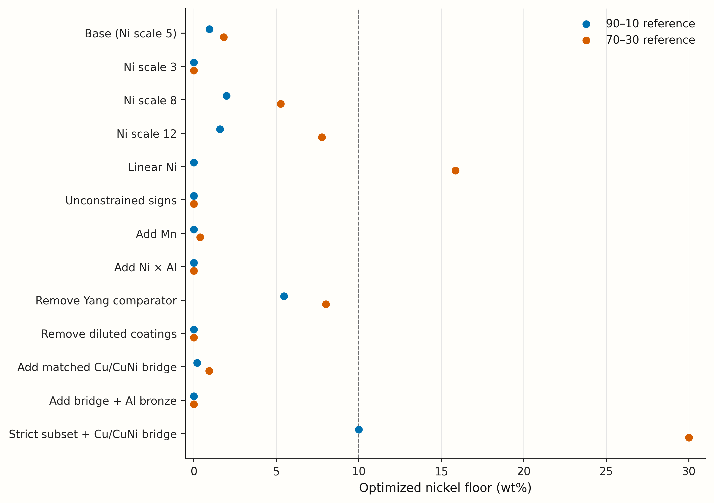

# Independent review: does this copper-alloy benchmark establish a nickel floor?

**Verdict: no robust positive nickel floor is established, and I would not restrict the search to Ni ≥ 10 wt%.** The physics-based version is a useful *what-if simulator*, not a validated truth for 30-day seawater performance. Its fitted floor depends strongly on the imposed nickel response, aluminum response, data exclusions and reference definition.

I independently fitted the data **before reading the supplied fitting implementation**, then compared coefficients. I obtained the same base coefficients to within \(1.1\times10^{-15}\). My continuous, constrained film-only floors are **0.947 wt% Ni against 90–10** and **1.822 wt% against 70–30**, rather than the supplied grid-rounded 1.0 and 1.9. In the full inherited process model I found passing witnesses at **1.625 and 2.4312 wt% Ni**, respectively. These are synthetic-model results, not experimentally demonstrated alloy limits.

I also found and added a genuine **same-deployment pure-Cu/Cu–Ni immersion bridge** in Reinhart's original 1968 report. Adding its four Cu/Cu–Ni records reduces the base film-only floors to **0.195 and 0.938 wt% Ni**. The exposure was **123 days in cold, deep seawater**, not the target 30-day surface-seawater test; it does not settle the target floor. The nominal “95–5” coupon actually contains **6.25 wt% Ni**. Exact measured Cu–2Ni/Cu–5Ni target-test evidence remains missing.

**Scope and evidence labels.** This review distinguishes **executed** numerical checks, **inspected** code/source evidence, and **delegated retrieval**. All original inputs were preserved; hashes are in `input_sha256.json`. I accessed the full text of all five cited sources underlying the original 16 rows, but Lewis–LaQue is itself a review and does not provide all underlying primary-test details. Numerical tables and code accompany this report; uncertainty ranges below are sensitivity ranges, **not confidence intervals**.

## 1. Findings and severity

| Severity | Finding | Quantitative consequence / action |
|---|---|---|
| **Changes the conclusion** | A positive Ni floor is not robust to defensible model choices. | Original-data alternatives give 90–10 floors **0–5.471** and 70–30 floors **0–15.857 wt%**. Removing weak evidence and retaining a strict, data-poor subset can instead give **10/30**. This instability is non-identifiability, not evidence for one cutoff. |
| **Changes the conclusion** | Low-Ni predictions are extrapolations in composition, processing **and test endpoint**. | Only four original observations are electrochemical measurements after 30 days; there is no original paired 30-day mass-loss comparison spanning pure Cu to Cu–Ni. Do not call the fitted response “ln(30-day rate)” without qualification. |
| **Changes the conclusion** | The original dataset's apparent zero-Ni anchor is an **unspecified aluminum bronze assigned a guessed composition**. | Its 43.2 µm/y rate is real, but Ni=0/Al=7/Fe=2.5 is not established for that coupon. The associated NAB grade/composition is also guessed. Remove these from composition-resolved primary fitting. |
| **Changes the conclusion** | The consequential low-Al benefit rests partly on an incompletely documented Yang comparator; the Ni constraint also borrows leverage from steel-diluted coatings. | Dropping Yang raises floors to **5.471/7.999**; dropping Zhao gives **0/0**. Neither should quietly determine an exclusion boundary. |
| **Changes the conclusion** | The score is not “tensile strength counted only if immersion passes.” | The implemented logistic gate counts **50%** of strength at the bar and **26.9%** at \(m=m_{ref}-0.05\), before the mineral penalty. Use a hard gate for the stated objective, or rename the utility. |
| **Changes the conclusion** | mc_ni is not validated for Cu-rich alloys. | The actual database header says it was tested at **Cu < 0.5 wt%**, whereas the search requires **Cu ≥ 65 wt%**. It has no explicit Cu–Al–Ni ternary parameter set. CALPHAD here is a hypothesis generator. |
| **Changes a number; potentially the conclusion** | A spot-checked NAB-like grid point has a different near-solidus equilibrium than an independent solve with the same database. | At Cu balance–4.286Ni–9.5Al–3.6Fe, stored liquid fraction is **0.95730**, versus **0.08340** independently at the stated solidus+1 °C. Stored Fe-rich bcc is **0.02745**; my solve instead has Cu-rich bcc and no separate Fe-rich bcc. This changes the nucleant index from **0.61 to 0** under the stated labeling. Audit the generator/solver before trusting crack benefits. |
| **Changes a number** | The base fitting arithmetic is reproducible, but the supplied film-floor calculation is a grid search. | Continuous floors are **0.946625/1.821657**, with optimal Al **2.613206 wt%**. The code's 0.1-wt% grid explains 1.0/1.9; it does not establish optimized precision. |
| **Changes a number** | Qian's rows are inverse charge-transfer resistance, not measured penetration rates. | Their ratio is **1.859** using the rounded CSV; the same paper's seven-day Tafel-current ratio is **8.171**. Replacing, not stacking, the endpoint gives **1.597/2.607** floors. |
| **Changes a number** | Two quiet-water “rates” are constructed range midpoints, not exact measured observations. | Both 0.4 mpy values come from **0.2–0.6** and **0.3–0.5 mpy** ranges with unspecified duration. Their equality is constructed. |
| **Changes a number** | The reference is a modeled porous deposit, not a truly dense external coupon, and a finite process search misses its best density. | Supplied reference \(m\): **0.831356/0.842067**; continuous best-density deposits: **0.832406/0.842703**; ideal dense references: **0.837285/0.850000**. Full-model low-Ni witnesses still exist below 10 under all three definitions. |
| **Changes a number** | A same-test pure-Cu bridge was missed. | Four matched historical Cu/Cu–Ni records change film floors to **0.195/0.938**. Adding the matched Al bronze gives **0/0**, but that bronze also shows selective attack: average loss alone is not an adequate local-corrosion criterion. |
| **Changes a number** | “Fe in solution” is actually capped nominal Fe; the base Fe coefficient hits zero. | Changing the cap from 1 to 2.5 wt% or removing it does nothing in this fit. That is a boundary solution, not evidence that Fe partitioning is understood. |
| **Changes a number** | The grid contains silent incomplete phase results. | **864/864** rows say `ok=1`; **33** liquidus/range values are missing, and **two** solidus+1 phase-fraction sums are zero. Six alpha-composition records are missing because alpha is absent. Preserve validity/censoring masks. |
| **Changes a number** | Conductivity is physically motivated but only approximate; strength/cracking mappings remain largely hand-set. | Model resistivity for C71500 is **42.2**, versus its own quoted handbook **37.5 µΩ cm**. The crack thresholds correspond to **68/112 °C equilibrium freezing ranges**, with no new DED calibration. |
| **Changes a number / reproducibility** | Flattened uploads do not match runtime paths; the CALPHAD generator depends on an absent helper. | `truth_phys.py` expects `phys/calphad_grid.csv` and `phys/corrosion_fit.json`; I redirected these **in memory only**. `run_calphad.py` and the policy/check scripts were not uploaded. End-to-end policy enforcement cannot be certified. |
| **Cosmetic, unless used as a decision** | “No worse” needs inclusive equality and a numerical tolerance. | `phys_tables.md` labels the 90–10 reference itself “no,” despite using it to set the bar. A reference at its defining settings should pass. |

## 2. Row-by-row data audit

**Executed/inspected:** I retrieved and read full source text for Tan, Yang, Qian, Zhao and Lewis–LaQue, reconciled all 16 original rows, and saved `row_audit.csv` and source text/extracts. Retrieval agents independently supplied primary-table checks, but could not see parent-workspace files. I recovered their executed evidence through task messages and reconciled it locally; I do **not** claim their isolated output paths exist here.

CSV line numbers below include the header. Source abbreviations resolve to the DOI references in §8.

| CSV line | Row and reported value | Check against source and disposition |
|---:|---|---|
| 2 | Tan: 6.82Ni–6.94Al–4.10Fe–1.72Mn; 0.35 µA/cm² | **Verified**, Tables 1 and 3, 30-day polarization. Same preparation/test as the other Tan rows. Not cumulative mass loss. |
| 3 | Tan: 6.13Ni–7.90Al–3.92Fe–2.12Mn; 0.36 | **Verified**, same tables and endpoint. |
| 4 | Tan: 5.18Ni–8.94Al–4.12Fe–2.18Mn; 0.69 | **Verified**, same tables and endpoint. |
| 5 | Tan: 3.99Ni–9.94Al–3.94Fe–1.82Mn; 0.78 | **Verified**. Its Al lies outside the proposed 9.5-wt% search limit; useful as nearby calibration, not an admissible design. Strong covariation of Ni and Al prevents independent identification of their effects. |
| 6 | Yang: nominal 7Ni–3Al–1Fe–1Mn; 0.0215 mm/y | **Verified**, Table 1 and §3.3: cast alloys, ten-day static artificial seawater, mass loss. Other Al-series rates are graph-only; I did not invent exact values. |
| 7 | Yang commercial C70600; 0.0359 mm/y | **Rate verified**, §3.4 and conclusion. Source shorthand is **Cu–10Ni–1Fe–1Mn**, not the CSV's assumed 1.4Fe/0.8Mn. Comparator-specific batch, form and conditioning are insufficiently documented to certify a strict same-test pair. I tested retaining and dropping it. |
| 8 | Qian B10; 0.000185 inverse Ω cm² | **Rct verified**: 5401.604 Ω cm² at seven days, Table 2. Inversion gives 0.00018513. Chemistry 11.266Ni/1.751Fe/0.725Mn is verified; Zr and Hg are omitted from the model. A derived impedance proxy, not measured mass loss. |
| 9 | Qian B30; 0.0000995 | **Rct verified**: 10050.6 Ω cm², Table 3; inverse 0.000099497. Chemistry 30.050Ni/0.726Fe/0.718Mn is verified; Zr/Si are omitted. Same seven-day uncoupled electrochemical endpoint, not the separate coupled-current measurement. |
| 10 | Lewis quiet C70600; 0.4 mpy | **Constructed midpoint** of 0.2–0.6 mpy, Table III, printed p.32. Duration and coupon chemistry are not supplied. “Wrought tube” is not established by this table alone. |
| 11 | Lewis quiet C71500; 0.4 mpy | **Constructed midpoint** of 0.3–0.5 mpy, same table. Generic grade chemistry is not an analyzed heat composition. |
| 12 | Lewis aluminum bronze; 43.2 µm/y | **Rate and matched condition verified**, Table XIV, p.43: uncoupled one-year exposure, 0.6 m/s seawater. Grade unspecified. Assigning C61400 and 7Al/2.5Fe is unsupported. |
| 13 | Lewis NAB; 150 µm/y | **Rate and condition verified**, same table. Grade unspecified; assigning C95800 and the listed chemistry is unsupported. |
| 14 | Lewis C70600; 30.5 µm/y | **Verified** same uncoupled exposure. Heat chemistry and product-form details remain unavailable; secondary reproduction of unpublished INCO data. |
| 15 | Lewis C71500; 20.3 µm/y | **Verified**, same limitations. The paired 90–10/70–30 rate ratio is 1.502. |
| 16 | Zhao N-1; 7.82 µA/cm² | **Verified**, Tables 3/5: regional upper-coating EDS 3.8Ni/9.8Al/**11.2Fe**. Steel-diluted coating, not homogeneous benchmark feedstock. Mn is unreported, not measured zero. |
| 17 | Zhao N-2; 4.65 µA/cm² | **Verified**, regional EDS 12.4Ni/10.4Al/4Fe. NiAl interlayer changes dilution, microstructure and substrate interactions. Same polarization protocol does not remove these confounders. |

**No outright numeric rate mistranscription was found in these 16 rows.** The important problems are unsupported chemistry, constructed proxies/midpoints, and comparability—not a decimal-point error. I corrected Yang's source nominal chemistry in a separate output without changing the uploaded CSV. Its correction leaves the constrained base fit unchanged because the Fe coefficient is zero and Mn is omitted.

### What within-study ratios do—and do not—solve

A study intercept cancels a multiplicative rate/unit factor **if both observations measure the same endpoint with a composition-independent conversion**. It does not cancel casting versus commercial processing, flow/oxygen dependence, selective attack, temperature, duration-dependent film development, or the difference between charge-transfer resistance and mass loss. Nor does it make all slopes transferable across studies. In particular, Stern–Geary conversion depends on polarization slopes; inverse \(R_{ct}\) need not be proportional to alloy penetration rate with one common constant.

### Added and missed same-test evidence

**The important new bridge is primary immersion evidence.** Reinhart1968, Tables 2/3/14/15, contains the following **NCEL, fully exposed seawater, 123-day, 5,640-ft deployment**. I downloaded the original scanned report and checked the composition and rate table images locally.

| Material | Ni | Al | Fe | Mn | Mass-loss rate, mpy | mm/y |
|---|---:|---:|---:|---:|---:|---:|
| Oxygen-free Cu | 0 | 0 | no intentional addition | no intentional addition | 1.6 | 0.04064 |
| Nominal 95–5, actually 6.25Ni | 6.25 | 0 | 1.24 | 0.53 | 1.5 | 0.03810 |
| 90–10 coupon | 9.42 | 0 | 1.16 | 0.38 | 1.6 | 0.04064 |
| 70–30 coupon | 30.53 | 0 | 0.53 | 0.33 | 1.2 | 0.03048 |

The report tabulates chemistry; it does not consistently distinguish analyzed from nominal composition. “No intentional addition” is not an analytical zero. The same report has a matched 6.59Al–3.15Fe bronze at **0.5 mpy**, but flags **slight dealloying**. The setting is approximately **2.3 °C, low dissolved oxygen**, not warm aerated seawater. I therefore use it as a transferability sensitivity, not a replacement target-test dataset. Pure Cu equals the 90–10 coupon at the displayed precision in this deployment; that alone does not establish equality at 30 days in the proposal's environment.

I reconstructed **71 historical records**, preserving deployment and participant groups and a censored value, in `historical_bridge_data.csv` and `historical_bridge_metadata.csv`. I did not collapse exposures of different depth/duration into one intercept or count NCEL and INCO as interchangeable replicates. The all-history sensitivity caps the whole report's total row weight at **2** and excludes the censored record. Those reconstructions were delegated and selected primary tables were checked locally; I did not independently re-read every one of the 71 added rows from the scans.

Other source-supported additions and exclusions:

- **Tan2024:** the missed ten-day polarization series is **0.50, 1.34, 1.77, 2.16 µA/cm²**. I tested replacing the 30-day series with it, not treating time points as independent new studies. The exact 30-day mass-loss minimum is **0.00267 mm/y**, but only one exact composition-linked mass-loss value is available in text; it cannot identify within-study slopes alone.
- **Qian2025:** Tables 4/5 provide five matched Tafel pairs from three hours to seven days. The seven-day values are **234.52 versus 28.70 µA/cm²**. I tested replacing the EIS proxy with this pair rather than double-counting both endpoints.
- **Lewis–LaQue:** Table XVII supplies missed **30-day, clean seawater, 2 m/s** measurements: C70600 **93.9, 84.9** and C71500 **95.1, 89.5 µm/y**. These are review-reproduced data with grade-level, not measured heat, chemistry. Table XV has additional untreated 62/132-day Cu–Ni–Fe comparisons. Table XX reproduces a **60-day, 3.4% NaCl** Fe series: Cu–10Ni with 0/0.3/1.5Fe gives **38.4/33.0/12.2 µm/y**. I label that series secondary and do not relabel 3.4% as 3.5%.
- **Gudić2021:** primary Tables 1/2 connect pure Cu to Cu–Al and Cu–Al–Ni in **0.5 M NaCl, 20 °C**. Currents are **13.95, 6.56, 5.17, 3.48, 2.83 µA/cm²** for Cu, Cu–9.10Al, Cu–11.29Al–4.05Ni, Cu–8.30Al–9.40Mn, and Cu–13Al–2.5Ni–2.5Mn. Only the Cu/Cu–9.10Al pair lies wholly within the composition box. Conditioning is 60-min open-circuit potential **plus impedance testing**, not 30-day immersion. I retain the outside-box series only as a deliberately adverse extrapolation sensitivity.
- **Southwell, Hummer & Alexander1966:** primary tropical exposure tables connect Cu and **5.07Al–0.08Fe bronze**. One-year continuous-seawater penetration is **1.21 versus 0.18 mil**, equivalent to annualized rates with a ratio **0.149**. The 1/2/4/8/16-year records are nested cumulative exposures; I use only the one-year pair in the fit sensitivity, not five independent replications. Atmospheric bronze has different chemistry and is excluded from this seawater fit.
- **Zhao N-3:** missed current **4.09 µA/cm²**, chemistry 10.8Ni/10.9Al/4.1Fe/**1.9Cr**, is saved but excluded from benchmark-composition fitting because Cr and the interlayer are confounded.
- **Walsh2024:** primary pure-Cu/Cu–Ni/NAB rotating-electrode data exist, but Tafel and linear-polarization prose are numerically inconsistent and conditioning times differ. I retrieved the paper locally and did not force these values into the principal regression.
- **Zhu2017:** delegated full-PDF inspection found a **30-day, 3.5% NaCl** rate of **0.028 mm/y** for 6.5Ni–1Al–1Si–0.15Mg–0.15Ce. It is an outside-chemistry singleton without a same-test reference, so it supplies context, not an identifiable slope or target floor. My local paper API retry failed; I rely on the explicitly labeled delegated extraction for this fact.
- **Dhar1985**, DOI 10.5006/1.3582011, directly compares Cu/10Ni/30Ni, but primary numerical full text was inaccessible. Its abstract is not sufficient to construct rate rows. Exact Cu–2Ni/Cu–5Ni comparison values were **not recovered**.

`additional_data.csv`, `additional_fe_series.csv`, `gudic_bridge_data.csv`, `southwell_immersion_bridge.csv`, and the historical files preserve numeric additions and inclusion restrictions. These are not silently pooled into a claimed clean 30-day dataset.

## 3. Independent regression and continuous floor optimization

### Method and independence

I first implemented weighted within-study centering, which analytically removes each study intercept, and fitted the centered log rates with bounded least squares. My first saved result was **unpenalized**; only after that did I inspect `fit_corrosion.py` and add its ridge penalty for a like-for-like base comparison. I subsequently executed the supplied `fit()` function for coefficient cross-checks, but did not use its sampling/grid floor routine as my optimizer.

The base response is

\[
 z(N,A,F)=b_N[1-\exp(-N/5)]+b_A A+b_{A2}A^2/10+b_F\min(F,1.5),
\]

with compositions in wt%, \(b_N,b_F\le0\), supplied row weights, and a **0.05 ridge penalty on slopes only**. I obtain

\[
(b_N,b_A,b_{A2},b_F)=(-0.318371,-0.168659,0.322706,\;\text{approximately }0).
\]

The unpenalized independent coefficients are **−0.411589, −0.182996, +0.332126, approximately 0**. There are **16 observations but only ten within-study contrast dimensions**, before estimating slopes. Six study labels come from only **five source documents**. The base's nominal four-slope design is full rank, but this is not strong causal identification.

For each model and bar, I minimized Ni subject to \(z\le z_{reference}\), the element bounds, Cu ≥ 65, and the supplied grid-interpolated liquidus ≤ 1,250 °C. I partitioned the domain at Al=1.5 and 7 so that the conditional Fe limits are enforced explicitly, and used multistart sequential quadratic programming—not sampling minima. Film-only candidates assume dense, beta-prime-free material.

I additionally minimized the separable Al polynomial and Fe/Mn terms over a **relaxed full box** and solved the Ni inequality analytically. Whenever the relaxed minimizer satisfies the proposal limits, it certifies the constrained global floor. **48 of the 50 original-data bar/model cases have such closed-form certificates; the other two have feasible zero-Ni witnesses and the trivial global lower bound Ni ≥ 0.** I checked all reported witnesses against the limits. For models without Mn, the feasible witness at Mn=0 also certifies that allowing other Mn values cannot lower the relaxed Ni bound. Mn-model witnesses here also optimize to zero.

The film-only tables use the fitter's reference compositions **(10Ni, 0Al, 1.4Fe, 0.8Mn)** and **(30Ni, 0Al, 0.6Fe, 0.8Mn)**. The actual network references are **(9.99,0,1.395,0.8)** and **(30,0,0.675,0.8)**. Testing that discrepancy changes the base 90–10 floor by only **0.00164 wt% Ni**, but the definitions should still be unified.

### Original-data alternatives

All floors and witness coordinates are **wt%**; **Mn=0 and Cu is the balance**. Three-decimal witnesses are rounded presentations of boundary solutions, not fabrication targets guaranteed to pass after rounding. Full precision, coefficients, residual sums of squares and validity checks are in `refits.json` / `refits.csv`. I also executed the packaged reproduction script end to end: all **82 floors** reproduced, with a maximum difference of **1.1e-08 wt% Ni**.

| Independent fit / data change | Ni floor: 90–10 | Witness (Ni, Al, Fe) | Ni floor: 70–30 | Witness (Ni, Al, Fe) |
|---|---:|---|---:|---|
| Base | 0.947 | (0.947, 2.613, 0.000) | 1.822 | (1.822, 2.613, 0.000) |
| No ridge | 1.453 | (1.453, 2.755, 0.000) | 2.431 | (2.431, 2.755, 0.000) |
| Ridge 0.5 | 0.000 | (0.000, 2.066, 0.000) | 0.000 | (0.000, 2.066, 0.000) |
| Linear Al | 0.000 | (0.000, 0.000, 0.000) | 0.000 | (0.000, 0.000, 0.000) |
| Free signs | 0.000 | (0.000, 2.301, 0.000) | 0.000 | (0.000, 2.301, 0.000) |
| Linear Al; free signs | 0.000 | (0.000, 0.000, 0.000) | 0.000 | (0.000, 0.000, 0.000) |
| Ni scale 3 | 0.000 | (0.000, 2.227, 0.000) | 0.000 | (0.000, 2.227, 0.000) |
| Ni scale 8 | 1.982 | (1.982, 2.937, 0.000) | 5.268 | (5.268, 2.937, 0.000) |
| Ni scale 12 | 1.591 | (1.591, 2.995, 0.000) | 7.771 | (7.771, 2.995, 0.000) |
| Linear Ni | 0.000 | (0.000, 2.861, 0.000) | 15.857 | (15.857, 2.861, 0.000) |
| Fe cap 1.0 | 0.947 | (0.947, 2.613, 0.000) | 1.822 | (1.822, 2.613, 0.000) |
| Fe cap 2.5 | 0.947 | (0.947, 2.613, 0.000) | 1.822 | (1.822, 2.613, 0.000) |
| Fe nominal (no cap) | 0.947 | (0.947, 2.613, 0.000) | 1.822 | (1.822, 2.613, 0.000) |
| Equal row weights | 0.875 | (0.875, 2.486, 0.000) | 1.737 | (1.737, 2.486, 0.000) |
| Equal study weights | 1.785 | (1.785, 2.874, 0.000) | 2.838 | (2.838, 2.874, 0.000) |
| Add Mn | 0.000 | (0.000, 2.967, 0.000) | 0.388 | (0.388, 2.967, 0.000) |
| Add Ni x Al | 0.000 | (0.000, 0.000, 1.500) | 0.000 | (0.000, 0.000, 1.500) |
| Drop Tan2024 | 0.000 | (0.000, 3.264, 0.000) | 0.403 | (0.403, 3.264, 0.000) |
| Drop Yang2018 | 5.471 | (5.471, 0.995, 0.000) | 7.999 | (7.999, 0.995, 0.000) |
| Drop Qian2025 | 0.000 | (0.000, 2.448, 0.000) | 0.030 | (0.030, 2.448, 0.000) |
| Drop LewisLaQue1981_quiet | 1.045 | (1.045, 2.628, 0.000) | 1.939 | (1.939, 2.628, 0.000) |
| Drop LewisLaQue1981_1y | 1.013 | (1.013, 4.750, 0.000) | 1.901 | (1.901, 4.750, 0.000) |
| Drop Zhao2022 | 0.000 | (0.000, 2.311, 0.000) | 0.000 | (0.000, 2.311, 0.000) |
| Drop Lewis + Zhao (weak rows) | 0.000 | (0.000, 4.325, 0.000) | 0.000 | (0.000, 4.325, 0.000) |
| Only Tan + Yang | 0.000 | (0.000, 3.941, 0.000) | 0.000 | (0.000, 3.941, 0.000) |

“Equal study weights” means each of the six study labels has total weight one; it does not pretend that the two Lewis labels are independent source documents. “Drop Lewis + Zhao” removes constructed/unknown-grade review rows and the diluted coatings. “Only Tan + Yang” excludes the EIS proxy too. These restricted fits are useful diagnostics, not validated replacements.

**Interpretation of the alternatives:**

1. **The Al optimum is model-created.** The base quadratic has a minimum at **2.613 wt% Al**. The best directly described low-Al mass-loss alloy is Yang's 3Al sample; its exact within-series curve is not tabulated. Tan mainly explores high Al while varying Ni in the opposite direction. Neither dataset independently maps the low-Ni/low-Al saddle that determines the floor.
2. **Sign constraints are priors, not observations.** Free signs give \(b_N=-0.00757\), \(b_F=+0.38697\); linear Al plus free signs gives \(b_N=+0.44212\), \(b_F=+0.51132\). I do not interpret these confounded coefficients as proof that Ni or dissolved Fe is intrinsically harmful. Conversely, forcing protective signs cannot convert an unidentified knee into measured evidence. The linear-Al constrained model sets both film coefficients essentially to zero; its zero floor is an identification failure, not proof that pure Cu meets the target test.
3. **A five-wt% Ni scale is not identified by 10-versus-30Ni pairs.** The base predicts a dense 90–10/70–30 rate ratio of only **1.043**, compared with **1.859** for the original Qian proxy and **1.502** for Lewis's one-year pair. Linear Ni predicts **1.462** and has lower weighted residual sum of squares (**0.438 versus 0.601**). A 60-point scale profile puts the lowest penalized loss near **22.7 wt%**, not 5; that is only a profile sensitivity, not a validated fitted film mechanism.
4. **Fe-cap insensitivity is not Fe robustness.** All cap variants hit \(b_F\simeq0\). The separate reproduced 60-day Fe series demonstrates a strong within-test Fe effect, yet adding it at low weight still leaves the global coefficient at its zero bound. One composition-only slope is not adequately representing the heterogeneous studies.
5. **Mn and interaction models are stress tests.** Adding Mn gives \(b_{Mn}=+0.3842\) per wt% and moves the floors sharply; the original Zhao Mn values are not measured zeros. Excluding Zhao before adding Mn gives 0/0 as well. Adding \(N\times A/10\) gives coefficient **−0.05783**, while the main Ni film coefficient hits zero. These extra coefficients are too weakly supported for mechanistic conclusions.
6. Ridge strength and feature scaling matter. A penalty on the chosen feature coordinates is a discretionary regularization prior, not a measured uncertainty model.

### Source corrections, new bridge and endpoint sensitivities

The following are **separate re-fits**, not one indiscriminately augmented dataset. All start from the Yang nominal-chemistry correction unless the label says otherwise. New rows generally receive weight **0.5**; the secondary Fe series and tropical pair receive **0.25**. The whole-history cases use total report weight **2**, to avoid letting many correlated historical deployments overwhelm five modern/review sources.

| Independent fit / data change | Ni floor: 90–10 | Witness (Ni, Al, Fe) | Ni floor: 70–30 | Witness (Ni, Al, Fe) |
|---|---:|---|---:|---|
| Yang nominal corrected | 0.947 | (0.947, 2.613, 0.000) | 1.822 | (1.822, 2.613, 0.000) |
| No unconfirmed Yang comparator | 5.471 | (5.471, 0.995, 0.000) | 7.999 | (7.999, 0.995, 0.000) |
| Replace Qian EIS by 7d Tafel | 1.597 | (1.597, 2.733, 0.000) | 2.607 | (2.607, 2.733, 0.000) |
| Add Lewis 30d clean-water pair | 0.772 | (0.772, 2.588, 0.000) | 1.614 | (1.614, 2.588, 0.000) |
| Add Lewis untreated 62d/132d pairs | 2.178 | (2.178, 2.894, 0.000) | 3.327 | (3.327, 2.894, 0.000) |
| Replace Tan30d by Tan10d | 0.000 | (0.000, 3.022, 0.000) | 0.709 | (0.709, 3.022, 0.000) |
| Mn excluding unreported Zhao | 0.000 | (0.000, 2.514, 0.000) | 0.000 | (0.000, 2.514, 0.000) |
| Add 123d Cu/CuNi-only bridge | 0.195 | (0.195, 2.519, 0.000) | 0.938 | (0.938, 2.519, 0.000) |
| Add 123d Cu/CuNi/Al bronze bridge | 0.000 | (0.000, 3.613, 0.000) | 0.000 | (0.000, 3.613, 0.000) |
| Add all historical bridges; report weight2 | 0.000 | (0.000, 4.439, 0.000) | 0.400 | (0.400, 4.439, 0.000) |
| Add all historical Cu/CuNi; report weight2 | 0.703 | (0.703, 2.579, 0.000) | 1.533 | (1.533, 2.579, 0.000) |
| Strict data +123d Cu/CuNi bridge | 10.000 | (10.000, 0.000, 0.000) | 30.000 | (30.000, 0.000, 0.000) |
| Add Gudic Cu/CuAl pair only | 1.331 | (1.331, 4.069, 0.000) | 2.283 | (2.283, 4.069, 0.000) |
| Add Gudic all alloys (outside box) | 3.931 | (3.931, 5.523, 0.000) | 5.655 | (5.655, 5.523, 0.000) |
| Add secondary 60d Fe series | 0.947 | (0.947, 2.613, 0.000) | 1.822 | (1.822, 2.613, 0.000) |
| Add 1y tropical Cu/CuAl bridge | 0.487 | (0.487, 3.506, 0.000) | 1.279 | (1.279, 3.506, 0.000) |

The requested **with/without pure-Cu comparison** is therefore explicit: **0.947/1.822 without**, **0.195/0.938 with the four matched Cu/Cu–Ni rows**, and **0/0 with the matched bronze too**. The full historical Cu/Cu–Ni subset at capped influence gives **0.703/1.533**, so the chosen deployment is not the only possible presentation.

The “strict data +123d bridge” fit retains only Tan, Qian and the four historical Cu/Cu–Ni observations, dropping the undocumented Yang comparison, Lewis assumptions and Zhao coatings. It returns **10/30** because it estimates Al as unhelpful across the extrapolated low-Al range. This does **not** prove no lower-Ni aluminum-bearing alloy can pass: the strict subset has discarded the only original low-Al benefit comparison. I include it to show how evidence-quality choices can change the answer all the way to the reference composition. It would be circular to select that fit because a Ni floor is desired.

**Uncertainty:** I do not report a narrow standard error or confidence interval on a boundary extrapolation from five heterogeneous documents, active coefficient constraints, missing replicate errors, unknown grades and uncertain endpoint conversions. The alternative-model range is not statistical coverage. A positive physical floor is not established merely because one selected constrained regression has a positive optimum.

## 4. Full-truth floors, reference definition and objective

### Executed full-network checks

I installed the missing Python dependencies, imported the uploaded network, redirected its flattened resource paths in memory, and executed its nodes. I minimized Ni over the **seven design variables**, including process settings, using multistart constrained optimization. These full-network results are **best minima found, not global certificates**; the multilinear CALPHAD grid has nonsmooth cell boundaries. The 90–10 boundary run did not declare solver success, so I separately checked a slightly higher-Ni, strictly passing witness.

| Bar | Supplied-reference \(m_{ref}\) | Full-truth Ni boundary found | Strictly passing composition (Ni, Al, Fe, Mn), wt% | Process (a, P, v), scaled | Witness \(m-m_{ref}\) |
|---|---:|---:|---|---|---:|
| 90–10 | 0.831356345 | 1.62484 | (1.6250, 2.073631, 3.6000, approximately 0) | (0.391584, 0.637217, 0.559983) | +0.00000229 |
| 70–30 | 0.842066618 | 2.43110 | (2.4312, 2.073927, 3.6000, approximately 0) | (0.386670, 0.633157, 0.559022) | +0.00000122 |

Both strict witnesses satisfy **all proposal limits**. Their boundary densities are about **0.9862/0.9874**, and retained-beta indices about **0.06885/0.06834**. Thus the supplied full truth itself does not imply a Ni ≥ 6 or ≥ 10 floor. The original full-truth 1.6/2.4 table is a reasonable rounded description of this particular simulator.

Reference optimization matters, but does not rescue a 10-wt% cutoff:

| Reference definition | \(m_{ref}\), 90–10 / 70–30 | Full-model Ni boundary found, 90–10 / 70–30 |
|---|---|---|
| Supplied 16,384-point process search | 0.831356 / 0.842067 | 1.625 / 2.431 |
| Continuously optimized density of the modeled deposits | 0.832406 / 0.842703 | 1.698 / 2.483 |
| Truly dense, beta-free reference, with no porosity penalty | 0.837285 / 0.850000 | 2.055 / 3.125 |

For the last two rows I held Fe at the previously found 3.6-wt% grid knot and optimized the other six coordinates. They provide additional low-Ni passing boundaries/witness families, not global minimum certificates. A truly dense external reference should not inherit the simulator's processing penalty.

I also executed a **262,144-point scrambled Sobol diagnostic** over uniformly scaled seven-dimensional designs, seed 2728. It gives **73.813%** inside the proposal limits. Among those designs, **0.898%** pass the 90–10 bar and **0.627%** pass the 70–30 bar; fractions of the entire box are **0.663%/0.463%**. These are distribution-dependent sampling estimates, not intrinsic alloy fractions. The uploaded 0.8%/0.6% figures are broadly consistent in scale, but I cannot reproduce their exact seed, sample size or denominator from the missing checking script.

A separate multistart optimization of the actual **soft-gated** 90–10 objective found **J=0.30028** at about **15.100Ni–2.405Al–0.900Fe–0Mn**, with scaled process (0.3920, 0.6058, 0.5290), \(m=0.89880\), \(U=0.59712\), and yield-strength surrogate **359.9 MPa**. This slightly improves the uploaded J=0.298; it is a best value found, not a global-optimality proof. It does not establish the physical optimum or verify policy performance.

### What “no worse than the reference” should mean

**Use the reference actually promised in the proposal.** If the service comparator is dense C70600, then **90–10 is the defensible default**. C71500 is a legitimate **separate, stricter scenario**, not an interchangeable interpretation that can be chosen after seeing the floor. If the proposal explicitly names 70–30, that—not a more convenient 90–10 bar—must be the primary test. Neither alloy is universally superior in every flow, sulfide and film-age regime; for example, the missed 30-day flowing-seawater pair does not show a clear 70–30 advantage.

Specify the alloy heat chemistry, product condition, surface preparation, seawater composition, temperature, oxygenation, flow, cleaning procedure and endpoint. Define “no worse” as a paired **30-day cumulative mass-loss comparison**, supplemented by an agreed maximum local-penetration/dealloying requirement. A current measured after 30 days is not itself 30-day cumulative loss. Define a noninferiority margin and uncertainty rule before testing; finite noisy replicates cannot demonstrate exact equality with certainty.

### Score and network inconsistencies to fix

- `objective_from` uses \(U\,\mathrm{sigmoid}[(m-m_{ref})/0.05]-0.3B\), not \(U\mathbf{1}(m\ge m_{ref})-0.3B\). At the bar the strength contribution is halved; a failing design still receives strength credit. If a smooth acquisition surrogate is useful, keep it separate from the reported hard-pass final objective.
- `U` remains a dimensionless, hand-written tensile surrogate. The CALPHAD `strength_mpa` value is labeled a **yield estimate** and is not a validated ultimate tensile strength prediction. Report these as separate quantities.
- The film fit already absorbs differences associated with high-Al microstructures; an additional inherited beta-prime attack penalty may **double-count** some of that signal. Its coefficient is not independently fitted here. The inherited one-hour-screen transfer and process-density penalties are also unvalidated.
- `feasible()` correctly implements the stated Cu, conditional Ni/Fe and low-Al Fe limits and the interpolated liquidus bound. But `objective()` itself still returns finite values outside those limits. `bofn_alloy.py` exposes a `FEASIBLE` mask; the absent policy code must actually apply it to **initial designs, candidates, optimization, baselines and reported optima**. I did not certify that integration.

## 5. CALPHAD node, mapping and limits

### What I executed

I downloaded **mc_ni v2.036** from the link on MatCalc's open-database page. Its SHA-256 is

`84ba813156e1f7d8bde495d74420319afec03572b981f6b56103807f305313ab`,

matching the supplied prefix. I installed **pycalphad 0.11.2** and executed equilibrium spot checks, rather than stopping at code inspection.

The raw MatCalc file is not directly readable by pycalphad: Latin-1 characters, MatCalc-only metadata/preferred-constituent markers, non-Gibbs vacancy-formation records, and a `6000.00.00` temperature-limit typo need handling. I saved both original and adapted files. I retained Gibbs-energy and magnetic parameters, removed metadata/unsupported HMVA records, and corrected that temperature-bound typo. I did not invent a Cu–Al–Ni assessment.

The uploaded generator imports **`run_calphad.py`, which is not present**. Therefore I cannot exactly reproduce its phase selection, labeling, solver options, or melting-range routine. My meaningful spot checks explicitly use **LIQUID, FCC_A1, BCC_A2, NIAL and GAMMA_PRIME**, consistent with the grid's principal represented phases. This is an explicit analytical choice, not proof that I reran the original generator. An unrestricted compatible-phase run instead produced a spurious **beta-Mn phase in Mn-free Cu–Ni–Fe**, reinforcing why phase-set handling must be archived and tested.

### Grid integrity and spot checks

- **864 rows**, all marked successful; coordinate order agrees with the declared 8×6×6×3 product. Stored Ni coordinates are rounded to four decimals; the truth interpolates on ideal uniform levels, a negligible coordinate difference here.
- At 900 and 600 °C, stored phase sums are within approximately **0.99999–1.00001**. At solidus+1 °C, **two rows sum to zero**, despite `ok=1`: grid indices **245** and **854**. Index 245, **8.571Ni–1.9Al–2.7Fe–4Mn**, is inside the proposal limits. My independent solve there yields **0.97748 FCC + 0.02252 liquid**, not a zero phase inventory.
- **33 missing liquidus/range values** are replaced by 1,550 °C in the truth. That is a lower-bound/censoring treatment for solids remaining at the top of the scan, not a measured liquidus. Interpolating a censored bound as an exact number can understate nearby liquidus; keep a separate validity/bound mask. There are no `ok=0` rows for the advertised nearest-neighbor repair to fix.
- **Six missing alpha compositions** occur where alpha fraction is zero. Setting those composition terms to zero can be sensible for the absent matrix, but the strength mapping must then handle a predominantly beta alloy explicitly; otherwise it can silently return an implausible low strength.

| Exact grid composition, wt% | Independent result | Comparison with stored grid |
|---|---|---|
| Pure Cu | FCC at 600 °C; solid at 1083.51 °C, liquid at 1085.51 °C | Consistent with stored melting point **1084.51 °C**. |
| 30Ni–0Al–0.9Fe–0Mn | At 600 °C: Cu-rich FCC **0.948556**, Fe/Ni-rich FCC **0.051444** | Matches stored **0.94856/0.05144**. At stored liquidus ±1 °C, liquid fraction is approximately **0.99029/1.00000**, supporting the upper transition. |
| 4.285714Ni–9.5Al–3.6Fe–0Mn | At 600 °C: FCC **0.872260**, Fe-rich bcc **0.048779**, NiAl **0.078961** | Matches stored **0.87226/0.04878/0.07896**. |
| Same NAB-like point, **1045.82 °C** = stored solidus+1 | Liquid **0.083395**, Cu-rich bcc **0.888740**, NiAl **0.027865** | **Does not match** stored liquid **0.95730**, Fe-rich bcc **0.02745**, NiAl **0.01525**. Primary high-temperature microstructure, not just rounding, differs. |
| 8.571429Ni–1.9Al–2.7Fe–4Mn at **1051.44 °C** | FCC **0.977482**, liquid **0.022518** | Stored near-solidus phase sum is **zero**, while the row says `ok=1`. |

I did not rebuild all 864 points or independently locate every liquidus/solidus. The NAB discrepancy could involve solver convergence/metastability or missing helper behavior; without that helper I cannot attribute a single cause. The executed mismatch is enough to require an audit, not enough to declare every grid value wrong. Machine-readable independent equilibria and NetCDF outputs are saved.

### Physical meaning of the outputs

**\(f=\Delta T_{eq}/200\).** Equilibrium freezing range is a thermodynamic descriptor, not a calibrated hot-tearing measure for rapidly solidifying blown-powder directed energy deposition (DED). The thresholds \(f\le0.34\) and onset 0.56 imply **68 and 112 °C**, respectively, inherited from the old synthetic scale. They need recalibration after replacing the scale. Nonequilibrium segregation, terminal feeding, strain, grain morphology and remelting matter. Compare equilibrium and Scheil/finite-back-diffusion paths, but do not label either a validated crack probability without experiments.

**\(g=(f_{Fe-rich\,bcc}+f_{Fe/Ni-rich\,fcc})/0.045\).** A solid fraction **one degree above the solidus** is not necessarily the population of particles present **before alpha nucleation**. Some Fe-rich FCC can form after, or by decomposition within, a copper-rich solid; its equilibrium abundance does not establish heterogeneous nucleation potency. Count primary particles on the liquidus-to-alpha path, with their identity, size, stability and crystallographic compatibility. Mole fractions are not automatically volume fractions. The 0.045 normalization and clipping also saturate the model's grain-refinement benefit without a measured dose-response.

At the checked NAB-like point, the stored near-solidus fraction gives \(g=0.02745/0.045=0.61\); my solve has no separate Fe-rich phase there, so its stated labeling gives zero. This is consequential because the inherited crack formula can reduce effective freezing index by up to roughly **76%** at \(g=1\). A numerically or physically misidentified particle population can therefore create artificial feasibility and strength benefits.

**\(s\), strength at 600 °C phase state.** CALPHAD predicts equilibrium phase fractions, not particle size, spacing, coherency, dislocation density or DED thermal history. Terms such as \(700\sqrt{f_{NiAl}+f_{Ni_3Al}}+250\sqrt{f_{Fe-rich\,bcc}}\) MPa are an **Orowan-inspired surrogate**, not an Orowan calculation. They lack precipitate size/spacing and use mole fractions instead of demonstrated volume fractions. The nominal 600 °C equilibrium state may represent a long aging treatment rather than an as-deposited alloy. The mole-to-weight conversion divides by copper's molar mass rather than the actual alpha mean molar mass, and the solid-solution contribution is not matrix-fraction-weighted. Distinguishing Fe-rich FCC from kappa strengthening is sensible, but the complete mapping needs mechanical calibration.

**\(h=0.6\sqrt{k/k_{Cu}}\).** Wiedemann–Franz plus residual-resistivity increments is a reasonable first-order physical trend. However, the implementation uses **nominal composition**, not solutes actually in solution, despite comments invoking dissolved solutes. It applies constant room-temperature increments to a DED heat-flow surrogate and treats precipitating Fe/Al/Ni through an effective ad hoc coefficient.

| Alloy composition used for check | Model resistivity, µΩ cm | Handbook resistivity quoted in uploaded code, µΩ cm | Model \(k\), W/(m K) | Model \(h\) |
|---|---:|---:|---:|---:|
| Pure Cu | 1.7 | 1.7 | 435.6 | 0.600 |
| C70600-like: 10Ni–1.4Fe–0.8Mn | 18.0 | 19.1 | 45.67 | 0.194 |
| C71500-like: 30Ni–0.6Fe–0.8Mn | 42.2 | 37.5 | 22.35 | 0.136 |
| C61400-like: 7Al–2.5Fe | 14.7 | 12.3 | 54.80 | 0.213 |
| C60800-like: 6Al | 10.7 | 10.1 | 73.41 | 0.246 |

These are internal back-checks against the code's own quoted handbook values, **not independently verified new handbook measurements**. The tenfold conductivity decline by 10Ni is qualitatively captured, but the square-root transformation and power threshold are not derived heat-transfer laws.

### Database and proposal-limit caveats

The most important database caveat is broader than “NAB liquidus ~50 °C high”: the **database's assessed/tested application is Ni-base superalloys**, and its header's Cu limit is below 0.5 wt%. No explicit Cu–Al–Ni ternary parameters were found in the downloaded file. Missing relevant Cu-rich phase descriptions and unvalidated extrapolations can alter phase identities and liquidus across much of the box. The supplied statement that NAB liquidus is about 50 °C high is a warning from the uploaded documentation; **I did not independently verify that 50 °C experimental offset**.

The four proposal limits are implemented correctly at the truth-mask level. They remain **proposal constraints**, not consequences proved by this thermodynamic model. In particular, using a database with such system-level uncertainty as a sharp 1,250 °C exclusion surface risks false exclusions. I would retain clear engineering limits but mark CALPHAD-dependent boundaries uncertain and validate points near them. I would not silently subtract 50 °C from every alloy's liquidus: a local discrepancy is not a universal correction.

## 6. Robustness verdict and the smallest useful experiment

### Is there a robust nickel floor?

**No positive numerical floor is supported robustly.** There is a plausible physical benefit from Ni-assisted films, but “Ni helps” does not imply “every possible Al/Fe/Mn combination below a universal Ni threshold must fail.” Aluminum-assisted protection, phase-selective attack, product condition and film age matter. The constrained base fit's protective signs and Al quadratic are defensible priors to explore, but not enough evidence to certify an exclusion rule.

The newly found pure-Cu data partly close the compositional gap, but not the **target-test/DED transfer gap**. Zero predicted floor does not prove pure Cu or a Ni-free bronze is good enough in the proposed 30-day test. Conversely, a strict, low-information fit returning 10/30 does not prove such alloys cannot pass. Both errors would overinterpret the evidence.

### Would I restrict the space to Ni ≥ 10?

**No.** It would discard the base model's optimized witnesses, the full simulator's strictly passing low-Ni designs, and the low-Ni Al-bearing hypothesis the experiment is supposed to test. It would also manufacture a boundary conveniently aligned with a commercial reference rather than learned from appropriate data.

For preliminary optimization studies, I would keep the full permitted composition space, use low-Ni uncertainty-aware sampling, and run an **ensemble of alternative truths**: saturating/linear Ni, alternative Al forms/interactions, strict/expanded evidence, and both explicitly named bars. Show whether policy rankings survive. If Ni ≥ 10 is imposed for a separate engineering or supply-chain reason, label it an **external scope restriction**, not an experimentally established corrosion floor. Report results for the unrestricted domain too.

### Smallest experiment: separate falsification from establishing a boundary

**To falsify Ni ≥ 10 as necessary**, the logical minimum is **one well-chosen sub-10Ni alloy and the C70600 reference in the exact same 30-day test**. Three independent coupons per material gives **six coupons**, but that is only a starting experiment, not a powered guarantee. A concrete challenge is Cu balance–**2Ni–2.1Al–3.6Fe–0Mn**, fabricated to high measured density; it is near the full simulator's low-Ni witness family. Add three C71500 coupons if that bar also matters. A convincing pass under the prespecified mass-loss and local-attack criteria disproves the proposed 10-wt% exclusion, even though it does not locate the ultimate floor.

**To discriminate the main competing film models**, I recommend a small crossed experiment:

- Ni **0, 2, 5, 10 wt%** × Al **0, 2.5 wt%**, with Fe **1.4** and Mn **0.8 wt%** held fixed: **eight compositions**.
- Add **unalloyed Cu**, because the 0Ni–1.4Fe–0.8Mn specimen is not pure Cu, and a specified dense **70–30 reference**: **ten materials, 30 coupons at triplicate**. The 10Ni–0Al member supplies the matched 90–10-type comparator.
- If budget allows, add the **2Ni–2.1Al–3.6Fe** DED witness and/or a known aluminum-bronze control to test the process/microstructure branch rather than only the dissolved-film hypothesis.
- Use common seawater batches and surface preparation; randomize positions; measure density, bulk composition, phases and retained beta. Use independent fabrication replicates where possible, not merely three cuts from one deposit presented as independent builds.
- Measure 30-day cumulative mass loss with blank/cleaning corrections and maximum local attack/dealloying; use sacrificial intermediate-time coupons or nondestructive film measurements to separate kinetics. Do not repeatedly clean and reimmerse the same coupon while calling it uninterrupted 30-day exposure.
- Prespecify a practically meaningful noninferiority margin and required precision. With no variance estimate, **three replicates are not a sample-size justification**; use this pilot to power the confirmatory comparison.

No finite tiny experiment can prove the universal statement “no alloy below Ni=x anywhere in the four-element box can pass.” It can falsify a proposed floor cheaply, discriminate the main mechanisms, and support a bounded, explicitly domain-specific exclusion only after sequential checks of optimized low-Ni candidates.

## 7. Overall defensibility and priorities

**As a transparent what-if for a proposal: conditionally defensible. As a validated physics-based truth or evidence for excluding low Ni: not defensible yet.** The same-test fitting is a substantial improvement over inventing a corrosion gate, and open thermodynamics is better than an unexplained composition polynomial. But the output still mixes fitted electrochemical proxies, uncertain chemistry, an extrapolated database, and inherited process/strength/crack heuristics. Preliminary algorithm results should be described as **simulator studies under stated assumptions**, not predicted alloy performance.

I would change the following first, in this order:

1. **Fix the scientific decision definition:** named reference, genuinely dense condition, 30-day mass-loss plus local-attack criteria, hard final pass/fail score. Keep the smooth utility only if deliberately intended and named.
2. **Rebuild the evidence table with quality tiers:** remove guessed bronze chemistries and constructed quiet-water midpoints from the primary fit; flag the Yang comparator and coatings; keep EIS/Tafel/mass loss and durations separate. Add the historical bridge as a transferability test, not fake target-test validation.
3. **Do not choose a single Ni scale or cutoff from these data.** Use a model ensemble and report policy-ranking sensitivity; acquire the paired low-Ni experiment before restricting the space.
4. **Archive and repair the CALPHAD workflow:** include `run_calphad.py`, phase set, parser adaptations, pycalphad version, solver settings and complete equilibrium diagnostics; reject empty phase inventories; distinguish censored liquidus. Investigate the NAB-like near-solidus mismatch before using its nucleant benefit.
5. **Recalibrate mappings rather than inheriting thresholds:** primary-particle path for \(g\), nonequilibrium freezing/feeding for \(f\), particle-aware strength plus measured UTS, temperature/state-aware heat-flow behavior, and actual DED density/cracking observations. Avoid double-counting beta attack.
6. **Ship an executable, self-contained benchmark:** correct resource paths, assert feasibility at evaluation, unify reference chemistries, optimize reference settings, and verify all policies use the same admissible pools. None of the present evidence establishes comparative optimization-policy performance.

### Which requested checks were executed?

| Requested check | Status | What I actually did / remaining limitation |
|---|---|---|
| Original 16-row source audit | **Executed retrieval; inspected all rows** | Retrieved full source text and reconciled all original entries. Lewis is a secondary review; underlying heat assays/durations are still unavailable. |
| Search for missing Cu/low-Ni and bronze data | **Delegated retrieval + local verification + executed additions** | Recovered exact primary historical Cu/Cu–Ni bridge; downloaded and inspected selected original table images. Saved 71 historical records and endpoint-specific additions. Not every added historical scan cell was independently rechecked by me. |
| Exact Cu–2Ni/Cu–5Ni 30-day bridge | **Not completed: evidence not recovered** | Found nominal 95–5 with actual 6.25Ni, not a measured 5Ni substitute. Dhar numerical full text inaccessible. |
| Independent regression before supplied code | **Executed** | Saved initial unpenalized independent fit first; added ridge after inspecting supplied code; coefficient cross-check executed subsequently. |
| Alternative fits and optimized film floors | **Executed** | **41 fits × two bars = 82 continuous floor calculations**, plus relaxed analytical certificates and witness-limit checks. No sampling minima used for these floors. |
| Full-network floors and references | **Executed** | Multistart seven-variable constrained search; strict passing witnesses checked. Additional reference-definition searches are local, not global proofs. |
| Pass-volume / objective optimum | **Executed diagnostic** | 262,144 Sobol designs; continuous soft-objective refinement. Not a rerun of the absent checking script or BO policies. |
| Grid/mapping/limit inspection | **Executed data checks; inspected code** | All grid rows checked for ordering, missingness and phase sums; truth nodes and feasibility mask evaluated. |
| pycalphad spot checks | **Executed** | Hash-matched database; four exact grid compositions, multiple temperatures, explicit phase-set restrictions. Not the absent helper or a full grid regeneration. |
| NAB liquidus ~50 °C experimental bias | **Only inspected supplied caveat** | Database extrapolation and missing ternary checked independently; the specific experimental 50 °C offset was not remeasured/reverified. |
| Final policy filtering / comparative BO results | **Only partial code inspection; not executed** | Policy and checking scripts not supplied. Exposed mask does not by itself prove universal enforcement. |

### Reproducibility and files

- Main report: `report.md`; numerical floors: `refits.csv`, `refits.json`; per-row audit: `row_audit.csv`.
- Independent implementation: `independent_refit.py`; complete refit reproduction: `python outputs/reproduce_refits.py` from the original workspace, using `refit_config.json` and saved `refit_inputs/`.
- Full-network checks: `full_truth_floors.json`, `reference_checks.json`, `reference_definition_full_floors.json`, `independent_design_diagnostics.json`.
- CALPHAD evidence: original/adapted database, `calphad_spotchecks*.json`, equilibrium NetCDF files, and `grid_integrity.json`.
- Source full text, PDFs where downloaded, table images, and DOI BibTeX: `sources/`. Additional provenance: delegated task messages and source passages; no isolated subagent path is advertised as a local deliverable.
- Figure: `floor_sensitivity.png` / `.pdf`; full bibliography: `references.bib`; original-input hashes: `input_sha256.json`.

### Evidence-task provenance

| Contribution | Executing task UUID |
|---|---|
| Independent regression, optimization, local source reconciliation, CALPHAD checks, report | `363efb39-4ddb-4cbd-945b-ed3c72073d1b` |
| Tan/Yang/Zhao primary source retrieval and tables | `9004f1f1-e565-407f-b611-f1a14350765f` |
| Historical pure Cu/CuNi bridge; additional low-Ni leads | `9d06146d-044d-46e0-b41d-bdd9f7022e88` |
| Gudic and tropical Cu/bronze primary table transcription | `4b09267c-8c61-4b21-b191-95086efb438e` |

The corresponding locally recovered evidence files are listed in `task_provenance.csv`.

## 8. Sources

I saved full BibTeX through the citation APIs for every web source used, with a corrected original-cover author entry for the tropical report. Primary source locations are identified above; uploaded code/data are cited by filename and function. Access date: **28 October 2026**.

1. **Tan et al. (2024)**, *Effect of Al/Ni Ratio on the Microstructure and Properties of Nickel–Aluminum Bronze Alloys*. Materials 17, 1330. [DOI: 10.3390/ma17061330](https://doi.org/10.3390/ma17061330). Tables 1/3 and mass-loss discussion.
2. **Yang et al. (2018)**, *Effect of Al Element on the Microstructure and Properties of Cu-Ni-Fe-Mn Alloys*. Materials 11, 1777. [DOI: 10.3390/ma11091777](https://doi.org/10.3390/ma11091777). Table 1, §§3.3–3.4, conclusions.
3. **Qian et al. (2025)**, *Corrosive study of B10/B30 copper-nickel alloys coupled pipeline in static seawater*. Advanced Composites and Hybrid Materials 8, 113. [DOI: 10.1007/s42114-024-01174-0](https://doi.org/10.1007/s42114-024-01174-0). Chemistry and Tables 2–5.
4. **Lewis & LaQue (1981)**, *Evaluation of copper-nickel alloys for OTEC applications*. [DOI: 10.2172/6255887](https://doi.org/10.2172/6255887). Review Tables III, XIV, XV, XVII and XX. Secondary provenance explicitly retained.
5. **Zhao et al. (2022)**, *The Laser Deposited Nickel-Aluminum Bronze Coatings on SUS630 Stainless Steel and Its Corrosion Resistance in 3.5 wt.% NaCl Solution*. Metals 12, 781. [DOI: 10.3390/met12050781](https://doi.org/10.3390/met12050781). Tables 3/5 and interlayer methods.
6. **Reinhart, F. M. (1968)**, *Corrosion of Materials in Hydrospace. Part IV. Copper and Copper Alloys*. Naval Civil Engineering Laboratory, Technical Note N-961. [Original report](https://archive.org/details/corrosionofmater04rein). Tables 2/3/10/11/14/15; primary scanned report downloaded locally.
7. **Gudić et al. (2021)**, *Comparison of corrosion behaviour of copper and copper alloys in aqueous chloride solution*. Chemical Industry and Chemical Engineering Quarterly 27, 383–394. [DOI: 10.2298/CICEQ200701007G](https://doi.org/10.2298/CICEQ200701007G). Tables 1/2; primary PDF downloaded locally.
8. **Southwell, C. R., Hummer, C. W., Jr. & Alexander, A. L. (1966)**, *Corrosion of Metals in Tropical Environments. Part 7—Copper and Copper Alloys—Sixteen Years' Exposure*. NRL Report 6452. [DOI: 10.21236/AD0644930](https://doi.org/10.21236/AD0644930). Tables 1/A1; primary PDF downloaded locally. DOI author metadata corrected against cover.
9. **Walsh et al. (2024)**, *Corrosion of Copper, Cupronickel, Nickel Aluminium Bronze and Super-Duplex Stainless Steel Rotating Cylinder Electrodes in Seawater under Turbulent Flow Conditions*. Journal of The Electrochemical Society 171, 101503. [DOI: 10.1149/1945-7111/ad81b5](https://doi.org/10.1149/1945-7111/ad81b5). Full text inspected; inconsistent electrochemical values excluded from principal fitting.
10. **Zhu et al. (2017)**, *Corrosion behavior of novel Cu–Ni–Al–Si alloy with super-high strength in 3.5% NaCl solution*. Transactions of Nonferrous Metals Society of China 27, 1096–1104. [DOI: 10.1016/S1003-6326(17)60128-6](https://doi.org/10.1016/S1003-6326(17)60128-6). Delegated full-PDF extraction only; singleton not fitted.
11. **Dhar et al. (1985)**, *Corrosion of Cu and Cu-Ni Alloys in 0.5M NaCl and in Synthetic Seawater*. Corrosion 41, 317–323. [DOI: 10.5006/1.3582011](https://doi.org/10.5006/1.3582011). Scope verified, numerical primary full text inaccessible; no data constructed.
12. **MatCalc open databases / Povoden-Karadeniz**, [database listing](https://www.matcalc.at/index.php/databases/open-databases) and [mc_ni v2.036 original file](https://www.matcalc.at/images/stories/Download/Database/mc_ni_v2036.tdb). Release listing and database header inspected; exact hash verified.

## Discretionary analytical decisions

- **I established an independent fitting implementation before comparing the supplied fitter**, then matched its ridge convention to separate scientific assumptions from arithmetic errors.
- **I kept evidence-quality changes as separate sensitivities**, rather than silently replacing the original table with a supposedly definitive cleaned dataset. Unknown-grade chemistry and constructed endpoints are not equivalent to primary measured rates.
- **I optimized continuously and partitioned conditional constraints**, with analytical relaxed-box certificates where available; I distinguish globally certified film-only minima from local full-network minima and sampling-based pass shares.
- **I fixed Mn=0 only where it cannot improve the film-only relaxed bound and supplied feasible witnesses**, and optimized Mn in the Mn-dependent fits. I retained the network's specified limits rather than inventing new metallurgical exclusions.
- **I used low weights and report-level influence capping for historical additions**, because cold deep-water observations, repeated deployments and modern surface electrochemistry are not exchangeable target-test replicates.
- **I separated impedance, polarization and mass-loss endpoints and avoided double-counting time points**, because an intercept does not guarantee common composition-dependent conversions or film kinetics.
- **I explicitly restricted the CALPHAD spot-check phase set and documented parser adaptations**, because the missing helper and the Ni-base database prevent an exact reconstruction; I did not present those checks as a full grid validation.
- **I used 90–10 as the stated default service comparator and 70–30 as a separate scenario**, rather than choosing the stricter bar to manufacture a higher floor. I also tested truly dense reference definitions.
- **I did not turn model-sensitivity ranges into confidence intervals or a universal exclusion claim**, and I designed the smallest experiment first to falsify a proposed cutoff, not to promise that a finite small test proves a global floor.
