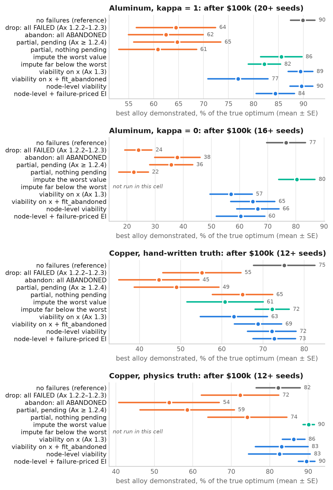
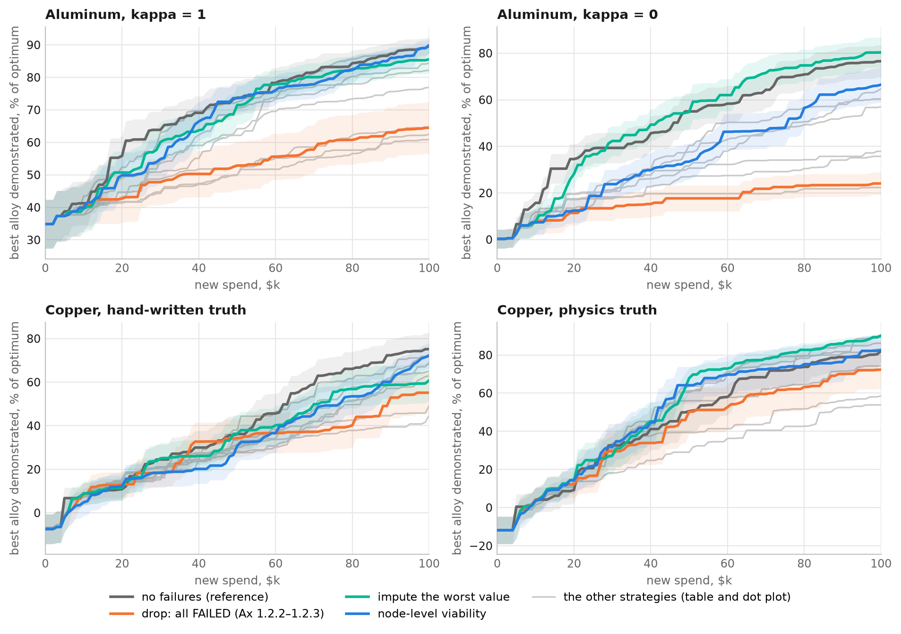
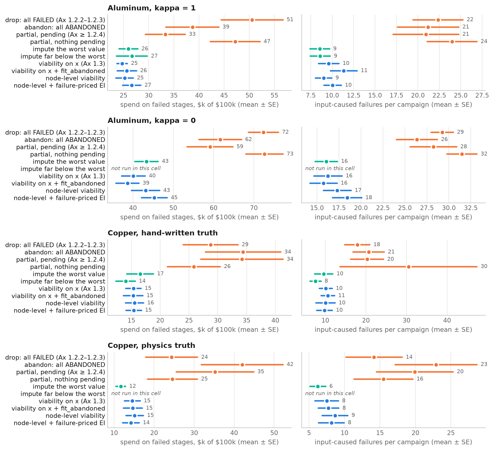
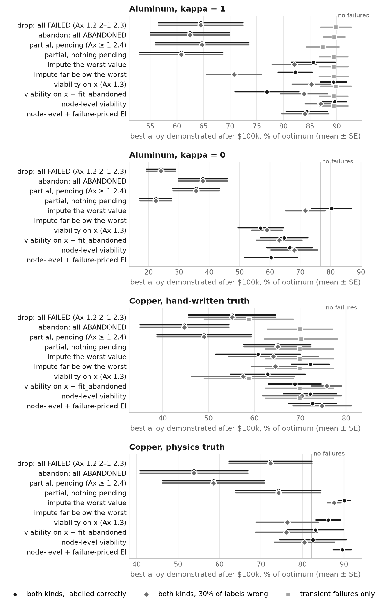
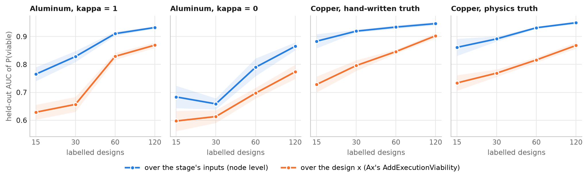

# BOFN with failed vs. abandoned experiments: a benchmark on the lab's aluminum and copper networks

Issue [#274](https://github.com/vertical-cloud-lab/digital-alloy-lab/issues/274). When a stage of
the alloy workflow fails (the powder won't atomize, a build crashes, a bar breaks outside the gauge),
what should a Bayesian-optimization campaign do with the run? This benchmark answers that on the two
synthetic function networks the lab already uses for its proposals: the aluminum LPBF network
(`bofn-prelim`, PR #117) and the copper DED network (`bofn-cu-ded`, PR #206, with both its
hand-written and its physics-based truth). The strategies are named for what Ax does with each
trial status, checked against Ax's code and threads (`survey/ax.md`) and BoTorch's
(`survey/botorch.md`).

**Everything here is synthetic.** The networks are hand-built or physics-informed simulators, not
data, and the failure layer (`failmodel.py`) is an assumption, sourced below.

## Bottom line

Four cells (aluminum at `kappa` = 1 and 0, copper with its hand-written and physics truths), 64 matched
campaigns of $100k each per strategy, both kinds of failure labelled correctly:



*Best alloy demonstrated (printed or deposited and carried through every test) after $100k of new
spend, as a percentage of each cell's true optimum; dots are means over seeds and bars ±1 SE.
Orange: no failure model; aqua: imputation; blue: a viability model; gray: the same campaign with
failures switched off. Every number is in [`tables.md`](tables.md).*

1. **What helps is learning from failures; the status a failed run gets doesn't.** Without a failure
   model, the four ways Ax can record a failed run, `FAILED` (`drop`), `ABANDONED` (`abandon`), and
   `COMPLETED` with partial data, pending (`partial`) or not (`keep`), end 23 to 28 points of the
   optimum behind node-level viability, pooled over the four cells (it wins 51 to 53 of 64 matched
   campaigns, Holm-corrected p < 1e-6). They also spend $24k to $73k of every $100k on stages that
   fail, against $12k to $45k for the strategies that learn where failures happen. The worst case is
   aluminum at `kappa = 0`, where most high-solute alloys crack: `drop` reaches 24 % of the optimum
   and spends $72k on failed builds.
2. **A failure model recovers most or all of the loss, and which one matters less.** Node-level
   viability ends level with the no-failure reference on average (−3.3 points pooled, 90 % CI −8.5 to
   +2.4) and has the best mean rank over the cells (2.5). Imputing the worst value seen (2.8), node-level
   viability with failures priced into the acquisition (2.8), and Ax's `AddExecutionViability` with or
   without `fit_abandoned` (3.8 each) are close behind. None of the pairwise differences among them
   survives the Holm correction.
3. **Node level against design level.** As a classifier, the stage-input model learns much faster:
   after 30 labelled runs its held-out AUC is 0.83 to 0.92, against 0.66 to 0.80 over the 7-D design
   (aluminum at `kappa = 1`, both copper truths; [`classifier_check.md`](classifier_check.md)), and it
   matches the design-level model trained on 2 to 4 times as many runs. In the campaigns that becomes
   +4.0 points pooled (90 % CI −0.7 to +9.1, not significant): ahead on aluminum at `kappa = 0`
   (+9.5) and on the hand-written copper truth (+9.2), level on aluminum at `kappa = 1` (+0.2), and
   behind on the copper physics truth (−3.7). Both models cut input-caused print and deposit failures
   two to three times and end with similar counts, so the classifier's head start mostly goes unused,
   probably because the viability models switch on only after three failures, by which point the
   search has settled where both are accurate enough (not tested directly).
4. **Imputing the worst value seen is a good failure model in these networks; imputing far below it
   is a gamble** (the concern [raised on #274](https://github.com/vertical-cloud-lab/digital-alloy-lab/issues/274#issuecomment-7053633447)). In these truths a failed build is a bad alloy or a bad
   setting anyway (no design within 60 % of any optimum fails), so writing the failure down as the worst
   result seen teaches the network the right thing. It was the best strategy on the copper physics
   truth (90 %) and on aluminum at `kappa = 0` (80 %). Writing it down one observed range *below*
   anything measured, a "terrible result", cost 7 points on aluminum at `kappa = 1` (82 % against
   90 % for node-level viability, Holm p = 0.06), and 16 points once 30 % of labels were wrong (71 %,
   Holm p = 0.009), while imputing the worst value seen lost under 4. On the hand-written copper truth
   it did no harm (72 % against 61 % for the worst value seen and 72 % for node-level viability, 12
   seeds, and 65 % with mislabels), so the damage depends on the network, which is the risk.
5. **Transient faults alone cost money more than results, as long as the run's data are kept.** With
   transient failures only, every strategy on aluminum ends at 87 % to 90 % of the optimum against
   90 % without failures, and the faults cost about $10k per $100k. On copper, where every run passes
   through five stages that can fail, the strategies that keep a failed run's data end at 70 %
   against 75 % without failures, while `drop` (Ax's `FAILED`, which discards them) ends at 59 %
   (−11 points against node-level viability, 7 wins and 5 losses, not significant). Abandoning a
   design for good after one bad plate cost nothing measurable in either network.
6. **Wrong labels cost a few points, least for node-level viability.** With 30 % of the transient /
   input-caused labels wrong, node-level viability loses at most 3 points in any cell and has the best
   mean rank over the cells (1.8). Ax's viability on x loses up to 10 points (copper physics truth,
   86 % → 76 %) and ends 6.4 points behind node-level viability pooled (90 % CI +0.1 to +12.5;
   p = 0.035, Holm 0.14). Imputing the worst value loses up to 9 (aluminum at `kappa = 0`,
   80 % → 72 %) and is level with node-level viability pooled (+0.5). All of them stay 24 to 26
   points above the strategies without a failure model (Holm p < 1e-4).
7. **Ax ≥ 1.2.4's partial data doesn't help on its own.** `partial` against `abandon` and `drop` is
   within noise in every cell. Whether it helps alongside a failure model isn't settled either:
   `viab_x_partial` against `viab_x` goes both ways. A node-level model needs it all the same, since
   its labels and powder data come from the runs that crashed.
8. **Pricing failures into the acquisition** (EI × P(no transient fault) / expected cost) didn't help
   on average (−1.7 points against plain node-level viability, not significant): it was better on
   the copper physics truth (90 % against 83 %) and worse on aluminum (84 % against 90 % at `kappa = 1`).

**Where node-level handling doesn't win.** On the copper physics truth, imputing the worst value
(90 %), failure-priced node-level viability (90 %) and Ax's viability on x (86 %) all finish ahead of
plain node-level viability (83 %); on aluminum at `kappa = 0`, imputation (80 %) is well ahead of it
(67 %; −13.9 points, 8 wins and 8 losses, not significant). On aluminum at `kappa = 1` it only ties
Ax's viability on x at $100k, though it gets there sooner (74 % against 64 % at $50k, and 60 % of
the optimum by a median $24k against $26k).



*Mean best alloy demonstrated against new spend (bands ±1 SE), one strategy per family highlighted;
the others are the light lines.*



*Where the money goes: spend on stages that failed, and the number of input-caused failures per
campaign (mean ± SE).*



*The same strategies with both kinds of failure labelled correctly, with 30 % of labels wrong, and
with transient faults only. Strategies that don't read labels run identically in the first two; in
the third, `keep`, both imputations, viability on x with `fit_abandoned` and node-level viability are
the same campaign, as are `drop` and viability on x.*



*Held-out AUC of each viability model against the number of labelled random designs (mean ± SE over
10 replicates).*

### The pre-registered hypotheses

| | Hypothesis | Result |
|---|---|---|
| H1 | `drop` does worst, with the most repeats | **Not as stated.** `drop` is bad, but so are `abandon`, `partial` and `keep`; which of the four is lowest changes with the cell (`keep` on aluminum, `abandon` on copper). |
| H2 | Keeping completed stages helps (`partial` ≥ `abandon`, `viab_x_partial` ≥ `viab_x`) | **Not supported.** Both differences are within noise in every cell; `viab_x_partial` was 12.5 points *behind* `viab_x` on aluminum at `kappa = 1` (p = 0.027, not significant after correction), ahead on two of the other three cells and behind on the third. |
| H3 | Abandoning transient failures costs something | **Not supported**: `abandon` ends level with node-level viability in both networks (+0.1 points each). Discarding the failed runs' data (`drop`) is what cost points, on copper. |
| H4 | A failure model means fewer input-caused failures than `partial` | **Supported** in every cell (aluminum at `kappa = 1`: 8.6 to 11.3 against 20.9). |
| H5 | Node-level viability ≥ viability on x with `fit_abandoned`, with fewer failures | **Same direction, not significant**: +5.1 points pooled (p = 0.028, Holm 0.14), similar failure counts. |
| H6 | `impute` competitive with correct labels, and hurt more by mislabels | **First half supported** (pooled −0.8 against node-level viability). **Second half weakly**: worst-value imputation lost more than node-level viability in two cells of four (most on aluminum at `kappa = 0`, −9 against +2), and pooled it moves from 0.8 ahead to 0.5 behind. The extreme version shows it clearly on aluminum, not on copper. |
| H7 | Every strategy ends below the no-failure reference | **Not supported**: imputation and failure-priced node-level viability end above it on the copper physics truth and imputation on aluminum at `kappa = 0` (none significantly). A likely reason: failures here happen where alloys are poor, so a model of them steers the search away from poor regions about as well as measured low values do, and sometimes sooner. |

### The other scenarios and the full-pipeline check

Best alloy demonstrated after $100k, % of the optimum (mean ± SE; strategies that don't read labels
repeat their `mixed` numbers in the mislabelled columns; in the transient-only column, `keep`, both
imputations, viability on x with `fit_abandoned` and node-level viability are one campaign, as are
`drop` and viability on x):

| Strategy | Cu hand-written, 30 % mislabelled | Cu hand-written, transient only | Cu physics, 30 % mislabelled | Al κ=0, 30 % mislabelled | Al κ=1, full pipeline | Cu hand-written, full pipeline |
|---|---|---|---|---|---|---|
| no failures (reference) | 75 ± 7 (n=16) | 75 ± 7 (n=16) | 82 ± 6 (n=12) | 77 ± 7 (n=16) | 82 ± 6 (n=12) | 53 ± 11 (n=12) |
| drop (all FAILED) | 55 ± 9 (n=16) | 59 ± 10 (n=12) | 72 ± 10 (n=12) | 24 ± 5 (n=16) | 70 ± 9 (n=12) | 60 ± 11 (n=12) |
| abandon (all ABANDONED) | 45 ± 10 (n=16) | 70 ± 7 (n=12) | 54 ± 13 (n=12) | 38 ± 8 (n=16) | 73 ± 7 (n=12) | 59 ± 11 (n=12) |
| partial (Ax >= 1.2.4, pending) | 49 ± 10 (n=16) | 70 ± 8 (n=12) | 59 ± 12 (n=12) | 36 ± 8 (n=16) | 62 ± 10 (n=12) | 55 ± 10 (n=12) |
| keep partial data, nothing pending | 65 ± 7 (n=16) | 70 ± 7 (n=12) | 74 ± 10 (n=12) | 22 ± 5 (n=16) | – | – |
| impute worst value | 64 ± 10 (n=12) | 70 ± 7 (n=12) | 88 ± 2 (n=12) | 72 ± 6 (n=16) | 82 ± 4 (n=12) | 68 ± 5 (n=12) |
| impute far below the worst | 65 ± 5 (n=12) | 70 ± 7 (n=12) | – | – | – | – |
| viability on x (Ax 1.3) | 58 ± 11 (n=12) | 59 ± 10 (n=12) | 76 ± 8 (n=12) | 59 ± 5 (n=16) | 82 ± 4 (n=12) | 58 ± 11 (n=12) |
| viability on x + fit_abandoned | 76 ± 3 (n=12) | 70 ± 7 (n=12) | 76 ± 7 (n=12) | 63 ± 8 (n=16) | – | – |
| node-level viability | 70 ± 9 (n=12) | 70 ± 7 (n=12) | 80 ± 7 (n=12) | 68 ± 8 (n=16) | 77 ± 6 (n=12) | 70 ± 8 (n=12) |
| node-level viability + failure-priced EI | 75 ± 6 (n=12) | – | – | – | – | – |

- **Wrong labels:** point 6 above. Pooled over the four cells, node-level viability beats `drop`,
  `abandon`, `partial` and `keep` by 24 to 26 points (60 matched campaigns, Holm p < 1e-4).
- **Transient faults only, copper:** point 5 above. The strategies that keep a failed run's data end
  at 70 % against 75 % without failures; `drop` and viability on x, which discard it (Ax `FAILED`),
  at 59 %.
- **Full pipeline (no lot reuse, 12 seeds).** The failure-model strategies still lead. On aluminum,
  Ax's viability on x and worst-value imputation end at the no-failure level (82 %), against 62 % to
  73 % without a failure model; node-level viability reaches 77 % (−4.9 against viability on x, not
  significant). On copper, where this policy's no-failure runs reach only 53 %, node-level viability
  and imputation reach 70 % and 68 % against 55 % to 60 %. On aluminum there are no repeated
  failures without lot reuse, against about 9 a campaign for `drop` and `keep` with it: reprinting the
  lots of failed runs is how an unmodelled failure repeats.


## What to do in the lab

- **Keep a node-level ledger** (one row per stage attempt: stage, status, kind, reason, inputs as
  executed, lot IDs, cost; the template is in [`bofn-failed-vs-abandoned.md`](../../bofn-failed-vs-abandoned.md) §4)
  and build the network's training sets from it. Ax's trial status can't hold this.
- **Give every failure a model.** The cheapest one that worked: write an input-caused failure down as
  the worst value measured so far at that stage, not below anything measured (that cost up to 16 points
  on aluminum, though nothing on copper). A viability
  model over the failing stage's inputs (powder yield, density, CALPHAD outputs) did as well on
  average and learns the region from fewer failures.
- **Label each failure transient or input-caused when you can,** and keep the data of a run that hit
  a transient fault: whether the design is then retried or abandoned made no measurable difference,
  but discarding the run's completed stages (`FAILED` in Ax ≥ 1.2.2) cost points on copper. A 30 %
  error rate in these labels cost a few points.
- **If Ax is the ledger** (details and links in [`survey/ax.md`](survey/ax.md) §f): use `Client` ≥ 1.2.4,
  `attach_data` each stage's metrics as it finishes, and for an input-caused failure call
  `complete_trial` with the measured stages plus a stage viability metric of 0, used as an outcome
  constraint (maintainer-endorsed in Ax [#1392](https://github.com/meta/Ax/issues/1392#issuecomment-1403841061)
  and [#2460](https://github.com/meta/Ax/issues/2460#issuecomment-2115746662)). Mark a transient fault
  `FAILED` with its reason. If you turn on `AddExecutionViability`, register a tracking metric named
  `execution_viable` (it crashes without one in 1.3.x), and don't abandon trials for logistics (it
  learns every abandoned trial as non-viable). The deprecated `AxClient.complete_trial` still marks a
  trial with a missing metric `FAILED`, which throws away its data.


## The question in Ax's terms

A function network fails at a stage, not as a whole trial: the stages upstream of a failure
produced good data, and an input-caused failure says something about *that stage's* inputs (which
include measured intermediates such as powder yield), not about the whole design. Ax gives each trial
one status. What each strategy does with a run that stopped early:

| Strategy | Ax analogue (version) | Completed stages of a failed run | Failed design pending? | Failure model |
|---|---|---|---|---|
| `drop` | every failure `FAILED`; also what `Client.complete_trial` did with a missing metric from 0.5.0 to 1.2.3 | not fit (since 1.2.2) | no, may be suggested again | none |
| `abandon` | every failure `ABANDONED` | not fit | yes, for good | none |
| `partial` | `Client.complete_trial` with missing metrics (≥ 1.2.4): `COMPLETED`, partial data fit | fit | yes, for the stages it lacks | none |
| `keep` | the same, as Ax actually treats it below 100 trials when the arm has any objective or constraint metric | fit | no | none |
| `impute` | "soft pushing" ([raised on #274](https://github.com/vertical-cloud-lab/digital-alloy-lab/issues/274#issuecomment-7053633447); BoTorch maintainers' advice in [#943](https://github.com/meta-pytorch/botorch/issues/943#issuecomment-918802564)): an input-caused failure is recorded as the worst value seen at that stage; a transient one is dropped | fit | no | implicit |
| `impute_extreme` | the same, but one observed range *below* the worst value: a "terrible result" outside anything measured | fit | no | implicit |
| `viab_x` | `AddExecutionViability` (1.3.0, opt-in): transient → `FAILED`, input-caused → `ABANDONED`; a GP on 0/1 labels over the design, constrained to `execution_viable ≥ 0.8` once 3 runs are abandoned | not fit | input-caused: yes | over the design `x` |
| `viab_x_partial` | the same with `fit_abandoned=True` (every status fit, `FAILED` included) | fit | input-caused: for the stages it lacks | over `x` |
| `viab_node` | a node-level ledger (proposed in [`bofn-failed-vs-abandoned.md`](../../bofn-failed-vs-abandoned.md) §4) | fit | no | per stage, over that stage's own inputs |
| `viab_node_ec` | `viab_node`, plus failures priced into the acquisition: EI × P(no transient fault) / expected cost of a chain that stops at its first failure | fit | no | per stage |
| `nofail` | reference: the same campaign with failures switched off | | | |

Every strategy runs the same search policy, the source benchmarks' best: BOFN with lot reuse
(`eifn_reuse`: network expected improvement per dollar over new designs and new prints or DED
sessions on powder lots already made). With failures switched off, every strategy reproduces the
source run action for action on both networks (`tests/`). A full-pipeline variant (`+full`) checks
that the findings are not an artefact of lot reuse: every decision is a new design through every
stage, scored by the same network EI on the same candidate pool. It is not the source `eifn`, which
adds a local refinement step, so its no-failure runs differ from the source's.

How each Ax behaviour is emulated, and where the emulation is a simplification:

- **Fit / not fit** is exact: each node's GP is trained on the observations the strategy keeps.
- **Pending** follows BoTorch's `X_pending` effect with a kriging believer: the pending design's
  missing node outputs are added to their GPs at the posterior mean (hyperparameters fixed), which
  lowers the value of nearby candidates. The source benchmarks sample each candidate's network
  posterior marginally, so joint sampling with `X_pending` isn't available.
- **Viability** is what Ax fits: an ordinary GP regression on 0/1 labels (noise learned), and each
  Monte Carlo sample of the network counts as an improvement only if the sampled viability clears
  0.8 (BoTorch's sigmoid with `eta = 1e-3`). `viab_x` uses one GP over the 7-D design;
  `viab_node` one GP per failing stage, over that stage's node inputs, sampled with the sampled
  parent outputs. Neither is a classifier; a Bernoulli variational GP is BoTorch's recommended
  model (`survey/botorch.md` §f) and is left for later.
- **CALPHAD** never fails and is always kept: it is a simulation the lab stores whatever happens
  downstream.

## The networks

| Cell | Network (vendored unmodified, `vendor/SOURCES.md`) | Stages that can fail | True optimum |
|---|---|---|---|
| `al-k1` | aluminum LPBF, `kappa = 1` (CALPHAD misses the Zr inoculant): CALPHAD → ultrasonic atomization → LPBF build → tensile | atomize, build, tensile | 0.694 |
| `al-k0` | aluminum, `kappa = 0` (the crack screen is right, so most high-solute alloys crack) | same | 0.485 |
| `cu-toy-k1` | copper DED, hand-written truth, `(kappa, eta) = (1, 1)`: CALPHAD + heat flow → atomization → small DED (Utah, power-capped) → large DED (Mines) → microscopy → tensile → 1-h screen → 30-day immersion | atomize, Utah, Mines, tensile, immersion | 0.492 |
| `cu-phys-k1` | copper DED, physics-based truth (pycalphad grid, seawater-corrosion fit, the proposal's search-space limits), `(1, 1)` | same | 0.431 |

The scores are "best alloy demonstrated" as in the source benchmarks: the true objective of the best
design carried through every test, as a percentage of the cell's optimum (`optima.json`, computed by
`calibrate.py`; within 0.5 % of the source READMEs' values). All campaigns start from the source
benchmarks' shared seed data (CALPHAD on 32 compositions and five full runs, sunk and
failure-free) and spend $100k at the source costs.

## The failure model (`failmodel.py`)

Two kinds of failure, drawn independently at every stage attempt:

**Transient** (Ax `FAILED`: unrelated to the inputs, could be repeated):

| Stage | Probability | Source |
|---|---|---|
| ultrasonic atomization | 0.15 aluminum, 0.20 copper | Between bofn-clocked's assumed 0.10 and the lab's own record: of the ten logged runs (Oct 2 to Nov 13, [`atomizer-runs/runs.csv`](https://github.com/vertical-cloud-lab/digital-alloy-lab/blob/8320f13623c7961fcce12ee4d5d2033f4d8c9936/atomizer-runs/runs.csv) on PR #286), seven made little or no usable powder, and six of those seven for reasons unrelated to the alloy (setup, a plate on its second use, a generator trip). Of the five copper runs, three failed that way. The rates here assume the SOP fixes since then (new plate each run, plate-height gauge) have taken hold. |
| LPBF build, Mines DED session | 0.08 | bofn-clocked's assumption (recoater crash, delamination, support failure) |
| Utah DED session, 30-day immersion | 0.05 | assumed |
| tensile | 0.03 | bofn-clocked's assumption (bar breaks outside the gauge) |

**Input-caused** (Ax `ABANDONED`: the inputs make the stage fail), each a steep logistic of a term
the network's own truth already contains, so the failure regions move with the composition through
CALPHAD's outputs:

| Stage | Failure | Region |
|---|---|---|
| LPBF build / Mines session | severe hot cracking: up to 60 % of the most cracked builds curl into the recoater or delaminate | crack severity above about 0.9 (the truth's `sigmoid((f_eff − onset)/0.05)`, with the inoculant/nucleant effect `kappa` included), as for unmodified 7075 ([Martin et al. 2017](https://doi.org/10.1038/nature23894)) |
| LPBF build | lack of fusion: layers don't bond | far below the energy-density ridge (the truth's window term below 0.05) |
| LPBF build / Mines session | keyholing: spatter and swelling | laser power above about 0.92 of the range |
| Utah / Mines session | the deposit never fuses | the truth's lack-of-fusion index above 0.85 (copper-rich alloys at Utah's power cap) |
| print or deposit (precondition) | too little usable powder to spread or feed | powder quality `q < 0.25`; the lab measures `q`, so it doesn't pay for the print (the "very little powder" runs of Oct 21 and Nov 13) |

`calibrate.py` places these regions (`optima.json`): every optimum is viable, and no design within
60 % of any cell's optimum is in a failure region, as one would expect physically (a crashed build
is a bad alloy or a bad setting). Of random designs, 64 % (`al-k1`), 86 % (`al-k0`), 52 %
(`cu-toy-k1`) and 46 % (`cu-phys-k1`) would fail somewhere for input reasons.

**Labels.** The lab writes down which kind each failure was. In the `mislabel` scenario 30 % of
labels are wrong (the operator can't always tell a bad plate from a bad alloy; Oct 28 and Nov 13
took a video review to trace). The precondition is always labelled correctly. One random stream
per (seed, stage), consumed in attempt order, gives every strategy the same faults and label flips.

## Scenarios, seeds and analysis

Pre-registered in [`PREREGISTRATION.md`](PREREGISTRATION.md) before the sweep. Changes since,
all made before the runs they affect:

- **Added strategies:** `keep` (after the Ax survey found that partly measured arms usually drop out
  of `X_pending`), `viab_node_ec`, `impute_extreme` (to test [the concern about imputed values](https://github.com/vertical-cloud-lab/digital-alloy-lab/issues/274#issuecomment-7053633447) directly), and the
  full-pipeline variant.
- **`viab_x_partial` corrected:** the survey showed that `fit_abandoned=True` makes Ax fit every
  status, `FAILED` included, and that Ax then labels those rows viable. Its first eight runs, made
  under the narrower reading, were deleted and rerun.
- **Fewer seeds and a new order** for the later lines, when the copper runs proved about twice as slow
  as timed: 12 seeds for the copper physics truth and the secondary copper scenarios, 16 for aluminum
  at `kappa = 0`; [`plan.txt`](plan.txt) has the final order and says what was cut.

 `mixed` (both kinds,
labelled correctly) for every strategy; `mislabel` for the strategies that read labels (the others
run identically by construction); `transient` (transient faults only) for the strategies that differ
there. Seeds: 20 for aluminum at `kappa = 1`, 16 for aluminum at `kappa = 0` and the hand-written
copper truth, 12 for the copper physics truth, the secondary copper scenarios and the full-pipeline
check. Comparisons are on
matched seeds (same seed data and failure draws): two-sided Wilcoxon signed-rank tests with a Holm
correction within each cell and scenario, and 90 % bootstrap intervals of the mean difference.
All tables: [`tables.md`](tables.md); per-run JSON: `results/<cell>/<scenario>/<strategy>_s<seed>.json`.

## Caveats

- **Synthetic, and assumed failures.** The truths are simulators and the failure rates and regions are
  assumptions (sourced above). A real lab's failure regions may sit closer to its optimum than these
  do; the Nov 20 toy ([`bofn-failed-vs-abandoned.md`](../../bofn-failed-vs-abandoned.md) §5), where the
  optimum sits on a failure boundary, is the harsher case.
- **Ax is emulated, not run.** The strategies reproduce what each Ax status does to the data, the pending
  set and the viability labels, as checked against Ax's code and by running Ax 1.3.1
  ([`survey/ax.md`](survey/ax.md)); the BOFN model itself has to run outside Ax. Pending points are a
  kriging believer, not joint sampling, and Ax's `X_pending` intersection (above) means `keep` is
  closer to what Ax does below 100 trials than `partial` is.
- **One search policy**, BOFN with lot reuse, plus a full-pipeline check. Not pKGFN: a failure-aware
  knowledge gradient (a fantasy over success and failure, `survey/botorch.md` §f4) is the obvious next
  step.
- **Noise-free observations**, as in the source benchmarks; `bofn-clocked` (#283) adds measurement
  noise, time and capacity.
- **The viability models are GP regressions on 0/1 labels**, as Ax fits them, not classifiers.
- **12 to 20 seeds per cell.** Differences under about 10 points between failure-model strategies are
  not resolved; the pooled comparison over cells is the most reliable number.

## Reproduce

```bash
pip install torch --index-url https://download.pytorch.org/whl/cpu && pip install botorch scipy matplotlib pytest
cd benchmarks/bofn-failures
python -m pytest tests/ -q              # vendored code unchanged; exact reproduction of the source runs with failures off
python calibrate.py all                 # optima.json
python run_sweep.py --plan plan.txt     # every campaign in plan.txt, resumable; about 4.5 h on 4 cores
python analyze.py && python plot.py     # tables.md, summary.json, figures/
```

Versions used: Python 3.14.4, torch 2.15.0 (CPU), BoTorch 0.18.1, GPyTorch 1.15.2, Ax 1.3.1 (survey checks only).
