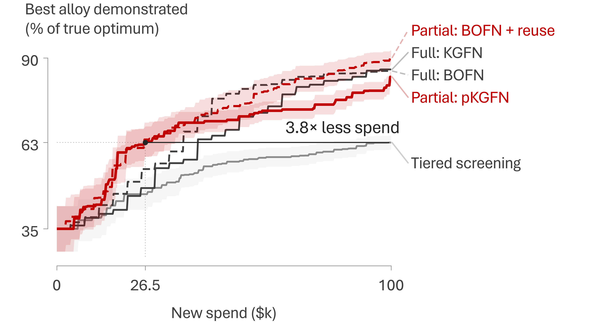

# Port notes: `bofn-prelim` → `bofn-paper`

This folder starts the BOFN methods paper (Digital Discovery; preprint planned
for Feb 26, 2027; issue #121). It is the MS&T26 benchmark carried over
unchanged, with code added on top. [`README.md`](README.md) still describes
the MS&T26 results, and none of its claims were changed.

## What was copied

- `75b3b10:benchmarks/bofn-prelim` was copied verbatim in `702d76f`. The new
  folder's git tree hash (`6f4ad44`) equals the source's, so all 360 files are
  byte-identical. Upstream provenance is in `75b3b10`'s message:
  agent-staging drop `2026-10-10-bofn-prelim` at `8b07d4e`, originally
  a private repo, `presentations/2026-10-mst26/bofn-prelim/`.
- The 292 stored runs in `results/` (`k1`: 164, `k0.5`: 64, `k0`: 64) have not
  been modified since. New runs go to new folders.

## What changed

| File | Change |
|---|---|
| `run_sweep.py` | Flags: `--policies` (alias of `--kinds`), `--kappa` (alias of `--kappas`), `--seeds` with ranges and lists (`0-4`, `7`, `0,3,10-12`), `--costs STAGE=USD` and `--noise SD` or `--noise STAGE=SD`. The defaults are unchanged. With non-default costs or noise it will not write into `results/`, and if an existing JSON's recorded settings differ from the requested ones, it raises an error instead of skipping the cell. Every JSON now records `settings`, `git` (commit, plus whether tracked files here were modified), `versions`, `platform`, `argv`, `env` (`BOFN_*`) and `finished_utc`. |
| `bofn_alloy.py` | `set_costs()` and `set_noise()` change the shared `COSTS`/`NOISE` dicts. `Lab` can add Gaussian noise to the atomize, print and tensile measurements. The noise comes from its own generator (seed 6000 + seed). The physics runs on true values and the data get the measured ones. CALPHAD stays deterministic, because its error is the bias κ. Node GPs use the known noise variance. Every purchase after the seed data is logged with its inputs (`purchases` in the JSON). New `Network.kg_full`, the full-chain knowledge gradient (KGFN, below). |
| `policies.py` | `run(kind, kappa, seed, budget, costs=None, noise=None)`. `settings()` lists every knob. `best_validated` is computed from true objectives. Noise-free, these are the same floats as before; with noise, rows also carry `best_validated_obs`, the true value of the alloy with the best *measured* objective. New policy `kgfn` (`run_pkgfn(..., full_chain=True)`). |
| `analyze.py` | Matched-seed bootstrap (`matched()`, `speedup(..., matched=True)`, `boot_ratio(..., matched=True)`). The old independent-seed bootstrap still prints alongside as a sensitivity check. New `speedup_table(kappa, over="tiered")` prints the README's "speed-up over tiered screening" table. `load()` also reads `results-kgfn/` for policies that `results/` lacks (KGFN, step 5). |
| `compare_runs.py` (new) | Checks re-runs against stored runs action for action (see below). |
| `requirements.txt` (new) | Exact pins of the environment behind `results-rerun/`. |
| `quality/check_kgfn.py` (new) | Brute-force check of `kg_full`. |
| `quality/mc_noise.py`, `plot.py` | The `TinyGP` wrapper now passes keyword arguments through. `plot.py` has a style for `kgfn` and `slide_figure_kgfn()`, the slide figure with KGFN (step 5). Its `__main__` block moved to the end of the file: it called `slide_figure()` before the function was defined, so `python plot.py 1.0` stopped with a NameError. The MS&T26 figures it draws are unchanged, byte for byte. |

With noise off (the default), these changes leave every number the code
produces unchanged. The re-run check below tests that. With noise on, each
node GP is told its own measurement-noise variance. Downstream GPs, though,
take the *measured* parent values (q for printing, ρ for tensile) as inputs,
and that input noise is not modeled. The noise option has only been
smoke-tested; nothing has been run with it.

## Step 2: does the port reproduce the stored runs?

Seeds 0–4 at κ = 1 were re-run with the step-1 code (`9462e01`, a clean
worktree) into [`results-rerun/k1/`](results-rerun/k1/). Seeds 5–19 followed
on Oct 17 with the code at `28a89f6`, also from a clean worktree and with the
step-3 KGFN code in place. `results-rerun/k1/` now holds all 20 stored seeds of
the seven policies, 140 runs, each with its purchase log. The recipe was the
stored runs' own: recommender on, except `eifn_reuse` (`BOFN_NO_REC=1`). The
environment was the one pinned in `requirements.txt` (torch 2.14.1+cpu,
BoTorch 0.18.1, GPyTorch 1.15.2, linear_operator 0.6.1, NumPy 2.5.3, SciPy
1.18.1, Python 3.12.3), on AMD EPYC 9V45 (seeds 0–4) and 9V74 (seeds 5–19)
GitHub runners. Full per-run output is in
[`results-rerun/compare_k1.txt`](results-rerun/compare_k1.txt).

| policy | seeds | match action for action | max abs diff, best validated | max abs diff, rec_printed | max abs diff, rec |
|---|---|---|---|---|---|
| pkgfn | 0–19 | 20/20 | 1.1e-16 | 1.1e-16 | 2.2e-16 |
| eifn | 0–19 | 20/20 | 1.1e-16 | 1.1e-16 | 2.2e-16 |
| eifn_reuse | 0–19 | 20/20 | 1.1e-16 | 1.1e-16 | n/a (no recommender) |
| ei | 0–19 | 20/20 | 2.2e-16 | 2.2e-16 | 2.2e-16 |
| tiered | 0–19 | 20/20 | 1.1e-16 | 1.1e-16 | 1.1e-16 |
| tiered_naive | 0–19 | 20/20 | 1.1e-16 | 1.1e-16 | 1.1e-16 |
| random | 0–19 | 20/20 | 1.1e-16 | 1.1e-16 | 1.1e-16 |

"Match action for action" means the following. Every row (one per purchase
decision) has the same `action` at the same cumulative `spent`, and the
per-stage `counts` agree. The scores recorded after each purchase also agree to
within 1e-9. The stored runs do not log the designs bought, but
`best_validated` and `rec_printed` are true-objective values of designs the
run bought, so the score check is what shows that the designs were the same
too. The remaining differences are in the last bit, and none of them changed a
decision. No GP fit failed. Mean wall time per run on the 2-core 9V45 runner:
pkgfn 183 s, tiered 26 s, tiered_naive 20 s, eifn_reuse 13 s, eifn 11 s, ei
10 s, random 8 s. The 9V74 runner was about 1.3 times slower (pkgfn 239 s).

## Step 3: KGFN, so the policies form a 2 × 2

| | partial evaluation (stage by stage, or powder reuse) | full evaluation (whole chain per query) |
|---|---|---|
| **KG per dollar** | `pkgfn` | `kgfn` (new) |
| **EI per dollar** | `eifn_reuse` | `eifn` (cost is constant, so EI per dollar is EI) |

`kgfn` is `run_pkgfn(..., full_chain=True)`. It shares pKGFN's network model
(one `TinyGP` per node), its pool, its inner-max set (anchored on the
incumbent) and its candidates. The only difference is the query. KGFN takes the
designs attached to pKGFN's CALPHAD, atomize and print candidates (full chains
leave no untested build, so there are no tensile candidates), up to about 52
designs per iteration. It runs the whole chain at one of them, paying $4,200,
or $4,210 if the alloy has never been simulated. The design is chosen by the
KG of observing every node, per dollar:

- **Fantasy.** One standard normal per node (6 in all), from 32 scrambled-Sobol
  QMC points (`BOFN_NFANT`, recorded as `N_FANT`). Each fantasy is first pushed
  down the chain: CALPHAD's outputs at the composition, then q at (a, g̃), ρ at
  (P, v, f̃, g̃, q̃) and U at (s̃, ρ̃). That gives every node its fantasized input
  and value. Each node GP then takes the closed-form rank-one update for its
  own observation, and the network is sampled on the inner set with common
  random numbers, as in pKGFN.
- **Current value.** This comes from the same fantasy-averaged estimator as
  pKGFN's, so KG ≥ 0 by construction.
- **Fallback.** When KG is flat, KGFN takes network EI per dollar on the same
  designs, as pKGFN does.
- **Check.** [`quality/check_kgfn.py`](quality/check_kgfn.py) redoes every
  fantasy by brute force: it appends the fantasized observation to each node's
  data with the same hyperparameters, re-solves the GP and resamples. It agrees
  with `kg_full` to within 1e-13 on seed 0 at κ = 1 and on seed 3 at κ = 0.5. KG is
  non-negative, and re-running a design that has already been through the whole
  chain is worth 0.
- **Smoke test.** Seeds 0 and 1 at κ = 1 ran from the clean commit `83b5667`
  ([`quality/kgfn-smoke/k1/`](quality/kgfn-smoke/k1/)). Each bought 23 full
  chains, the same number as EIFN, and stopped at $96.7k, where the next chain
  would pass $100k. 14 and 15 of those chains were on new alloys. KG was never
  flat, so the fallback was never used, and no GP fit failed. Each run took
  about 6.5 min on the 2-core runner with both running at once, against about
  3 min for pKGFN. These runs only check that the policy works. They are not
  results; the 20-seed run at κ = 1 is step 5.

Re-running pKGFN seed 0 with the KGFN code in place reproduces
`results-rerun/k1/pkgfn_s0.json` purchase for purchase. The `full_chain`
branch does not touch pKGFN's path.

## Step 4: matched-seed bootstrap

For a given seed, every policy starts from the same five seed alloys, so the
policies are paired by seed. `analyze.py` now resamples seeds jointly (each
bootstrap draw takes the same seeds for both policies) and uses that for the
headline intervals. The old bootstrap, which resamples each policy's seeds
independently, still prints next to it as a sensitivity check, and its numbers
reproduce the README's exactly. On the stored runs (κ = 1, 20 seeds, speed-up
over tiered screening, 90% intervals), `python analyze.py 1.0` prints the
following. The README is unchanged.

- pKGFN 3.8×: matched 2.2–5.6, independent 2.0–5.7
- BOFN + powder reuse 3.8×: matched 2.6–5.5, independent 2.2–5.9
- BOFN, full pipeline 2.6×: matched 2.1–3.7, independent 2.1–3.9
- standard BO 2.1×: matched 1.5–2.9, independent 1.5–2.9

## Step 5: KGFN on all 20 seeds (κ = 1)

KGFN ran on seeds 0–19 at κ = 1 into [`results-kgfn/k1/`](results-kgfn/k1/)
on Oct 17. It used a clean worktree at `28a89f6` and the pinned environment,
with the recommender on, as in the smoke test. Seeds 0 and 1 reproduce the
smoke-test runs (`83b5667`) purchase for purchase, with zero difference. Every
run bought 23 full chains and stopped between $96,700 and $96,790. KG was flat
once in the 460 decisions, so the fallback chose one purchase. No GP fit failed
(0 of 2,400). A run calls CALPHAD 15 times on average (10–19), because the rest
of its chains go to alloys that were simulated before. Runs took 558 s on
average, two at a time on the 2-core 9V74 runner.

`analyze.py` reads `results-kgfn/` for the policies that `results/` lacks, so
`python analyze.py 1.0` now includes KGFN. It is compared with the stored runs
on matched seeds, which is sound because the re-runs in step 2 reproduce them.
The best alloy demonstrated, as % of the optimum (mean ± SE over 20 seeds):

| Policy | $25k | $50k | $100k | median $ to 60% | median $ to 70% | median $ to 80% |
|---|---|---|---|---|---|---|
| pKGFN: picks the stage | 62% ± 5 | 70% ± 3 | 84% ± 2 | $15k (95% of seeds) | $25k (95% of seeds) | $86k (75% of seeds) |
| **KGFN, full pipeline** | 45% ± 6 | 65% ± 6 | 86% ± 4 | $27k (90% of seeds) | $42k (85% of seeds) | $55k (80% of seeds) |
| BOFN + powder reuse | 61% ± 6 | 74% ± 5 | 90% ± 2 | $19k (100% of seeds) | $26k (90% of seeds) | $52k (85% of seeds) |
| BOFN, full pipeline | 50% ± 6 | 77% ± 5 | 86% ± 4 | $32k (90% of seeds) | $36k (85% of seeds) | $42k (80% of seeds) |
| Standard BO | 48% ± 7 | 63% ± 5 | 84% ± 3 | $40k (95% of seeds) | $46k (85% of seeds) | $59k (70% of seeds) |
| Tiered screening | 46% ± 5 | 56% ± 3 | 63% ± 2 | $56k (60% of seeds) | >$100k (15% of seeds) | >$100k (10% of seeds) |

In the 2 × 2 of step 3, at $25k and at $100k:

| | partial evaluation | full evaluation |
|---|---|---|
| **KG per dollar** | pKGFN: 62%, 84% | KGFN: 45%, 86% |
| **EI per dollar** | BOFN + powder reuse: 61%, 90% | BOFN: 50%, 86% |

- **Partial evaluation buys the early lead with either acquisition
  function.** At $25k pKGFN is 16.5 points ahead of KGFN (ahead on 12 of 20
  matched seeds, 2 ties; Wilcoxon p = 0.014), and BOFN + powder reuse is 11
  points ahead of BOFN. By $100k the four are within 6 points of each other,
  and pKGFN and KGFN are level (−2.4 points, p = 0.22).
- **KGFN behaves like full-pipeline BOFN with a slower middle.** The two are
  level at $25k (−4.6 points, p = 0.33) and at $100k (+0.5, p = 0.96). At $50k
  KGFN is 11.9 points behind (p = 0.076).
- **Speed-up over tiered screening:** 2.4× (90% matched-seed bootstrap
  1.7–3.4; independent-seed 1.6–3.4). That is between BOFN (2.6×) and
  standard BO (2.1×). At $100k KGFN is 23.5 points ahead of screening, on 18
  of 20 seeds (p = 8.2e-5).

**Slide figure with KGFN** (`plot.slide_figure_kgfn()`, Oct 17; `python plot.py 1.0` draws it):



*Best alloy demonstrated, as % of the true optimum, against new spend at κ = 1.
Lines are means over the same 20 seeds, and the style is the MS&T26 slide
figure's. Color is the evaluation (red partial, gray full pipeline) and the
dash is the acquisition function (solid KG, dashed EI per dollar), so
full-pipeline BOFN is dashed here and solid in the MS&T26 figure. KGFN and BOFN
end level (86.2% and 85.8%), so the leader lines carry the dashes too. The
callout is the MS&T26 one: pKGFN's mean reaches screening's $100k level
(62.7%) at $26.5k. The other means get there at $26.25k (BOFN + powder reuse),
$38k (BOFN) and $42.25k (KGFN). Bands are ±1 SE, for the red traces and
screening only. Standard BO is left out to keep the 2 × 2 readable (its mean
gets there at $46.5k); the version with it is
[`variants/bofn_best_vs_spend_k1_partial_vs_full_kgfn_with_bo.png`](variants/bofn_best_vs_spend_k1_partial_vs_full_kgfn_with_bo.png).*

These are the first KGFN results. The README's MS&T26 claims, tables and
slide figures do not include KGFN and are unchanged; the figure above is
the one with KGFN. The p-values are per-comparison, with no correction for
testing several pairs and spend levels.

## Rerun one cell by hand (Xavier, before Oct 23)

```bash
python3.12 -m venv /tmp/bofn-venv
/tmp/bofn-venv/bin/pip install -r benchmarks/bofn-paper/requirements.txt --extra-index-url https://download.pytorch.org/whl/cpu
cd benchmarks/bofn-paper
# cheap cell (~30 s): tiered screening, seed 3
/tmp/bofn-venv/bin/python run_sweep.py --policies tiered --kappa 1 --seeds 3 --workers 1 --out /tmp/by-hand
/tmp/bofn-venv/bin/python compare_runs.py results/k1/tiered_s3.json /tmp/by-hand/k1/tiered_s3.json          # vs the stored MS&T26 run
/tmp/bofn-venv/bin/python compare_runs.py results-rerun/k1/tiered_s3.json /tmp/by-hand/k1/tiered_s3.json    # vs this port's re-run, purchase by purchase
# the expensive one (~3 min): pKGFN, e.g. seed 2
/tmp/bofn-venv/bin/python run_sweep.py --policies pkgfn --kappa 1 --seeds 2 --workers 1 --out /tmp/by-hand
/tmp/bofn-venv/bin/python compare_runs.py results/k1/pkgfn_s2.json /tmp/by-hand/k1/pkgfn_s2.json
```

`compare_runs.py` exits 0 on a match. A mismatch on another platform (macOS,
another BLAS) is worth reporting even if it is only in the last digits.
Bit-level agreement has so far been checked only on Linux x86_64.
