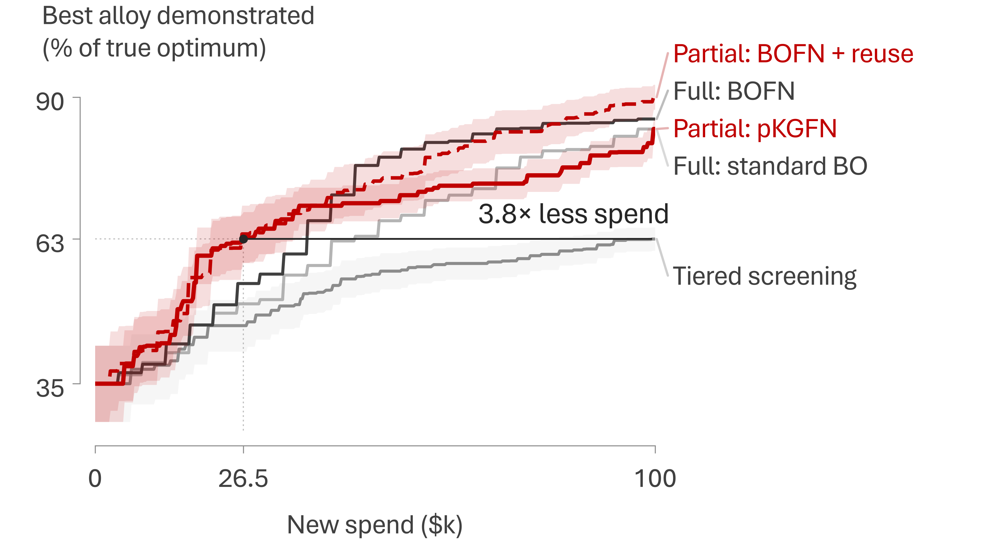
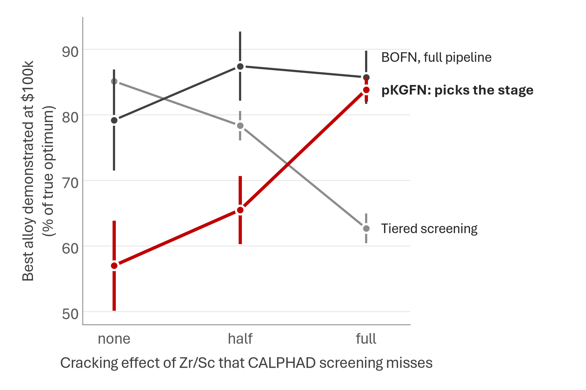
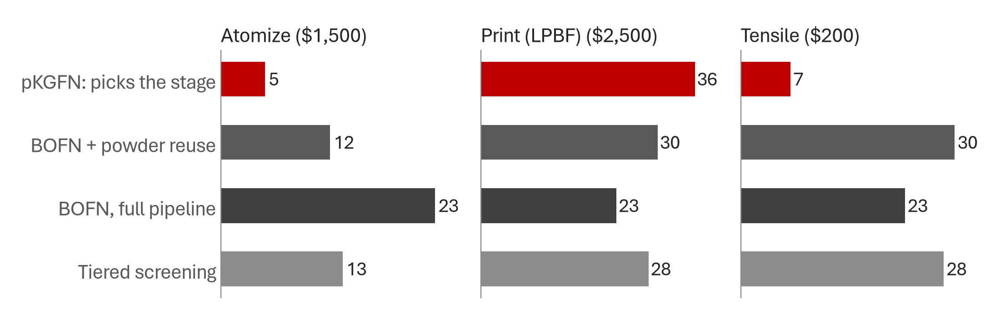
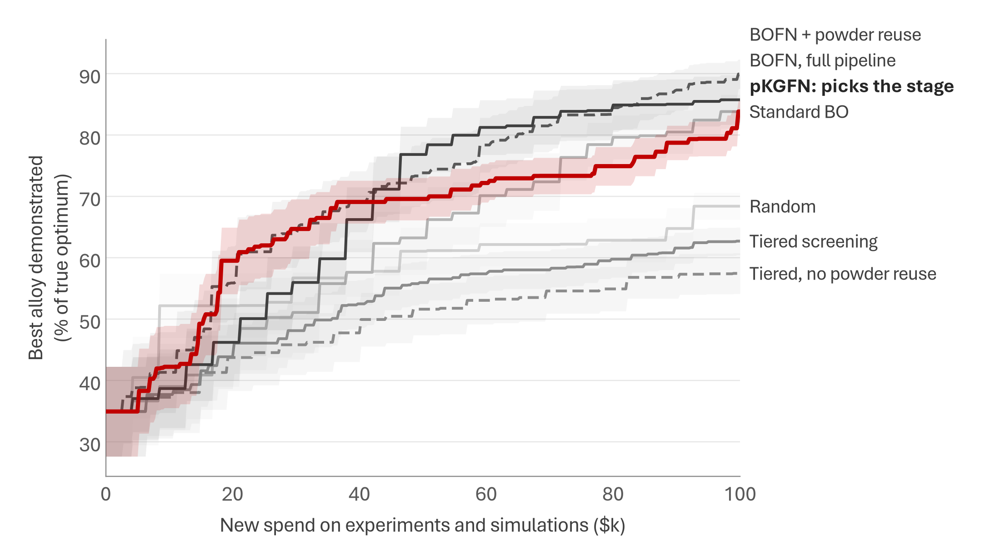
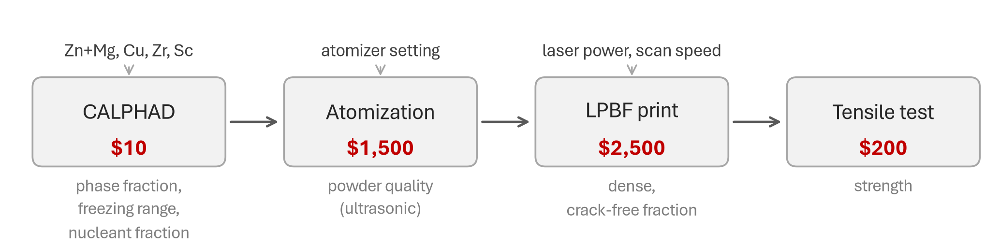
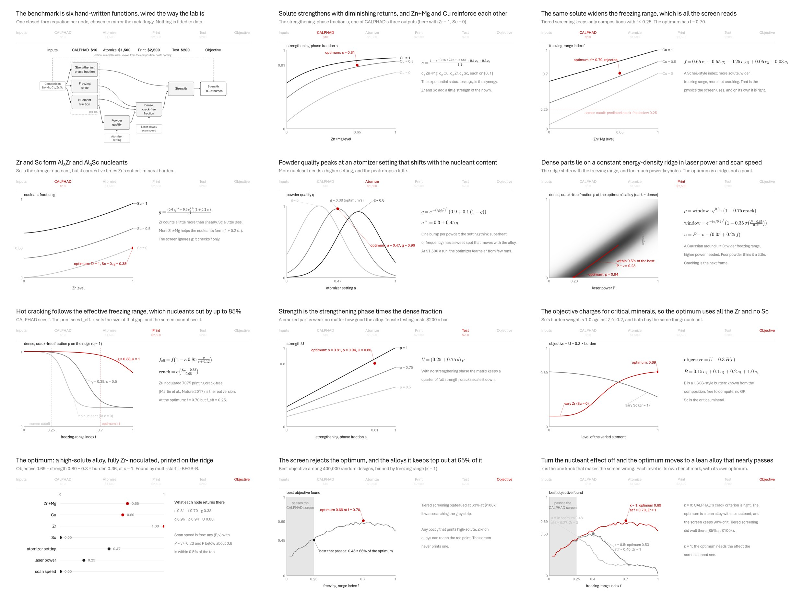
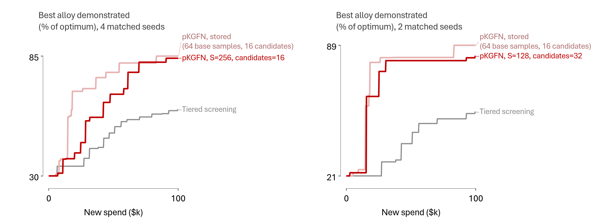

# BOFN preliminary results: does choosing the stage beat tiered screening?

> **Paper port (Oct 10, 2026).** This folder is `benchmarks/bofn-prelim` (`75b3b10`), carried over to start the BOFN methods paper (issue #121). Everything below is the MS&T26 write-up, and its claims are unchanged. [`PORT.md`](PORT.md) covers what changed in the code, the check that the port reproduces the stored runs (all 140 runs at `kappa = 1`, re-run with purchase logs), the KGFN policy and its 20-seed run at `kappa = 1`, the matched-seed bootstrap, and how to rerun one cell by hand.

Synthetic benchmark for the MS&T26 talk (issue 83). It tests the claim in the
abstract: cost-aware partial evaluation of the alloy DAG (pKGFN,
[Buathong et al., ICML 2024](https://proceedings.mlr.press/v235/buathong24a.html))
reaches good alloys with several times less money than tiered screening or
whole-pipeline BO.

## Bottom line

**Where the claim holds.** If CALPHAD's screening criterion misses a real effect, tiered screening caps out. In this benchmark that effect is Zr/Sc inoculation suppressing hot cracking (`kappa = 1`). The screen's shortlist leaves out the optimum, so it plateaus at 63% of the optimum by $100k, below random designs (68%).
- pKGFN reaches that level after $26.5k, against $99.5k for screening: **3.8× less spend** (90% bootstrap CI 2.0–5.7; 20 seeds). Two independent re-implementations of the bootstrap (Edison, Oct 5) put the interval at 2.1–5.7 and 2.0–5.6, so its endpoints are themselves uncertain by about 0.1. At $100k pKGFN is ahead of screening on 19 of 20 seeds, with one tie (+21 points, Wilcoxon p = 1.3e-4).
- **The ratio depends on the target.** Screening's mean creeps up by 0.09 points between $95k and $100k, which is what puts its own crossing at $99.5k. Against a fixed 62.5% target the ratio is 3.6×, against 60% it is 4.0×, and against 55% it is 2.4×.
- **Both partial-evaluation policies clear 3×, but full-pipeline BOFN's interval includes it too.** Spend each method needs to reach screening's $100k level, relative to screening:

  | Method | Speed-up over tiered screening (90% bootstrap CI) |
  |---|---|
  | pKGFN (stage by stage) | **3.8×** (2.0–5.7) |
  | BOFN + powder reuse (EI per dollar) | **3.8×** (2.2–5.9) |
  | BOFN, full pipeline | 2.6× (2.1–3.9) |
  | Standard BO | 2.1× (1.5–2.9) |

  Full-pipeline BOFN's interval reaches 3.9× and both partial-evaluation intervals reach below 3×, and tiered screening itself reuses powder, so these runs do not isolate partial evaluation as *the* cause of the ≥3× (Edison re-analysis, Oct 5).
- pKGFN has the highest mean at $25k, the cost of about six make–print–test cycles: 62% of the optimum, against 61% for BOFN with powder reuse (not a real difference: 6 wins, 2 ties and 12 losses on matched seeds, Wilcoxon p = 0.53) and 46–50% for the others. By then pKGFN had bought, on average, 1.4 new powders, 8.4 prints and 2.9 tensile tests.

**Where it doesn't.**
- **pKGFN against BOFN with full evaluations.** pKGFN leads only early. BOFN overtakes it at about $40k, and by $100k they are level (86% vs 84%).
  - A simple heuristic finishes best (90%): BOFN that ranks reprints of existing powders against new alloys by EI per dollar.
  - pKGFN under-invests in new alloys: about 5 new powders against 36 prints per $100k. One-step KG can't see that a powder's value only shows once it is printed.
- **When the screen is right (`kappa = 0`).** Tiered screening keeps up with full-pipeline BOFN and beats standard BO: 85% against 79% and 71% at $100k (12 seeds). So the ≥3× doesn't apply there.
- **pKGFN as implemented is fragile.**
  - It may only atomize alloys it has already simulated, and one-step KG rarely pays for a new CALPHAD run. So at `kappa = 0`, where the optimum sits in a composition corner none of the 32 seed compositions is near, it collapses (57% at $100k).
  - Letting it atomize any alloy, with CALPHAD run automatically and a two-step powder lookahead, fixes that case. It becomes the best policy at `kappa = 0`: 81% at $50k against 60% for screening (p = 0.016) and 67% for BOFN, and 91% at $100k (8 seeds).
  - The same change trails full-pipeline BOFN at `kappa = 0.5` (81% vs 93% at $100k on 8 matched seeds, p = 0.016). At `kappa = 1` (20 seeds) it gives up pKGFN's head start: 61% at $50k against 70% for pKGFN and 77% for BOFN (p = 0.005), finishing at 82%. It ran with lighter MC settings throughout.
- **No single partial-evaluation policy wins everywhere.** At every bias level, some partial-evaluation policy has the fastest start: any-alloy pKGFN at `kappa = 0`, BOFN + powder reuse at `kappa = 0.5` (+15 points over BOFN at $25k, p = 0.02), and pKGFN or BOFN + reuse at `kappa = 1`. Which one wins depends on the problem. The most robust finishers across all three levels are the two BOFN policies: full pipeline at 79%, 87% and 86%, and with powder reuse at 87%, 87% and 90%, at $100k.

**What the data supports for the abstract.** "Tiered screening wastes budget … and forfeits the algorithm's ability to … learn cross-measurement biases" holds when the screen's criterion is biased, and that is the case worth arguing (Martin et al. 2017 is the canonical example). "≥3× sample efficiency" holds as a point estimate **against tiered screening under that bias, for the two methods that use partial evaluation** (3.8× each); full-pipeline BOFN gets 2.6× with an interval that reaches 3.9×. It does not hold against whole-pipeline BO, or when the screen is right. A wording that stays inside the evidence:

> "...synthetic-network benchmarks in which, when the simulation misses a processing effect, network-aware BO with partial evaluation (reusing powders across prints) reaches tiered screening's best alloy with ≥3× less spend (2.6× for full-pipeline evaluation)."

A second statement that holds at all three bias levels is that a partial-evaluation policy always had the fastest start, though not always the same one.

The most defensible single sentence, in the words of the Oct 5 re-analysis: "In this synthetic alloy benchmark at `kappa = 1`, where CALPHAD misses an inoculant effect, pKGFN and BOFN with powder reuse reach tiered screening's $100k mean validated score at about $26.5k (3.75×) and $26.25k (3.79×), respectively, but the result depends on the chosen target and does not show that pKGFN beats full-pipeline BOFN."

The paper's claim that pKGFN beats full-evaluation BOFN is not reproduced on this alloy network. The paper reports it for its own problems (Ackley, Manu-GP, FreeSolv, Pharma), where node costs are 1:49 or 5:10:10:45.

**Slide figure** (`plot.slide_figure()`, restyled Oct 5 to Sterling's figure rules):



*Best alloy demonstrated (printed and tensile-tested), as a percentage of the true optimum, against new spend, at `kappa = 1`. Lines are means over 20 seeds. Partial evaluation is red (pKGFN solid, BOFN + powder reuse dashed), full-pipeline evaluation gray. The ticks mark the axis ends and the two called-out values: $26.5k, where pKGFN's mean first reaches screening's $100k level, and that level, 63%. The value axis starts at 35%, the level of the five shared seed alloys. Bands are ±1 SE, drawn only for the two red traces and for screening; the variant with bands on every trace is [`variants/bofn_best_vs_spend_k1_partial_vs_full_all_bands.png`](variants/bofn_best_vs_spend_k1_partial_vs_full_all_bands.png). The last-step rise in pKGFN comes from four seeds' end-of-budget tensile tests on builds printed earlier (the mean jumps from 81.1% at $99.5k to 83.8% at $99.75k), not from a smooth improvement.*

The same figure with KGFN added (Oct 17), so that it shows all four of {KG, EI per dollar} × {partial, full}, is [`bofn_best_vs_spend_k1_partial_vs_full_kgfn.png`](bofn_best_vs_spend_k1_partial_vs_full_kgfn.png); its caption is in [`PORT.md`](PORT.md), step 5.

The earlier diagnostic version with pKGFN alone highlighted and a legend is [`bofn_best_vs_spend_k1_best_validated.png`](bofn_best_vs_spend_k1_best_validated.png).



*Best alloy demonstrated after $100k as the cracking effect that CALPHAD screening misses goes from none (`kappa = 0`) to full (`kappa = 1`). There are 12 seeds at none and half and 20 at full; bars are ±1 SE. Each level has its own optimum. With nothing missed, screening keeps up with BOFN (85% vs 79%, not significant). With half missed, BOFN wins on 11 of 12 seeds (87% vs 78%, p = 0.03). The same at $50k is in [`bofn_sensitivity_at50k.png`](bofn_sensitivity_at50k.png).*



*Purchases per $100k (mean over 20 seeds) at `kappa = 1`, excluding the shared seed data.*

### Every policy, best alloy demonstrated (% of optimum, mean ± SE over seeds)

**`kappa = 1`** (CALPHAD screening misses the full inoculant effect):

| Policy | n | $25k | $50k | $100k | median $ to 60% | median $ to 70% | median $ to 80% |
|---|---|---|---|---|---|---|---|
| pKGFN: picks the stage | 20 | 62% ± 5 | 70% ± 3 | 84% ± 2 | $15k (95% of seeds) | $25k (95% of seeds) | $86k (75% of seeds) |
| pKGFN, any alloy | 20 | 51% ± 6 | 61% ± 5 | 82% ± 5 | $49k (85% of seeds) | $54k (80% of seeds) | $80k (75% of seeds) |
| BOFN + powder reuse | 20 | 61% ± 6 | 74% ± 5 | 90% ± 2 | $19k (100% of seeds) | $26k (90% of seeds) | $52k (85% of seeds) |
| BOFN, full pipeline | 20 | 50% ± 6 | 77% ± 5 | 86% ± 4 | $32k (90% of seeds) | $36k (85% of seeds) | $42k (80% of seeds) |
| Standard BO | 20 | 48% ± 7 | 63% ± 5 | 84% ± 3 | $40k (95% of seeds) | $46k (85% of seeds) | $59k (70% of seeds) |
| Tiered screening | 20 | 46% ± 5 | 56% ± 3 | 63% ± 2 | $56k (60% of seeds) | >$100k (15% of seeds) | >$100k (10% of seeds) |
| Tiered, no powder reuse | 20 | 45% ± 5 | 52% ± 4 | 57% ± 3 | >$100k (50% of seeds) | >$100k (15% of seeds) | >$100k (10% of seeds) |
| Random | 20 | 52% ± 5 | 61% ± 4 | 68% ± 2 | $8k (80% of seeds) | >$100k (50% of seeds) | >$100k (15% of seeds) |

**`kappa = 0.5`** (half the effect missed):

| Policy | n | $25k | $50k | $100k | median $ to 60% | median $ to 70% | median $ to 80% |
|---|---|---|---|---|---|---|---|
| pKGFN: picks the stage | 12 | 34% ± 7 | 55% ± 6 | 66% ± 5 | $58k (75% of seeds) | >$100k (33% of seeds) | >$100k (33% of seeds) |
| pKGFN, any alloy | 8 | 35% ± 10 | 59% ± 9 | 81% ± 7 | $29k (88% of seeds) | $55k (88% of seeds) | $70k (75% of seeds) |
| BOFN + powder reuse | 8 | 46% ± 8 | 64% ± 9 | 87% ± 4 | $36k (100% of seeds) | $51k (88% of seeds) | $82k (75% of seeds) |
| BOFN, full pipeline | 12 | 32% ± 6 | 58% ± 7 | 87% ± 5 | $51k (92% of seeds) | $57k (92% of seeds) | $63k (92% of seeds) |
| Standard BO | 12 | 41% ± 6 | 51% ± 6 | 78% ± 4 | $63k (92% of seeds) | $76k (75% of seeds) | >$100k (50% of seeds) |
| Tiered screening | 12 | 43% ± 5 | 60% ± 4 | 78% ± 2 | $56k (92% of seeds) | $67k (92% of seeds) | >$100k (50% of seeds) |

**`kappa = 0`** (CALPHAD's crack criterion is exactly right):

| Policy | n | $25k | $50k | $100k | median $ to 60% | median $ to 70% | median $ to 80% |
|---|---|---|---|---|---|---|---|
| pKGFN: picks the stage | 12 | 26% ± 6 | 36% ± 8 | 57% ± 7 | >$100k (50% of seeds) | >$100k (42% of seeds) | >$100k (25% of seeds) |
| pKGFN, any alloy | 8 | 59% ± 6 | 81% ± 3 | 91% ± 2 | $8k (100% of seeds) | $31k (100% of seeds) | $39k (100% of seeds) |
| BOFN + powder reuse | 8 | 47% ± 7 | 69% ± 7 | 87% ± 7 | $43k (88% of seeds) | $48k (88% of seeds) | $50k (88% of seeds) |
| BOFN, full pipeline | 12 | 35% ± 8 | 62% ± 8 | 79% ± 8 | $46k (75% of seeds) | $55k (75% of seeds) | $65k (75% of seeds) |
| Standard BO | 12 | 20% ± 5 | 34% ± 6 | 71% ± 5 | $91k (58% of seeds) | >$100k (50% of seeds) | >$100k (33% of seeds) |
| Tiered screening | 12 | 43% ± 5 | 64% ± 4 | 85% ± 2 | $45k (100% of seeds) | $55k (100% of seeds) | $70k (75% of seeds) |

"pKGFN, any alloy" ran with lighter MC settings (32 base samples, 10 candidates per stage).

At `kappa = 1`, scored by the printed alloy each policy's own model ranks best (`rec_printed`), which credits pKGFN's untested builds:

| Policy | n | $25k | $50k | $100k | median $ to 60% | median $ to 70% | median $ to 80% |
|---|---|---|---|---|---|---|---|
| pKGFN: picks the stage | 20 | 64% ± 5 | 73% ± 4 | 86% ± 1 | $14k (100% of seeds) | $21k (95% of seeds) | $56k (85% of seeds) |
| BOFN + powder reuse | 20 | 61% ± 6 | 74% ± 5 | 90% ± 2 | $19k (100% of seeds) | $26k (90% of seeds) | $52k (85% of seeds) |
| BOFN, full pipeline | 20 | 50% ± 6 | 77% ± 5 | 86% ± 4 | $32k (90% of seeds) | $36k (85% of seeds) | $42k (80% of seeds) |
| Standard BO | 20 | 48% ± 7 | 63% ± 5 | 84% ± 3 | $40k (95% of seeds) | $46k (85% of seeds) | $59k (70% of seeds) |
| Tiered screening | 20 | 46% ± 5 | 56% ± 3 | 63% ± 2 | $56k (60% of seeds) | >$100k (15% of seeds) | >$100k (10% of seeds) |
| Tiered, no powder reuse | 20 | 45% ± 5 | 52% ± 4 | 57% ± 3 | >$100k (50% of seeds) | >$100k (15% of seeds) | >$100k (10% of seeds) |
| Random | 20 | 52% ± 5 | 61% ± 4 | 68% ± 2 | $8k (80% of seeds) | >$100k (50% of seeds) | >$100k (15% of seeds) |



## The benchmark



The node-level DAG (which output feeds which node, the one-call CALPHAD group,
the known penalty), the same graph in the BOFN papers' x/f/y style, and the
partial-evaluation views (one action at a time, with its cost) are in
[`dag/`](dag/README.md), as PNGs, a GIF and an editable Morph deck.

- **Design space (7-D, all scaled to [0, 1]):** Zn+Mg, Cu, Zr and Sc levels;
  ultrasonic atomizer setting; laser power; scan speed.
- **Network:** one GP per node, and each node's output feeds its children.
  - CALPHAD returns three things: strengthening-phase fraction, freezing range and primary-nucleant (Al3Zr/Al3Sc) fraction.
  - Atomization returns powder quality, from the atomizer setting and the nucleant fraction.
  - LPBF returns a dense, crack-free fraction, from power, speed, freezing range, nucleant and powder quality.
  - Tensile returns strength, from the strengthening phase and the density.
  - The objective is strength minus 0.3 × a critical-mineral burden. The burden is known and free to compute, and Sc is weighted heaviest.
- **Costs per query:** CALPHAD $10 (assumed: TC-Python compute plus license), ultrasonic atomization $1,500, LPBF build $2,500 (the middle of $1–5k), tensile bar $200. These are the abstract's numbers.
- **Physical rules:**
  - A powder must exist before it can be printed, and a build must exist before it can be tested.
  - One powder lot can be printed many times.
  - The first experiment on any alloy auto-runs its CALPHAD calculation.
- **The simulation–experiment gap (`kappa`):** Zr/Sc inoculation suppresses hot cracking in LPBF, as in Zr-nucleated 7075 and 6061 ([Martin et al., Nature 2017](https://doi.org/10.1038/nature23894)). A Scheil freezing-range screen can't see that. At `kappa = 1` inoculants cut the effective freezing range by up to 85%. At `kappa = 0` they do nothing, so the screen's physics is right; its threshold (freezing-range index ≤ 0.25) is still conservative relative to the truth's crack onset (a sigmoid centred at 0.38, so 7% crack probability at the threshold).
- **Shared start:** every policy and seed starts from the same five random alloys, made, printed and tested, plus CALPHAD on 32 compositions. That seed data is sunk, and the x-axis counts only new spend, up to $100k (about 24 full make-print-test cycles).
- **Scoring:** "best alloy demonstrated" is the true objective of the best alloy that has actually been printed *and* tensile-tested. pKGFN gets no credit for builds it hasn't tested. Two secondary metrics are in [`analyze.py`](analyze.py):
  - `rec_printed`: the printed alloy the policy's own model ranks best.
  - `rec`: the paper's metric, the argmax of the network posterior mean over the whole space. It turned out to be very noisy here, swinging between 5% and 70% of the optimum from one $10 CALPHAD call to the next, so it isn't used for conclusions.

## How uncertainty propagates through the network (asked at the talk)

Raymundo Arróyave asked whether uncertainty is propagated by MCMC sampling. The
code does this:

- **One exact GP per node**, hyperparameters fitted by maximum marginal
  likelihood (`fit_gpytorch_mll`, a MAP point estimate under BoTorch's default
  priors). There is no sampling over hyperparameters.
- **Forward Monte Carlo through the DAG** (`Network.samples` in
  [`bofn_alloy.py`](bofn_alloy.py)): for a design, draw 64 standard-normal base
  samples per node (common random numbers), then walk the nodes in topological
  order. Each node's GP gives a mean and variance at its input, which is the
  design variables plus the *sampled* outputs of its parents, and the node's
  value is mean + sqrt(variance) × base sample. The children see sampled parent
  values, so the network posterior at a design is non-Gaussian and is carried
  as 64 draws. This is the reparameterised sample-average approach of
  Astudillo & Frazier (2021) and Buathong et al. (2024).
- **Knowledge gradient**: the fantasy observation of the stage being scored is
  integrated by Gauss–Hermite quadrature (10 nodes; a 2³ product rule for
  CALPHAD's three outputs), and the fantasised posterior update is closed-form
  rank-one. The inner maximisation runs over a discrete, incumbent-anchored set.

So the answer is "GPs, yes; Monte Carlo, yes; Markov chain Monte Carlo, no."
Every base sample is an independent standard-normal draw (`torch.randn`, held
fixed across the candidates of one iteration as common random numbers), and
there is no Markov chain anywhere. MCMC would enter only with fully Bayesian GP
hyperparameters (NUTS, as in SAASBO), which this benchmark does not use.

## The truth functions and the optimum (asked at the talk)

Someone asked what the optimum of the synthetic network actually is. The node
functions are hand-written closed forms in `AlloyTruth.node`, built to mirror
the qualitative metallurgy; nothing is fitted to data. The explainer GIF walks
through them one node at a time, then the optimum and why the screen rejects it:
[`explain/synthetic_network.gif`](explain/synthetic_network.gif) (frames in
[`explain/frames/`](explain/frames/), built by
[`explain/explain_network.py`](explain/explain_network.py)).



| Node | Function (inputs on [0, 1]) |
|---|---|
| strengthening phase `s` | `(1 − exp(−(1.4 c₁ + 0.9 c₂ + 1.5 c₁c₂)) + 0.1 c₃ + 0.3 c₄) / 1.2` |
| freezing range `f` | `0.65 c₁ + 0.55 c₂ − 0.25 c₁c₂ + 0.05 c₃ + 0.03 c₄` |
| nucleant `g` | `(0.6 c₃^1.5 + 0.9 c₄^1.2)(1 + 0.2 c₁) / 1.8` |
| powder quality `q` | `exp(−((a − a*)/0.28)²)(0.9 + 0.1(1 − g))`, `a* = 0.3 + 0.45 g` |
| dense, crack-free `ρ` | `window · q^0.3 · (1 − 0.75 crack)`, `window = exp(−(u/0.2)²)(1 − 0.35 σ((P − 0.85)/0.05))`, `u = P − v − (0.05 + 0.25 f)`, `crack = σ((f_eff − 0.38)/0.05)`, `f_eff = f (1 − κ · 0.85 · g/(g + 0.12))` |
| strength `U` | `(0.25 + 0.75 s) ρ` |
| objective | `U − 0.3 B`, `B = 0.15 c₁ + 0.1 c₂ + 0.2 c₃ + 1.0 c₄` |

`c₁` Zn+Mg, `c₂` Cu, `c₃` Zr, `c₄` Sc, `a` atomizer setting, `P` laser power,
`v` scan speed.

**The optimum**, by multi-start L-BFGS-B from the 50 best of 400,000 random
designs (`explain/explain_network.py`; the random-search value in
`analyze.optimum`, which every "% of optimum" in this README is normalised by,
is within 0.1% of it):

| κ | objective | Zn+Mg | Cu | Zr | Sc | a | P | v | s | f | g | q | ρ | U |
|---|---|---|---|---|---|---|---|---|---|---|---|---|---|---|
| 1 (headline) | **0.694** | 0.65 | 0.60 | 1.00 | 0 | 0.47 | 0.23 | 0 | 0.81 | 0.70 | 0.38 | 0.96 | 0.94 | 0.80 |
| 0.5 | 0.531 | 0.35 | 0.27 | 1.00 | 0 | 0.46 | 0.15 | 0 | 0.57 | 0.40 | 0.36 | 0.96 | 0.91 | 0.62 |
| 0 | 0.485 | 0.28 | 0.19 | 0 | 0 | 0.30 | 0.12 | 0 | 0.40 | 0.27 | 0 | 1.00 | 0.92 | 0.50 |

- At κ = 1 the optimum is a high-solute alloy, fully Zr-inoculated and
  Sc-free (Sc buys the same nucleant at five times the mineral burden), printed
  on the process ridge. Its freezing-range index is 0.70, far above the
  screen's 0.25 cutoff, yet it prints 94% dense because the nucleant cuts the
  effective freezing range to 0.25. The best design that passes the screen
  scores 0.45, which is 65% of the optimum; that is the ceiling tiered
  screening hit (63% at $100k).
- The optimum is a ridge, not a point, in the process settings: any (P, v)
  with P − v ≈ 0.23 and P below about 0.6 is within 0.5% of the top, and v = 0
  is just where L-BFGS-B stopped.
- At κ = 0 (CALPHAD's crack criterion is right) the optimum is a lean alloy
  with no nucleant at f = 0.27, and the screen keeps 90% of it.

## Policies (all on equal $ budgets)

| Policy | What it does each step |
|---|---|
| **pKGFN** | For each stage (CALPHAD, atomize a simulated alloy, print an existing powder, test an existing build), it computes the knowledge gradient per dollar of one more query and buys the best one. |
| BOFN, full pipeline (EIFN) | The same network model. It picks a design by network expected improvement, then runs all four stages on it ([Astudillo & Frazier 2021](https://arxiv.org/abs/2112.15311)). |
| Tiered screening | Stage 1: CALPHAD on 256 compositions, then keep the four strongest that CALPHAD predicts crack-free (freezing-range index ≤ 0.25), net of the mineral penalty. Stage 2: BO (EI) on atomizer and laser settings for those four only. The default version reuses each shortlisted powder across prints; `tiered_naive` re-atomizes every time. |
| Standard BO (EI) | A single GP from the 7 inputs to the objective, with all four stages run per design. |
| Random | Uniform designs, all four stages run. |
| *Ablation:* BOFN + powder reuse | Network EI per dollar over new designs *and* reprints of existing powders. This is partial evaluation without KG's choice of stage. |
| *Variant:* pKGFN + lookahead (`pkgfn_la`, 4 seeds at `kappa = 1`) | As pKGFN, plus the atomize-and-print lookahead described in the next row, but still limited to alloys it has already simulated. No detectable gain: 84% at $100k over its 4 seeds, against 84% for pKGFN over 20. |
| *Variant:* pKGFN, any alloy + lookahead | As pKGFN, but it may atomize *any* alloy, with CALPHAD run automatically first and its outputs entering KG at their GP means. A new powder is also valued by what printing it would reveal: atomize plus print as one $4,000 move, with powder quality at its posterior mean. Run with lighter MC settings (32 base samples, 10 candidates per stage). |

### pKGFN implementation notes

[`bofn_alloy.py`](bofn_alloy.py) implements the method from scratch. It does not use the upstream `partial_kgfn` package, which needs BoTorch 0.8 and takes hours per trial.

- **GPs:** each node is an exact GP with BoTorch-fitted RBF hyperparameters (BoTorch 0.18 defaults: RBF with a dimension-scaled LogNormal lengthscale prior and no ScaleKernel, so the unit outputscale that `TinyGP.post_std` assumes is the library's own). Fantasy updates are closed-form rank-one, so every KG candidate is scored in one vectorized pass. Fit failures are counted rather than swallowed (`bofn_alloy.FIT_LOG`, stored as `gp_fits` in every run JSON written since Oct 5); none occurred in any run checked.
- **KG:** the inner max runs over a shared design set anchored on the incumbent: the top posterior-mean designs, the top network-EI designs, and the design attached to every candidate. Fantasies use Gauss–Hermite nodes, with a 2³ product rule for the three CALPHAD outputs. Base samples are common random numbers.
- **Current value:** it comes from the same fantasy-averaged estimator, so the estimated KG is never negative. This is the bug that sank the earlier port in `digital-alloy-lab-private`. Its fantasy set wasn't anchored on the incumbent and KG came out negative, which Edison's code review (task `653fe70e`) identified as the dominant failure.
- **Fallback:** when KG is numerically zero for every candidate, the policy buys the experiment with the highest network EI per dollar instead of stopping. The fast-pKGFN paper similarly uses EIFN to propose candidates.
- **Quadrature:** the three CALPHAD outputs are fantasized with a 2-point-per-output product rule (8 points), which gets the fourth moment wrong (1 instead of 3); the single-output stages use 10 Gauss–Hermite nodes. The current-value term is a finite-sample estimate too, so the estimated KG is nonnegative by construction but not exact (Edison code review, Oct 5). Treat pKGFN's numbers as those of this implementation at these settings; the fidelity checks below say how much the settings matter.

## Caveats (read before quoting numbers)

- **Synthetic truth.**
  - The node functions are hand-built to mirror the qualitative metallurgy: solute strengthening, a freezing-range crack criterion, nucleant-driven crack suppression, a constant-energy-density process ridge, and powder quality versus melt superheat. Nothing is fitted to data.
  - The bias knob `kappa` is the one place the benchmark is designed to make tiered screening wrong. At `kappa = 0` its physics is right (its threshold stays conservative), and the sensitivity panel shows what happens then.
- **Simplifications.**
  - Observations are noise-free.
  - There is one scalar objective (strength minus 0.3 × critical-mineral burden), not the abstract's four objectives with EHVI.
  - There is one parameter set per build. Real LPBF plates carry many coupons per build, which would make prints cheaper per data point and favor partial evaluation further.
- **Costs.**
  - CALPHAD at $10 per call is an assumption.
  - Gas atomization ($25k a batch) is not modeled. With it, the case for reusing each powder and screening before melting gets stronger, but the benchmark doesn't test that.
- **pKGFN implementation.**
  - It is discrete: candidates come from EI-ranked pools, the inner max runs over an anchored design set, and the method is one-step myopic. The paper optimizes the acquisition continuously.
  - Results moved with the candidate rules, as described under "Where it doesn't" above. Treat the pKGFN-versus-BOFN comparison as unresolved rather than negative.
  - Two budget-edge bugs were fixed on Oct 5 after the Edison code review: the tiered loop could buy a $4,200 pipeline when only $2,700 was left (never triggered at $100k in the stored runs), and any-alloy pKGFN did not count the $10 CALPHAD call that atomizing a never-simulated alloy pays (seeds 0 and 1 of `pkgfn_free` ended at $100,010). The stored results predate the fixes; re-running seed 0 of every headline baseline with the fixed code reproduces the stored runs action for action, and the pKGFN change is a no-op for the headline variant, which only atomizes alloys it has already simulated.
- **Sample sizes.** There are 20 seeds at `kappa = 1` for every policy except the restricted lookahead variant (4). At `kappa = 0` and `0.5` there are 12 seeds for the four core policies and 8 for the two variants, and the error bars there are wide.

## Quality checks (Oct 5, 2026)

Sterling asked whether any hyperparameter had been cut back far enough to cripple the models. Three checks, all on the headline setting (`kappa = 1`):

**GP fitting.** Re-running seed 0 of tiered screening, BOFN + reuse, standard BO, BOFN and random (about 850 node-GP fits) and the pKGFN diagnostic below (63 fits) produced no fit failure. Fitted lengthscales ranged from 0.10 to 132 (median 0.52); none sat at BoTorch's lower bound of 0.025 and 4.5% exceeded 10, i.e. a few input directions are learned as nearly flat, which is expected for a 7-input problem with few points. The fixed noise of 1e-6 is a numerical nugget for noise-free observations, and the 0.25 floor on the output scale is a prior scale, not a fitted quantity.

**Monte-Carlo noise in the knowledge gradient** ([`quality/mc_noise.py`](quality/mc_noise.py), seed 0). The run was replayed, and at iterations 4, 12, 24 and 40 the very same candidate sets were re-scored with five other base-sample draws at S = 64 (to get the MC standard error) and with S = 1024 as a reference:

| iteration | stage chosen at S = 64 | stage at S = 1024 | same design | gap between best and second-best stage, in MC standard errors |
|---|---|---|---|---|
| 4 | print | print | yes | 9.7 |
| 12 | print | print | no (another print) | 7.8 |
| 24 | print | print | yes | 18.6 |
| 40 | print | print | yes | 1.4 |

The stage choice survived at every probed iteration, and the design choice at three of four. But S = 64 underestimates the small knowledge gradients of the atomize and tensile stages by 36–100% relative to S = 1024 (it often returns exactly zero where the reference is small but positive), while the print stage's KG is within 10–50%. That bias is in the direction of pKGFN's observed behaviour (many prints, few new powders and tests), so the stage choice is robust where the gap is large but could tip in close calls such as iteration 40. Results of the diagnostic are in [`quality/mc_noise_k1_s0.json`](quality/mc_noise_k1_s0.json).

**Higher-fidelity re-runs** ([`quality/compare_hq.py`](quality/compare_hq.py), results in [`quality/results-hq/`](quality/results-hq/)). pKGFN was re-run on the same seeds with four times the base samples (S = 256 instead of 64; 4 seeds, about 25 minutes each against under 3) and, separately, with twice the candidates per stage (32 instead of 16, at S = 128; 2 seeds). Because the Monte-Carlo draws change, each re-run is a different realization of the policy, not a replay, so the comparison is between matched seeds:

| setting | seeds | best alloy demonstrated at $100k, stored vs re-run | new purchases per run, stored vs re-run (CALPHAD / atomize / print / tensile) |
|---|---|---|---|
| S = 256, 16 candidates | 0–3 | 85.2 ± 2.5 vs 84.3 ± 0.5 (re-run higher on 1 of 4) | 1.2 / 3.8 / 37.0 / 7.5 vs 1.8 / 4.8 / 36.2 / 8.0 |
| S = 128, 32 candidates | 0–1 | 89.1 ± 1.3 vs 83.3 ± 6.3 (higher on 1 of 2) | 1.5 / 3.0 / 37.5 / 7.5 vs 1.5 / 4.5 / 36.5 / 8.0 |

At $100k the re-runs land within the seed-to-seed spread of the stored runs, and they buy the same mix of stages (a few powders, many prints, few tests), so the production settings were not crippling the method: its behaviour is a property of the one-step, discretized acquisition on this network, not of 64 base samples or 16 candidates. The 32-candidate runs never used the EI-per-dollar fallback (0 of 101 purchases; the `fallback` flag and the GP-fit counter were added while the S = 256 runs were in flight, so those do not record either), and none of their 119 GP fits failed. What the re-runs do show is how much the early budget depends on the Monte-Carlo realization: at $25k the four S = 256 re-runs average 46% against 69% for the stored runs, with two seeds higher and two lower (one stored seed found a 91%-of-optimum alloy by $17k that its S = 256 re-run did not find until $90k, while its 32-candidate re-run found 92% by $15k). The $26.5k crossing behind "3.8×" therefore inherits that realization-to-realization spread, which is what its 2.0–5.7 interval is saying; the twenty stored seeds, not any single run, carry the claim.



**Independent reviews.** Two Edison Analysis tasks reviewed the benchmark on Oct 5 with the code, the README, all 292 run files and the figure uploaded: [`edison/results/code-review.md`](edison/results/code-review.md) (GP posterior checked against NumPy and BoTorch to 1e-15, fantasy update and broadcasting derived and confirmed, truth wiring and the cost ledger verified on every run; findings listed above) and [`edison/results/analysis-review.md`](edison/results/analysis-review.md) (every table recomputed from the JSON without `analyze.py`; all reproduce at the published precision; the wording changes above come from it). Briefs: [`edison/brief-code.md`](edison/brief-code.md), [`edison/brief-analysis.md`](edison/brief-analysis.md).

## Reproduce

```bash
python -m venv /tmp/bofn-venv
/tmp/bofn-venv/bin/pip install -r benchmarks/bofn-paper/requirements.txt --extra-index-url https://download.pytorch.org/whl/cpu
cd benchmarks/bofn-paper   # was presentations/2026-10-mst26/bofn-prelim in a private repo
python run_sweep.py --kappas 1.0 --seeds 0-19 --kinds pkgfn eifn tiered tiered_naive ei random
BOFN_NO_REC=1 python run_sweep.py --kappas 1.0 --seeds 0-19 --kinds eifn_reuse
BOFN_NO_REC=1 python run_sweep.py --kappas 0.0 0.5 --seeds 0-11 --kinds pkgfn tiered eifn ei
BOFN_NO_REC=1 python run_sweep.py --kappas 0.0 0.5 --seeds 0-7 --kinds eifn_reuse
BOFN_NO_REC=1 BOFN_SACQ=32 BOFN_NCAND=10 python run_sweep.py --kappas 1.0 --seeds 0-19 --kinds pkgfn_free
BOFN_NO_REC=1 BOFN_SACQ=32 BOFN_NCAND=10 python run_sweep.py --kappas 0.0 0.5 --seeds 0-7 --kinds pkgfn_free
python analyze.py 1.0 0.5 0.0     # tables
python plot.py 1.0                # figures, including the slide figure, its all-bands variant and the version with KGFN
DIAG_ITS=4,12,24,40 BOFN_NO_REC=1 python quality/mc_noise.py 0 1.0 quality/mc_noise_k1_s0.json   # KG noise check
BOFN_NO_REC=1 BOFN_SACQ=256 python run_sweep.py --kappas 1.0 --seeds 0-7 --kinds pkgfn --out quality/results-hq/sacq256-ncand16
BOFN_NO_REC=1 BOFN_SACQ=128 BOFN_NCAND=32 python run_sweep.py --kappas 1.0 --seeds 0-3 --kinds pkgfn --out quality/results-hq/sacq128-ncand32
```

The slide figure needs the Aptos fonts in `~/.local/share/fonts/aptos/` (Microsoft's zip: `download.microsoft.com/download/8/6/0/860a94fa-7feb-44ef-ac79-c072d9113d69/Microsoft%20Aptos%20Fonts.zip`).

Per-run JSON (every purchase, spend and score) is in `results/k<kappa>/<policy>_s<seed>.json`.
