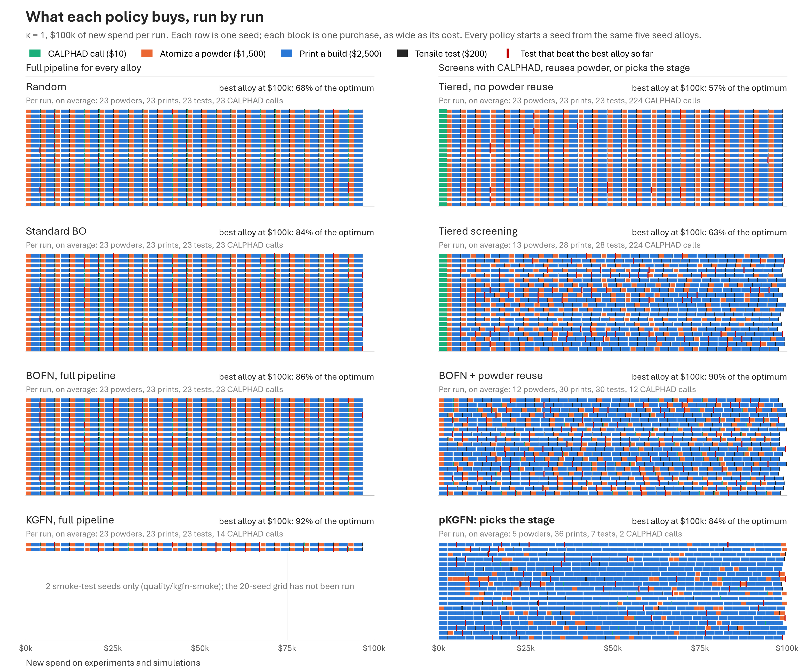
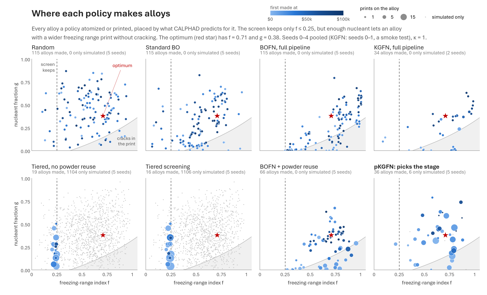

# How each policy behaves, across seeds

These are static companions to the timelapse in [`../dag`](../dag), which plays
back one seed. Here every seed is on the page at once. Both figures come from
[`behaviour.py`](behaviour.py), at κ = 1 with $100k of new spend per run.

## What each policy buys, run by run

Each row is one run and each block is one purchase, as wide as its cost and
coloured by stage. Red ticks mark the tensile tests that beat the best alloy so
far, so they show when a run made progress. The panel headers give per-run
averages.

- **Full-pipeline policies** (random, standard BO, BOFN, KGFN) produce the
  same tape every time: 23 chains of atomize, print and test, each with a $10
  CALPHAD call when the alloy is new. They choose only the alloy, so the one
  thing that differs between their tapes is where the red ticks fall.
- **Tiered screening** starts with a $2,240 block of CALPHAD calls, then
  alternates new powders with reprints of the four shortlisted alloys (13
  powders, 28 prints).
- **BOFN + powder reuse** makes 12 powders and 30 prints.
- **pKGFN** is mostly long runs of prints on a few powders (5 powders, 36
  prints) and tests only 7 builds per run, so its tape is almost all blue.

The data are all 20 stored seeds (KGFN has only its two smoke-test seeds). The
stored runs record each decision's action and the spend after it, but not its
stages. Those follow from the action and the size of the spend step: a "full"
chain is atomize, print and test, plus a $10 call when the alloy is new;
"reuse" is print and test; the screen is a run of $10 calls. `purchases()`
rebuilds the stages this way. On every run that logs its purchases (37: the
re-runs and the KGFN smoke tests), it checks the rebuilt list against the
log, and they match.

## Where each policy makes alloys

Each point is an alloy (a composition) that a policy atomized or printed. It
sits at two numbers CALPHAD gives for it:

- the **freezing-range index f**, the only thing the tiered screen checks
  (it keeps f ≤ 0.25);
- the **nucleant fraction g**. In the print, nucleant suppresses hot cracking
  (κ), and the screen cannot see this.

The curve is where a print is 50% cracked, `f (1 − κ·0.85·g/(g + 0.12)) = 0.38`.
To its right (shaded) prints crack. The red star is the optimum (f = 0.71,
g = 0.38). A point's size is the number of prints on that alloy, and its colour
is when the policy first made it. Gray dots are compositions that were only
simulated. The figure needs each purchase's inputs, so it uses the runs that log
them: seeds 0–4 in [`../results-rerun`](../results-rerun) (identical to the
stored runs, action for action) and KGFN's seeds 0–1.

| policy | alloys made (5 seeds) | prints per alloy | mean distance to the optimum in (f, g), made before / after $50k | share of prints within 0.15 of the optimum |
|---|---|---|---|---|
| Random | 115 | 1.0 | 0.26 / 0.30 | 21% |
| Standard BO | 115 | 1.0 | 0.36 / 0.24 | 17% |
| BOFN, full pipeline | 115 | 1.0 | 0.30 / 0.28 | 19% |
| KGFN, full pipeline (2 seeds) | 34 | 1.4 | 0.38 / 0.19 | 22% |
| Tiered, no powder reuse | 19 | 6.1 | 0.51 / 0.48 | 0% |
| Tiered screening | 16 | 8.9 | 0.51 / 0.50 | 0% |
| BOFN + powder reuse | 66 | 2.3 | 0.29 / 0.11 | 26% |
| pKGFN | 36 | 5.2 | 0.24 / 0.22 | 36% |

Tiered screening simulates compositions across the whole map (the gray cloud),
but it makes alloys only in the strip the screen allows, far from the optimum,
and it prints them over and over. The model-based full-pipeline policies make
many of their early alloys in the cracking zone at low nucleant (27% for BOFN
before $50k), then move up toward the star. Of all the policies, BOFN + powder
reuse ends closest to the optimum. pKGFN puts the largest share of its prints
near the optimum, spread over a few alloys that it prints many times.

These are five seeds, so the table describes behaviour. It is not a result.
The distance in (f, g) is a summary of where the policies look; it is not the
objective.

Regenerate with `python benchmarks/bofn-paper/behaviour/behaviour.py`, which
takes a few seconds and needs `../requirements.txt` and the Aptos fonts (see
`../README.md`).
