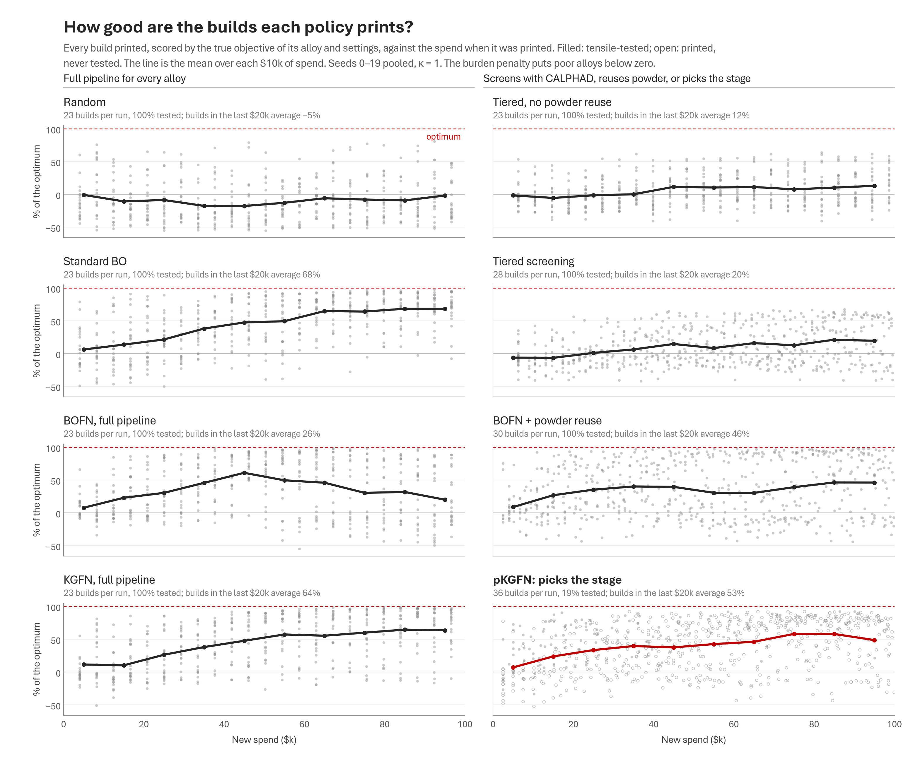

# How each policy behaves, across seeds

These are static companions to the timelapse in [`../dag`](../dag), which plays
back one seed. These put all 20 seeds of every policy on the page at once. All
three figures and both tables come from [`behaviour.py`](behaviour.py), at
κ = 1 with $100k of new spend per run.

The runs are the ones behind the slide figures. The purchases figure reads the
20 stored seeds. The other two need the inputs of every purchase, which only
runs made after the port log. Every stored seed was re-run with that log into
[`../results-rerun`](../results-rerun), and all 140 re-runs match the stored
runs action for action ([`../PORT.md`](../PORT.md)). KGFN is not among the
stored runs; its 20 seeds are in [`../results-kgfn`](../results-kgfn).

## What each policy buys, run by run

Each row is one run and each block is one purchase, as wide as its cost and
coloured by stage. Red ticks mark the tensile tests that beat the best alloy so
far, so they show when a run made progress. The panel headers give per-run
averages.

- **Full-pipeline policies** (random, standard BO, BOFN, KGFN) produce the
  same tape every time: 23 chains of atomize, print and test, each with a $10
  CALPHAD call when the alloy is new. They choose only the alloy, so the one
  thing that differs between their tapes is where the red ticks fall.
  KGFN calls CALPHAD on only 15 of its 23 chains (10 to 19 per run). The
  other chains go to alloys that were simulated before, often ones it has
  already made: 352 alloys from 460 chains.
- **Tiered screening** starts with a $2,240 block of CALPHAD calls, then
  alternates new powders with reprints of the four shortlisted alloys (13
  powders, 28 prints).
- **BOFN + powder reuse** makes 12 powders and 30 prints.
- **pKGFN** is mostly long runs of prints on a few powders (5 powders, 36
  prints) and tests only 7 builds per run, so its tape is almost all blue.

The stored runs record each decision's action and the spend after it, but not
its stages. Those follow from the action and the size of the spend step: a
"full" chain is atomize, print and test, plus a $10 call when the alloy is new;
"reuse" is print and test; the screen is a run of $10 calls. `purchases()`
rebuilds the stages this way. On every run that logs its purchases (162: the
140 re-runs, KGFN's 20 seeds and its two smoke tests), it checks the rebuilt
list against the log, and they match.

## Where each policy makes alloys

Each point is an alloy (a composition) that a policy atomized or printed. It
sits at two numbers CALPHAD gives for it:

- the **freezing-range index f**, the only thing the tiered screen checks
  (it keeps f ≤ 0.25);
- the **nucleant fraction g**. In the print, nucleant suppresses hot cracking
  (κ), and the screen cannot see this.

The curve is where a print is 50% cracked, `f (1 − κ·0.85·g/(g + 0.12)) = 0.38`.
To its right (shaded) prints crack. The red star is the optimum (f = 0.71,
g = 0.38). A point's size is the number of prints on that alloy, and its colour
is when the policy first made it. Gray dots are compositions that were only
simulated.

| policy | alloys made (20 seeds) | prints per alloy | mean distance to the optimum in (f, g), made before / after $50k | share of prints within 0.15 of the optimum |
|---|---|---|---|---|
| Random | 460 | 1.0 | 0.28 / 0.28 | 18% |
| Standard BO | 460 | 1.0 | 0.32 / 0.26 | 22% |
| BOFN, full pipeline | 460 | 1.0 | 0.26 / 0.23 | 31% |
| KGFN, full pipeline | 352 | 1.3 | 0.25 / 0.19 | 42% |
| Tiered, no powder reuse | 77 | 6.0 | 0.52 / 0.51 | 0% |
| Tiered screening | 72 | 7.9 | 0.52 / 0.53 | 0% |
| BOFN + powder reuse | 273 | 2.2 | 0.25 / 0.17 | 32% |
| pKGFN | 159 | 4.6 | 0.25 / 0.21 | 35% |

Tiered screening simulates compositions across the whole map (the gray cloud),
but it makes alloys only in the strip the screen allows, far from the optimum,
and it prints them over and over. BOFN (with and without powder reuse) and KGFN
make about a fifth of their early alloys in the cracking zone (21–22% of those
made before $50k, against 10% for random, 11% for standard BO and 12% for
pKGFN), then move toward the star. BOFN + powder reuse ends closest to the
optimum (0.17 in (f, g) for alloys made after $50k), with KGFN next (0.19).
KGFN puts the largest share of its prints near the optimum (42%), ahead of
pKGFN (35%), BOFN + powder reuse (32%) and BOFN (31%). pKGFN gets its share
with the fewest alloys, 159 over 20 seeds, and prints each of them many times.

The distance in (f, g) is a summary of where the policies look; it is not the
objective.

## How good are the builds each policy prints?

Each point is one build, placed at the spend when it was printed and scored
by the true objective of its alloy and settings, as % of the optimum. That is
the value a tensile test of the build would return, since the runs are
noise-free. Filled points were tested and open points were printed but never
tested. The line is the mean over each $10k of spend. The runs are the same
as in the composition figure.

| policy | builds per run | tested | mean of builds in the last $20k | builds above 80% of the optimum (20 seeds), tested / not tested |
|---|---|---|---|---|
| Random | 23 | 100% | −5% | 1 / 0 |
| Standard BO | 23 | 100% | 68% | 97 / 0 |
| BOFN, full pipeline | 23 | 100% | 26% | 94 / 0 |
| KGFN, full pipeline | 23 | 100% | 64% | 121 / 0 |
| Tiered, no powder reuse | 23 | 100% | 12% | 0 / 0 |
| Tiered screening | 28 | 100% | 20% | 0 / 0 |
| BOFN + powder reuse | 30 | 100% | 46% | 129 / 0 |
| pKGFN | 36 | 19% | 53% | 21 / 84 |

- **Standard BO and KGFN climb steadily**, standard BO from 6% of the
  optimum in the first $10k to 68% in the last $20k, and KGFN from 12% to 64%.
- **Full-pipeline BOFN climbs fastest, then falls back.** Its builds reach 61%
  in the $40–50k bin and then get worse, down to 20% in the last $10k, while
  its best tested alloy goes from 77% at $50k to 86% at $100k. Once it has a
  good incumbent, expected improvement favours long shots: a fifth of the
  alloys it makes after $50k are in the cracking zone, against 3–9% for the
  other model-based policies.
- **Neither tiered policy ever prints a build above 80%** (0 of 1,029 builds),
  because the screen has ruled those alloys out.
- **BOFN + powder reuse keeps a wide spread to the end** (sd 44 points in the
  last $20k, against 25 for standard BO). Cheap reprints let it keep trying
  settings on powders that are not the best ones, and it prints the most
  builds above 80% (129).
- **pKGFN prints the most builds and tests one in five.** The builds it tests
  are the better ones: they average 49%, against 38% for the untested ones.
  Still, 84 of its 105 builds above 80% were never tested. Its score, the
  best *tested* alloy, counts only what it chose to test.

Regenerate with `python benchmarks/bofn-paper/behaviour/behaviour.py`, which
takes about 10 seconds, prints the two tables above and needs
`../requirements.txt` and the Aptos fonts (see `../README.md`).
