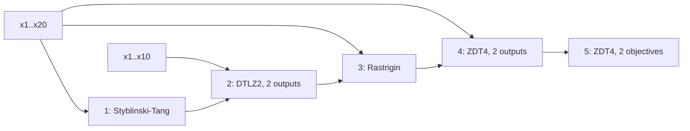

# 5-node multi-objective function network for EIFN (issue #265)

[`five_node_mo_network.py`](five_node_mo_network.py) defines `FiveNodeMOFunctionNetwork`, a synthetic
test problem for Bayesian optimization of function networks (EIFN, Astudillo & Frazier 2021; p-KGFN,
Buathong et al. 2024). It follows the structure of the `ackley_sin.py` template attached to the issue
(`n_nodes`, `node_groups`, `parent_nodes`, `dag`, `active_input_indices`, `node_dims`, `node_costs`,
`parent_bounds`, `evaluate(X, idx)`), and it is also a BoTorch `MultiObjectiveTestProblem`, so
`problem(X)` returns the two objectives.



| Node | Function | Literature domain | Inputs | Outputs, mapped onto |
|---|---|---|---|---|
| 1 | Styblinski–Tang, 20-D | [-5, 5] | x1..x20 | 1, onto DTLZ2's [0, 1] |
| 2 | DTLZ2, 11-D, 2 objectives | [0, 1] | x1..x10, node 1 | 2, onto Rastrigin's [-5.12, 5.12] |
| 3 | Rastrigin, 22-D | [-5.12, 5.12] | x1..x20, node 2 | 1, onto ZDT4's [-5, 5] |
| 4 | ZDT4, 21-D, 2 objectives | x1 in [0, 1], rest in [-5, 5] | x1..x20, node 3 | f1 = x1 as is (ZDT4's [0, 1]); f2 onto [-5, 5] |
| 5 | ZDT4, 2-D, 2 objectives | u1 in [0, 1], u2 in [-5, 5] | node 4 | the two objectives (minimized) |

Each parent output goes through a fixed min–max map onto the child's literature domain for that
input. The range it maps from is exact for nodes 1 and 2 and a rigorous bound for nodes 3 and 4: the
sum of the per-coordinate maxima, because all four functions are sums of one-variable terms. So every
node's output lies in the domain of the node it feeds, and no function is evaluated outside its
literature domain. BoTorch's `StyblinskiTang`, `DTLZ2` and `Rastrigin` raise on inputs outside their
bounds, so this is checked on every evaluation, and the tests check it on 4,000+ points including the
corners of the feasible box. ZDT4 is not in BoTorch, so it is implemented here with BoTorch's ZDT
conventions.

## Input domain and constraints

- `bounds` is `[-5, 5]^20`, the domain of Styblinski–Tang and of ZDT4's distance variables.
- x1..x10 also feed DTLZ2 (domain `[0, 1]`), and x1 is ZDT4's position variable (`[0, 1]`), so
  `0 <= x_i <= 1` for `i = 1..10`. These are in `problem.inequality_constraints`, a list of 20
  `(indices, coefficients, rhs)` tuples meaning `sum_i X[indices[i]] * coefficients[i] >= rhs`.
  That is the format `optimize_acqf(..., inequality_constraints=...)` and `evaluate_feasibility`
  take. BoTorch's constraints are non-strict, so `0 < x < 1` is stored as `0 <= x <= 1`.
- `problem.feasible_bounds` is the box the constraints cut out (`[0, 1]^10 x [-5, 5]^10`). Use it for
  Sobol initial designs.
- `problem.get_inequality_constraints(normalized=True)` gives the same constraints for optimizers
  that work on the unit cube, such as the BOFN code. There, `x_i` in `[0, 1]` is `z_i` in
  `[0.5, 0.6]`.
- `evaluate` rejects inputs more than `1e-6` outside the feasible box and clamps smaller violations,
  such as the `~1e-9` steps SLSQP can take.

## Known Pareto front

Node 5 is ZDT4 on node 4's outputs `(u1, u2)`, where `u1 = x1`. So `f1 = x1` and
`f2 = g (1 - sqrt(f1 / g))` with `g = 1 + u2^2 + 10 (1 - cos(4 pi u2)) >= 1`.

- **No input does better than `f2 = 1 - sqrt(f1)`.** This holds because `g >= 1` and
  `g - sqrt(t g)` increases with `g`.
- **Every point of that curve is reached.** Fix `x1 = t` and move x2..x20 from 0 towards the
  maximizers of ZDT4's distance term. Node 4's mapped f2, `u2`, goes from below -4.3 to above 3.9
  along that path. It is continuous, so it passes through 0, where `g = 1`.

So the network's Pareto front is exactly the ZDT1/ZDT4 front `f2 = 1 - sqrt(f1)`, `f1` in `[0, 1]`.
`gen_pareto_front(n)` returns it. `gen_pareto_set(n)` returns feasible inputs that reach it, found by
bisection along that path; their objectives match the front to `1e-10` in the tests. The Pareto set
is not unique, and `gen_pareto_set` returns one input per point of the front.

**Reference point: `(11, 11)`** (`problem.ref_point`, negated when `negate=True`). This is BoTorch's
reference point for the ZDT problems, from Yang et al. (2019). The front's nadir is `(1, 1)`. f2
ranges up to about 26 on random inputs, and about 54% of random inputs dominate `(11, 11)`, so the
hypervolume is informative from the first batch. The maximum hypervolume is
`problem.max_hv = 11 * 11 - 1/3 = 120 + 2/3`. `problem.max_hv_for_ref_point(r)` gives it for any
other reference point; for example, `(1.1, 1.1)` gives `1.21 - 1/3`.

How hard the problem is: the hypervolume regret of Sobol random search, averaged over 5 seeds, with
reference point `(11, 11)`:

| Random points | 21 | 42 | 100 | 300 | 1,000 | 4,096 | 20,000 |
|---|---|---|---|---|---|---|---|
| HV regret | 11.8 | 6.27 | 3.38 | 1.96 | 0.97 | 0.28 | 0.20 |

Random inputs pile up on ZDT4's local fronts (`g ≈ 1.25, 2, 3.25, ...`), and only a thin
level set of x2..x20 reaches `g = 1`.

## Usage

```python
import torch
from botorch.utils.sampling import draw_sobol_samples
from benchmarks.eifn_synthetic import FiveNodeMOFunctionNetwork

problem = FiveNodeMOFunctionNetwork(negate=True)  # maximize -f, as BoTorch's MOBO expects
X = draw_sobol_samples(problem.feasible_bounds, n=42, q=1).squeeze(-2)
Y = problem.evaluate(X)                    # 42 x 8: [n1, n2a, n2b, n3, n4a, n4b, obj1, obj2]
F = problem.network_to_objective(Y)        # 42 x 2, same as problem(X)
problem.evaluate(Y[:, [4, 5]], idx=[6, 7]) # node 5 alone, from node 4's outputs
```

One multi-objective EIFN step: a GP network over the 8 scalar nodes, qLogEHVI on samples from the
network, and constrained `optimize_acqf`. The last test in
[`test_five_node_mo_network.py`](test_five_node_mo_network.py) runs exactly this:

```python
from botorch.acquisition.multi_objective.logei import qLogExpectedHypervolumeImprovement
from botorch.optim import optimize_acqf
from botorch.sampling import StochasticSampler
from botorch.utils.multi_objective.box_decompositions.non_dominated import FastNondominatedPartitioning
from benchmarks.partial_kgfn.gp_network import GaussianProcessNetwork, fit_gp_network
from benchmarks.partial_kgfn.utils import construct_obs_set

train_X, train_Y = construct_obs_set(X, Y, problem.parent_nodes, problem.active_input_indices)
model = GaussianProcessNetwork(train_X=train_X, train_Y=train_Y, dag=problem.dag,
                               active_input_indices=problem.active_input_indices,
                               node_groups=problem.node_groups, node_dims=problem.node_dims)
fit_gp_network(model)
acqf = qLogExpectedHypervolumeImprovement(
    model=model, ref_point=problem.ref_point.tolist(),
    partitioning=FastNondominatedPartitioning(ref_point=problem.ref_point, Y=F),
    sampler=StochasticSampler(torch.Size([64])), objective=problem.get_objective())
candidate, _ = optimize_acqf(acqf, bounds=problem.bounds, q=1, num_restarts=10, raw_samples=512,
                             inequality_constraints=problem.inequality_constraints)
```

In BOFN's own `GaussianProcessNetwork`, use the same `dag` and `active_input_indices`. That code
optimizes on `[0, 1]^d`, so unnormalize with `problem.bounds` and pass
`get_inequality_constraints(normalized=True)`. For p-KGFN, `node_groups` lists which scalar nodes are
evaluated together. `parent_bounds[k]` and `node_input_bounds[g]` are the boxes to optimize a node's
input over, and `node_costs` takes either 5 costs (one per group) or 8 (one per scalar node).

## Choices made where the issue left room

- **Multi-objective nodes.** Nodes 2, 4 and 5 are 2-output test functions. Each output is one
  scalar node, because EIFN fits one GP per scalar output. The outputs of one node form a node group,
  evaluated together from the same input.
- **Node 5's inputs.** The issue says "node 4 outputs and node 4 outputs feed into node 5". This is
  read as node 4's outputs only. That is also what keeps node 5's front known: with any of x1..x20 as
  extra inputs to node 5, the front of the network would no longer be ZDT4's.
- **Why ZDT4 at nodes 4 and 5.** Node 4 must take all 20 inputs and node 3's output. Suppose node
  5's front needed node 4's distance term at its minimum. Then x2..x20 and node 3's output would all
  have to be 0 at once, which the chain cannot guarantee for every x1, and the front would not be
  known. ZDT4 avoids this in two ways. Its first objective is its position variable x1, which sweeps
  `[0, 1]` freely. Node 5's distance optimum (`u2 = 0`) is in the interior of `[-5, 5]`, so it is a
  level set node 4 can always reach. Of the ZDT and DTLZ families, ZDT4 is also the one whose domain
  is `[-5, 5]`. DTLZ2 at node 5 would have the same property but was rejected as too easy: with one
  distance input, half of all random inputs would land within 1% of its front.
- **Styblinski–Tang instead of the template's Ackley at node 1.** Its literature domain is exactly
  `[-5, 5]`, and it is separable, so the map onto DTLZ2's `[0, 1]` uses its exact range. Ackley's
  literature domain is `[-32.768, 32.768]`; using it here would need a restricted domain and a looser
  range.

## Tests

```bash
python -m pytest benchmarks/eifn_synthetic -q   # 14 tests, ~10 s
```

The tests cover:

- the scaling constants, recomputed from scratch;
- every node's outputs within the next node's domain;
- node-by-node evaluation matching the full network;
- the constraint format, checked with `evaluate_feasibility`, raw and normalized;
- no input beating the front, and `gen_pareto_set` reaching it;
- `max_hv` against BoTorch's `Hypervolume`;
- ZDT4 against its published formula;
- one constrained EIFN-style qLogEHVI step.

The last test needed a one-line fix in `benchmarks/partial_kgfn/gp_network.py`.
`MultivariateNormalNetwork.rsample` expanded the inputs with sizes of 1 instead of -1, so any MC
acquisition function that drew more than one sample from a network with a non-root node failed.

## References

- Styblinski & Tang (1990), *Neural Networks* 3(4):467–483.
- Rastrigin (1974); Mühlenbein, Schomisch & Born (1991), *Parallel Computing* 17:619–632.
- Zitzler, Deb & Thiele (2000), *Evolutionary Computation* 8(2):173–195 (ZDT4).
- Deb, Thiele, Laumanns & Zitzler (2005), in *Evolutionary Multiobjective Optimization*, Springer,
  pp. 105–145 (DTLZ2).
- Yang, Emmerich, Deutz & Bäck (2019), *Swarm and Evolutionary Computation* 44:945–956 (ZDT
  reference point).
- Astudillo & Frazier (2021), *Bayesian Optimization of Function Networks*, NeurIPS (EIFN).
- Buathong, Astudillo, Frazier et al. (2024), *Bayesian Optimization of Function Networks with
  Partial Evaluations*, ICML (p-KGFN).
- Surjanovic & Bingham, *Virtual Library of Simulation Experiments*,
  https://www.sfu.ca/~ssurjano/ (domains of the single-objective functions).
