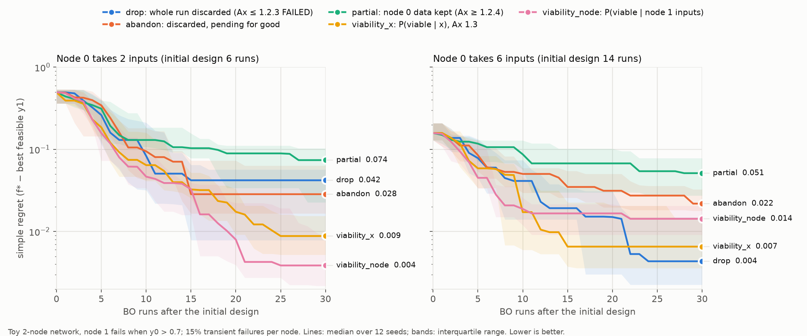

# BOFN with failed vs. abandoned experiments, in Ax's terms

Issue [#274](https://github.com/vertical-cloud-lab/digital-alloy-lab/issues/274). Related: the
5-node synthetic EIFN test function ([#265](https://github.com/vertical-cloud-lab/digital-alloy-lab/issues/265))
and the lab's fork of the pKGFN code,
[`vertical-cloud-lab/partial_kgfn`](https://github.com/vertical-cloud-lab/partial_kgfn).

Versions read for this note (2026-11-20): Ax `main` at
[`41cdcef`](https://github.com/meta/Ax/tree/41cdcef7d6247571464ad333ae9266054009a31f)
(2026-11-17), Ax 1.3.1 on PyPI (2026-06-09), and `partial_kgfn` `main` at
[`a599601`](https://github.com/vertical-cloud-lab/partial_kgfn/tree/a5996011ddba608a08c240479c859bcb3b2a897f).
Line links below point at those commits.

## Summary

- **Ax's definitions.** `FAILED` means a possibly transient error, so the arm may be suggested
  again. `ABANDONED` means "don't run this again": either a person decided so, or the
  parameterization makes the trial fail every time. By default the model fits on neither
  status's data. Ax keeps abandoned arms as pending points, so it won't suggest them again;
  failed arms can come back.
- **A function network fails at a node, not as a whole trial.** The nodes upstream of the
  failure still produced good data, and the failure says something about *that node's inputs*
  (including measured intermediate outputs), not about the whole input vector `x`. Ax gives
  each trial one status, so it can't record this. A BOFN campaign should give each node
  evaluation its own status.
- **Ax recently moved in this direction.** Since Ax 1.2.4, `Client.complete_trial` with
  missing metrics marks the trial `COMPLETED` and still fits the partial data. Before that
  (1.0.0 to 1.2.3) it marked the trial `FAILED`, which dropped the partial data and let the arm
  be suggested again. Ax 1.3.0 added an opt-in transform, `AddExecutionViability`, that treats
  `ABANDONED` trials as deterministic failures and learns P(viable | x). The function-network
  version of that is one **viability node** per failure-prone node, fit on that node's inputs
  (§4).
- **`partial_kgfn` already keeps a separate training set for each node,** so a run that stops
  partway still feeds the upstream GPs. It has no failure path, though. The full-evaluation
  algorithms (EIFN, KGFN, TSFN) assume every node returns a value, and the upstream-restricted
  pKGFN treats every parent output in the training data as physically available to continue
  from (§3).
- **A toy run (§5) says the failure model matters more than the partial data.** On a 2-node
  network whose optimum sits on a failure boundary, both viability strategies (on `x`, and on
  node 1's inputs) end near the optimum in 8 to 11 of 12 seeds. Keeping node 0's data from
  failed runs without a failure model (Ax ≥ 1.2.4's default) did worst. The node-level viability
  model did not beat the one on `x` there, because in that toy both see the same failures. Its
  case rests on data the `x` model never sees, such as purchased powder or other campaigns, and
  the toy doesn't test that.

## 1. What Ax does with each status

From [`trial_status.py`](https://github.com/meta/Ax/blob/41cdcef7d6247571464ad333ae9266054009a31f/ax/core/trial_status.py#L14-L65):

```
CANDIDATE --> STAGED --> RUNNING --> COMPLETED
          ------------->         --> FAILED (retryable)
                                 --> EARLY_STOPPED (deemed unpromising)
          -------------------------> ABANDONED (non-retryable)
          -------------------------> STALE (retryable, never run)
```

| Status | Ax's meaning | Data fit by default? | Pending, so not suggested again? | Notes |
|---|---|---|---|---|
| `RUNNING` | deployed (the Client API marks trials `RUNNING` as soon as it generates them) | yes, whatever is attached | yes, for each metric without data | |
| `COMPLETED` | finished | yes | yes for each metric that still has no data (Ax ≥ 1.2.4) | later data needs `Trial.update_trial_data()` |
| `EARLY_STOPPED` | stopped as unpromising | yes | no | needs data; with none, Ax tells you to abandon instead ([L692-L722](https://github.com/meta/Ax/blob/41cdcef7d6247571464ad333ae9266054009a31f/ax/core/base_trial.py#L692-L722)) |
| `FAILED` | "possibly transient or retryable error" | **no** | **no**, so the arm can be suggested again | attach any data *before* marking; Ax refuses to attach data afterwards ([L909-L916](https://github.com/meta/Ax/blob/41cdcef7d6247571464ad333ae9266054009a31f/ax/core/base_trial.py#L909-L916)) |
| `ABANDONED` | "should not be rerun": a person's decision, or the arm "deterministically causes trial evaluation to fail" | **no**, unless `fit_abandoned=True` | **yes, for every metric, permanently** | a terminal trial can't be abandoned without `unsafe=True` ([Ax #2931](https://github.com/meta/Ax/issues/2931)) |
| `STALE` | generated, never run | no | no | only reachable from `CANDIDATE` |

Details behind the table:

- **Which data the model fits on.** `DataLoaderConfig.statuses_to_fit` returns
  `{RUNNING, COMPLETED, EARLY_STOPPED}`, or every status if `fit_abandoned=True`
  ([`data_utils.py` L84-L91](https://github.com/meta/Ax/blob/41cdcef7d6247571464ad333ae9266054009a31f/ax/core/data_utils.py#L84-L91)).
  Its docstring says "all statuses except ABANDONED", but the code also drops `FAILED`, and
  [Ax PR #4958](https://github.com/meta/Ax/pull/4958) confirms that `FAILED` data is left out on
  purpose: "we could not rely on the quality of the data collected from FAILED trials".
- **Pending points are tracked per metric.** For experiments with fewer than 100 trials, an arm
  is pending for metric *m* if its trial is a `CANDIDATE`, or if it is deployed, completed or
  abandoned and has no data for *m*
  ([`utils.py` L384-L398](https://github.com/meta/Ax/blob/41cdcef7d6247571464ad333ae9266054009a31f/ax/core/utils.py#L384-L398)).
  `FAILED`, `EARLY_STOPPED` and `STALE` arms are never pending.
- **Partial data since 1.2.4** ([Ax PR #4958](https://github.com/meta/Ax/pull/4958), "Separate
  metric data availability from trial orchestration status"). Before 1.2.4, `complete_trial`
  marked a trial `FAILED` if any optimization-config metric was missing, which "discarded
  useful partial data from model fitting, allowed re-suggestion of already-evaluated arms".
  Now the trial is always `COMPLETED`, a warning names the missing metrics, a
  `MetricAvailability` (`NOT_OBSERVED` / `INCOMPLETE` / `COMPLETE`) is computed for each trial,
  and the arm stays pending for the metrics it lacks
  ([`client.py` L531-L573](https://github.com/meta/Ax/blob/41cdcef7d6247571464ad333ae9266054009a31f/ax/api/client.py#L531-L573)).
  I checked the wheels: 1.2.3 still has the `FAILED` rule and 1.2.4 has the new one.
- **Learning a failure region** ([Ax PR #4547](https://github.com/meta/Ax/pull/4547), in 1.3.0
  and later, opt-in).
  [`AddExecutionViability`](https://github.com/meta/Ax/blob/41cdcef7d6247571464ad333ae9266054009a31f/ax/adapter/transforms/add_execution_viability.py#L35-L72)
  adds an `execution_viable` metric (0 for `ABANDONED` trials, 1 for the rest, with synthetic
  rows for abandoned trials that have no data) and the outcome constraint
  `execution_viable >= 0.8`. It switches on after 3 abandoned trials. This is the
  "probabilistic classification model" an Ax maintainer described in
  [#2931](https://github.com/meta/Ax/issues/2931#issuecomment-2432765144). Note that it treats
  *every* `ABANDONED` trial as non-viable, including ones abandoned for logistics.
- **How abandoning "helps avoid re-suggesting similar points"** (your open question in
  [#2931](https://github.com/meta/Ax/issues/2931#issuecomment-3457166202)). Pending arms are
  passed to the acquisition function as `X_pending`. BoTorch's MC acquisition functions append
  `X_pending` to every candidate batch (`concatenate_pending_points`), so a candidate is scored
  by what it adds *jointly* with the pending points. Near a pending point the two outcomes are
  highly correlated and the candidate adds little. The effect is local, on the scale of the GP
  lengthscale, and the model learns nothing about *why* the arm was abandoned; only
  `AddExecutionViability` does that.

## 2. Where a function network differs

In BOFN ([Astudillo & Frazier, NeurIPS 2021](https://arxiv.org/abs/2110.06410)) each node *k*
has its own GP from (`x_k`, parent outputs) to `y_k`. EIFN samples through the DAG, and pKGFN
([Buathong et al., ICML 2024](https://proceedings.mlr.press/v235/buathong24a.html)) chooses one
node evaluation at a time. A lab run of composition → atomization → powder → print → test is a
path through that DAG, and when it fails, it fails at one node.

Status for each node evaluation, using Ax's names:

| What happened at node *k* | Ax analogue | Nodes before *k* | Node *k* | Nodes after *k* | Pending? | Intermediate (powder lot, coupon) |
|---|---|---|---|---|---|---|
| Measured, even if the value is bad (85 % dense, cracked but measurable) | `COMPLETED` | fit | fit | as run | no | as normal |
| Equipment or operator fault unrelated to the inputs (clog from a dirty crucible, gas ran out, power cut) | `FAILED` | **fit** | nothing; retry is allowed | nothing | no | still usable unless consumed: retry node *k* from it |
| Failure caused by node *k*'s inputs (melt won't atomize at that superheat, powder too coarse to spread, hot cracking) | `ABANDONED` (+ `AddExecutionViability`) | **fit** | **viability label 0 at node *k*'s inputs** (`x_k` plus *measured* parent outputs) | nothing | no; the viability model steers away from it | mark as dead-end |
| Stopped on purpose after node *k*−1 (pKGFN chose another node, intermediate looked unpromising, budget) | `EARLY_STOPPED` | fit | nothing | nothing | no | **kept; pKGFN can resume from it later** |
| Generated, then superseded before running | `STALE` | nothing | nothing | nothing | no | none |
| Vetoed by policy (banned element, safety) | not a failure | n/a | n/a | n/a | n/a | make it a known constraint on the search space, not a training label |
| Run, but not as planned (Ax [#3577](https://github.com/meta/Ax/issues/3577)) | Ax's workaround: abandon the planned arm, attach the executed one | fit on executed values | fit on executed values | as run | the planned arm | as measured |

Why attributing the failure to a node matters:

1. **Upstream data survives.** If node 3 fails, the atomization data from nodes 1 and 2 is still
   good. Ax 1.0 to 1.2.3 threw it away, and so does any pipeline that writes NaN into a
   full-network row.
2. **Failure rules are often about intermediates, not `x`.** "Powder with D90 above 63 µm
   doesn't recoat" depends on node 2's output, so a viability model on node 3's inputs
   carries over to *any* composition that gives coarse powder. One classifier on `x` (what
   `AddExecutionViability` fits) has to relearn the rule in each composition region, and it
   can't tell which step failed.
3. **Intermediates are physical.** pKGFN with the upstream restriction continues from an
   intermediate that already exists. That is a contextual / fixed-feature problem (Ax
   [#746](https://github.com/meta/Ax/issues/746), [#905](https://github.com/meta/Ax/issues/905)),
   and whether a given lot still exists is an inventory question, not a modelling one. Ax has
   no "resume" for an early-stopped trial. In pKGFN, resuming is just the next node evaluation.
4. **"Planned vs executed" comes built in for intermediates.** BOFN conditions node *k*+1 on
   the *measured* `y_k`, so the executed values are already what the model sees. The question
   from [#3577](https://github.com/meta/Ax/issues/3577) remains only for root inputs
   (composition as weighed vs. as measured, laser power set vs. logged): fit on executed
   values, generate candidates in planned values, store both. Noisy measured intermediates are
   the input-uncertainty problem of [#751](https://github.com/meta/Ax/issues/751).

The atomizer has already produced most of these cases:

| Run | What happened | Node-level reading |
|---|---|---|
| 630 bronze, Nov 5 ([#219](https://github.com/vertical-cloud-lab/digital-alloy-lab/issues/219#issuecomment-6670680314), [clog confirmed](https://github.com/vertical-cloud-lab/digital-alloy-lab/issues/219#issuecomment-6782571216)) | the induction generator shut itself off halfway; the melt cooled and clogged the nozzle | `FAILED` (equipment), but the powder made before the shutdown is real. Keep its PSD, but drop or flag the yield, which reflects the fault rather than the inputs |
| 630 bronze, second run ([#219](https://github.com/vertical-cloud-lab/digital-alloy-lab/issues/219#issuecomment-6509252104)) | "mostly failed": the plate's tungsten coating had worn away | transient if it's plate wear; deterministic if the melt attacks the coating. Record it as `unknown` until the cause is known |
| 630 bronze, Nov 13 ([#219](https://github.com/vertical-cloud-lab/digital-alloy-lab/issues/219#issuecomment-6869334131)) | O2 sensor failed (no reading); a seal burned and smoke got into the chamber | one output missing (`INCOMPLETE`, not a failure); the powder's quality is suspect |
| Al, Oct 20 ([#159](https://github.com/vertical-cloud-lab/digital-alloy-lab/issues/159#issuecomment-6353393906)) | never got past setup: empty argon tank, leaking seal | `STALE` / retryable: no data, and nothing learned about the inputs |
| Al, Oct 8 ([#159](https://github.com/vertical-cloud-lab/digital-alloy-lab/issues/159#issuecomment-6353393526)) | "dripping perfect, but it's not atomizing at all"; melt froze on the plate tip | possibly deterministic (superheat, plate temperature), so a candidate viability label |

Simulations fail too. Some Eagar-Tsai corner cases return NaN and then succeed on retry with a
larger domain ([PR #238](https://github.com/vertical-cloud-lab/digital-alloy-lab/pull/238)), which
is a textbook `FAILED`.

## 3. What `partial_kgfn` does today

- **Each node has its own data.** `GaussianProcessNetwork` takes a list of `train_X` and
  `train_Y` tensors, one per node, and fits each node's GP separately
  ([`decoupled_gp_network.py` L35-L108](https://github.com/vertical-cloud-lab/partial_kgfn/blob/a5996011ddba608a08c240479c859bcb3b2a897f/partial_kgfn/models/decoupled_gp_network.py#L35-L108)).
  `condition_on_observations` accepts `None` for nodes that weren't evaluated
  ([L169-L222](https://github.com/vertical-cloud-lab/partial_kgfn/blob/a5996011ddba608a08c240479c859bcb3b2a897f/partial_kgfn/models/decoupled_gp_network.py#L169-L222)).
  pKGFN appends data only to the node it evaluated
  ([`run_one_trial.py` L494-L505](https://github.com/vertical-cloud-lab/partial_kgfn/blob/a5996011ddba608a08c240479c859bcb3b2a897f/partial_kgfn/run_one_trial.py#L494-L505)).
  The data structure needed for partial runs is already there.
- **Full-network algorithms can't handle a missing node.** EIFN, KGFN, TSFN and Random call
  `problem.evaluate` for the whole network and append every node's output
  ([L413](https://github.com/vertical-cloud-lab/partial_kgfn/blob/a5996011ddba608a08c240479c859bcb3b2a897f/partial_kgfn/run_one_trial.py#L413),
  [L472-L480](https://github.com/vertical-cloud-lab/partial_kgfn/blob/a5996011ddba608a08c240479c859bcb3b2a897f/partial_kgfn/run_one_trial.py#L472-L480),
  via [`construct_obs_set`](https://github.com/vertical-cloud-lab/partial_kgfn/blob/a5996011ddba608a08c240479c859bcb3b2a897f/partial_kgfn/utils/construct_obs_set.py#L17-L68)).
  A failed node would have to be NaN, which breaks the GP fit. The fix is small: append node by
  node, skip any node that has no measured output or whose parents weren't measured, and still
  charge the cost.
- **No failure path anywhere.** Test functions always return a value, nothing records a status,
  and there is no viability model.
- **The training data doubles as inventory.** With `impose_assump=True`, the candidates for a
  downstream node are every combination of parent outputs in `model.train_Y`
  ([`discrete_kgfn_optim.py` L57-L90, L219-L247](https://github.com/vertical-cloud-lab/partial_kgfn/blob/a5996011ddba608a08c240479c859bcb3b2a897f/partial_kgfn/optim/discrete_kgfn_optim.py#L219-L247)).
  In the lab, a powder lot can be used up, contaminated, or consumed by a failed print. Keep
  an inventory table separate from the training data and draw candidates from it.
- **fast_pKGFN requires `impose_assump=False`**
  ([L98-L99](https://github.com/vertical-cloud-lab/partial_kgfn/blob/a5996011ddba608a08c240479c859bcb3b2a897f/partial_kgfn/run_one_trial.py#L98-L99)),
  i.e. it assumes intermediates can be bought in. For us that is real: when a composition won't
  atomize, a purchased powder can still be used to learn about the print and test nodes.
- **Best observed value is undefined under partial evaluation** (`-inf` for pKGFN on the
  pharma problem,
  [L288](https://github.com/vertical-cloud-lab/partial_kgfn/blob/a5996011ddba608a08c240479c859bcb3b2a897f/partial_kgfn/run_one_trial.py#L288)).
  Report regret of the posterior-mean recommendation, as the paper does.

## 4. Proposed handling for the lab's BOFN

**Keep one ledger row per node evaluation**, not per arm:

```
run_id, node, status (COMPLETED | FAILED | ABANDONED | EARLY_STOPPED | STALE | RUNNING),
failure_kind (transient | deterministic | unknown), reason,
inputs_planned, inputs_executed, parent_lot_ids, outputs, cost, lot_id_out, lot_remaining
```

Rebuild the model from the ledger every iteration:

```python
for k in nodes:
    ok = rows(node=k, status=COMPLETED, all parents COMPLETED)
    gp[k] = fit(X=[executed x_k, measured parent outputs] of ok, Y=outputs of ok)

    tried = rows(node=k, status in {COMPLETED, ABANDONED}, all parents COMPLETED)
    if k is failure-prone:
        viable[k] = fit(X=same inputs as gp[k] for tried, Y=1 if COMPLETED else 0)
        # FAILED (transient) rows are left out: they say nothing about the inputs.
        # "unknown" rows: count as 0 to be safe, or with a lower weight.

pending  = rows(status=RUNNING)          # FAILED, EARLY_STOPPED, STALE are not pending
inventory = lots with lot_remaining > 0 and status COMPLETED
```

**Viability nodes in the network.** Add `v_k` to the DAG as an extra sink with the same parents
and active inputs as node *k*. The existing `GaussianProcessNetwork` samples it like any other
node, conditioned on the sampled parent outputs. Then use EIFN with a constraint on those
samples, e.g. BoTorch's `constraints=[lambda Z: 0.5 - Z[..., v_k]]`: an MC sample only
counts as an improvement if every node on its path is viable. This is the node-level version of
`AddExecutionViability`. Fitting a GP to 0/1 labels is crude (a classification GP is the
principled choice), but it is the same compromise Ax made, and it works with the existing
network posterior.

The repo's benchmarks so far use three other encodings (§7). Each fits a different case:

- **Failure as a low value**, as in PR #122, where cracking scales density down. This is right
  when the failed part can still be measured: it is a `COMPLETED` node with a bad output.
- **An imputed penalty**, as in PR #206, where a stopped chain is recorded as `−λB`. This puts
  a cliff of arbitrary height into a smooth GP, and the GP smears it over a lengthscale. It
  should be used only where the imputed number is something the lab would actually measure.
- **NaN**, as planned in PR #74. This is fine as a ledger value, as long as model building drops
  it node by node, as above, and never passes it to a GP.

**pKGFN with failures.** Multiply the value of evaluating node *k* at `z` by the probability
that the evaluation succeeds (viability × (1 − transient failure rate for node *k*)), and charge
the full cost either way. Including the information a failure label carries (a fantasy
over success and failure) is an extension worth having in the methods paper
([#121](https://github.com/vertical-cloud-lab/digital-alloy-lab/issues/121)).

**If Ax is the ledger.** Use Ax ≥ 1.2.4. Keep a trial `RUNNING` while its run moves through
the nodes, and `attach_data` each node's metrics as they come in; data on `RUNNING` trials is
fit. When the run ends, at the last node or because it stopped at node *k*, call
`complete_trial`. The trial is then `COMPLETED` with `INCOMPLETE` availability, the partial data
is used, and the arm isn't suggested again. Record failures as tracking metrics
(`node3_viable = 0`) and put the reason in the trial's run metadata. Don't use trial-level
`FAILED` or `ABANDONED` for node-level failures: both drop the upstream data from the fit. Also
don't abandon trials for logistical reasons while `AddExecutionViability` is on, since it learns
those as non-viable. In the Client API, a trial that was never run is already `RUNNING`, so
`STALE` needs `unsafe=True`; `FAILED` gives the same retryable, no-data behaviour.

Ax's own models treat each metric as a separate output of `x`, not as a network, so BOFN
generation has to run outside Ax. That is the pattern from
[#3577](https://github.com/meta/Ax/issues/3577#issuecomment-3070067980): rebuild the client from
the database and reattach every trial each iteration, with single-step generation strategies. It
also covers mid-campaign changes ([#4295](https://github.com/meta/Ax/issues/4295)), which stay
local in a network: a new parameter or a new node only changes the GPs of the nodes that use
it, and old runs take the default value of the new step (e.g. "no heat treatment").

## 5. A toy run, and the benchmark to settle it

[`benchmarks/bofn_failures_demo.py`](benchmarks/bofn_failures_demo.py) runs a two-node network:
`y0 = f0(x_1..x_D)`, then `y1 = y0 · g(x_D+1)`. Node 1 fails deterministically when
`y0 > 0.7` (powder too coarse to spread), and each node evaluation also fails with probability
0.15 for reasons unrelated to its inputs. Because `y1` rises with `y0`, the best feasible runs
sit on the failure boundary (`f* = 0.7`), so an optimizer that learns nothing from a failure
keeps getting pulled into the failure region. Every strategy uses the same GP network and the
same MC expected improvement through the network, evaluated jointly with any pending points
(BoTorch's mechanism) on 1,280 candidates per run. They differ only in what they do with a
failed run:

- **drop**: Ax 1.0 to 1.2.3. `complete_trial` marks the trial `FAILED`, the run is discarded,
  and the arm can come back.
- **abandon**: every failure is `ABANDONED`. The run is discarded and the arm is pending for
  good.
- **partial**: Ax ≥ 1.2.4. The trial is `COMPLETED` with incomplete metrics, node 0's data is
  fit, and the arm is pending.
- **viability_x**: Ax ≥ 1.3 used as intended. Transient failures are `FAILED`, deterministic
  ones are `ABANDONED`, and `AddExecutionViability` fits a 0/1 GP over `x`, with
  `P(viable) ≥ 0.8` once 3 runs have been abandoned.
- **viability_node**: §4's proposal. Node 0's data is kept, and node 1 gets a 0/1 viability GP
  over its own inputs (`x_D+1`, measured `y0`), with the same bound and trigger and nothing
  pending.

Settings: 12 seeds, 30 BO runs after a Sobol design, with `D = 2` (failure region 24 % of
node 0's inputs) and `D = 6` (23 %). It takes about 4 and 7 minutes on 4 CPU cores
([results](benchmarks/bofn_failures_results.json),
[results, D = 6](benchmarks/bofn_failures_results_dim6.json),
[figure script](benchmarks/bofn_failures_visualize.py)).



| D | strategy | final regret, mean ± SE | median | seeds within 0.02 | deterministic failures in 30 BO runs | repeat failures (within 0.1 of an earlier one) |
|---|---|---|---|---|---|---|
| 2 | drop | 0.036 ± 0.008 | 0.042 | 4/12 | 13.9 ± 1.4 | 12.8 |
| 2 | abandon | 0.042 ± 0.010 | 0.028 | 4/12 | 10.3 ± 1.1 | 5.4 |
| 2 | partial | 0.097 ± 0.034 | 0.074 | 2/12 | 10.2 ± 0.8 | 3.4 |
| 2 | viability_x | 0.012 ± 0.003 | 0.009 | 11/12 | 10.0 ± 0.7 | 5.8 |
| 2 | viability_node | **0.008 ± 0.003** | 0.004 | 10/12 | 9.2 ± 0.7 | 4.2 |
| 6 | drop | **0.008 ± 0.002** | 0.004 | 12/12 | 13.9 ± 0.7 | 7.1 |
| 6 | abandon | 0.026 ± 0.004 | 0.022 | 5/12 | 7.8 ± 0.8 | 0.5 |
| 6 | partial | 0.061 ± 0.015 | 0.051 | 3/12 | 9.9 ± 0.8 | 0.1 |
| 6 | viability_x | 0.011 ± 0.003 | 0.007 | 9/12 | 10.1 ± 0.7 | 1.7 |
| 6 | viability_node | 0.017 ± 0.003 | 0.014 | 8/12 | 12.5 ± 0.7 | 1.0 |

What the toy shows:

1. **Learning from failures is what helps.** Both viability strategies end low in both settings
   (8 to 11 of 12 seeds within 0.02 of `f*`).
2. **Keeping partial data without a failure model doesn't help.** `partial` has the worst
   regret in both settings. The node 0 data from failed runs shows exactly where `y0` is high,
   and node 1's GP, which only sees `y0 ≤ 0.7`, extrapolates that high `y0` is good. The pending
   arms then flatten the joint EI. Ax ≥ 1.2.4's handling is the right data hygiene, but when a
   failure is caused by the inputs it has to come with a failure model.
3. **`drop` is erratic and always fails most.** At `D = 2` it re-proposes the same failing spot
   (12.8 repeat failures out of 13.9). At `D = 6` its suggestions spread out enough to land just
   below the boundary, and it ends best, but at the price of the most failures (46 % of BO runs).
   That is the Ax ≤ 1.2.3 behaviour, and the stuck re-suggestion of Ax
   [#1568](https://github.com/meta/Ax/issues/1568).
4. **`abandon` fails least at `D = 6`** (7.8) but improves slowly. Pending arms stop exact
   repeats; they don't teach the model anything.
5. **The node-level viability model did not beat the one on `x`.** It is ahead at `D = 2`
   (within noise) and behind at `D = 6`, where it also fails more. In this toy every node 1
   attempt comes from a full run, so both models see the same events, and at `D = 6` the node
   model inherits node 0's uncertainty about `y0`. Its expected advantage is data the `x` model
   never sees: node 1 runs on purchased powder (fast_pKGFN's setting), on lots from other
   campaigns, or on pKGFN partial evaluations, plus knowing which step failed. This toy doesn't
   test any of that.

Caveats: this is one failure mode at one node, with failures labelled transient or
deterministic correctly, noiseless outputs, a GP regression on 0/1 labels (as Ax does), a
discrete candidate search, and 12 seeds. Read it as a demonstration of the mechanisms, not as a
ranking.

**The benchmark that would settle it** puts three failure modes on the 5-node chain from
[#265](https://github.com/vertical-cloud-lab/digital-alloy-lab/issues/265):

1. transient failures with probability *p* at each node, independent of the inputs;
2. a deterministic failure region for node 3 that depends on node 2's *output*;
3. a deterministic failure region for node 1 that depends on `x` alone.

It would add the case the toy leaves out: node 3 sometimes run on intermediates that don't come
from `x` (purchased powder). It would also label some failures `unknown`, and measure regret
against cumulative cost, cost spent on failed evaluations, and repeated suggestions.

## 6. Ax issues and PRs to read alongside this

- [#2931](https://github.com/meta/Ax/issues/2931): abandoning a terminal trial; abandon vs. fail
  for parameterization-caused failures; the classifier plan (now `AddExecutionViability`).
- [#3577](https://github.com/meta/Ax/issues/3577): planned vs. executed parameters; abandon plus
  attach as the workaround; storing candidates and experiments separately in BoFire.
- [#4295](https://github.com/meta/Ax/issues/4295): changing the search space mid-campaign.
- [#1568](https://github.com/meta/Ax/issues/1568): out-of-design trials causing repeated
  suggestions, and abandoned out-of-design arms not being treated as pending.
- From page 3 of your Ax issues: [#140](https://github.com/meta/Ax/issues/140#issuecomment-1172010989)
  (hierarchical search spaces; your multi-step processing example with optional steps),
  [#746](https://github.com/meta/Ax/issues/746) / [#905](https://github.com/meta/Ax/issues/905)
  (fixed features, i.e. continuing from a given intermediate),
  [#751](https://github.com/meta/Ax/issues/751) (input uncertainty, i.e. noisy measured
  intermediates), [#1189](https://github.com/meta/Ax/issues/1189) (structured GPs, where a
  maintainer noted these models are "hard to build a generic interface for" in Ax).
- Ax PRs: [#4958](https://github.com/meta/Ax/pull/4958) (metric availability separate from
  trial status) and [#4547](https://github.com/meta/Ax/pull/4547) (`AddExecutionViability`,
  first called `AddFeasibility`).

## 7. Related issues and PRs in this repo

Nothing in the repo uses Ax yet: no `AxClient`, `TrialStatus`, or fail/abandon calls on `main`,
#14, #122 or #206. A mock reviewer has already asked the question this note answers: "How do
you handle missing nodes/failed builds/failed tests (censoring) in the DAG?"
([`edison-topic3b-fit-assessment.md` L182](edison-trajectories/edison-topic3b-fit-assessment.md)).

| # | What it is | Bearing on failed / abandoned / partial runs |
|---|---|---|
| [#91](https://github.com/vertical-cloud-lab/digital-alloy-lab/issues/91) | FLAIME as a DAG; multi-output test nodes; pKGFN speed | Missing outputs *by design*: each sample gets SEM/EDS, tensile *or* hardness, so "we will not have all the data points required for input into one GP". The pKGFN authors' setting needs every parent output before a child can run ([comment](https://github.com/vertical-cloud-lab/digital-alloy-lab/issues/91#issuecomment-6201156166)) |
| [#121](https://github.com/vertical-cloud-lab/digital-alloy-lab/issues/121) / [PR #122](https://github.com/vertical-cloud-lab/digital-alloy-lab/pull/122) | aluminum LPBF benchmark port, KGFN, matched-seed bootstrap | Already keeps **inventory separate from training data** (powder `lots`, `builds` with a `tested` flag; `benchmarks/bofn-paper/bofn_alloy.py` L202-L302). Cracking is modelled as a *value* (density scaled down, L115-L124), not a gap. Builds pKGFN never tests are effectively abandoned |
| [#205](https://github.com/vertical-cloud-lab/digital-alloy-lab/issues/205) / [PR #206](https://github.com/vertical-cloud-lab/digital-alloy-lab/pull/206) | copper/DED 8-stage benchmark | The only code with gates and lot retirement (a lot is retired after three density-gate misses). The screening baseline records a stopped chain with an *imputed* value (`−λB`, "recorded as a failure"; `benchmarks/bofn-cu-ded/policies.py` L220-L248). `pkgfn_audit` sends about 1 in 10 stopped candidates on anyway, to measure false rejections, which is the selection-bias cost of early stopping. Not run yet |
| [#13](https://github.com/vertical-cloud-lab/digital-alloy-lab/issues/13) / [PR #14](https://github.com/vertical-cloud-lab/digital-alloy-lab/pull/14) | first BoTorch BOFN, pKGFN port, HPC sweeps | Per-node data and partial evaluations; a silent "error fallback" to random draws was removed after it masked pKGFN crashes. The keyhole, balling and lack-of-fusion constraints are only plotted. [`bofn-llm-bo-synthesis.md`](bofn-llm-bo-synthesis.md) L117-L121 says they are "composed via `ConstrainedMCObjective`", but no code does that |
| [#73](https://github.com/vertical-cloud-lab/digital-alloy-lab/issues/73) / [PR #74](https://github.com/vertical-cloud-lab/digital-alloy-lab/pull/74) | design doc: particle packing and CrabNet as BOFN benchmarks | Chose particle packing partly for its native simulation failures, a ready-made P(fail) testbed; the planned `evaluate_node` returns NaN on failure |
| [#265](https://github.com/vertical-cloud-lab/digital-alloy-lab/issues/265) | 5-node synthetic EIFN test | Where the failure modes of §5 would go |
| [#104](https://github.com/vertical-cloud-lab/digital-alloy-lab/issues/104) | fantasizing a batch-independent multi-output GP breaks pKGFN | Has to be solved before multi-output nodes can have partial outputs |
| [#120](https://github.com/vertical-cloud-lab/digital-alloy-lab/issues/120) | Advanced Materials article plan | Run class "R5: failed runs" feeds the atomization-window figure |
| [#219](https://github.com/vertical-cloud-lab/digital-alloy-lab/issues/219), [#159](https://github.com/vertical-cloud-lab/digital-alloy-lab/issues/159) | copper and aluminum atomizer runs | The real failures in §2 |
| [PR #66](https://github.com/vertical-cloud-lab/digital-alloy-lab/pull/66), [#223](https://github.com/vertical-cloud-lab/digital-alloy-lab/issues/223) / [PR #224](https://github.com/vertical-cloud-lab/digital-alloy-lab/pull/224), [PR #238](https://github.com/vertical-cloud-lab/digital-alloy-lab/pull/238) | SLURM port; recovered Edison tasks; Arroyave simulation methods | Compute-side partial runs (`"partial": true` checkpoints at walltime) and retryable simulation failures |
| [#47](https://github.com/vertical-cloud-lab/digital-alloy-lab/issues/47) | contact the BoTorch team about a BOFN tutorial | A failure-aware BOFN example could be the tutorial's hook |
| fork [#1](https://github.com/vertical-cloud-lab/partial_kgfn/issues/1), [PR #2](https://github.com/vertical-cloud-lab/partial_kgfn/pull/2), [#4](https://github.com/vertical-cloud-lab/partial_kgfn/issues/4) | reproduce the pKGFN paper in CI; fast_pKGFN posterior mean | PR #2 ran with `impose_assump=False`. Your [review there](https://github.com/vertical-cloud-lab/partial_kgfn/pull/2#discussion_r3244170803) caught a best-vs-cost curve above the true maximum, which came from taking the max of noisy observations. That is also why §3 recommends reporting regret at the recommended point |
