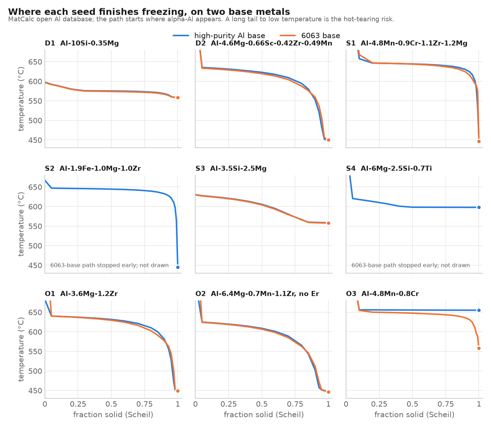
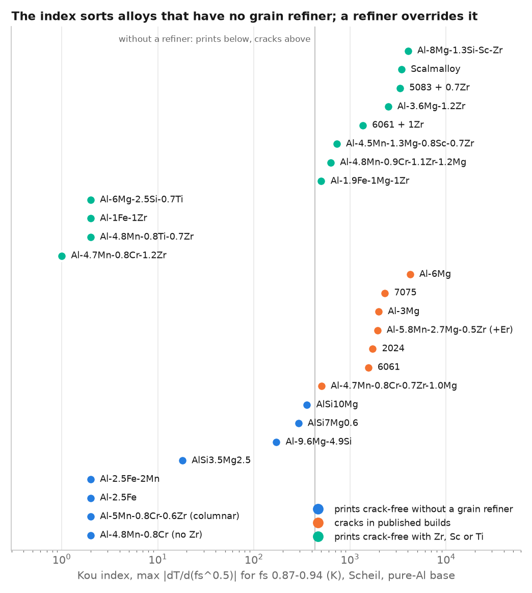
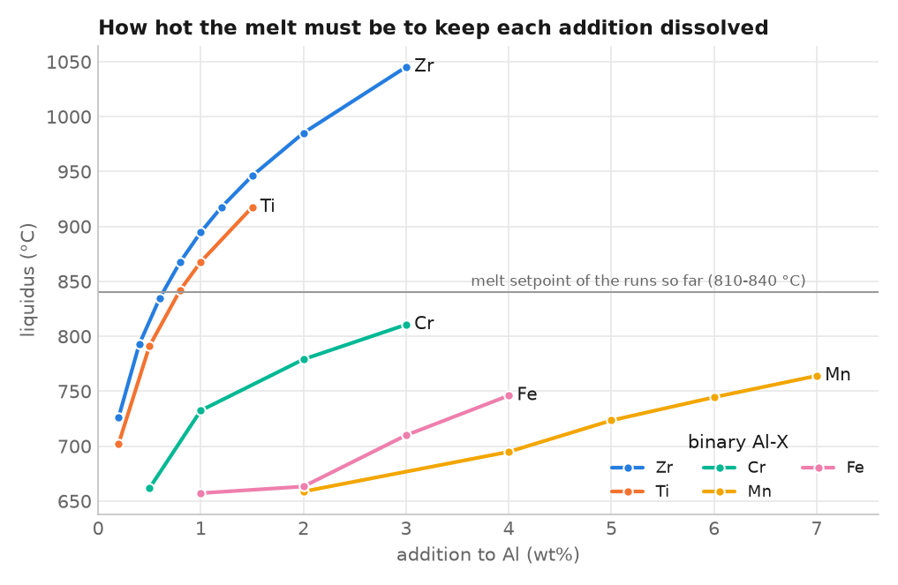
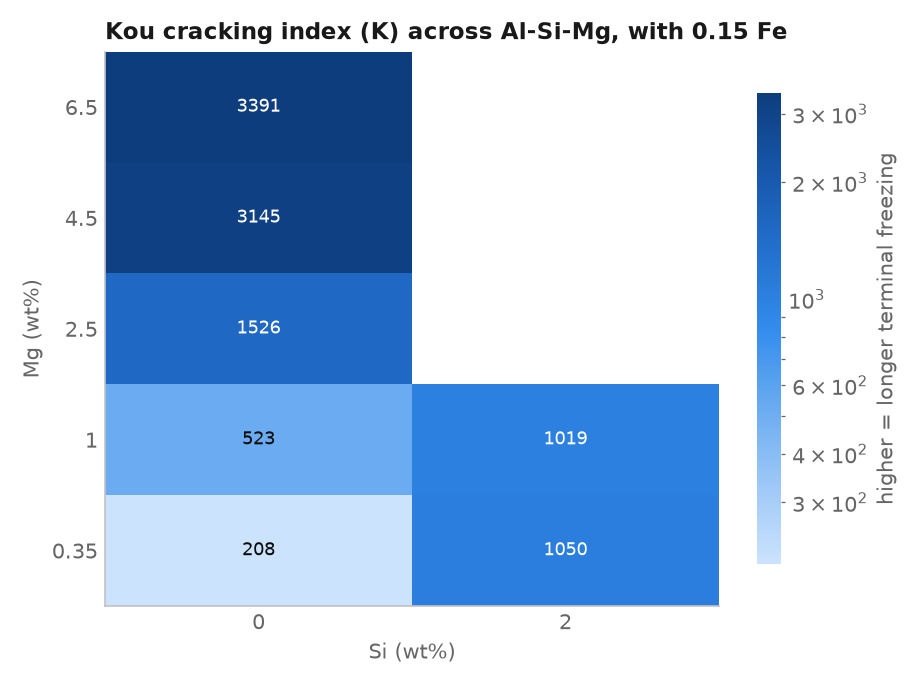
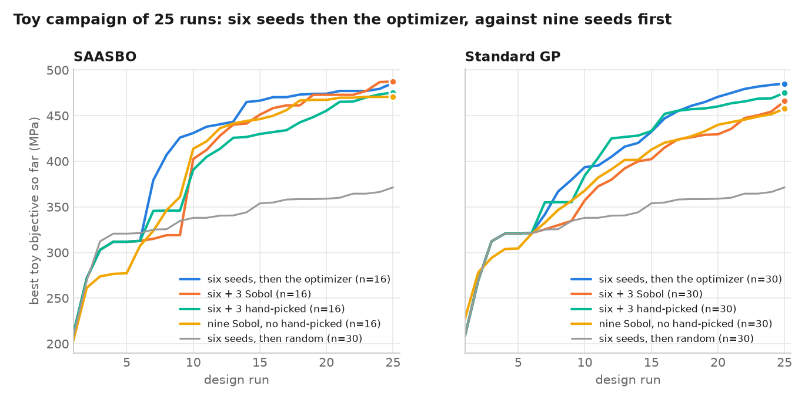

# The first six seed experiments for the Al campaign, and three optional ones (#275)

[#275](https://github.com/vertical-cloud-lab/digital-alloy-lab/issues/275) asks for the first six
compositions of the [#277](https://github.com/vertical-cloud-lab/digital-alloy-lab/issues/277)
campaign and a possible three more, each with atomizer settings, a sieve cut, laser powder bed
fusion (LPBF) settings for the Aconity MIDI, the microstructure to expect, and people worth asking
first. After the six, SAASBO takes over. This folder builds on the seeding plan one level up
([`../README.md`](../README.md)) and replaces its seed table.

**Status:** a plan. Nothing here has been run on a real sample. Every number is either read from a
source (and marked with how it was read) or comes from a model in this folder (and says so).

## Short version

| | Composition (wt%) | Role | Published strength: yield / UTS / elongation | Feedstock |
|---|---|---|---|---|
| **D1** | Al–10Si–0.35Mg | Benchmark: the alloy to beat | 233–270 / 461–466 MPa / 6–10 % as built (EOS datasheet) | on hand |
| **D2** | Al–4.6Mg–0.66Sc–0.42Zr–0.49Mn | Benchmark: Scalmalloy-type | 465–500 / 505–530 / 11.5–16 % after 325 °C for 4 h (vendor datasheets) | Sc on hand; **Zr to buy** |
| **S1** | Al–4.8Mn–0.9Cr–1.1Zr–1.2Mg | Sc-free, strongest verified | 390 / 450 / 17 % as built; 500 / 560 / 5 % after 375 °C for 8 h | **Zr to buy** |
| **S2** | Al–1.9Fe–1.0Mg–1.0Zr | Sc-free, Fe-based, heat-resistant | 218 / 310 / 13 % as built; 376 / 406 / 11 % after 400 °C for 4 h | **Fe and Zr to buy** |
| **S3** | Al–3.5Si–2.5Mg | Sc-free, needs nothing we lack | 270–417 / 442–506 / 6–13 % as built, depending on plate temperature and machine; 348 / 484 / 10.5 % after 170 °C for 1 h | on hand |
| **S4** | Al–6Mg–2.5Si–0.7Ti | Exploratory: Ti in place of Zr and Sc | UTS 448 MPa, 9.1 % as built (abstract only) | on hand |
| *O1* | Al–3.6Mg–1.2Zr | Optional: the plainest Zr route | 350 / 385 / 17–19 % after 400 °C for 8 h | **Zr to buy** |
| *O2* | Al–6.4Mg–0.7Mn–0.4Er–1.1Zr | Optional: Er in place of Sc | 440 / 520 / 15.5 % after 375 °C for 10 h | Er on hand; **Zr to buy** |
| *O3* | Al–4.8Mn–0.8Cr | Optional: S1 without Zr or Mg | 99 HV as built, crack-free; no tensile data | on hand |

The six are two benchmarks, three alloys from the literature that each strengthen in a different
way, and one exploratory alloy. The sources and how each was read are in
[Why these nine](#why-these-nine).

**Four things to settle before the S runs (Dec 7–10):**

1. **Order an Al–Zr master alloy now, and iron.** Five of the nine need Zr (D2, S1, S2, O1, O2):
   about 120 g of Al–10Zr for one 250 g charge of each. Zr isn't on the Nov 13 list in
   [#146](https://github.com/vertical-cloud-lab/digital-alloy-lab/issues/146#issuecomment-6842840090).
   Among Sc-free commercial alloys with a published composition, a yield strength above about
   350 MPa together with 8 % elongation comes only with Zr or TiB₂: Höganäs Al-HS1, EOS/Constellium
   Al5X1, HRL 7A77 and A20X ([`research/datasheets.md`](research/datasheets.md)).
   **If Zr is late, run D1, S3, S4 and O3 first:** all four use only what is on the shelf.
2. **Melt hotter for anything with Zr, Ti, Cr or Mn.** The runs so far were at 810–840 °C. The
   calculated liquidus is 835 °C for 0.6 wt% Zr and 895 °C for 1 wt% Zr in pure Al, and Mg raises
   it by another 35–40 °C. A Zr-bearing charge at 840 °C still holds Al₃Zr crystals. Setpoints
   here run from 820 °C (D1, S3) to 1040–1060 °C (S1, O1, O2); see
   [the atomizer table](#atomizer-settings).
3. **Decide the base metal per seed.** 6063 brings about 0.5 Mg, 0.35 Si and 0.2 Fe. That suits D1,
   D2, S1, S2, S3 and S4, which contain Mg anyway. It does not suit a Mg-free Al–Mn–Cr alloy: the
   calculated range over which the last tenth freezes grows from under 1 K to about 45 K, its
   cracking index goes from 2 to about 570 K, and the published variant with 1.0 Mg and 0.7 Zr
   cracked. That is why S1 is the Mg-bearing, high-Zr version, and why O3 needs a purer base
   ([details](#what-the-6063-base-does)).
4. **Open the design box on [PR #72](https://github.com/vertical-cloud-lab/digital-alloy-lab/pull/72)
   where these alloys sit outside it:** Fe to 2.5 (S2 has 1.9), Zr to 1.5 (S1, O1, O2 have 1.1–1.2),
   Mg to 7 (O2, S4), Ti to 1.0 (S4), and drop the Mg + Si ≤ 6 cap (D1, S3 and S4 all break it).

**Where they go in the [#256](https://github.com/vertical-cloud-lab/digital-alloy-lab/issues/256) calendar.**
The six fit the slots already there, so nothing moves:

| Slot | Date | Run | If Zr has not arrived |
|---|---|---|---|
| D1 | Mon Nov 30 | D1 | D1 |
| D2 | Wed Dec 2 | D2 | S3 |
| S1–S4 | Mon–Thu Dec 7–10 | S1, S2, S3, S4 | S4 and O3 first; then D2, S1 and S2 in the order Zr and Fe arrive |
| X1–X3 (flex slots) | Dec 14–16 | redo any failure; otherwise O1, O2, O3 | whichever of D2, S1 and S2 is still owed |

**After the six, go straight to the optimizer.** In a toy campaign on this palette, six seeds
followed by SAASBO did as well as six seeds plus three Sobol points (a difference of +2 ± 6 MPa
against nine seeds, over 16 paired instances), and 18 of its 19 picks tried an element no seed
contained. Edison's literature review recommends the opposite (nine seeds, the extra three chosen
for coverage). Both are laid out in [After the six](#after-the-six-saasbo).

## Why these nine

Each row says what was read. "In full" means the paper's own text; "abstract" means only that.

| | What the source reports | Read how | Why it is on the list |
|---|---|---|---|
| D1 | EOS AlSi10Mg at 30 µm: 233/270 MPa yield (vertical/horizontal), 461–466 UTS, 6.3–10.2 %. On a Concept Laser M2: 209 / 315 / 7.3 % ([10.1038/nature23894](https://doi.org/10.1038/nature23894)) | datasheet; paper in full | The alloy to beat, made through our own atomizer |
| D2 | Mg 4.5–4.9, Sc 0.68–0.84, Zr 0.2–0.4, Mn 0.2–0.7. As built 275–295 / 350–355 / 22–23 %; aged 325 °C for 4 h: 465–500 / 505–530 / 11.5–16 % | three vendor datasheets | The Sc reference for mineral burden |
| S1 | Chalmers "alloy F", measured Al–4.8Mn–0.9Cr–1.1Zr–1.2Mg (plus 0.19 Fe, 0.20 Si): as built 390 / 450 / 17 %; 375 °C for 8 h: 500 / 560 / 5 %, 172 HV. The same alloy with 0.7 Zr and 1.0 Mg cracked. Without Mg, Al–5.0Mn–0.8Cr–0.6Zr gave 250 / 310 / 25 % and 350 / 440 / 8 % aged ([10.1016/j.jallcom.2023.171685](https://doi.org/10.1016/j.jallcom.2023.171685), [10.1016/j.matdes.2024.113160](https://doi.org/10.1016/j.matdes.2024.113160), Chalmers thesis) | in full | The strongest Sc-free result we could verify. Its Mg, Fe and Si levels are what a 6063 base gives. Sold in a Mg-free form as Höganäs forAM Al-HS1 (355–370 / 420–440 / 12–16 % aged) |
| S2 | Measured Al–1.87Fe–1.02Mg–1.03Zr, 30–63 µm powder, 380 W, 1800 mm/s, 100 µm hatch, 30 µm layers, 99.8 % dense. As built 218 / 310 / 13.2 %; 400 °C for 4 h: 376 / 406 / 11.1 %; still 302 MPa after 100 h at 400 °C; 182 MPa yield at 200 °C ([10.1080/17452759.2025.2516663](https://doi.org/10.1080/17452759.2025.2516663)) | in full, through the BYU tunnel | Iron is the one palette element not on the 2025 U.S. critical minerals list. Printed from a coarse cut like ours. A commercial relative exists (Aheadd CP1, Al–1Fe–1Zr: 275–300 MPa aged) |
| S3 | Powder measured Si 3.3, Mg 2.3 (0.43 % "other, including Mn, Zr, Fe"), 20–63 µm, 370 W, 50 µm layers, 61.7 J/mm³. As built: 270 / 442 / 12.7 % on a 50 °C plate, 381 / 483 / 6.1 % on a 100 °C plate, 417 / 506 / 10.1 % on a Concept Laser M2. 170 °C for 1 h: 348 / 484 / 10.5 % ([10.3390/met10040514](https://doi.org/10.3390/met10040514)); 99.87 % dense at 1200 mm/s and 0.1 mm hatch ([10.1007/s40964-026-01583-1](https://doi.org/10.1007/s40964-026-01583-1)) | in full | About 100 MPa above AlSi10Mg with only Si and Mg, from 4047, 6063 and Mg. It is not proven Zr-free: ask what the 0.43 % is |
| S4 | "Ti addition at 0.77 wt.%" raises the nucleation rate and growth restriction; a higher Mg/Si ratio gives Al/Mg₂Si eutectic that backfills. UTS 447.8 MPa, 9.1 % as built. A search summary gives the alloy as Al–6Mg–2.5Si–0.7Ti ([10.1080/17452759.2024.2378930](https://doi.org/10.1080/17452759.2024.2378930)) | abstract only; composition from a search summary | The one documented route to a refined, crack-free, strong alloy with no Zr and no Sc. If Ti works in our hands, every Mg-based alloy opens up without the Zr order |
| O1 | Al–3.60Mg–1.18Zr: as built 220 / 290 / 29 %; peak aged (400 °C, about 8 h) 350 / 385 / 17–19 %, the same in both directions. Mg fell from 3.6 to 2.7 % in the part at the highest energy ([10.1016/j.actamat.2018.04.053](https://doi.org/10.1016/j.actamat.2018.04.053)). EOS Al5X1 (Mg 2.5–4.2, Zr 0.6–1.8, Mn 0.1–1): 380 / 415 / 14.5 % after 400 °C for 6 h | accepted manuscript in full; datasheet | The cleanest test of what Zr alone does, with high ductility |
| O2 | Measured Al–6.40Mg–0.72Mn–0.40Er–1.10Zr: as built 325 / 438 / 18 %; 375 °C for 10 h: 440 / 520 / 15.5 % ([10.1016/j.matdes.2022.111064](https://doi.org/10.1016/j.matdes.2022.111064)) | abstract by us; full text by Edison | The closest Sc-free result to Scalmalloy. Every Er alloy we found also has 0.5–3 % Zr; none printed crack-free without it |
| O3 | Chalmers "alloy B", measured Al–4.9Mn–0.8Cr: crack-free, about 99.5 % dense, 99 HV as built; it hardens for about 1 h at 405 °C and then over-ages ([10.1016/j.jallcom.2022.165870](https://doi.org/10.1016/j.jallcom.2022.165870)) | in full | Shows what the Zr and Mg in S1 buy, and runs without the Zr order |

What was left out, and why:

- **Al–Mn–Sc** (Al–4.5Mn–1.3Mg–0.8Sc–0.7Zr, 577 / 588 / 11 % aged, patent example) is the strongest
  alloy in the survey, but it carries more Sc than Scalmalloy.
- **7xxx with Zr** (HRL 7A77: 490–585 MPa after HIP and heat treatment) needs solution treatment and
  quench, and published builds lost about a third of the Mg and a quarter of the Zn. The droplet
  model here adds a Zn loss in the atomizer. It is a good later pick for the optimizer.
- **Near-eutectic Al–Mg₂Si** (Al–9.6Mg–4.9Si: 439 / 557 MPa) and **Al–Fe–Cu–Zr** (about 500 MPa)
  are strong but report under 3–5 % elongation.
- **Al–Ce and Al–Ni eutectics** need Ce or Ni and trade room-temperature strength for heat
  resistance, which isn't the #277 goal.
- **A low-Sc, Zr-free alloy** (Al–3.2Mg–0.36Sc, UTS 453 MPa and 26 % as built in a patent example)
  is the obvious "less Sc than Scalmalloy" probe. It is a patent example we could not cross-check,
  so it is a candidate for the first optimizer batch, not a seed.

## The recipes

### Settings that are the same for all nine

- **Atomizer:** 40 kHz, 1.5:1 booster, Mo plate, amplitude 90–100 %, pour pressure 0.19 bar, 250 g
  charge, chamber O₂ below 20 ppm before heating. These are the settings the A-block runs fix
  ([#159](https://github.com/vertical-cloud-lab/digital-alloy-lab/issues/159)). Only the melt
  setpoint and the hold change, by one rule: **setpoint = highest liquidus + 100 °C, and at least
  820 °C**. Start the ultrasonics before opening the sealing pin, as on Oct 22.
- **Sieve cut:** pass the 63 µm sieve and print that (nominally 20–63 µm). Lang's relation puts
  the median near 60 µm at 40 kHz, so a little over half of the atomized powder passes 63 µm, and
  about 16 % passes 45 µm. Printing only the 15–45 µm fraction would leave too little powder.
  The 63–150 µm fraction goes to DED, as in [#256](https://github.com/vertical-cloud-lab/digital-alloy-lab/issues/256).
- **Layer thickness:** 50 µm. Vendors qualify 20–63 µm aluminium powder at 30–60 µm layers, and the
  closest precedent to our route printed an ultrasonically atomized Al alloy with a median near
  64 µm at 50 µm layers ([10.1002/adma.202509507](https://doi.org/10.1002/adma.202509507)).
- **Laser and scan:** 80 µm spot, 350 W as the centre (the MIDI at Utah has two 400 W lasers), 67°
  rotation between layers, 5–10 mm stripes, chamber O₂ below 100 ppm.
- **Powder:** dry at 80 °C for 4 h before printing (the Chalmers practice), and keep it sealed
  and below the humidity threshold from the Nov 12 meeting.
- **Per alloy on the plate:** single tracks, then 16 cubes around the centre (2 powers × 4 speeds
  × 2 hatches, listed with the model's read of each in
  [`results/process/lpbf_doe.csv`](results/process/lpbf_doe.csv)), then flat miniature tensile
  bars at the best setting. Li et al. used a gauge of 11.5 × 3.5 × 1 mm for S2's alloy.
- **Measure on every seed:** sieve fractions and yield; SEM shape and satellites; composition of
  the powder **and** of a printed cube (EDS, with ICP-OES on the seeds for Mg, Zr, Sc, Mn, Fe, Ti
  and Mo); density by Archimedes and on a section; cracks on a section; hardness as built and after
  the direct age; tensile where there is powder.

### Charges

On a 6063 base, with Si from 4047 rod, Zr from an Al–10Zr master alloy and everything else as the
element. Mg is over-charged by 5 % where the melt stays below 950 °C and by 10 % above that, until
the first ICP result says otherwise.

<!-- TABLE:recipes -->
| Seed | Weigh for a 250 g charge on 6063 | Melt composition this gives (wt%) |
|---|---|---|
| D1 | Mg 0.68 g; 6063 bar/cups 42.4 g; 4047 rod 206.9 g | 10Si-0.35Mg-0.28Fe |
| D2 | Mg 10.77 g; Sc 1.65 g; Al-10Zr master 10.5 g; Mn 1.22 g; 6063 bar/cups 226.4 g | 4.6Mg-0.66Sc-0.49Mn-0.42Zr-0.36Si-0.18Fe |
| S1 | Mn 12.0 g; Cr 2.25 g; Al-10Zr master 27.5 g; Mg 2.06 g; 6063 bar/cups 206.4 g | 4.8Mn-1.2Mg-1.1Zr-0.9Cr-0.33Si-0.17Fe |
| S2 | Fe 4.24 g; Mg 1.49 g; Al-10Zr master 25.75 g; 6063 bar/cups 218.7 g | 1.87Fe-1.03Zr-1.02Mg-0.35Si |
| S3 | Mg 5.54 g; 6063 bar/cups 177.7 g; 4047 rod 67.0 g | 3.5Si-2.5Mg-0.22Fe |
| S4 | Mg 15.37 g; Ti 1.75 g; 6063 bar/cups 188.4 g; 4047 rod 45.8 g | 6Mg-2.5Si-0.7Ti-0.21Fe |
| O1 | Mg 8.62 g; Al-10Zr master 30.0 g; 6063 bar/cups 212.2 g | 3.6Mg-1.2Zr-0.34Si-0.17Fe |
| O2 | Mg 16.37 g; Mn 1.8 g; Er 1.0 g; Al-10Zr master 27.5 g; 6063 bar/cups 204.8 g | 6.4Mg-1.1Zr-0.72Mn-0.4Er-0.33Si-0.16Fe |
| O3 | Mn 12.0 g; Cr 2.0 g; 6063 bar/cups 236.0 g | 4.8Mn-0.8Cr-0.52Mg-0.38Si-0.19Fe |
<!-- /TABLE -->

The same recipes on a high-purity Al base are in
[`results/process/recipes.csv`](results/process/recipes.csv).

### Atomizer settings

<!-- TABLE:atomization -->
| Seed | Highest liquidus, °C (first solid) | α-Al starts, °C | Melt setpoint, °C | Hold, min | Lang D50, µm | Mass below 63 µm | Loss in flight (60 µm drop) | Cooling rate, K/s |
|---|---|---|---|---|---|---|---|---|
| D1 | 595 (α-Al) | 595 | **820** | 5 | 60 | 57 % | Mg 0.5% | 4.4e+04 |
| D2 | 835 (Al₃Zr) | 634 | **940** | 20 | 59 | 58 % | Mg 2.3%; Mn 0.0% | 5.1e+04 |
| S1 | 932 (Al₃Zr) | 647 | **1040** | 20 | 59 | 59 % | Mg 6.5%; Mn 0.0% | 5.7e+04 |
| S2 | 910 (Al₃Zr) | 647 | **1010** | 20 | 60 | 58 % | Mg 4.8% | 5.5e+04 |
| S3 | 628 (α-Al) | 628 | **820** | 5 | 60 | 57 % | Mg 0.5% | 4.4e+04 |
| S4 | 755 or 1009: the databases disagree | 621 | **950** | 15 | 59 | 59 % | Mg 2.6% | 5.2e+04 |
| O1 | 943 (Al₃Zr) | 640 | **1050** | 20 | 59 | 59 % | Mg 6.9% | 5.8e+04 |
| O2 | 958 (Al₃Zr) | 624 | **1060** | 20 | 59 | 59 % | Mg 7.5%; Mn 0.0% | 5.8e+04 |
| O3 | 810 (Al₄(Cr,Mn)) | 650 | **920** | 15 | 60 | 58 % | Mg 1.9%; Mn 0.0% | 5.0e+04 |
<!-- /TABLE -->

- **Highest liquidus** is the temperature at which the first crystal of any kind appears, from two
  databases ([below](#calphad)). For the Zr-bearing seeds that crystal is Al₃Zr, far above where
  α-Al starts to freeze.
- **Hold** is a judgment, not a measurement. Nobody has published how fast an Al–Zr master alloy
  dissolves in a charge this size. The one comparable report melted pure Al with an Er–Zr–Ni master
  alloy at 1300 °C for about 5 min on a rePOWDER, for an alloy with 1.6 wt% Zr, and recovered 94 %
  of the Zr in the powder ([10.21203/rs.3.rs-6558867/v1](https://doi.org/10.21203/rs.3.rs-6558867/v1), as reported by Edison q9).
  AMAZEMET's own FAQ says Zr and Ti master alloys should be arc-melted first and then diluted in
  the induction melt.
- **Loss in flight** is from a droplet model with large uncertainty. It says the atomizer costs
  little Mg and a noticeable share of any Zn. Published Mg losses are mostly in printing: 3.6 → 2.7 wt%
  at high energy density (Croteau et al.), about a third in 7075 (Martin et al.), 0.1–0.2 wt% in the
  Chalmers alloys.

### Print settings on the MIDI

<!-- TABLE:lpbf -->
| Seed | Published set it starts from | Model depth of that set, µm | MIDI start: W / mm·s⁻¹ / hatch µm / layer µm | Plate, °C | Energy density, J/mm³ | Model pool: width / depth, µm | Direct age |
|---|---|---|---|---|---|---|---|
| D1 | 370 W, 1300 mm/s, 190 um hatch, 30 um layer, 100 um spot | 108 | 350 / 1250 / 150 / 50 | 35 | 37 | 223 / 107 | none (as built); optional 165 C / 6 h |
| D2 | 370 W, 1000 mm/s, 100 um hatch, 30 um layer, 80 um spot | 144 | 350 / 900 / 100 / 50 | 200 | 78 | 297 / 145 | 325 C / 4 h |
| S1 | 370 W, 1300 mm/s, 130 um hatch, 30 um layer, 100 um spot | 107 | 350 / 1450 / 120 / 50 | 100 | 40 | 223 / 108 | 375 C / 8 h (peak); also 350 C / 4 h (under-aged, for ductility) |
| S2 | 380 W, 1800 mm/s, 100 um hatch, 30 um layer, 75 um spot | 89 | 350 / 1450 / 110 / 50 | 100 | 44 | 210 / 100 | 400 C / 4 h |
| S3 | 370 W, 1200 mm/s, 100 um hatch, 50 um layer, 70 um spot | 109 | 350 / 1100 / 100 / 50 | 50 | 64 | 225 / 108 | 170 C / 1 h |
| S4 | 370 W, 1200 mm/s, 100 um hatch, 50 um layer, 70 um spot | 113 | 350 / 1250 / 100 / 50 | 100 | 56 | 234 / 113 | as built; screen 170 C / 1-2 h |
| O1 | 200 W, 200 mm/s, 135 um hatch, 30 um layer, 90 um spot | 110 | 350 / 1200 / 130 / 50 | 100 | 45 | 228 / 110 | 400 C / 8 h |
| O2 | 350 W, 1000 mm/s, 130 um hatch, 30 um layer, 80 um spot | 114 | 350 / 1200 / 130 / 50 | 100 | 45 | 238 / 115 | 375 C / 10 h |
| O3 | 170 W, 1500 mm/s, 100 um hatch, 30 um layer, 40 um spot | 65 | 350 / 1450 / 140 / 50 | 35 | 34 | 209 / 100 | 375 C / 1-4 h (over-ages quickly without Zr) |
<!-- /TABLE -->

- **How the start point was set.** A conduction-only melt-pool model (Eagar–Tsai) was run on each
  published parameter set. Every one of them lands at a modelled depth near 105 µm, whatever the
  machine, except the 170 W set from a 40 µm spot. The MIDI start point keeps that depth at 350 W
  on an 80 µm spot, and the hatch follows from a lack-of-fusion criterion with a margin. The model
  cannot show keyholing, so treat the result as the middle of a grid, not a setting.
- **Plate temperature is part of the recipe, not a nuisance.** S3 went from 270 to 381 MPa yield
  between a 50 °C and a 100 °C plate, and its authors warn that 200 °C over-ages it. Scalmalloy
  gains from 200 °C (clusters form during the build; measured on an Aconity MIDI at Innsbruck,
  as reported by Edison q7). AlSi10Mg loses strength above about 100 °C. Record it as an input.

### Card for each experiment

**D1, Al–10Si–0.35Mg.** *Expect* columnar α-Al grains with sub-micron cells walled by eutectic Si.
*Success* is matching commercial AlSi10Mg printed in the same session (P1): that says our powder
route is not the limiting factor. *Watch* the Fe that 4047 brings (about 0.3 wt%, inside the EOS
limit of 0.55). *Ask* the Utah MIDI facility for their AlSi10Mg parameter set.

**D2, Al–4.6Mg–0.66Sc–0.42Zr–0.49Mn.** *Expect* sub-micron equiaxed grains at melt-pool
boundaries, nucleated on primary Al₃(Sc,Zr), and fine columnar grains inside; coherent Al₃(Sc,Zr)
after 325 °C for 4 h. *Success* is 450 MPa or more after ageing. *Watch* the Sc stock (1.65 g per
charge), Mg loss in printing (up to 1.2 wt% in keyhole mode per Edison q7), and the melt
temperature: 840 °C is right at this alloy's Al₃Zr liquidus (835 °C), with no margin. *Ask* the Innsbruck and Leoben groups,
who print Scalmalloy on an Aconity MIDI with and without a 200 °C plate.

**S1, Al–4.8Mn–0.9Cr–1.1Zr–1.2Mg.** *Expect* grains near 1 µm where primary L1₂ Al₃Zr formed,
Mn and Cr held in solid solution (about 3.7 wt% Mn in solution was worth about 104 MPa in a
related alloy), Mn-rich particles along melt-pool boundaries, and Al₁₂Mn/Al₆Mn plus Al₃Zr
precipitates after 375 °C. *Success* is 350 MPa or more as built with 10 % elongation. The aged
500 MPa comes with 5 % elongation, so also test an under-aged state (350 °C for 4 h). *Watch* three
things. First, the melt: the highest setpoint of the nine, and Mn and Cr powders that must fully
dissolve. Second, cracking if Zr comes out low: the published alloy with 0.7 Zr cracked, so check
Zr in the powder before printing. Third, Si: 6063 brings 0.33 wt%, against 0.20 in the published
alloy. *Ask* the Chalmers group, and Höganäs's powder team about atomizing it.

**S2, Al–1.9Fe–1.0Mg–1.0Zr.** *Expect* grains near 2 µm, a cellular and lamellar α-Al/Al₆Fe
eutectic, and after 400 °C for 4 h Al₁₃Fe₄ plates with L1₂ Al₃Zr. *Success* is 350 MPa or more
after ageing with 10 % elongation. *Watch* the Si from 6063 (the published alloy has none listed),
which can turn part of the Fe into Al–Fe–Si phases, and Fe dissolution. *Ask* the University of
Groningen group that published it, and the Grenoble group behind Al–1Fe–1Zr.

**S3, Al–3.5Si–2.5Mg.** *Expect* grains near 6 µm, cells under 1 µm with a Si-rich film, Mg₂Si
eutectic, and Mg–Si clusters from the warm plate or the 170 °C age. *Success* is 340 MPa or more
after 170 °C for 1 h with 8 % elongation. *Watch* the plate temperature (print at 50 °C first, then
100 °C if powder allows) and gas pores from Mg above about 2 wt% (Kimura et al., abstract). *Ask*
the senior author of both papers what the "other 0.43 %" is, and Kymera/ECKA's product manager,
since the alloy is now sold as CustAlloy.

**S4, Al–6Mg–2.5Si–0.7Ti.** *Expect*, if it works, equiaxed grains nucleated on Al₃Ti with
Al/Mg₂Si eutectic between them. *Success* is a crack-free section. Strength comes second here.
*Watch* the melt temperature, which is the least certain of the nine: the two databases put the
first solid at 755 °C (Al₃Ti) and at 1009 °C (a Ti–Si compound that one database carries over from
the binary), and binary Al–0.7Ti is near 820 °C in both. The setpoint here is 950 °C. Section the
powder and look for Ti-rich flakes before printing. Also watch Ti powder dissolving slowly, Mg
loss, and the fact that we have only the abstract: read the paper before the run. *Ask* the Brunel
University London group that designed it.

**O1, Al–3.6Mg–1.2Zr.** *Expect* 0.8 µm equiaxed grains on cuboidal Al₃Zr at pool boundaries and
1 × 5–10 µm columnar grains between. *Success* is 340 MPa or more after 400 °C for 8 h with 15 %
elongation. *Watch* that the published powder was much finer (median 14 µm) and printed slowly at
123–247 J/mm³, and that Mg dropped by a quarter at the top of that range. *Ask* the Northwestern
group, and NanoAL's technical lead.

**O2, Al–6.4Mg–0.7Mn–0.4Er–1.1Zr.** *Expect* the D2 microstructure with Al₃(Er,Zr) core–shell
precipitates. *Success* is 400 MPa or more after 375 °C for 10 h. *Watch* Er lost to oxide, and
that a related alloy with 0.5 Zr cracked over most of its window. Er is a heavy rare earth, so
this lowers cost more than it lowers mineral burden. *Ask* the Beijing University of Technology
group.

**O3, Al–4.8Mn–0.8Cr.** *Expect* columnar grains tens of µm wide and no age hardening to speak of.
*Success* is a crack-free section and a hardness near 100 HV: it is the control for S1. *Watch* the
base: on 6063 it becomes a different alloy ([below](#what-the-6063-base-does)). Use a purer base
or accept that it then tests the 6063 effect. *Ask* the Chalmers group.

## Simulations

### CALPHAD

Two open databases, each used for what it gets right:

- **MatCalc open Al database** (`mc_al_v2.032`; Al, Cr, Cu, Fe, Mg, Mn, Ni, Sc, Si, Ti, Zn, Zr) for
  the Scheil solidification paths, the cracking indices and the Al₃Sc liquidus.
- **COST 507** (no Sc, no Er) for the liquidus of Zr-, Ti-, Cr-, Mn- and Fe-bearing melts.

The reason for the second one: **the MatCalc database has no Al₃Zr liquidus.** For Al–1 wt% Zr it
shows no solid at all down to 667 °C. COST 507 puts the Al₃Zr liquidus between 887 and 907 °C,
which is where the assessed phase diagram has it. A melt setpoint taken from the first database
alone would have been about 250 °C too low for every Zr-bearing seed. Neither database has Er, so
O2 is computed without it.

The Scheil paths come from a step-by-step loop in [`calphad_screen.py`](calphad_screen.py), not
from the `scheil` package. That package ends a path as soon as one step returns no liquid, and
here that ended several Mg-rich paths 50–100 K early (Scalmalloy at 549 °C, where the full path
runs to 446 °C). The loop retries a failed step and re-checks any "no liquid left" result with a
finer search before it stops.

<!-- TABLE:calphad -->
| Seed | Base | Melt composition (wt%) | α-Al starts, °C | Freezing ends, °C | Range for the last 10 %, K | Kou index, K | Solid before α-Al | Note |
|---|---|---|---|---|---|---|---|---|
| D1 | high-purity Al | 10Si-0.35Mg | 595 | 558 | 10 | 356 | 0.0 % |  |
| D1 | 6063 | 10Si-0.35Mg-0.28Fe | 595 | 558 | 8 | 349 | -0.0 % |  |
| D2 | high-purity Al | 4.6Mg-0.66Sc-0.49Mn-0.42Zr | 635 | 448 | 104 | 3432 | 1.5 % |  |
| D2 | 6063 | 4.6Mg-0.66Sc-0.49Mn-0.42Zr-0.36Si-0.18Fe | 634 | 450 | 107 | 2608 | 1.7 % |  |
| S1 | high-purity Al | 4.8Mn-1.2Mg-1.1Zr-0.9Cr | 646 | 450 | 94 | 629 | 11.5 % |  |
| S1 | 6063 | 4.8Mn-1.2Mg-1.1Zr-0.9Cr-0.33Si-0.17Fe | 647 | 447 | 48 | 893 | 13.0 % |  |
| S2 | high-purity Al | 1.87Fe-1.03Zr-1.02Mg | 646 | 446 | 68 | 502 | 0.7 % |  |
| S2 | 6063 | 1.87Fe-1.03Zr-1.02Mg-0.35Si | 647 | 592 | 31 | 943 | 1.4 % | stopped early |
| S3 | high-purity Al | 3.5Si-2.5Mg | 628 | 559 | 1 | 18 | 0.0 % |  |
| S3 | 6063 | 3.5Si-2.5Mg-0.22Fe | 628 | 558 | 1 | 19 | -0.0 % |  |
| S4 | high-purity Al | 6Mg-2.5Si-0.7Ti | 622 | 598 | 0 | 2 | 1.3 % |  |
| S4 | 6063 | 6Mg-2.5Si-0.7Ti-0.21Fe | 621 | 614 | 0 | 1 | 1.3 % | stopped early |
| O1 | high-purity Al | 3.6Mg-1.2Zr | 640 | 447 | 131 | 2487 | 0.4 % |  |
| O1 | 6063 | 3.6Mg-1.2Zr-0.34Si-0.17Fe | 640 | 449 | 125 | 1610 | 1.2 % |  |
| O2 | high-purity Al | 6.4Mg-1.1Zr-0.72Mn | 626 | 447 | 54 | 3443 | 0.7 % | Er left out |
| O2 | 6063 | 6.4Mg-1.1Zr-0.72Mn-0.33Si-0.16Fe | 624 | 446 | 65 | 3837 | 1.2 % | Er left out |
| O3 | high-purity Al | 4.8Mn-0.8Cr | 655 | 655 | 0 | 2 | 9.0 % |  |
| O3 | 6063 | 4.8Mn-0.8Cr-0.52Mg-0.38Si-0.19Fe | 650 | 558 | 47 | 569 | 10.5 % |  |
<!-- /TABLE -->



Scheil assumes equilibrium at the interface and no diffusion in the solid. Laser melting is
faster than that: primary intermetallics are partly suppressed and solute is trapped. Read the
table as a ranking.

#### What the 6063 base does

The Mg-free, Si-free alloys (Al–Mn–Cr with or without Zr or Ti, Al–Fe, Al–Fe–Zr, Al–Fe–Mn) finish
freezing within about 1 K on a pure base, with a Kou index of 1–2 K. That is why they print
without a grain refiner. On a 6063 base every one of them keeps a little Mg- and Si-rich liquid
for 40–70 K, and the index rises to 350–830 K: from well below AlSi10Mg to above it. The Chalmers
experiments show the same thing from the other side: adding 1.0 Mg to the 0.7 Zr alloy made it
crack, and it took 1.1 Zr to stop that. Alloys with Mg and Si already in them (D1, S3, S4 and the
Mg-rich seeds) barely notice the base. The full table, with both bases for about 40 alloys, is
[`results/calphad/named.csv`](results/calphad/named.csv).

#### Does the cracking index rank alloys the way experiments do?

<!-- TABLE:validation -->
| What experiments found | Alloy (wt%) | Range for the last 10 %, K | Kou index, K | CSC |
|---|---|---|---|---|
| Cracks in published builds | 5.4Zn-2.25Mg-1.54Cu-0.19Cr | 19 | 2300 | 0.20 |
| Cracks in published builds | 0.83Mg-0.62Si-0.25Fe-0.23Cu-0.08Cr | 71 | 1546 | 1.81 |
| Cracks in published builds | 4.4Cu-1.5Mg-0.6Mn | 8 | 1721 | 0.09 |
| Cracks in published builds | 3Mg | 142 | 1981 | 3.14 |
| Cracks in published builds | 6Mg | 67 | 4208 | 0.66 |
| Cracks in published builds | 4.7Mn-1Mg-0.8Cr-0.7Zr | 73 | 504 | 5.87 |
| Cracks in published builds | 5.82Mn-2.68Mg-0.54Zr | 142 | 1925 | 3.54 |
| Prints crack-free with no grain refiner | 10Si-0.35Mg | 10 | 356 | 1.40 |
| Prints crack-free with no grain refiner | 7Si-0.6Mg | 3 | 290 | 0.13 |
| Prints crack-free with no grain refiner | 3.5Si-2.5Mg | 1 | 18 | 0.02 |
| Prints crack-free with no grain refiner | 9.6Mg-4.9Si | 34 | 171 | 18.65 |
| Prints crack-free with no grain refiner | 4.8Mn-0.8Cr | 0 | 2 | 0.18 |
| Prints crack-free with no grain refiner | 5Mn-0.8Cr-0.6Zr | 0 | 2 | 0.11 |
| Prints crack-free with no grain refiner | 2.5Fe | 0 | 2 | 0.18 |
| Prints crack-free with no grain refiner | 2.5Fe-2Mn | 0 | 2 | 0.18 |
| Prints crack-free with Zr, Sc or Ti | 4.6Mg-0.66Sc-0.49Mn-0.42Zr | 104 | 3432 | 1.41 |
| Prints crack-free with Zr, Sc or Ti | 4.8Mn-1.2Mg-1.1Zr-0.9Cr | 94 | 629 | 6.22 |
| Prints crack-free with Zr, Sc or Ti | 3.6Mg-1.2Zr | 131 | 2487 | 2.44 |
| Prints crack-free with Zr, Sc or Ti | 1.87Fe-1.03Zr-1.02Mg | 68 | 502 | 5.41 |
| Prints crack-free with Zr, Sc or Ti | 1Fe-1Zr | 0 | 2 | 0.18 |
| Prints crack-free with Zr, Sc or Ti | 4.8Mn-0.82Ti-0.71Zr | 0 | 2 | 0.08 |
| Prints crack-free with Zr, Sc or Ti | 4.5Mg-0.7Mn-0.7Zr-0.15Cr | 106 | 3311 | 1.50 |
| Prints crack-free with Zr, Sc or Ti | 1Zr-0.83Mg-0.62Si-0.25Fe-0.23Cu-0.08Cr | 75 | 1357 | 2.12 |
| Prints crack-free with Zr, Sc or Ti | 6Mg-2.5Si-0.7Ti | 0 | 2 | 0.03 |
<!-- /TABLE -->



Among alloys with no effective grain refiner, the index separates the ones that print from the
ones that crack: the eight that print have an index of 2–356 K, and the seven that cracked have
504–4208 K (two of those carry 0.5–0.7 % Zr, too little to refine the grains). The index cannot
see grain refinement: Scalmalloy and Al–Mg–Zr have indices as high as 7075 and print crack-free
because Al₃(Sc,Zr) breaks up the columnar grains. So the optimizer needs two descriptors from this
node, not one: a terminal-freezing index and a measure of nucleant supply (Zr, Sc or Ti above the
level at which the primary phase forms). By the first of these, S3 (18 K) and S4 (2 K) should
print unaided, and S1 on a 6063 base (893 K) depends on its 1.1 % Zr arriving in the powder.

#### How hot the melt has to be

<!-- TABLE:liquidus -->
| Addition | Liquidus, °C, by content (wt%) | First solid |
|---|---|---|
| Zr | 0.2Zr: 726; 0.4Zr: 793; 0.6Zr: 835; 0.8Zr: 868; 1Zr: 895; 1.2Zr: 917; 1.5Zr: 946; 2Zr: 985; 3Zr: 1045 | Al₃Zr |
| Zr, with 4.5 Mg | 4.5Mg–0.2Zr: 762; 4.5Mg–0.4Zr: 830; 4.5Mg–0.6Zr: 874; 4.5Mg–0.8Zr: 905; 4.5Mg–1Zr: 932; 4.5Mg–1.2Zr: 955; 4.5Mg–1.5Zr: 985; 4.5Mg–2Zr: 1024; 4.5Mg–3Zr: 1084 | Al₃Zr |
| Ti | 0.2Ti: 702; 0.5Ti: 791; 0.8Ti: 842; 1Ti: 868; 1.5Ti: 917 | Al₃Ti |
| Cr | 0.5Cr: 662; 1Cr: 732; 2Cr: 779; 3Cr: 811 | Al₁₁Cr₂ |
| Mn | 2Mn: 659; 4Mn: 695; 5Mn: 723; 6Mn: 744; 7Mn: 764 | Al₄Mn |
| Fe | 1Fe: 657; 2Fe: 663; 3Fe: 710; 4Fe: 746 | Al₁₃Fe₄ |
| Cr, with 4.8 Mn | 4.8Mn–0.4Cr: 720; 4.8Mn–0.8Cr: 719; 4.8Mn–1.6Cr: 770 | Al₁₁Cr₂ |
<!-- /TABLE -->



#### The Al–Si–Mg plane



PR #72 caps Mg + Si at 6 wt% and flags Mg/Si ratios of 1.5–2.0. The map shows where the long
terminal ranges are: at low Si with a few percent Mg. D1, S3 and S4 sit in the low-index parts of
the plane, all three above the cap. The grid is in
[`results/calphad/grids.csv`](results/calphad/grids.csv).

### Atomization

[`process_models.py`](process_models.py), with the numbers in
[`results/process/atomization.csv`](results/process/atomization.csv):

- **Size.** Lang's relation, D50 = 0.34·(8πσ/(ρf²))^(1/3), gives about 60 µm for Al at 40 kHz.
  Alloying moves it by a few percent, because size goes as the cube root of surface tension over
  density. Measured values bracket it: 65 µm for Al–10Cu on a rePOWDER at 40 kHz, 45–60 µm in
  AMAZEMET's own table, 52 µm at 60 kHz for an Al–Zr–Er–Ni alloy. Edison's q6 quotes 46 µm from
  the same formula; that does not follow from the inputs it gives (the capillary wavelength is
  179 µm, not 135 µm).
- **Spread.** A lognormal width of 0.29, from two published ultrasonic Al powders (36/65/78 µm and
  44.5/63.8/91.5 µm for D10/D50/D90).
- **Cooling.** A 60 µm droplet in still argon cools at about 5 × 10⁴ K/s and is liquid for
  20–30 ms. That is slower than gas atomization, so coarse particles of the Zr-bearing seeds will
  contain primary Al₃Zr. Published work printed such powder successfully, and reported
  solute-rich particles when the melt was not homogeneous.
- **Evaporation.** In-flight loss from the droplet (mass transfer at Sh = 2 with the activity of
  each element in liquid Al) and diffusion-limited loss from the crucible surface over a 15 min
  hold. The crucible term is negligible under 1 atm of argon.

### Melt pool

Also in [`process_models.py`](process_models.py): Eagar–Tsai for a Gaussian beam, conductivity
from the Wiedemann–Franz law with solute resistivity (Mn and Cr in solution roughly halve it,
which is why the Mn seeds run faster for the same depth), an absorptivity of 0.35, and the
lack-of-fusion criterion (h/w)² + (t/d)² ≤ 1. Full output:
[`results/process/lpbf_window.csv`](results/process/lpbf_window.csv) for 30 and 50 µm layers.

### From six seeds to the optimizer

[`saasbo_handoff_sim.py`](saasbo_handoff_sim.py) is a toy, not a model of the campaign:

- **Space.** The 15-element palette, sparse compositions with one to five additions.
- **Response.** A sum of saturating strengthening terms, times a printability factor that drops
  for crack-prone mixes with neither a grain refiner nor enough eutectic, minus a charge for Sc,
  Er, Ce and Li. Every coefficient is redrawn for each instance. Half the instances hide a
  two-element synergy that no seed contains.
- **Campaign.** 25 runs, batches of 3, results arriving one batch late, noise of 10 MPa.
- **Starts.** The six seeds; six plus three sparse Sobol points; six plus three more hand-picked
  alloys; nine Sobol points and no hand-picked seeds. The line above the table says which seed set
  the numbers are for.

<!-- TABLE:saasbo -->
Seed set: a draft of the six (S1 without Mg at 0.6 Zr, and O1 in place of S4). The rerun with the final six is in `results/saasbo_handoff/`.

| Model | Start | Instances | Best of 25, MPa (± s.e.) | Paired difference from six seeds | Regret, MPa | Optimizer runs with an element no seed has | Found the hidden pair |
|---|---|---|---|---|---|---|---|
| SAASBO | six seeds, then the optimizer | 16 | 486 ± 8 | – | 26 | 18.1 of 19 | 88 % |
| SAASBO | six + 3 Sobol, then the optimizer | 16 | 487 ± 9 | +2 ± 6 | 24 | 10.6 of 16 | 62 % |
| SAASBO | six + 3 hand-picked (Zn-Cu, Er and Ni-Ti alloys), then the optimizer | 16 | 475 ± 9 | -10 ± 5 | 36 | 8.2 of 16 | 88 % |
| SAASBO | nine Sobol, then the optimizer | 16 | 471 ± 14 | -15 ± 8 | 41 | 1.8 of 16 | 75 % |
| standard GP | six seeds, then the optimizer | 30 | 485 ± 10 | – | 32 | 15.1 of 19 | 53 % |
| standard GP | six + 3 Sobol, then the optimizer | 30 | 466 ± 11 | -19 ± 7 | 52 | 7.5 of 16 | 67 % |
| standard GP | six + 3 hand-picked (Zn-Cu, Er and Ni-Ti alloys), then the optimizer | 30 | 475 ± 10 | -10 ± 10 | 43 | 5.1 of 16 | 47 % |
| standard GP | nine Sobol, then the optimizer | 30 | 458 ± 9 | -27 ± 11 | 60 | 0.8 of 16 | 80 % |
| random picks | six seeds, then random | 30 | 371 ± 11 | – | 146 | 15.8 of 19 | 40 % |
<!-- /TABLE -->



What it says, within those assumptions:

- **Six seeds then the optimizer is as good as nine seeds then the optimizer.** For SAASBO the
  difference from adding three Sobol points is within noise, and adding three hand-picked
  "coverage" alloys cost about 10 MPa. For a standard GP, adding three Sobol points cost about
  19 MPa.
- **SAASBO explores without being told to.** Nearly every one of its picks included an element
  absent from all six seeds, and it found the hidden pair more often than the standard GP did.
- **Hand-picked seeds beat Sobol seeds** by 15–27 MPa, and any optimizer beat random picks by more
  than 100 MPa.
- **SAASBO and a standard GP ended level** from six seeds. SAASBO was less sensitive to what the
  extra seeds were.

What the toy leaves out: failed runs, the cost of bringing in an element that isn't on the shelf,
the function-network structure, and a response with sharper cliffs than a sum of smooth terms.
It has 16 instances for SAASBO and 30 for the standard GP.

## After the six: SAASBO

**Recommendation: six seeds, then SAASBO, with two guards.**

1. **Reserve one of the three picks in each of the first two batches for coverage** (the candidate
   with the largest posterior variance, or a Thompson sample), and let the other two follow the
   acquisition function. This costs two runs and covers the case the toy does not model, where the
   optimizer collapses onto one seed.
2. **Restrict the candidate pool to feedstock that is on the shelf or ordered.** In the toy,
   trying a new element is free. Here it is a purchase, a dissolution problem and a clean-out.

**Edison disagrees** ([q8](../edison/q8-saasbo-small-init/answer.md)). Its review recommends nine
seeds, the extra three chosen by maximin or k-medoids for coverage, because every published SAASBO
benchmark starts from ten or more space-filling points, six clustered expert points cannot
identify length scales, and one alloy study found that a poor start cost the equivalent of about
100 evaluations ([10.1039/d5dd00361j](https://doi.org/10.1039/d5dd00361j)). It also notes that at
15 dimensions a standard GP with dimension-scaled priors is a strong alternative
([arXiv 2402.02229](https://arxiv.org/abs/2402.02229)). Its argument is by analogy: it found no
study that starts SAASBO from a handful of hand-picked points. The toy tests exactly that case
and finds no penalty, but it is a toy. If you would rather follow the literature, O1, O2 and O3 are
the three to add: they are hand-picked, so they are the "six + 3 hand-picked" row above.

**Check these after the six, before trusting a batch** (from Edison q8's table):

- leave-one-out predictions against a constant-mean baseline, for SAASBO and for a standard GP;
- which inverse length scales have left their prior, across several chains;
- where the proposed batch sits: nearest-neighbour distance to the data, and whether all three
  picks crowd one seed or sit on bounds;
- NUTS convergence (R̂, effective sample size, divergences).

**What the model should see.** Raw wt% for 15 elements, plus two CALPHAD descriptors from the
section above (terminal-freezing index and nucleant supply), plus the plate temperature. Mineral
burden stays a separate analytic node.

## Things the issue did not ask for

1. **The melt setpoint is a composition-dependent output, and the database matters.** See the
   Al₃Zr gap above. If Thermo-Calc arrives ([#141](https://github.com/vertical-cloud-lab/digital-alloy-lab/issues/141)),
   recheck these liquidus values in TCAL first.
2. **Mg loss is mostly a printing problem.** The over-charge should be set from the composition of
   a printed cube, not of the powder. None of the nine published ultrasonically atomized Al alloys
   that were printed and tested contained Mg or Zn (Edison q9), so our numbers would be the first.
3. **Powder per run is the binding constraint.** A 250 g charge at the 60–80 % atomization yield
   others report, with a little over half below 63 µm, leaves roughly 80–110 g to print. That
   covers tracks, 16 small cubes and a few flat tensile bars on the Ø55 mm reduced platform, and
   not much else. Plan two charges for any seed whose tensile data matters (S1, S2, S3), and ask
   Utah whether the Ø55 mm insert and a plate heater that holds 50–200 °C are installed. Their
   facility page lists the 1200 °C induction heater, which covers only a Ø70 mm volume.
4. **The sonotrode plate leaves a fingerprint.** Published ultrasonic Al powders picked up
   0.10–0.25 at.% Mo from a TZM sonotrode and 0.2 wt% W from a W-cored platform. Add Mo to the ICP
   list. Section a few powder particles from each Zr-bearing run and map them by EDS before
   printing: one study found solute-rich particles that became "swirls" in the print.
5. **"Critical" needs a weighted definition.** The final 2025 U.S. list has 60 entries and added
   copper and silicon. Of the 15 palette elements only Fe is absent, and Al is on it too. A count
   of listed elements cannot tell AlSi10Mg from Scalmalloy. The supply-risk scores in
   [`database-samples/criticality/`](../../database-samples/criticality/) can.
6. **Most of these compositions sit inside granted patent claims** (Scalmalloy, Al–Mn–Sc, Al–Mg–Zr,
   Al–Mn–Cr–Zr, Al–Fe–Zr; [`research/patents.md`](research/patents.md)). That is no obstacle to
   research, but it matters for calling an alloy new. The survey found no claims on Al–Mn–Mg
   without Sc or Zr, Al–Mn–Cr without Zr or Si, Er-bearing alloys without Sc or Zr, or Al–Ni–Mn
   without Zr, Ce or Cu. "Found no claim" is not a freedom-to-operate opinion.
7. **Nobody has closed this loop.** Edison's precedent search found four reports covering nine
   ultrasonically atomized, printed and tested Al compositions, one of them chosen by Bayesian
   optimization on computed descriptors, and none that fed measured properties back into the next
   atomized composition. That is the claim the paper can make.
8. **Buy a reference where one exists.** Commercial AlSi10Mg is already planned for P1. A small lot
   of Scalmalloy or Al-HS1 powder, printed in the same session as D2 or S1, separates "our powder"
   from "this alloy on this machine".
9. **Two cheap additions for later batches.** Sn at about 0.05–0.1 wt% is claimed to speed
   Mn–Si dispersoid precipitation (patent US 12104237), and Sn is on the shelf. Si at about 1 wt%
   stopped cracking in two Mg-rich alloys with weak refiners (Al–Mg–Sc–Zr at low Sc, and an
   Al–Mn–Mg–Er–Zr alloy).

## People to ask before running

University researchers are named. People at companies and national laboratories are given by role,
as this repository's rules require.

| Topic | Who | Why them |
|---|---|---|
| Ultrasonic atomization of a new Al alloy, then LPBF | S. Mohadeseh Taheri-Mousavi (Carnegie Mellon) and A. John Hart (MIT) | Al–Zr–Er–Ni alloys made on an ultrasonic atomizer, including a rePOWDER run at 1300 °C with a carbon-fibre plate, printed at 50 µm layers on a 200 °C plate |
| The same route on an Aconity | Markus Bambach (ETH Zurich) | Al–Cu–Ti–Cr–Fe atomized on an ATO Lab+ and printed on an AconityMIDI+; about 30 % yield after sieving |
| Custom Al–Zr–X powders from a rePOWDER | the Empa group behind Ekaputra et al. (2026) | Six Al–Zr–X compositions; they report the Mo pickup and the solute-rich particles |
| Melt practice on our machine for Zr, Ti, Mn, Cr | AMAZEMET's application engineers | They co-authored the 1300 °C Al–Zr–Er–Ni run, and their FAQ covers Zr and Ti master alloys |
| S1 and O3, Al–Mn–Cr–Zr | Lars Nyborg and Eduard Hryha (Chalmers); Höganäs's AM powder team | Designed and printed the family; Höganäs atomizes it |
| Printing Al alloys on an Aconity MIDI, plate heating, Al–Mn–Ti–Zr | Gerhard Leichtfried (University of Innsbruck) and Stefan Pogatscher (Montanuniversität Leoben) | Scalmalloy on a MIDI with and without a 200 °C plate; Al–Mn–Ti–Zr on an AconityLAB |
| S2, Al–Fe–Zr | Guilhem Martin and Jean-Jacques Blandin (Université Grenoble Alpes); Naoki Takata (Nagoya University); Constellium's AM alloy lead | Al–1Fe–1Zr (CP1), and Al–Fe and Al–Fe–Mn |
| O1, Al–Mg–Zr and Zr precipitation | David Dunand and David Seidman (Northwestern); NanoAL's technical lead | Addalloy and the Al₃Zr literature |
| O2, Er | Zuoren Nie (Beijing University of Technology) | Al–Mg–Mn–Er–Zr |
| In-house atomization of custom Al alloys for LPBF | Yongho Sohn (University of Central Florida) | 5083 + Zr and 6061 + Zr, gas-atomized in their own lab |
| Al–Mn–Sc and plate heating | Xinhua Wu and Aijun Huang (Monash) | The strongest LPBF Al alloy; platform heating as in-situ ageing |
| Seeds for Bayesian optimization of alloys | Raymundo Arróyave (Texas A&M) | Domain-knowledge initial designs for alloy BO |
| The MIDI itself | the University of Utah facility manager | Which heater and reduced platform are installed; an AlSi10Mg parameter set |

## How the sources were read

- **Papers.** About forty were checked against their own text where it could be reached:
  [`research/papers-checked-a.md`](research/papers-checked-a.md) (Mn, Cr, Fe, Zr families) and
  [`research/papers-checked-b.md`](research/papers-checked-b.md) (Si, Mg, Sc, Er families).
  Thirteen were read in full, the rest as abstracts, and five could not be reached; each entry
  says which. That pass corrected the
  earlier plan in two places: the Al–Mn–Ti–Zr alloy is Al–4.8Mn–0.82Ti–0.71Zr as measured, not
  Al–4Mn–0.5Ti–0.5Zr, and the Al–Ni–Zr–Er alloy has no Y or Yb.
- **The Pi.** A tunnel through the CubXL Pi exits on the BYU network. Taylor & Francis, IOP,
  Springer, Nature and Knovel pages loaded through it at first; Taylor & Francis later showed a
  bot check as well. ScienceDirect, Wiley and ASM showed a "verify you are human" check from the
  start. We did not click through any of them, so Elsevier papers come from open repository copies
  or abstracts.
- **Patents.** About 31 families: [`research/patents.md`](research/patents.md), with a column for
  whether each number was read off the patent page.
- **Datasheets.** [`research/datasheets.md`](research/datasheets.md), including the Aconity MIDI
  and rePOWDER specifications.
- **Edison.** Six tasks in [`../edison/`](../edison/): q4 seed recipes, q5 patents and commercial
  alloys, q6 ultrasonic atomization, q7 LPBF windows and plate heating, q8 SAASBO from a small
  start, q9 precedent. Edison's numbers are as it reported them unless a row above says we read
  the source.

## Files

| File | What |
|---|---|
| [`seeds.csv`](seeds.csv) | The nine experiments with every recommended setting in one row each |
| [`process_models.py`](process_models.py) | Charge recipes, atomization size and evaporation, melt-pool windows; writes `seeds.csv` and `results/process/` |
| [`calphad_screen.py`](calphad_screen.py), [`liquidus_cost507.py`](liquidus_cost507.py), [`collect_calphad.py`](collect_calphad.py) | The CALPHAD screen, the second-database liquidus, and the tables in `results/calphad/` |
| [`make_lists.py`](make_lists.py), [`lists/`](lists/) | The compositions screened |
| [`saasbo_handoff_sim.py`](saasbo_handoff_sim.py) | The toy campaign; results in `results/saasbo_handoff/` |
| [`make_figures.py`](make_figures.py), [`make_tables.py`](make_tables.py) | Figures (light and dark) and the tables in this README |
| [`research/`](research/) | Patent survey, datasheets, and the two paper checks |

```bash
pip install pycalphad numpy scipy matplotlib "botorch[fully_bayesian]"
# the two databases are not in the repo; see the docstrings for where to get them
python bofn-seeding/first-six/make_lists.py
python bofn-seeding/first-six/calphad_screen.py bofn-seeding/first-six/lists/named.json /tmp/res/named.jsonl --tdb mc_al_v2.032.pycalphad.tdb --workers 4
python bofn-seeding/first-six/liquidus_cost507.py bofn-seeding/first-six/lists/named.json /tmp/res/liquidus_cost507.jsonl --tdb cost507R.TDB
python bofn-seeding/first-six/collect_calphad.py /tmp/res
python bofn-seeding/first-six/process_models.py
python bofn-seeding/first-six/saasbo_handoff_sim.py --reps 16 --workers 2      # about 40 min
python bofn-seeding/first-six/saasbo_handoff_sim.py --reps 30 --models gp random --workers 2
python bofn-seeding/first-six/saasbo_handoff_sim.py --summarize
python bofn-seeding/first-six/make_figures.py && python bofn-seeding/first-six/make_tables.py
```

## Notes for whoever reruns this

- **The `scheil` package ends a path too early** when one equilibrium step fails. Use the loop in
  `calphad_screen.py`, and distrust any path that ends above the path of the same alloy on a purer
  base (`named.csv` flags those).
- **The MatCalc open Al database has no Al₃Zr liquidus.** Take Zr liquidus values from COST 507 or
  from Thermo-Calc.
- **Both databases are open but neither is in this repo.** The docstrings say where they are.
- **The Edison client did not install on Python 3.14** (a dependency caps Python below 3.14). A
  Python 3.12 virtual environment worked.
- **Publisher access through the Pi is partial.** Open-access copies in university repositories
  were the reliable route for Elsevier papers.

## Caveats

- Nothing was ordered, nobody was contacted, and the #256 schedule is unchanged.
- The CALPHAD numbers come from open databases built for other purposes. The Al₃Zr case shows how
  far one can be off.
- The atomization, evaporation and melt-pool models set starting points. The first A-block and
  D1 results should replace their constants (absorptivity, the lognormal width, Lang's 0.34).
- S4 rests on an abstract.
- S3's source does not show its powder was free of Zr.
