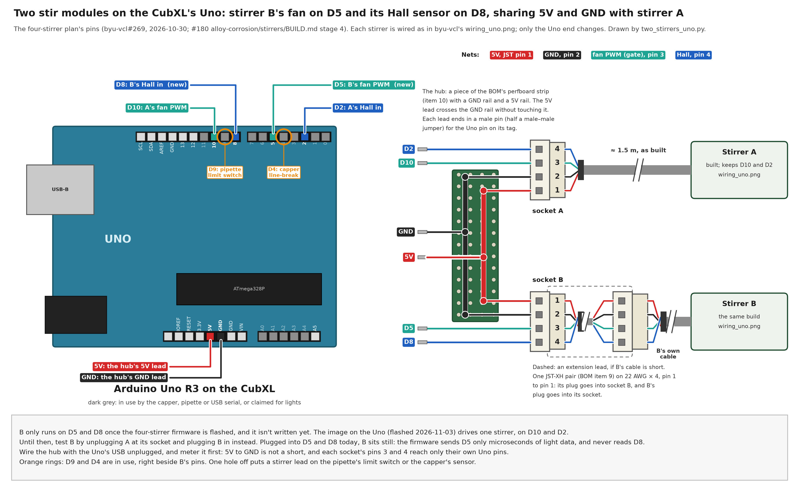

# A second stir module on the CubXL's Uno

Asked by @jarrettshupe on [#236](https://github.com/vertical-cloud-lab/digital-alloy-lab/issues/236)
(2026-11-13): how does a second stirrer connect to the Arduino Uno, which pins does it use, and what
can be done when its cable doesn't reach? Nothing here has been wired, flashed or run.

[`two_stirrers_uno.py`](two_stirrers_uno.py) draws the figure, and it checks that no stirrer lead lands
on a pin the firmware uses. The drawing code comes from byu-vcl's
[`wiring_diagram.py`](https://github.com/vertical-cloud-lab/byu-vcl/blob/4d5446c/hardware/vial-stirrer-cubxl/wiring_diagram.py),
so this figure matches the stirrer's own
[`wiring_uno.png`](https://github.com/vertical-cloud-lab/byu-vcl/blob/4d5446c/hardware/vial-stirrer-cubxl/img/wiring_uno.png).

## The pins

They come from the four-stirrer plan: byu-vcl's
[Four stirrers on one Uno](https://github.com/vertical-cloud-lab/byu-vcl/blob/4d5446c/hardware/vial-stirrer-cubxl/README.md#four-stirrers-on-one-uno)
(2026-10-30), and stage 4 of `alloy-corrosion/stirrers/BUILD.md` on #180. The stirrer itself is
unchanged. Each one is built exactly as `wiring_uno.png` shows, with the same JST-XH pin order.

| JST pin | Net | Stirrer A (built) | Stirrer B (second) |
| --- | --- | --- | --- |
| 1 | 5V | 5V, through the hub | 5V, through the hub |
| 2 | GND | GND, through the hub | GND, through the hub |
| 3 | fan PWM (MOSFET gate) | D10 | **D5** |
| 4 | Hall sensor | D2 | **D8** |

- **The Uno has only one 5V pin, and A's lead is already in it.** So both stirrers' pins 1 and 2 meet
  on a hub, and one lead goes from each of its rails to the Uno's 5V and GND. The hub can be a piece of
  the BOM's perfboard strip (item 10) with a 5V rail and a GND rail. For two stirrers, two Y-splices
  in heat shrink also work. If stirrers C and D are coming, build #180's four-socket hub now.
- **D8 is right beside D9, the pipette's limit switch. D5 is right beside D4, the capper's line-break
  sensor.** If a pin is one hole off, a stirrer lead lands on one of them, so count twice.
- **Why these two pins:** the gate goes on D5, a pin the firmware claims for a NeoPixel dot that isn't
  wired. The Hall input goes on D8, which nothing drives, so the pin never fights the sensor's output.

## What the firmware can do today

- **The image on the Uno (flashed 2026-11-03) drives only one stirrer, on D10 and D2.** Stirrer B
  runs on D5 and D8 only after the four-stirrer firmware is written and flashed, and it hasn't been
  written yet.
- **To test B before then,** unplug A at its socket and plug B in instead. Spin it with byu-vcl
  `BUILD.md` stage 8, as #180's `BUILD.md` stage 3 says.
- **Plugging B into D5 and D8 early is harmless, but it does nothing.** Today's firmware sends D5 only
  microseconds of light data and never reads D8. B's own 10 k pull-down also holds its gate off.
  Stirrer D's planned gate is different: D7 can sit high from boot, so D waits for the new firmware.
- **Wire the hub with the Uno's USB unplugged.** Before plugging back in, meter it: 5V to GND must not
  be a short, and each socket's pins 3 and 4 must reach only their own Uno pins. On 2026-11-04 the
  Uno shut off when A's 5V lead went in, and the cause was never found.

## When B's cable doesn't reach

1. **Make an extension lead, so nothing on B gets cut.** Take one JST-XH pair (BOM item 9; 10 pairs
   came, and #180's plan uses 6). Splice its plug half onto one end of a length of 22 AWG × 4 and its
   socket half onto the other, pin 1 to pin 1, straight through. Put heat shrink on each joint and
   stagger the joints, then check continuity end to end. The extension's plug goes into socket B on
   the hub, and B's own plug goes into the extension's socket. This only works if B's cable already
   ends in a JST-XH plug like A's, so put one on first.
2. **Or splice more cable onto B's own,** with the joints staggered and heat-shrunk, and one sleeve
   over the lot. Strain-relieve it so a tug doesn't pull on the joints.
3. **Where to get cable:**
   - The BOM's cable (item 8) comes in 10 ft packs, about two stirrers each. #180's order list has a
     second pack (ST2). Check whether it came in the 2026-11-09 order.
   - From lab stock today: an Ethernet patch cable with the plugs cut off. It has 8 wires of 24 AWG
     in twisted pairs. Put 5V and GND on one pair, the Hall line and a second GND on another, and the
     gate on a third. Join the two GND wires at each end.
   - Don't chain Dupont jumpers. They pull apart, and a half-out 5V pin can short.
4. **Length doesn't matter much electrically.** At the fan's 0.1 A, a 3 m run drops about 0.03 V in
   22 AWG and 0.05 V in 24 AWG. If B's rpm reads above 0 with its fan stopped, the long cable is picking up the stepper
   drives. Add 10 nF from D8 to GND at the Uno end, as byu-vcl's `BUILD.md` says for D2, and keep the
   cable away from the stepper wiring.
5. **Measure B's route before cutting:** from its slots to the Uno, flat along the deck edge, taped,
   and clear of the gantry. #180's column has B's cable leaving from the left, at deck x 51.5.
