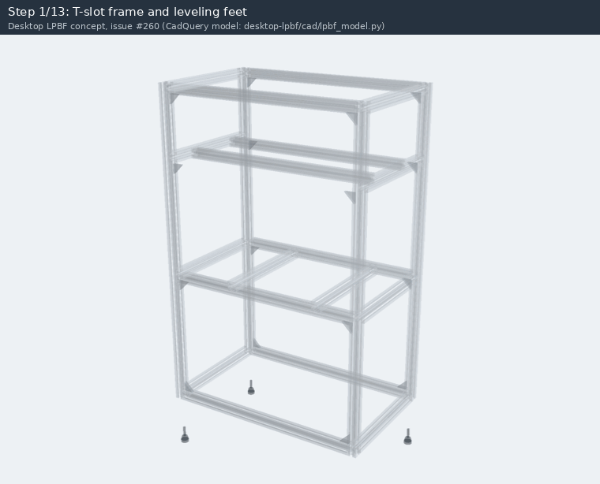
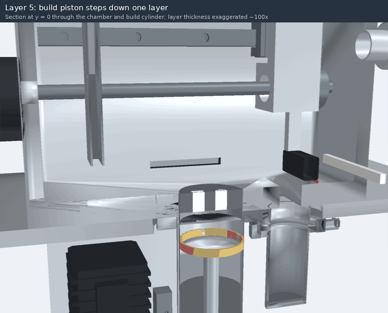
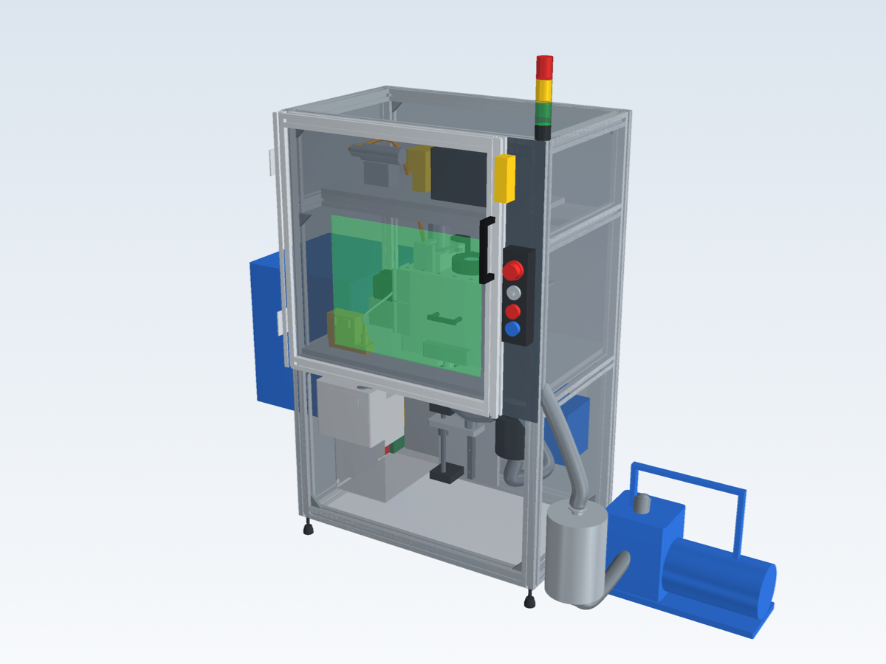
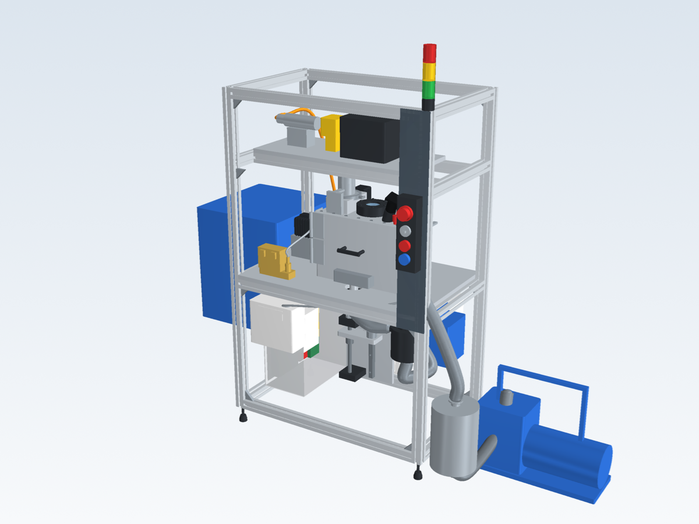
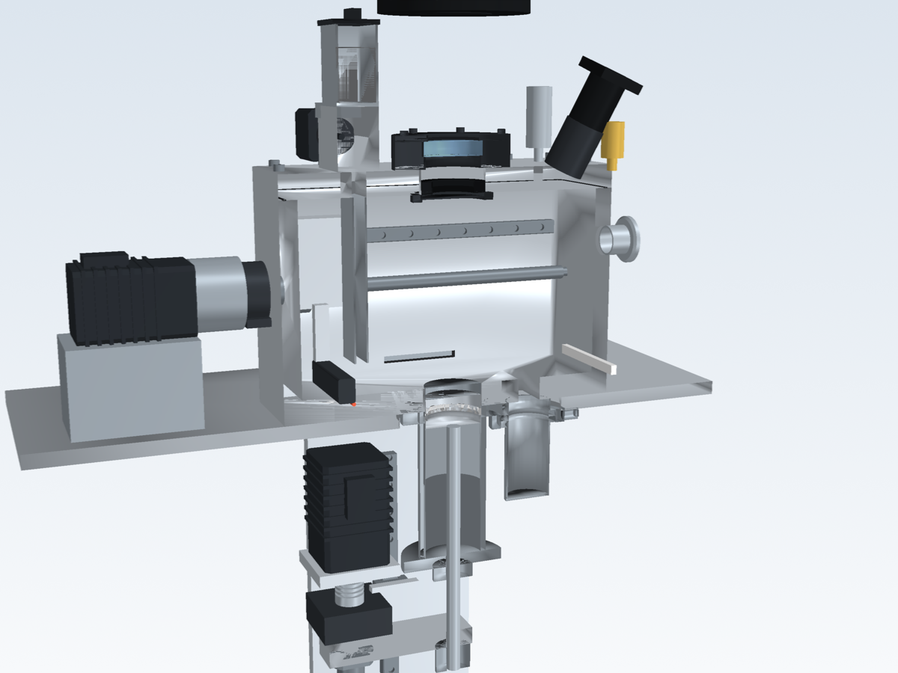
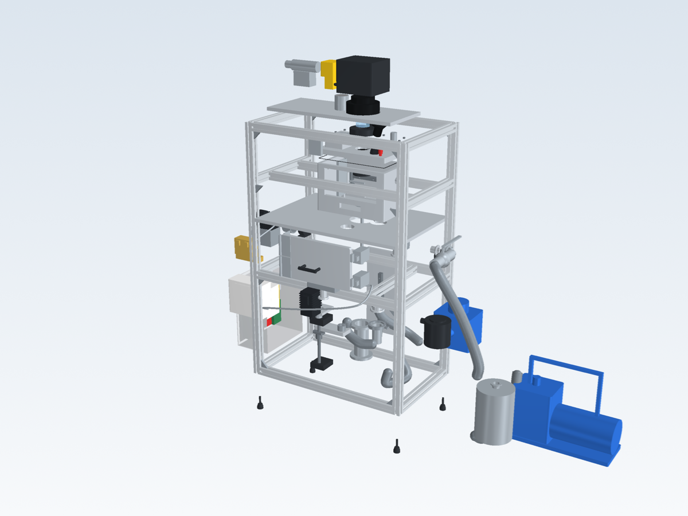
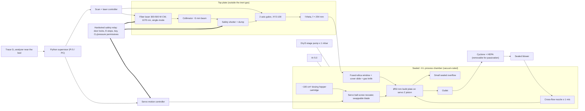

# Desktop LPBF for small-batch alloy screening: survey, concept and first BOM

First pass for [issue #260](https://github.com/vertical-cloud-lab/digital-alloy-lab/issues/260), written 2026-11-13.
Nothing here has been built, quoted or reviewed by BYU's Laser Safety Officer or EHS yet.

**Low-profile version (2026-11-17):** [`low-profile.md`](low-profile.md) re-lays the machine out as three modules side by side on a VLM tray, 564 mm tall (581.2 mm since 2026-11-19, on real levelling mounts: [`fasteners.md`](fasteners.md)), as byu-vcl PR 318's height limits ask. It also has exact interference sweeps, MuJoCo and CalculiX checks, a mass budget, and a materials selection matched to the lab's other systems.

**Fast track (2026-11-26):** [`fast-track/README.md`](fast-track/README.md) compares designs that reach first coupons in 3–6 weeks instead of 10–16. It recommends FT-1, a small purge-box LPBF built from a used laser chain, stock stages and a stainless box ($20k–31k), with a hand-spread single-track bench (FT-0) as its first half. Every part it buys carries into the design below. **Round 2 (2026-11-27)** worked it through: CAD on the makers' STEP files, structural and thermal FEA, purge and cross-flow CFD, FreeCAD CAM for every made piece, a build supervisor with simulated and real backends, and a progression video ([youtu.be/kdaj7jzdJyI](https://youtu.be/kdaj7jzdJyI)). FT-1 is now $29k–47k ($24k–39k without monitoring), and 59–123 shop hours make the shop, not the parts, the long pole: coupons at 3.7–9.3 weeks, or 3.2–6.4 with two people in the shop ([`fast-track/README.md`](fast-track/README.md) §0).

**Round 6 (2026-11-25):** round 5's undone items. Two SCHUNK zero-point clamps now hold the build module instead of screws ([`hot-swap.md`](hot-swap.md) §3.2a), and the robot swaps the module, empties the overflow jar by its new grip fin, and takes out the liners, reservoir and blade cartridge (all 14 jobs pass; [`robot-ops.md`](robot-ops.md)). The door seal is fixed (the latches pried the door off it), the frame's 4th-axis setup is programmed and every program is simulated clean, the CFD is re-run on the moved outlet, and the collimator and LED questions are answered ([`optics.md`](optics.md) §9). The build video is re-rendered and on YouTube as version 3: [youtu.be/54KqThbeVOg](https://youtu.be/54KqThbeVOg). [`followup-checks.md`](followup-checks.md) §0 has the round summary.

**Round 5 (2026-11-23):** round 4's undone items. The overflow jar comes out by hand; the liners are six lift-out parts; the latches, reservoir and blade are reachable; the focus is on the powder; the electrical parts are drawn; FEA cases 1 and 1b, the thermal model with the stack screws and the assembly chapter are re-run; and every CAM move is checked against holders and fixtures. The bought parts are refined against vendor CAD and photos ([`oem-parts.md`](oem-parts.md)), and the VCL lockup and BYU Y are debossed. The zero-point clamps still don't fit. [`followup-checks.md`](followup-checks.md) §0a has the round summary.

**Round 4 (2026-11-22):** the machine now has an electrical design ([`electrical.md`](electrical.md): no custom PCBs are needed), an end-to-end optics check ([`optics.md`](optics.md)), instant quotes and a make-or-buy split for the custom parts ([`outsourcing.md`](outsourcing.md)), a check of every model part against the BOM ([`completeness-audit.md`](completeness-audit.md)), and the FreeCAD G-code simulated in CAMotics ([`machining.md`](machining.md#g-code-simulated-in-camotics-2026-11-22)). [`followup-checks.md`](followup-checks.md) §0b has the round summary.

**Round 3 (2026-11-20 evening):** after a BYU machinist's review the chamber is a through-frame plus a bolted floor plate ([`chamber-construction.md`](chamber-construction.md)), nothing needs 5-axis, and the robots, assembly and safety are checked ([`followup-checks.md`](followup-checks.md) §0c).

**Follow-up checks (2026-11-20):** [`followup-checks.md`](followup-checks.md) collects the CalculiX, OpenFOAM, LIGGGHTS, MuJoCo, CAM and operation-by-operation checks, real parts, used and cheaper-source costs, and an optional tooling BOM. Two of its findings come before any purchase: the quoted laser is air-cooled and the machine would run inside the VLM ([`heat.md`](heat.md) §2), and the build module can't shed the laser's heat ([`heat.md`](heat.md) §1).

| File | What it is |
|---|---|
| [`README.md`](README.md) | this note: survey, gantry question, concept, safety, BOM, plan |
| [`bom.csv`](bom.csv) | the bill of materials (core electronics and unit operations), with low/high prices and their basis |
| [`bom_table.py`](bom_table.py) | renders `bom.csv` as the table in §6 and totals it |
| [`vendor-lookups.csv`](vendor-lookups.csv) | every price and dimension fetched from vendor sites through the lab Pi on 2026-11-13, with URL and time |
| [`budgets.py`](budgets.py) | sizing arithmetic for powder per build, purge cycles, cross-flow and gantry turnaround |
| [`edison/`](edison/) | Edison `LITERATURE_HIGH` query on custom LPBF design and its results |
| [`notes/2026-11-17-student-chat.md`](notes/2026-11-17-student-chat.md) | redacted excerpt of a 2026-11-17 conversation with a student in the lab about designing and building this machine with generative CAD, with a summary of the design points raised (folded in at §1b) |
| [`mcmaster-parts.csv`](mcmaster-parts.csv) | 69 McMaster-Carr part numbers checked live on 2026-11-17, with quantity, line total, BOM line, dimensions, URL and fetch time |
| [`cad/lpbf_model.py`](cad/lpbf_model.py) | parametric CadQuery model of the machine: 120 parts in 13 assembly steps (§1a) |
| [`cad/render.py`](cad/render.py) | renders the stills and GIFs in [`cad/img/`](cad/img/) headless |
| [`cad/out/`](cad/out/) | STEP export of the model (10 MB; opens in Onshape, SolidWorks, FreeCAD) |
| [`cad/`](cad/) | also: manifest of vendor CAD and drawings fetched through the lab Pi, plus the scripts that fetch pages and CAD |
| [`low-profile.md`](low-profile.md) | low-profile layout for a VLM tray: interference, MuJoCo and FEA results, mass budget, materials selection with sources |
| [`cad/lpbf_low.py`](cad/lpbf_low.py), [`cad/render_low.py`](cad/render_low.py) | the low-profile model (118 parts, each with material and motion group) and its renders in [`cad/img/low/`](cad/img/low/) |
| [`analysis/`](analysis/) | interference, MuJoCo, CalculiX and mass-budget scripts, with results in [`analysis/out/`](analysis/out/) |
| [`modules.md`](modules.md) | the heated build plate, Ø25 / Ø50 / Ø75 build modules, S / M / L reservoirs and the automation features as built into the low-profile model ([`cad/modules_low.py`](cad/modules_low.py), [`cad/module_params.py`](cad/module_params.py)), with the thermal FEA, interference sweeps and renders in [`cad/img/modules/`](cad/img/modules/) |
| [`options-mcmaster.csv`](options-mcmaster.csv), [`options-vendors.csv`](options-vendors.csv) | the 55 parts behind those features (McMaster-Carr, DigiKey, DwyerOmega, Accu-Glass, Lesker, Edmund, AutomationDirect and others), read live through the lab Pi on 2026-11-17 |
| [`build-sequence.md`](build-sequence.md) | the animated build, from stock and bought parts through machining, sub-assembly and screwing together to the finished machine on its tray ([`cad/render_build.py`](cad/render_build.py); GIFs, a contact sheet and an MP4 in [`cad/img/sequence/`](cad/img/sequence/)) |
| [`fasteners.md`](fasteners.md) | every screw, insert, pin and disc spring in the model as a real McMaster-Carr part ([`cad/fasteners.py`](cad/fasteners.py)), each recreated in CadQuery and checked by volume against McMaster's own CAD ([`cad/out/fastener-check.md`](cad/out/fastener-check.md)); the joint table with its holes ([`cad/joints.py`](cad/joints.py)); the bolted gland plate and the Macor-ring heater stack that replace a welded flange and screws in Macor; [`fasteners.csv`](fasteners.csv) |
| [`hot-swap.md`](hot-swap.md) | how the parts that are swapped should be held, screws or something else: what LPBF machines and automation use (sourced notes in [`notes/2026-11-19-hot-swap-research.md`](notes/2026-11-19-hot-swap-research.md)), Shigley / Hertz / disc-spring / magnet sizing of each option ([`analysis/out/hotswap/joint_calcs.md`](analysis/out/hotswap/joint_calcs.md)) and CalculiX checks ([`analysis/out/hotswap/fea_hotswap.md`](analysis/out/hotswap/fea_hotswap.md)) |
| [`preheat-and-plates.md`](preheat-and-plates.md) | whether a lower-expansion build plate helps (FEA with nine plate materials, [`analysis/out/thermal/plate_materials.md`](analysis/out/thermal/plate_materials.md); stock in [`plate-materials.csv`](plate-materials.csv)), and when a 500 °C plate is worth building: by alloy, and what it does to spreading, gas purity and the machine ([`preheat_500.py`](preheat_500.py), Edison task in [`edison/preheat-500-plate-cte/`](edison/preheat-500-plate-cte/)) |
| [`followup-checks.md`](followup-checks.md) | **start here for the 2026-11-20 follow-up checks:** what changes what we buy or draw, most urgent first; what was run; the design changes made and still to make |
| [`heat.md`](heat.md) | the laser's heat in the build modules (CalculiX: the plate drifts past 200 °C in dense builds; a fan or water-cooled sleeve fixes it) and the machine's heat in the VLM (the air-cooled laser against its 35 °C rating), with an Edison second opinion in [`edison/followup-laser-heat/`](edison/followup-laser-heat/) |
| [`seals.md`](seals.md) | every seal and penetration of the gas envelope checked (Parker glands, closure forces, permeation, pump-down, powder lift, rate-of-rise test) and the fixes, now drawn in the model with real parts ([`seal-parts.csv`](seal-parts.csv)) |
| [`machining.md`](machining.md) | machining review with open-source CAM (OpenCAMLib toolpaths, voxel stock-removal simulation, FreeCAD CAM G-code), DFM rules, 3-axis and 4th-axis setups and hours over all machined parts; what BYU's shops can make; the optional tooling BOM [`tooling-bom.csv`](tooling-bom.csv) and the machines needed [`machines.csv`](machines.csv) |
| [`gas-flow.md`](gas-flow.md) | OpenFOAM CFD of the argon cross-flow over the plate, recirculation, bed shear, spatter and condensate, and the slot, outlet and flow-rate changes that reach 2.5 m/s |
| [`powder-spreading.md`](powder-spreading.md) | powder spreading by theory and LIGGGHTS DEM: gap, speed, cohesion, segregation, blade force, the hot-plate gap, and recipe settings |
| [`operations.md`](operations.md) | every hand operation (assembly, use, maintenance, swaps) simulated step by step, with real tool shapes on every screw |
| [`robot-ops.md`](robot-ops.md) | every automated operation with a UR12e (the UR10e renamed) + Robotiq 2F-85 + D405 on a MiR250 in byu-vcl PR 318's cell (FCL on meshes, IK branches, RRT-Connect, 1.5 mm audit, movers), with the tools ([`robot-tooling.csv`](robot-tooling.csv)) and machine-side features ([`cad/automation.py`](cad/automation.py)) that make each job work: 10 of 12 pass end to end |
| [`chamber-construction.md`](chamber-construction.md) | the chamber as a through-frame from 5-1/2 in. plate plus a bolted floor plate, in answer to a BYU machinist: options compared, Shigley floor joint, CalculiX, tools, setups and hours |
| [`vacuum-and-purge.md`](vacuum-and-purge.md) | how the frame + floor plate changes vacuum tightness and air ingress against the old block (permeation, defect leaks, virtual leaks), the vacuum-then-argon purge with the dry scroll roughing pump (no turbo), and what the atmosphere does to Al prints ([`analysis/seals/vacuum_purge.py`](analysis/seals/vacuum_purge.py)) |
| [`oem-parts.md`](oem-parts.md) | the bought parts refined against vendor drawings, vendor CAD (aligned volume IoU, surface distance) and product photos (camera pose solved, silhouette overlays), with measured colours and finishes ([`cad/oem/`](cad/oem/)); the VCL and BYU Y debosses ([`cad/logos.py`](cad/logos.py)) |
| [`assembly.md`](assembly.md) | the machine assembled by two UR12e arms on MiR250s: every insertion path swept for collisions, both arms planned and audited, O-ring stretch and install tooling ([`assembly-tooling.csv`](assembly-tooling.csv)) |
| [`robot-shop.md`](robot-shop.md) | hypothetical: two UR12e on MiR250s unboxing, tending the VF-4 and lathe, and assembling; payload, reach, tip-over, timeline ([`robot-shop-equipment.csv`](robot-shop-equipment.csv)) |
| [`robot-build/video.md`](robot-build/video.md) | **the robot-built video** (round 7): two UR12e on MiR250s unpack, machine, assemble and integrate the machine from a 12 m parts table, a person only where one is needed, with the running cost (new against used), lead times and time estimates on screen ([`cad/robotbuild/`](cad/robotbuild/); the MP4 in [`cad/img/robotbuild/`](cad/img/robotbuild/)); behind it, [`robot-build/manufacturing-route.md`](robot-build/manufacturing-route.md) (where the 287 shop hours go; in-house, outsourced, hybrid, printed chamber) and [`robot-build/lead-times.md`](robot-build/lead-times.md) (cost and lead time, new against used) |
| [`safety.md`](safety.md) | laser, argon, aluminium powder, hot plate and robot safety: what BYU publishes, the standards, the numbers for this machine ([`safety_calcs.py`](safety_calcs.py)), gaps and parts ([`safety-parts.csv`](safety-parts.csv)) |
| [`real-parts.md`](real-parts.md) | bought parts drawn to published dimensions ([`cad/vendor_parts.py`](cad/vendor_parts.py), [`vendor-parts.csv`](vendor-parts.csv)), checked against vendor CAD, and the fit problems they showed |
| [`cost-scenarios.md`](cost-scenarios.md) | what the machine costs with used major parts and with cheaper same-spec catalogue parts, from live listings ([`cost/`](cost/)) |
| [`electrical.md`](electrical.md) | the electrical design: supply and power box, UPS and DC rails, 95 devices and signals ([`electrical-io.csv`](electrical-io.csv)), controllers, the safety chain checked over every input combination, chamber feedthroughs, wiring, bonding and the aluminium-dust rules, heater-loop and power simulations, and the electrical BOM ([`electrical-bom.csv`](electrical-bom.csv)); custom PCBs: none needed |
| [`optics.md`](optics.md) | the beam path from fibre to plate (spot, depth of focus, where the focus lands, clipping, field), irradiance against part ratings, thermal lensing (with a CalculiX cross-check), ghosts and back-reflection, safety optics, calibration and monitoring instruments, the layer camera, and the optics BOM ([`optics-bom.csv`](optics-bom.csv)) |
| [`monitoring.md`](monitoring.md) | in-situ monitoring: what the design already has (the layer camera and the coaxial photodiode), what spreading, the melt pool, cooling and cracking each need (acoustic emission, two-colour and coaxial cameras, side high-speed video, InGaAs), where sensors can look from (453 viewports checked on the model, [`analysis/optics/monitoring_views.py`](analysis/optics/monitoring_views.py)), metadata on one clock, and a costed order |
| [`outsourcing.md`](outsourcing.md) | instant quotes for the custom parts (SendCutSend, OSH Cut, JLCCNC, JLC3DP; [`outsourcing-quotes.csv`](outsourcing-quotes.csv)), a should-cost model, and which parts to make at BYU, outsource or buy instead |
| [`completeness-audit.md`](completeness-audit.md) | every model part mapped to its BOM line or parts list, and every BOM line to the model: what is generic, missing or inconsistent, and the BOM lines rewritten for the low-profile design |
| [`notes/2026-11-20-pain-points.md`](notes/2026-11-20-pain-points.md) | 59 sourced pain points from similar and adjacent systems, each turned into a check or a change ([`pain-points.csv`](notes/pain-points.csv)) |

## 1. Short answers

- **Open-source LPBF exists, but nothing open is designed for small powder batches.** There are two open-hardware metal machines:
  - [DTU OpenAM-PBF](https://github.com/DTU-OpenAM/OpenAM-PBF): CERN-OHL-P v2, 300 W at 1080 nm, Ø250 × 150 mm, a safety PLC with door interlocks, and closed-loop cross-flow.
  - [TUM iwb reAM250](https://www.mec.ed.tum.de/en/iwb/research-and-industry/projects/additive-manufacturing/iwb-ream-250-powder-bed-fusion-machine-for-research-purposes): open hardware and software, an nLIGHT AFX-1000, a RAYLASE galvo and a 250 mm cube.

  Both are full-size. We should borrow their safety and control designs, not their powder system. Edison found the closest precedent for our use: Heriot-Watt's open-architecture rig ([Bidare et al. 2017](https://doi.org/10.1016/j.addma.2017.06.007)). It has a ~30 × 30 × 10 mm bed, a 400 W single-mode laser and a Raylase head with a 163 mm f-theta, plus a compliant silicone-cord spreader. It reached > 99 % density on very little powder, and slow spreading, not lasing, dominated build time. DTU also published an open-source Teensy-based LPBF controller ([Andersen et al. 2022](https://doi.org/10.26153/tsw/44600)).
- **Commercial small machines cost $59k–130k**: AO Metal A30 (Ø30 × 60 mm, from $59k in 2025), A50 ($89k), Xact Metal XM200C ($65k), 2OneLab 2CREATE ($120k) and One Click Metal MPRINT ($129.9k). Several vendors offer Ø30–55 mm reduced build volumes for exactly our problem (§2.2).
- **A modified CNC router or a CubXL-like gantry should not move the beam.** Al LPBF scans at 0.7–2.3 m/s in hatch vectors a few mm to 10 mm long. A 1 g gantry needs 50 mm just to reach 1 m/s, so a 10 mm vector spends about 95 % of its time turning around. The CubXL itself is a GRBL ball-screw CNC frame (Genmitsu PROVerXL 4030 geometry) that runs at 50–83 mm/s. Xact Metal launched its XM200 line on a mirror gantry in 2018, and its current XM200S and XM200G datasheets list galvos.
- **Use a fixed galvo scanner and f-theta lens above a small sealed chamber.** Linear servo axes then only spread powder and lower the piston, where smoothness matters and speed doesn't. A CubXL-style gantry is useful *outside* the chamber, to fill hopper cartridges and move plates (§3.1).
- **Base machine (2026-11-17, §1b): modify a laser engraver that takes a MOPA fiber laser module, and buy a commercial unit if that stalls.**
  - The MOPA engravers we found already put a galvo above the bed, so the laser, scan head and controller come as one machine. Powder spreading, a heated walled aluminium plate in place of the slats, and the inert chamber are what we add.
  - With a $9,500 200 W engraver, the BOM falls to about $35k, against $55–75k for the realistic component build (§6). The open risk is whether a pulsed 200 W source melts our Al powders, so single tracks come first.
  - A go/no-go point partway through the semester decides between finishing the build and buying a commercial desktop unit (§5).
- **Concept in one line:** a ~6 L vacuum-purgeable chamber under a fixed galvo, with these parts:
  - a Ø53 mm build plate, with a Ø25 mm insert (the concept said Ø50 mm; McMaster's nearest tube has a 53.8 mm bore, §6a);
  - a ~100 cm³ dose-from-above hopper cartridge and no supply piston: a 15 mm build uses ~80 g;
  - a servo ball-screw recoater with swappable blades;
  - a recirculating cross-flow of ≥ 2.5 m/s everywhere over the plate: 140–200 L/min through the 120 × 8 mm slot, with perforated slots and a wider outlet ([`gas-flow.md`](gas-flow.md); the earlier ~2 m/s target left the plate at 1.5 m/s in CFD);
  - 2–3 vacuum–argon purge cycles to < 100 ppm O₂;
  - a hardwired dual-channel interlock chain;
  - everything scriptable from Python.
- **BOM: 40 lines, about $29.6k on the cheapest listed options to about $103k on the premium ones.** The spread is mostly the laser, scan head and scan controller, which need quotes. Prices for Thorlabs, McMaster-Carr, DigiKey, Cloudray and Teknic were pulled live through the lab Pi (BYU network) on 2026-11-13. On 2026-11-17, 69 McMaster part numbers for the frame, chamber, motion, gas and controls were checked the same way ($10.8k for one machine), which replaced most of the mechanical estimates and raised the low end by ~$8k.
- **CAD model: [`cad/lpbf_model.py`](cad/lpbf_model.py)**, built from those parts, with assembly and build-cycle GIFs (§1a) and a STEP export.

## 1a. The model

*The CadQuery model assembled in 13 steps. Catalogue parts are sized from their McMaster-Carr product pages ([`mcmaster-parts.csv`](mcmaster-parts.csv)); the galvo head, laser, chiller, O₂ analyzer, blower and electronics are envelopes.*

*One layer in section: the piston steps down, the recoater returns, the hopper meters a dose, the silicone-cord blade spreads it into the overflow, and the galvo scans three coupons while the argon cross-flow (blue) sweeps the plate. Layers are drawn ~100× thicker than they are.*

| | |
|---|---|
|  |  |
|  |  |

- **Layout.** A 30 mm T-slot cabinet, 660 × 410 × 1010 mm plus feet, with the laser source, chiller and vacuum pump beside it.
  - The welded ~6.2 L chamber sits on a 1/2 in. deck plate. The Z axis hangs below it, and the controls enclosure and gas loop share the lower bay.
  - The galvo and f-theta sit on their own 1/2 in. plate and rails, 301 mm (the lens working distance) above the powder plane. They never touch the chamber, which can flex under vacuum.
  - The recoater rides a 15 mm guide on the back wall. Its servo sits outside the left wall and drives through a sealed feedthrough. The cross-flow runs from a slot in the back wall to one under the front door.
- **Run it.** `python desktop-lpbf/cad/lpbf_model.py` writes [`cad/out/desktop-lpbf.step`](cad/out/desktop-lpbf.step) (add `--glb` for a GLB). The STEP opens in Onshape, SolidWorks or FreeCAD. `xvfb-run -a python desktop-lpbf/cad/render.py` redraws the stills and GIFs. Every position comes from the parameter block `P`: chamber size, bore, dose and park positions, lens working distance and the rest.
- **Vendor parts are drawn from their listed dimensions,** not from the vendors' CAD files, so the model can be public.
- **Not modelled yet:** wiring, NPT fittings, the Pirani gauge, the cartridge antechamber, fasteners other than the lid screws, and anything toleranced. This is a layout, not a released design.

## 1b. Design points from a 2026-11-17 conversation with a student

On 2026-11-17 Sterling talked with a student in the lab about designing and building this machine with generative CAD.
A redacted excerpt, with a summary of the design points, is in
[`notes/2026-11-17-student-chat.md`](notes/2026-11-17-student-chat.md) (times below are mm:ss into it). Four points change the plan:

| Design point | What changes | Where |
|---|---|---|
| **Start from a laser engraver that takes a MOPA fiber laser module** (21:58–24:06) | The laser, galvo, lens and scan controller come as one bought machine. Powder spreading, the heated plate and the inert chamber are what we add | §1b.1, §6 |
| **A heated build plate for aluminium:** a heating element in a walled aluminium plate, in place of the engraver's slats (22:30–23:42) | Preheat is now a requirement, not open question 3. On an engraver the plate can be a fixed tray, which removes the build piston and its seals | §1b.2, [`requirements-later.md`](requirements-later.md) §1 |
| **Mostly off-the-shelf parts, and no in-house laser** (07:05, 21:19, 22:30) | Buy the parts and make the assembly. Choosing the laser is one of the main decisions | §1b.3 |
| **Two aims and a go/no-go point** partway through the semester, with buying a commercial desktop unit as the fallback (15:05–16:11, 20:21–21:49) | Order the engraver first, so that by the go/no-go point there are melted tracks to judge as well as the schedule | §5 |

The other points support the plan as it stands: keeping oxygen out is one of the hardest parts (§3.4); turnkey powder-dosing systems ($100k–300k) don't suit alloy powders, and the lab built its own doser with generative CAD (§3.3); and the student would start on assembly and making parts, with the materials-science work once the equipment is "more or less fixed".

### 1b.1 The base machine: a laser engraver with a MOPA fiber module

The idea is that "if it can cut metal, it can sinter it for sure", and that laser engravers are "about as adjacent as you can get": the engraver already has the motion system, so spreading is the main LPBF-specific addition (21:58–24:06).

- **The MOPA engravers we looked at already have the architecture of §3.1.** Both steer the beam with a galvo and an f-theta lens on a Z column, rather than moving a fiber head on an XY gantry.
  - A listed 200 W machine is [$9,500](https://jpt-laser.com/200w-fiber-laser/): a JPT YDFLP-200-M7 source (2–500 ns pulses, 1–4,000 kHz, M² < 1.6), a Sino-Galvo SG7110 head (10 mm aperture), lenses for 70 × 70 to 300 × 300 mm fields, EZCAD 2/3 or LightBurn, and air cooling.
  - Monport launched a 200 W split MOPA engraver with autofocus, the GT200W, in February 2026 ([press release](https://www.steel-technology.com/index.php/pressreleases/monport-highlights-gt200w-mopa-fiber-laser-engraver); price on request).
  - So the galvo answer holds: the galvo scans the melt, and a motorized Z (the autofocus axis) can follow the powder surface on a fixed tray (§1b.2). If the engraver chosen is a gantry type carrying a fiber head instead, §3.1's turnaround problem returns. Its gantry could still drag the recoater blade, but it should not hatch Al.
  - The engraver in the conversation (22:16) wasn't identified, so neither of these is a pick.
- **Check the height.** The low-profile layout ([`low-profile.md`](low-profile.md)) keeps the process module 564 mm tall for a VLM tray, with an f = 160 mm lens and the galvo 233 mm above the powder. A split MOPA head with a short lens can sit on that layout's optics bridge. A stock engraver's column and base may not fit under the 695 mm bay height, so check before buying.
- **It replaces six BOM lines:** L1 laser, L2 chiller (the 200 W MOPA is air-cooled), L3 collimator, L5 galvo, L6 f-theta and C1 scan controller. Those lines total $4,265–47,012 today.
  - With the $9,500 engraver in their place, the BOM is **about $34.8k** on the cheapest options elsewhere, or $58.7k on the premium ones. The realistic component build in §6 is $55–75k.
  - The shutter (L4), the chamber window (L7) and the whole safety chain stay.
- **It falls short of §3.2's laser spec in four ways, so check these before buying:**
  1. **Power and pulse format.** It is 200 W average, pulsed, with M² < 1.6. The concept specifies 300–500 W CW and single-mode (M² ≤ 1.1).
     - 200 W is enough for dense AlSi10Mg with a conventional LPBF laser: on a Concept Laser M1 with a 200 W fiber laser and a ~150 µm beam, Kempen et al. reached 99 % density at 200 W, 1,200–1,400 mm/s and 105 µm hatch ([SFF 2011](https://utw10945.utweb.utexas.edu/Manuscripts/2011/2011-37-Kempen.pdf)).
     - At 1–4 MHz the pulses are 0.25–1 µs apart, against the ~100 µs an ~80 µm melt pool takes to respond, so a MOPA should heat close to CW. But a quick search found no LPBF results from a MOPA source, so single tracks on Al plates are the first test (§5).
     - M² < 1.6 still gives a spot of about 80 µm at f = 254 mm with a 7 mm beam (§3.2's formula), which is in the commercial range.
  2. **Scan head.** A 10 mm marking head. Its vendor ships it on 200 W pulsed sources, but §3.2's caution about CW ratings and back-reflection from Al still applies.
  3. **Controller.** The student warned that commercial machines' boards are often locked down, so the electronics may have to be replaced (08:04).
     - Galvo engravers commonly run a BJJCZ (EZCAD) board. The open-source [galvoplotter](https://pypi.org/project/galvoplotter/) library from the MeerK40t project drives EZCAD2-type (LMC) boards from Python over USB, so a supported board can be scripted from the supervisor (§3.6).
     - Check the exact board before buying. If it isn't supported, swap in one of §3.6's controllers.
  4. **Sourcing.** The listings we found use JPT sources, which are made in the PRC, so open question 1 now gates this route too.
- **Safety doesn't get easier.** Once we open up and modify an engraver, its own laser classification no longer covers the machine. Treat it as the home-built Class 4 machine of §3.7: register it with the LSO before first light, and keep the guard, shutter and hardwired interlocks.

### 1b.2 A heated build plate: a walled aluminium plate

Sterling noted that pretty much no desktop system has a heated plate, which matters for aluminium, and that research-grade systems with heated plates and the right laser powers cost close to $400,000. The student's answer was a heating element inside an aluminium plate with walls, which "should give a pretty even spread" (aluminium spreads heat more evenly and more quickly than steel), set on the engraver bed in place of its slats (22:30–23:42).

- **Preheat is now a requirement.** [`requirements-later.md`](requirements-later.md) §1 sizes it: build 200 °C now (~70 W of heater for a 15 min ramp on Ø50 mm) and reserve 500 °C.
- **On an engraver the plate can stay put.** The walls hold the powder, and each layer is set by raising the recoater blade and the focus instead of lowering a piston.
  - That removes the piston and its bore seal. It removes the rod's exit through the floor, one of the two weak seals in §6a. It also removes the hot sliding seal that `requirements-later.md` has to move below a thermal break, and the heater's wiring no longer moves.
  - On the low-profile layout it also removes the Z stage hung below the chamber floor (a 40 mm stroke plus the lift arm).
  - The cost:
    - the wall height caps the build. 15–20 mm covers the 15 mm screening builds of §3.3;
    - the blade needs its own µm-level lift, held parallel to the plate. The M3 stage's screw and guide could lift the recoater instead of lowering a piston;
    - the powder surface rises by the build height during a build, so the cross-flow nozzle and the camera have to allow for it.
  - The walled tray is also a natural form for the swappable build modules of `requirements-later.md` §2.
- **Aluminium suits the 200 °C tier,** and it is the right substrate for Al builds anyway (6061 or AlSi10Mg plates). At the reserved 500 °C tier, 6061 is within ~80 °C of its solidus (582 °C), so that tier needs a steel heater block under a replaceable aluminium plate.

### 1b.3 Mostly off-the-shelf parts, and no in-house laser

- **Buy the parts; the assembly is the custom part** (07:05). The lab won't make its own laser, so choosing it is one of the main decisions (21:19, 22:30). The main parts left to make are the chamber, the walled heated plate, the dosing block and the blade holders.
- **Reuse spreaders where we can** (21:19): the blade cartridges (M5) should take stock blades.
- **Check agents' material choices.** Every model the student tried first recommended a PEI build plate for printing Ultem, which is itself a PEI. The student suggested giving the model options to choose between (17:30–19:36). So agent-made material picks for this machine should come from a list of candidates, each with a source, and be checked against what the lab's other systems use.

## 2. What already exists

### 2.1 Open-source, open-architecture and home-built LPBF

Sources tagged † come from search summaries and have not been opened. Check them before relying on them.

| Project | Laser | Beam motion | Recoater | Gas | Build area | Notes |
|---|---|---|---|---|---|---|
| [DTU OpenAM-PBF](https://github.com/DTU-OpenAM/OpenAM-PBF) (CERN-OHL-P v2) | 300 W, 1080 nm | not stated in README | "multi-material powder system" | closed-loop cross-flow | Ø250 × 150 mm | v1 documented, "v2 is to be the actual release"; controller redesign under way; 1,500+ print hours ([RPJ 2024](https://doi.org/10.1108/RPJ-12-2023-0422)†). E-stop opens a safety contactor that also cuts the laser trigger and motor drivers. |
| [TUM iwb reAM250](https://www.mec.ed.tum.de/en/iwb/research-and-industry/projects/additive-manufacturing/iwb-ream-250-powder-bed-fusion-machine-for-research-purposes)† | nLIGHT AFX-1000 | RAYLASE galvo, dynamic zoom | "adaptable recoater for new recoating and sensing strategies" | cyclone separator | 250 mm cube | Autodesk Machine Control Framework driving the RAYLASE API ([Wenzler et al., Procedia CIRP 2024](https://doi.org/10.1016/j.procir.2024.08.121)†) |
| **Heriot-Watt open-architecture PBF** ([Bidare et al. 2017](https://doi.org/10.1016/j.addma.2017.06.007), via Edison) | 400 W CW single-mode SPI, 1070 nm (run at 50 W, 50 µm spot) | Raylase MS-II-14 galvo + 163 mm f-theta | 3 mm **silicone cord** after tungsten-carbide knife and cylindrical spreaders jammed; ~10 mm/s, 50 µm gap | detachable Perspex chamber; purge then bed-level cross-flow; exhaust through a water bath | **~30 × 30 × 10 mm** | > 99 % density, little powder; slow spreading dominated build time. The closest precedent for this design |
| MIT (Hart group) bespoke testbed ([Penny et al. 2025](https://doi.org/10.1038/s44334-025-00039-8), via Edison) | 500 W SPI redPOWER qube, 1.075 µm; 19.5 mm collimated beam | **Thorlabs QS20XY** galvo | servo-actuated compliant blade; piston feed | enclosure; gas knife on 2 s before to 2 s after fusion; CaF₂ window | – | NI cRIO-9039 on a 10 µs timebase; MWIR camera through a shared optical path; front access to the plate without disturbing lid optics |
| DTU unified controller ([Andersen et al. 2022](https://doi.org/10.26153/tsw/44600), via Edison) | 250 W SPI; 0–10 V power (10-bit), PWM to 100 kHz | Sunny Galvo SG S9320D, 20 mm, XY2-100 | motor interfaces for recoat and multi-material | PID gas-flow (VFD pump), O₂ and flow sensing | – | Open-source Teensy 3.6 firmware with DMA and timer interrupts for deterministic scanner–laser sync; runs three DTU LPBF/SLS machines |
| [NIST AMMT](https://www.nist.gov/laboratories/tools-instruments/additive-manufacturing-metrology-testbed-ammt)† | – | custom scan control; XY2-100 at 100 kHz; SiC mirrors | – | evacuate and backfill, Ar | 100 × 100 mm | Government testbed, "about the size of a small car". Scattered/back-reflected power heated a folding mirror to ~275 °C and its silver coating failed: use baffles, cooling and robust mirror substrates (Grantham 2016, via Edison) |
| [Open Additive PANDA](https://www.fabbaloo.com/news/open-additives-panda-metal-3d-printing-system)† | 500 or 1000 W IPG | configurable | – | – | 152 × 152 × 241 mm and up | Commercial open architecture, from $219,900 ([aniwaa](https://www.aniwaa.com/product/3d-printers/openadditive-panda/)†) |
| [Hobbyist DIY SLM, 2026](https://hackaday.com/2026/01/03/printing-in-metal-with-diy-slm)† | 500 W fiber | galvo outside the chamber, through a window in the lid | servo-driven blade | argon, small chamber to save gas | – | Laser and galvo were most of the cost. A plastic blade was damaged by hot metal; a stainless blade gave repeatable layers. |
| [Sheffield diode point melting](https://eprints.whiterose.ac.uk/id/eprint/235887)† | 8 × 450 nm diodes, ~35 W total | **diode head on an x-y gantry** | – | – | – | Works, but slowly. Cooling is 750–1400 °C/s against 10⁵–10⁶ °C/s in LPBF, so alloys screened this way would not see LPBF thermal histories. |
| Synchrotron "process replicators" ([Leung et al. 2018](https://doi.org/10.1038/s41467-018-03734-7)†, [RSI 2020](https://doi.org/10.1063/1.5143766)†) | – | – | – | – | beamline-sized | Miniature rigs that "mimic an entry-level commercial" LPBF: the closest precedent for a minimal-powder machine |
| [Freemelt ONE](https://www.metal-am.com/articles/freemelt-ab-open-source-technology-to-explore-the-potential-of-electron-beam-powder-bed-fusion/)† (open e-beam, for contrast) | 6 kW e-beam | magnetic deflection | – | 10⁻⁵ mbar vacuum | Ø100 × 100 mm | Open software toolbox and Open Beam Path file format |

Unopened leads:
- an MIT SM thesis, "Design and fabrication of an open-architecture selective laser melting system" (2017);
- [UT Austin, "An Open-Architecture Multi-Laser Research Platform" (SFF 2019)](https://utw10945.utweb.utexas.edu/sites/default/files/2019/002%20An%20Open-Architecture%20Multi-Laser%20Research%20Platform.pdf).

No HardwareX *metal* LPBF paper turned up. The open polymer SLS builds (OpenSLS, the HardwareX SLS, SLS4All) are polymer-only.

### 2.2 Commercial desktop and research-grade machines

| Machine | Build volume | Laser / spot | Beam motion | Gas / O₂ | Reduced volume | Price |
|---|---|---|---|---|---|---|
| AO Metal A30 (Additive Plus, CA) | Ø30 × 60 mm | 200 W fiber, upgradable to 300 W | – | – | the whole machine is small | from $59k (2025) ([VoxelMatters](https://www.voxelmatters.com/de/additive-plus-bringt-ao-3d-druckerfamilie-fuer-erschwingliche-lpbf-auf-den-markt.md)) |
| AO Metal A50 | Ø50 × 100 mm | 300 W (500/1000 W, or a 445 nm blue option) | – | – | – | from $89k (2025) |
| Xact Metal XM200C | 127 mm cube | 100 W Yb† | XY **mirror gantry**, no galvo or f-theta ([3DPI 2018](https://3dprintingindustry.com/news/xact-metal-releases-sub-100k-high-precision-metal-3d-printers-131363/)) | – | – | $80k at launch (2018), later $65k† |
| Xact Metal XM200S | 127 mm cube | 200 W, > 50 µm spot | **galvo**, scanning up to 8 m/s ([datasheet](https://cdn.goengineer.com/xact_metal_3d_printer_xm200s_technical_data_sheet.pdf)) | – | – | $130k (2018) |
| Xact Metal XM200G / G2 | 150 mm cube | 1–2 × 100–400 W, 50/100 µm | galvo, jog at 20.7 or 34.6 m/s ([datasheet](https://cdn.goengineer.com/xact-metal-xm200g-data-sheet-goengineer.pdf)) | glovebox option | – | ~$90k† |
| TRUMPF TruPrint 1000 | Ø98 × 100 mm | 200 W, 55/80 µm (30 µm option) | galvo | **≤ 3000 ppm standard; ≤ 100 ppm only with the glovebox + sensor option**† ([flyer](https://www.headland.com.au/static/d87e49df79ca2401f7a6403c8d0f506c/TRUMPF-TruPrint1000-flyer-EN-1-1.pdf)) | Ø50 × 100 mm | – |
| Sisma MYSINT100 | Ø100 × 80 mm | 200 W, 30–55 µm | – | glovebox for reactive metals† | Ø33.5–34.5 mm | – |
| Aconity MINI / MIDI+ | Ø140–170 / Ø250 mm | 400–1000 W single-mode, 80 µm | galvo, ≤ 4 m/s | – | **down to Ø55 mm**† | – |
| Renishaw reduced build volume insert | 78 × 78 × 55 mm | host machine | host | host | **as little as 0.25 L of powder**† | – |
| Nikon SLM 125 | 125 mm cube | 400 W IPG | – | – | 50 mm cube† | – |
| 2OneLab 2CREATE / Plus / Desktop | Ø100 × 100 mm; 150 × 150 × 100; 100 × 80 mm | 250 / 400 / 300 W | – | – | – | $120k (aniwaa)† |
| One Click Metal MPRINT / MPRINT+ | 150 mm cube | 200 W, 70 µm | – | argon (N₂ outlet on +) | cartridges carry 250 % oversupply† | from $129.9k† |
| EOS M 100 | Ø100 × 95 mm | 200 W, 40 µm | galvo | – | – | – |
| Sharebot MetalONE | 65 × 65 × 100 mm | 200–300 W (sources disagree) | galvo | Ar or N₂ | small plate | – |
| Prima Additive Print Sharp 150 | Ø150 × 160 mm | 300 W single-mode, 35–100 µm | – | – | – | – |
| Farsoon FS121M | 120 × 120 × 100 mm | 200–500 W (sources disagree) | – | N₂ | – | – |
| Eplus3D EP-M100T, Kings 3D DiMetal-100, Coherent CREATOR | ~Ø100–120 mm | 100–200 W | – | – | – | CREATOR from $100k† |

The repo already rates Xact Metal and AO Metal as purchase candidates
([`company-landscape.md`](../company-landscape.md)), and
[`budget-assessment-official-requirements.md`](../edison-trajectories/budget-assessment-official-requirements.md)
weighs a ~$40–65k desktop machine against the Genesis budget. The Aconity MIDI at the University of
Utah needs a ~1 kg hopper fill
([pr52 review replies](../edison-trajectories/pr52-followup/pr52-review-replies.md), byu-vcl #77), which
is the reason to build small.

### 2.3 Lessons we take

1. **Small batches mean a Ø30–55 mm build cylinder, a dose-on-demand feed and a small overflow.** Vendors converge on that size (TruPrint 1000, MYSINT100, Aconity, SLM 125, AO Metal A30). Cartridge feeders that oversupply by 250 % are the wrong model.
2. **Purge alone gets commercial machines to ~1000–3000 ppm.** Reaching ≤ 100 ppm takes a tighter route: a glovebox plus sensor (TRUMPF) or, our choice, a vacuum-capable chamber (§3.4). EOS M 290 work uses a 1000 ppm threshold with Ar 5.0, and one study held < 100 ppm ([Pauzon 2019](https://research.chalmers.se/publication/510755/file/510755_Fulltext.pdf); [Polito 2023](https://iris.polito.it/bitstream/11583/2980588/1/CIPR.pdf)).
3. **The recoater should be a swappable, compliant module.** Precedents are Xact's compliant "bulb", which spreads like a blade and compacts like a roller, TUM's adaptable recoater, and the hobby build's switch from a plastic to a steel blade.
4. **The laser, scanner and scan controller are most of the cost, and an open scan-controller API matters.** reAM250 uses RAYLASE's API; DTU's controller limited it and is being redesigned.
5. **Put safety in hardware from day one.** OpenAM uses a safety PLC and door interlocks, its E-stop opens a contactor that cuts the laser trigger and motor drivers, and lasing needs closed doors plus a reset.

## 3. Concept

### 3.1 Beam delivery, and the gantry question

`python desktop-lpbf/budgets.py` gives the numbers below.

| | Galvo + f-theta | XY gantry moving optics (CNC router, CubXL, custom) |
|---|---|---|
| Scan speed needed for Al (0.7–2.3 m/s; [Warwick SFF 2023](https://utw10945.utweb.utexas.edu/sites/default/files/2023/027%20ControllingChemicalCompositionChangesinLaserPowderBedFusionofAlSi10Mg.pdf)) | marking speed 1.1 m/s, positioning 8 m/s (basiCube 20 at f = 160 mm); Xact galvos jog at 20.7–34.6 m/s | CubXL: 50 mm/s default, 83 mm/s max ([CubOS config](https://github.com/Ursa-Laboratories/CubOS/blob/main/services/api/configs/gantry/cub_xl_seed.yaml)); best vendor gantry claim 1.5 m/s (Xact XM300) |
| Distance to reach 1 m/s | ~0.25 mm at 2000 m/s² equivalent | 50 mm at 10 m/s² (1 g); 25 mm even at 20 m/s² (Bambu H2D class) |
| One 10 mm hatch vector at 1 m/s | ~10 ms of laser-on time, sub-ms turnaround | ~210 ms, of which ~200 ms is turnaround; energy density changes along the line unless power follows velocity |
| Inert-gas side | optics stay outside, behind one window; chamber stays small | moving optics, cables, bellows and lubricant inside the chamber, or a large moving window; more volume, particles and leaks |
| Field distortion | f-theta distortion is trivial over Ø53 mm in a 156–175 mm field | none, which is the gantry's only real advantage |

The verdict is a galvo. A gantry that moves the beam is a big custom engineering job: Kurtz Ersa's Flying Ray S
calls moving that mass with PBF dynamics the hard part ([Metal AM](https://www.metal-am.com/?p=118720)†). It also changes
the thermal history you are trying to screen for, and the small vendor that tried it (Xact) moved its
XM200 line to galvos. Fraunhofer ILT's hybrid of galvos riding on linear axes
([Fraunhofer](https://www.futuream.fraunhofer.de/en/news_and_media/video-multi-scanner-on-the-fly-processing-LPBF.html)†)
only pays off for big beds.

**The CubXL** is Ursa Laboratories' "CNC gantry with custom instrument mounts and labware". Its specs:
- a 400 × 300 mm deck for liquid handling ([ursalabs.ai](https://ursalabs.ai));
- GRBL over serial;
- 307–399 × 250–300 × 87–129 mm of travel;
- the Genmitsu PROVerXL 4030 geometry ([CubOS `docs/gantry.md`](https://github.com/Ursa-Laboratories/CubOS/blob/main/docs/gantry.md)).

It is an open frame with no inert enclosure and is roughly 10–30× too slow for scanning.

**Where a gantry does belong:**
- **Inside the machine,** the recoater and the build piston are linear axes too. They need smooth, constant velocity and µm-level Z steps, not speed, so they get servo-driven ball screws on precision guides (§3.5), not belts.
- **Outside the machine,** the CubXL, or a CubOS-driven gantry like it, could fill and cap hopper cartridges from the lab's powder dispensing (AutoTrickler) line. It could also carry cartridges and build plates between the glovebox, the machine's antechamber and characterisation. That is where "ease of automation" pays off without putting a router in the beam path.

### 3.2 Laser and optics

**Checked end to end on 2026-11-22 in [`optics.md`](optics.md).** Its findings that change the design:
- **Spot:** the drawn 5 mm collimator gives a 48 µm spot at f = 160 mm. A 75 µm spot needs a ~3.2 mm beam.
- **Focus:** the window and cover slide push the focus 3.4 mm below the powder, so the lens needs raising and a shim range.
- **Field:** the L75 plate's outer ring may be out of reach as drawn.
- **Cover slides:** they need an AR coating.

- **Laser.** Use a CW Yb fiber laser at 1070 nm, 300–500 W (run at 150–400 W), single-mode with M² ≤ 1.1. It needs analog power control, a TTL gate or modulation input (IPG's YLR-500-U3-SM-AC: to 100 kHz, ≤ 12 µs on/off), a hardware interlock input and a guide laser.
  - Aluminium reflects strongly at 1 µm, so keep power headroom: commercial Al work on an EOS M 290 uses 370 W.
  - Ask every vendor for M² and fiber core size. "Single-module" on Raycus and similar listings describes packaging, not beam mode.
  - US options are IPG and nLIGHT (CFL-500). **IPG quoted its YLR-500-U3-SM-AC on 2026-11-18 at approximately $23k, with a 10–12 week lead time after the order that it says is unlikely to shorten** (forced-air 4U rack, 40 kg, M² ≤ 1.1, 5 m fiber; specs and open items in [`quotes/ipg-ylr-500-u3-sm-ac.md`](quotes/ipg-ylr-500-u3-sm-ac.md)). PRC options (Raycus RFL-C500, MAX MFSC-500) are much cheaper. Check the funding source's foreign-sourcing rules before choosing one (see [`foreign-connections/`](../foreign-connections/)).
  - The quoted IPG unit is air-cooled at 500 W, so it needs no chiller. A water-cooled alternative would.
  - AlSi10Mg powder absorbs only ~5–10 % at 1070 nm, so 300 W or more gives headroom. 200 W is the floor that has worked: Kempen et al. reached 99 % density with it, and it is what the engraver route (§1b.1) would have. **Specify back-reflection protection** (an isolator, or a laser rated for it), and baffle and cool the scan optics. On NIST's AMMT, scattered and back-reflected light overheated a mirror until its coating failed (via [Edison](edison/answer.md#4-beam-delivery-galvanometer-scanner-vs-gantry)).
- **Spot size.** d ≈ 4M²λf/(πD), with M² = 1.1 and λ = 1.07 µm:

  | f | D = 5 mm | D = 7 mm | D = 10 mm |
  |---|---|---|---|
  | 160 mm | 48 µm | 34 µm | 24 µm |
  | 254 mm | **76 µm** | 54 µm | 38 µm |

  **f = 254 mm with D ≈ 5 mm** gives the 70–100 µm spot of commercial machines without a beam expander. Its Rayleigh range is about ±3.9 mm, which is forgiving, and the 156–175 mm field keeps a Ø53 mm plate in the low-distortion centre.
- **Scan head.** It needs mirrors rated for ≥ 500 W CW at 1070 nm.
  - The SCANLAB basiCube 20 (20 mm aperture) is rated 1000 W at 1064 nm at 100 % duty without water cooling, with XY2-100 (SL2-100 option) ([SCANLAB](https://www.scanlab.de/en/print-product/1061)).
  - The $279–899 Sino-Galvo-class marking heads (Cloudray RC1001, SG7110, SG7210) have no CW power rating we could find. Use one only on a low-power bench, or after the vendor confirms its mirror coatings.
  - Thorlabs' GVS012 ($3,785.20) has silver mirrors and is also a bench part.
- **f-theta lens.** Thorlabs FTH254-1064 ($1,559.61; field 156.7 mm; WD 301.2 mm; Ø120 × 67.8 mm; M85 × 1) and FTH160-1064 ($1,011.78) give only a *pulsed* damage threshold.
  - Prefer a fused-silica lens rated for kW CW to avoid thermal focal shift.
  - EKSMA 150-2541 (f = 254 mm, 175 × 175 mm field, $486–504) is a cheap candidate. Its CW rating is unverified.
- **Chamber window.** Use AR-coated fused silica (Thorlabs WG41050-C, Ø1 in., $127.12). Expect to need Ø2 in. for the scan cone, sized for 1 atm differential pressure.
  - Below it goes a cheap sacrificial cover slide. A small argon gas knife across its underside keeps condensate off.
  - A **fixed field-stop aperture** in the window flange physically limits the beam cone to the plate area. It is a passive guard that doesn't depend on software.
- **Shutter and dump.** A mechanical shutter sits between the collimator and the galvo and closes on any safety trip; FDA's Class IV list includes a permanently attached beam attenuator. For commissioning, use a water-cooled dump (Thorlabs LB2L/M, 500 W, $507.50).
- **Power measurement.** Thorlabs S322C ($1,690.54) only reaches 200 W, so a 500 W-class thermal head is still to be sourced.

### 3.3 Powder: spreadability and a small hopper

Sizing comes from `budgets.py`, assuming AlSi10Mg, 30 µm layers, a 1.8 dose factor and 50 % bed packing:

| Plate | Powder per layer (dosed) | 15 mm build | Hopper volume |
|---|---|---|---|
| Ø53 mm | 0.16 g | **~80 g** | 54 cm³, so specify **~100 cm³ (~150 g)** with margin; the modelled cartridge holds ~126 cm³ |
| Ø25 mm insert | ~0.04 g | ~18 g | – |

- **No supply piston.** A powder supply piston has to be filled far above what it delivers. Instead, a sealed **hopper cartridge** of ~100 cm³ sits above the dose position.
  - A fluted metering roller or vibratory slot drops one line of powder per layer in front of the recoater.
  - A **load cell under the cartridge** weighs each dose, which gives automatic powder accounting and a "short feed" alarm.
  - Cartridges are filled in the glovebox, or by the automated powder line. They dock through a small purgeable antechamber, so the process chamber never sees air.
- **Small overflow.** It is sealed and recoverable, because every gram of a new alloy matters.
- **Build piston.** The bore is 53.8 mm (a lapped 2-1/4 in. 304 tube) with a Ø53 mm plate and a Ø25 mm insert, the stroke about 60 mm, with a bronze-filled PTFE wear ring. Layers run 20–60 µm with ≤ 2 µm repeatability.
- **Recoater.**
  - It rides on a servo ball screw on a linear guide at a steady 20–100 mm/s. Start slow for fine, cohesive Al powders.
  - The blade cartridge is quick-swap:
    - compliant: a silicone cord or rubber, which rides over curled parts. Heriot-Watt's rigid tungsten-carbide knife jammed and its 3 mm silicone cord worked;
    - a wide-nose blade. A rounded leading edge packs better than a sharp edge (Salehi 2023);
    - a carbon-fiber brush;
    - hard: HSS or ceramic. The DIY build found steel repeatable.
  - A roller module comes later. In one comparison, a **non-rotating roller** packed layers at 45 % against 30 % for a straight blade, though rollers can jam at very thin layers (Sehhat 2021). Counter-rotation at high rates destabilised the bed while forward rotation helped (Jabri 2024). Sources via [Edison](edison/answer.md#2-powder-spreading-recoater-design-speed-layer-thickness-and-spreadability).
  - Start at 10–50 mm/s and work up toward ~100 mm/s. Fine Al (below the ~20 µm cohesion threshold) flows worse, so the 15–20 µm tail of our 15–63 µm powders is the risk. The 2026-11-20 DEM ([`powder-spreading.md`](powder-spreading.md)) favours 50 mm/s (25 mm/s for a new powder), a first-layer gap of ~2 × D90, and zeroing the blade gap with the plate at temperature.
  - The gap and dose factor are recipe parameters.
- **Measuring spreadability.**
  - A layer camera (Raspberry Pi HQ camera with an oblique LED bar) images every layer, before and after lasing.
  - Coverage, streaks and short feed are scored automatically, and the scores go into the same dataset as the alloy's process window.
  - The same camera and recoater can run with no laser in the glovebox as a stand-alone **spreadability test rig** (phase 0). That tests each new powder before it goes in the machine.

### 3.4 High-purity inert gas

- **Targets for Al.** The literature purges Al builds below 0.1 % (1000 ppm) and runs them at a few hundred ppm. Even 0.1–0.2 % O₂ forms oxide films that cause balling and lack of fusion, and < 500 ppm still oxidises Al. For Al-Mg-Sc/Zr, < 200 ppm is prudent (Bosio 2021; Revanur 2024; via [Edison](edison/answer.md#3-inert-gas-environment-for-aluminium-alloys)). So: a **hard interlock at 1000 ppm**, operation below 100–200 ppm, and moisture removal too. Laser-split water gives hydrogen porosity in Al, so dry the powder (vacuum oven) and fit a dew-point sensor (BOM G9).
- **Vacuum-purge, don't just flow-purge.**
  - A ~6 L chamber pumped to ≤ 1 mbar and backfilled with Ar 5.0 reaches the ideal < 100 ppm in 2 cycles (`budgets.py`). Plan 3 to cover outgassing from the powder and walls.
  - The McMaster single-stage pump (9901K64, $765.49) only pulls 26 inHg (~130 mbar), which needs 4 cycles. Hence the dry scroll or two-stage line in the BOM.
  - **The pump is a roughing pump, with no turbo** (2026-11-23, [`vacuum-and-purge.md`](vacuum-and-purge.md)). BOM line G2 is an oil-free Edwards nXDS6i dry scroll (6.2 m³/h, 0.02 mbar). With a throttled start it reaches 1 mbar in ~1.5 min, a cycle takes ~4 min, and three cycles reach the argon's own impurity (1–2 ppm O₂ in theory). A turbo would reach that in one cycle but no lower, and fine powder wrecks turbos. The build itself runs at ~1 atm of argon, not in vacuum. For Al, the powder's water matters far more than the pump.
  - Flow-purging the same chamber ideally takes ~7.6 volume changes (46 L). In practice it takes much longer, because the porous powder in the hopper and bed holds air that only a vacuum pulls out quickly.
  - The chamber must take a full 1 atm differential: walls, window, door and seals are designed for it.
- **Recirculate the cross-flow; don't vent it.**
  - A 70 × 8 mm laminar nozzle at 2 m/s moves ~67 L/min. Design for **~2 m/s at the plate**. Below about 2 m/s, spatter rises vertically, the plume is poorly cleared and melt-pool penetration drops sharply (Reijonen et al. 2020, via [Edison](edison/answer.md#3-inert-gas-environment-for-aluminium-alloys)). A minimum average of ≥ 1 m/s is recommended, and low velocity correlates with porosity ([Kjer et al. 2023](https://mdpi.com/2504-4494/7/4/143)). In an EOS M 290, flow is ~3.5 m/s near the inlet and ~2 m/s at mid-plate, and is non-uniform.
  - Too fast picks up powder, so tune velocity per powder and plate height.
  - The loop is a sealed blower, then a cyclone or settling stage, then a HEPA cartridge, and back.
- **Hold ≤ 100 ppm (aim for ~10 ppm) with closed-loop make-up.** A trace O₂ analyzer (Ntron Microx with ranges down to 0–10 ppm, $1,694–2,091; or the SST OXY-FLEX zirconia sensor, $1,271.07, once its low range is confirmed) samples near the bed. Readings depend on sensor position, and the best reading is near the bed ([Metal AM](https://www.metal-am.com/linde-and-eos-leverage-addvance-o2-precision-technology-for-aluminium-study/)).
  - The analyzer opens an Ar make-up valve. The chamber is held at +5–20 mbar so leaks go outward.
  - A purifier on the loop is a later option.
- **Permissives.** The laser enable requires O₂ below its setpoint and chamber pressure in its window. Both permissives are hardwired into the safety relay, not just checked in software.

### 3.5 Motion: smoothness and suitability

- **Recoater.** It has to spread at a constant velocity without cogging or vibration. A ClearPath-SD integrated servo (from $265) drives a ball screw (McMaster 4566N101: M12, 10 mm lead, ±0.05 mm/300 mm, $188.22, cut to ~330 mm, with the 4566N401 nut) on a 15 mm ball guide (6709K33 rail, 6709K12 carriage), with S-curve moves. The axis is stiff, so it doesn't chatter when it hits a part.
- **Build piston.** A 15 mm ball guide (the same 6709K33/6709K12) and an M12 × 2 mm lead ball screw (6638K11), driven by a servo. All motion is in the same direction for every layer, to take up backlash, and on a vertical axis gravity does that too. A crossed-roller stage is the upgrade if the screw's ±0.21 mm/300 mm lead error shows up in layer thickness.
- **No belts and no lubricant inside the chamber.** Use dry or vacuum grease, and bellows or covers over the screws. Motors sit outside on rotary feedthroughs, or are sealed, to protect the gas.

### 3.6 Controls and electronics

**Updated 2026-11-22 in [`electrical.md`](electrical.md), which replaces the choices below where they differ:**
- **Controls:** an RTC6 Ethernet board streams SL2-100 to the scan head. A Productivity1000 PLC reads the thermocouples and 4–20 mA lines, and a Banner XS26 safety controller runs the interlocks.
- **Power:** a power box beside the rack holds the main disconnect and four AC branches.
- **Rack:** a 4U drawer in a 12U rack.
- **Scan head supply:** a single 24 V rail, not ±15 V.
- **Custom PCBs:** none needed.

- **Supervisor.** A Raspberry Pi 5 or small Linux PC runs one Python service. It handles the recipe, the state machine (purge, heat, spread, expose, repeat), logging and a REST API. That fits the lab's other automated instruments, and a CubOS-driven gantry can call it.
- **Scan and laser controller.** It outputs XY2-100 to the head and drives the laser gate, analog power and PWM, with programmable laser on/off delays and skywriting. Options:
  - SCANLAB RTC6 (quote), the professional route with a vendor SDK;
  - a JCZ card (DLC2-M4-2D, EZCAD3, $1,785 at Cloudray). It is Windows-only, so it is harder to automate;
  - open source, with an LPBF track record: **DTU's unified controller** (Teensy 3.6; XY2-100 via DMA; 0–10 V laser power; PWM to 100 kHz; PID gas flow; O₂, photodiode and 4–20 mA inputs), which runs three DTU machines ([Andersen et al. 2022](https://doi.org/10.26153/tsw/44600));
  - other open source: [OPAL](https://github.com/opengalvo/OPAL) (GPL-2.0, Teensy 4.0 + SN75174N, G-code to XY2-100), LinuxCNC `xy2mod` on Mesa FPGA cards, or [Tuet/XY2_100](https://github.com/Tuet/XY2_100). OPAL warns it "might crash at any time leaving your galvo and laser in an unknown state", which is fine only because the safety chain does not depend on it.
- **Motion.** Step/dir from a Teknic ClearCore, or Klipper on the supervisor, to 2–3 ClearPath servos.
- **Process I/O.** The O₂ analyzer (4–20 mA), a chamber pressure transducer, 24 V solenoid valves for purge, vent and make-up, the blower drive, plate heaters (MAX31856 thermocouple interface, $17.50), the hopper load cell and the layer camera.
- **Power.** A Mean Well SDR-480-24 24 V DIN-rail supply ($151.10).

### 3.7 Safety

#### Laser (Class 4 source inside a Class 1 enclosure)

- **FDA.** A laser "used by the individual(s) who designed and constructed the device" is not subject to the federal laser product performance standard. It must still be classified under ANSI Z136.1 and go through the university laser safety program ([Northwestern](https://researchsafety.northwestern.edu/safety-information/laser-safety-handbook.html); [21 CFR 1040.10](https://www.law.cornell.edu/cfr/text/21/1040.10)). That changes if the machine is ever sold or given to another organisation. **Register it with BYU's LSO before first light.** We did not find BYU's institutional laser program online, so contact the LSO directly.
- **Build to the FDA Class IV feature list anyway:**
  - a key-actuated master control;
  - an emission indicator;
  - a permanently attached beam attenuator (the shutter);
  - a manual reset after an interlock trip or > 5 s power loss;
  - a remote interlock connector;
  - interlocks on every protective-housing panel.
- **Guarding follows IEC 60825-4:2022.** The whole machine sits inside an opaque metal laser guard. The chamber walls take any stray direct hit (the protective exposure limit, PEL, question). The viewing window is OD ≥ 7 at 1070 nm and kept out of any direct beam path.
  - Window candidates: Thorlabs LW1P1/M light green, 385.8 × 304.8 mm, $411.95; Laser Safety Industries acrylic, OD 7+ at 1060–1100 nm, $195.
  - Service eyewear: Thorlabs LG1, $217.47 (confirm OD at 1070 nm).
- **Interlock chain, all hardwired.**
  - Dual-channel inputs: a guard-locking door switch (Omron D4JL, $803.42; it keeps the door locked while lasing or while the chamber is off atmospheric pressure), the panel switches, E-stops (IDEC XA1E, $76.67), the key switch, the O₂ < setpoint permissive and the pressure permissive.
  - These go into a safety relay (Omron G9SE-201 class, $275.29; Pilz PNOZ or Banner are alternatives).
  - The relay's outputs drop the laser's hardware interlock, close the shutter and disable the motion drives. Software can only *request* emission.

#### Aluminium powder and condensate

- **Codes.** NFPA 484 (2022) has an additive-manufacturing chapter: dust hazard analysis, emergency shutdown locations, part harvesting, powder storage and training. UL 2011 for AM machines draws on NFPA 484, 652 and 654. Ask EHS for a dust hazard analysis that **includes the machine and its filter**: some AM dust hazard analyses have left those out ([Dust Safety Science](https://dustsafetyscience.com/?p=5800)).
- **The filter is the main fire hazard.** Condensate can ignite on contact with air or from vibrating the cartridge ([ULT via Metal AM](https://www.metal-am.com/ult-highlights-the-importance-of-air-handling-technology-for-pbf-lb-additive-manufacturing/)). The design response:
  - The filter housing valves off under argon and comes out sealed.
  - It is passivated in a controlled way: dry quartz sand or mineral oil, or binding the condensate.
  - Unoxidised aluminium plus water gives hydrogen, so a wet separator is not automatically safe for Al.
- **Explosibility.** Al alloys need 13–23 mJ minimum ignition energy, against 4 mJ for pure Al, with Pmax ~5–7 bar. Ground and bond everything, and use conductive gloves and tools.
- **Handling.** Sieve, load and unload in an inert glovebox (McMaster 4083N14, $4,305.48). The machine's small, cartridge-based powder path keeps open handling to a minimum.
- **Nanoparticles.** LPBF condensate is respirable. Personal exposure is highest when someone opens and cleans the chamber, because they lean into it. Faulty filtration spreads contamination to offices on clothes and tools (Walter 2019, via [Edison](edison/answer.md#6-safety)). So: wear a respirator for chamber opening, use a HEPA vacuum and keep a dedicated area.
- **Fire.** Keep a Class D sodium-chloride extinguisher (McMaster 6435T23, 30 lb, $920.22) at the machine. The willful OSHA citation after the 2013 Powderpart fire, in which a worker was badly burned, was for having no Class D extinguisher ([OSHA](https://www.dol.gov/newsroom/releases/osha/osha20140520-2)).

#### Gas

- **Asphyxiation.** Argon purge and vent volumes are small, but vent the pump exhaust outside the room. Keep an O₂-deficiency monitor in the room (McMaster 18995T81, $459), plus an overpressure relief on the chamber.

## 4. Design requirements and how the concept meets them

| Requirement (issue #260) | Target | Design response |
|---|---|---|
| Good spreadability | full, uniform 20–60 µm layers with fine Al powders | servo ball-screw recoater at steady speed; swappable soft/brush/hard blades (roller later); per-layer camera scoring; offline spreadability rig (phase 0) |
| Safety | Class 1 machine; NFPA 484-aware powder path | hardwired dual-channel interlocks + guard lock + key + shutter; metal guard + field-stop aperture; sealed, passivatable filter; glovebox; Class D; room O₂ monitor |
| Ease of automation | every action scriptable; cartridges and plates handled by a robot | Python supervisor with REST API; scan controller with SDK or open firmware; docking hopper cartridges with a load cell; CubOS gantry outside |
| Smooth, suitable motion | constant-velocity spreading; µm-level Z | galvo for the beam; servo + ball screw + preloaded guides for powder axes; no belts in the chamber |
| Small hopper | ≤ ~150 g per alloy per build | Ø53 mm plate (Ø25 mm insert), dose-from-above ~100 cm³ cartridge, no supply piston, recoverable overflow: ~80 g per 15 mm build |
| High-purity inert gas | < 100 ppm O₂, ideally ~10 ppm | ~6 L vacuum-rated chamber, 2–3 vacuum–Ar 5.0 cycles, sealed recirculating cross-flow, trace analyzer near the bed, slight overpressure, O₂ permissive on the laser |
| Heated build plate (2026-11-17) | 200 °C for Al alloys; 500 °C reserved | cartridge heaters in a walled aluminium plate, a fixed tray on the engraver route (§1b.2); sizing and interlocks in [`requirements-later.md`](requirements-later.md) §1 |

## 5. Phased plan

The project has two aims (2026-11-17, §1b): stay current on generative design of whole systems, not just generative CAD; and get the machine ordered, assembled, tested and in use as soon as possible. So the base engraver is ordered first and lases early, and a go/no-go point partway through the semester decides whether to finish the build or buy a commercial unit.

0. **Spreadability rig and heated plate, no laser.** Recoater axis, the walled heated plate (or the Ø53 mm piston), hopper cartridge and layer camera, run in the glovebox with our own powders. This settles blade vs. brush vs. roller and the dose factor cheaply, at room temperature and at 200 °C.
1. **Base engraver and first tracks.** Choose a MOPA engraver whose board galvoplotter supports, or plan to replace the board (§1b.1). Register it with the LSO and guard it as they require. Then lay single tracks and small pads on Al plates and our powders under argon, on the heated plate at room temperature and 200 °C. A small purged box with a window under the head is enough for this. It answers whether a pulsed 200 W source melts our Al powders.

**Go/no-go, partway through the semester.** Suggested criteria, for Sterling to set:
- the engraver is in hand, and single tracks in at least one Al alloy are continuous at a known power and speed (phase 1);
- the rig lays full layers of our Al powder on the heated plate (phase 0);
- a fresh estimate of phases 2–4 fits the rest of the semester, and is not heading toward the multi-year build this would have been a year ago (16:00–16:11, 21:19);
- the cost to finish stays below the commercial units it competes with.

**If no-go,** buy a commercial desktop unit, probably after the semester (§2.2: AO Metal A30 from $59k, Xact XM200C at $65k, A50 from $89k).
- Ask each vendor about build-plate heating first. In the conversation Sterling's read was that desktop units pretty much lack it, and our searches found none listed for the A30 or the XM200C.
- The spreadability rig, the heated plate, the glovebox and cartridges, and the O₂ instruments are still useful next to a bought machine. The engraver and its argon box stay useful for single-track screening of new alloys.

2. **Chamber and gas loop around the engraver head.** Machine the chamber and prove 2–3 cycles to < 100 ppm with powder loaded. Measure the hold-up and the make-up gas use, and tune the cross-flow velocity, using smoke or particles.
3. **Full builds with the safety chain.** Interlock commissioning with the beam into the dump, then density cubes.
   - **Laser lead time.** The CW laser for the component route takes 10–12 weeks after IPG receives the order, plus BYU's PO processing (over $3,500). If the go/no-go point is likely to choose the CW build, order the laser before that point so it arrives in time for phase 3.
4. **Monitoring and automation.** Photodiode (Thorlabs PDA36A2, $400.01) and layer-image scoring, recipe API, cartridge docking, and CubOS gantry hand-off.

The student would start on assembly and making parts. The materials-science work starts once the equipment is "more or less fixed" (29:01–29:55).

## 5a. What the Edison literature review adds

Edison `LITERATURE_HIGH`, task `cccde784…`, ~50k characters, is in [`edison/answer.md`](edison/answer.md), with its references and the full trajectory. It mostly confirms the concept. Its ranked recommendations for a sub-$60k Al screening machine:
1. a ~50 × 50 mm bed with hopper or small-piston feed;
2. a compliant or wide-nose blade at 50–150 mm/s, with 30–50 µm layers;
3. a 300–500 W single-mode 1070 nm laser with back-reflection isolation;
4. an XY2-100 galvo with a 163–254 mm f-theta;
5. a vacuum-purge-backfill chamber, recirculating argon at ≥ 2 m/s, a < 500 ppm operating target with a 1000 ppm hard interlock, and zirconia O₂ plus dew-point sensing;
6. an open-source embedded controller (DTU);
7. a coaxial photodiode;
8. a Class 1 enclosure with NFPA 484 controls.

Changes made because of it:
- cross-flow raised to ~2 m/s;
- roller and wide-nose blade options added, and counter-rotation flagged;
- back-reflection protection, the DTU controller and a dew-point sensor added;
- Heriot-Watt's 30 mm rig cited as the main precedent.

Its price claims are unsourced, so they are not used: a 500 W SPI redPOWER at ~$15–25k, an SG S9320D at ~$3–5k, and an NI cRIO at ~$5–10k against ~$100 for a Teensy.

## 6. Bill of materials (core electronics and unit operations)

`bom.csv` is the master copy; this table is generated by `python desktop-lpbf/bom_table.py`.

- **"fetched"** prices were read live from vendor pages through the lab Pi on 2026-11-13. Each has its URL and time in [`vendor-lookups.csv`](vendor-lookups.csv).
- **"agent-sourced"** prices come from the web survey, with the URL in `bom.csv`.
- **"estimate"** values are placeholders until quotes come in.
- **"fetched (McMaster 2026-11-17) + estimate"** lines are the subtotal of their rows in [`mcmaster-parts.csv`](mcmaster-parts.csv) plus the estimate named in the line's notes (custom machining, BK10/BF10 bearings, a Pirani gauge and so on).

Ranges are "cheapest listed option" to "premium option" for that line.

| ID | Subsystem | Item | Candidate | Qty | Unit (USD) | Basis |
|---|---|---|---|---|---|---|
| L1 | Laser & optics | Fiber laser source | IPG YLR-500-U3-SM-AC (quoted 2026-11-18, approx. $23k, 10-12 weeks ARO; see quotes/ipg-ylr-500-u3-sm-ac.md) | 1 | 3,300–23,000 | quote (IPG, rounded) + estimate |
| L2 | Laser & optics | Laser chiller | None for the quoted IPG unit (forced-air cooled); vendor-recommended chiller for a water-cooled alternative | 1 | 0–3,000 | estimate |
| L3 | Laser & optics | Collimator / beam expander | IPG collimator with a ~3.2 mm beam (custom diameter, 'other diameters on request': quote) | 1 | 0–512 | fetched (Thorlabs) |
| L4 | Laser & optics | Safety shutter + beam dump | Industrial fiber-laser shutter (quote) | 1 | 508–2,000 | fetched + estimate |
| L5 | Laser & optics | 2-axis galvo scan head | SCANLAB basiCube 20 (1000 W at 1064 nm without cooling) | 1 | 419–12,000 | fetched (Cloudray) + quote (SCANLAB) |
| L6 | Laser & optics | F-theta lens | Thorlabs FTH160-1064 ($1,011.78) + 2 x FTHW75-1064 spare protective windows ($122.03 each) | 1 | 1,256–2,500 | fetched (Thorlabs 2026-11-22) + estimate |
| L7 | Laser & optics | Chamber laser window | Edmund Optics 38-990 | 1 | 295 | fetched (Edmund 2026-11-22) |
| C1 | Controls | Scan + laser controller | SCANLAB RTC6 (quote); adds the RTC6 laser-connector breakout (ZL-RTB-DB15 + ZL-DB15-CBL-2) | 1 | 125–6,065 | fetched 2026-11-22 (electrical-bom.csv) + estimates marked there |
| C2 | Controls | Supervisor computer | Raspberry Pi 5 (8 GB) or small industrial PC | 1 | 80–600 | estimate |
| C3 | Controls | Motion controller and stepper drive | Teknic ClearCore CLCR-4-13 + DIN-MNT + 2 ClearPath cable sets + SureStep STP-DRV-4830 | 1 | 319–400 | fetched 2026-11-22 (electrical-bom.csv) + estimates marked there |
| C4 | Controls | DC supplies (UPS-backed) and 24 V branch protection | Mean Well SDR-240-24 + SDR-240-48 + HDR-100-24 + DDR-30G-5 + Phoenix CBMC E4 (high: Teknic IPC-5 for the servo bus) | 1 | 405–553 | fetched 2026-11-22 (electrical-bom.csv) + estimates marked there |
| C5 | Controls | Process I/O PLC and thermocouple inputs | AutomationDirect Productivity1000: P1-540 + 2 P1-16ND3 + 4 P1-08TD2 + P1-04THM + P1-08ADL-1 + P1-04ADL-2 + P1-04DAL-2 + terminal blocks (replaces 2 MAX31856 boards) | 1 | 1,092 | fetched 2026-11-22 (electrical-bom.csv) + estimates marked there |
| C6 | Controls | 4U control drawer, PB2 box and DIN hardware | 4U rack drawer (Middle Atlantic UD class) + PB2 box + 80 mm fan + DIN terminals, rail, duct, ferrules (replaces the 10 x 12 x 6 in enclosure) | 1 | 815 | fetched 2026-11-22 (electrical-bom.csv) + estimates marked there |
| M1 | Motion & powder | Recoater axis (less servo) | McMaster 4566N101 M12 x 10 mm lead screw (cut) + 4566N401 nut, 6709K33 rail + 6709K12 carriage, 6446K781 coupling; Ferrotec SFL-006-NN magnetic-fluid feedthrough (6 mm shaft; drawn); floating bearing in a custom cap | 1 | 1,326–2,346 | fetched (McMaster 2026-11-17) + estimate |
| M2 | Motion & powder | Servo motors | Teknic ClearPath-SD CPM-SDSK-2311S-RLN (recoater and Z; vendor-parts.csv) | 2 | 265–293 | fetched (Teknic 2026-11-20) |
| M3 | Motion & powder | Z stage (less servo): integrated actuator under the floor | THK KR2602A-0110-0-01A0 KR26 actuator, 2 mm lead, 110 mm stroke (Oriental Motor, a THK reseller: $883.00); GT2/HTD belt and two pulleys; custom Z flange, belt housing and lift arm | 1 | 923–1,113 | fetched (Oriental Motor 2026-11-22) + estimate |
| M4 | Motion & powder | Metering base, roller drive and overflow | McMaster 6627T91 NEMA 17 stepper; Ferrotec SSL-005-NN feedthrough (5 mm shaft; drawn); 5-to-5 mm coupling; custom metering base and roller; overflow jar from 4518K42 KF-40 half nipple + tube + welded bottom, KF-40 blank 5786N32 | 1 | 776–1,851 | fetched (McMaster 2026-11-17/22) + estimate |
| M5 | Motion & powder | Recoater blade cartridges | McMaster 2634T15 HSS flat stock (hard blade, the model's default) + 1187N14 3 mm silicone cord (compliant); custom quick-swap holders | 1 | 275–675 | fetched (McMaster 2026-11-17/22) + estimate |
| M6 | Motion & powder | Layer camera + lighting | Raspberry Pi HQ camera (Adafruit 4561, $55) + 12 mm C-mount lens (not chosen) + Thorlabs FESH0950 short-pass filter ($169.26) behind a plain window + 2.2 deg Scheimpflug wedge (in-house) + a second LED bar; the drawn oblique LED bar | 1 | 304–454 | fetched (Adafruit, Thorlabs 2026-11-22) + estimate |
| G1 | Inert gas | Process chamber: through-frame, floor plate, lid, door and their small parts | Midwest Steel & Aluminum 6061-T651 plate 5-1/2 in. cut to 9.5 x 15 in. (frame blank; McMaster stops at 4 in.), McMaster 89155K165 1 in. plate (floor), 89155K155 3/4 in. plate (lid, door), 2 x 1807A61 draw latches; machined on a VF-4 with an HRT210 (line X1); screws in FX, seals in G8 | 1 | 1,323–1,623 | fetched (McMaster 2026-11-17/22, Midwest Steel & Aluminum 2026-11-22) + estimate |
| G2 | Inert gas | Vacuum pump | Edwards nXDS6i dry scroll (A73501983; 0.02 mbar, 6.2 m3/h pumping speed (6.8 displacement), 26.2 kg) + McMaster 3394N12 KF-25 inlet filter + 2 x 3497N23 KF-25 hose | 1 | 5,470–7,469 | fetched (Marshall Scientific 2026-11-22, McMaster 2026-11-17) + search snippet (Agilent) |
| G3 | Inert gas | Argon supply | McMaster 78595A5 flowmeter-regulator (0-70 scfh Ar) | 1 | 334 | fetched (McMaster) |
| G4 | Inert gas | Recirculation blower | Sealed regenerative blower (quote) | 1 | 300–1,500 | estimate |
| G5 | Inert gas | Filter train | McMaster 5169K72 vacuum-rated housing + 9179K14 HEPA element (0.3 um, 99.97 %), valved off under argon for passivation | 1 | 205–605 | fetched (McMaster 2026-11-17) + estimate |
| G6 | Inert gas | O2 analyzer | Ntron Microx (Instrumart $1,694-2,091) | 1 | 1,271–2,091 | fetched (DigiKey) + agent-sourced (Instrumart) |
| G7 | Inert gas | Valves / fittings / gauges | McMaster: 3861N11 0-15 psia + 5539N26 0-10 inH2O transmitters, 2 x 8077K237 24 V NC solenoids, 4123K45 KF-25 ball valve, 7833K76 needle valve, KF-25/40 aluminium weld ports, clamps and rings, 1/4 in. 316 tube and fittings, 2 x 5182K862 SAE-4 adapters, 3 x 3497N23 loop hoses; Vacuum Research 902377 Pirani transmitter (NW-16); a 316 SS / FKM relief, ~0.5 psi, on an SAE-4 port (no catalogue part found: estimate); an SAE-4 to 1/4 NPT adapter for the 3861N11 (not found: estimate) | 1 | 3,680–3,980 | fetched (McMaster 2026-11-17/22, Vacuum Research price sheet 2026) + estimate |
| G8 | Inert gas | Chamber, module and port seals | McMaster 96515K127 0.139 in. cord (10 ft), 96515K123 0.070 in. cord (3 ft), 16 packs of 9464K AS568 rings and 5267T786 port rings (seal-parts.csv), 9262N11 splicing jig | 1 | 231–291 | fetched (McMaster 2026-11-20/22) |
| G9 | Inert gas | Dew-point / moisture sensor | Vaisala DMT143 (Selectum, a Vaisala distributor: $2,281.70) | 1 | 1,868–2,282 | fetched (Selectum 2026-11-22) + search snippet |
| S1 | Safety | Safety controller and final elements | Banner XS26-2 + XS16si + XS2so + SC-USB2 + 4 WEG CWBS9-33-30C03 (K3A, K3B, K4, K5) | 1 | 2,376 | fetched 2026-11-22 (electrical-bom.csv) + estimates marked there |
| S2 | Safety | Guard lock and guard-position switch | IDEC HS5L-VC44M-G spring lock + HS9Z-A51 actuator + IDEC HS6B-12B05 guard-position switch (replaces Omron D4JL) | 1 | 389 | fetched 2026-11-22 (electrical-bom.csv) + estimates marked there |
| S3 | Safety | E-stops (rack, guard front, gas module, spare) | IDEC XA1E-BV3U02-R; qty 2 -> 4: two more E-stops IDEC XW1E-BV402M-R with enclosures (guard front, gas module); line total shown | 1 | 277 | fetched 2026-11-22 (electrical-bom.csv) + estimates marked there |
| S4 | Safety | Key switch + emission indicator + manual reset + HOT lamp | McMaster 6749K3 key switch, 7545K316 + 7545K7 red emission light, 6749K201 illuminated reset, 1577T43 LED stack light; adds an amber HOT lamp ECX2053-24L | 1 | 373–473 | fetched 2026-11-22 (electrical-bom.csv) + estimates marked there |
| S5 | Safety | Laser-safe viewing window | Thorlabs LW1P1/M light green panel (385.8 x 304.8 mm) | 1 | 195–412 | fetched (Thorlabs) + agent-sourced |
| S6 | Safety | Laser safety eyewear (service/alignment) | Thorlabs LG1 | 2 | 217 | fetched (Thorlabs) |
| S7 | Safety | Room O2-deficiency monitor | Macurco OX-6 fixed O2 monitor (0-25 % O2, 4-20 mA, 2 relays, LED): $663 (Kele, search extract; list $1,275) | 1 | 663–1,275 | search extract (Kele 2026-11-20) + list |
| S8 | Safety | Class D extinguisher | McMaster 6435T23 | 1 | 920 | fetched (McMaster) |
| S9 | Safety | Rack, guard frame, guard panels and sliding guard door | 12U 4-post open-frame rack, ~560 mm tall (StarTech 4POSTRACK12U class: price not shown, not chosen); McMaster 20 mm T-slot 5537T101 x 4 (8 ft), corner brackets 5537T935 x 24, nuts 5278N44 x 13 packs, 5537T353 roller wheels x 4; 7 x 88895K51 0.063 in. 5052 sheet | 1 | 1,136–1,786 | fetched (McMaster 2026-11-17/22) + estimate |
| F3 | Frame | Levelling mounts (process and gas modules) | McMaster 5537T983 | 8 | 8 | fetched (McMaster 2026-11-17) |
| F4 | Frame | Module base plates (process and gas) | McMaster 86825K49 5/8 in. MIC-6, 24 x 72 in. (one sheet nests both plates) | 1 | 1,349–1,499 | fetched (McMaster 2026-11-22) + estimate |
| F5 | Frame | Optics bridge, posts and beam-path mounts | McMaster 89155K86 (bridge), 6546K31 (posts); 3/8 in. 6061 offcuts for the riser, ring and aperture | 1 | 871–1,096 | fetched (McMaster 2026-11-22) + estimate |
| P1 | Powder handling | Glovebox | McMaster 4083N14 (humidity meter + 2 gas ports) | 1 | 1,694–4,305 | fetched (McMaster) |
| T1 | Test & commissioning | Laser power sensor | Gentec-EO UP55G-600F-HD-D0 (201878B) 600 W fan-cooled head ($3,033) + U-LINK USB interface ($816) | 1 | 3,849 | fetched (Gentec-EO 2026-11-22) |
| T2 | Test & commissioning | Melt-pool photodiode and its optics | Thorlabs PDA36A2 ($400.01) + DMSP1000 dichroic ($331.76) + NF1064-44 ($635.55) + FESH1000 ($169.26) + AC254-050-B lens and SM1 parts | 1 | 1,687–1,837 | fetched (Thorlabs 2026-11-13/22) + estimate |
| T3 | Test & commissioning | Calibration tools | McMaster anodised sheet (not chosen) + Edmund 57-983 ($670) + Thorlabs VRC2 ($100.63) | 1 | 811–891 | fetched (Edmund, Thorlabs 2026-11-22) + estimate |
| H1 | Heated plate | Heater stacks for the three build modules, rod-end feedthroughs and thermocouple wiring | McMaster 3714N36 x10, 3871K606 x9 + 3869K35/34 plugs, 8489K75 Macor, 2317K275 shim; Cantherm RT240 x6; Molex 1205020022/1205000300 M12 x3; rod-end weld-in feedthroughs (per module 3 SST FA11631 + 3 FA11632 single type K leads + 1 FA10443 4-pin 16 A Cu), Kapton wire, shielded type K extension, SMPW-K, wall and cake TCs; drops the $50 potting and the $1,389 KF50 high option | 1 | 3,760–4,280 | fetched 2026-11-22 (electrical-bom.csv) + estimates marked there |
| H2 | Heated plate | Heater power, switching, independent limit and the plate < 50 C channel | Mean Well LRS-350-24 + Crydom D1D20 + HS151 + 2 WEG CWBS12-33-30C03 (K1, K2) + DwyerOmega CN708 + Omron K8DT-TH1CD | 1 | 862 | fetched 2026-11-22 (electrical-bom.csv) + estimates marked there |
| H3 | Heated plate | Module cooling fan under the floor | McMaster 1939K12 | 1 | 44–74 | fetched (McMaster 2026-11-22) + estimate |
| B1 | Build modules | Three build modules (Ø25 / Ø50 / Ø75): cylinders, spigot-flanges, pistons, plates, hollow rods | McMaster 89495K18, 11119N55, 89495K4 tube; 9260K5 4 in. 316 bar; 11119N35 rod; 316 plate for the flanges (not fetched) | 1 | 2,300–4,800 | fetched (McMaster 2026-11-17) + estimate |
| B2 | Build modules | Module seals, clamping and Z coupling | McMaster 9464K982, 95966A705 + 91065A610, 91732A782, 5679K95, 89095K23, 6435K35; 2-238 FKM (same family as 9464K367, not fetched) | 1 | 111–318 | fetched (McMaster 2026-11-17) + estimate |
| R1 | Hoppers | Reservoirs S / M / L (38 / 97 / 233 cm3) with shutters | McMaster 8983K56 sheet, 8969T3 springs, 85015A47 plungers | 1 | 493–1,313 | fetched (McMaster 2026-11-17) + estimate |
| A1 | Automation | Step-confirm sensors, reservoir ID and weighing | AutomationDirect PAM-AP-1H x4; Omron E32-T61-S + E3NX-FA41; NTAG213 on-metal x6 + Adafruit 364; Laumas ALLUE3 + SparkFun SEN-15242; adds 12 Murrelektronik M12 PUR shielded cordsets, 5 m | 1 | 1,528–1,996 | fetched 2026-11-22 (electrical-bom.csv) + estimates marked there |
| A2 | Automation | Cleaning and consumables | McMaster 2317K278 sheet; Edmund 36-299 x12 + Cloudray PW02FS50X2 x10 (trial); McMaster 5572N116 (Class II Div 1/2, Groups E-G, NFPA 484; needs 35 scfm air) | 1 | 4,583–4,839 | fetched (McMaster, Edmund, Cloudray 2026-11-17/22) |
| A3 | Automation | Pneumatic door drive and latch actuators, valves and air prep; robot handles and tags | SMC CDRQ2BS20-180 rotary actuator, 2 x CDQ2B20-15DZ-F7PS cylinders, SS5Y3-45FD-05U-N7 manifold + 2 x SY3140-5LOZ valves, 4 x AS2201F-01-06S speed controllers; McMaster 8800N538 (SMC AW20) filter-regulator + 8847N84 gauge; 6 mm tube and fittings; adds a Metal Work 5U11S101 air pressure switch, a NITRA ARV-21 lockable dump valve and two D-M9B switches on the rotary actuator | 1 | 1,139–1,289 | fetched 2026-11-22 (electrical-bom.csv) + estimates marked there |
| D1 | Tray services | Tray dock (tray half) and umbilicals | HARTING Han-Modular docking frame 09140161701 + carrier 09140161711 + float washers, Han C power and Han DD signal modules, RJ45 and pneumatic modules (electrical-bom.csv E7-01..E7-07, $261.26); a self-sealing argon coupling (not chosen); 1/4 in. 316 tube for the argon line; 1-1/2 in. exhaust line + KF-25 hose + flow switch | 1 | 539–5,628 | fetched (DigiKey via electrical-bom.csv, McMaster 2026-11-17/22) + estimate |
| D2 | Tray services | UPS (2U, in the rack) | Eaton 5PX1500RTG2 (1440 VA / 1440 W, line-interactive; CDW $1,137.99) | 1 | 1,138–2,707 | fetched (CDW 2026-11-22) |
| FX | Fasteners | Screws, helical inserts, dowels, set screws, retainers and disc springs | McMaster-Carr, 24 part numbers, 201 pieces for one machine with all three build modules: see fasteners.csv | 1 | 319 | fetched (McMaster 2026-11-19) |
| E1 | Electrical | Power box PB1: main disconnect, branch protection, contactors | Power box PB1: Socomec 22013003 UL 98 disconnect + 147E1111 handle + shaft, 6 Eaton FAZ UL 489 MCBs, 3 WEG CWB9-11-30C03 contactors, overload, 16 x 12 x 6 in NEMA 12 enclosure, Fandis FF12D24UN filter fan | 1 | 925 | fetched 2026-11-22 (electrical-bom.csv) + estimates marked there |
| E2 | Electrical | Ethernet switch | AutomationDirect STRIDE SE3-SW8U Ethernet switch | 1 | 124 | fetched 2026-11-22 (electrical-bom.csv) + estimates marked there |
| E3 | Electrical | Axis home sensors and chamber-at-ambient switch | 4 inductive M8 home/over-travel sensors + a +/-5 mbar chamber-at-ambient pressure switch (estimates) | 1 | 200 | fetched 2026-11-22 (electrical-bom.csv) + estimates marked there |
| E4 | Electrical | Bulk wire, bonding straps, ESD | bulk wire, braided bonding straps, ESD wrist strap | 1 | 190 | fetched 2026-11-22 (electrical-bom.csv) + estimates marked there |
| E5 | Electrical | Optional: milliohm meter, UPS network card, LED-bar feedthrough | FLIR Extech 380580 milliohm meter, Eaton NETWORK-M3 card, SST FA11643 LED-bar feedthrough | 1 | 0–1,571 | fetched 2026-11-22 (electrical-bom.csv) + estimates marked there |
| X1 | Fabrication | Machining and fabrication of the custom parts not costed elsewhere | BYU ME Prototyping Lab (Haas VF-4 + HRT210) or a job shop | 1 | 7,708–20,770 | estimate (assumed rate, not quoted) |

**Total: $70,478 – $154,119** (2026-11-22: lines rewritten for the low-profile design and lines added for parts the model has, by the completeness audit, [`completeness-audit.md`](completeness-audit.md); electrical lines from [`electrical.md`](electrical.md) §10 and optics lines from [`optics.md`](optics.md) §5. Earlier: line FX for the fasteners, 2026-11-19, [`fasteners.md`](fasteners.md); lines H1–A2, 2026-11-17, [`modules.md`](modules.md) §6.) The low figure takes the cheapest listed option on every line; the high figure takes the premium option.

**Why the total rose on 2026-11-22.** Round 4's audit added what the BOM had been missing: the UPS, rack, tray dock, a dry scroll pump in place of the $588 rotary-vane pump, the base plates and guard, the power box, a safety controller with enough inputs, and the optics instruments. It also added the shop hours (X1, $7.7–20.8k at an assumed $40–100/h). Without X1 the total is $62,770–$133,349. X1 and the make-or-buy split in [`outsourcing.md`](outsourcing.md) are two ways of costing the same custom parts, so don't add them together. The paragraph below predates these lines.

The low end needs a PRC laser and a marking-class galvo, neither confirmed for 500 W CW. Treat it as a floor, not a plan. A realistic first build is a US single-mode laser, a power-rated scan head and an open or SDK controller. That probably lands at $55–75k once quotes are in: the low total with the laser, scan head and controller swapped for $32–48k of US and SCANLAB parts. That is close to an AO Metal A30/A50 or Xact XM200C. So the case for building rests on what we gain, not on price:
- Ø25–53 mm builds from ~20–80 g of powder;
- < 100 ppm O₂;
- full control of scan, gas and recoat;
- an API for the autonomous loop.

**The engraver route (§1b.1)** buys L1, L2, L3, L5, L6 and C1 ($4,265–47,012 above) as one MOPA engraver. With the $9,500 200 W listing in their place, the total is about **$34.8k–58.7k**. On the realistic build's basis (cheapest options on the other lines), that is $20k–40k less, at 200 W pulsed instead of 300–500 W CW. `bom.csv` keeps the component route until an engraver is chosen.

**Geometry.** The layout now lives in the CadQuery model (§1a), whose McMaster parts are listed in §6a. The vendor CAD fetched on 2026-11-13 is listed in [`cad/cad-manifest.csv`](cad/cad-manifest.csv) with sizes and sha256s:
- McMaster-Carr native models (SolidWorks parts) for the 4566N101 and 6624K69 ball screws and the 78595A5 argon regulator;
- Thorlabs dimensioned drawings (PDF) for the FTH254-1064 and FTH160-1064 f-theta lenses, the GBE02-C beam expander, the WG41050-C window, the PDA36A2 photodiode and the GVS012 galvo.

Those files are the vendors' copyrighted content and are not committed. Re-fetch them with [`cad/fetch_cad.py`](cad/fetch_cad.py) through the Pi tunnel to check fits against the model.

## 6a. McMaster-Carr parts behind the model

[`mcmaster-parts.csv`](mcmaster-parts.csv) has 69 rows. Each part number was read off its own McMaster product page through the lab Pi on 2026-11-17 between 20:34 and 20:56 UTC. The one exception is the Viton cord, carried over from 2026-11-13. Four rows are alternatives that were checked and not chosen (quantity 0). The other 65 come to **$10,800.91** for one machine:

| BOM line | McMaster part numbers | Subtotal |
|---|---|---|
| G7 Valves, fittings, gauges | 3861N11, 5539N26, 8077K237 ×2, 4123K45, 4277T52, 7833K76, 5182K111, 89785K824, 4518K49, 5786N23, 5786N25, 4518K72/63/73/64, 3497N23 ×3 | $2,981.47 |
| G2 Vacuum pump line | 4396K21, 3394N12, 3497N23 ×2 | $2,078.84 |
| S9 Frame, deck and laser guard | 5537T97 ×14, 5537T536, 5278N47, 5537T983, 5537T847, 5537T419, 88895K51 ×9, 89155K135 ×4 | $2,009.03 |
| M3 Build piston Z stage | 6638K11, 6709K33, 6709K12, 6446K781, 89895K623, 1490N11, 1240K129, 1465N1 | $930.87 |
| M1 Recoater axis | 4566N101, 4566N401, 6709K33, 6709K12, 6446K781, 9572K33, 9572K63 | $830.85 |
| M4 Hopper and dosing | 8989K418, 4518K43 ×2, 6627T91, 3487N257 | $614.20 |
| G1 Process chamber | 89155K135 ×2, 1807A61 ×2, 1151A87 ×2, 91292A137, 91292A126 | $464.49 |
| S4 Operator controls | 6749K3, 7545K316, 7545K7, 1577T43, 6749K201 | $367.15 |
| C6 Controls enclosure | 7812K14, 7812K54, 8961K15, 69915K54 | $275.10 |
| G5 Recirculation filter | 5169K72, 9179K14 ×2 | $205.30 |
| M5 Recoater blades | 1187N14, 9011K104 | $27.11 |
| G8 Chamber seals | 1165N11 | $16.50 |

What checking real parts changed:

- **The build bore is 53.8 mm, so the plate is Ø53 mm.**
  - McMaster sells no honed tube near 2 in. ID. The nearest is 2-1/4 in. OD × 0.065 in. 304 tube (89895K623), with a 53.8 mm bore and no ID tolerance listed.
  - The model laps that tube and rings a Ø53 mm piston with bronze-filled PTFE wear ring (1465N1). A 15 mm build now doses ~80 g, up from ~71 g.
  - Boring the cylinder from solid would keep Ø50 mm.
- **The M12 screw end supports come from another vendor.**
  - McMaster's only supports that fit an M12 screw are inch parts: $796.24 fixed (60755K12) plus $555.77 floating (60755K219), per axis.
  - The model uses BK10/BF10 blocks, which are commodity parts. Moving to M16 screws would fit McMaster's 6624K56 ($212.73) instead.
- **The recoater screw is cut from a 500 mm length.**
  - The M12 × 10 mm lead family (4566N101) comes only in 500 and 1,000 mm.
  - Its nut (4566N401, $244.44) costs more than the screw.
  - It is listed only to 150 °F, so it sits above the bed behind the carriage block. The 28 mm-tall 15 mm carriages pushed that block forward, so the blade arm now drops behind the dose chute.
- **The shaft feedthrough and the rod exit are the weak seals.**
  - McMaster has no lip seal for an 8–10 mm shaft. Its closest fit is a PTFE V-ring stack (9572K33 + 9572K63) in a machined gland, with no vacuum rating. A magnetic-fluid feedthrough from a vacuum vendor is the robust choice.
  - The 1/2 in. rod wiper (1490N11) only scrapes powder off the rod. The rod still needs an O-ring gland or a bellows to hold gas.
- **McMaster has no vacuum-rated 24 V solenoid valve.**
  - The 24 V normally-closed valves (8077K237) do the argon side.
  - Pump isolation is a manual KF-25 ball valve (4123K45), unless a powered KF angle valve is bought from a vacuum vendor.
- **Pressure needs three sensors.**
  - The 0–15 psia transmitter (3861N11) reads to ±15 mbar, so it cannot confirm ≤ 1 mbar. That takes a Pirani gauge, which McMaster doesn't sell.
  - A 0–10 inH₂O differential transmitter (5539N26, ±0.2 mbar) holds the +5–20 mbar overpressure. Its 415 inH₂O limit is barely above full vacuum, so it is valved off during pump-down.
- **The McMaster pump is good enough.**
  - The 4396K21 rotary-vane pump reaches 1 × 10⁻² Torr (0.013 mbar) at 3 cfm for $587.53, so two vacuum–argon cycles reach < 100 ppm.
  - Its intake is SAE flare, so it needs an adapter to KF-25. A KF-25 inline filter (3394N12, 8 µm) protects it.
- **The argon blower is still a quote.**
  - McMaster's 24 V blowers are open cooling blowers.
  - Its smallest regenerative blower (9960K51) runs on AC, costs $823.20 and moves about 10× the flow needed. McMaster doesn't say whether it is gas-tight.
- **Stainless KF-25 bellows hose costs $384.45 per 24 in. (3497N23).** Five of them are $1,922 of the $10.8k. Cheaper hose is probably fine on the +20 mbar loop.
- **The chamber is 1/2 in. 6061 plate (89155K135), TIG-welded, with aluminium KF weld ferrules (5786N23, 5786N25).** One atmosphere deflects a 1/2 in. wall well under 0.1 mm.

## 7. Open questions for the lab

1. **Funding and sourcing.** Is a PRC fiber laser acceptable on the intended funds? If not, IPG has quoted a 500 W single-mode unit (approximately $23k, 10–12 weeks; [`quotes/`](quotes/ipg-ylr-500-u3-sm-ac.md)); still request an nLIGHT quote for comparison, and a SCANLAB basiCube 20 + RTC6 quote. The lead time means this decision should come before the go/no-go point, not after it. This now gates the engraver route too, since the MOPA engravers we found use JPT sources (§1b.1).
2. **Build plate size.** The low-profile model now takes Ø25, Ø50 and Ø75 build modules in one floor port ([`modules.md`](modules.md) §2). Which of them do the test coupons need (density cubes, small tensile bars per the [test-structure notes](../edison-trajectories/am-scaleup-test-structures.md))?
3. **Plate preheat.** Answered on 2026-11-17: yes for Al (§1b.2; sizing in [`requirements-later.md`](requirements-later.md) §1). Still open: a fixed walled tray, which suits an engraver, or a heater riding on the piston?
4. **Safety reviews.** Who are the LSO and EHS contacts for the laser registration and the NFPA 484 dust hazard analysis?
5. **CubXL scope.** Should the CubXL be in scope for cartridge filling in phase 4, or should powder dispensing stay with the AutoTrickler line?
6. **Which engraver?** The conversation's engraver (22:16) wasn't identified. Is it a galvo MOPA engraver near 200 W whose board galvoplotter supports? Or a split MOPA head on our own frame? Ask the vendor whether the source can run CW or quasi-CW, and for its M² and beam diameter.
7. **The go/no-go point.** Which week of the semester, and are §5's criteria the right ones?
