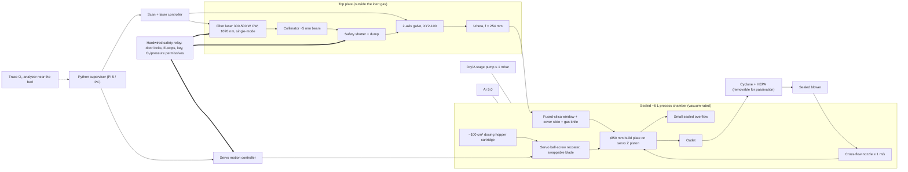

# Desktop LPBF for small-batch alloy screening: survey, concept and first BOM

First pass for [issue #260](https://github.com/vertical-cloud-lab/digital-alloy-lab/issues/260), written 2026-11-13.
Nothing here has been built, quoted or reviewed by BYU's Laser Safety Officer or EHS yet.

| File | What it is |
|---|---|
| [`README.md`](README.md) | this note: survey, gantry question, concept, safety, BOM, plan |
| [`bom.csv`](bom.csv) | the bill of materials (core electronics and unit operations), with low/high prices and their basis |
| [`bom_table.py`](bom_table.py) | renders `bom.csv` as the table in §6 and totals it |
| [`vendor-lookups.csv`](vendor-lookups.csv) | every price and dimension fetched from vendor sites through the lab Pi on 2026-11-13, with URL and time |
| [`budgets.py`](budgets.py) | sizing arithmetic for powder per build, purge cycles, cross-flow and gantry turnaround |
| [`edison/`](edison/) | Edison `LITERATURE_HIGH` query on custom LPBF design and its results |

## 1. Short answers

- **Open-source LPBF exists, but nothing open is designed for small powder batches.** There are two open-hardware metal machines:
  - [DTU OpenAM-PBF](https://github.com/DTU-OpenAM/OpenAM-PBF): CERN-OHL-P v2, 300 W at 1080 nm, Ø250 × 150 mm, a safety PLC with door interlocks, and closed-loop cross-flow.
  - [TUM iwb reAM250](https://www.mec.ed.tum.de/en/iwb/research-and-industry/projects/additive-manufacturing/iwb-ream-250-powder-bed-fusion-machine-for-research-purposes): open hardware and software, an nLIGHT AFX-1000, a RAYLASE galvo and a 250 mm cube.

  Both are full-size. We should borrow their safety and control designs, not their powder system.
- **Commercial small machines cost $59k–130k**: AO Metal A30 (Ø30 × 60 mm, from $59k in 2025), A50 ($89k), Xact Metal XM200C ($65k), 2OneLab 2CREATE ($120k) and One Click Metal MPRINT ($129.9k). Several vendors offer Ø30–55 mm reduced build volumes for exactly our problem (§2.2).
- **A modified CNC router or a CubXL-like gantry should not move the beam.** Al LPBF scans at 0.7–2.3 m/s in hatch vectors a few mm to 10 mm long. A 1 g gantry needs 50 mm just to reach 1 m/s, so a 10 mm vector spends about 95 % of its time turning around. The CubXL itself is a GRBL ball-screw CNC frame (Genmitsu PROVerXL 4030 geometry) that runs at 50–83 mm/s. Xact Metal launched its XM200 line on a mirror gantry in 2018, and its current XM200S and XM200G datasheets list galvos.
- **Use a fixed galvo scanner and f-theta lens above a small sealed chamber.** Linear servo axes then only spread powder and lower the piston, where smoothness matters and speed doesn't. A CubXL-style gantry is useful *outside* the chamber, to fill hopper cartridges and move plates (§3.1).
- **Concept in one line:** a ~6 L vacuum-purgeable chamber under a fixed galvo, with these parts:
  - a Ø50 mm build plate, with a Ø25 mm insert;
  - a ~100 cm³ dose-from-above hopper cartridge and no supply piston: a 15 mm build uses ~71 g;
  - a servo ball-screw recoater with swappable blades;
  - a recirculating cross-flow at ≥ 1 m/s;
  - 2–3 vacuum–argon purge cycles to < 100 ppm O₂;
  - a hardwired dual-channel interlock chain;
  - everything scriptable from Python.
- **BOM: 38 lines, about $20k on the cheapest listed options to about $93k on the premium ones.** The spread is mostly the laser, scan head and scan controller, which need quotes. Prices for Thorlabs, McMaster-Carr, DigiKey, Cloudray and Teknic were pulled live through the lab Pi (BYU network) on 2026-11-13.

## 2. What already exists

### 2.1 Open-source, open-architecture and home-built LPBF

Sources tagged † come from search summaries and have not been opened. Check them before relying on them.

| Project | Laser | Beam motion | Recoater | Gas | Build area | Notes |
|---|---|---|---|---|---|---|
| [DTU OpenAM-PBF](https://github.com/DTU-OpenAM/OpenAM-PBF) (CERN-OHL-P v2) | 300 W, 1080 nm | not stated in README | "multi-material powder system" | closed-loop cross-flow | Ø250 × 150 mm | v1 documented, "v2 is to be the actual release"; controller redesign under way; 1,500+ print hours ([RPJ 2024](https://doi.org/10.1108/RPJ-12-2023-0422)†). E-stop opens a safety contactor that also cuts the laser trigger and motor drivers. |
| [TUM iwb reAM250](https://www.mec.ed.tum.de/en/iwb/research-and-industry/projects/additive-manufacturing/iwb-ream-250-powder-bed-fusion-machine-for-research-purposes)† | nLIGHT AFX-1000 | RAYLASE galvo, dynamic zoom | "adaptable recoater for new recoating and sensing strategies" | cyclone separator | 250 mm cube | Autodesk Machine Control Framework driving the RAYLASE API ([Wenzler et al., Procedia CIRP 2024](https://doi.org/10.1016/j.procir.2024.08.121)†) |
| [NIST AMMT](https://www.nist.gov/laboratories/tools-instruments/additive-manufacturing-metrology-testbed-ammt)† | – | custom scan control; power and speed updated at 100 kHz | – | – | – | Government testbed, "about the size of a small car"; its value is full software control |
| [Open Additive PANDA](https://www.fabbaloo.com/news/open-additives-panda-metal-3d-printing-system)† | 500 or 1000 W IPG | configurable | – | – | 152 × 152 × 241 mm and up | Commercial open architecture, from $219,900 ([aniwaa](https://www.aniwaa.com/product/3d-printers/openadditive-panda/)†) |
| [Hobbyist DIY SLM, 2026](https://hackaday.com/2026/01/03/printing-in-metal-with-diy-slm)† | 500 W fiber | galvo outside the chamber, through a window in the lid | servo-driven blade | argon, small chamber to save gas | – | Laser and galvo were most of the cost. A plastic blade was damaged by hot metal; a stainless blade gave repeatable layers. |
| [Sheffield diode point melting](https://eprints.whiterose.ac.uk/id/eprint/235887)† | 8 × 450 nm diodes, ~35 W total | **diode head on an x-y gantry** | – | – | – | Works, but slowly. Cooling is 750–1400 °C/s against 10⁵–10⁶ °C/s in LPBF, so alloys screened this way would not see LPBF thermal histories. |
| Synchrotron "process replicators" ([Leung et al. 2018](https://doi.org/10.1038/s41467-018-03734-7)†, [RSI 2020](https://doi.org/10.1063/1.5143766)†) | – | – | – | – | beamline-sized | Miniature rigs that "mimic an entry-level commercial" LPBF: the closest precedent for a minimal-powder machine |
| [Freemelt ONE](https://www.metal-am.com/articles/freemelt-ab-open-source-technology-to-explore-the-potential-of-electron-beam-powder-bed-fusion/)† (open e-beam, for contrast) | 6 kW e-beam | magnetic deflection | – | 10⁻⁵ mbar vacuum | Ø100 × 100 mm | Open software toolbox and Open Beam Path file format |

Unopened leads:
- an MIT SM thesis, "Design and fabrication of an open-architecture selective laser melting system" (2017);
- [UT Austin, "An Open-Architecture Multi-Laser Research Platform" (SFF 2019)](https://utw10945.utweb.utexas.edu/sites/default/files/2019/002%20An%20Open-Architecture%20Multi-Laser%20Research%20Platform.pdf).

No HardwareX *metal* LPBF paper turned up. The open polymer SLS builds (OpenSLS, the HardwareX SLS, SLS4All) are polymer-only.

### 2.2 Commercial desktop and research-grade machines

| Machine | Build volume | Laser / spot | Beam motion | Gas / O₂ | Reduced volume | Price |
|---|---|---|---|---|---|---|
| AO Metal A30 (Additive Plus, CA) | Ø30 × 60 mm | 200 W fiber, upgradable to 300 W | – | – | the whole machine is small | from $59k (2025) ([VoxelMatters](https://www.voxelmatters.com/de/additive-plus-bringt-ao-3d-druckerfamilie-fuer-erschwingliche-lpbf-auf-den-markt.md)) |
| AO Metal A50 | Ø50 × 100 mm | 300 W (500/1000 W, or a 445 nm blue option) | – | – | – | from $89k (2025) |
| Xact Metal XM200C | 127 mm cube | 100 W Yb† | XY **mirror gantry**, no galvo or f-theta ([3DPI 2018](https://3dprintingindustry.com/news/xact-metal-releases-sub-100k-high-precision-metal-3d-printers-131363/)) | – | – | $80k at launch (2018), later $65k† |
| Xact Metal XM200S | 127 mm cube | 200 W, > 50 µm spot | **galvo**, scanning up to 8 m/s ([datasheet](https://cdn.goengineer.com/xact_metal_3d_printer_xm200s_technical_data_sheet.pdf)) | – | – | $130k (2018) |
| Xact Metal XM200G / G2 | 150 mm cube | 1–2 × 100–400 W, 50/100 µm | galvo, jog at 20.7 or 34.6 m/s ([datasheet](https://cdn.goengineer.com/xact-metal-xm200g-data-sheet-goengineer.pdf)) | glovebox option | – | ~$90k† |
| TRUMPF TruPrint 1000 | Ø98 × 100 mm | 200 W, 55/80 µm (30 µm option) | galvo | **≤ 3000 ppm standard; ≤ 100 ppm only with the glovebox + sensor option**† ([flyer](https://www.headland.com.au/static/d87e49df79ca2401f7a6403c8d0f506c/TRUMPF-TruPrint1000-flyer-EN-1-1.pdf)) | Ø50 × 100 mm | – |
| Sisma MYSINT100 | Ø100 × 80 mm | 200 W, 30–55 µm | – | glovebox for reactive metals† | Ø33.5–34.5 mm | – |
| Aconity MINI / MIDI+ | Ø140–170 / Ø250 mm | 400–1000 W single-mode, 80 µm | galvo, ≤ 4 m/s | – | **down to Ø55 mm**† | – |
| Renishaw reduced build volume insert | 78 × 78 × 55 mm | host machine | host | host | **as little as 0.25 L of powder**† | – |
| Nikon SLM 125 | 125 mm cube | 400 W IPG | – | – | 50 mm cube† | – |
| 2OneLab 2CREATE / Plus / Desktop | Ø100 × 100 mm; 150 × 150 × 100; 100 × 80 mm | 250 / 400 / 300 W | – | – | – | $120k (aniwaa)† |
| One Click Metal MPRINT / MPRINT+ | 150 mm cube | 200 W, 70 µm | – | argon (N₂ outlet on +) | cartridges carry 250 % oversupply† | from $129.9k† |
| EOS M 100 | Ø100 × 95 mm | 200 W, 40 µm | galvo | – | – | – |
| Sharebot MetalONE | 65 × 65 × 100 mm | 200–300 W (sources disagree) | galvo | Ar or N₂ | small plate | – |
| Prima Additive Print Sharp 150 | Ø150 × 160 mm | 300 W single-mode, 35–100 µm | – | – | – | – |
| Farsoon FS121M | 120 × 120 × 100 mm | 200–500 W (sources disagree) | – | N₂ | – | – |
| Eplus3D EP-M100T, Kings 3D DiMetal-100, Coherent CREATOR | ~Ø100–120 mm | 100–200 W | – | – | – | CREATOR from $100k† |

The repo already rates Xact Metal and AO Metal as purchase candidates
([`company-landscape.md`](../company-landscape.md)), and
[`budget-assessment-official-requirements.md`](../edison-trajectories/budget-assessment-official-requirements.md)
weighs a ~$40–65k desktop machine against the Genesis budget. The Aconity MIDI at the University of
Utah needs a ~1 kg hopper fill
([pr52 review replies](../edison-trajectories/pr52-followup/pr52-review-replies.md), byu-vcl #77), which
is the reason to build small.

### 2.3 Lessons we take

1. **Small batches mean a Ø30–55 mm build cylinder, a dose-on-demand feed and a small overflow.** Vendors converge on that size (TruPrint 1000, MYSINT100, Aconity, SLM 125, AO Metal A30). Cartridge feeders that oversupply by 250 % are the wrong model.
2. **Purge alone gets commercial machines to ~1000–3000 ppm.** Reaching ≤ 100 ppm takes a tighter route: a glovebox plus sensor (TRUMPF) or, our choice, a vacuum-capable chamber (§3.4). EOS M 290 work uses a 1000 ppm threshold with Ar 5.0, and one study held < 100 ppm ([Pauzon 2019](https://research.chalmers.se/publication/510755/file/510755_Fulltext.pdf); [Polito 2023](https://iris.polito.it/bitstream/11583/2980588/1/CIPR.pdf)).
3. **The recoater should be a swappable, compliant module.** Precedents are Xact's compliant "bulb", which spreads like a blade and compacts like a roller, TUM's adaptable recoater, and the hobby build's switch from a plastic to a steel blade.
4. **The laser, scanner and scan controller are most of the cost, and an open scan-controller API matters.** reAM250 uses RAYLASE's API; DTU's controller limited it and is being redesigned.
5. **Put safety in hardware from day one.** OpenAM uses a safety PLC and door interlocks, its E-stop opens a contactor that cuts the laser trigger and motor drivers, and lasing needs closed doors plus a reset.

## 3. Concept

### 3.1 Beam delivery, and the gantry question

`python desktop-lpbf/budgets.py` gives the numbers below.

| | Galvo + f-theta | XY gantry moving optics (CNC router, CubXL, custom) |
|---|---|---|
| Scan speed needed for Al (0.7–2.3 m/s; [Warwick SFF 2023](https://utw10945.utweb.utexas.edu/sites/default/files/2023/027%20ControllingChemicalCompositionChangesinLaserPowderBedFusionofAlSi10Mg.pdf)) | marking speed 1.1 m/s, positioning 8 m/s (basiCube 20 at f = 160 mm); Xact galvos jog at 20.7–34.6 m/s | CubXL: 50 mm/s default, 83 mm/s max ([CubOS config](https://github.com/Ursa-Laboratories/CubOS/blob/main/services/api/configs/gantry/cub_xl_seed.yaml)); best vendor gantry claim 1.5 m/s (Xact XM300) |
| Distance to reach 1 m/s | ~0.25 mm at 2000 m/s² equivalent | 50 mm at 10 m/s² (1 g); 25 mm even at 20 m/s² (Bambu H2D class) |
| One 10 mm hatch vector at 1 m/s | ~10 ms of laser-on time, sub-ms turnaround | ~210 ms, of which ~200 ms is turnaround; energy density changes along the line unless power follows velocity |
| Inert-gas side | optics stay outside, behind one window; chamber stays small | moving optics, cables, bellows and lubricant inside the chamber, or a large moving window; more volume, particles and leaks |
| Field distortion | f-theta distortion is trivial over Ø50 mm in a 156–175 mm field | none, which is the gantry's only real advantage |

The verdict is a galvo. A gantry that moves the beam is a big custom engineering job: Kurtz Ersa's Flying Ray S
calls moving that mass with PBF dynamics the hard part ([Metal AM](https://www.metal-am.com/?p=118720)†). It also changes
the thermal history you are trying to screen for, and the small vendor that tried it (Xact) moved its
XM200 line to galvos. Fraunhofer ILT's hybrid of galvos riding on linear axes
([Fraunhofer](https://www.futuream.fraunhofer.de/en/news_and_media/video-multi-scanner-on-the-fly-processing-LPBF.html)†)
only pays off for big beds.

**The CubXL** is Ursa Laboratories' "CNC gantry with custom instrument mounts and labware". Its specs:
- a 400 × 300 mm deck for liquid handling ([ursalabs.ai](https://ursalabs.ai));
- GRBL over serial;
- 307–399 × 250–300 × 87–129 mm of travel;
- the Genmitsu PROVerXL 4030 geometry ([CubOS `docs/gantry.md`](https://github.com/Ursa-Laboratories/CubOS/blob/main/docs/gantry.md)).

It is an open frame with no inert enclosure and is roughly 10–30× too slow for scanning.

**Where a gantry does belong:**
- **Inside the machine,** the recoater and the build piston are linear axes too. They need smooth, constant velocity and µm-level Z steps, not speed, so they get servo-driven ball screws on precision guides (§3.5), not belts.
- **Outside the machine,** the CubXL, or a CubOS-driven gantry like it, could fill and cap hopper cartridges from the lab's powder dispensing (AutoTrickler) line. It could also carry cartridges and build plates between the glovebox, the machine's antechamber and characterisation. That is where "ease of automation" pays off without putting a router in the beam path.

### 3.2 Laser and optics

- **Laser.** Use a CW Yb fiber laser at 1070 nm, 300–500 W (run at 150–400 W), single-mode with M² ≤ 1.1. It needs analog power control, a TTL gate or modulation input (IPG YLR: 0–50 kHz), a hardware interlock input and a guide laser.
  - Aluminium reflects strongly at 1 µm, so keep power headroom: commercial Al work on an EOS M 290 uses 370 W.
  - Ask every vendor for M² and fiber core size. "Single-module" on Raycus and similar listings describes packaging, not beam mode.
  - US options are IPG (YLR-500, water-cooled 3U rack, about 40 kg) and nLIGHT (CFL-500). PRC options (Raycus RFL-C500, MAX MFSC-500) are much cheaper. Check the funding source's foreign-sourcing rules before choosing one (see [`foreign-connections/`](../foreign-connections/)).
  - A 500 W CW unit probably needs a chiller.
- **Spot size.** d ≈ 4M²λf/(πD), with M² = 1.1 and λ = 1.07 µm:

  | f | D = 5 mm | D = 7 mm | D = 10 mm |
  |---|---|---|---|
  | 160 mm | 48 µm | 34 µm | 24 µm |
  | 254 mm | **76 µm** | 54 µm | 38 µm |

  **f = 254 mm with D ≈ 5 mm** gives the 70–100 µm spot of commercial machines without a beam expander. Its Rayleigh range is about ±3.9 mm, which is forgiving, and the 156–175 mm field keeps a Ø50 mm plate in the low-distortion centre.
- **Scan head.** It needs mirrors rated for ≥ 500 W CW at 1070 nm.
  - The SCANLAB basiCube 20 (20 mm aperture) is rated 1000 W at 1064 nm at 100 % duty without water cooling, with XY2-100 (SL2-100 option) ([SCANLAB](https://www.scanlab.de/en/print-product/1061)).
  - The $279–899 Sino-Galvo-class marking heads (Cloudray RC1001, SG7110, SG7210) have no CW power rating we could find. Use one only on a low-power bench, or after the vendor confirms its mirror coatings.
  - Thorlabs' GVS012 ($3,785.20) has silver mirrors and is also a bench part.
- **f-theta lens.** Thorlabs FTH254-1064 ($1,559.61; field 156.7 mm; WD 301.2 mm; Ø120 × 67.8 mm; M85 × 1) and FTH160-1064 ($1,011.78) give only a *pulsed* damage threshold.
  - Prefer a fused-silica lens rated for kW CW to avoid thermal focal shift.
  - EKSMA 150-2541 (f = 254 mm, 175 × 175 mm field, $486–504) is a cheap candidate. Its CW rating is unverified.
- **Chamber window.** Use AR-coated fused silica (Thorlabs WG41050-C, Ø1 in., $127.12). Expect to need Ø2 in. for the scan cone, sized for 1 atm differential pressure.
  - Below it goes a cheap sacrificial cover slide. A small argon gas knife across its underside keeps condensate off.
  - A **fixed field-stop aperture** in the window flange physically limits the beam cone to the plate area. It is a passive guard that doesn't depend on software.
- **Shutter and dump.** A mechanical shutter sits between the collimator and the galvo and closes on any safety trip; FDA's Class IV list includes a permanently attached beam attenuator. For commissioning, use a water-cooled dump (Thorlabs LB2L/M, 500 W, $507.50).
- **Power measurement.** Thorlabs S322C ($1,690.54) only reaches 200 W, so a 500 W-class thermal head is still to be sourced.

### 3.3 Powder: spreadability and a small hopper

Sizing comes from `budgets.py`, assuming AlSi10Mg, 30 µm layers, a 1.8 dose factor and 50 % bed packing:

| Plate | Powder per layer (dosed) | 15 mm build | Hopper volume |
|---|---|---|---|
| Ø50 mm | 0.14 g | **~71 g** | 48 cm³, so specify **~100 cm³ (~150 g)** with margin |
| Ø25 mm insert | ~0.04 g | ~18 g | – |

- **No supply piston.** A powder supply piston has to be filled far above what it delivers. Instead, a sealed **hopper cartridge** of ~100 cm³ sits above the dose position.
  - A fluted metering roller or vibratory slot drops one line of powder per layer in front of the recoater.
  - A **load cell under the cartridge** weighs each dose, which gives automatic powder accounting and a "short feed" alarm.
  - Cartridges are filled in the glovebox, or by the automated powder line. They dock through a small purgeable antechamber, so the process chamber never sees air.
- **Small overflow.** It is sealed and recoverable, because every gram of a new alloy matters.
- **Build piston.** The bore is Ø50 mm with a Ø25 mm insert, the stroke about 40 mm, with a felt/PTFE seal. Layers run 20–60 µm with ≤ 2 µm repeatability.
- **Recoater.**
  - It rides on a servo ball screw on a linear guide at a steady 20–100 mm/s. Start slow for fine, cohesive Al powders.
  - The blade cartridge is quick-swap: soft (silicone/rubber, which rides over curled parts), carbon-fiber brush, or hard (HSS/ceramic; the DIY build found steel repeatable).
  - A counter-rotating roller module is phase 2, for powders that won't spread with a blade.
  - The gap and dose factor are recipe parameters.
- **Measuring spreadability.**
  - A layer camera (Raspberry Pi HQ camera with an oblique LED bar) images every layer, before and after lasing.
  - Coverage, streaks and short feed are scored automatically, and the scores go into the same dataset as the alloy's process window.
  - The same camera and recoater can run with no laser in the glovebox as a stand-alone **spreadability test rig** (phase 0). That tests each new powder before it goes in the machine.

### 3.4 High-purity inert gas

- **Vacuum-purge, don't just flow-purge.**
  - A ~6 L chamber pumped to ≤ 1 mbar and backfilled with Ar 5.0 reaches the ideal < 100 ppm in 2 cycles (`budgets.py`). Plan 3 to cover outgassing from the powder and walls.
  - The McMaster single-stage pump (9901K64, $765.49) only pulls 26 inHg (~130 mbar), which needs 4 cycles. Hence the dry scroll or two-stage line in the BOM.
  - Flow-purging the same chamber ideally takes ~7.6 volume changes (46 L). In practice it takes much longer, because the porous powder in the hopper and bed holds air that only a vacuum pulls out quickly.
  - The chamber must take a full 1 atm differential: walls, window, door and seals are designed for it.
- **Recirculate the cross-flow; don't vent it.**
  - A 70 × 8 mm laminar nozzle at 2 m/s moves ~67 L/min. A minimum average of **≥ 1 m/s at the plate** is recommended, and low velocity correlates with porosity ([Kjer et al. 2023](https://mdpi.com/2504-4494/7/4/143)).
  - Too fast picks up powder, so tune velocity per powder and plate height.
  - The loop is a sealed blower, then a cyclone or settling stage, then a HEPA cartridge, and back.
- **Hold ≤ 100 ppm (aim for ~10 ppm) with closed-loop make-up.** A trace O₂ analyzer (Ntron Microx with ranges down to 0–10 ppm, $1,694–2,091; or the SST OXY-FLEX zirconia sensor, $1,271.07, once its low range is confirmed) samples near the bed. Readings depend on sensor position, and the best reading is near the bed ([Metal AM](https://www.metal-am.com/linde-and-eos-leverage-addvance-o2-precision-technology-for-aluminium-study/)).
  - The analyzer opens an Ar make-up valve. The chamber is held at +5–20 mbar so leaks go outward.
  - A purifier on the loop is a later option.
- **Permissives.** The laser enable requires O₂ below its setpoint and chamber pressure in its window. Both permissives are hardwired into the safety relay, not just checked in software.

### 3.5 Motion: smoothness and suitability

- **Recoater.** It has to spread at a constant velocity without cogging or vibration. A ClearPath-SD integrated servo (from $265) drives a ball screw (McMaster 4566N101: M12, 10 mm lead, ±0.05 mm/300 mm, $188.22) on a preloaded linear guide, with S-curve moves. The axis is stiff, so it doesn't chatter when it hits a part.
- **Build piston.** It needs a crossed-roller guide and a fine-lead screw (2 mm), driven by a servo or an encoder-closed stepper. All motion is in the same direction for every layer, to take up backlash.
- **No belts and no lubricant inside the chamber.** Use dry or vacuum grease, and bellows or covers over the screws. Motors sit outside on rotary feedthroughs, or are sealed, to protect the gas.

### 3.6 Controls and electronics

- **Supervisor.** A Raspberry Pi 5 or small Linux PC runs one Python service. It handles the recipe, the state machine (purge, heat, spread, expose, repeat), logging and a REST API. That fits the lab's other automated instruments, and a CubOS-driven gantry can call it.
- **Scan and laser controller.** It outputs XY2-100 to the head and drives the laser gate, analog power and PWM, with programmable laser on/off delays and skywriting. Options:
  - SCANLAB RTC6 (quote), the professional route with a vendor SDK;
  - a JCZ card (DLC2-M4-2D, EZCAD3, $1,785 at Cloudray). It is Windows-only, so it is harder to automate;
  - open source: [OPAL](https://github.com/opengalvo/OPAL) (GPL-2.0, Teensy 4.0 + SN75174N, G-code to XY2-100), LinuxCNC `xy2mod` on Mesa FPGA cards, or [Tuet/XY2_100](https://github.com/Tuet/XY2_100). OPAL warns it "might crash at any time leaving your galvo and laser in an unknown state", which is fine only because the safety chain does not depend on it.
- **Motion.** Step/dir from a Teknic ClearCore, or Klipper on the supervisor, to 2–3 ClearPath servos.
- **Process I/O.** The O₂ analyzer (4–20 mA), a chamber pressure transducer, 24 V solenoid valves for purge, vent and make-up, the blower drive, plate heaters (MAX31856 thermocouple interface, $17.50), the hopper load cell and the layer camera.
- **Power.** A Mean Well SDR-480-24 24 V DIN-rail supply ($151.10).

### 3.7 Safety

#### Laser (Class 4 source inside a Class 1 enclosure)

- **FDA.** A laser "used by the individual(s) who designed and constructed the device" is not subject to the federal laser product performance standard. It must still be classified under ANSI Z136.1 and go through the university laser safety program ([Northwestern](https://researchsafety.northwestern.edu/safety-information/laser-safety-handbook.html); [21 CFR 1040.10](https://www.law.cornell.edu/cfr/text/21/1040.10)). That changes if the machine is ever sold or given to another organisation. **Register it with BYU's LSO before first light.** We did not find BYU's institutional laser program online, so contact the LSO directly.
- **Build to the FDA Class IV feature list anyway:**
  - a key-actuated master control;
  - an emission indicator;
  - a permanently attached beam attenuator (the shutter);
  - a manual reset after an interlock trip or > 5 s power loss;
  - a remote interlock connector;
  - interlocks on every protective-housing panel.
- **Guarding follows IEC 60825-4:2022.** The whole machine sits inside an opaque metal laser guard. The chamber walls take any stray direct hit (the protective exposure limit, PEL, question). The viewing window is OD ≥ 7 at 1070 nm and kept out of any direct beam path.
  - Window candidates: Thorlabs LW1P1/M light green, 385.8 × 304.8 mm, $411.95; Laser Safety Industries acrylic, OD 7+ at 1060–1100 nm, $195.
  - Service eyewear: Thorlabs LG1, $217.47 (confirm OD at 1070 nm).
- **Interlock chain, all hardwired.**
  - Dual-channel inputs: a guard-locking door switch (Omron D4JL, $803.42; it keeps the door locked while lasing or while the chamber is off atmospheric pressure), the panel switches, E-stops (IDEC XA1E, $76.67), the key switch, the O₂ < setpoint permissive and the pressure permissive.
  - These go into a safety relay (Omron G9SE-201 class, $275.29; Pilz PNOZ or Banner are alternatives).
  - The relay's outputs drop the laser's hardware interlock, close the shutter and disable the motion drives. Software can only *request* emission.

#### Aluminium powder and condensate

- **Codes.** NFPA 484 (2022) has an additive-manufacturing chapter: dust hazard analysis, emergency shutdown locations, part harvesting, powder storage and training. UL 2011 for AM machines draws on NFPA 484, 652 and 654. Ask EHS for a dust hazard analysis that **includes the machine and its filter**: some AM dust hazard analyses have left those out ([Dust Safety Science](https://dustsafetyscience.com/?p=5800)).
- **The filter is the main fire hazard.** Condensate can ignite on contact with air or from vibrating the cartridge ([ULT via Metal AM](https://www.metal-am.com/ult-highlights-the-importance-of-air-handling-technology-for-pbf-lb-additive-manufacturing/)). The design response:
  - The filter housing valves off under argon and comes out sealed.
  - It is passivated in a controlled way: dry quartz sand or mineral oil, or binding the condensate.
  - Unoxidised aluminium plus water gives hydrogen, so a wet separator is not automatically safe for Al.
- **Explosibility.** Al alloys need 13–23 mJ minimum ignition energy, against 4 mJ for pure Al, with Pmax ~5–7 bar. Ground and bond everything, and use conductive gloves and tools.
- **Handling.** Sieve, load and unload in an inert glovebox (McMaster 4083N14, $4,305.48). The machine's small, cartridge-based powder path keeps open handling to a minimum.
- **Fire.** Keep a Class D sodium-chloride extinguisher (McMaster 6435T23, 30 lb, $920.22) at the machine. The willful OSHA citation after the 2013 Powderpart fire, in which a worker was badly burned, was for having no Class D extinguisher ([OSHA](https://www.dol.gov/newsroom/releases/osha/osha20140520-2)).

#### Gas

- **Asphyxiation.** Argon purge and vent volumes are small, but vent the pump exhaust outside the room. Keep an O₂-deficiency monitor in the room (McMaster 18995T81, $459), plus an overpressure relief on the chamber.

## 4. Design requirements and how the concept meets them

| Requirement (issue #260) | Target | Design response |
|---|---|---|
| Good spreadability | full, uniform 20–60 µm layers with fine Al powders | servo ball-screw recoater at steady speed; swappable soft/brush/hard blades (roller later); per-layer camera scoring; offline spreadability rig (phase 0) |
| Safety | Class 1 machine; NFPA 484-aware powder path | hardwired dual-channel interlocks + guard lock + key + shutter; metal guard + field-stop aperture; sealed, passivatable filter; glovebox; Class D; room O₂ monitor |
| Ease of automation | every action scriptable; cartridges and plates handled by a robot | Python supervisor with REST API; scan controller with SDK or open firmware; docking hopper cartridges with a load cell; CubOS gantry outside |
| Smooth, suitable motion | constant-velocity spreading; µm-level Z | galvo for the beam; servo + ball screw + preloaded guides for powder axes; no belts in the chamber |
| Small hopper | ≤ ~150 g per alloy per build | Ø50 mm plate (Ø25 mm insert), dose-from-above ~100 cm³ cartridge, no supply piston, recoverable overflow: ~71 g per 15 mm build |
| High-purity inert gas | < 100 ppm O₂, ideally ~10 ppm | ~6 L vacuum-rated chamber, 2–3 vacuum–Ar 5.0 cycles, sealed recirculating cross-flow, trace analyzer near the bed, slight overpressure, O₂ permissive on the laser |

## 5. Phased plan

0. **Spreadability rig, no laser.** Recoater axis, Ø50 mm piston, hopper cartridge and layer camera, run in the glovebox with our own powders. This settles blade vs. brush vs. roller and the dose factor cheaply.
1. **Chamber and gas loop, no laser.** Machine the chamber and prove 2–3 cycles to < 100 ppm with powder loaded. Measure the hold-up and the make-up gas use, and tune the cross-flow velocity, using smoke or particles.
2. **Laser, optics and safety.** LSO review, then interlock commissioning with the beam into the dump, then single tracks on plates, then density cubes.
3. **Monitoring and automation.** Photodiode (Thorlabs PDA36A2, $400.01) and layer-image scoring, recipe API, cartridge docking, and CubOS gantry hand-off.

## 6. Bill of materials (core electronics and unit operations)

`bom.csv` is the master copy; this table is generated by `python desktop-lpbf/bom_table.py`.

- **"fetched"** prices were read live from vendor pages through the lab Pi on 2026-11-13. Each has its URL and time in [`vendor-lookups.csv`](vendor-lookups.csv).
- **"agent-sourced"** prices come from the web survey, with the URL in `bom.csv`.
- **"estimate"** values are placeholders until quotes come in.

Ranges are "cheapest listed option" to "premium option" for that line.

| ID | Subsystem | Item | Candidate | Qty | Unit (USD) | Basis |
|---|---|---|---|---|---|---|
| L1 | Laser & optics | Fiber laser source | IPG YLR-500 (or nLIGHT CFL-500), US vendors | 1 | 3,300–30,000 | estimate (quotes needed) |
| L2 | Laser & optics | Laser chiller | Vendor-recommended chiller | 1 | 0–3,000 | estimate |
| L3 | Laser & optics | Collimator / beam expander | Collimator supplied with laser (QBH) | 1 | 0–512 | fetched (Thorlabs) |
| L4 | Laser & optics | Safety shutter + beam dump | Industrial fiber-laser shutter (quote) | 1 | 508–2,000 | fetched + estimate |
| L5 | Laser & optics | 2-axis galvo scan head | SCANLAB basiCube 20 (1000 W at 1064 nm without cooling) | 1 | 419–12,000 | fetched (Cloudray) + quote (SCANLAB) |
| L6 | Laser & optics | F-theta lens | High-power fused-silica f-theta (quote) | 1 | 486–2,500 | fetched (Thorlabs) + agent-sourced (EKSMA) |
| L7 | Laser & optics | Chamber laser window + sacrificial cover slide | Thorlabs WG41050-C (Ø1 in.) / Ø2 in. equivalent | 2 | 127–400 | fetched (Thorlabs) |
| C1 | Controls | Scan + laser controller | SCANLAB RTC6 (quote) | 1 | 60–6,000 | fetched (Cloudray) + estimate |
| C2 | Controls | Supervisor computer | Raspberry Pi 5 (8 GB) or small industrial PC | 1 | 80–600 | estimate |
| C3 | Controls | Motion controller | Teknic ClearCore or Klipper on the supervisor | 1 | 150–400 | estimate |
| C4 | Controls | 24 V DC supply | Mean Well SDR-480-24 | 1 | 151 | fetched (DigiKey) |
| C5 | Controls | Thermocouple interface | Adafruit 3263 (MAX31856) | 2 | 18 | fetched (DigiKey) |
| M1 | Motion & powder | Recoater axis | McMaster 4566N101 ball screw (M12 x 10 mm lead x 500 mm) + guide rail | 1 | 188–600 | fetched (McMaster) + estimate |
| M2 | Motion & powder | Servo motors | Teknic ClearPath-SD | 2 | 265–486 | fetched (Teknic) |
| M3 | Motion & powder | Build piston Z stage | Custom (screw + guide + bore) | 1 | 500–1,500 | estimate |
| M4 | Motion & powder | Dose-from-above hopper + metering | Custom | 1 | 200–800 | estimate |
| M5 | Motion & powder | Recoater blade cartridges | Custom holders + stock blade material | 1 | 100–500 | estimate |
| M6 | Motion & powder | Layer camera + lighting | Raspberry Pi HQ camera + lens + oblique LED bar | 1 | 100–300 | estimate |
| G1 | Inert gas | Process chamber | Custom machined | 1 | 2,000–6,000 | estimate |
| G2 | Inert gas | Vacuum pump | Dry scroll or 2-stage RV (quote) | 1 | 765–4,000 | fetched (McMaster) + estimate |
| G3 | Inert gas | Argon supply | McMaster 78595A5 flowmeter-regulator (0-70 scfh Ar) | 1 | 334 | fetched (McMaster) |
| G4 | Inert gas | Recirculation blower | Sealed regenerative blower (quote) | 1 | 300–1,500 | estimate |
| G5 | Inert gas | Filter train | Inline HEPA housing (quote) | 1 | 200–600 | estimate |
| G6 | Inert gas | O2 analyzer | Ntron Microx (Instrumart $1,694-2,091) | 1 | 1,271–2,091 | fetched (DigiKey) + agent-sourced (Instrumart) |
| G7 | Inert gas | Valves / fittings / gauges | McMaster / Kurt J. Lesker | 1 | 500–1,500 | estimate |
| G8 | Inert gas | Chamber seals | McMaster 1165N11 (per ft) | 10 | 2 | fetched (McMaster) |
| S1 | Safety | Safety relay | Omron G9SE-201 (DigiKey 'SAFETY UNIT 2+1 O/P') | 1 | 275 | fetched (DigiKey) |
| S2 | Safety | Guard-locking door interlock | Omron D4JL-4NFA-C5-NPT | 1 | 803 | fetched (DigiKey) |
| S3 | Safety | E-stop | IDEC XA1E-BV3U02-R | 2 | 77 | fetched (DigiKey) |
| S4 | Safety | Key switch + emission indicator + manual reset | Panel-mount keyed selector + stack light | 1 | 100–300 | estimate |
| S5 | Safety | Laser-safe viewing window | Thorlabs LW1P1/M light green panel (385.8 x 304.8 mm) | 1 | 195–412 | fetched (Thorlabs) + agent-sourced |
| S6 | Safety | Laser safety eyewear (service/alignment) | Thorlabs LG1 | 2 | 217 | fetched (Thorlabs) |
| S7 | Safety | Room O2-deficiency monitor | McMaster 18995T81 (0-25% O2) | 1 | 459 | fetched (McMaster) |
| S8 | Safety | Class D extinguisher | McMaster 6435T23 | 1 | 920 | fetched (McMaster) |
| S9 | Safety | Outer enclosure | Aluminum extrusion + sheet | 1 | 800–2,000 | estimate |
| P1 | Powder handling | Glovebox | McMaster 4083N14 (humidity meter + 2 gas ports) | 1 | 1,694–4,305 | fetched (McMaster) |
| T1 | Test & commissioning | Laser power sensor | Ophir/Coherent 500-1000 W head (quote) | 1 | 1,691–4,000 | fetched (Thorlabs) + estimate |
| T2 | Test & commissioning | Melt-pool photodiode | Thorlabs PDA36A2 | 1 | 400 | fetched (Thorlabs) |

**Total: $20,374 – $93,176.** The low figure takes the cheapest listed option on every line; the high figure takes the premium option.

The low end needs a PRC laser and a marking-class galvo, neither confirmed for 500 W CW. Treat it as a floor, not a plan. A realistic first build is a US single-mode laser, a power-rated scan head and an open or SDK controller. That probably lands at $45–70k once quotes are in, which is close to an AO Metal A30/A50 or Xact XM200C. So the case for building rests on what we gain, not on price:
- Ø25–50 mm builds from ~20–70 g of powder;
- < 100 ppm O₂;
- full control of scan, gas and recoat;
- an API for the autonomous loop.

**Geometry.** Dimensions for the fetched parts are in `vendor-lookups.csv`, for example the f-theta housing, thread, working distance and flange focal length. The Thorlabs and McMaster product pages offer STEP models. Pulling them into an Onshape layout of the top plate and chamber is the next step.

## 7. Open questions for the lab

1. **Funding and sourcing.** Is a PRC fiber laser acceptable on the intended funds? If not, request IPG and nLIGHT quotes for a 500 W single-mode unit, and a SCANLAB basiCube 20 + RTC6 quote.
2. **Build plate size.** Is Ø50 mm (with a Ø25 mm insert) right for the test coupons we need (density cubes, small tensile bars per the [test-structure notes](../edison-trajectories/am-scaleup-test-structures.md))?
3. **Plate preheat.** Is 200 °C plate preheat wanted for the Al alloys? It changes the chamber's thermal design.
4. **Safety reviews.** Who are the LSO and EHS contacts for the laser registration and the NFPA 484 dust hazard analysis?
5. **CubXL scope.** Should the CubXL be in scope for cartridge filling in phase 3, or should powder dispensing stay with the AutoTrickler line?
