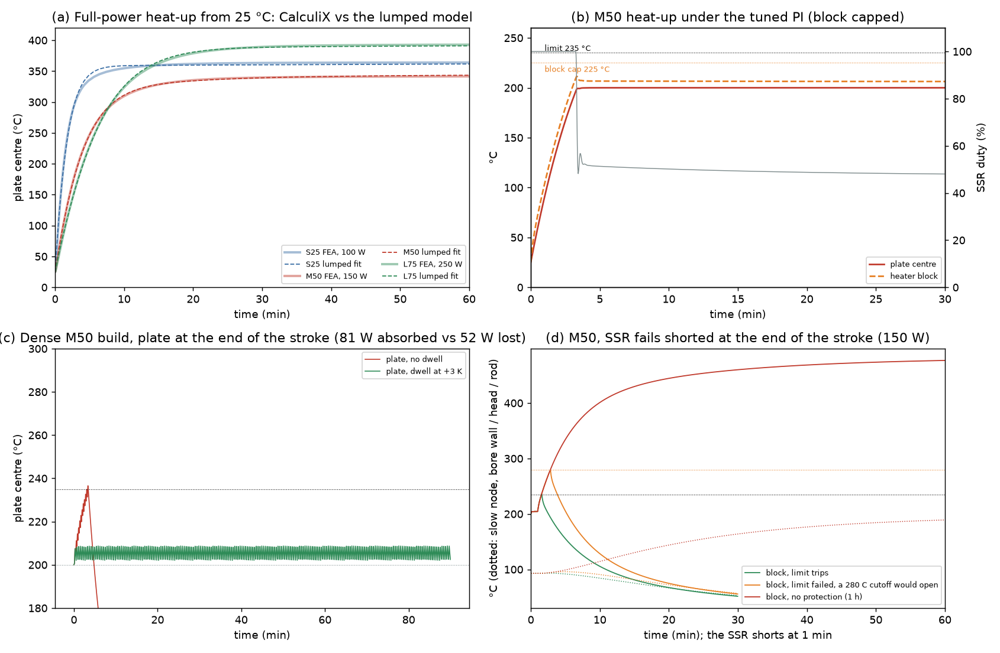

# Heater control loop: lumped model, PID, laser heat and an SSR that fails shorted

Generated by [`analysis/electrical/heater_loop.py`](../../electrical/heater_loop.py). Method, inputs and assumptions are in the script's docstring. The lumped model is fitted to this repo's CalculiX results (`analysis/out/thermal/thermal.json`, `laser_heat.json`); it is not a new FEA.

Set point 200 °C at the plate centre; block cap 225 °C; latching limit 235 °C on the limit thermocouple; no thermal cutoff (dropped 2026-11-23, section 5); thermocouple lag 2 s.

## 1. Fit of the lumped model to the FEA

| Module, position | C fast / slow (J/K) | G fast-slow / slow-ambient / fast-ambient (W/K) | r_B block offset (K/W) | Fit: RMS over the FEA curve (K) | worst in the first 30 min (K) | worst steady point (K) |
|---|---|---|---|---|---|---|
| S25_start | 33 / 57790 | 0.23 / 1.80 / 0.012 | 0.500 | 2.7 | 8.7 | 3.2 |
| S25_end | 39 / 303 | 0.16 / 0.29 / 0.062 | 0.500 | 0.5 | 2.9 | 6.0 |
| M50_start | 124 / 1548 | 0.27 / 1.46 / 0.093 | 0.087 | 1.9 | 3.5 | 6.1 |
| M50_end | 138 / 670 | 0.28 / 0.44 / 0.101 | 0.087 | 0.3 | 0.7 | 1.4 |
| L75_start | 276 / 74903 | 0.47 / 8.46 / 0.001 | 0.038 | 1.3 | 3.0 | 1.2 |
| L75_end | 301 / 1513 | 0.42 / 0.81 / 0.093 | 0.038 | 0.3 | 0.7 | 0.8 |

## 2. PI tuning and heat-up

PI with a feed-forward duty (the heater power that holds 200 °C, which the PLC knows from calibration) and the block cap. Kp and Ti are picked by a grid search on the fitted plant (heat-up from 25 °C, then a 30 W laser step at 30 min); a first-order-plus-dead-time fit of the same plant is shown for reference (its 1 h gain and 63 % time). Kp is in duty per kelvin of plate error.

| Module | Heater needed at 200 °C (W) | FOPDT gain (K per unit duty, 1 h) | τ (s) | θ (s) | Kp (duty/K) | Ti (s) | Heat-up: within 2 K (min) | settled ±2 K (min) | Overshoot (K) | Block peak (°C) | Limit tripped? |
|---|---|---|---|---|---|---|---|---|---|---|---|
| S25 | 43 | 335 | 110 | 2.5 | 0.080 | 960 | 2.3 | 2.3 | 0.0 | 224 | no |
| M50 | 71 | 310 | 269 | 2.5 | 0.150 | 60 | 3.3 | 3.3 | 0.0 | 211 | no |
| L75 | 97 | 373 | 410 | 2.5 | 0.150 | 240 | 4.0 | 4.0 | 0.0 | 207 | no |

## 3. A dense build at the end of the stroke (the lowest-loss position), 90 minutes

350 W, absorptance 0.45: 158 W into the plate while the beam scans, then an 8 s recoat. The heater cannot cool, so with more laser heat than loss the plate drifts up. The dwell rule holds the next layer until the control thermocouple is back within 3 K of its set point.

| Module | Mean laser (W) | Case | Plate max (°C) | Plate, last 30 min: mean / band (°C / K) | Limit trip | Layers in 90 min (nominal) | Build-time penalty | Heater mean (W) |
|---|---|---|---|---|---|---|---|---|
| S25 | 35 | no dwell | 237 | 27 / 3 | at 12 min | 67 (516) | 670 % | 0 |
| S25 | 35 | dwell at +3 K | 210 | 205 / 8 | no | 424 (516) | 22 % | 0 |
| M50 | 81 | no dwell | 237 | 30 / 6 | at 3 min | 12 (323) | 2595 % | 0 |
| M50 | 81 | dwell at +3 K | 209 | 205 / 7 | no | 210 (323) | 54 % | 0 |
| L75 | 111 | no dwell | 236 | 37 / 11 | at 6 min | 13 (199) | 1433 % | 0 |
| L75 | 111 | dwell at +3 K | 208 | 205 / 5 | no | 132 (199) | 51 % | 0 |

## 4. The SSR fails shorted (full installed power from the 200 °C steady state)

| Module, position | Case | Time to the limit trip (s) | Time to the TCO (s) | Plate peak (°C) | Block peak (°C) | Bore seal (°C) | Rod gland (°C) | Magnet face (°C) |
|---|---|---|---|---|---|---|---|---|
| S25 start | limit trips | 6 | – | 209 | 245 | 59 | 44 | 38 |
| S25 start | limit failed, RT240 (240 C) would open | – | 4 | 207 | 241 | 59 | 44 | 38 |
| S25 start | limit failed, a 257 C cutoff would open | – | 10 | 216 | 257 | 59 | 44 | 38 |
| S25 start | limit failed, a 280 C cutoff would open | – | 20 | 232 | 280 | 59 | 44 | 38 |
| S25 start | no protection (1 h) | – | – | 373 | 423 | 63 | 46 | 39 |
| S25 start | steady, no protection | – | – | 384 | 434 | 95 | 63 | 51 |
| S25 end | limit trips | 6 | – | 211 | 245 | 109 | 104 | 54 |
| S25 end | limit failed, RT240 (240 C) would open | – | 5 | 209 | 241 | 109 | 103 | 54 |
| S25 end | limit failed, a 257 C cutoff would open | – | 10 | 217 | 258 | 109 | 104 | 54 |
| S25 end | limit failed, a 280 C cutoff would open | – | 20 | 233 | 280 | 109 | 104 | 54 |
| S25 end | no protection (1 h) | – | – | 532 | 582 | 265 | 250 | 109 |
| S25 end | steady, no protection | – | – | 534 | 584 | 268 | 253 | 110 |
| M50 start | limit trips | 40 | – | 223 | 236 | 69 | 48 | 40 |
| M50 start | limit failed, RT240 (240 C) would open | – | 46 | 227 | 240 | 69 | 48 | 40 |
| M50 start | limit failed, a 257 C cutoff would open | – | 82 | 244 | 257 | 70 | 48 | 41 |
| M50 start | limit failed, a 280 C cutoff would open | – | 140 | 267 | 280 | 71 | 49 | 41 |
| M50 start | no protection (1 h) | – | – | 344 | 357 | 104 | 66 | 53 |
| M50 start | steady, no protection | – | – | 344 | 357 | 105 | 67 | 53 |
| M50 end | limit trips | 35 | – | 224 | 237 | 115 | 111 | 57 |
| M50 end | limit failed, RT240 (240 C) would open | – | 40 | 227 | 240 | 115 | 111 | 57 |
| M50 end | limit failed, a 257 C cutoff would open | – | 68 | 244 | 257 | 116 | 112 | 58 |
| M50 end | limit failed, a 280 C cutoff would open | – | 110 | 267 | 280 | 119 | 114 | 58 |
| M50 end | no protection (1 h) | – | – | 464 | 477 | 242 | 231 | 102 |
| M50 end | steady, no protection | – | – | 469 | 482 | 252 | 241 | 106 |
| L75 start | limit trips | 51 | – | 227 | 236 | 65 | 46 | 39 |
| L75 start | limit failed, RT240 (240 C) would open | – | 59 | 231 | 240 | 65 | 46 | 39 |
| L75 start | limit failed, a 257 C cutoff would open | – | 96 | 248 | 257 | 65 | 46 | 39 |
| L75 start | limit failed, a 280 C cutoff would open | – | 152 | 271 | 280 | 66 | 46 | 39 |
| L75 start | no protection (1 h) | – | – | 394 | 404 | 79 | 53 | 44 |
| L75 start | steady, no protection | – | – | 398 | 407 | 111 | 69 | 54 |
| L75 end | limit trips | 48 | – | 227 | 236 | 112 | 108 | 56 |
| L75 end | limit failed, RT240 (240 C) would open | – | 54 | 231 | 240 | 113 | 108 | 56 |
| L75 end | limit failed, a 257 C cutoff would open | – | 87 | 248 | 257 | 114 | 109 | 57 |
| L75 end | limit failed, a 280 C cutoff would open | – | 135 | 271 | 280 | 116 | 111 | 58 |
| L75 end | no protection (1 h) | – | – | 515 | 525 | 250 | 238 | 105 |
| L75 end | steady, no protection | – | – | 526 | 535 | 273 | 259 | 114 |

## 5. Is there a thermal cutoff that fits? (2026-11-23)

A one-shot cutoff in series with the heaters must hold (Th, 168 h without opening) at the hottest normal block temperature, which is the 225 °C block cap (heat-up block peaks: S25 224 °C, M50 211 °C, L75 207 °C; S25's block runs 216-221 °C at 200 °C on the plate), and it must break the heater current at 24 V DC: 4.2 / 6.2 / 10.4 A (S25 / M50 / L75).

| Cutoff | Tf (°C) | Th (°C) | Holds at the 225 °C cap? | DC rating | Source |
|---|---|---|---|---|---|
| Cantherm RT240 (the old part) | 240 | 205 | no | not read | electrical.md 0 point 6 (holding 205 C) |
| Therm-O-Disc Microtemp G4, 257 C | 257 | 220 | no | 5 A at 24 V DC | farnell.com/datasheets/3689251.pdf p.4, read 2026-11-23 22:31Z |
| Cantherm SDF DF280S | 280 | 230 | yes | AC only (250 V 10 A, 125 V 15 A); UL, VDE, CCC applied for | Cantherm SDF datasheet p.4 (mirror datasheet.chipsmall.com/SDF-DF091S/256659.pdf), read 2026-11-23 22:46Z |

None of them does both, so the cutoff is dropped: the latching limit (CN708 on its own thermocouple, K2) and the PLC's over-temperature on the control and edge thermocouples (K1 through the safety controller, the diverse input the interlock check added) each stop an SSR short on their own. Both read thermocouples in the same block with the same lag, so the 'limit trips' rows of section 4 stand for either channel. The 'would open' rows show what each cutoff would add if both channels failed: a 280 °C part opens only after the plate has passed the limit by tens of kelvin, and the 240 °C part opens first on S25 in normal fault handling, which is the nuisance trip the drop removes.

## Caveats

- Two lumped nodes stand in for a 14,000-node axisymmetric model. They reproduce the FEA heat-up and cool-down to the RMS errors in §1; seal temperatures are scaled from the slow node with the FEA's steady ratios, so they are estimates.
- The laser's heat is put into the fast node as a square wave per layer, as `thermal_laser.py` puts its time average into the plate. Melt-pool and part-top temperatures are not modelled.
- The SSR duty is used as an average; time-proportioning ripple at a 1 s cycle is under 0.1 K on these masses (C_F ≥ 40 J/K at ≤ 250 W).
- Thermocouple lag 2 s and the CN708's 0.5 s are assumptions; the result is not sensitive to them because the block rises at well under 3 K/s even at full power.
