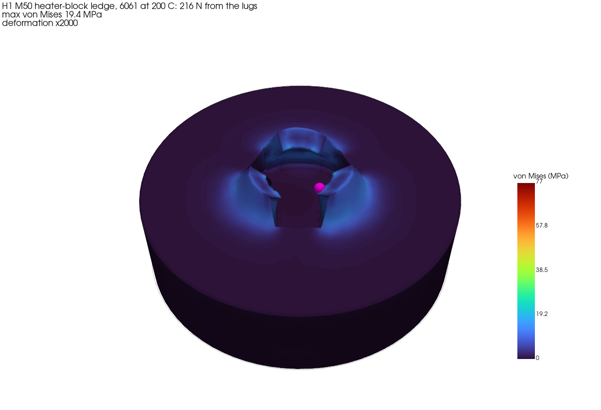
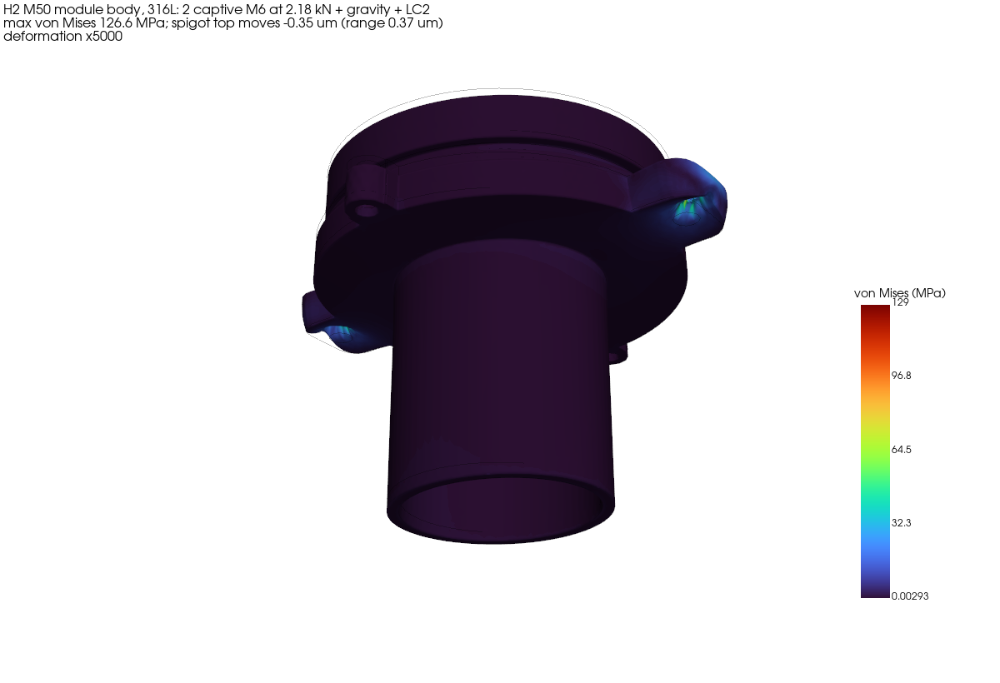

# CalculiX checks of the hot-swappable joints

Generated by [`analysis/hotswap/hotswap_fea.py`](../../hotswap/hotswap_fea.py) from the model at commit 1c7a977. C3D10 (gmsh), ccx, SPOOLES. Contact is modelled as compression-only prescribed supports, solved by an active-set loop (no contact elements).

## H1 M50: bayonet lugs and ledge, 6061 at 200 °C (E 62 GPa), preload 216 N

| case | peak von Mises, MPa | in the lugs, MPa | vs 103 MPa (204 °C, 10,000 h) / 77 MPa (225 °C) | top-face flatness change, µm | plate face in contact |
|---|---|---|---|---|---|
| plate, preload | 42.9 | 42.9 | 2.40 / 1.79 | 0.23 | 16 % |
| plate, preload + 50 N strike | 42.9 | 42.9 | 2.40 / 1.79 | 1.40 | 16 % |
| block ledge | 19.4 | – | 5.30 / 3.96 | – | – |

## H1 L75: bayonet lugs and ledge, 6061 at 200 °C (E 62 GPa), preload 530 N

| case | peak von Mises, MPa | in the lugs, MPa | vs 103 MPa (204 °C, 10,000 h) / 77 MPa (225 °C) | top-face flatness change, µm | plate face in contact |
|---|---|---|---|---|---|
| plate, preload | 107.1 | 107.1 | 0.96 / 0.72 | 0.68 | 7 % |
| plate, preload + 50 N strike | 107.1 | 107.1 | 0.96 / 0.72 | 2.05 | 7 % |
| block ledge | 46.1 | – | 2.23 / 1.67 | – | – |

## H2 M50 module body (316L) on the chamber floor, gravity + LC2

| hold | peak von Mises, MPa | in the flange, MPa | vs S_y 170 (316L) | spigot top moves, µm (mean / range) | contact |
|---|---|---|---|---|---|
| 2 captive M6, 2 × 2,182 N | 126.6 | 126.6 | 1.34 | -0.35 / 0.37 | 35 % of the flange face; max gap 0.50 µm |
| 3-groove kinematic seat, 218 N per ball | 27.5 | 27.5 | 6.19 | -0.10 / 0.33 | 3 balls (axial + tangential fixed) |

