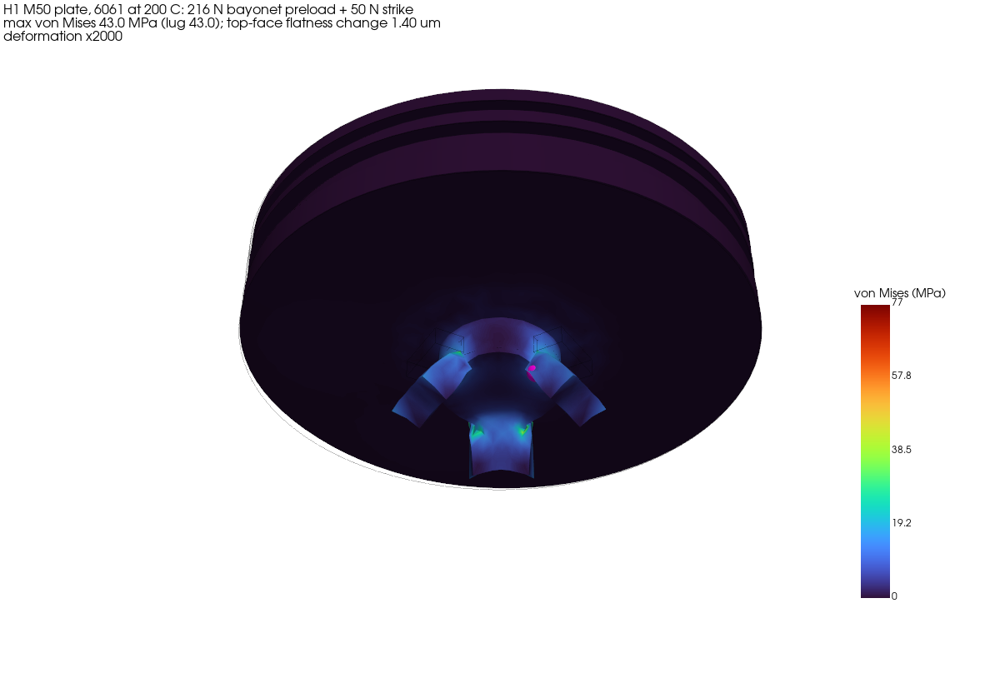
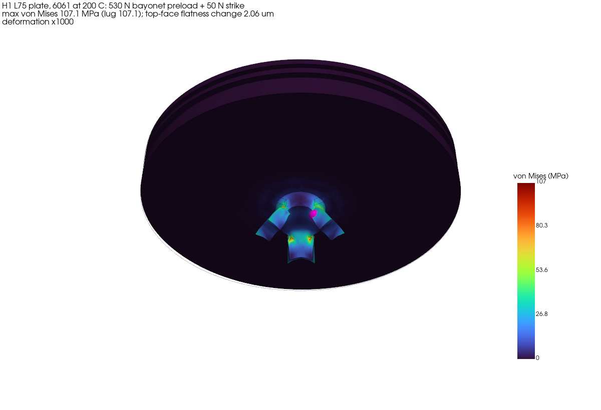
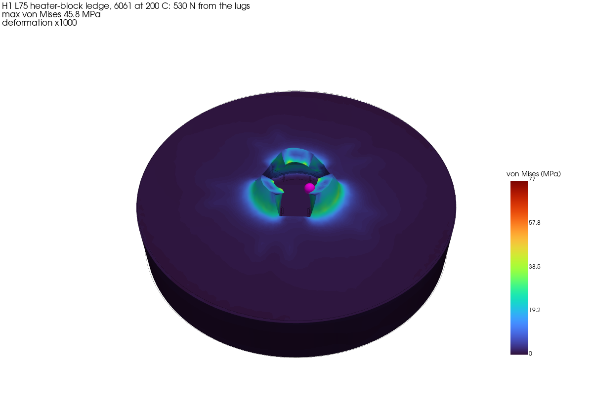
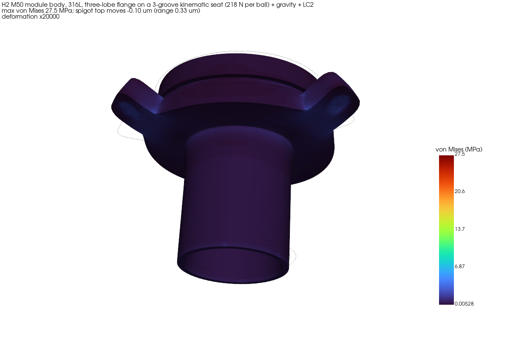

# CalculiX checks of the hot-swappable joints

Generated by [`analysis/hotswap/hotswap_fea.py`](../../hotswap/hotswap_fea.py) from the model at commit 9f45d80. C3D10 (gmsh), ccx: SPOOLES up to 60,000 nodes, ITERATIVE CHOLESKY above (the module body and the heater blocks). Contact is modelled as compression-only prescribed supports, solved by an active-set loop (no contact elements).

## H1 M50: bayonet lugs and ledge, 6061 at 200 °C (E 62 GPa), preload 216 N

| case | peak von Mises, MPa | in the lugs, MPa | vs 103 MPa (204 °C, 10,000 h) / 77 MPa (225 °C) | top-face flatness change, µm | plate face in contact |
|---|---|---|---|---|---|
| plate, preload | 43.0 | 43.0 | 2.39 / 1.79 | 0.23 | 16 % |
| plate, preload + 50 N strike | 43.0 | 43.0 | 2.39 / 1.79 | 1.40 | 16 % |
| block ledge | 18.8 | – | 5.49 / 4.10 | – | – |

Against the run on the model at 1c7a977: lugs 42.3 → 43.0 MPa, flatness change with the strike 1.38 → 1.40 µm, ledge 19.2 → 18.8 MPa.

## H1 L75: bayonet lugs and ledge, 6061 at 200 °C (E 62 GPa), preload 530 N

| case | peak von Mises, MPa | in the lugs, MPa | vs 103 MPa (204 °C, 10,000 h) / 77 MPa (225 °C) | top-face flatness change, µm | plate face in contact |
|---|---|---|---|---|---|
| plate, preload | 107.1 | 107.1 | 0.96 / 0.72 | 0.68 | 7 % |
| plate, preload + 50 N strike | 107.1 | 107.1 | 0.96 / 0.72 | 2.06 | 7 % |
| block ledge | 45.8 | – | 2.25 / 1.68 | – | – |

Against the run on the model at 1c7a977: lugs 107.1 → 107.1 MPa, flatness change with the strike 2.05 → 2.06 µm, ledge 46.1 → 45.8 MPa.

## H2 M50 module body (316L) on the chamber floor, gravity + LC2

| hold | peak von Mises, MPa | in the flange, MPa | vs S_y 170 (316L) | spigot top moves, µm (mean / range) | contact |
|---|---|---|---|---|---|
| 2 captive M6, 2 × 2,182 N | 131.0 | 131.0 | 1.30 | -0.35 / 0.38 | 36 % of the flange face; max gap 0.51 µm |
| 3-groove kinematic seat, 218 N per ball | 27.5 | 27.5 | 6.19 | -0.10 / 0.33 | 3 balls (axial + tangential fixed) |

Against the run on the model at 1c7a977 (before the module body's welded bottom collar and the wider spigot groove): flange 126.4 → 131.0 MPa with the screws, 27.5 → 27.5 MPa on the kinematic seat; spigot top -0.35 → -0.35 µm.

