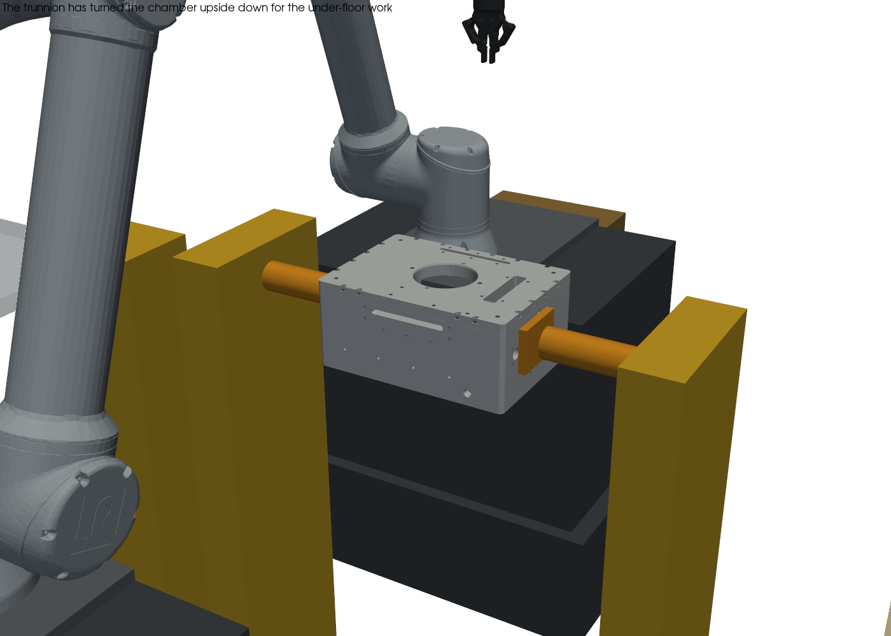
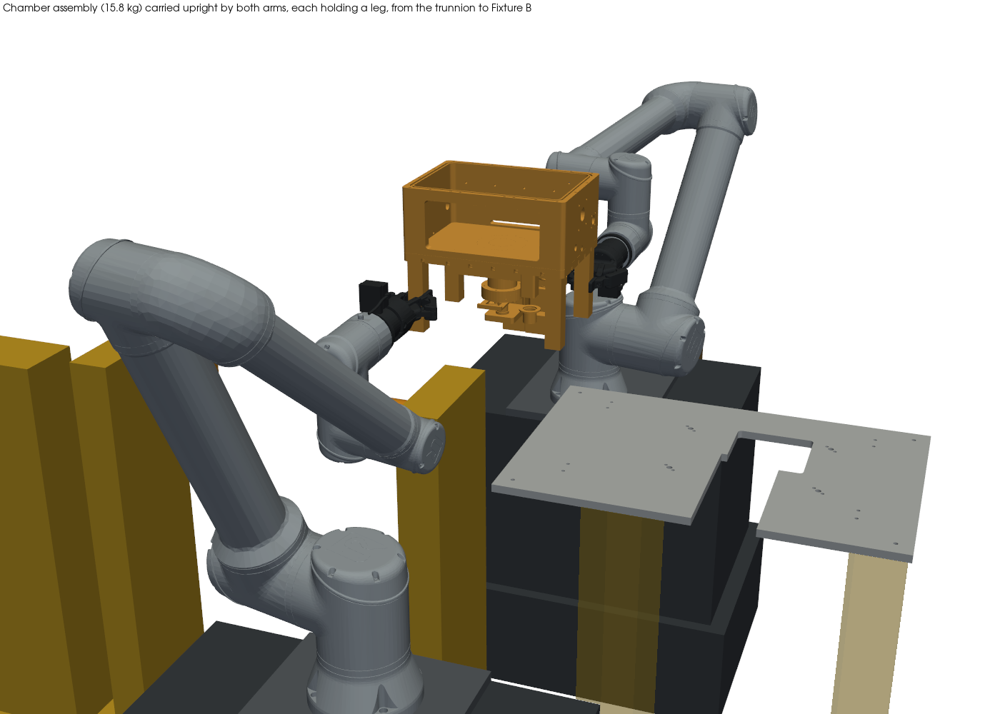
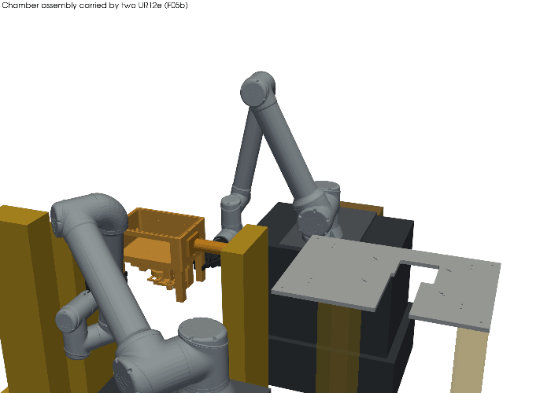
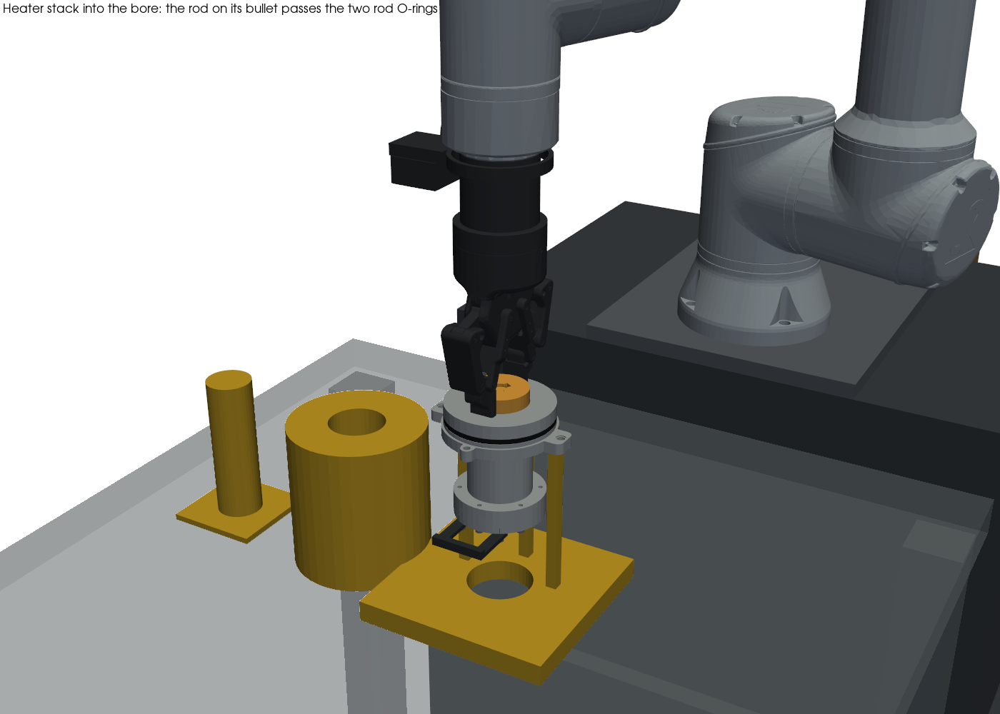
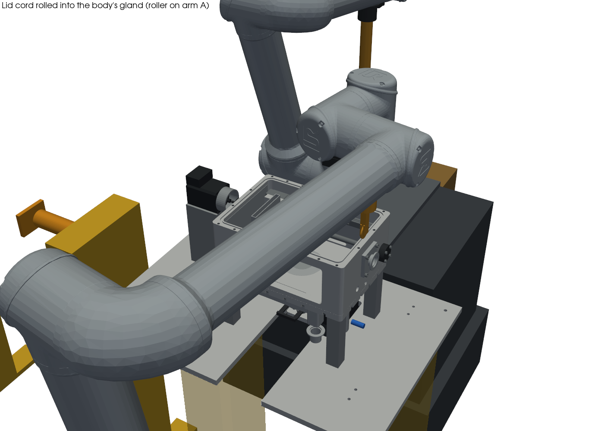
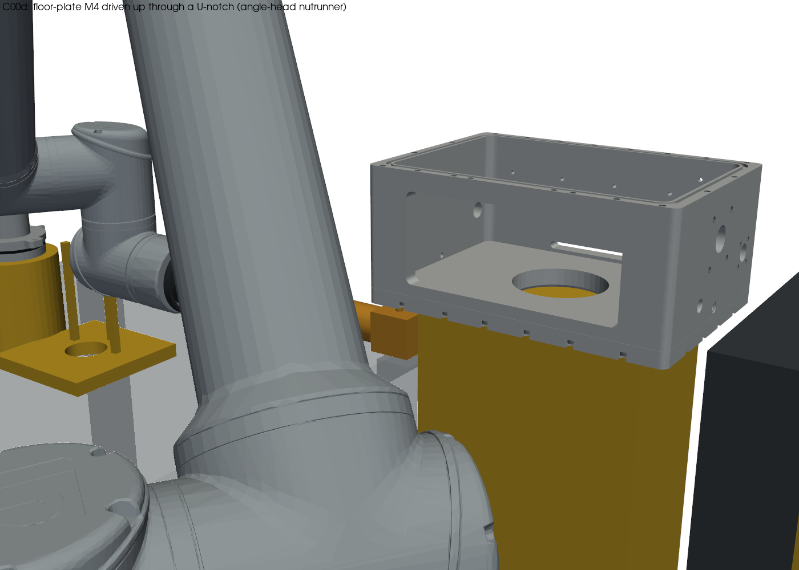
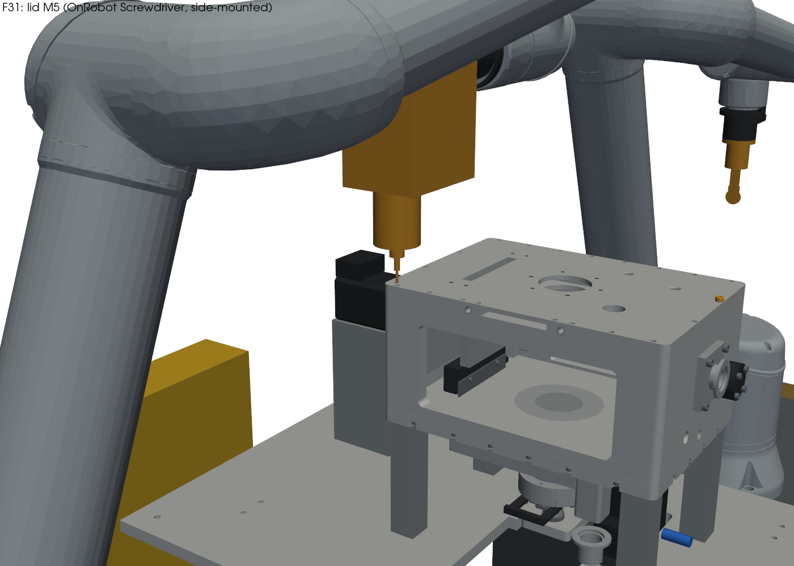

# Assembling the desktop LPBF with two UR12e arms: the sequence, collisions in motion, the seals and the forces

Written 2026-11-20 for [PR #266](https://github.com/vertical-cloud-lab/digital-alloy-lab/pull/266) (issue #260). It answers
two comments on the [build animation](build-sequence.md):
- a BYU machinist: "Some of those gaskets might be hard to get on ... the animation was not worried about space and collisions";
- sgbaird: "have a set of two UR12e-s do the fine-detail assembly ... knowing that creation and use of additional tooling is fine. Also address the point about collisions rather than just space. Be thorough".

The cell follows [byu-vcl PR 318](https://github.com/vertical-cloud-lab/byu-vcl/pull/318) (round 14, commit 11d4410), through [`analysis/robot/cell.py`](analysis/robot/cell.py).

Nothing here has been built or tried on hardware. The numbers come from the model, from the sources cited, or from estimates, which are labelled as such. The model is `cad/lpbf_low.py` with the M50 module. It includes:
- the chamber change of [chamber-construction.md](chamber-construction.md): a through-frame and a bolted floor plate with a second 3.53 mm cord;
- for run 2, two items from this note's patch list: the lid gland's R13 corners and the floor port's lead-in.

## Result

**Two UR12e arms can do most of the fine assembly, given a turn-over positioner, three drivers and a few custom tools.** What still fails comes down to:
- four design patches (rod end, dowels, locating pins, door);
- a handful of step and path fixes this run found but did not re-run;
- three seal-seating or threading steps that a straight-line check can't show.

The check covers 117 steps from chapters 3-5 and 135 screws in 23 joints, which is every screw the model draws for chapters 3-4 except the reservoir's own two lid screws. Each step is checked in motion: the part swept along its path, both arms checked frame by frame on a planned approach, and the 1.5 mm audit.
- **Run 1** (2026-11-20 23:13 UTC) was the first sequence.
- **Run 2** (2026-11-21 00:51 UTC) came after the patches the model took and the cell and sequence fixes below.
- Both runs used the model after its chamber change: a through-frame and a bolted floor plate with a second 3.53 mm cord. Run 2's model also has the lid gland at R13 and the floor port's 20° × 2.5 mm chamfer.

| | Run 1 | Run 2 |
|---|---|---|
| Build module (chapter 3): parts, seals, turn-overs | 17 pass, 3 fail | **19 pass, 1 fail** (the welded rod end) |
| Chamber and under-floor work | 12 pass, 1 fail | **14 pass, 1 fail** |
| Upright work on Fixture B | 18 pass, 22 fail | **30 pass, 14 fail** |
| All checked steps (screws and person-only steps not counted) | 47 pass, 26 fail | **63 pass, 16 fail** |
| Screws driven on a planned, collision-free approach | 91 of 135 | **118 of 135** |
| Screws whose drive itself is clear (tool on the screw, all the way in) | 118 of 135 | **121 of 135** |
| Steps for a person or the machine shop | 16 | 16 (unchanged: inserts, felt seal, lead and fibre routing, KF clamp, threaded ports, lens, guard, door latches, chapter 5) |

**What changed between the runs, and what it fixed:**
- **A trunnion positioner in place of both two-arm turn-overs.** Two stands, an axis 1000 mm up, and jaws on the chamber's side walls.
  - In run 1 both turn-overs failed: arm B's forearm hit its own gripper (C01), and its upper arm hit its own tool stand (F05).
  - Now the arms only carry the chamber the right way up: 7.4 kg into the jaws (C01), and 15.8 kg by two legs across 1.0 m onto the base plate (F05b), lifted 320 mm to clear the stands.
  - The trunnion's two 180° turns pass the mover check. The jaws open before the arms lift.
- **Fixture B is now two columns under the base plate,** and **the tool stands hang below the cabinet tops.** The base plate's carry (F01) passes.
- **Order changes:**
  - The Z flange goes on alone, its four M5 driven, then the actuator; C13 now passes 4/4 (0/4 before).
  - The optics posts go on after the side-wall parts and the draw latches. F22 (the Ferrotec feedthrough) and F50 (the right draw latch's way in) now pass.
  - The recoater rail goes on with its carriage, block, nut and arm, as bought. The ball screw comes in alone (F21 passes).
- **Tools:**
  - the vacuum gripper for the Ø100 window flange and retaining ring and the galvo riser (F33b, F37b and F56 now pass);
  - a small-part vacuum nozzle for the Macor rings, shields and disc springs (M05 and M07 now pass);
  - a 130 mm extension for the captive M6.
- **Approach planning for upward screws.** 1000 RRT iterations, a pre-approach slid out from under the plate, and a restart from park when a retreat leaves the arm touching. The 18 floor screws went from 3 to 17 planned.
- **A bookkeeping bug fixed.** While iterating, a screw could be left on the other arm's bit after a failed fallback attempt, which spoiled the next two-arm carry. Run 1 had no fallback, so it wasn't affected.

**What still fails (run 2), by cause.** Patch numbers refer to the list at the end.

- **Needs a design patch:**
  - M25, the rod end welded to the rod: patch 1.
  - F14, F16, F23: the inlet plenum, the vacuum-port adapter and the bearing cap can't be held by one arm while the other screws them. In F16 and F23, B's driver meets A's holding wrist; in F14, A can't reach behind the back wall. Patch 9, two locating pins per flange, removes the holding.
  - C02 passes the motion check, but the dowels' 1.6 kN press is 11 × what the arm can push there (149 N): patch 4.
- **Needs a step or path fix this run found but did not re-run:**
  - **C12:** the Z flange's fingers meet the module's gland plate. Fit the flange before the module.
  - **F27:** the blade's two M3 sit 11-17 mm above the floor, too low for any of the three drivers. Screw the blade into its holder on the bench.
  - **F54:** grasp the bridge between the posts, not over post 1.
  - **F25, F56b, F57:** use shorter approach paths (the motor bracket, the galvo, the beam parts). Their animation paths start out of reach or, in this layout, inside the trunnion's stand.
- **Needs a different tool shape:** F11, the LED bar 1 mm from the wall. The VGC10's 100 mm body hits the frame, so it needs a slim side-mounted nozzle.
- **Not settled by this check:**
  - **F26:** the blade holder can't pass the door's 8 mm sill. It has to go in through the frame's open bottom before the floor plate, which is not modelled here.
  - **F48b:** the camera window's 2-017 can't be laid straight into its seat in the boss as drawn; check the seat for an undercut.
  - **F45:** the roller feedthrough is threaded, so a straight sweep can't show it going in.
  - **C11:** the check counts the captive M6 against its own retainer, which holds it captive by design.
- **Planning budget:** one screw each in C00d, F06 and F03, out of 34 driven upward. Their drives are clear; their approaches weren't found in 1000 iterations.
- **Cell, still:** in F18 one rail screw's driving arm meets the base plate's edge (3 of 4), and in F52 the hinge pins, slid in from the right, put arm A's upper arm into its own cabinet.

**Collisions, not just space.** On the way in, the tightest gaps are:

| Step | Gap | Where |
|---|---|---|
| rod in the head (M10) | 0.02 mm | |
| stack in the bore (M22) | 0.03 mm | the rod passing the gland plate |
| heaters (M03) | 0.05 mm | Ø6.1 bores |
| spigot mandrel's sleeve (M20) | 0.05 mm | over the Ø95.8 spigot |
| module into the port (C10) | 0.05 mm | |
| dowel (C02) | 0.05 mm | |

- The arms' tightest clearance to anything they may not touch is 0.0-0.1 mm: fingers beside seated parts.
- The rollers run 0.9-1.1 mm from the gland walls.
- 16 parts are let go 6-39 mm short of their seat and pushed home with the closed fingers. Two Macor rings drop the last 6-9 mm onto their guide pins.

**Seals.**
- **Stretch.** Installed stretch is 1.4-2.7 % for every ring; Parker allows 5 %. The most stretch while fitting is 18.6 %.
- **Rod rings.** The two 2-114s, folded through the Ø15.93 throat at about 34 % bending strain, remain the riskiest seal step.
- **Lid gland.** Its corners are now R13 in the model, so its corner strain drops from 29 % to 12 %. A moulded 2-277 would fit it at +2.8 % (2.2-3.4 % over tolerance), and the floor gland at +1.7 %. The floor port now has its lead-in.

**Forces and tip-over.**
- **Push.** At the force steps' poses the arms can push 113-191 N downward (149 N at the dowels, 119 N at the spigot), using the corrected link-mass torques.
- **Too much for the arm:** the spigot's 328 N break-out (the captive M6 pull it home), the dowels' 1.6 kN, and the door latches' 725 N.
- **Tip-over.** Every load the arms carry keeps the MiR's restoring / overturning moment at 5.8 or more. A robot pressing a dowel would tip it (0.5).


## Renders

Rendered offscreen by [`render_assembly.py`](analysis/assembly/render_assembly.py) from run 2's own snapshots: the same arm poses, tools, held parts and placed parts the checks used. The cell overview is under [The cell](#the-cell).

| | |
|---|---|
|  |  |
| C01b: the trunnion has turned the chamber (frame + floor plate) upside down. The jaws clamp the side walls 10 mm above the turn axis. The under-floor work then goes on from above. | F05b, halfway through the 1.0 m carry: the 15.8 kg chamber assembly, back upright, held by both arms by two legs on its way from the trunnion to the base plate on Fixture B. |
|  |  |
| F05b: the two-arm carry from the trunnion to Fixture B, every few frames of the checked path. | M22: arm B lowers the heater stack into the module bore. The plate-to-bore gap is 0.03 mm. The rod on its PEEK bullet passes the two 2-114 rod rings, and B lets go 39 mm short and pushes it home. |
|  |  |
| M20: the spigot's 2-238 goes on over the acetal mandrel. Arm A strokes the pusher down, and the sleeve clears the spigot by 0.05 mm. | C10: the finished module goes down into the floor port of the upside-down chamber in the trunnion, with 0.05 mm clearance at the spigot. Its captive M6 then pull the seal home. |
|  |  |
| F29: arm A rolls the lid cord into the frame's gland, working over the chamber between the optics posts (1.0 mm from the gland walls). Arm B does the back half. | C00d: a floor-plate M4 driven up through its U-notch, with the plate on Fixture P. The angle head keeps the wrist 250 mm to the side. 17 of 18 are planned (3 in run 1). |
|  |  |
| F06: a base-plate-to-leg M6 driven up from under the base plate on Fixture B (now two columns) by the angle-head nutrunner. 7 of 8 are planned; all 8 drives are clear. | F31: a lid M5 driven by the side-mounted OnRobot Screwdriver. All 20 pass, with 2.6 mm to spare. |
|  |  |
| F18: a recoater-rail M4 driven from inside the chamber toward the back wall by the angle-head nutrunner (3 of 4). The OnRobot's body does not fit inside the 190 mm deep chamber. |  |

## How it was checked

Everything is in [`analysis/assembly/`](analysis/assembly/). One command re-runs it on whatever `cad/` holds (16 min for run 2, on a shared 4-core runner):

```bash
OMP_NUM_THREADS=1 /tmp/capmem 3 /tmp/venv/bin/python desktop-lpbf/analysis/assembly/run_assembly.py     # the build, step by step
/tmp/venv/bin/python desktop-lpbf/analysis/assembly/seals_forces.py                                    # seals, forces, tip-over
/tmp/venv/bin/python desktop-lpbf/analysis/assembly/report.py                                          # steps.md, sequence.json, push.json
xvfb-run -a -s "-screen 0 1600x1200x24" /tmp/venv/bin/python desktop-lpbf/analysis/assembly/render_assembly.py
```

| File | What it does |
|---|---|
| [`cell2.py`](analysis/assembly/cell2.py) | The cell: two UR12e on MiR250s, the bench, the fixtures and the tool stands. It imports [`../robot/cell.py`](analysis/robot/cell.py) (byu-vcl PR 318's arm, 2F-85, D405, FCL bodies, IK branches, RRT-Connect, 1.5 mm audit) and adds an automatic tool changer, so the arm can carry the 2F-85, a screwdriver, a nutrunner, a vacuum gripper or a roller. The D405 stays on the arm side of the changer. Each arm's world includes the other arm, with its tool and whatever it holds. |
| [`tooling.py`](analysis/assembly/tooling.py) | Dimensioned CadQuery CAD of the custom tools and fixtures, exported as STEP to [`out/assembly/tooling/`](analysis/out/assembly/tooling/). The bought tools are drawn at their published sizes. |
| [`sequence.py`](analysis/assembly/sequence.py) | The build order: every part and fastener of chapters 3-5 and `joints.py`. For each step it gives the insertion path, the tool, which arm acts and which holds. |
| [`run_assembly.py`](analysis/assembly/run_assembly.py) | The checks below, step by step |
| [`seals_forces.py`](analysis/assembly/seals_forces.py) | Ring stretch, moulded rings in rectangular grooves, chamfers, dovetail insertion, friction, forces and tip-over |
| [`report.py`](analysis/assembly/report.py), [`render_assembly.py`](analysis/assembly/render_assembly.py) | The tables, the replay file for `render_build.py`, the renders |
| [`out/assembly/`](analysis/out/assembly/) | Outputs:<ul><li>[`results.json`](analysis/out/assembly/results.json): every check, and every screw;</li><li>[`steps.md`](analysis/out/assembly/steps.md): the table below;</li><li>[`sequence.json`](analysis/out/assembly/sequence.json): for `render_build.py` to replay. Per step: the parts' exact `Part.name`s, insertion waypoints relative to the final pose in model coordinates ending at [0, 0, 0] (4 × 4 poses for the turn-overs), the tool (and the joint key for screws), the arm, the clearance, pass/fail, and for rings the fitting method;</li><li>[`seals_forces.json`](analysis/out/assembly/seals_forces.json);</li><li>[`push.json`](analysis/out/assembly/push.json);</li><li>[`tooling/*.step`](analysis/out/assembly/tooling/): the custom tools.</li></ul> |

Each step gets three checks:

1. **Part sweep.** The part travels its insertion path against everything already in its sub-assembly. This reuses `analysis/ops/checks.path_check`: FCL on 0.1 mm meshes, sampled every 1 mm. A contact only counts as a block when manifold3d finds more than 0.5 mm³ shared and OpenCascade's exact boolean confirms it. The check reports the smallest gap along the way.
2. **Arms, frame by frame.** The actor's MiR docks at a station and may slide along the bench. Its TCP then follows the part's path:
   - IK every 3 mm, all on one branch (a joint jump over 20° counts as a fail);
   - FCL every frame, for the links, the tool, the D405, the changer and the held part, against the cell, every part present and the other arm;
   - the move to the start of the path planned with `cell.Checker.plan`: the straight joint line, otherwise RRT-Connect with 1.5° edge checks.

   The part and the tool may touch the part's own seat only up to 1.5 mm deep (byu-vcl PR 318's round-11 rule). A part whose fingertips would reach its seat is let go short of it and pushed home with the closed fingers ("released N mm short" in the table), and the push is checked too.
3. **Screws.** Each screw rides on the driver's bit from the mouth of its hole to its seat. The check tries 12 roll angles about the screw axis and every IK branch, checks the drive frame by frame, plans the move there, and checks that the screw's own axis line is clear (`checks.withdraw_check`). The driver is chosen per screw:
   - the OnRobot Screwdriver, which works downward or sideways only, up to 5 N m;
   - otherwise the inline nutrunner.

Flips and two-arm carries are checked the same way along the part's whole path (lift, turn, move, lower), with both arms' IK and collisions at every frame. The trunnion's turn is checked as a mover, as in byu-vcl PR 318: 37 frames of the turning chamber and jaws against the cell, everything placed and both parked arms.

What is not simulated: the elastomer's own shape while it is stretched or rolled (the tools are checked, not the rubber), cables and hoses, the pick side of each step (kitting trays), and the MiR's own driving.

## The cell


- **Arms.** Two UR12e arms, each with a 2F-85 and a D405, on MiR250s with 480 mm cabinets, so each arm's base is 800 mm above the floor. These are byu-vcl PR 318's arms. Arm A docks on the front of the bench (y < 0) and arm B on the back. Each MiR slides along x to line up with a station, as PR 318's MiR drives along the VLM opening. Each arm base sits 240 mm off the bench edge.
- **Bench and stations (run 2).** The bench is 800 × 800 mm, top at 760 mm, and carries the module nests. The rest stands on the floor:
  - **Fixture P,** a 240 × 150 column that holds the floor plate 1000 mm up, so the arms reach under its edges.
  - **The trunnion,** a turn-over positioner: two stands, an axis along x 1000 mm up, and two jaws that clamp the chamber's side walls 10 mm above the axis. Something like a geared stepper with a brake would drive it. In run 2 it turns the chamber upside down for the under-floor work and back upright. Run 1 tried both turn-overs with the two arms alone, and both failed.
  - **Fixture B,** two 120 × 200 columns under the process base plate. They are clear of the legs' and posts' base screws and of the Z actuator, and nothing stands beside or above the plate. Run 1's end frames blocked the right-wall screws.
- **Tool changer.** Each arm has an ATI QC-21 automatic changer: 25 kg, Mxy 56.5 N m, 42.4 mm coupled, plus about a 16 mm UR plate. The QC-11 is lighter (0.245 kg, 36.1 mm), but it is rated only 20.3 N m in Mxy. The two-arm lifts below put up to about 15 N m on each wrist, which leaves the QC-11 too little margin. The D405 clamps to the changer's master side, so it stays on every tool.
- **Tool stand.** Each arm has one hung on its cabinet's far face, below the cabinet top, as PR 318 keeps finger sets on a stand on the MiR. Each stand holds that arm's set of tool plates. In run 1 the stand sat on the cabinet top behind the arm base, where arm B's upper arm hit it during the second turn-over.

| Tool | On | Used for | Published numbers (fetched 2026-11-20 UTC) |
|---|---|---|---|
| Robotiq 2F-85 | both arms | parts, flips, two-arm carries, hand tools (mandrel, pusher, loader) | 85 mm stroke, 20-235 N, 0.925 kg; pads 38 × 22 mm ([manual](https://blog.robotiq.com/hubfs/support-files/2F-85_2F-140_General_PDF_20210623.pdf), 22:24) |
| 2F-85 pin caps (custom) | either | small rings (internal two-point grip), Macor rings, disc springs | 2 mm wall over the pad, Ø2 × 6 mm pin |
| OnRobot Screwdriver | A | M3-M5 screws driven down or sideways | 0.15-5 N m, M1.6-M6, 2.5 kg, 308.5 × 86 × 114 mm, side-mounted. Downward or sideways only. Magnetic screws only ([datasheet v1.7](https://onrobot.com/storage/datasheets/screwdriver/datasheet_screwdriver_v1.7_en), 22:18) |
| Inline nutrunner (Kolver PLUTO 10 class) | either | M6 driven down (7.4 N m), and M4-M5 where the OnRobot's body doesn't fit | 1.5-10 N m, 0.5 kg (Brera 2022, via [Edison r3](edison/r3-robot-oring-assembly/answer.md)). The Ø40 × 250 mm envelope is an estimate. |
| Angle-head nutrunner (Atlas Copco / Kolver angle-head class) | either | every screw driven upward: the 18 floor-plate M4, the 8 post-base and 8 leg-base M6 | 0.5-10 N m class. The envelope is an estimate: Ø40 × 230 mm body, 90° head 44 × 40 × 46 mm. An inline driver pointing up puts the wrist under the arm base and into the pedestal; this one keeps the wrist 250 mm to the side. |
| OnRobot VGC10 | A | the floor plate, the lid, the wall liners; the Ø100 window flange and retaining ring, the 155 × 130 galvo riser and the galvo (run 2) | 0.814 kg; 100 × 100 × 101.5 mm; 6 kg on its standard cups, up to 15 kg on custom ones ([datasheet](https://onrobot.com/storage/datasheets/vgc10/datasheet_vgc10_v1.7_en.pdf), 22:24) |
| Small-part vacuum nozzle (custom, on the VGC10) | A | the 9 Macor rings, 2 shields, 3 disc springs, the LED bar (run 2) | Ø5 × 60 mm stem, Ø6 cup |
| Trunnion positioner (custom) | floor | both chamber turn-overs (run 2) | stands 90 × 260 mm, axis 1000 mm up, Ø50 shafts, 12 × 90 × 70 mm jaws |
| Roller (custom) | A | the lid and floor cords; the door and drawer cords on their nests | Ø30 PTFE wheel on a sprung fork with 15 mm travel and 8-25 N. A 3.2 mm wheel for the 3.53 mm cord, a 1.4 mm wheel under a half-dovetail lip. |
| Spigot mandrel and pusher (custom) | B, A | the 2-238 on the spigot | acetal. The cone runs Ø96.7 to Ø82 over 40 mm; a 0.45 mm sleeve covers the spigot's top edge. |
| Rod bullet (custom) | on the rod | the rod through the two 2-114 rings | PEEK, 15° nose, Ø8 bore for the leads |
| Ring loader (custom) | A | the 2-114 rings into the gland plate's internal grooves | slotted tube, Ø15.6 OD, through the Ø15.93 throat |

The vendor rows of [`assembly-tooling.csv`](assembly-tooling.csv) have every source and its fetch time; the custom rows give a dimensioned spec and an estimated price. No vendor publishes a price for the arms, the changer, the screwdriver or the VGC10.

### Where the arms are, and how sure

- **Docking.** The MiR250 docks to a VL marker within ±3 mm and ±0.5° (MiR's [spec page](https://mobile-industrial-robots.com/it/prodotti/robot/mir250/specifiche), 22:37). After docking, the wrist D405 reads an AprilTag cube on each fixture, as PR 318's arms do.
  - AprilTag 36h11 measured 0.39 mm and 0.77° at 10-50 cm ([DeepTag, Table 2](https://arxiv.org/abs/2105.13731), 22:39). That figure is the error of a measured 10 cm displacement, not an absolute pose.
  - So after re-registration a part lands within roughly 0.4-1 mm (an estimate). Over a 300 mm part, the 0.77° grows to about 4 mm at its far end, so long parts (lid, frame, bridge) need two tags or a touch-off in force mode.
- **Repeatability.** The UR12e repeats to ±0.05 mm (UR datasheet, 22:32).
- **What that is enough for:**
  - Screws: the OnRobot tolerates up to 0.5 mm of pre-mount error.
  - Clearance holes: ISO 273 medium gives 0.3-0.5 mm a side.
- **What it is not enough for:**
  - the plate in its bore (0.15 mm radial);
  - the spigot in the port (0.10 mm);
  - the H7 dowels (0-0.012 mm).

  Those need a lead-in chamfer and a force-guided spiral search in force mode, as SDU's two-UR10e WRC 2018 cell did (Edison r3 §4.2). The UR's F/T sensor reads ±100 N to ±5.5 N.

### Tip-over (MiR250 94 kg, 131 kg ballast, 30 kg cabinet structure (estimate), 12 kg UR control box, 33.5 kg arm)

The check takes the restoring moment about the MiR's near edge (half its 580 mm width) and divides it by the overturning moment of the payload at reach plus any push at its height. The arm's own mass is lumped at its base. That is an underestimate of the overturning moment when the arm stretches out, so the margins below are upper bounds.

| Case | Payload per arm | Push | Restoring / overturning |
|---|---|---|---|
| chamber assembly, two arms (15.8 kg / 2) | 7.75 kg | 0 N | 14.4 |
| optics bridge with lens and ring, two arms (14.3 kg / 2) | 6.65 kg | 0 N | 14.8 |
| 8.1 kg on one arm (more than any single-arm lift in the sequence) | 8.1 kg | 0 N | 18.9 |
| 12.5 kg at 1300 mm (rated payload at full reach) | 12.5 kg | 0 N | 5.8 |
| reservoir push home 94 N, sideways at 1.25 m | 0.5 kg | 94 N | 6.7 |
| dowel press 1.6 kN (if a robot tried) | 0.0 kg | 1644 N | 0.5 |

MiR publishes a centre-of-mass ceiling for the payload when it drives at 1.2 m/s: 860 mm above the floor for 200 kg. The arm, cabinet, box and ballast here put it at about 480 mm (an estimate). So the cell can drive between stations with the arm folded.

## The sequence, and why it differs from the animation

The robot sequence ([`sequence.py`](analysis/assembly/sequence.py)) keeps the animation's sub-assemblies (render_build.py chapters 3-5), but it changes the order and which way up each part sits. The rule behind every change: every screw is driven from above or from the side, every part goes onto something it can rest on, and nothing heavier than about 8 kg rests on one arm.

1. **Heater stack, built upside down on a pedestal nest.** In order:
   - the block, bayonet face down;
   - the heaters, thermocouples, cutoff, Macor rings and shields, all dropping in from above;
   - the piston head;
   - the disc springs;
   - the three M3 stack screws, driven down;
   - the rod, into the head's socket;
   - its two radial set screws.

   Arm A then turns the stack over in its wrist (a 180° roll about the tool axis, 320 mm above the bench) and hands it to arm B. B takes it by the heater block from above, with its fingers crossed at 90° to A's.
2. **Module body, built upside down on its spigot face.** In order:
   - the gland plate with its 2-034 face ring (held by the PFPE film);
   - six M4, driven down;
   - the handle and its two M4;
   - the two 2-114 rod rings, folded through the throat by the loader.

   Arm A then turns the body upright onto a three-post nest. Next:
   - the 2-238 goes on over the mandrel;
   - arm B lowers the stack into the bore on the PEEK bullet, the rod passing down through both rod rings;
   - arm A drops the plate in at +8 mm overtravel and gives it the 60° bayonet turn.

   A turns the module over again for the rod end and the striker's three flat-head M3.
3. **Chamber (frame + floor plate).**
   - **On Fixture P.** The plate goes face up on Fixture P, a floor-standing pedestal, and the floor cord is rolled into its gland. Both arms lower the frame onto the plate's two dowels. The 18 M4 floor screws go up through the U-notches with the angle-head nutrunner.
   - **Into the trunnion (run 2).** Both arms carry the 7.4 kg chamber upright into the trunnion's jaws. The trunnion turns it upside down, with both arms parked.
   - **Under-floor work, all from above.** The parts go on in this order:
     - the module's dowel and diamond pin;
     - the outlet plenum and the overflow funnel, each with its face ring held by a PFPE film, and their M4;
     - the module-present sensor;
     - the whole module, down into the floor port. Its two captive M6 pull the spigot seal home; they are driven on a 130 mm extension so the driver clears the gland plate.
     - the Z flange alone and its four M5, then the actuator, belt fold and servo on it;
     - the four legs, each with one M6 down its Ø11 bore on a 150 mm extension.
4. **Base plate on Fixture B.** Both arms carry the 12 kg base plate onto Fixture B's two columns.
5. **Back upright, and across (run 2).**
   - The trunnion turns the 15.8 kg chamber assembly back upright, then opens its jaws.
   - Both arms each take a leg and carry the assembly straight across onto the base plate.
   - The eight base-plate-to-leg M6 then go in from below.
6. **Everything else goes on upright, from above or the side.** Run 2's changes are marked "run 2".
   - The jar.
   - The LED bar before the liners, with the nozzle (run 2).
   - The liners.
   - The inlet plenum, held by A while B drives its M4 into the back wall.
   - The vacuum port.
   - The recoater, as a rail unit, for which the closed chamber needs a new path (run 2):
     - the rail goes on with its carriage, carriage block, ball nut and arm already on it, as bought;
     - the ball screw comes in alone through the right wall's bore and turns through the nut;
     - the blade holder comes in through the door opening.
   - The feedthrough and the bearing cap.
   - The gas knife and the chute.
   - The lid cord, rolled by A (front half) and B (back half), then the lid on the vacuum gripper and its 20 M5.
   - The window stack: the flange and the retaining ring on the vacuum gripper (run 2).
   - The drawer.
   - The metering base, screwed down before its feedthrough covers two of its screws, then the dosing parts and the reservoir.
   - The camera, in its own order: adapter, window O-ring, window, flat ring, retaining ring.
   - The hinges and latches, the door, the hinge pins.
   - Then the optics posts (run 2, moved here from before the turn-over). Arm B holds each post while arm A drives its M6 from below.
   - The 14.3 kg bridge, by both arms, and its eight M6.
   - The galvo riser and the galvo, both on the vacuum gripper (run 2), and the beam path.
7. **People and the machine shop.** These are listed in the step table with a reason for each:
   - the helical inserts;
   - lead and fibre routing;
   - the bore seal (felt);
   - the KF-40 wing-nut clamp;
   - the SAE-4 threaded ports;
   - the f-theta lens (Ø90, threaded);
   - the guard;
   - the draw latches;
   - chapter 5: the 84 kg module onto the tray, the rack and gas units of 23-40 kg, the hoses and the dock.

## Step table

Generated by `report.py` from `run_assembly.py`. Sweep: the part along its insertion path against what is already in its sub-assembly (FCL on 0.1 mm meshes, OpenCascade booleans to confirm a block); gap = smallest clearance on the way. Arm: IK at every 3 mm of the path on one branch, FCL each frame for both arms, tools, D405, changer and held part, the approach planned (RRT-Connect), 1.5 mm depth limit at the seat (byu-vcl PR 318). Clearance = smallest distance from the tool, wrist, forearm and held part to anything they are not meant to touch.

| Step | What | Tool | Arm | Sweep | Gap (mm) | Arms | Arm clearance (mm) | Force / torque | Notes |
|---|---|---|---|---|---|---|---|---|---|
| M01 | Heater block onto the stack nest, bayonet face down | gripper | A | PASS |  | PASS |  |  |  |
| M02 | Three M3 helical inserts in the block's underside |  | machine shop | - |  | - |  |  | Installed right after tapping with a powered insert tool and the tang broken off, as for every insert in the chamber body (render_build chapter 2); a cobot would need a dedicated inserter and tang-break station for 3 inserts. |
| M03 | Three cartridge heaters into their bores | gripper | A | PASS | 0.05 | PASS |  |  | released 24 mm short and pushed home with the closed fingers |
| M04 | Thermocouples and the thermal cutoff | gripper | A | PASS | 0.09 | PASS | 0.1 |  | released 33 mm short and pushed home with the closed fingers |
| M05 | Macor rings and radiation shields over three guide pins | nozzle | A | PASS | 0.30 | PASS | 2.1 |  | released 9 mm above its seat and let drop over its guide; released 6 mm above its seat and let drop over its guide |
| M06 | Piston head onto the break | gripper | A | PASS | 0.30 | PASS | 1.7 |  |  |
| M07 | Disc springs into the head's slotted counterbores (small-part vacuum nozzle) | nozzle | A | PASS | 0.30 | PASS |  |  |  |
| M08 | Three M3 x 25 stack screws down through the head (torque-controlled: disc-spring preload) | screwdriver | A | PASS |  | PASS | 1.5 | 0.6 N m | 3/3 screws;  |
| M09 | Bore seal (aramid felt + carbon-filled PTFE scraper) stretched into the head's groove |  | person | - |  | - |  |  | A felt strip and a split PTFE scraper are wrapped, not pushed; no published robot method for felt. |
| M10 | Hollow rod into the head's socket | gripper | A | PASS | 0.02 | PASS |  |  |  |
| M11 | Two M4 cup-point set screws into the rod (radial) | screwdriver | A | PASS |  | PASS | 0.7 | 1.1 N m | 2/2 screws;  |
| M12 | Welded module body onto its nest, spigot face down | gripper | A | PASS |  | PASS | 41.4 |  |  |
| M13 | Gland-plate face O-ring (2-034) into the gland plate's groove, groove up, PFPE film | gripper+caps | B | PASS | 1.70 | - |  |  |  |
| M14 | Gland plate, its face O-ring, onto the welded collar | gripper | A | PASS | 1.70 | PASS |  |  |  |
| M15 | Six M4 x 20 gland-plate screws, star pattern | screwdriver | A | PASS |  | PASS | 2.2 | 2.2 N m | 6/6 screws;  |
| M16 | Handle under the gland plate | gripper | A | PASS | 2.43 | PASS | 36.6 |  |  |
| M17 | Two M4 handle screws | screwdriver | A | PASS |  | PASS | 2.2 | 2.2 N m | 2/2 screws;  |
| M18 | Two 2-114 rod O-rings folded through the Ø15.93 throat into their grooves (ring loader) | ring_loader | A | PASS | 0.14 | PASS | 0.1 |  |  |
| M19 | Module body turned upright (wrist roll, 180 deg about the tool axis) onto the upright nest |  | A | - |  | PASS |  |  |  |
| M20 | Spigot O-ring (2-238) over the mandrel into the spigot groove | gripper | A (holds: B) | PASS | 0.05 | PASS |  |  |  |
| M21 | Heater stack turned over by arm A and handed to arm B, which takes it by the heater block from above |  | A | - |  | PASS |  |  |  |
| M22 | Heater stack into the bore from the top; the rod (on its PEEK bullet) passes down through the two rod O-rings | gripper | B | PASS | 0.03 | PASS | 11.4 | needs 35 N (peak 104); arm can push 161 N | released 39 mm short and pushed home with the closed fingers |
| M23 | Rim wiper onto the plate; plate into the bore onto the bayonet, turned 60 deg (piston at +8 mm overtravel) | gripper | A | PASS | 2.00 | PASS | 0.1 | needs 10 N; arm can push 164 N | released 18 mm short and pushed home with the closed fingers |
| M24 | Module turned upside down again (wrist roll) onto its spigot nest |  | A | - |  | PASS |  |  |  |
| M25 | Rod end with its hermetic connector onto the rod (as drawn: welded to the rod) | gripper | A | FAIL |  | PASS |  |  | sweep: Rod end M50 blocked by Hollow piston rod M50 (5/8 in. x 0.065 in. seamles after 0.0 mm |
| M26 | Striker disc | gripper | A | PASS | 0.30 | PASS |  |  |  |
| M27 | Three M3 x 10 flat-head striker screws | screwdriver | A | PASS |  | PASS | 0.6 | 1.1 N m | 3/3 screws;  |
| C00a | Floor plate (inserts and the two frame dowels already in) onto Fixture P, gland face up, by the vacuum gripper | vacuum | A | PASS |  | PASS |  |  |  |
| C00b | Floor O-ring cord (3.53 mm, vulcanized splice) rolled into the floor plate's pad gland | roller | A (holds: B) | - |  | PASS | 1.1 |  |  |
| C00c | Frame lowered onto the floor plate's dowels, one arm on each side wall |  |  | - |  | PASS |  | 4.3 kg, 2.1 kg per arm | 4.3 kg;  |
| C00d | Eighteen M4 x 16 floor-plate screws up through the U-notches into the frame's skirt, from under the plate's ed | nutrunner_angle | A | PASS |  | PART | 1.2 | 1.1 N m | 17/18 screws; in the: approach: no path in 1000 iterations |
| C01 | Chamber (frame + floor plate, 7.4 kg) carried upright by both arms from Fixture P into the trunnion's jaws |  |  | - |  | PASS | 0.0 | 7.39 kg, 3.7 kg per arm | 7.39 kg;  |
| C01b | The trunnion turns the chamber upside down (180 deg about x), both arms parked |  |  | - |  | PASS |  |  |  |
| C02 | Locating dowel and diamond pin into the floor | gripper | A | PASS | 0.05 | PASS |  | needs 1644 N; arm can push 149 N | TOO MUCH FORCE for the arm: NO: 16x the F/T range; a UR pushing this hard is past its force limit. Arbor press by a person, or a slip fit (g6) with ;  |
| C03 | Outlet-plenum O-ring (2-044) into the plenum's flange groove, plenum on a nest, PFPE film | gripper+caps | B | PASS | 1.68 | - |  |  |  |
| C04 | Outlet plenum with its O-ring and KF-25 port onto the floor | gripper | A | PASS | 1.68 | PASS |  |  |  |
| C05 | Six M4 x 12 outlet-plenum screws | nutrunner/screwdriver | A | PASS |  | PASS | 2.2 | 2.2 N m | 6/6 screws;  |
| C06 | Overflow-funnel O-ring (2-042) into the funnel block's groove, PFPE film | gripper+caps | B | PASS | 1.68 | - |  |  |  |
| C07 | Overflow funnel block (KF-40 port welded on) onto the floor | gripper | A | PASS | 1.68 | PASS | 11.1 |  |  |
| C08 | Four M4 x 12 overflow-funnel screws | screwdriver | A | PASS |  | PASS | 0.8 | 2.2 N m | 4/4 screws;  |
| C09 | Module-present sensor | gripper | A | PASS | 0.82 | PASS | 0.5 |  | released 18 mm short and pushed home with the closed fingers |
| C10 | Build module (upside down) down into the Ø96 floor port; dowel and diamond pin through its flange lugs | gripper | A | PASS | 0.05 | PASS | 9.5 | needs 109 N (peak 328); arm can push 119 N | peak beyond the arm: robot starts it on the lead-in chamfer (<= 50 N in force mode), the two captive M6 screws pull it home;  |
| C11 | Two captive M6 screws pull the flange onto the floor (they also finish pushing the spigot seal home); inline n | nutrunner_angle | A | PASS |  | FAIL |  | 4.0 N m | 0/2 screws; nge #1: nutrunner: screw:Captive M6 panel screws on the hits Captive-screw retainers #1; also no w; nge #2: nutrunner: screw:Captive M6 panel screws on the hits Captive-screw retainers #2; also no w |
| C12 | Z mounting flange alone onto the floor (the actuator goes on after its screws, which sit beside it) | gripper | A | PASS | 0.30 | FAIL | 1.3 |  | arm A: A/gr/left_finger hits Module M50 bottom flange: gland plate (316L, bolted to the welded collar; two FKM 2-114 rod glands) at 96 mm along the insertion |
| C13 | Four counterbored M5 x 12 Z-flange screws | screwdriver | A | PASS |  | PASS | 2.6 | 4.2 N m | 4/4 screws;  |
| C13b | Z actuator, belt fold, servo, carriage, arm and magnet (pre-assembled) onto the flange | gripper | A | PASS | 0.30 | PASS | 3.0 |  |  |
| C14 | Four legs onto the floor, one at a time | gripper | A | PASS | 0.30 | PASS | 2.1 |  | released 21 mm short and pushed home with the closed fingers |
| C15 | One M6 x 25 down each leg's Ø11 bore (160 mm bit extension) | nutrunner | A | PASS |  | PASS | 1.0 | 7.4 N m | 4/4 screws;  |
| F01 | Process base plate onto Fixture B (both arms, one at each end) |  |  | - |  | PASS | 0.0 | 11.99 kg, 6.0 kg per arm | 11.99 kg;  |
| F02 | Levelling mounts |  | person | - |  | - |  |  | They thread in when the finished process module goes onto the tray (chapter 5); until then Fixture B carries the plate on its ends. |
| F05 | The trunnion turns the chamber assembly (module, Z stage, legs) back upright |  |  | - |  | PASS |  |  |  |
| F05b | Chamber assembly (15.8 kg) carried upright by both arms, each holding a leg, from the trunnion onto the base p |  |  | - |  | PASS | 122.6 | 15.84 kg, 7.9 kg per arm | 15.84 kg;  |
| F06 | Eight M6 x 25 base-plate-to-leg screws, from under the plate | nutrunner_angle | A | PASS |  | PART | 0.7 | 7.4 N m | 7/8 screws; 316 #1: approach: no clear way in to the hole's mouth (A/upper_arm hits Base plate, process module |
| F07 | Overflow jar in from the right under the floor, up onto its KF-40 port | gripper | B | PASS | 0.30 | PASS | 2.0 |  |  |
| F08 | KF-40 clamp round the jar's flange (wing nut) |  | person | - |  | - |  |  | A hinged KF clamp needs its ring opened round the flange and a wing nut turned; nothing on the 2F-85 or the screwdriver does that. A robot-friendly alternative is a lever (over-centre) KF clamp. |
| F09 | Overflow-jar sensor | gripper | B | PASS | 9.25 | PASS | 4.5 |  |  |
| F11 | LED bar (small-part vacuum nozzle on its top face) | nozzle | A | PASS | 1.00 | FAIL | 0.5 |  | arm A: A/tool/nozzle hits Process chamber body (6061-T6 through-frame from 5.5 in. plate, R10 inside corners; floor plate bolted under it) at 105 mm along the insertion |
| F10 | Lift-out wall liners into the open chamber | vacuum | A | PASS | 0.06 | PASS | 0.1 |  |  |
| F12 | Through-beam fibre heads with their 2-010 O-rings, threaded into the side walls from outside |  | person | - |  | - |  |  | Threading an M6 head with a fibre attached means winding the fibre with it; the ring itself is a pick-and-place. |
| F13 | Inlet-plenum O-ring (2-044) into the plenum's flange groove, PFPE film | gripper+caps | B | PASS | 1.68 | - |  |  |  |
| F14 | Inlet plenum with its O-ring and KF-25 port onto the back wall, held there by arm A | gripper | A | PASS | 1.68 | FAIL |  |  | arm A: no IK at the start pose at 0 mm along the insertion; held-part screws: 316 #7: screwdriver: B/tool/screwdriver hits Inlet plenum port (KF-25); also no way with nutrunner |
| F14h | Inlet plenum with its O-ring and KF-25 port onto the back wa: screws of plenum_in driven while arm A holds it | nutrunner_angle/screwdriver | B (holds: A) | PASS |  | PART | 0.8 | 2.2 N m | 6/7 screws; 316 #7: screwdriver: B/tool/screwdriver hits Inlet plenum port (KF-25); also no way with nutrunner |
| F15 | Nine M4 x 16 inlet-plenum screws into the back wall | screwdriver | B | - |  | - |  | 2.2 N m | all screws of this joint were already driven (with the part held) |
| F16 | Vacuum-port adapter (KF-25 stub welded in) with its 2-024 O-ring onto the right wall | gripper | A | PASS | 0.30 | FAIL |  |  | released 12 mm short and pushed home with the closed fingers; held-part screws: 316 #1: screwdriver: B/tool/screwdriver hits A/wrist1; also no way with nutrunner, nutrunner_angle; 316 #2: screwdriver: B/tool/screwdriver hits A/wri |
| F16h | Vacuum-port adapter (KF-25 stub welded in) with its 2-024 O-: screws of vac_port driven while arm A holds it | nutrunner_angle | B (holds: A) | PASS |  | FAIL |  | 4.2 N m | 0/4 screws; 316 #1: screwdriver: B/tool/screwdriver hits A/wrist1; also no way with nutrunner, nutrunner_angle; 316 #2: screwdriver: B/tool/screwdriver hits A/wrist2; also no way with nutrunner, nutrunner_angle; 316 #3: screwdriver: B/tool/screwdriver hits A/w |
| F17 | Four M5 x 20 vacuum-port screws | screwdriver | A | - |  | - |  | 4.2 N m | all screws of this joint were already driven (with the part held) |
| F18 | Recoater rail with its carriage, carriage block, ball nut and arm (bought and pre-assembled on the rail) onto  | gripper | A | PASS | 2.40 | FAIL |  |  | released 24 mm short and pushed home with the closed fingers; held-part screws: d thro: screwdriver: B/upper_arm hits Base plate, process module (MIC-6, 15 mm); also no way with  |
| F18h | Recoater rail with its carriage, carriage block, ball nut an: screws of rail driven while arm A holds it | nutrunner_angle | B (holds: A) | PASS |  | PART | 1.9 | 2.2 N m | 3/4 screws; d thro: screwdriver: B/upper_arm hits Base plate, process module (MIC-6, 15 mm); also no way with  |
| F19 | Five M4 x 16 rail screws, driven from inside the chamber toward the back wall | screwdriver | A | - |  | - |  | 2.2 N m | all screws of this joint were already driven (with the part held) |
| F21 | Ball screw in through the right wall's bore and turned through the ball nut (30 turns at 10 mm lead) into the  | gripper | A | PASS | 1.00 | PASS | 3.0 |  | released 33 mm short and pushed home with the closed fingers |
| F22 | Feedthrough spacer, its two 2-024 O-rings, the Ferrotec unit and the coupling on the left wall | gripper | A | PASS | 0.30 | PASS |  |  |  |
| F23 | Blind bearing cap and its 2-019 O-ring on the right wall | gripper | A | PASS | 0.30 | FAIL | 22.1 |  | released 15 mm short and pushed home with the closed fingers; held-part screws: 316 #1: screwdriver: B/tool/screwdriver hits A/wrist2; also no way with nutrunner, nutrunner_angle; 316 #2: screwdriver: B/tool/screwdriver hits A/wri |
| F23h | Blind bearing cap and its 2-019 O-ring on the right wall: screws of bearing_cap driven while arm A holds it | nutrunner_angle | B (holds: A) | PASS |  | FAIL |  | 2.2 N m | 0/4 screws; 316 #1: screwdriver: B/tool/screwdriver hits A/wrist2; also no way with nutrunner, nutrunner_angle; 316 #2: screwdriver: B/tool/screwdriver hits A/wrist2; also no way with nutrunner, nutrunner_angle; 316 #3: screwdriver: B/tool/screwdriver hits A/w |
| F24 | Four M4 x 20 bearing-cap screws | screwdriver | A | - |  | - |  | 2.2 N m | all screws of this joint were already driven (with the part held) |
| F25 | Motor standoff, bracket and recoater servo | gripper | A | PASS | 0.05 | FAIL | 0.0 |  | arm A: held:F25:Recoater motor bracket hits Trunnion stands at 0 mm along the insertion |
| F26 | Blade holder and blade, in through the door opening and up under the recoater arm | gripper | A | FAIL | 0.05 | FAIL | 1.3 |  | sweep: Blade holder blocked by Process chamber body (6061-T6 through-frame from 5 after 43.0 mm; arm A: held:F26:Blade holder hits Process chamber body (6061-T6 through-frame from 5.5 in. plate, R10 inside corners; floor plate bolted under it) at 90 mm along t |
| F27 | Two M3 x 8 blade screws | nutrunner_angle | A | PASS |  | FAIL |  | 1.1 N m | 0/2 screws; 316 #1: screwdriver: A/tool/screwdriver hits Build module M50: spigot, flange, honed 316L cylinder; 316 #2: screwdriver: A/upper_arm hits Fixture B (open stand); also no way with nutrunner_angle |
| F28 | Gas knife and dose chute | gripper | A | PASS | 3.00 | PASS | 3.0 |  |  |
| F29 | Lid O-ring cord (3.53 mm) rolled into the body's top gland: arm A rolls, arm B feeds the cord | roller | A (holds: B) | - |  | PASS | 0.9 |  |  |
| F30 | Lid (inserts in) onto the cord, by the vacuum gripper | vacuum | A | PASS | 0.30 | PASS |  |  |  |
| F31 | Twenty M5 x 25 lid screws, star pattern | screwdriver | A | PASS |  | PASS | 2.6 | 4.2 N m | 20/20 screws;  |
| F32 | Window-flange O-ring (2-036) into the flange's lower groove, PFPE film | gripper+caps | B | PASS | 1.68 | - |  |  |  |
| F33 | Field stop | gripper | A | PASS | 0.10 | PASS | 0.1 |  | released 27 mm short and pushed home with the closed fingers |
| F33b | Window flange with its O-ring (Ø100: the vacuum gripper) | vacuum | A | PASS | 0.30 | PASS |  |  |  |
| F34 | Six counterbored M4 x 16 window-flange screws (torque-controlled) | screwdriver | A | PASS |  | PASS | 2.2 | 2.2 N m | 6/6 screws;  |
| F35 | Window O-ring (2-031) into the flange's seat groove | gripper+caps | B | PASS | 1.15 | PASS |  |  |  |
| F36 | Ø2 in. fused-silica window onto its O-ring | gripper | A | PASS | 0.20 | PASS |  |  | released 27 mm short and pushed home with the closed fingers |
| F37 | FKM flat ring | gripper | A | PASS | 0.30 | PASS | 0.3 |  | released 24 mm short and pushed home with the closed fingers |
| F37b | Window retaining ring (Ø100: the vacuum gripper) | vacuum | A | PASS | 0.20 | PASS |  |  |  |
| F38 | Six M3 x 10 retaining-ring screws (torque-controlled: clamp the silica evenly) | screwdriver | A | PASS |  | PASS | 1.5 | 0.8 N m | 6/6 screws;  |
| F39 | Cover-slide drawer (2-033 in its half-dovetail, put in on the bench) into the lid's front edge | gripper | A | PASS | 0.30 | PASS |  | needs 50 N (peak 358); arm can push 1500 N | released 6 mm short and pushed home with the closed fingers |
| F40 | Quarter-turn drawer latches |  | robot (custom bit) | - |  | - |  |  | Two quarter-turn studs, turned with a slotted bit on the screwdriver; the latch hardware is an envelope in the model (seals.md: no catalogue latch fits). |
| F41 | Drawer-closed sensor | gripper | A | PASS | 1.32 | PASS | 1.0 |  | released 18 mm short and pushed home with the closed fingers |
| F42 | Metering-base O-ring (2-040) on its lid side (groove faces down when fitted: PFPE film) | gripper+caps | B | PASS | 1.68 | - |  |  |  |
| F42b | Metering-base dock-face O-ring (2-040), groove up | gripper+caps | B | PASS | 1.68 | - |  |  |  |
| F43 | Metering base alone (feedthrough, coupling and stepper not yet on) onto the lid | gripper | A | PASS | 0.30 | PASS | 23.2 |  |  |
| F44 | Four M4 x 16 metering-base screws (before the roller feedthrough covers two of them) | nutrunner | A | PASS |  | PASS | 0.0 | 2.2 N m | 4/4 screws;  |
| F45 | Roller feedthrough (threaded M8 x 1 over its 2-012), coupling, stepper, dock rails, load cell, NFC, side port, | gripper | A | FAIL | 0.30 | FAIL | 0.2 |  | sweep: Roller shaft blocked by Metering base (6061, fluted roller over a 100 mm d after 0.0 mm; arm A: no IK at the start pose at 0 mm along the insertion; sweep: Roller feedthrough O-ring blocked by Metering base (6061, fluted roller over a 100 mm d after 0.0 |
| F46 | Reservoir M slid onto the dovetail dock (about 94 N to seat on the dock O-ring) | gripper | A | PASS | 1.10 | PASS |  | needs 94 N; arm can push 191 N |  |
| F47 | Camera adapter O-ring (2-022), PFPE film | gripper+caps | B | PASS | 1.68 | - |  |  |  |
| F48 | Camera viewport adapter with its 2-022 | gripper | A | PASS | 0.30 | PASS | 13.0 |  |  |
| F48b | Camera window O-ring (2-017), window, flat ring, retaining ring, in that order, then the camera | gripper | A | FAIL | 0.04 | FAIL | 1.6 |  | sweep: Camera window O-ring blocked by Camera viewport adapter + boss (6061; Ø1 in. windo after 0.0 mm; arm A: A/gr/right_finger_tip hits Camera viewport adapter + boss (6061; Ø1 in. window, 1070 nm blocking filter; FKM face O-rings) (3.0 mm deep); pushed home |
| F49 | Pressure transducer and relief valve (SAE-4 O-ring-boss ports) |  | person | - |  | - |  |  | Threaded ports need a wrench on a hex and a set torque; a 2F-85 can only spin a plain body. |
| F50 | Hinge knuckles on the chamber and the two draw latches | gripper | A | PASS | 0.26 | PASS | 0.4 |  | released 9 mm short and pushed home with the closed fingers |
| F51 | Door (cord rolled into its half-dovetail on the bench) brought in, knuckles in line | gripper | A | PASS | 0.01 | PASS | 0.0 | needs 725 N |  |
| F52 | Hinge pins slid in along x | gripper | A | PASS | 0.10 | FAIL |  |  | arm A: A/upper_arm hits A cabinet at 0 mm along the insertion |
| F03 | Optics posts (moved here: they blocked the side-wall parts and the right latch) onto the base plate, one at a  | gripper | B | PASS | 0.30 | FAIL | 13.0 |  | held-part screws: 316 #3: approach: no path in 1000 iterations |
| F03h | Optics posts (moved here: they blocked the side-wall parts a: screws of bridge_base driven while arm B holds i | nutrunner_angle | A (holds: B) | PASS |  | PASS | 3.0 | 7.4 N m | 2/2 screws;  |
| F03h | Optics posts (moved here: they blocked the side-wall parts a: screws of bridge_base driven while arm B holds i | nutrunner_angle | A (holds: B) | PASS |  | PART | 3.0 | 7.4 N m | 1/2 screws; 316 #3: approach: no path in 1000 iterations |
| F03h | Optics posts (moved here: they blocked the side-wall parts a: screws of bridge_base driven while arm B holds i | nutrunner_angle | A (holds: B) | PASS |  | PASS | 3.0 | 7.4 N m | 2/2 screws;  |
| F03h | Optics posts (moved here: they blocked the side-wall parts a: screws of bridge_base driven while arm B holds i | nutrunner_angle | A (holds: B) | PASS |  | PASS | 2.9 | 7.4 N m | 2/2 screws;  |
| F04 | Two M6 x 25 up into each post's bottom cap, from under the plate | screwdriver | A | - |  | - |  | 7.4 N m | all screws of this joint were already driven (with the part held) |
| F53 | f-theta lens threaded into its adapter ring under the bridge (on the bench, bridge upside down) |  | person | - |  | - |  |  | The Ø90 lens is wider than the 2F-85's 85 mm stroke and threads M85 x 1; a strap wrench by hand (operations.md: lens and ring fitted to the bridge on the bench). |
| F54 | Optics bridge (13.3 kg, lens and ring under it) onto the four posts, one arm at each end |  |  | - |  | FAIL | 20.9 | 14.28 kg, 7.1 kg per arm | 14.28 kg; arm A: A/gr/right_finger_tip hits Optics bridge posts #1 |
| F55 | Eight M6 x 35 bridge screws down into the posts | nutrunner | A | PASS |  | PASS | 3.0 | 7.4 N m | 8/8 screws;  |
| F56 | Galvo riser plate (155 x 130: the vacuum gripper) | vacuum | A | PASS | 0.30 | PASS | 19.8 |  |  |
| F56b | basiCube 20 scan head on the riser (3.75 kg: the vacuum gripper on its top) | vacuum | A | PASS | 0.30 | FAIL |  |  | arm A: no IK at the start pose at 0 mm along the insertion |
| F57 | Beam tube, shutter and collimator | gripper | A | PASS | 0.00 | FAIL |  |  | arm A: no IK at the start pose at 0 mm along the insertion; arm A: no IK at the start pose at 0 mm along the insertion; arm A: no IK at the start pose at 0 mm along the insertion |
| F58 | Process fiber routed to the collimator |  | person | - |  | - |  |  | Armoured fiber, >= 100 mm bend radius: cable routing stays manual. |
| F59 | Class 1 laser guard: T-slot frame, panels, door rail, sliding door, guard lock, operator panel |  | person | - |  | - |  |  | T-slot nuts and 1.5 mm panels up to 730 mm wide; its hardware is not drawn (joints.NOT_DRAWN). |
| T01 | Process module (84 kg) off Fixture B onto the VLM tray; levelling mounts threaded in |  | person + hoist | - |  | - |  |  | 84 kg is 3.4 times two UR12e payloads; a hoist or lift table. |
| T02 | 19 in. rack and its units (UPS 23 kg, laser 40 kg, PC 8 kg, DIN drawer 9 kg) |  | person + lift | - |  | - |  |  | the UPS and the laser exceed a UR12e's 12.5 kg; cage nuts and screws are not drawn |
| T03 | Gas module: base plate, scroll pump (26 kg), blower, filter housing, O2 box, argon manifold |  | person + lift | - |  | - |  |  | the pump exceeds 12.5 kg; the units' screws are not drawn |
| T04 | KF-25 bellows, vacuum valve, argon and O2 lines |  | person | - |  | - |  |  | hose and tube routing (deformable, KF wing-nut clamps) |
| T05 | Tray dock and umbilicals |  | person | - |  | - |  |  | cable and hose routing |
| T06 | Leak check: rate of rise from <= 1 mbar, O2 drift at +20 mbar argon |  | machine | - |  | - |  |  | the seal verification in assembly.md |

## Seals: every O-ring and cord

Every gland comes from `lpbf_low.GLANDS` after `build()`, plus the lid cord. `seals_forces.py` computes the numbers and writes them to [`out/assembly/seals_forces.json`](analysis/out/assembly/seals_forces.json).

| Gland | Ring | Installed stretch | Most stretch while fitting | How the cell fits it | Lead-in it needs |
|---|---|---|---|---|---|
| lid | 3.53 mm cord (vulcanized splice) | cord (no stretch); a moulded 2-277 would be +2.76 % (+2.18 to +3.35 % over tolerance) | corners R13: 12 % bending strain (Parker: R >= 10.6) | cord laid in by arm B at the midpoints, ends, quarter points (Adebola et al. 2024), rolled home by arm A's 3.2 mm PTFE wheel at 10-20 N; the splice at a straight run | none (axial face seal) |
| spigot | 2-238 | +2.3 % | +9.3 % | stretched over the acetal spigot mandrel (cone + 0.45 mm sleeve) and pushed off into the groove by the pusher | floor port's lower edge: 20 deg x 2.5 mm, now in the model (FP-04), = Trelleborg's minimum for 3.53 mm; the spigot's top edge is covered by the mandrel's sleeve |
| gland_plate_M50 | 2-034 | +1.5 % | +3.4 % | 2F-85 pin caps open inside the ring, lay it in the groove; PFPE film if the groove faces down when closed | none (axial face seal) |
| rod_M50 x 2 | 2-114 | +2.2 % on the rod; OD -3.8 % in the groove | folded: ~34 % bending strain at a 2.5 mm fold | folded into the slotted loader tube (kidney fold), pushed through the Ø15.93 throat and released into the groove, the deeper groove first; then the rod enters on the PEEK bullet | rod end: the bullet's 15 deg nose (>= 3.0 mm at 15 deg); the throat's edges rounded R0.2-0.4 and polished |
| hermetic_M50 | 2-014 | +1.4 % | +9.5 % | 2F-85 pin caps open inside the ring, lay it in the groove; PFPE film if the groove faces down when closed | none (axial face seal) |
| overflow_funnel | 2-042 | +2.0 % | +3.2 % | 2F-85 pin caps open inside the ring, lay it in the groove; PFPE film if the groove faces down when closed | none (axial face seal) |
| floor | 3.53 mm cord (vulcanized splice) | cord (no stretch); a moulded 2-277 would be +1.73 % (+1.16 to +2.31 % over tolerance) | corners R11.5: 13 % bending strain (Parker: R >= 10.6) | floor plate face up on Fixture P: cord laid in by arm B, rolled home by arm A's 3.2 mm wheel; nothing above the plate yet, so the roller has the whole gland to itself | none (axial face seal) |
| inlet_plenum | 2-044 | +2.0 % | +3.1 % | 2F-85 pin caps open inside the ring, lay it in the groove; PFPE film if the groove faces down when closed | none (axial face seal) |
| outlet_plenum | 2-044 | +2.0 % | +3.1 % | 2F-85 pin caps open inside the ring, lay it in the groove; PFPE film if the groove faces down when closed | none (axial face seal) |
| vacuum_port | 2-024 | +2.5 % | +6.0 % | 2F-85 pin caps open inside the ring, lay it in the groove; PFPE film if the groove faces down when closed | none (axial face seal) |
| fibre_heads x 2 | 2-010 | +2.1 % | +18.6 % | 2F-85 pin caps open inside the ring, lay it in the groove; PFPE film if the groove faces down when closed | none (axial face seal) |
| recoater_feedthrough | 2-024 | +2.5 % | +6.0 % | 2F-85 pin caps open inside the ring, lay it in the groove; PFPE film if the groove faces down when closed | none (axial face seal) |
| recoater_cap | 2-019 | +2.2 % | +7.1 % | 2F-85 pin caps open inside the ring, lay it in the groove; PFPE film if the groove faces down when closed | none (axial face seal) |
| window_lower | 2-031 | +1.7 % | +3.9 % | 2F-85 pin caps open inside the ring, lay it in the groove; PFPE film if the groove faces down when closed | none (axial face seal) |
| window_flange | 2-036 | +2.6 % | +4.2 % | 2F-85 pin caps open inside the ring, lay it in the groove; PFPE film if the groove faces down when closed | none (axial face seal) |
| drawer | 2-033 | +2.0 % | +4.0 %; through a 1.71 mm lip: 3.8-7.7 % lateral squeeze, 0.116-0.353 N/mm | 2F-85 pin caps open inside the ring (2-point internal grip), lay it on the groove, roller_n presses it under the dovetail lip | none (axial face seal) |
| metering_base | 2-040 | +2.0 % | +3.4 % | 2F-85 pin caps open inside the ring, lay it in the groove; PFPE film if the groove faces down when closed | none (axial face seal) |
| reservoir_dock | 2-040 | +2.0 % | +3.4 % | 2F-85 pin caps open inside the ring, lay it in the groove; PFPE film if the groove faces down when closed | none (axial face seal) |
| roller_feedthrough | 2-012 | +2.7 % | +13.5 % | 2F-85 pin caps open inside the ring, lay it in the groove; PFPE film if the groove faces down when closed | none (axial face seal) |
| reservoir_lid_M | 2-030 | +2.0 % | +4.4 % | 2F-85 pin caps open inside the ring, lay it in the groove; PFPE film if the groove faces down when closed | none (axial face seal) |
| camera_adapter | 2-022 | +2.7 % | +6.7 % | 2F-85 pin caps open inside the ring, lay it in the groove; PFPE film if the groove faces down when closed | none (axial face seal) |
| camera_window | 2-017 | +2.5 % | +8.3 % | 2F-85 pin caps open inside the ring, lay it in the groove; PFPE film if the groove faces down when closed | none (axial face seal) |
| sae4_ports x 4 | 3-904 | on the fitting | - | comes fitted on the transducer and relief valve; turned in with the part | SAE J1926 port's 12 deg chamfer (part of the port standard) |
| door | cord |  | ; through a 1.71 mm lip: 3.8-7.7 % lateral squeeze, 0.116-0.353 N/mm | cord: vulcanized ring rolled into the half-dovetail (roller_n), arm B tensioning the free loop | none (axial face seal) |

What this table says:

- **Installed stretch is within Parker's limit everywhere.** Parker allows 5 % or less (ORD 5700 §3.3, [handbook](https://nfc.arizona.edu/sites/default/files/2022-02/parker_o-ring_handbook.pdf), read 22:18 UTC). Every face ring sits at 1.4-2.7 %. The spigot ring is at +2.3 % and the rod rings at +2.2 %.
- **Stretch while fitting is low too.** Parker says installation stretch "ordinarily does not exceed 25-50 %". The most any ring sees here is 18.6 %: the 2-010 fibre-head ring, opened by the pin caps. The 2-238 sees 9.3 % over the mandrel, and only for the seconds the pusher takes. Edison found no published dwell limit, so the cell holds no ring stretched for longer than one move.
- **The rod rings are the exception.** To pass the gland plate's Ø15.93 throat, each 2-114 has to be folded, not stretched. Folding it into a kidney shape small enough for the loader puts about 34 % bending strain in its outer fibre (an estimate, at a 2.5 mm fold radius). That is a quarter of FKM's 125 % elongation at break, but it is the step most likely to nick or twist a ring.
  - Edison rates it "Medium". It needs a loader, trials and a borescope check.
  - A gland plate split at the grooves, with a retainer forming one side of each groove, would let the rings drop into open grooves instead. See patch request 5.

**A moulded AS568 ring in the near-rectangular face grooves.**
- **Lid** (959.0 mm inner perimeter). A 2-278 (ID 304.39 ± 1.65 mm, Parker Table 9-1) would sit on the inner wall at +0.29 %, and at -0.25 to +0.83 % over its tolerance.
  - The length is right. At the bottom of the tolerance band it is 2.6 mm slack, which the 1.07 mm of free width in the 4.6 mm groove takes up.
  - The corners are the problem. The gland's inner corners are R4.3. Parker §4.3 asks for at least 3 × the cross-section (10.6 mm), and ideally 6 × (21.2 mm), for a standard ring in a non-circular groove. Bending a 3.53 mm section round R4.3 strains its outer fibre 29 %; at R10.6 that is 14 %. The cord has the same corners, so it has the same problem, plus a splice.
  - Long term, a ring held bent at 29 % takes a compression set at the four corners, and that is where a lid seal would start to leak.
- **Floor** (new, chamber-construction.md). The gland has R11.5 corners, which meets Parker's rule. A moulded 2-277 would sit at +1.73 % (1.16-2.31 % over tolerance) with 13 % corner strain.
  - The cell can fit a moulded ring there with no splice. See patch request 3.

**Lead-in chamfers.** Parker gives only "10-20°, chamfer longer than the ring's overlap". The lengths below are Trelleborg's Table 16, read 22:41 UTC. Only three places need one:
1. **The floor port's lower edge.** The 2-238 on the spigot enters it from below. It needs at least 3.5 mm at 15°, or 2.5 mm at 20°. The model draws a sharp edge there (patch request 2).
2. **The spigot's own top edge.** It is flush with the powder floor and must stay sharp. The mandrel's 0.45 mm sleeve covers it while the ring goes on, so the ring never touches it.
3. **The rod's lower end.** The PEEK bullet gives it a 15° nose. The rod's 1.65 mm wall is too thin to chamfer 3 mm.

The reservoir plate's leading edge slides across the dock's 2-040. It should get the 1.5 mm × 20° lead-in that Trelleborg gives for 1.78 mm, or it will shave the ring.

**Half-dovetails (door, drawer).** Pushing the 1.78 mm cord through the 1.71 mm lip squeezes it 3.8 % sideways at nominal size and 7.7 % at maximum size. By Lindley's relation that takes 0.12-0.35 N per mm of contact, so the roller's 8-25 N spring is far more than enough. Force is not the problem.
- The problem is seals.md's note (a). The groove is overfilled: 94 % nominal, 111 % at worst tolerance when warm.
- Edison rates robotic half-dovetail insertion "at the boundary of current capability", 60-80 % first-pass success (an estimate).
- The cell fits these cords on the bench, with the door and the drawer face up on nests, where the roller has the whole groove. That makes it the easiest form of the hardest case.

**Lubricant.** A film of Krytox LVP, wiped on with a lint-free swab.
- It is a PFPE grease: 1 × 10⁻¹³ Torr at 20 °C, rated -15 to 300 °C, and Chemours lists Viton A as compatible ([data sheet](https://cdn.shopify.com/s/files/1/0270/6758/0483/files/Krytox_LVP.pdf), 22:36 UTC). A 2 oz tube is listed at $90-220.
- The film also holds a face ring in a groove that faces down when the part goes on: the gland plate, the outlet and inlet plenums, the funnel block, the window flange, the metering base's lid side and the camera adapter.
  - That is common practice, but it is the step where a ring falls out unseen.
  - So the D405 looks at each of these grooves just before the part goes on, and the force check below catches a ring pinched under the flange.

**Verification**, in the order the cell does it:
1. **Vision.** The D405's RGB, 70-120 mm from the groove before each closure, checks that the ring is present, unbroken, in the groove all the way round, and not twisted.
   - At 100 mm, with its 87° × 58° field and 1280 × 720 pixels, a pixel covers about 0.12 mm.
   - Its depth is quoted at ±2 % at 50 cm (Intel). A distributor quotes about ±1.4 % at 20 cm, but that came from a search snippet and was not fetched. Either way it is too coarse to see a 0.5-0.9 mm proud cord, so seating is checked by force, not depth. (Adebola et al. needed a side view for the same reason.)
2. **Force.**
   - The roller presses at a set 10-20 N in force mode. The UR's F/T sensor reads ±100 N to ±5.5 N. A dip in that force means a gap; a spike means an overlap.
   - The rod and the spigot follow reference curves: 35 N running and 104 N break-out for the rod, 109 N and 328 N for the spigot (Parker §5.11.2, dry). A double peak means a pinched ring.
   - A face flange screwed down metal to metal shows nothing in its torque. So the vision check before closure is the only per-ring check those seals get.
3. **Leak test.** The rate of rise from 1 mbar or below, then the O₂ drift at +20 mbar argon (seals.md), then a helium sniff of each new joint if the rate of rise fails.

## Forces: what each step needs against what the arm and its tools give

| Step | What | Needs | Basis | Robot? |
|---|---|---|---|---|
| C02 | Ø6 m6 dowel and diamond pin pressed 10 mm into the 6061 floor (H7) | 1644 N | Lame press fit, 0.008 mm diametral interference, mu 0.15: p = 58 MPa | NO: 16x the F/T range; a UR pushing this hard is past its force limit. Arbor press by a person, or a slip fit (g6) with retaining compound so the robot only inserts it |
| C10 | spigot's 2-238 entering the Ø96 floor port | 109 N (peak 328 N) | Parker 5.11.2: fc 2.07 lb/in at 22.1 % over pi x 96 mm; break-out 3x | robot starts it on the lead-in chamfer (<= 50 N in force mode), the two captive M6 screws pull it home |
| M22 | hollow rod through the two 2-114 rod O-rings | 35 N (peak 104 N) | Parker 5.11.2: fc 1.99 lb/in at 21.3 % over pi x 15.875 mm, two rings | yes in force mode with a PFPE film (lubricated, about half); dry break-out is at the F/T range |
| M23 | build plate into the honed bore (0.15 mm radial clearance) and onto the bayonet | 10 N | sliding fit; 10 N contact for a spiral search | yes: force-guided spiral search; positioning alone (AprilTag + D405, about +-0.4 mm) is coarser than the clearance |
| F39 | drawer against its 2-033 (358 N to squeeze, seals.md) | 50 N (peak 358 N) | the two quarter-turn latches pull it the last 0.4 mm | robot pushes to first contact only |
| F46 | reservoir onto the dock O-ring along its 2 deg ramps (seals.md) | 94 N | seals.md: 94 N push home, 58 N pull-out | yes, but at the F/T range's edge (100 N): set the push to 94 N +- 5.5 N |
| F51 | door draw latches, 725 N preload each (seals.md) | 725 N | 1807A61 over-centre latches | NO: a person closes them (or pneumatic clamps, seals.md (b)) |
| screws | M3 / M4 / M5 / M6 A2-70 in A2 inserts, mu 0.14 (MoS2 paste) | M3 1.1, M4 2.2, M5 4.2, M6 7.4 N m | Pfeiffer Vacuum's A2-70 table (90 % of Rp0.2): M4 2.2, M5 4.2, M6 7.4 N m at mu 0.14; M3 from TR Fastenings | OnRobot Screwdriver 0.15-5 N m covers M3-M5; M6 needs the inline nutrunner (1.5-10 N m) |
| M02/C01 | helical inserts (M3-M6) | insert 0.45-3 (Bollhoff's powered tools) N m | Bollhoff HELICOIL power tools E-S 206 (0.45-0.95 N m), E-PSG (0.9-3 N m) | machine shop, with the tang broken off |

- **What the UR12e gives.**
  - **Force sensing:** the F/T sensor reads ±100 N and ±10 N m, to ±5.5 N and ±0.5 N m (UR12e datasheet, 22:32 UTC). UR publishes no maximum force for `force_mode`; the script manual only says the actual wrench "may be lower".
  - **Raw push:** limited by the joint torques. At the force steps' own poses, [`push.json`](analysis/out/assembly/push.json) gives the largest static push along the insertion before a joint reaches its limit, C02 (arm A): 149 N; C10 (arm A): 119 N; F39 (arm A): 1500 N; F46 (arm A): 191 N; M22 (arm B): 161 N; M23 (arm A): 164 N; F30 (arm A): 113 N. Those figures load each link's mass only on the joints upstream of it, as the corrected `cell.max_force` and `shop_checks.joint_torques` do.
  - **What limits it:**
    - A downward push at these poses tops out at 113-191 N before a joint reaches its torque limit. Holding the pose alone uses 31-48 % of the most-loaded joint.
    - Horizontally (the drawer) it is 1.5 kN.
  - **So:**
    - The reservoir's 94 N, the rod's 35 N running and the plate's 10 N search are all within both the motors and the sensor.
    - The spigot's 328 N break-out is not: 119 N is available at C10.
    - Nor is the dowels' 1.6 kN: 149 N is available.
- **Screws.** At μ 0.14 (MoS₂ paste on 316 in 18-8 inserts, Pfeiffer's table), the joints need:

  | Screw | Torque | Driver |
  |---|---|---|
  | M3 | 1.1 N m | OnRobot (0.15-5 N m, ±0.04 N m below 1.33 N m) |
  | M4 | 2.2 N m | OnRobot |
  | M5 | 4.2 N m | OnRobot, at 84 % of its maximum |
  | M6 | 7.4 N m | inline nutrunner (1.5-10 N m) |

  - The OnRobot stops itself at 35-45 N axial, so a screw that cross-threads stops it instead of the arm.
  - A 7.4 N m reaction is well inside the wrist's 56 N m and the QC-21's Mz rating of 35 N m.
- **Seal closures don't need the arm's force.**
  - The lid's 20 × M5, the floor's 18 × M4 and the flanges all squeeze their rings metal to metal.
  - The spigot's 109-328 N is pulled home by its two captive M6.
  - The drawer's 358 N is closed by its latches.
  - The arm only starts each part, under 50 N.
- **What the arm can't do:**
  - press the dowels (1.6 kN);
  - close the door's draw latches (725 N each).

## Changes needed, as patch requests for files this note doesn't own

1. **Rod end: clamp it, don't weld it** (`cad/modules_low.py` / `cad/lpbf_low.py` rod-end part; `cad/joints.py` new joint `rod_end_M50`).
   - **Why:** step M25 fails, and the sweep shows it: the welded cap is part of the rod. At assembly the rod has to pass down through the gland plate's two 2-114 rings, so the cap can only go on afterwards, and welding 10 mm from FKM is not an option. In service the same weld traps the gland plate (operations.md M7.2).
   - **Change:**
     - make the cap a sleeve on the plain Ø15.875 rod: bore Ø15.90 H8 × 20 deep;
     - one Parker rod groove Ø20.0 × 3.6 inside it for a third 2-114, sealing on the rod's OD;
     - two M4 × 6 cup-point set screws at 90° and 270°, the same detail as the piston head's socket;
     - the hermetic connector's boss unchanged.
   - The cell then fits the cap from above with the module upside down (M24-M27). The cap's 2-114 goes in with the same loader.
2. **DONE in the model (FP-04, 2026-11-21):** **Lead-in chamfer on the floor port's underside edge** (`cad/lpbf_low.py`, floor plate).
   - **Change:** 20° × 2.5 mm on the Ø96 port's lower edge, polished R0.2. That is Trelleborg Table 16's minimum for a 3.53 mm ring; 15° × 3.5 mm also does.
   - **Why:** the module's 2-238 enters the port from below, and a sharp edge there shaves it.
   - The port's top edge, flush with the powder floor, stays sharp. The ring never passes it.
3. **PARTLY DONE: the lid gland corners are now R13 in the model (2026-11-21).** **Lid gland corners to R ≥ 10.6 mm, and moulded rings in both cord glands** (`cad/lpbf_low.py`: the lid O-ring and its gland cut; `GLANDS["floor"]`).
   - Still open: the moulded rings. Re-derived from the model, a 2-277 fits the lid's new 941.7 mm inner perimeter at +2.8 % (2.2-3.4 % over tolerance) with 12 % corner strain, and the floor gland at +1.7 %.
   - **Lid:** the inner wall's corner radius is 4.3 mm, against Parker §4.3's 3 × 3.53 = 10.6 mm minimum. That puts 29 % bending strain at the corners.
     - Open the inner wall to R11.5, as the new floor gland already is. Then re-pick the moulded ring for the lid's new inner perimeter.
     - At today's perimeter it would be a 2-278 at +0.3 %.
   - **Floor:** specify an AS568 2-277 (ID 291.69 mm) in place of the spliced cord. It sits at +1.7 % stretch (1.2-2.3 % over tolerance) with 13 % corner strain, and has no splice.
   - The cell rolls both kinds in the same way.
4. **Module dowels and floor-plate dowels: no press fit by robot** (`cad/joints.py`, `module_dowels` and `floor_dowels`).
   - A Ø6 m6 dowel pressed 10 mm into 6061 needs about 1.6 kN (Lamé, 0.008 mm interference, μ 0.15).
     - That is 16 × the UR's F/T range.
     - Pushed by an arm on a MiR at 1 m height, it would tip the MiR: restoring / overturning moment 0.5.
   - **Either:** press them in the machine shop on an arbor press before the floor plate reaches the cell. Mark both dowel steps "machine shop".
   - **Or:** ream for a slip fit (H7 hole, g6 pin) and retain them with a retaining compound (e.g. Loctite 638). Then the robot inserts them with a 10 N spiral search.
5. **Rod gland: open grooves instead of a throat** (`cad/modules_low.py`, gland plate). This is optional, but it removes the riskiest seal step (M18).
   - Split the 14 mm gland plate at the first groove. A 5 mm 316L retainer ring then forms each groove's outer side, held by the same six M4.
   - Each 2-114 then drops into an open, stepped bore instead of being folded through a Ø15.93 throat.
6. **KF-40 clamp on the overflow jar: over-centre lever clamp** (`cad/lpbf_low.py`, "Overflow clamp").
   - A hinged wing-nut clamp needs two hands (F08: a person). A lever-type KF-40 clamp can be closed by one 2F-85 pushing its lever.
7. **Door: robot-closable clamps, and a 2.62 mm cord** (`cad/lpbf_low.py`, door).
   - **Clamps:** the two 1807A61 draw latches need 725 N each to set (seals.md); a person does F51 today. seals.md (b)'s pneumatic over-centre clamps (DE-STA-CO 802-U class, 890 N) would let the robot or the controller close the door.
   - **Cord:** the half-dovetail is overfilled (seals.md (a)). The 2.62 mm cord in Parker's half-dovetail (Design Chart 4-5) fixes that.
8. **Floor-plate screws: the driver has to reach down to 1.1 N m, driving upward** (a tooling choice; `joints.py` key `floor` is fine as drawn).
   - The 18 M4 floor screws go up through U-notches at the plate's edge at about 1.1 N m (JOINT_NOTES).
   - The OnRobot can't drive upward, and the PLUTO 10 class starts at 1.5 N m. So the angle-head nutrunner (E8b) has to be one whose range starts at 1 N m or below.
   - The run found all 18 drives clear with it.
9. **Two locating pins on each flange that one arm must hold while the other screws it** (`cad/joints.py`: `plenum_in`, `vac_port`, `bearing_cap`).
   - **Change:** two Ø3 m6 dowels per flange, pressed into the frame's wall, with slip holes in the flange.
   - **Why:** F14, F16 and F23. The flanges sit on the back wall and the right wall, which arm A can reach only around the chamber.
     - The inlet plenum's start pose is out of A's reach (F14).
     - The right-wall flanges need the stand clear (F16, F23).
   - With pins, the arm that places the flange can also drive its screws.

**Which remaining failures depend on these patches:**
- M25 (rod end) needs 1.
- C02 (dowels: the arm can push 149 N, the press needs 1.6 kN) needs 4.
- F08 (KF-40 clamp, a person) needs 6.
- F51 (door latches, a person) needs 7.
- F14, F16 and F23 need 9. In F14 arm A can't reach behind the back wall to hold the inlet plenum while B screws it. In F16 and F23 arm B's driver meets arm A's holding wrist at the vacuum port and the bearing cap. Pins remove the holding.
- F45 (roller feedthrough) is threaded. The straight sweep can't show a screw motion; a person or a spinning wrist does it.

**Run 2 applied this note's own fixes:**
- the trunnion positioner in place of both two-arm turn-overs;
- Fixture B as two columns under the base plate;
- tool stands hung below the cabinet tops;
- the posts after the side-wall parts and the latches;
- the recoater as a rail unit, the ball screw alone, the blade holder through the door opening;
- the vacuum gripper for the three parts wider than 85 mm, the nozzle for the small parts;
- the F43/F48 step fixes;
- 1000 RRT iterations for screw approaches, with a pre-approach slid out from under the plate;
- a 130 mm extension for the captive M6;
- the trunnion's jaws opening before the arms lift the chamber out.
