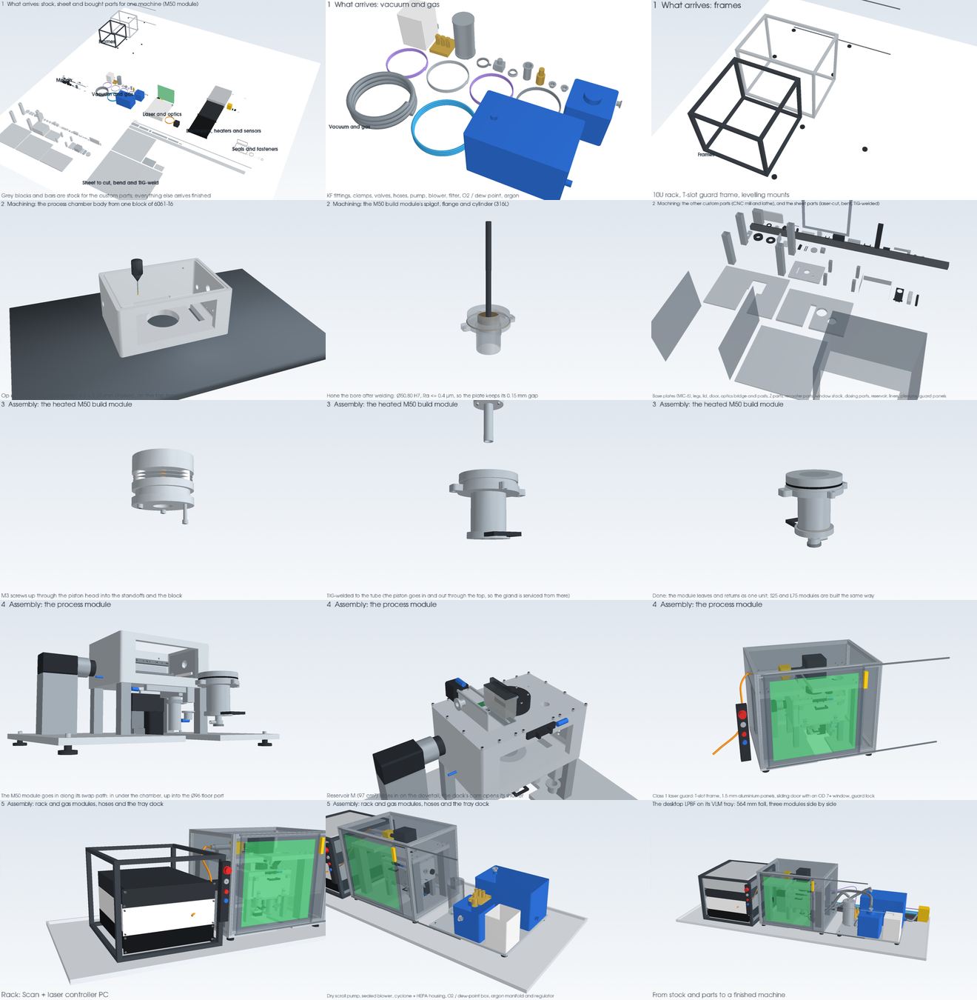

# Building the desktop LPBF from stock and bought parts: the animated sequence

Written 2026-11-19 for [PR #266](https://github.com/vertical-cloud-lab/digital-alloy-lab/pull/266) (issue #260), in answer to
"Show an animated visualization of the full build and assembly process, starting from the raw ordered parts (and include
things like custom machining, screwing things together, etc.)".

[`cad/render_build.py`](cad/render_build.py) renders it headless from the low-profile model ([`cad/lpbf_low.py`](cad/lpbf_low.py),
with the M50 module and reservoir M) into [`cad/img/sequence/`](cad/img/sequence/):

- one GIF per chapter (the long ones split into parts of ≤ 200 frames, 720 px wide, ~9 frames/s);
- [`build.mp4`](cad/img/sequence/build.mp4): the whole run in one video (880 × 540, about 2.5 min). Download it to play it: GitHub
  plays videos inline only when they are uploaded as comment attachments;
- [`build-sheet.png`](cad/img/sequence/build-sheet.png): three key frames from each chapter.

Nothing here has been built. The sequence is one reasonable way to make and assemble the machine, not a process plan.



| Chapter | GIF | What it shows |
|---|---|---|
| 1. What arrives | [`1-kit.gif`](cad/img/sequence/1-kit.gif) | Every part laid out by kind, then a closer look at each kind: stock for the 37 machined parts (6061-T6 and MIC-6 plate and bar, 316 bar, tube and plate, Macor rod, 416 rod; three of them are tube cut to length), sheet for the 13 cut, bent and welded parts, and the 90 bought parts (motion, vacuum and gas, laser and optics, electronics and sensors, seals and fasteners, frames). Hoses, lines and the fiber are shown as coils |
| 2. Machining | [`2-machining-a.gif`](cad/img/sequence/2-machining-a.gif), [`-b`](cad/img/sequence/2-machining-b.gif) | The chamber body hogged out of a 13 × 9.5 × 6 in. 6061-T6 block in six operations (face and square; pocket with 5 mm corners and floor coves; door opening and inlet slot; floor port, slots and holes from below; side bores; lid O-ring gland). The M50 module body: spigot turned from 4 in. 316 bar, flange and bottom collar waterjet-cut from 1/2 in. 316 plate, cylinder bored from 2-1/4 × 1/4 in. 316 tube, stacked, TIG-welded and honed to Ø50.80 H7. The chamber body's last two ops drill and STI-tap its helical-insert holes. Heater block, build plate and piston head turned from 2-1/4 in. 6061 bar, then drilled and milled. Then every other machined and sheet part as one batch |
| 3. Build module | [`3-module-a.gif`](cad/img/sequence/3-module-a.gif), [`-b`](cad/img/sequence/3-module-b.gif) | Heater block; 3 cartridge heaters, 3 thermocouples and the thermal cutoff slide in from below; three M3 helical inserts in the block; Macor standoff rings with the radiation shields between them; piston head; disc springs; M3 × 25 screws up through the head's slotted counterbores into the block; bore seal stretched into its groove; hollow rod and its two set screws; PTFE rim wiper; the plate dropped onto its bayonet and turned 60° to lock; the welded body; the gland plate and its face O-ring bolted to the welded collar (6 × M4) and the handle under it; the spigot O-ring; the whole stack lowered into the bore from the top, with the rod passing down through the gland; rod end, and the striker on three flat-head screws |
| 4. Process module | [`4-process-a.gif`](cad/img/sequence/4-process-a.gif), [`-b`](cad/img/sequence/4-process-b.gif), [`-c`](cad/img/sequence/4-process-c.gif) | Base plate on four 5537T983 levelling mounts (their M8 stems thread into it); legs (2 × M6 each from below); chamber with its helical inserts, then one M6 up each leg's bore; under-floor plenum, overflow jar and dowel pins; liners, LED bar, inlet plenum and ports; recoater rail on 5 × M4 × 16 at McMaster 6709K33's 60 mm pitch, carriage, ball screw, bearings and servo, blade holder and blade (2 × M3 × 8); the Z stage under the floor (4 counterbored M5 × 12); the M50 module brought in along its swap path and up into the floor port, its two captive screws driven, then the Z arm rises so its magnet takes the striker; gas knife, dose chute, lid O-ring; the lid and its 20 M5 screws in a star pattern; window flange (6 × M4 into M4 × 4 inserts), O-ring, window and ring (6 × M3); cover-slide drawer; dosing base (4 × M4 through its tabs), the reservoir sliding in on its dovetail; camera and gauges; hinge knuckles; the door brought in open and swung shut (hinge and latch screws not drawn yet); optics posts (2 × M6 each from below) and bridge (2 × M6 × 35 into each post); galvo; the f-theta lens threaded up into it; beam tube, shutter, collimator and fiber; the laser guard |
| 5. Tray | [`5-tray.gif`](cad/img/sequence/5-tray.gif) | The process module on the VLM tray; the 10U rack and its four units, each slid in (their cage-nut screws are not drawn yet); panels and operator panel; the gas module's base on its levelling mounts, pump, blower, filter housing, O₂ box and argon manifold; hoses and lines; the tray dock and umbilicals; a closing orbit |

## What comes from the model, and what is drawn for the animation

- **From the model:** every part's geometry and position, the order of the 13 assembly steps, and the motion paths the
  sequence reuses: the module's swap path, the door hinge, the reservoir dovetail and the Z arm's release.
- **The chamber body's operations are exact.** The script rebuilds the body one cut at a time from the same features as
  `lpbf_low.py`, and checks that the result matches the model's body: the volumes agree to 0.000 %.
- **Stock sizes are named where the BOM names them:** 4 in. 316 bar (McMaster 9260K5) for the spigot, 2-1/4 × 1/4 in. 316
  tube (11119N55) for the cylinder, 5/8 in. 316 tube (11119N35) for the rod, Macor rod (8489K75), 1 in. 416 rod (89095K23) for
  the striker. The chamber block is 13 × 9.5 × 6 in. Every other blank is the part's bounding box plus a 3 mm allowance,
  rounded up to a standard plate thickness or bar diameter. That is a stock *size*, not a cut list or a quote.
- **Screws (updated 2026-11-19, [`fasteners.md`](fasteners.md)).** Every screw the animation drives is now a real McMaster part
  at the position the model's joint table ([`cad/joints.py`](cad/joints.py)) gives it, with its holes cut into the parts. The
  levelling-mount, door-hinge, rack-unit and gas-module screws were only illustrative and are gone until those hole patterns
  are drawn.
- **The two assembly choices this note flagged are settled** ([`fasteners.md`](fasteners.md)): the module's bottom flange is
  now a gland plate bolted to a collar welded round the tube end, and the Macor standoffs are clamped rings on a screw from the
  piston head into a helical insert in the heater block; nothing threads into Macor.
- **The rack laser** is drawn as the model's 3U box; the quoted IPG YLR-500-U3-SM-AC is a 4U, air-cooled unit
  ([quote note](quotes/ipg-ylr-500-u3-sm-ac.md)).
- **Not shown:** wiring and connectors, tube fittings other than the KF hoses, the electronics inside the rack units,
  adhesives and potting, the guard's own fasteners, deburring, cleaning and passivation, leak checks and inspection.

## Re-run

```bash
xvfb-run -a -s "-screen 0 1920x1080x24" python desktop-lpbf/cad/render_build.py            # all chapters + MP4 (~5 min)
xvfb-run -a -s "-screen 0 1920x1080x24" python desktop-lpbf/cad/render_build.py module --quick   # one chapter, few frames
```

Requirements as in [`analysis/requirements.txt`](analysis/requirements.txt), plus `ffmpeg` for the MP4.
