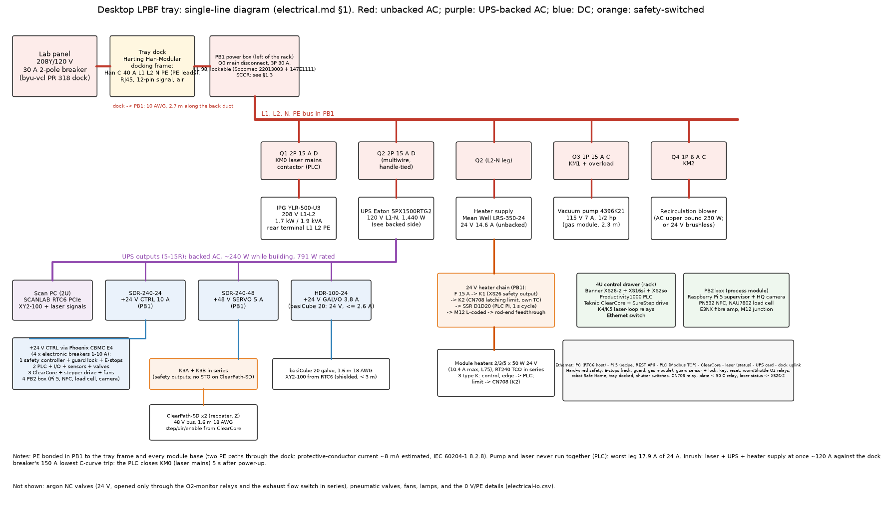

# Electrical design of the desktop LPBF tray: supply, controls, safety chain, feedthroughs, wiring

Written 2026-11-22 for [PR #266](https://github.com/vertical-cloud-lab/digital-alloy-lab/pull/266) (issue #260), in answer to
Sterling's question: "Have you considered what will be needed in terms of electrical? Do we need custom PCBs or no? Have you
been thorough in terms of both mechanical and electrical components?" Until now the electrical side was a few BOM lines
(C1-C6, S1-S9, H1-H2, A1, G6, G7, G9, M2, M6, T2) and notes in [`safety.md`](safety.md), [`heat.md`](heat.md),
[`modules.md`](modules.md), [`seals.md`](seals.md), [`real-parts.md`](real-parts.md) and [`robot-ops.md`](robot-ops.md).

Nothing here has been built, wired, or reviewed by a licensed electrician, BYU's LSO, EHS or Fire Marshal. Prices were read
on 2026-11-22 (UTC) from the pages linked in [`electrical-bom.csv`](electrical-bom.csv). A second opinion from Edison
(`r5-electrical-review`, [answer](edison/r5-electrical-review/answer.md)) is folded in and compared in §11.

| File | What it is |
|---|---|
| [`electrical-io.csv`](electrical-io.csv) | 95 devices and signals: signal type, voltage and current, controller and channel, connector, cable, chamber feedthrough, whether the model and the BOM have it |
| [`electrical-bom.csv`](electrical-bom.csv) | the electrical parts with part numbers, prices, URLs and fetch times, and the bom.csv line each one replaces or adds to |
| [`analysis/electrical/heater_loop.py`](analysis/electrical/heater_loop.py) → [`heater_loop.md`](analysis/out/electrical/heater_loop.md) | lumped thermal model fitted to the CalculiX runs, PI tuning, a dense build with and without a dwell, the SSR failing shorted |
| [`analysis/electrical/interlock_logic.py`](analysis/electrical/interlock_logic.py) → [`interlock.md`](analysis/out/electrical/interlock.md) | the safety logic as a function of every input, checked over all 16.8 M input combinations, plus 49 single faults |
| [`analysis/electrical/power_budget.py`](analysis/electrical/power_budget.py) → [`power.md`](analysis/out/electrical/power.md) | dock legs, inrush against the breakers, UPS runtime through a power cut, drawer heat, voltage drop, hermetic-pin heating, earth-leakage current |
| [`analysis/electrical/io_list.py`](analysis/electrical/io_list.py) → [`io_check.md`](analysis/out/electrical/io_check.md) | writes the I/O list and counts channels against the controllers |
| [`analysis/electrical/drawings.py`](analysis/electrical/drawings.py) | [single-line diagram](analysis/out/electrical/single_line.png), [interlock schematic](analysis/out/electrical/interlock.png), [panel layouts to scale](analysis/out/electrical/panels.png) |

## 0. The short answers

**Custom PCBs: no.** Every function has an off-the-shelf part that is cheaper than the engineering time a board would take:
the SCANLAB RTC6 makes the XY2-100 stream and the laser timing, a Productivity1000 PLC reads the thermocouples and 4-20 mA
transmitters, a Banner XS26 safety controller runs the interlocks, a DC SSR and two contactors switch the heaters, and
DIN-rail breakouts, M12 cordsets and hermetic feedthroughs with their own connectors do the wiring (§5). The open and
lab-built LPBF machines we found agree: the ones that made a board (DTU's Teensy controller, OPAL) made it to *replace* a
scan card, and none put safety on it. A board is worth making only if the RTC6 is dropped for cost: a ~100 × 80 mm 4-layer
Teensy carrier would cost about $50 in boards and assembly plus ~$60 of parts, and weeks of firmware and timing work (§5).

**Thorough? Not yet, and these were the gaps.** Twenty of the 95 devices and signals have no bom.csv line and 37 are not
drawn in the model ([`io_check.md`](analysis/out/electrical/io_check.md)). The ones that change the design:

1. **There was no supply design.** No main disconnect, no branch protection, no 48 V servo supply, no place for the AC parts
   (the UPS only got a bom.csv line, D2, today). Now: a lockable main disconnect and five branches in a power
   box PB1 beside the rack (§1).
2. **The 3U DIN drawer cannot hold the controls.** A safety controller with enough inputs (Banner SC26/XS26) stands 129 mm
   off its rail, and the 480 W DIN supplies 128.5 mm; a 3U drawer has ~120 mm clear. Make it **4U and the rack 12U (560 mm,
   still under the machine's 564 mm)**, and move the power parts to PB1 ([panels.png](analysis/out/electrical/panels.png)).
3. **The drawer would cook without a fan:** 72-147 W in a closed 3U box is 51-104 K above the air around it. With the power
   parts in PB1 (with its own 27 CFM filter fan) and an 80 mm fan in the drawer, the controls stay ≤ 10 K above ambient; in the Shuttle's worst case (43 °C, heat.md) that is
   53 °C against the safety controller's 55 °C ([`power.md`](analysis/out/electrical/power.md) §4).
4. **The galvo needs one 24 V (or 30 V) rail at ≤ 2.6-3 A, not ±15 V** (SCANLAB basiCube series data; the tray budget and
   Edison both assumed ±15 V).
5. **The servo bus needs two contactors in series.** ClearPath-SD has no safe torque off, and the interlock check failed with
   one ([`interlock.md`](analysis/out/electrical/interlock.md)).
6. **The 240 °C thermal cutoff is below its own holding rating.** The Cantherm RT240's holding temperature is 205 °C; the S25
   block runs at 216-221 °C and M50 at 205-206 °C in normal running. It will age and may open on its own. The latching limit
   (235 °C) trips 35-51 s after an SSR short on M50 and L75 and keeps the plate under 227 °C, but on S25 the block reaches
   the TCO's 240 °C in 4-5 s (§9.1). Replace the TCO with one rated above ~225 °C holding, or drop it.
7. **A dense build trips any sensible limit without a dwell.** With more laser heat than the module loses, the plate drifts up
   (heat.md); the 235 °C limit tripped after 3-12 minutes in every dense case. The scan software's dwell (hold the next layer
   until the plate is within 3 K) keeps it at ~205 °C and costs 22-54 % more build time at the end of the stroke (§9.1).
8. **The sensors on the lid cannot be wired to a Pi in the rack.** The Pi HQ camera's CSI ribbon and the NFC and load-cell
   boards' I2C/SPI want ≤ 0.5 m. Put the Pi 5 in a small box (PB2) on the process module.
9. **The chamber has an LED bar inside it and no feedthrough for it.** Move it outside a window, or add a 2-pin KF16 feedthrough.
10. **The rod-end connector is not real yet.** The drawn LEMO 1B misses the spec (seals.md), and no catalogue part carries 3
    type K pairs plus power. Six single-lead type K weld-ins (Ø6.27 mm sleeves) and one 4-pin 16 A copper weld-in (Ø12.62 mm)
    do it, but need a rod-end face ~28-30 mm across, not 24 (§6).
11. **Missing devices:** home and over-travel sensors on the recoater and Z, a guard-position sensor separate from the lock,
    two more E-stops, a chamber-at-ambient pressure switch, a Pirani gauge port, auto switches on the door actuator and latch
    cylinders, an air pressure switch, and a second plate-temperature channel for the door (electrical-io.csv).
12. **Earth leakage ~8 mA (estimate).** Above 3.5 mA a plug-in machine needs reinforced protective earth: two PE contacts in
    the dock, and no 5 mA GFCI upstream (§8).

**Electrical BOM:** $11,359 in 94 lines ($1,177 of it estimates, $1,571 optional), not counting the RTC6 and the IPG cable
(quotes). Against today's bom.csv it is **+$8.0k at the low end and +$7.7k at the high end** (§10): the safety controller (+$2.1k),
the rod-end feedthroughs and thermocouple wiring (+$1.5k), the PLC (+$1.1k), the power box (+$0.9k) and the drawer (+$0.5k)
are most of it; the guard lock gets cheaper (−$0.4k).

## 1. Architecture

### 1.1 Supply and distribution

**Supply.** byu-vcl PR 318's dock: 208Y/120 V, L1 + L2 + N + PE, a 30 A two-pole breaker in the lab panel, so 24 A
continuous ([`tray_budget.md`](analysis/out/tray/tray_budget.md)). PR 318 uses a Stäubli CombiTac; its prices are on quote. The
priced equivalent is a Harting Han-Modular docking frame (floating frame $9.56, carrier $9.72; Han C 40 A modules $9.32 and
10 AWG contacts $4.05; Han DD 12-pin signal modules $7.82-8.07; DigiKey, read 05:45Z). Use whatever PR 318 settles on, with:
L1, L2, N at ≥ 30 A, **two leading PE contacts**, an RJ45 module, a 12-pin signal module (tray docked ×2, E-stop loop through the
dock, room-O2 relays ×2, VLM may move, robot signals) and the air line.

**Main disconnect.** The dock is not a disconnecting means (NFPA 79; Edison r5 point 1). Q0 is a lockable 3-pole 30 A rotary
switch at the front of PB1: Socomec SIRCO M Compact 22013003 (UL 98, 100 kA SCCR with 30 A class J fuses, $75) with the
147E1111 red/yellow handle, padlockable in OFF ($27), and a 150 mm shaft ($7) (AutomationDirect, read 06:03Z). ABB OT40F3
(UL 508, $75.05) + OHB45J6 handle ($72.22) and Eaton R5A3040U ($193.03, UL 508, SCCR 10/65 kA) are the alternatives.

**PB1, the power box.** A 16 × 12 × 6 in steel NEMA 12 enclosure on the tray at the left end, beside the rack (the tray has
223 mm free between the rack at x = −990 and the rim at x = −1213; not checked against the full model). It holds the
disconnect, the branch breakers, the laser, pump and blower contactors, the UPS-backed DC supplies, the heater supply, SSR,
contactors K1 and K2, the CN708 on the door and the K8DT. The DC supplies sit here, not in the drawer, because their losses
(up to ~60 W) would overheat the drawer. A 27 CFM filter fan (Fandis FF12D24UN, $95) holds PB1 ~5 K above ambient.

| Branch | Breaker (UL 489 DIN) | Switched by | Load | Wire |
|---|---|---|---|---|
| Q1 | 2-pole 15 A, D curve | KM0 (PLC: 5 s after power-up, off between builds) | IPG YLR-500-U3, 208 V L1-L2, 1.7 kW / 1.9 kVA, rear terminal block (2012 YLR guide) | 14 AWG |
| Q2 | 2-pole 15 A, D curve, multiwire (handle-tied) | – | L1-N: UPS (120 V, 1,440 W); L2-N: heater supply LRS-350-24 | 14 AWG |
| Q3 | 1-pole 15 A, C curve | KM1 + overload (PLC) | vacuum pump 4396K21, 115 V 7 A, 1/2 hp | 14 AWG, 2.3 m |
| Q4 | 1-pole 6 A, C curve | KM2 (PLC) | recirculation blower (≤ 230 W at its AC upper bound; G4 still open) | 16-14 AWG |

D curves on Q1 and Q2 because the laser, UPS and LRS-350 (60 A cold-start at 230 V, ~30 A at 120 V) each have inrush that a
B curve would trip on ([`power.md`](analysis/out/electrical/power.md) §2). **Closing Q0 energises the laser, UPS and heater
supply together: ~120 A peak against the dock breaker's lowest C-curve magnetic trip of 150 A.** That is why the laser gets a
contactor KM0 that the PLC closes after the rest has started.

**Legs:** worst real case (500 W CW, blower at its AC bound, UPS recharging) is **17.9 A on L1 and 14.0 A on L2, inside
24 A**. The pump never runs while the laser fires (PLC); with everything at rated at once L2 would see 20.7 A.

### 1.2 What the UPS carries, and the DC rails

**UPS:** Eaton 5PX1500RTG2 (line-interactive, 1,440 VA / 1,440 W, 2U, 5-15P in, 8 × 5-15R; $1,137.99 at CDW, read 2026-11-22),
in bom.csv as D2 (added 2026-11-22). PR 318 standardises on the Vertiv GXT5LI-1500 (online, Li-ion, $2,706.99); either
works. A Network-M3 card ($462.99) lets the Pi start the power-cut sequence.

| Rail | Supply (location) | Backed? | Loads | Protection |
|---|---|---|---|---|
| 120 V AC | UPS outputs | yes | scan PC with the RTC6, the three DC supplies below | UPS |
| +24 V CTRL | Mean Well SDR-240-24, 10 A (PB1), $104.38 | yes | XS26 safety controller, guard lock, PLC and I/O, sensors, valves, ClearCore logic, stepper drive, fans, PB2 (Pi, NFC, load cell, camera), O₂ analyser, transmitters | Phoenix CBMC E4 4-channel electronic breaker, 1-10 A per channel ($122.41) |
| +48 V SERVO | Mean Well SDR-240-48, 5 A (PB1), $104.38 | yes | two ClearPath-SD (24-75 V, Teknic manual rev 3.30) | 10 A fuse; **K3A + K3B in series** from the safety controller |
| +24 V GALVO | Mean Well HDR-100-24, 3.8 A (PB1), $38.18 | yes | SCANLAB basiCube 20 (24 V, ≤ 2.6 A) | own supply, so servo and valve transients stay off the galvo |
| +5 V | Mean Well DDR-30G-5 (PB2), $35.36 | yes | Raspberry Pi 5 | from +24 V CTRL |
| +24 V HEAT | Mean Well LRS-350-24, 14.6 A (PB1), $34.81 | **no** | module heaters 100 / 150 / 250 W | 15 A fuse → K1 → K2 → SSR |

Unbacked: laser, pump, blower, heaters (PR 318's rule for heaters and pumps). On a power cut the build stops, the argon valves
close (they are normally closed), the safety controller, guard lock, PLC, O₂ analyser and Pi stay up, the PC saves and shuts
down at 120 s and the servos are disabled at 60 s. **The held load is ~63 W, which the UPS carries for ~5 h by a Peukert
estimate (4 × 12 V 9 Ah assumed: Eaton's page timed out)**, far past the 15 / 28 / 41 min the plate takes to cool to 50 °C
(power.md §3). At the rated 791 W backed load it would last ~16 min.

The 48 V bus is a choice: ClearPath-SD runs on 24-75 V and the manual puts the minimum at about 21.5 V; 48 V gives speed
headroom over 24 V and the recoater (≤ 100 mm/s on a 10 mm lead, 600 rpm) and Z axis need little. Teknic's own IPC-5 (75 V,
350 W, built-in regen control, $253) is the alternative if a fast axis ever regenerates into the bus.

### 1.3 Short-circuit current rating (Edison r5 point 2)

The tray's fault current is set by the lab panel and the branch run, neither known yet. With 10 kA at the panel and 15 m of
10 AWG to the dock plus the 2.7 m dock feeder, a bolted L-L fault at PB1 is about 208 V / 0.14 Ω ≈ 1.5 kA, and L-N about
0.9 kA; with only 5 m of branch it is ~3 kA. **So a panel SCCR of 5 kA covers any branch longer than ~2 m**, and the parts
chosen are rated higher (UL 489 breakers ≥ 10 kA as listed by makers; R5A3040U 10/65 kA). Mark PB1 "SCCR 5 kA" once BYU
Facilities give the panel's available fault current (NEC 409.110 and 670.3; UL 508A SB). Not computed: the exact UL 508A
supplement SB table for the DC supplies.

### 1.4 Where things go

| Place | What | Why there |
|---|---|---|
| **PB1** (tray, left of the rack) | Q0, Q1-Q4, KM0-KM2, K1, K2, SSR on a through-wall heat sink, CN708 (door), K8DT, LRS-350-24, SDR-240-24, SDR-240-48, HDR-100-24, PE bar | next to the largest loads (laser, UPS); heat and mains out of the control drawer; away from the filter on the right |
| **4U drawer** (rack, top) | XS26-2 + XS16si + XS2so, Productivity1000 (CPU + 8 modules), ClearCore, stepper drive, K3A/K3B, K4/K5, Ethernet switch, CBMC E4, 40 terminal blocks, 80 mm fan | low-voltage control only: ~46 W |
| **PB2** (process module, guard frame near the lid) | Raspberry Pi 5, PN532 NFC, NAU7802, Omron E3NX fibre amplifier, M12 junction | CSI, I2C and SPI need ≤ 0.5 m to the camera, antenna and load cell |
| **Gas module** | pump, blower, argon valves, pneumatic manifold, O₂ and dew-point box | as drawn |
| **Rack** | UPS (2U), laser (4U), scan PC (2U), drawer (4U): **12U, 560 mm** | the 4U drawer (§0 point 2) |

## 2. Devices and I/O

The full list is [`electrical-io.csv`](electrical-io.csv); the channel count is [`io_check.md`](analysis/out/electrical/io_check.md).

| Controller | Used / capacity |
|---|---|
| Productivity1000 DI (2 × P1-16ND3) | 20 / 32 |
| DO (P1-08TD2 × 4, sourcing 1 A) | 29 / 32 |
| Thermocouple (P1-04THM: control, edge, chamber wall, filter cake) | 4 / 4 |
| 4-20 mA in (P1-08ADL-1: O₂, dew point, absolute and differential pressure, two room O₂) | 6 / 8 |
| 0-10 V in / out (P1-04ADL-2: Pirani; P1-04DAL-2: blower speed) | 1 / 4, 1 / 4 |
| Safety inputs (XS26-2 26 + XS16si 16) | 31 / 42 |
| Safety outputs (XS26-2 4 + XS2so 4) | 6 / 8 |
| ClearCore | M-0 recoater, M-1 Z, M-2 dosing stepper drive, M-3 spare; IO-1..4 home and limit sensors |
| RTC6 | XY2-100 to the basiCube; LASERON (gate) and ANALOG OUT1 (power) to the laser |

**Devices the model does not draw** (37 rows, the main ones): the safety shutter's two position switches (L4 has no product
yet), home and over-travel sensors for the recoater and Z, the door actuator's and latch cylinders' auto switches, the drawbar
release cylinder and its switch, the air pressure switch and dump valve, the heater supply, SSR and contactors, the CN708 and
K8DT, the module fan (heat.md), the chamber-wall and filter-cake thermocouples, the differential pressure transmitter, the
chamber-at-ambient pressure switch, a Pirani gauge (and a KF16 port for it), the argon shutoff at the dock, the exhaust flow
switch, two E-stops, the guard-position sensor, the stack light and HOT lamp, PB1, PB2 and the Pi.

**Devices with no bom.csv line** (20 rows): the axis home and over-travel sensors, the door actuator's auto switches, the
drawbar cylinder and its switch, the air pressure switch and dump valve, the contactors K1-K5, the K8DT, the wall and cake
thermocouples, the chamber-at-ambient switch, the guard-position sensor, the HOT lamp, the Ethernet switch and the cabinet fans.
They are in [`electrical-bom.csv`](electrical-bom.csv). Since this note started, other work added bom.csv lines for the UPS (D2),
the dock (D1), the pneumatics (A3), the module fan (H3) and a Pirani gauge (G7); electrical-bom.csv keeps its own picks for
those as qty-0 alternatives so nothing is counted twice.

## 3. Controllers, and why

| Function | Choice | Price | Why | Alternatives |
|---|---|---|---|---|
| Scan and laser timing | **SCANLAB RTC6** (PCIe board in the 2U PC) | quote | laser on/off delays and skywriting in hardware, XY2-100, analog and gate outputs in step with the mirrors, Linux and Windows libraries; the same family as the scan head; used by the IFSW research platform (Edison r5) and GE's M2-Open (RTC5) | JCZ DLC2-M4 ($1,785, EZCAD3 SDK, BOM C1); Mesa 7I96S + LinuxCNC xy2mod ($149, needs a custom bitfile, Mesa forum); OPAL on a Teensy 4.0: "PRE ALPHA ... DO NOT USE THIS WITH OTHER LASERS THAN LASERPOINTERS" (README) |
| Motion | **Teknic ClearCore CLCR-4-13** + DIN-MNT | $105 + $21 | four step/dir axes made for ClearPath (HLFB read-back), 13 I/O, Ethernet, C++ SDK; 127 × 89 × 25 mm | Klipper on the Pi (BOM C3), Duet 3 |
| Stepper drive (dosing roller) | AutomationDirect SureStep STP-DRV-4830 (3 A/phase, 12-48 VDC) | $99 | step/dir from ClearCore M-2, 24 V; the STP-DRV-4035 is discontinued | – |
| Process I/O and heater PI | **AutomationDirect Productivity1000**: P1-540 CPU + 2 × P1-16ND3 + 4 × P1-08TD2 + P1-04THM + P1-08ADL-1 + P1-04ADL-2 + P1-04DAL-2 | $237 + modules ≈ $1,000 | 24 V industrial I/O, a 4-channel 16-bit thermocouple module, 4-20 mA in, PID with time-proportioned outputs, Ethernet with Modbus TCP for the Python supervisor, 17-21 mm modules | CLICK PLUS C2-03CPU-2 ($277) + C0-04THM ($217); Arduino Opta and Pi HATs have no thermocouple module and aren't industrial I/O |
| Safety | **Banner XS26-2 + XS16si + XS2so**, with four WEG CWBS9-33-30C03 contactors (K3A, K3B, K4, K5; mirror contacts, $108 each) | $1,093.01 + $464 + $370 | 42 safety inputs and 8 safety outputs (0.5-0.75 A) with test pulses and EDM; the logic in §4 needs 31 inputs and 6 outputs | SC26-2 ($904.01) has 26 inputs and is not expandable; Pilz PNOZ m B0 ($871.91, 20 inputs, 4 outputs at 2 A); the G9SE-201 in S1 has too few inputs (safety.md) |
| Heater switching | DC SSR Crydom D1D20 (20 A, 100 mΩ max) on an HS151 heat sink; K1 and K2 WEG CWBS12-33-30C03 safety contactors (mirror contacts, $120 each) | $93.36 + $49.32 + $240 | 10.4 A at up to 10.8 W; the D1D12 in H2 is a 12 A part | Crydom DRA1-CMXE100D10 DIN module ($107.20, 10 A: too close) |
| Independent limit | DwyerOmega CN708, latching, on the limit TC → K2 | $204.60 (H2) | own sensor, own relay, manual reset | – |
| Plate < 50 °C for the door | Omron K8DT-TH1CD on the edge TC | $240.25 | second, independent channel (with the PLC) for the guard unlock; it latches alarms by default (set it non-latching) and listed a 19-week lead time | the 67F bimetal of modules.md; SOLO SL4848-RR-D ($143, panel mount) |
| Supervisor | Raspberry Pi 5 in PB2 | BOM C2 | recipe, state machine, logging, REST API; camera, NFC and load cell next to it | the scan PC (then the camera needs USB or GigE) |

## 4. Safety and interlock logic

The safety controller owns every final element; the PLC, the Pi and the RTC6 only *request*. Two final elements per hazard:

| Hazard | Function | Final elements | Inputs that must all hold |
|---|---|---|---|
| Class 4 beam | laser interlock closed (emission possible) | **K4 + K5** in the laser's two-channel interlock loop (dry contacts, Cat 3 PL d, 500 ms in the 2012 YLR guide) **and the shutter** (power to open, spring closed, through K4 + K5 contacts) | 3 E-stops, guard closed, guard locked, key, room and Shuttle O₂ ≥ 19.5 %, limit healthy, robot at Safe Home, tray docked, PLC permissive (chamber O₂ < set point, pressure in window, module and cover slide present, galvo ready), manual reset, no latched fault |
| Opening the guard | unlock | spring-lock guard lock (power to unlock) | laser loop open, shutter closed on both switches, plate < 50 °C (K8DT and PLC), chamber at ambient (pressure switch) |
| Moving parts | 48 V servo bus | **K3A + K3B** in series | E-stops, guard closed and locked |
| Hot plate | heater power | **K1** (safety controller) **+ K2** (CN708, hard-wired) + the SSR | E-stops, limit healthy, room O₂, PLC permissive (O₂ under argon) |
| Argon | supply valve | 24 V through **both O₂-monitor relays and the exhaust flow switch** in series, no controller | room and Shuttle O₂ ≥ 19.5 %, exhaust proven |
| Robot | entry permitted | standard output to the UR (reduced mode lifts a safety plane at the guard opening, "normal mode only": check against UR's e-Series manual) | unlock conditions; the laser chain already needs the robot home |

**What the check found** ([`interlock.md`](analysis/out/electrical/interlock.md)). Over all 2²⁴ = 16.8 M combinations of
inputs, requests and state bits, the eight properties (laser only when every permissive holds; shutter only with the laser
loop closed; unlock only laser-off, shutter-closed, plate-cool, ambient; and so on) have **zero violations**, and every output
is reachable. The single-fault run (each channel stuck closed, stuck open or shorted to its twin; each contact welded; the
shutter stuck open; the laser ignoring its loop; the reset button stuck) **first failed twice**:
- one servo-bus contactor: welded, nothing safety-rated stopped the motors. **Fix: K3A + K3B in series**, both read back.
- the CN708 relay welded: the laser chain lost its over-temperature input with nobody noticing. **Fix: the PLC's own
  over-temperature (control and edge TCs) as a second, diverse input, and a cross-check that latches a fault if the CN708
  relay stays closed while the PLC reads over-temperature.**

Two more rules the model needed to pass: re-arming needs both shutter switches closed, and the laser's status outputs
(Ready, Emission ON) are read back so a laser that ignores its loop is caught. After the fixes **49 of 49 single faults pass**:
each is either safe on the next demand and detected, or already safe. Target **PL d, Category 3** for the laser function
(Edison r5 point 6 agrees); the devices' B10d/MTTFd values are not collected, so the PL is not computed.

**Spring lock or power to lock?** [`safety.md`](safety.md) §4.4 says "Use a power-to-lock design: a spring-lock switch
unlocks on power loss", which mixes the two terms. ISO 14119 prefers the spring-applied, power-released principle where the
hazard outlasts a power cut, and here the plate stays above 50 °C for 15-41 minutes and the chamber can be off ambient. **Use
a spring lock (IDEC HS5L-VC44M-G, 1,400 N, $254.19, replacing the out-of-stock Omron D4JL in S2)** with its manual release
on the guard for maintenance. With the UPS holding the lock ~5 h, a power-to-lock HS5L-VC7Y4M-G ($269.44) would also work,
but it would then depend on the UPS.

**Laser-specific rules:** manual reset after any trip or a power loss over 5 s (21 CFR 1040.10(f)(10)); emission lamps wired
through K4/K5 so they are lit whenever emission is possible; the galvo supply on the UPS and "galvo ready" in the PLC
permissive, so the mirrors are under control before emission and emission stops before galvo power goes (Edison r5 point 7).

## 5. Custom PCBs, function by function

| Function | Off-the-shelf part | Price | When a custom board would pay |
|---|---|---|---|
| XY2-100 to the galvo | RTC6 (quote); Mesa 7I96S + LinuxCNC xy2mod ($149) | quote / $149 | only to replace the RTC6 (below) |
| Laser modulation and timing | RTC6 LASERON + ANALOG OUT1; IPG takes "CMOS to 24 VDC" on its gate (2012 guide) | in the RTC6 | never on its own: it has to move in step with the mirrors |
| Interlock logic | Banner XS26 safety controller | $1,927 | never: none of the lab-built machines put safety on a custom board (DTU used an ABB Pluto safety PLC) |
| Thermocouple inputs | P1-04THM (4 ch, 16-bit) | $172 | never; MAX31856 breakouts ($17.50) are non-isolated, which matters with a grounded heater block |
| Heater switching | D1D20 + HS151, two WEG CWBS12 contactors | $383 | never |
| Feedthrough wiring | the feedthroughs' own plugs; SMPW-K type K connectors; M12 L-coded cordsets ($51.72 + $65.36, H1) | – | never |
| Sensor breakouts on the lid | Pi 5 + Adafruit PN532 ($39.95) + SparkFun NAU7802 ($5.95) with Qwiic cables in PB2 | ~$50 | optional: a Pi HAT with the NFC chip, the load-cell ADC, 24 V → 5 V and M12 jacks would be tidier; ~$60-80 at JLCPCB with assembly; not needed |
| Laser and RTC6 connectors | AutomationDirect ZL-RTB-DB15 ($48.50) + ZL-DB15-CBL-2 ($16.50); the IPG plug is a 24-pin circular, not a D-sub (2012 guide): use IPG's cable or plug on DIN terminals | ~$65 | never |
| Dock | Harting Han-Modular modules | ~$100 | never |

**If the RTC6 is dropped:** DTU's open PBF controller (Teensy 3.6 with XY2-100 drivers, a 10-bit 0-10 V DAC, a 24 V PWM
enable to 100 kHz and three 4-20 mA inputs) is the pattern. A 100 × 80 mm 4-layer board costs $14 for 10 at JLCPCB plus
$25.99 shipping (2-layer $5), or $248 for 6 at OSH Park; JLCPCB's economic assembly adds $9.71 per order plus $0.0016 per joint
(B5, read 05:35-05:52Z). With a Teensy 4.1 (~$30), isolated RS-422 drivers, a DAC and connectors, about **$110-150 per board**.
The board is cheap; laser on/off delay compensation, skywriting and 100 kHz updates are weeks of firmware and test, and OPAL
shows what happens without them.

**What the open and lab-built machines did** (research notes, 2026-11-22): OPAL and Les Wright's OPAL_PCB (Teensy 4.0 +
SN75174N line driver, transmit only, no interlock input); DTU OpenAM (custom Teensy board, safety on a separate ABB Pluto D20
whose contactor "physically break[s]" the laser trigger and motor drivers); NIST AMMT (custom FPGA, XY2-100 and power every
10 µs); MIT (NI cRIO analog outputs); Heriot-Watt (SCAPS USC-2 card); GE M2-Open (SCANLAB RTC5); TUM (RAYLASE with a PLC);
LSU (ScanMaster board + Arduino/GRBL); KU Leuven LMq (NI FPGA with a custom RS-485 scanner board). **None documented its heater
control**, and every one that described safety kept it off the custom electronics.

## 6. Chamber feedthroughs

**Pin count.** The chamber needs very few electrical penetrations, because almost every powered device is outside it:

| Penetration | Pins | Where | Product |
|---|---|---|---|
| **FT1, module rod end** (×3 modules) | 2 power (10.4 A at 24 V on L75) + 3 type K pairs (control, edge, limit) | the rod end below the gland plate; the leads run down the hollow rod, which is open to the chamber gas | **Solid Sealing Technology: 3 × FA11631 (single Chromel lead) + 3 × FA11632 (single Alumel lead), Ø6.27 × 38 mm weld sleeves, −269 to 450 °C, $44 each; 1 × FA10443 (4 × 0.81 mm Cu, 16 A per pin, 2 kV, Ø12.62 × 24 mm sleeve, $92), two pins per pole** = $356 per module |
| FT2, LED bar (if it stays inside) | 2 power | chamber wall | SST FA11643 (2 × 27 A Cu on KF16, $108); better: move the LED bar outside a window |
| Plate-up through-beam | optical | two M6 fibre heads in the side walls, O-ring under each head | whether the Omron E32-T61-S fibre leaks along its sheath is not known; ask Omron or use a vacuum fibre feedthrough |
| O₂ sample, pressure transducer, Pirani | – | gas and KF ports | the instruments seal on their own ports; the Pirani needs a KF16 port the model doesn't have |

- **Thermocouple-alloy pins**, not copper: a copper pin adds two Chromel-Cu and Alumel-Cu junctions whose difference reads as
  error whenever the two ends of the pin differ in temperature (Edison r5 point 4 agrees).
- **Copper power pins.** Ni-Fe glass-sealed pins (Accu-Glass Sub-C class, 1.02 mm) carry 10.4 A at ~1.4 W per pin in vacuum
  with no convection ([`power.md`](analysis/out/electrical/power.md) §6); two per pole halves the current but still sits above
  their 5 A rating. The FA10443's copper pins (16 A each) at 5.2 A avoid it.
- **No single catalogue part carries 3 type K pairs and power** (combined parts stop at 1 pair at Solid Sealing, 2 pairs at MDC
  on a 2.75 in. CF flange or Accu-Glass on KF50; research notes A2, 06:12Z). Hence separate parts.
- **Plug and flange limits:** Solid Sealing nylon plugs 218 °C, PEEK vacuum plugs 200 °C, SMPW connectors 180 °C, KF O-ring
  mounts 150 °C: all fine at the ~57-70 °C rod end (thermal.md), none usable at the heater block.
- **Alternatives:** two KF16 ports on a rod-end block: SST FA14198 (3 type K pairs on KF16, $309.50) + FA11643 (2 × 27 A Cu on
  KF16, $108), $417.50; or FA23474 (3 pairs, Ø22.1 mm weld flange, $265.50 without plug) + FA10594 (2 × 27 A, Ø18.97 mm sleeve,
  $57.50) on a ~Ø40 block; MDC 9391007 (1 TC pair + 2 × 15 A Cu, 3/4 in. weld sleeve, $212.52) with MDC 9311009 ($207.90; MDC
  parts showed 84-day lead times); Accu-Glass
  100791 (Thermo-D on KF40, $426) or 100801 (2 TC pairs + 2 power on KF50, $463, options-vendors.csv); MPF A0408-2-QF (2 type K
  pairs on KF16, $361.63, seal-parts.csv).
- **Model patch request (modules_low.py):** the compact route needs a rod-end face ~28-30 mm across for six Ø6.27 mm and one
  Ø12.62 mm sleeve (a rough layout, not drawn), in place of today's Ø24 rod end with a Ø12 boss. Check it against the Z arm,
  the pot magnet and the module's swap path.
- **Insulation inside:** the heater stack runs at 200-240 °C, the rod at ≤ 120 °C. Use the cartridges' own leads (fibreglass
  and PTFE on 3714N36), fibreglass-sheathed thermocouples (3871K606, 900 °F cable), and Kapton-insulated silver-plated copper
  hook-up wire (Accu-Glass 100712 class, 250 °C bakeable, 1e-10 Torr) where a joint is needed. No PVC or silicone in the hot
  zone. PTFE outgasses 4.2 × 10⁻⁵ → 1.5 × 10⁻⁶ (Edison's units) between 25 and 100 h after cleaning (Edison r5, warner2022).
  Potting compound in the hollow rod is no longer needed once the rod end is hermetic.

## 7. Wiring

| Run | Length (m, model + 20 %) | Current | Conductor | Drop |
|---|---|---|---|---|
| Dock → PB1 | 2.7 (feeder) | 24 A | 10 AWG | 0.1 % (0.8 m modelled) |
| PB1 → laser, UPS | 0.5-2.4 | 9.1 / 7.4 A | 14 AWG | ≤ 0.3 % |
| PB1 → pump | 2.3 | 7 A | 14 AWG | 0.1 % |
| Heater 24 V, PB1 → rod end (L75) | 1.7 incl. a 0.3 m loop | 10.4 A | **16 AWG** | 2.3 % (4.6 % of heater power); 18 AWG would lose 7.3 % |
| 48 V servo bus | 1.6 | 5 A peak | 18 AWG (Teknic CPM-CABLE-PWR) | 0.8 % |
| 24 V galvo | 1.6 | 2.6 A | 18 AWG | ~1 % |
| 24 V to the guard lock / gas module | 1.6-2.3 | 1-2 A | 22-20 AWG | ≤ 1.5 % |

- **Fusing:** each 24 V branch on its own CBMC E4 channel (1-10 A, set per load); the heater on a 15 A fuse ahead of K1 (sized
  for the supply's 14.6 A and the 16 AWG wire). safety.md asks for a fuse per heater leg (~2 × 2.1 A): with the cartridges'
  leads joined inside the block, one 15 A fuse plus the 16 AWG pair protects the wiring; per-leg fuses would need the legs
  brought out separately through more pins.
- **Signals:** thermocouples in shielded type K extension (TE THMWK-UL-20-1S-F-1, FEP, PLTC, $1.59/ft) with SMPW-K mini
  connectors; 4-20 mA in shielded twisted pairs; shields grounded at the drawer end only, at one star point. Keep thermocouple,
  4-20 mA and XY2-100 cables in a separate duct from the servo and 120/208 V cables (NFPA 79 / IEC 60204-1 separation; Edison
  r5 point 5). Scanner link on SCANLAB's shielded cable, 2-3 m (PC to head is ~1.3 m in the model): the RTC6 speaks SCANLAB's
  SL2-100 natively and needs an optional converter for XY2-100; the basiCube takes both, so run SL2-100 (A2 notes, from the two
  datasheets; neither gives a maximum cable length: ask SCANLAB). The laser's analog input is
  single-ended: short, shielded, and grounded at the laser end.
- **Moving parts:** the Z axis moves the rod end 50 mm (slowly, once per layer) and drops 45 mm at a module swap: a 0.3 m
  service loop in PTFE-jacketed cable, or a short igus micro chain. At a swap the M12 L-coded and SMPW-K plugs at the rod end
  are unplugged (modules.md). The chamber door's actuator and latch cylinders carry only air lines and M8 auto-switch leads,
  fixed to the chamber. The drawer, reservoir and guard door carry no cables: their sensors and the guard lock are fixed and
  see the moving part. The fibre keeps its ≥ 100 mm bend radius (model).
- **Bend radii:** PUR sensor cordsets 10 × OD fixed, 15 × OD moving; chainflex-class cable 7.5-10 × OD in a chain; the 10 AWG
  feeder ≥ 6 × OD.

## 8. Grounding, bonding and the aluminium powder

- **Protective earth:** one PE bar in PB1, bonded to the tray frame and with a strap to each module's base plate (safety.md
  P9). The estimated protective-conductor current is ~8 mA (laser filter ~3.5 mA assumed, UPS, four supplies, pump, PC;
  power.md §7). IEC 60204-1 8.2.8: above 3.5 mA a plug-connected machine needs a warning and reinforced PE, above 10 mA a
  ≥ 10 mm² Cu conductor or a second PE conductor. **Use two PE contacts in the dock and two PE conductors in the feeder.** A
  5 mA GFCI upstream would trip; if the lab requires residual-current protection, it should be a 30 mA type.
- **Bonding for powder:** chamber (bare 6061, no anodize on a ground path: the vacuum SOP's ≤ 0.1 Ω check failed through an
  anodized bore, low-profile.md), lid, door, filter housing, cyclone, reservoir dock, drawer, pump and exchange pail to the PE
  bar. Check each to ≤ 0.1 Ω (the lab's SOP) with a 4-wire milliohm meter; NFPA 77 asks ≤ 10 Ω for all-metal paths (research
  notes B7). ESD wrist-strap point on PB1 and the drawer.
- **Class II, Group E.** (NFPA 484's 2022 edition was its last; it is now part of NFPA 660.) Aluminium is a Group E dust; where it "may be present" in hazardous quantities the location is
  Class II, Division 1, and NEC 502.100(A)(3) bars transformers and capacitors there (research notes B7; Edison r5 §2). So
  the plan is to keep the electronics out of any powder zone, not to rate them for it:
  - inside the chamber there are only the heaters, thermocouples and cutoff (sealed in the module) and, as drawn, the LED bar
    (move it out). The heaters are off whenever the chamber is open to air (PLC permissive);
  - the filter housing gets a thermocouple well only; its service area is where dust in air is expected, so the power box PB1
    sits at the opposite (left) end of the tray, and the gas-module electrics near the filter (valves, pump motor, blower) go
    into the dust hazard analysis (DHA) the Fire Marshal will ask for;
  - cleaning uses the Class II Div 1 Groups E-G vacuum already in A2 (McMaster 5572N116); vendors recommend a wet immersion
    separator for aluminium (Ruwac, Nilfisk).

## 9. Simulations and checks: what changed the design

### 9.1 Heater loop ([`heater_loop.md`](analysis/out/electrical/heater_loop.md))

- **The lumped model** (plate + block, and a slow node for the bore wall, head and rod) reproduces the CalculiX heat-up and
  cool-down to 0.3-2.7 K RMS and the laser-heat steady states to ≤ 6 K.
- **PI with a feed-forward and the block cap** heats S25 / M50 / L75 to 200 °C in 2.3 / 3.3 / 4.0 min with no overshoot; the
  S25 block peaks at 224 °C under the 225 °C cap. Gains: Kp 0.08 / 0.15 / 0.15 duty per K, Ti 960 / 60 / 240 s (M50 sits at the
  edge of the grid searched). **The PLC must control on the block reading minus r_B × heater power** (S25 0.5 K/W, M50 0.09,
  L75 0.04): without that correction S25's plate runs 21 K hot once the laser takes over the heating.
- **Dense builds:** with no dwell the 235 °C limit tripped in 3-12 min in every module at the end of the stroke. With a dwell
  at +3 K the plate stays at ~205 °C (band 5-8 K) and the build takes 22 % (S25), 54 % (M50) and 51 % (L75) longer. **The dwell
  is a requirement on the scan software, not an option.** The module fan of heat.md cuts it.
- **SSR fails shorted** (full power from 200 °C): the limit trips after 35-40 s on M50 and 48-51 s on L75, with the plate
  ≤ 227 °C and the seals unchanged. With no protection at all the plate would reach 464-532 °C at the end of the stroke, the rod
  gland 231-250 °C (FKM 200 °C) and the magnet face 102-109 °C. On S25 the block reaches 240 °C in 4-5 s, before the limit
  thermocouple (2 s lag assumed) catches it. **Limit set point 235 °C**; replace the RT240 (holding 205 °C).

### 9.2 Interlock logic: §4.

### 9.3 Power ([`power.md`](analysis/out/electrical/power.md)): legs, inrush, UPS, drawer heat, voltage drop, pins and earth
leakage, all quoted above (§1, §6, §7, §8).

### 9.4 Not simulated

Ground loops and EMI (only the separation and shielding rules above), the RTC6's timing, the laser's own inrush (assumed 40 A),
fault-current coordination beyond §1.3, PL calculation, and the drawer's internal air path (one fan, sized by the energy
balance).

## 10. Electrical BOM

[`electrical-bom.csv`](electrical-bom.csv) lists each part with its price, URL and fetch time, and the bom.csv line it
replaces or adds to ([`bom_summary.md`](analysis/out/electrical/bom_summary.md), [`bom_proposed_rows.csv`](analysis/out/electrical/bom_proposed_rows.csv)).
**94 lines, $11,358.57** (of which $1,177.00 are estimates and $1,570.99 optional). Quotes not included: SCANLAB RTC6, IPG interface cable.

### 10.1 Proposed bom.csv rows (line totals, USD)

| id | change | old low / high | new low / high | delta low |
|---|---|---|---|---|
| C1 | adds the RTC6 laser-connector breakout (ZL-RTB-DB15 + ZL-DB15-CBL-2) | 60.00 / 6,000.00 | 125.00 / 6,065.00 | +65.00 |
| C3 | Teknic ClearCore CLCR-4-13 + DIN-MNT + 2 ClearPath cable sets + SureStep STP-DRV-4830 | 150.00 / 400.00 | 319.00 / 400.00 | +169.00 |
| C4 | Mean Well SDR-240-24 + SDR-240-48 + HDR-100-24 + DDR-30G-5 + Phoenix CBMC E4 (high: Teknic IPC-5 for the servo bus) | 151.10 / 151.10 | 404.71 / 553.33 | +253.61 |
| C5 | AutomationDirect Productivity1000: P1-540 + 2 P1-16ND3 + 4 P1-08TD2 + P1-04THM + P1-08ADL-1 + P1-04ADL-2 + P1-04DAL-2 + terminal blocks (replaces 2 MAX31856 boards) | 35.00 / 35.00 | 1,092.50 / 1,092.50 | +1,057.50 |
| C6 | 4U rack drawer (Middle Atlantic UD class) + PB2 box + 80 mm fan + DIN terminals, rail, duct, ferrules (replaces the 10 x 12 x 6 in enclosure) | 275.10 / 275.10 | 814.90 / 814.90 | +539.80 |
| S1 | Banner XS26-2 + XS16si + XS2so + SC-USB2 + 4 WEG CWBS9-33-30C03 (K3A, K3B, K4, K5) | 275.29 / 275.29 | 2,376.01 / 2,376.01 | +2,100.72 |
| S2 | IDEC HS5L-VC44M-G spring lock + HS9Z-A51 actuator + IDEC HS6B-12B05 guard-position switch (replaces Omron D4JL) | 803.42 / 803.42 | 389.24 / 389.24 | -414.18 |
| S3 | qty 2 -> 4: two more E-stops IDEC XW1E-BV402M-R with enclosures (guard front, gas module); line total shown | 153.34 / 153.34 | 276.58 / 276.58 | +123.24 |
| S4 | adds an amber HOT lamp ECX2053-24L | 367.15 / 467.15 | 373.40 / 473.40 | +6.25 |
| H1 | rod-end weld-in feedthroughs (per module 3 SST FA11631 + 3 FA11632 single type K leads + 1 FA10443 4-pin 16 A Cu), Kapton wire, shielded type K extension, SMPW-K, wall and cake TCs; drops the $50 potting and the $1,389 KF50 high option | 2,241.00 / 4,100.00 | 3,759.94 / 4,279.94 | +1,518.94 |
| H2 | Mean Well LRS-350-24 + Crydom D1D20 + HS151 + 2 WEG CWBS12-33-30C03 (K1, K2) + DwyerOmega CN708 + Omron K8DT-TH1CD | 324.63 / 770.00 | 862.34 / 862.34 | +537.71 |
| A1 | adds 12 Murrelektronik M12 PUR shielded cordsets, 5 m | 1,131.82 / 1,600.00 | 1,527.82 / 1,996.00 | +396.00 |
| A3 | adds a Metal Work 5U11S101 air pressure switch, a NITRA ARV-21 lockable dump valve and two D-M9B switches on the rotary actuator | 969.73 / 1,119.73 | 1,139.43 / 1,289.43 | +169.70 |
| E1 | NEW Power box PB1: Socomec 22013003 UL 98 disconnect + 147E1111 handle + shaft, 6 Eaton FAZ UL 489 MCBs, 3 WEG CWB9-11-30C03 contactors, overload, 16 x 12 x 6 in NEMA 12 enclosure, Fandis FF12D24UN filter fan | 0.00 / 0.00 | 925.00 / 925.00 | +925.00 |
| E2 | NEW AutomationDirect STRIDE SE3-SW8U Ethernet switch | 0.00 / 0.00 | 124.00 / 124.00 | +124.00 |
| E3 | NEW 4 inductive M8 home/over-travel sensors + a +/-5 mbar chamber-at-ambient pressure switch (estimates) | 0.00 / 0.00 | 200.00 / 200.00 | +200.00 |
| E4 | NEW bulk wire, braided bonding straps, ESD wrist strap | 0.00 / 0.00 | 190.16 / 190.16 | +190.16 |
| E5 | NEW, optional: FLIR Extech 380580 milliohm meter, Eaton NETWORK-M3 card, SST FA11643 LED-bar feedthrough | 0.00 / 0.00 | 0.00 / 1,570.99 | +0.00 |

**Net change to the machine BOM: +7,962.45 USD at the low end, +7,728.69 at the high end** (qty 1 per line; S3 and C5 change from qty 2 to a line total).

bom.csv itself is not edited here (another worker owns it): the rows above are the change to make.

## 11. Edison's second opinion (`r5-electrical-review`): where it agrees and where it doesn't

**Agrees and folded in:** the standards list (NFPA 79, UL 508A, NEC 670, IEC 60204-1, ISO 13849-1, ISO 14119, ISO 13850,
21 CFR 1040.10, ANSI Z136.1, NFPA 484, NEC 500/502); a lockable main disconnect, since the dock is not a disconnecting means;
an SCCR marked at the tray (§1.3); a contactor in series with the SSR, owned by the limit and the safety controller; type K
pins; shielded, separated signal wiring with one star point; the laser function as a whole chain to PL d Cat 3 with two
diverse final elements, the RTC6 gate being a convenience; a DHA, bonding and a Group E vacuum; KF hermetic feedthroughs and
PTFE/Kapton inside; a validated safety interface to the UR12e; and DIN-rail modules rather than custom boards.

**Disagrees or adds:**
- **The galvo is not ±15 V.** The basiCube 20 takes one 24 V (or 30 V) rail. Edison's sequencing point still holds and is in
  the PLC permissive.
- **First-pulse suppression** is a Q-switched-laser problem. The IPG YLR is CW with fast modulation (≤ 12 µs on/off, U3 spec
  sheet); the relevant numbers are its rise time and any turn-on overshoot, which IPG should state.
- **The 240 °C TCO is not a good third layer here** (Edison calls the layering good): its 205 °C holding rating is below
  normal block temperatures (§0 point 6).
- **Weld-in feedthroughs, not only KF flanges:** at the rod end a KF16 does not fit (seals.md); weld-in parts do, on a larger
  rod end.
- **Edison did not find** the 3U-drawer depth problem, the drawer heat, the CSI/I2C length limit, the second servo contactor,
  the S25 block-offset correction, or the dense-build trips; those came from the checks here.

## 12. Open items

- **IPG:** the YLR-500-U3 interface pinout, interlock voltage and response, gate level, AC inlet, inrush, earth-leakage current,
  rise time and back-reflection rating. The 2012 YLR guide is the closest public document; the U3 may differ (its U2 page lists
  "5 and 24 Volt Control Interfaces").
- **SCANLAB:** RTC6 price and the laser-connector pinout; basiCube 20 power connector and status signal.
- **Model patch requests** (not made here): 4U drawer and 12U rack; PB1 beside the rack; PB2 on the guard frame; rod-end block
  for the weld-in feedthroughs; LED bar outside the chamber; a KF16 Pirani port; recoater and Z home sensors; a guard-position
  sensor separate from the lock; E-stops on the guard front and the gas module.
- **Prices not fetched** (estimates in electrical-bom.csv, marked so): the 4U drawer (3U versions $217.80-286.20), the
  16 × 12 × 6 in enclosure, the PB2 box, the FA23474 plugs, SMPW-K connectors, the overload relay, the M8 home sensors, the
  chamber-at-ambient switch, the P1-04ADL-2, bulk wire and bonding straps; the RTC6 and the IPG interface cable are quotes.
- **Checks still to do:** a real SC26/XS26 program and its response times; PL calculation; the TCO replacement; a UR safety
  configuration; the Kardex interface for "tray docked" and "VLM may move"; the DHA.
