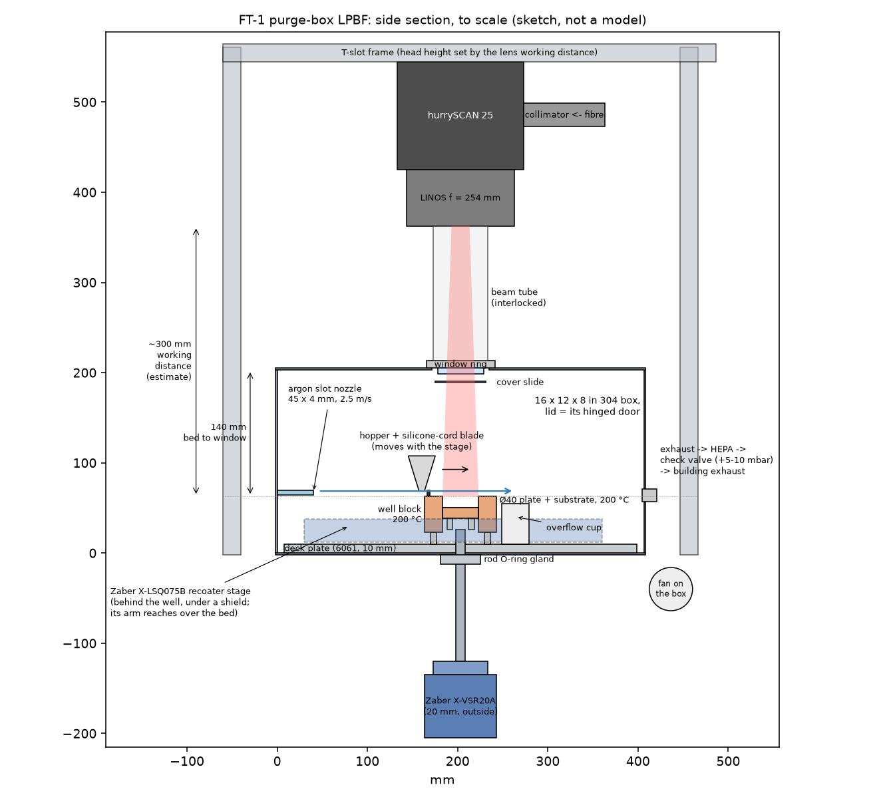
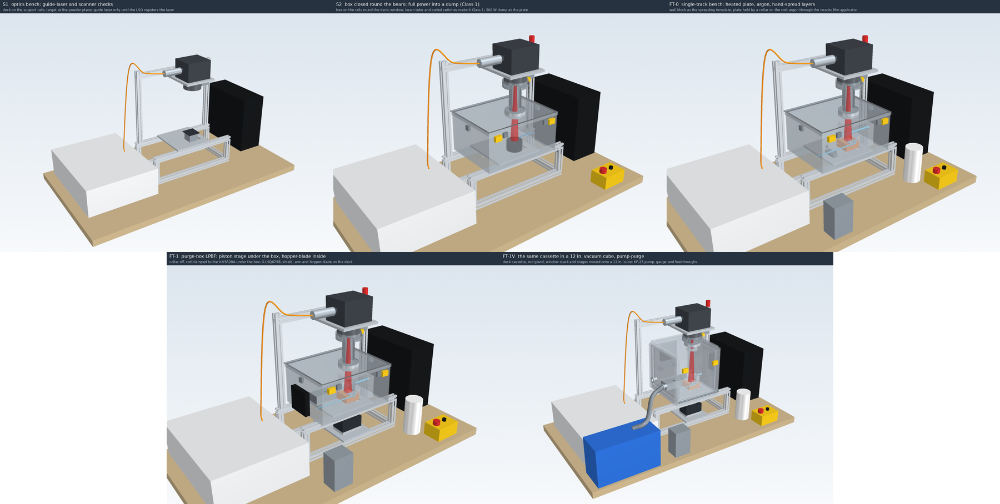

# Fast-track alternatives: a working desktop LPBF in 3–6 weeks

For [issue #260](https://github.com/vertical-cloud-lab/digital-alloy-lab/issues/260), 2026-11-26. Sterling asked on PR 266
for "alternative designs that could simplify the process and lead to a working product in a shorter lead time (e.g., 3-6
weeks from start to finish)". This note compares those alternatives, recommends one, and gives its parts, costs and
schedule. It is stacked on PR 266's design and reuses its numbers. Nothing here has been bought, built, quoted by a
person, or reviewed by BYU's Laser Safety Officer (LSO) or EHS.

"Start" here means the day the decision is made and the orders go out. "Finish" means the first multi-layer test coupons
in an Al alloy: the smallest result that shows a working LPBF machine.

| File | What it is |
|---|---|
| [`README.md`](README.md) | this note |
| [`parts.csv`](parts.csv) | the parts for FT-0, FT-1 and FT-1V, with price, condition, availability as read, source and fetch time |
| [`live-reads-2026-11-26.csv`](live-reads-2026-11-26.csv) | every listing and vendor page read today through the lab Pi (BYU network), including the ones eBay refused |
| [`fast_track.py`](fast_track.py) | purge, argon, heat, optics and powder sizing; costs from `parts.csv`; the forward-pass schedule and Gantt chart |
| [`out/`](out/) | the script's tables (`summary.md`, `schedule.csv`, `purge.csv`, `build.csv`, `optics.csv`) |
| [`img/gantt.png`](img/gantt.png), [`img/ft1-section.png`](img/ft1-section.png) | the schedules, and FT-1's layout to scale |
| [`cad/`](cad/) | **the CadQuery model of FT-0, FT-1 and FT-1V, and the progression between them as parts arrive** (model, checks, schedule, renders, STEP); see [`cad/README.md`](cad/README.md) |
| [`../edison/ft-fast-track-review/`](../edison/ft-fast-track-review/) | Edison `LITERATURE_HIGH` review of minimal LPBF builds (query, answer, references, trajectory) |
| [`live-reads-2026-11-27.csv`](live-reads-2026-11-27.csv) | round 2's reads through the lab Pi (headed Chrome, real mouse clicks): eBay, Zaber, Thorlabs, Digi-Key, Digilent, box and heater vendors |
| [`process/`](process/README.md) | rounds 2–3: optics chain, back reflection, thermal lens, AlSi10Mg melt-pool model and starting set, the first build's scan program and RTC lists, build times |
| [`control/`](control/README.md) | round 2: the build supervisor `ftctl` (simulated and real backends, 54 tests), interlock check, I/O list, power budget, wiring diagrams, dwell study, commissioning |
| [`analysis/`](analysis/) | rounds 2–3: structural and thermal FEA (CalculiX) and gas CFD (OpenFOAM) of FT-1/FT-1V, on CAD v2 since round 3 |
| [`fab/`](fab/) | rounds 2–3: fabrication-ready parts (CAD v2 since round 3), FreeCAD CAM and G-code, voxel checks, drawings, shop hours |
| [`../edison/ft-round2-review/`](../edison/ft-round2-review/answer.md) | Edison round 2: seven design risks and the top five with first-week checks |
| [`video/`](video/README.md) | round 2: the progression video, S1 → FT-1V on the round-1 model with the real scan programs ([YouTube](https://youtu.be/kdaj7jzdJyI)), its pipeline, QA and frame audit |
| [`day0/`](day0/README.md) | round 3: every request a person has to send on day 0 (LSO, EHS and the Fire Marshal, Physical Facilities, sellers and makers, BYU Purchasing), and FT-1's laser-hazard numbers for the LSO |
| [`live-reads-2026-11-28.csv`](live-reads-2026-11-28.csv), [`…-notes.md`](live-reads-2026-11-28-notes.md) | round 3's reads through the lab Pi: SCANLAB's RTC4 package, PicoScope, the Pi HQ camera, the AE chain, Digi-Key, the cube's face opening, BYU's card rules and laser-safety pages |
| [`fab/review-r3.md`](fab/review-r3.md) | round 3: a separate review of the fabrication programs and the shop-hour allowances |

## Short answer

Updated in round 3 (2026-11-28). §0 lists what round 3 found, working through round 2's not-done list; §0a lists
what round 2's detailed design changed.

- **PR 266's design can't reach 6 weeks.** Bought new, the IPG laser alone takes 12–15 weeks to arrive. With the laser,
  scan head and card bought used, fabrication sets the date: about 10–11.5 weeks to an assembled machine
  ([`lead-times.md`](../robot-build/lead-times.md)). The 287 shop hours, the outside honing of the build module (3–6
  weeks, unquoted) and two safety switches with 19–27 week lead times are the long poles.
- **The recommended fast-track machine is still FT-1, a "purge box" LPBF:** a small LPBF built almost entirely from
  things that ship within days.
  - **Optics:** a used IPG 400 W single-mode laser, a used SCANLAB hurrySCAN 25, a used f = 254 mm lens and a used
    **RTC4 PCIe** card. The RTC5 named in round 1 can't drive this 2003 XY2-100 head without SCANLAB's converter
    ([`control/`](control/README.md) §6). The head and lens sit 30 mm in front of the plate's centre, so that a
    reflection off a flat aluminium plate can't go back into the laser's fibre ([`process/`](process/README.md)).
  - **Enclosure:** a stock 304 stainless NEMA 4X box (Saginaw SCE-16EL1208SSLP, $694.24) laid on its back, so its
    hinged door is the lid with the laser window in it. Argon flows through it; there is no vacuum.
  - **Powder bed:** two stock Zaber stages (1–5 day lead time). The X-VSR20A lowers a Ø40 mm heated plate in a heated
    aluminium well. The **X-LSM100B** moves a small gravity-fed hopper with the blade, as Heriot-Watt's rig did; Zaber's
    STEP showed round 1's X-LSQ075B is 285.9 mm long, too long for the deck.
  - **Custom parts:** 41 kinds of piece to FT-1 on CAD v2 (47 with FT-1V's), every machined one programmed in
    FreeCAD CAM: **81–166 shop hours** with PR 266's allowances (round 2's set on the round-1 model: 59–122; round 1
    guessed 25–40) ([`fab/`](fab/)). A separate review found fixes the programs needed before they run; round 3 made them, and the review's own hours for FT-1 on v2 are 107–137 h with a machinist. No honing, no vacuum seals, no 4th axis.
  - **Cost:** **$30.6k–49.8k** with the monitoring set (camera, raking lights, coaxial photodiode, acoustic emission,
    digitizer), **$25.4k–42.2k without it**, against $70.5k–154.1k for PR 266's BOM. Round 3's rise is the shop
    time on v2's pieces.
  - **Time:** first tracks at 3.2–9.0 weeks and **first coupons at 4.2–11.0 weeks** with the shop giving 5–8 hours
    a working day. The shop, not the parts, sets the date, so how the stages are bought no longer matters. At 12 shop
    hours a day the coupons come at 3.6–7.1 weeks. **With two people programming and cutting full time for the first
    11 working days, every piece is ready when the build needs it: first coupons at 3.5 weeks at the expected hours,
    4.6 at the high ones** ([`fab/out/plan.md`](fab/out/plan.md)). One person gives 5.5 weeks.
- **FT-0 is FT-1's first half:** the same optics, box and heated plate without the stages, spread by hand with a 48 mm
  spreader bar. It lays single tracks and single-layer pads at **2.4–6.9 weeks for $22.7k–39.7k** ($18.0k–33.3k
  without monitoring), and it is worth doing even if FT-1 follows, because it checks the used laser chain inside its
  return windows.
- **What FT-1 gives up**, all of which can come back later:
  - O₂ of 100–1000 ppm by flow purge, against PR 266's 1–10 ppm by pump-purge. The purge CFD on CAD v2 has the box at
    1000 ppm in about 3.1 min and 100 ppm in about 5 min with a low diffuser and a vent at the top of the door. With
    the lid seated and the box at +5–10 mbar, leaks set a floor of a few ppm (0-D estimate). EOS M 290 work on Al
    uses a 1000 ppm threshold and small commercial machines purge to 1000–3000 ppm (PR 266 §2.3), and PR 266's own
    review found O₂ matters less than the powder's water ([`vacuum-and-purge.md`](../vacuum-and-purge.md)).
    FT-1V, the same machine in a stock vacuum cube, keeps pump-purge for $11.4k–13.7k more and 0.7–1.8 weeks longer.
  - One Ø40 mm plate instead of Ø25/50/75 modules; builds up to 15 mm.
  - No VLM tray fit, no robot features, no recirculating gas loop (argon runs once through).
- **What it keeps:** the physics PR 266 chose. A CW single-mode fibre laser at 1070 nm with a galvo and f-theta (76 µm
  spot), argon, a 200 °C plate, a few tens of grams of powder per build, hardwired interlocks and Python control (the
  supervisor `ftctl` runs a whole simulated build today: [`control/`](control/README.md)).
- **Heat, not the scanner, sets the build time.** The plate sheds the laser's heat to the block only through the 0.1 mm
  argon gap: 0.67 W/K from the substrate top in the thermal FEA. Without a dwell the substrate would run 41–106 K above
  200 °C. At that conductance a 10 mm build on CAD v2 takes 1.5–3.0 h holding the substrate within +10 K with the
  block at the set point, and **0.8–1.6 h with the block 20 K cooler** (absorptivity 0.3–0.6; scanning and recoating
  alone take 0.6 h; [`process/`](process/README.md) §R3.3). Round 2's +5 K hold gave 2.1–4.2 and 0.8–1.8 h
  ([`control/out/dwell-study-fe.csv`](control/out/dwell-study-fe.csv), [`analysis/out/fea/`](analysis/out/fea/)). The
  starting set for AlSi10Mg is 255 W, 1.25 m/s, 0.10 mm hatch, 30 µm layers ([`process/`](process/README.md)).
- **The long poles are now the shop and the approvals, not parts.** Registering a Class 4 laser with the LSO and an EHS
  look at aluminium powder have no published turnaround at BYU; FT-1 is a Class 1 enclosure (the beam is enclosed from
  the fibre to the plate) to make that review simple, and both requests should go out on day 0, with a Physical
  Facilities request for the laser's 208/240 V circuit if the room has none ([`day0/`](day0/README.md) has every
  request written out).
- **What round 3 changed in the design** (§0):
  - put the purge vent through the box's door, at its top;
  - measure the delivered door's return, and if it is under about 15 mm add a toggle clamp near each front corner:
    as drawn, the door's front corners lift off the gasket above about +22 mbar;
  - round the deck plate's corners to R 30, so the cassette lies flat in the cube at the estimated 250–260 mm face
    opening, and ask Ideal Vacuum for the frame's drawing before ordering the cube;
  - put focus ladders and reference crosses on the back half of the plate: its front 5 mm can return up to ~256 W of
    a polished plate's 342 W onto the scan mirrors;
  - brace the gantry's portals: with real bolted joints g3's first mode falls from 62 Hz to 44–54 Hz (34 Hz on bolted foot plates). A low diagonal in the front portal, one over the box at the back, a second bracket at each brace end and a thick plate under each foot bring it back to 62 Hz; then tap-test the built frame. Drawn as CAD variant g4b, the braces are clean in the box
    states, but FT-1V's cube needs its own back brace.
- **Two routes need no building and cost a phone call:** BYU's own metal-AM lab runs aluminium on a Concept Laser M2
  ([`safety.md`](../safety.md)); a reduced-build-volume insert there is how many groups screen alloys with little powder.
  And outside builds (a service bureau's reduced-volume machine, or the University of Utah's Aconity MIDI) can cover a
  specific alloy. Neither gives us our own machine or in-situ data.
- **Everything FT-1 buys carries into PR 266's machine:** the laser chain, the scan card, the stages, the heater control,
  the O₂ analyzers, the safety relay and the monitoring set. FT-1's box then becomes the spreadability rig of PR 266's
  phase 0.


*Working days from the decision; dark bars are the early estimate and light bars run to the late one. Grey: approvals
whose length at BYU is unknown (assumed 1–3 weeks). Red: milestones. The shop rows ("S1 parts made" ...) are
`fab/`'s hours per state: the low hours at 8 shop hours a working day, early, and the full hours at 5, late. Every
duration and its basis is in [`out/schedule.csv`](out/schedule.csv).*

## 0. Round 3 (2026-11-28): the not-done list, worked through

Sterling asked on PR 294 to do the PR's "What wasn't done" list where it could be done. Round 3 re-ran every analysis
on CAD v2, now with the g3 gantry as the model's default. It also finished what round 2 had left open, read what the
lab Pi could reach, had the fabrication programs reviewed by a separate worker, and wrote out the requests that need a
person. The first attempt ran out of credits partway through; the retry merged its workers' commits and finished the
rest. Nothing has been measured, bought or sent.

| Not done in round 2 | Where | What round 3 found | What changes |
|---|---|---|---|
| Nothing bought, built, quoted by a person, or reviewed by the LSO or EHS | [`day0/`](day0/README.md) | every request a person has to send, written out: the LSO, EHS and the Fire Marshal, Physical Facilities, the sellers and makers, BYU Purchasing. FT-1's laser-hazard numbers by PR 266's method: eyewear OD ≥ 5.3 for the direct 400 W, NHZ 162 m for the direct beam through the f-theta ([`lso-numbers.md`](day0/lso-numbers.md)) | still needs a person on day 0. BYU's laser-safety pages need a BYU login, so the forms themselves are not known |
| The g3 gantry clash-checked only on its new members; renders on the braced frame | [`cad/`](cad/README.md) | g3 is the default. **0 clashes and 0 parts in the beam envelope** in S1, S2, FT-0, FT-1, FT-1V and the Thorlabs variant (29 / 53 / 88 / 106 / 108 / 105 parts); renders, STEP and progression redone. The head comes off with MK-09 once the collimator is out ([`head-service.md`](cad/out/head-service.md)) | none |
| The gantry FEA's joints bonded | [`struct.md`](analysis/out/fea/struct.md) | **With real bolted joints, g3 is under the 60 Hz minimum.** With each joint a single T-slot bracket (estimated 1–10 kN·m/rad and 10–50 kN/mm, from Huth's bolt-flexibility formula), mode 1 drops from 61.9 Hz bonded to 43.9–54.4 Hz with the feet fixed, 41.1 Hz on a thick foot plate and 34.1 Hz on a bolted plate. The 12 brace ends matter most among the joints, and the feet more than any joint. Options (feet fixed / thick plate / bolted plate): both portals braced with stiff brace ends 72.8 / 64.4 / 57.5 Hz; **a low front diagonal and a back diagonal, brace ends stiffened, 70.7 / 62.0 / 54.8 Hz** (60.1 Hz on the thick plate with the other joints at the soft end). No option passes on plain bolted foot plates | **brace the portals:** a diagonal low in the front portal (the left post's foot to the right post at z 140, about 590 mm, clear of the door's front gap) and one in the back portal over the box (about 480 mm); a second bracket or a doweled end plate at all 16 brace ends; a 12–15 mm plate under each front post, bolted to the bench, and each back post bolted to its base rail through an end plate. Then **tap-test the built frame** against 60 Hz (`struct.md` 4c has the procedure). **In the CAD** (variant g4b, [`cad/README.md`](cad/README.md)): the two diagonals draw clean in S1, S2, FT-0 and FT-1, out of the beam, and leave the lid's front gap and 24° swing as on g3. Make the lower front diagonal removable: it stops FT-1V's cube door at 8° and blocks the box sliding off its rails. In FT-1V the back diagonal runs through the cube, so FT-1V needs its own back brace and its own FEA. g3 stays the model's default; the foot plates and second brackets aren't drawn yet, and the CAD ends the back diagonal 20 mm lower (z 255, clear of a knee brace): re-run as drawn, **70.3 / 61.6 / 54.5 Hz** (feet fixed / thick plate / bolted plate), still over 60 Hz on the thick plates |
| Fabrication on the round-1 model | [`fab/`](fab/) | ported to CAD v2 with g3: **47 pieces** (v1 35), 85 setups and 261 FreeCAD operations (v1 63 / 188), re-posted with no errors after the review's fixes. **81 / 166 / 249 shop hours to FT-1** (low / expected / high; v1 59 / 122 / 189). v2 adds the monitoring hardware, g3's plates and brackets, and the deck clamps | the schedule and the shop-time lines of `parts.csv` use these hours (below) |
| The shop hours rest on allowances; nobody reviewed the programs | [`fab/review-r3.md`](fab/review-r3.md) | a separate review of round 2's 63 programs. The basics pass in all of them, but **six setups can't run with the tool library as defined, 194 Adaptive links would cut material as a Haas's dogleg rapids, MK-02a_B cuts its soft jaws, and the rod's 304 lead notch (MK-06) runs above the makers' charts**. The allowances' range is credible; its low end leaves out 10–20 h (fixtures, tool setting, sawing), and its expected case counts the CAM as written from scratch. FT-1 (v1): 77–98 h with the CAM fixed and a machinist on the floor, 92–125 h with a student doing half of it | **fixed on v2** ([`fab/README.md`](fab/README.md), round 3): 11,221 Adaptive links now run as feed moves, so no rapid cuts material on a Haas; the holder clears the stock in every setup; helix starts 1 mm up, outlines on flipped pieces split, a 304 cutter with a ramp entry, long-series drills. Two faults the v2 port had added are fixed too: MK-10c's lens bore left a 50 × 34 mm pillar, and its set-screw holes ran across the bore. 85 setups and 261 operations, no errors, with a setup sheet for each ([`setup-sheets.md`](fab/out/setup-sheets.md)). The review's own hours on v2: FT-1 107–137 h with a machinist, 129–178 h with a student, inside the allowances' 81–249 h |
| Structural FEA on the round-1 model (lid, cube plate, rod) | [`struct.md`](analysis/out/fea/struct.md) | **The Saginaw door, as drawn, doesn't hold its gasket at a +50 mbar fault.** With one latch and two hinges its front corners lift: the seal starts to open at about +22 mbar, and 155 mm of the 1,314 mm line is open at +50 mbar. A 15–20 mm door return, or a toggle clamp near each front corner (~140 N each at +50 mbar), keeps ≥ 0.5 mm of the 1.0 mm squeeze. The cube plate (SF 32), window (SF 74) and rod (Euler 88 kN at 200 °C) still pass | measure the delivered door's return (the CAD draws 5.5 mm, an envelope); if it is under ~15 mm, add the two front clamps; set the purge's relief below +20 mbar (`parts.csv` E6, new) |
| Process and optics on the round-1 model | [`process/`](process/README.md) | no part of v2 is in the beam (tightest: the cover-slide holder, 2.8 mm at the Ø40 plate's edge). **The plate's front 5 mm can return up to ~256 W of a polished plate's 342 W onto the scan mirrors**; the Ø30 build area returns ≥ 17.4 mm off and misses them. RTC4 lists: 803–1,105 commands a layer, so one list a layer. A 10 mm build takes 0.8–1.6 h with the block 20 K below the plate, 1.5–3.0 h with it at the set point (holding +10 K) | focus ladders and reference crosses go on the back half of the plate margin; `control/`'s scan offset set to −30 mm, the lens axis's offset |
| CFD on the round-1 model | [`results.md`](analysis/out/cfd/results.md) | the cross-flow is unchanged on v2 (2.50 m/s 3 mm up, 0.055 Pa bed shear, 94–99 % of fume caught). The low-diffuser purge takes 3.1 / ≈ 4.9 min to 1000 / 100 ppm (v1 2.6 / 5.0): the Saginaw's dished door holds the last third of the O₂ above any wall vent | **put the vent through the door**, at its top (`parts.csv` G9) |
| The purge CFD isothermal and leak-free | [`results.md`](analysis/out/cfd/results.md) | **Leaks (0-D, estimates):** with the lid seated and the box at +5–10 mbar the exhaust reads 2–6 ppm at 27 L/min (argon 5.0 is 2 of it), 9–48 ppm at a 2 L/min dwell; with no overpressure a 30 µm gap along the seam holds the purge at ~60 ppm. **Leak CFD:** O₂ that leaks in at the lid stays in the box: 1 mm over the build area it is about a tenth of the exhaust reading. **Heat (CFD, R3.7):** a 200 °C bed and block leave the jet as it was (2.52 m/s, 0.056 Pa), but their plume reaches the lid: 54–56 °C under the cover slide, 47 °C at the exhaust, 39 °C box average. Fume that escapes above the jet passes the slide at 40–70 mm, not 103 mm (rough: the plume moves). The plate loses 3.9 W by convection, as the thermal FEA has it | keep +5–10 mbar on the box; the exhaust analyzer gives the conservative number; expect the cover slide to foul faster than the isothermal runs suggested, and watch it in the first builds |
| The FT-1V purge CFD not run | [`results.md`](analysis/out/cfd/results.md) | the cube's flow purge (20 L/min, low diffuser, high vent) reaches 1000 / 100 ppm in 2.1 / ≈ 3.5 min, faster than the box; again the last air waits above the vent (32–48 % of the O₂ under the top plate). Two pump cycles to 1 mbar still do better: about 2 ppm in 5.0 min with 45 L of argon (0-D), where the flow purge needs ~75 L for 100 ppm (R3.6) | keep pump-purging FT-1V; if it is ever flow-purged, vent through the top plate |
| The cube's face opening unpublished | [`cad/`](cad/README.md), [`live-reads-2026-11-28-notes.md`](live-reads-2026-11-28-notes.md) | still unpublished: Ideal Vacuum's site blocks the Pi, and the frame's STEP was never archived. Estimated 250–260 mm from Ideal Vacuum's render, 243 mm from the brochure's volume. The deck has to lie in the cube's bottom pocket, which is as big as the face opening, so the opening must be ≥ 245 mm square (247 mm with 1 mm a side), or 245 + 0.586 r with corner radius r. Tilting the cassette doesn't help, and round 2's edge-on fallback can't lie flat either | **round the deck plate's (MK-01) corners to R 30**: it then fits a 250–260 mm opening with corners up to R 25.4. At 243 mm only a 240.2 × 197.3 mm deck fits. Ask Ideal Vacuum for P107540's drawing before ordering the cube |
| A 64-bit DLL for the RTC4 unconfirmed | [`control/`](control/README.md), [`live-reads-2026-11-28-notes.md`](live-reads-2026-11-28-notes.md) §2 | **it exists:** SCANLAB's public RTC4 Software 2023-11-02 has `RTC4DLLx64.dll` and a signed x64 driver, and SCANLAB's RTC4 brochure (11/2026) still lists the RTC4 PCIe. `rtc4.py`'s prototypes now match SCANLAB's `RTC4expl.h` (`select_rtc` fixed). The hardware list stop is wired to the RTC4's /STOP (laser connector pin 9) too (I/O list S-13) | run the RTC4's PC on Windows 10 x64: Windows 11 isn't named |
| Prices not read | [`live-reads-2026-11-28.csv`](live-reads-2026-11-28.csv) | PicoScope 4824A US$2,999, in stock. Acoustic emission: a PXR15 sensor and a used PAC 1220A preamp come to about $455 on eBay, against `parts.csv`'s $800–2,000. The Pi HQ camera (C/CS mount) is out of stock at every seller read (Digi-Key expects stock on 28 Dec); the M12 version is in stock. **The stray-beam thermostat in `parts.csv` was a normally open part**: the normally closed Sensata 67L075 ($8.11, 1,368 in stock) replaces it | `parts.csv` S6 and the monitoring lines |
| BYU's purchasing-card rules not checked | [`live-reads-2026-11-28-notes.md`](live-reads-2026-11-28-notes.md) §7 | $3,500 a purchase at most, no split purchases, $10k a month on a card ($20k on a department card); eBay isn't mentioned | `fast_track.py` totals the card orders: FT-1's come to about $29k at the high prices, 2.9 cards' monthly limit, so spread them over cards or months. Zaber's two stages ($5,896) need a Workday requisition |
| Progression video on the round-1 model | [`video/`](video/README.md) | **not re-rendered.** Its port to v2 was half done when the first attempt stopped (the planner's assembly paths still collided with v2's new parts), and a render takes hours | the round-2 video stands, labelled as round 1's model |

**Which model each analysis used, after round 3:**

| Work | Model |
|---|---|
| CAD checks, progression, renders, STEP | v2, g3 gantry (round 3) |
| Process and optics, RTC4 lists | v2 (round 3) |
| Structural FEA | v2 (round 3): door, cube plate, rod; the gantry g3 with bolted joints |
| Thermal FEA | v2 (round 2) |
| CFD | v2 (round 3) |
| Fabrication (pieces, CAM, hours) | v2, g3 gantry (round 3); drawings on v2 too (47 sheets) |
| Progression video | v1 (round 2) |

**What round 3 does to the dates and the cost.** The v2 fabrication set is 47 pieces (41 to FT-1), and its 81–166
shop hours now set FT-1's date. At 5–8 shop hours a working day FT-1's first coupons come at 4.2–11.0 weeks (round 2:
3.7–9.3), and at 3.6–7.1 weeks with 12 shop hours a day ([`out/summary.md`](out/summary.md)). The shop calendar's
two-person case still meets every date at the expected hours: two people who program and cut full time for the first
11 working days give first coupons at 3.5 weeks, 4.6 at the high hours ([`fab/out/plan.md`](fab/out/plan.md)). FT-1
costs $30.6k–49.8k ($25.4k–42.2k without monitoring), $1.5k–2.5k more than round 2, almost all of it shop time. FT-0
costs $22.7k–39.7k with first tracks at 2.4–6.9 weeks; FT-1V $42.1k–63.5k with first coupons at 4.9–12.8 weeks.

## 0a. Round 2 (2026-11-27): what the detailed design changed

Sterling asked for the design to be worked through properly: real vendor geometry, analysis, fabrication and a video.
This round did that in parallel workers, each in its own folder, and read prices and drawings live through the lab Pi
in headed Chrome with real mouse clicks. Each finding below links the folder with its numbers and method.

| Finding | Where | What changes |
|---|---|---|
| **With the lens over the plate's centre, a flat aluminium plate at focus would send about 342 W back into the used laser's fibre core** (R 0.9 at 400 W) | [`process/`](process/README.md) | the scan head and lens move **30 mm toward −Y** (the nozzle): every plate point is then 10–50 mm off axis and the return misses the core; the window stack moves to y = −11 mm (box) / −21 mm (cube); the cover-slide holder opens to Ø44 mm. First test on arrival: 50 W on a bead-blasted plate, watching the laser's back-reflection status bit; ask IPG with the serial number whether this unit has back-reflection protection (Edison's top risk) |
| **The RTC5 can't drive the 2003 hurrySCAN 25**: its head connector speaks only SL2-100, the head XY2-100 | [`control/`](control/README.md) §6 | a used **RTC4 PCIe ($400)**, which drives XY2-100 natively, replaces the RTC5 ($1,499.99); the supervisor has backends for both. Unconfirmed: a 64-bit DLL for the RTC4 |
| **Zaber's own STEP shows the X-LSQ075B is 285.9 mm long**, not the ~241 mm estimated last round, so it doesn't fit the deck or the cube | [`cad/`](cad/README.md) | the recoater is the **X-LSM100B-E03** (239.2 mm, 101.6 mm travel, $2,871, 1–5 days); the deck is 245 mm |
| The other bought parts measured from the makers' files: X-VSR20A 88 × 101 mm; hurrySCAN 20/30 housing 206.9 × 140 × 180 mm, 5.8 kg; LINOS working distance 296.2 mm; the box is a real part (Saginaw SCE-16EL1208SSLP, $694.24) | [`cad/`](cad/README.md), [`live-reads-2026-11-27.csv`](live-reads-2026-11-27.csv) | the model is redrawn on them (CAD v2) |
| **The laser's rating label** (listing photos): made Feb 2015, 1/N/PE 200–240 VAC, 10 A | [`control/`](control/README.md) §3 | the laser needs its **own 208/240 V, 15 A two-pole circuit**: a Physical Facilities request on day 0. Everything else is ~440 W on one 120 V 20 A circuit |
| **Safety chain:** Omron documents the G9SE-201 only with direct-opening switches and Type 4 OSSD sensors, and two lid switches in series mask each other's stuck contacts | [`control/`](control/README.md) §2 | **one Omron D4NS-2CF tongue switch per guard** (lid, beam tube), $96.91 each today; a contact-level check of the whole chain (1,048,576 transitions) never emits with a contact open |
| **The trace O₂ analyzer reads only to 10,000 ppm**, so it can't show the box is safe to open | [`control/`](control/README.md) §1 | a percent-range O₂ transmitter on the exhaust, a valve that keeps the trace cell out of air, possibly a sample pump |
| **The plate's heat sets the build time.** The thermal FEA (CalculiX, CAD v2) gives 0.67 W/K from the substrate top to the block (0.83 W/K across the 0.1 mm argon gap); without a dwell the substrate runs 41–106 K over 200 °C | [`analysis/out/fea/`](analysis/out/fea/), [`control/`](control/README.md) §7 | a dwell takes most of each layer: at the FE conductance a 10 mm build takes 2.1–4.2 h with the block at setpoint, **0.8–1.8 h with the block 20 K below the plate** (round 1 assumed 1.2–1.8 h with no dwell) |
| **Process window** from a melt-pool model calibrated on 15 published AlSi10Mg tracks | [`process/`](process/README.md) | starting set **255 W, 1.25 m/s, 0.10 mm hatch, 30 µm layers**; first build three 10 mm and two 5 mm cubes; 0.60 h for 10 mm before any dwell; RTC lists for commissioning rungs 1–3 |
| **Structure** (CalculiX) | [`analysis/out/fea/struct.md`](analysis/out/fea/struct.md) | a **sponge silicone gasket**, not a solid cord (the cord needs 4.0 kN to close); the gantry as drawn in round 1 has a **13 Hz** first mode, so **four 45 mm posts with braces** (79 Hz in an equivalent model). Drawn in CAD v2 and re-run as drawn: 43 / 60 / 67 Hz; with front knee braces, a top flange and gussets on the head plate (now drawn) **50 / 67 / 94 Hz**, the frame no longer racks, but mode 1 is still under the 60 Hz minimum: the head swings on the flange plate below the beams; moving the gussets under the head changes nothing (49.8 Hz), because the head's centre of mass sits 95 mm out from a plate held only near its top. **A support plate on the head's far face from both cross-beams (variant g3, drawn and clash-checked) gives 62 / 101 / 179 Hz**, over the minimum: that is the frame to build); the cube plate and window pass (SF 34 and 74); the X-VSR20A must pull the rod down past its O-ring drag (7–45 N); the Thorlabs stage needs one O-ring |
| **Cross-flow** (OpenFOAM, laminar and k-ω SST, 237k cells) | [`analysis/out/cfd/`](analysis/out/cfd/) | the slot jet holds 2.6–2.7 m/s over the build area; bed shear 0.03–0.05 Pa, below the 0.053–0.118 Pa that starts to lift 63 µm powder; 96–99 % of tracers released 0.5–3 mm up reach the collector |
| **Purge** (OpenFOAM, passive and buoyant two-gas runs) | [`analysis/out/cfd/`](analysis/out/cfd/results.md) | through the nozzle alone, as drawn, the box takes 33–50 min to 1000 ppm; **a low diffuser and a high vent reach 1000 ppm in 2.6 min and 100 ppm in about 5 min** (argon displaces the air from the floor up), faster than perfect mixing (6.2 / 8.9 min). Two bulkheads, a diffuser and a ball valve; the analyzer samples the vent |
| **Fabrication** (FreeCAD CAM, 66 setups, every program checked in a voxel simulation; 35 drawings) | [`fab/`](fab/) | with PR 266's per-part allowances, FT-1's parts need **about 59–123 shop hours, not 25–40**. The schedule below is redone on them |
| **Progression video** (5:51; every frame audited for collisions; PR 266's camera check passes; scan vectors from the process program) | [`video/`](video/README.md), [YouTube](https://youtu.be/kdaj7jzdJyI) | shows round 1's model and numbers, labelled as such |
| **Monitoring** after PR 266's `monitoring.md`: layer camera, two raking lights, a coaxial photodiode, acoustic emission, thermocouples, one digitizer on the laser's time base | [`cad/`](cad/README.md) (MON1–MON8), [`control/`](control/README.md) | $4.5k–6.2k at FT-0 and $5.3k–8.2k at FT-1 (`parts.csv` group "Monitoring") |
| **Edison round 2:** seven design risks reviewed; the top five with first-week checks | [`../edison/ft-round2-review/`](../edison/ft-round2-review/answer.md) | back reflection, piston binding at 200 °C, purge leaks, hopper dosing of fine Al, cover-slide fouling; the commissioning steps in `control/ftctl/commission.py` follow them |

**Which model each analysis used.** The CAD v2 model landed partway through the round, so not everything was re-run on
it:

| Work | Model | Note |
|---|---|---|
| CAD checks, progression, renders, STEP | v2 | [`cad/`](cad/README.md) |
| Thermal FEA | v2 | [`analysis/out/fea/`](analysis/out/fea/) |
| Structural FEA | v1 for the lid, cube plate, window and rod; the gantry also on v2's drawn frame | v2's frame: 43 / 60 / 67 Hz as first drawn, 50 / 67 / 94 Hz braced, 62 / 101 / 179 Hz with the head's far side supported (g3) ([`struct.md`](analysis/out/fea/struct.md) 4c addendum) |
| CFD | v1 (same box, cassette and nozzle) | [`analysis/out/cfd/`](analysis/out/cfd/) |
| Process and optics | v1 geometry, own optics model | its changes (lens offset, window position) are in v2 |
| Fabrication (pieces, CAM, drawings, hours) | v1 | v2's changes listed and costed in [`fab/out/v2/delta.md`](fab/out/v2/delta.md); `fab/parts.py` stops with a message on v2 until ported |
| Progression video | v1 | [`video/`](video/) |

## 1. What sets the schedule of PR 266's design

| Long pole | Time | Source |
|---|---|---|
| IPG YLR-500-U3-SM-AC, new | 10–12 weeks after the order, plus BYU's PO (10–14 days) and freight: 12–15 weeks | [IPG quote](../quotes/ipg-ylr-500-u3-sm-ac.md), [`lead-times.md`](../robot-build/lead-times.md) |
| IDEC HS6B guard switch (S2) and Omron K8DT relay (H2), as chosen | 27 weeks; out of stock until 2027-03-03 | `lead-times.md` §2 |
| 57 machined parts | 287.3 h with a 4th axis (CAM 132 h, setups 99 h); 134 BYU hours on the recommended hybrid | [`manufacturing-route.md`](../robot-build/manufacturing-route.md) |
| Build module: turn, weld, bore, honing sent out | 3–6 weeks, unquoted | `manufacturing-route.md` |
| Used majors + swapped switches + outsourcing split | assembled at 10.3–11.5 weeks; fabrication sets it | `lead-times.md` §1 |
| LSO registration, EHS dust hazard analysis, a 208–240 V circuit | unknown | [`safety.md`](../safety.md) |

The parts that make the machine slow come from requirements a first machine doesn't need:

| PR 266 requirement | What it forces | FT-1 |
|---|---|---|
| Pump-purge to 1–10 ppm O₂ | a vacuum-rated machined chamber, 29 glands, a scroll pump, a Pirani gauge, vacuum feedthroughs, a sealed rod exit | flow purge to 100–1000 ppm in a stock box; add the vacuum later (FT-1V, or PR 266) |
| Heated build modules Ø25/50/75 on a sealed piston | honed bores, hot sliding seals, clearances that close as the plate heats, zero-point clamps | one Ø40 mm plate in a well heated to the same temperature, so the clearance doesn't change |
| Fits a VLM tray (≤ 695 mm) | low-profile layout, folded Z, 12U rack, dock, UPS | a bench machine |
| Robot-tended | drawbar, grip blocks, liners, AprilTags, pneumatic door | Python control of every axis now; robot features later |
| Recirculating gas at 140–200 L/min | a sealed blower (none found), plenums, a HEPA housing in the loop | once-through cross-flow from the cylinder, ~27 L/min |
| Class 1 guard around the whole machine | T-slot guard, sliding guard door, guard lock | the stainless box and a beam tube are the enclosure |

## 2. The alternatives

| | Alternative | Parts + shop time | First tracks | First coupons | O₂ | Heated plate | Main risk | Verdict |
|---|---|---|---|---|---|---|---|---|
| A | PR 266's design, fast-tracked (used majors, swapped switches, outsourcing split) | $70k–76k at spec with used majors (`lead-times.md`) | ~11.3–13.5 wk | ~12–15 wk | 1–10 ppm | Ø25/50/75 modules | honing, 134+ BYU hours | the long-term machine, not a 6-week one |
| **FT-0** | **Single-track bench**: used laser chain over a heated plate in a stainless box, hand-spread layers | **$22.7k–39.7k** ($18.0k–33.3k without monitoring) | **2.4–6.9 wk** | single layers and pads only | 100–1000 ppm (flow) | Ø40, 200 °C | the used laser's condition | **do first** |
| **FT-1** | **Purge-box LPBF**: FT-0 plus a heated well, a piston stage and a hopper-blade stage | **$30.6k–49.8k** ($25.4k–42.2k without monitoring) | **3.2–9.0 wk** | **4.2–11.0 wk** at 5–8 shop h a day; 3.5 wk with two people full time in the shop for 11 days | 100–1000 ppm (flow) | Ø40 well, 200 °C | shop hours; approvals; hopper flow with fine Al | **recommended** |
| FT-1V | FT-1 in a stock vacuum cube with a pump-purge kit | $42.1k–63.5k | 3.9–10.8 wk | 4.9–12.8 wk | < 100 ppm in 2–3 cycles | Ø40 well, 200 °C | stages and grease under vacuum; two POs | if O₂ below 100 ppm is required from day 1 |
| E | Laser engraver as the base (PR 266 §1b) | $7.5k–9.5k for a 200 W MOPA engraver | – | – | – | add-on | pulsed only: Monport's GT 200W has no CW or quasi-CW mode, and its board is closed (Sterling's 2026-11-19 update) | no: with a CW laser swapped in it becomes FT-0 with marking-grade optics |
| F | Buy a commercial desktop unit (AO Metal A30, Xact XM200C, ...) | $59k–130k (PR 266 §2.2) | vendor lead time + PO and any bid steps | – | ≤ 1000–3000 ppm typical | none listed on the desktop units | lead times not published; no heated plate | the go/no-go fallback, not a 6-week route |
| G | Reduced-build-volume insert in BYU's Concept Laser M2 | an insert, ~$1k–5k (estimate) | 2–6 wk (estimate; depends on that lab) | same | the M2's | check whether the M2 has one | the lab's willingness, warranty and schedule | ask this week |
| H | Outside builds (service bureau with a reduced build volume; the University of Utah's Aconity MIDI, ~1 kg fill) | per build | 1–3 wk per build (estimate) | same | theirs | theirs | 0.25–1 kg of powder per alloy; no in-situ data | only for one specific alloy |

A's weeks are `lead-times.md`'s 10.3–11.5 weeks to an assembled machine plus 1–2 weeks of commissioning (estimate). FT-0,
FT-1 and FT-1V come from `fast_track.py`. E, F, G and H are not costed in detail.

## 3. FT-1 in detail

### 3.1 Layout



*FT-1 to scale, a sketch drawn by `fast_track.py` from its constants. The reference is the CadQuery model in
[`cad/`](cad/), redrawn in round 2 on the makers' STEP files and drawings (the LINOS lens's working distance is 296.2 mm
by its datasheet), with interference, beam, travel and fit checks. The structural and thermal FEA and the gas CFD are in
[`analysis/`](analysis/).*

```
                 IPG YLR-400-SM (on the bench or a cart) ── fibre ──┐
                                                                  collimator
                                                                     │
                     T-slot frame ──── hurrySCAN 25 + LINOS f = 254 mm
                                                     │ beam tube (enclosed, interlocked)
   ┌──────────── lid = the box's hinged door, Ø50.8 mm fused-silica window + cover slide ───────────┐
   │   argon in ▶ slot nozzle  ▼ beam (window ~140 mm above the bed)                     exhaust ▶ │── HEPA ── check valve ── building exhaust
   │   [hopper+blade on the Zaber X-LSM100B, under a sheet shield] ──▶ spreads left to right       │
   │                ┌─────── well block, 200 °C, Ø40 bore ───────┐   overflow cup                   │
   │                │   heated plate + substrate disc, 200 °C    │                                  │
   │  deck plate    └── Macor standoffs ──┘    │ rod             └── Macor standoffs                │
   └────────────────────────────────────────── O-ring gland ──────────── 16 x 12 x 8 in 304 box ────┘
                                               │                                  fan on the outside
                                    Zaber X-VSR20A (outside, under the box)
```

- **The box** is a 16 × 12 × 8 in 304 stainless NEMA 4X enclosure: Saginaw SCE-16EL1208SSLP, 0.075 in 304,
  quarter-turn latches, concealed hinges, poured-in-place gasket, $694.24 (read 2026-11-27; round 1's "SCE-16128CHNFSS
  class" isn't sold). It lies on its back, so the door is a hinged lid. **Keep a soft gasket:** the structural FEA found
  that a solid Ø3 mm FKM cord needs 4.0 kN to close, far beyond the clamps, while a closed-cell silicone sponge strip
  needs 0.54 kN and still seals at a +50 mbar fault ([`analysis/out/fea/struct.md`](analysis/out/fea/struct.md)). Holes:
  the window, two gas bulkheads, the O₂ sample line, IP68 cable glands, and the rod gland. The deck cassette is 245 mm
  square in round 2's model ([`cad/`](cad/)).
- **The beam path is enclosed from the fibre to the plate:** collimator, scan head, lens, a tube from the lens to the
  window ring, the window, the box. With the lid shut there is no open beam, so the machine is Class 1 by construction.
- **The window** (Edmund 38-990, Ø50.8 × 9.53 mm fused silica, 1064 nm V-coat) sits in an O-ring ring clamp in the lid,
  about 140 mm above the bed, centred 11 mm in front of the plate's centre because the head and lens sit 30 mm in front
  of it (back reflection, [`process/`](process/README.md)). A cover slide below it takes the spatter. At a 5 mm collimated beam the beam is 2.8 mm
  across there: 6.7 kW/cm² at 400 W (`fast_track.py`). The scan cone over the Ø40 mm plate needs about Ø30 mm of the
  window's clear aperture at that height.

### 3.2 The laser chain, used

| Item | Listing (read 2026-11-26 through the lab Pi) | Price | Returns | Delivery to Provo |
|---|---|---|---|---|
| IPG YLR-400-SM-EOS, 400 W single-mode CW | [eBay 287712672728](https://www.ebay.com/itm/287712672728), OCO Industrial, El Paso TX | $2,099.99 or Best Offer + LTL freight ($300–600, estimate) | "Free returns" | freight, "Check the item description" |
| SCANLAB hurrySCAN 25, "for 1064nm up to 1500W w/ Optics", "Removed from a working system" | [eBay 358291508540](https://www.ebay.com/itm/358291508540), Leander TX | $1,286.29 or Best Offer | "Returns accepted" | "Estimated between Sat, Nov 28 and Wed, Dec 2" |
| ~~SCANLAB RTC5 PCIe with 3D option~~ (not chosen in round 2: it can't drive the XY2-100 head without a converter) | [eBay 358030746607](https://www.ebay.com/itm/358030746607), Leander TX, "LAST ITEM AVAILABLE" | $1,499.99 or Best Offer | not shown | "Estimated between Mon, Nov 30 and Thu, Dec 3" |
| **SCANLAB RTC4 PCIe** (round 2; native XY2-100) | [eBay 366737163447](https://www.ebay.com/itm/366737163447), Sacramento CA (read 2026-11-27) | $400.00 | returns accepted | "Estimated between Wed, Dec 2 and Tue, Dec 8" |
| LINOS F-Theta-Ronar f = 254 mm, 1064 nm | [eBay 298724791756](https://www.ebay.com/itm/298724791756) | $539.99 or Best Offer | "Free shipping and returns"; 30-day warranty | "Estimated between Mon, Nov 30 and Thu, Dec 3" |
| Backup laser: IPG YLR-200-SM-EOS, "Refurbished by the original Manufacturer" | [eBay 257041174571](https://www.ebay.com/itm/257041174571) | $2,450.00 | "Returns accepted" | not shown |

- **What the sellers' own descriptions say** (read today in the listings' description frames):
  - **hurrySCAN 25:** "removed from a system that we saw working before it was decommissioned several years ago. That
    system used a 400 watt laser. We did not test this scanner separately." It comes with an objective of unknown focal
    length (Photonic Devices, marked "5428AO-A"), an adjustable focusing input lens, a goniometer-adjustable input mirror
    and a **water-cooled entrance aperture**, and no cables or manual. So the LINOS lens is only needed if the included
    objective's focal length is wrong, and the aperture needs water (parts line L10).
  - **RTC5:** "tested using an IPG Photonics YLR-Series Laser System and is in good working condition" (P/N 117540.04,
    0–10 V analog out, 16-bit digital I/O). That is the same laser family as L1. **Round 2 drops it:** its head
    connector speaks only SL2-100, and the hurrySCAN 25 (SCANLAB test sticker dated 24.10.03) is an XY2-100 head. The
    used RTC4 PCIe ($400, eBay 366737163447) drives it natively ([`control/`](control/README.md) §6).
  - **YLR-400-SM-EOS:** "USED - GOOD CONDITION", "Unit in mint condition", "All warranty seals are in place", a 100 lb
    crate. Cooling, supply voltage, hours and the fibre end are not stated. If it is water-cooled it needs a ~1.5–3 kW
    chiller, which parts line L10 allows for (up to $1.5k, estimate).
- **Each of these is under BYU's $3,500 PCard limit** ([finserve.byu.edu](https://finserve.byu.edu/paying-for-goods-and-services)),
  so none waits for a purchase order. Whether a PCard may be used on eBay was not checked.
- **Check each on arrival, inside its return window:**
  1. the laser's interface: an EOS unit may carry EOS-specific settings. Find the analog power input (0–10 V), the
     modulation or gate input, the hardware interlock loop and the guide laser, from IPG's YLR user guide;
  2. its hours, fault log and cooling (forced air, or water and a chiller), and its mains supply (probably 200–240 V
     single phase; check the label, and ask for a circuit on day 0 if the room has none);
  3. whether the fibre ends in a collimator, and its beam diameter. IPG's standard beams are 5 mm (76 µm spot at
     f = 254 mm) and 7.5 mm (51 µm). A used IPG collimator was listed at $495 on 2026-11-20;
  4. output power against setpoint, with a calorimetric check: a 1 kW water-cooled dump (EKSMA 990-0820, $376, out of
     stock on 2026-11-27; round 1's Thorlabs LB2 is an 80 W block), a flowmeter and two thermocouples (power = flow ×
     heat capacity × temperature rise). Then the spot: burn a focus ladder of
     short lines on anodised aluminium at low power, stepping the plate height, and measure the line widths. Edison
     found no published acceptance test of ex-EOS IPG lasers, and recommends exactly these checks plus a fibre
     inspection and a scanner field calibration before any powder;
  5. the scan head's mirrors and coatings (it is rated to 1500 W at 1064 nm), its ±15 V supply, its XY2-100 link to the
     RTC4, its water-cooled aperture, and the focal length of its own objective, with the guide laser only;
  6. back reflection (round 2): with the head 30 mm in front of the plate's centre, 50 W on a bead-blasted plate while
     the supervisor watches the laser's back-reflection status bit; ask IPG, with the serial number, whether this unit
     has back-reflection protection.
- **Scan-card software** (the RTC4 DLL and correXion) comes from SCANLAB's download portal after registration. **A
  64-bit RTC4 DLL exists** (round 3): SCANLAB's own loader `RTC4expl.cpp` (2013) loads `RTC4DLLx64.DLL` on 64-bit
  Windows, and SCANLAB's download page still carries an RTC4 package (2023.11.02); see [`control/`](control/README.md)
  §6. The correction file for this head and lens has to be made with correXion and a burned grid.
- **The new alternatives are slower or dearer:** Thorlabs' QS20XY-Y1 galvo is "Available: Today" at $5,893.56 but needs
  a PO; a new SCANLAB head and RTC6 are quote-only.

### 3.3 The powder bed

- **A heated well, not a honed bore.** The plate (Ø39.8 × 28 mm 6061, with two 1/4 × 1 in. 50 W cartridge heaters in
  axial holes and a thermocouple, their leads run down the hollow rod; [`cad/`](cad/README.md#what-drawing-it-to-size-changed))
  rides in a Ø40.00 mm bore in a 6061 block. The block has its own two heaters and is held at the plate's temperature.
  Same alloy at the same temperature means the 0.1 mm radial clearance doesn't change when the machine heats up, which
  is what forced PR 266's honing and clearance study ([`preheat-and-plates.md`](../preheat-and-plates.md)). A fibreglass
  rope in a groove round the plate keeps powder out of the gap. Heat both together on start-up.
- **Thermal break:** the block stands on Macor standoffs. The plate sits on the rod, a thin-wall 1/2 in. 304 tube, which
  is its thermal break (about 2 W at 200 °C) and carries its leads out below the box.
- **The piston stage is outside the box,** under the floor: a Zaber X-VSR20A (20 mm travel, 0.095 µm microstep, 100 N).
  The rod enters through a lightly greased O-ring gland. With the box at +5–10 mbar of argon, that gland only has to
  stop gas, not hold vacuum. 20 mm of travel gives 15 mm builds and room to lift the plate for removal.
- **The recoater is a moving hopper with the blade on it,** on a Zaber X-LSM100B-E03 (101.6 mm, 104 mm/s, 25 N, rated
  0–50 °C; $2,871, "Lead Time: 1-5 Days"; 239.2 mm long by Zaber's STEP, so it fits the 245 mm deck and the cube; round 1's
  X-LSQ075B measures 285.9 mm, [`cad/`](cad/)) inside the box under a stainless shield. This is Heriot-Watt's arrangement ([Bidare et al. 2017](https://doi.org/10.1016/j.addma.2017.06.007),
  via [Edison](../edison/ft-fast-track-review/answer.md)):
  - a gravity-fed V-shaped reservoir travelled with the spreader on a stepper and lead screw;
  - the build support descended like a piston behind a Teflon O-ring;
  - rigid tungsten-carbide knife and cylindrical spreaders jammed, so it settled on a 3 mm silicone cord;
  - it made > 99 % dense 5 mm cubes (~125 layers) in ~1.5 h each, set by its 10 mm/s recoater.

  Our hopper holds ~30 cm³ and feeds through a slot with a small vibration motor. Start with the silicone cord; keep an
  HSS blade as the alternative. PETRA III's synchrotron rig used the same idea, a gravity funnel with an elastomer lip
  (Uhlmann and Krohmer 2020, via Edison).
- **Seal and alignment details from a reduction kit.** An EOS build-volume reduction kit with a Teflon-ringed circular
  piston suffered piston rotation, which drifted the scan pattern, and powder spread beyond its frame
  ([Norouzi-Inallu et al. 2023](../edison/ft-fast-track-review/answer.md#2-fixed-powder-bed-designs-and-rectangular-piston-wells),
  via Edison). PTFE is near its continuous-use limit at 200 °C. So FT-1 uses a fibreglass rope rather than PTFE at the
  plate edge, clamps the plate to the rod without any rotational freedom, and keeps a skirt round the well top.
- **The sequence per layer:** scan, return the hopper-blade over the scanned layer, lower the plate one layer, spread
  forward into an overflow cup past the well. A compliant blade copes with raised edges on the return.
- **The substrate disc** (Ø39.8 × 6 mm 6061, three countersunk M2 screws at r = 17.1 mm, outside a Ø30 mm build area;
  an M3 head there would overhang the disc) lifts out with the
  coupons after a build. Make several.

**Powder:** a 10 mm build on Ø40 mm takes about 30 g of AlSi10Mg at a 1.8× dose, and a 15 mm build about 45 g
(`fast_track.py`, using `budgets.py`'s factors). A 10 mm build is 333 layers. Scanning and spreading take 0.6 h
([`process/`](process/README.md)); the dwell the plate needs to shed the laser's heat brings it to 0.8–1.8 h with the
well block 20 K below the plate, or 2.1–4.2 h with the block at setpoint ([`control/out/dwell-study-fe.csv`](control/out/dwell-study-fe.csv)).

### 3.4 Gas: flow purge and a once-through cross-flow

| O₂ target | Volume changes (perfect mixing) | Ideal time at 20 L/min | Expected (2–5× for dead space and porous powder) | Argon |
|---|---:|---:|---:|---:|
| 1000 ppm | 5.3 | 6.3 min | 13–31 min | 0.25–0.63 m³ |
| 500 ppm | 6.0 | 7.1 min | 14–35 min | 0.28–0.71 m³ |
| 100 ppm | 7.6 | 9.0 min | 18–45 min | 0.36–0.90 m³ |

- **Round 2's CFD of the purge** ([`analysis/out/cfd/results.md`](analysis/out/cfd/results.md), OpenFOAM, 23.2 L of
  gas meshed, 20 L/min, isothermal and leak-free):
  - **as drawn, purging through the slot nozzle alone is slow:** 33–50 min to 1000 ppm and 47–71 min to 100 ppm (no
    buoyancy, two meshes), past the 13–31 / 18–45 min above, because the jet runs straight into the collector. An
    analyzer on the collector's exhaust then reads about 4× under the box;
  - **a diffuser low on one wall and a vent under the lid on the opposite wall** let the denser argon fill the box from
    the floor and push the air out: **2.6 min to 1000 ppm and about 5.0 min to 100 ppm** (box average, with buoyancy),
    against 6.2 / 8.9 min for perfect mixing. A high diffuser mixes instead (about 4.7 / 6.8 min); a high diffuser with
    a low vent leaves the air on top (about 8.8 / 12.6 min);
  - **so:** add the diffuser (a sintered or mesh diffuser on a bulkhead) and the vent (a bulkhead with a ball valve),
    sample the analyzer from the vent line, purge with the nozzle off and the plate cold, then close the vent and start
    the cross-flow. The O₂ the real box reaches is then set by its leaks, not by the purge time;
  - **the cross-flow works as drawn:** the jet crosses the build area at 2.6–2.7 m/s and carries 96–99 % of the fume
    released 0.5–3 mm up into the collector; its shear on the bed (0.03–0.05 Pa) is at or under the lowest pick-up
    threshold for 63 µm AlSi10Mg (0.053 Pa). Fume that rises above the jet is only half caught. In FT-1V's cube the
    same jet gives 2.49 m/s over the build area and 95 % capture (k-ω SST, 233k cells).
- **Round 3's CFD on CAD v2** ([`results.md`](analysis/out/cfd/results.md) R3): the cross-flow is unchanged (2.50 m/s
  3 mm up, 0.055 Pa); the low-diffuser purge takes 3.1 / ≈ 4.9 min to 1000 / 100 ppm, because the Saginaw's dished door
  holds the last third of the O₂ above any wall vent, so **the vent goes through the door, at its top**. With the lid
  seated and the box at +5–10 mbar, the leaks the 0-D budget can name hold the exhaust at 2–6 ppm at 27 L/min and
  9–48 ppm at a 2 L/min dwell (estimates); O₂ that does leak in stays in the box, at about a tenth of the exhaust
  reading 1 mm over the build area (leak CFD). In FT-1V's cube the same flow purge reaches 1000 / 100 ppm in 2.1 / ≈ 3.5 min, but two pump cycles to 1 mbar still give about 2 ppm in 5.0 min. With the bed and block at 200 °C the jet is unchanged, but a plume reaches the lid (54–56 °C under the cover slide), and fume that escapes above the jet passes the slide at 40–70 mm instead of 103 mm (rough), so the slide may foul faster than the isothermal runs suggested.
- **Box gas volume:** ~23.5 L (25.2 L less 1.7 L of internals, measured in the CAD model; FT-1V's cube: ~22 L, which it
  pump-purges below 100 ppm in about 7 minutes with ~44 L of argon, [`cad/out/checks.md`](cad/out/checks.md)).
- **The nearest precedent got there by purging alone.** Heriot-Watt's 350 × 230 × 220 mm Perspex box reached < 0.5 % O₂;
  its reinforced high-pressure version reached < 0.1 % (1000 ppm) after about 10 min of argon
  ([Bidare et al. 2018](https://doi.org/10.1007/s00170-018-2495-7), via Edison). A sealed metal box should do at least
  as well.
- **What 1000 ppm costs AlSi10Mg:** going from 1000 to 100 ppm changed elongation by about 5.7 %, UTS by about 3 % and
  yield by about 1 %, at ~99.8 % density both ways (Baroutaji et al. 2023, via Edison). That is not evidence for 6061 or
  7075. Edison expects crack-prone alloys to be more sensitive to oxide films, which is a reason to log O₂ with every
  build and to keep FT-1V in view.
- **The floor is set by leaks and permeation, not the purge.** The box runs at +5–10 mbar behind a check valve, so gaps
  leak outward. Gaskets still let oxygen through. The used trace O₂ analyzer (Alpha Omega Series 3000, $650, "Returns
  accepted", read today) gives the real number on the first purge. If it stalls above ~500 ppm, swap the gasket first,
  then consider FT-1V.
- **Cross-flow:** a 45 × 4 mm slot nozzle at 2.5 m/s, ~27 L/min, a few mm above the bed, across the plate to an outlet
  on the far side. The exhaust goes through a HEPA housing (McMaster 5169K72 + 9179K14) and a check valve to the
  building exhaust. **Treat the filter as a fire hazard** (PR 266 §3.7): condensate can ignite on contact with air.
- **Argon use** (round 2, `ftctl`'s simulated builds at the FE conductance): with the cross-flow dropped to a 5 L/min
  hold during dwells, a 15 mm build uses about 1.6–3.0 m³ while building (1.8 m³ with the block 20 K cooler, A 0.45),
  plus 0.3–0.9 m³ for the purge, so about 2–4 builds per size-300 cylinder. Without the low flow in dwells it is about
  three times that ([`control/`](control/README.md) §7). PR 266's recirculating loop is the fix once builds are routine.
- **Water matters more than O₂ for Al** ([`vacuum-and-purge.md`](../vacuum-and-purge.md)): dry the powder in a vacuum
  oven and load it dry. Heating the plate drives water off the powder into the gas, which the once-through flow carries
  away.

### 3.5 Heat

| | Value |
|---|---|
| Heater load at 200 °C (well block + plate, convection, radiation, standoffs) | ~56 W lumped; **11.0 W plate + 45.8 W block** in the thermal FEA with the fan (9.0 + 35.9 W in still air) |
| Installed heaters | 6 × 50 W Ø6 × 20 mm 24 V cartridges, 2 in the plate and 4 in the block (round 2; McMaster's page needs a login), margin 5× |
| Laser heat absorbed, averaged over a layer (400 W, 30 % of the plate scanned, absorptivity 0.3–0.6) | 46–91 W |
| Box air rise, still air | 32–46 K, so ~71 °C: **over the stages' 50 °C rating** |
| Box air rise with a fan blowing on the box | 9–14 K, ~39 °C |

- **Put a fan on the box.** A 120 mm fan on the outside of the box (or a water-cooled deck) keeps the stages in their
  rating. The thermal FEA ([`analysis/out/fea/thermal.md`](analysis/out/fea/thermal.md), CalculiX-checked FE of the
  cassette on CAD v2) found that the recoater stage, which sits in the box, takes the box air's temperature: the
  X-LSM100B runs at 37 °C (39 °C peak) with the fan and **59 °C (71 °C peak) without it, over its 50 °C rating**. The
  X-VSR20A under the box stays at 27 °C either way.
- **What else the thermal FEA found** (round 2):
  - the Ø30 build area is uniform to 0.22 K at 200 °C; the plate thermocouple reads 1.7 K above the substrate top,
    so set the plate loop to ~201.7 °C;
  - warm-up from 20 °C takes 6.5 min to 199 °C at the substrate with the four block heaters (9.5 min with two);
  - **the 0.1 mm plate-to-bore gap does not bind:** at 200 °C the plate runs 2.5–5 K warmer than the bore, closing the
    gap by 1–2 µm; the worst case modelled (laser heat with the heaters off) closes it by 54 µm;
  - the gland O-rings run at 42–77 °C, fine for FKM or nitrile.
- **The plate's heat sets the build time** (round 2, [`control/`](control/README.md) §7 and the thermal FEA): the plate
  passes heat to the block through the 0.1 mm argon gap at 0.67 W/K (FE, substrate top), so without a dwell the
  substrate runs 41–106 K above 200 °C. Holding it within 5 K takes a dwell of most of each layer (10 mm in 2.1–4.2 h);
  running the block 20 K below the plate gives 0.8–1.8 h. The `ftctl` supervisor does either. The FEA confirms the
  lumped dwell model to about 10 % and adds two things: lower the plate's own set point when the block runs cooler, so
  its heater stays off (otherwise the gain is a fifth smaller), and apply the band to the layer average or the plate
  thermocouple, because each layer swings the bare substrate's top by 11–22 K (2–4 K once 15 mm is built). A graphite
  foil under the substrate gains only 16 %, and more cross-flow nothing.
- **Dense layers will push the plate above 200 °C,** as PR 266 found for its modules ([`heat.md`](../heat.md)): the laser
  can bring more heat than the heaters' load, so the controller just switches off. Scan less of the plate per layer,
  add an interlayer dwell, or log the plate temperature as a screening variable.
- **An independent limit** (DwyerOmega CN708, 6 in stock at Digi-Key on 2026-11-25) opens a contactor on the heater
  supply if the plate passes its setpoint, separately from the PID.

### 3.6 Control and software

- **One Windows PC** holds the scan card (an RTC4 PCIe in round 2) and runs the supervisor in Python. Round 2 wrote that
  supervisor, `ftctl`, with simulated and real backends and 54 tests ([`control/`](control/README.md)):
  - the RTC4 or RTC5 DLL through `ctypes`: lists of jumps and marks with laser delays, analog power on the card's laser port;
  - `zaber-motion` for both stages (daisy-chained over RS-232);
  - layer hatching with an open-source slicer such as PySLM, or simple hatches of cubes and tracks;
  - a Raspberry Pi 5 with a relay board for the argon valve and the hopper vibrator, and logging of O₂ and temperatures.
- **The heater PID and limit run on their own,** so a PC crash can't overheat the plate.
- **Backup scan controller:** an XY2-100 driver on a Teensy (OPAL, or DTU's open controller, PR 266 §3.6) if the RTC4
  or its software disappoints.

### 3.7 Safety

- **Class 1 by construction.** The interlocks are one direct-opening Omron D4NS-2CF tongue switch on the lid, one on the
  beam tube, an E-stop and a key switch (round 2: Omron documents the G9SE-201 with direct-opening switches, not coded
  reed switches, and two lid switches in series mask each other's stuck contacts). They run into an Omron G9SE-201
  safety relay, whose outputs open the laser's two hardware interlock loops. Software can only request emission. A
  contact-level model of the chain never emits with a contact open over 1,048,576 transitions
  ([`control/`](control/README.md) §2). An emission lamp sits on the frame.
- **No viewing window at first.** A camera looks through the lid instead. A laser viewing panel (Thorlabs LW1P1/M) can
  be added later. A clear polymer process box, like Heriot-Watt's, would not be a laser enclosure on its own (Edison);
  the stainless box is.
- **Stray-beam sensors.** MIT's high-pressure testbed shut its laser down from thermistors placed near the optics, in
  case a misaligned beam heated them (Griggs et al. 2022, via Edison). FT-1 puts two thermocouples on the beam tube and
  window ring, wired to a temperature switch in the safety chain.
- **Opening after a build.** NIST's AMMT let its door open only once the chamber O₂ was back above 19.5 % (Lane et al.
  2016, via Edison). FT-1 lets air back in slowly through the inlet filter, which also passivates fresh condensate, and
  the lid stays shut until a percent-range O₂ transmitter on the exhaust reads air (round 2: the trace analyzer reads
  only to 10,000 ppm).
- **Alignment and service are Class 4:** a written SOP, the guide laser for alignment, Thorlabs LG1 glasses (confirm
  their OD at 1070 nm with the LSO), and a controlled area.
- **Aluminium powder** (PR 266 §3.7, NFPA 484):
  - a Class D extinguisher (McMaster 6435T23);
  - the box and stages bonded to ground;
  - powder loaded in a glovebox;
  - the HEPA element bagged out under argon;
  - a respirator when the lid is opened after a build;
  - a small powder inventory.
- **Argon:** a room O₂-deficiency monitor (Macurco OX-6) and the exhaust to the building exhaust.
- **Ask the LSO and EHS on day 0.** BYU's laser-safety pages need a BYU login; BYU's metal-AM lab already runs a Class 4
  machine on aluminium, so its SOPs and dust hazard analysis are the closest template.

### 3.8 Parts and cost

From [`parts.csv`](parts.csv) (`python fast_track.py`):

| Group | FT-0 | FT-1 | FT-1V |
|---|---:|---:|---:|
| Laser and optics (used) | $4.8k–7.9k | $4.8k–7.9k | $4.8k–7.9k |
| Scan control and computing | $1.2k–2.5k | $1.4k–2.8k | $1.4k–2.8k |
| Motion | $0.0k–0.1k | $6.0k–6.1k | $6.0k–6.1k |
| Enclosure or chamber | $1.3k–1.9k | $1.3k–1.9k | $11.6k–13.6k |
| Heated plate | $0.6k–1.0k | $0.9k–1.4k | $0.9k–1.4k |
| Gas and O₂ | $2.7k–4.3k | $2.7k–4.3k | $2.7k–4.1k |
| Safety | $2.8k–3.6k | $2.8k–3.6k | $2.8k–3.6k |
| Stock and shop time ($65/h) | $4.6k–9.2k | $5.6k–11.4k | $6.8k–13.6k |
| Glovebox (if the lab has none free) | $0–2.7k | $0–2.7k | $0–2.7k |
| Monitoring (camera, lights, photodiode, AE, digitizer) | $4.7k–6.4k | $5.2k–7.6k | $5.2k–7.6k |
| **Total** | **$22.7k–39.7k** | **$30.6k–49.8k** | **$42.1k–63.5k** |
| Total without monitoring | $18.0k–33.3k | $25.4k–42.2k | $36.9k–55.9k |

- **Purchase orders.** FT-1 needs one only if both Zaber stages go on one order ($5,896). Buying the piston stage from
  Thorlabs instead (MTS50/M-Z8 + KDC101, $2,179.18, both "Available: Today") keeps the stage orders under $3,500. Its
  44 N vertical rating carries the rod only with one O-ring at about 10 % squeeze (structural FEA). FT-1V adds a PO to
  Ideal Vacuum (~$9.5k). **At the high end McMaster's lines now come to about $3.7k–4.0k** (stock, the four-post frame,
  fittings, HEPA, extinguisher), over the $3,500 PCard limit: they fall naturally into orders days apart (S1's frame and
  stock on day 0, FT-0's gas and safety parts later), or go on BYU's McMaster account if it has one (not checked).
- **BYU's purchasing-card rules** (public page, read in round 3): at most $3,500 a purchase, no split purchases, and
  $10k a month on a card ($20k on a department custodian's card). Two Zaber stages on two charges would be a split
  purchase, so they need a Workday requisition, or the piston stage comes from Thorlabs. `fast_track.py` totals what
  is left for cards: FT-1's card orders come to about $29k at the high prices, 2.9 times one card's monthly limit, so
  they go on two or three cards or over two months. Public pages don't mention eBay.
- **Prices** are in [`live-reads-2026-11-26.csv`](live-reads-2026-11-26.csv) and round 2's
  [`live-reads-2026-11-27.csv`](live-reads-2026-11-27.csv) (all 14 eBay listings read; the Edwards RV3 pump had sold), and
  round 3's [`live-reads-2026-11-28.csv`](live-reads-2026-11-28.csv) (PicoScope, the Pi HQ camera, the AE chain, the
  normally closed thermostat, SCANLAB's RTC4 package, BYU's card rules).

### 3.9 What has to be made (FT-1)

Round 1 listed about 12 parts. Round 2's fabrication worker split them into the 31 kinds of piece a machinist makes up
to FT-1, made each fabrication-ready, programmed it in FreeCAD CAM and checked every program in a voxel simulation
([`fab/`](fab/)). The parts, all 2.5D, from McMaster stock that arrives in 1–2 days:
1. the deck plate (10 mm 6061, drilled; waterjet or SendCutSend if the mill is busy);
2. the window ring clamp and retaining ring;
3. the well block (80 × 80 × 40 mm, Ø40.00 bore, four heater holes, a thermocouple hole);
4. the heater plate (two heater holes, a thermocouple hole, a rope groove);
5. substrate discs (turned from 1-3/4 in. bar, several);
6. the piston rod and its stage bracket;
7. the rod's O-ring gland plate;
8. the hopper (bent 304 sheet), blade clamp and carriage arm;
9. the scan-head adapter plate and the collimator mount;
10. the beam tube and its flange;
11. the slot nozzle;
12. the stage shield (bent sheet).

**On CAD v2 that is 81–166 shop hours to FT-1** (FT-0: 66–133 h; FT-1V: 99–200 h; round 2's set on the round-1
model: 59–122 h to FT-1), with PR 266's allowances for CAM, setups and deburring on top of the programs' cycle times
(the low end uses `robot-shop.md`'s smaller allowances). Round 3 ported the set to v2 with the g3 gantry: 47 pieces, 85
setups, 261 FreeCAD operations ([`fab/`](fab/)). Round 1's 25–40
hours left out most of the CAM and setup time. Most of it is CAM and setups, not cutting (about 4 h of programmed
cutting in all). Nothing needs a 4th axis, a long tool, honing or welding. At 5–8 shop hours a working day the shop,
not the parts, sets FT-1's date: first coupons at 4.2–11.0 weeks, or 3.6–7.1 weeks at 12 shop hours a day.

- **The shop calendar** ([`fab/out/plan.md`](fab/out/plan.md), round 3 on v2) puts each state's pieces against the
  dates the progression needs them (S1's by working day 4, S2's by 5, FT-0's by 9, FT-1's by 11). Two people who both
  program and cut for the first 11 working days meet every date at the expected hours (FT-1's pieces done on day
  10.6): first coupons at 3.5 weeks, 4.6 at the high hours. One person finishes FT-1's pieces on day 20.7, which moves
  FT-0's first tracks to 3.9 weeks and FT-1's first coupons to 5.5 weeks. Round 2's v1 set needed 8 days of two
  people. Sending FT-1's plates out saves little (one person finishes FT-1's pieces on day 20.1 instead of 20.7);
  sending S1's and S2's out would arrive too late (SendCutSend's 5–6 days, PR 266's quotes, not re-read).
- **The programs are written.** Round 2 put the v1 set's expected hours at 61.6 / 83.8 / 97.0 h to FT-0 / FT-1 / FT-1V
  if a programmer reviews and proves them out instead of writing CAM afresh (0.25 h a setup). Round 3's reviewed case
  on v2, built from the CAM review's evidence ([`fab/out/hours.json`](fab/out/hours.json) `reviewed`), gives 86–111 /
  107–137 / 132–173 h with a machinist on the floor, and 105–145 / 129–178 h to FT-0 / FT-1 with a student doing half.
- **The fabrication set follows CAD v2 since round 3** (round 2's estimate of v2 was about 155 expected hours to FT-1,
  [`fab/out/v2/delta.md`](fab/out/v2/delta.md); the port gives 166). The monitoring pieces can wait until after first
  tracks.
- **The programs were reviewed in round 3** ([`fab/review-r3.md`](fab/review-r3.md)), by a separate worker reading the
  posted G-code as a CAM programmer would: six setups the tool library couldn't cut, Adaptive links that a Haas would run as dogleg rapids into the material, an outline that cut its soft jaws, and a 304 cut above the makers' charts. Round 3 fixed them on v2, with two faults the port had added at MK-10c, and re-posted all 85 setups with no errors; [`fab/out/setup-sheets.md`](fab/out/setup-sheets.md) gives each setup's holding, stock, G54 and tools. The review's own hours, applied to v2's pieces: FT-1 107–137 h with a machinist on the floor, 129–178 h if a student does half of it, inside the allowances' 81–249 h. Still open: no Haas post, two walls deeper than their cutters' flutes (MK-15c_C, MK-11b_A), and no piece timed.

### 3.10 Day 0 and the weeks after

- **Day 0:**
  - order the laser chain, the O₂ analyzer and the stages;
  - order the McMaster, Digi-Key, Thorlabs and Edmund items and the box;
  - book an argon cylinder;
  - send the LSO the layout and interlock list, and send EHS the powder plan;
  - check the room's power for the laser: it needs its own 208/240 V, 15 A two-pole circuit (rating label 200–240 V,
    10 A); if there is none, file the Physical Facilities request the same day;
  - book the shop: 81–166 hours to FT-1 on CAD v2 ([`fab/`](fab/)), so two people for the first 11 working days if
    the date matters.
- **Week 1:** the shop starts on S1's parts (the head plate, collimator saddle, deck and target stand), then S2's; the
  laser chain arrives. Check it with the guide laser and the RTC4 as soon as the LSO allows and the circuit is in.
- **Weeks 2–3:** the stages arrive; assemble; purge and heat to 200 °C while logging O₂; commission the interlocks. First
  tracks on bare 6061 plate, then on powder.
- **Weeks 3–6:** dose and spread; single-layer pads; then cubes 5–10 mm tall in AlSi10Mg first, then the alloys to
  screen.

### 3.11 The commissioning ladder

Edison's review recommends milestones of single tracks, then single layers, then small coupons, rather than full-height
specimens or robot-ready operation. Each rung below can start as soon as the one before works:

1. **Bare-plate tracks** on 6061 substrate discs, at room temperature: laser, scanner and interlocks proven together.
2. **Single-track screening on one powder layer** (FT-0 can do this). Bosio et al. (2019, via Edison) spread one 50 µm
   layer on a **40 mm disc**, the size of FT-1's plate. They laid 9 mm tracks at 25 power–speed pairs and classed them
   by continuity and regularity, then took the hatch spacing from the track widths.
3. **The same at 200 °C,** once the heated well is in. Edison ranks a room-temperature start with AlSi10Mg as a way to
   save days, so the heater does not gate rungs 1–2. It stays in FT-1 because the screening needs it.
4. **Multi-layer coupons:** 10 × 10 × 5 mm cubes in AlSi10Mg first (Bosio's validation size gave < 1.5 % porosity in an
   AlSi10Mg-4Cu alloy), then the crack-prone alloys.
   - **Make them at least 2–5 mm tall (50–125 layers).** Single tracks miss interlayer remelting, heat build-up,
     residual stress and hot cracking. Reviews warn this matters most for crack-prone aluminium (Martucci et al. 2023,
     via Edison). Edison found no agreed minimum height for hot cracking. Heriot-Watt's bed reached a steady melted
     layer after about 10 layers, so the first ~10 layers are not representative.

## 4. What carries over to PR 266's machine

| FT-1 part | In PR 266's machine |
|---|---|
| Used YLR-400-SM, hurrySCAN 25, RTC4, f = 254 mm lens | L1, L5b, C1, L6 (PR 266 drew f = 160 mm for the VLM height; f = 254 mm is its README's first choice) |
| Zaber stages | a bench spreadability rig, or the recoater axis |
| Heater PID, limit controller, SSR, thermocouples | H2 |
| Safety relay, switches, E-stop, key, glasses, extinguisher, room O₂ monitor | S1–S8 |
| Trace O₂ analyzer | G6 |
| The box, well and hopper-blade | PR 266's phase 0 spreadability rig, in the glovebox |

FT-1's results answer PR 266's open questions on real powder: whether a moving hopper feeds our Al powders, the dose
factor, the O₂ a flow purge reaches, what the plate's temperature does under dense scanning, and which collimator
spot works.

## 5. Risks, and how to find out early

| Risk | Check | Fallback |
|---|---|---|
| The used laser is faulty or EOS-locked | interface, hours, power check on arrival, inside "Free returns" | the YLR-200-SM-EOS backup; the new IPG (12–15 weeks) |
| The RTC4 won't run with this head (the 64-bit DLL exists: round 3) | ask the seller for the card's driver package; guide-laser test in week 1; correXion grid | the RTC5 with SCANLAB's XY2-100 converter (quote), or a Teensy XY2-100 controller (OPAL / DTU) |
| Back reflection damages the used laser | the 30 mm lens offset; 50 W test on a bead-blasted plate watching the status bit; ask IPG about protection | tilt the head 3° (defocuses the edges ±1 mm) |
| The shop can't give 8–12 hours a working day | book it on day 0 | send the plates and sheet parts out (fab/'s outsourced split) |
| The scan-head frame rings (50 Hz braced as drawn; 60 Hz is the minimum) | build the g3 frame (the head's far side supported: 62 Hz in the FEA, bonded joints); tap-test the built frame before first light | a stiffer frame or the head on the deck's own posts |
| LSO or EHS approval takes longer than 3 weeks | ask on day 0 with the Class 1 layout | FT-0's bench work waits; mechanics go on |
| The flow purge stalls above ~500 ppm | O₂ log on the first purge | better gasket; FT-1V's vacuum cube |
| Fine Al powder won't feed from the moving hopper | test the hopper on the bench with the real powder in week 1–2 | a second vertical stage as a supply piston (one more Zaber X-VSR20A) |
| Box air above the stages' 50 °C | thermocouple in the box during the first heat-up | fan, water-cooled deck, lower scan fill |
| No 208–240 V circuit where the machine goes | read the laser's label on day 0 | a Physical Facilities work order, or a portable step-up transformer if the LSO and electricians allow |

## 6. What Edison's review adds

Edison `LITERATURE_HIGH`, task `d0638a93…`, 61k characters, is in
[`../edison/ft-fast-track-review/`](../edison/ft-fast-track-review/) with its references and full trajectory. It
compared nine research LPBF platforms. Heriot-Watt, MIT's high-pressure testbed, NIST AMMT, KU Leuven, the ESRF, SSRL,
Diamond and PETRA III replicators, and DTU's controller are in its table. It ranks ten simplifications by the time they
save against the full design. Every one of them is in FT-1 or its commissioning plan:

| Edison rank | Simplification | Time saved (Edison's estimate) | In FT-1 |
|---:|---|---|---|
| 1 | An in-stock tested laser, scanner and lens, new or used | up to 8–12 weeks | the used YLR-400-SM, hurrySCAN 25, LINOS lens; acceptance checks in §3.2 |
| 2 | A small sealed metal box with flow-through argon instead of the machined vacuum chamber | 2–5 weeks | the stainless box (§3.1, §3.4) |
| 3 | A SCANLAB RTC5 with its DLL, the open controller postponed | 1–4 engineering weeks | the used RTC5; the Teensy controller as the fallback |
| 4 | One small circular bed, 3–10 mm usable height | 1–3 weeks | one Ø40 mm plate, 15 mm builds |
| 5 | A simple small piston with a replaceable seal, no honed bore | 1–3 weeks | the heated well with a rope wiper, anti-rotation (§3.3) |
| 6 | A travelling gravity reservoir with a compliant cord or lip | 1–2 weeks | the moving hopper with a silicone cord |
| 7 | Hand-spread single layers for commissioning | days to 2 weeks | FT-0 |
| 8 | Flow purge and once-through cross-flow | 1–3 weeks | §3.4 |
| 9 | Commission at room temperature, heat later | days to 2 weeks | rungs 1–2 of §3.11 |
| 10 | Milestones of tracks, layers, then 1–5 mm coupons | days to weeks of earlier data | §3.11 |

Edison's summary is that together these "can plausibly reduce the time to first multi-layer AlSi10Mg test coupons from
10–16 weeks to 3–6 weeks", which matches `fast_track.py`. Its cautions are in §5 and §3.3–§3.7: no published
acceptance test of ex-EOS lasers, PTFE near its limit at 200 °C, piston rotation in a reduction kit, and O₂
sensitivity of crack-prone alloys. Its time savings are engineering estimates, not sourced figures.

### 6.1 Edison round 2: seven design risks

A second `LITERATURE_HIGH` task (`61f66d54…`, in [`../edison/ft-round2-review/`](../edison/ft-round2-review/answer.md)
with its references and full trajectory) reviewed seven risks of this design and ranked the five most likely to cost
weeks, each with a check that fits in the first week. Round 2 acted on each:

| Rank | Risk | Edison's first-week check | What round 2 did |
|---:|---|---|---|
| 1 | Back reflection into the used YLR-400-SM (an ex-EOS unit may lack protection) | ask IPG with the serial number; 50 W on a bead-blasted plate off the field centre, watching the back-reflection alarm | the 30 mm lens offset that keeps the specular return out of the core ([`process/`](process/README.md)); the supervisor stops on the laser's back-reflection status bit ([`control/`](control/README.md)) |
| 2 | The heated piston binding or leaking powder | ten strokes at 200 °C with the drive force logged; bore and plate measured hot | the thermal FEA's hot clearance ([`analysis/out/fea/`](analysis/out/fea/)); the hot piston test in `ftctl/commission.py` |
| 3 | Purge leaks in the NEMA box | 20 L/min, time to < 500 and < 100 ppm; soap-test the seals if > 15 min | the purge CFD (a diffuser and a high vent reach the well-mixed time; [`analysis/out/cfd/`](analysis/out/cfd/)); a sponge gasket (structural FEA) |
| 4 | The gravity hopper dosing fine AlSi10Mg unevenly | 20 dose-and-spread cycles, each weighed and photographed under raking light; CV < 15 % | the 20-cycle dose test in `ftctl/commission.py`; the raking lights and layer camera (MON1–MON3) |
| 5 | Cover-slide fouling | 5 min at full power on Al, then the slide's transmission | the thermal-lens calculation for a sooted slide, and FT-1V's slide hung ~130 mm above the bed ([`process/`](process/README.md)) |

It also found that a 200 °C plate helps AlSi10Mg but did not stop hot cracking in 7075 at 100–200 °C (Velikajne 2026),
which matters for the alloys after AlSi10Mg. On heat, PR 266's own Edison review
([`../edison/followup-laser-heat/`](../edison/followup-laser-heat/answer.md)) had found that a recoat dwell of about
28–30 s kept heat from building up layer to layer (Bugatti and Colosimo 2024), the same order as the dwell `ftctl` needs
here with the block at setpoint.

## 6b. The CAD model and the progression

[`cad/`](cad/README.md) models FT-0, FT-1 and FT-1V in CadQuery as one machine that grows through five states as the
parts arrive: S1 the optics bench with the guide laser, S2 the box closed round the beam with full power into a dump,
then FT-0, FT-1 and FT-1V. Round 2 (CAD v2) redrew the bought parts that decide fit from the makers' STEP files and
drawings, and took the other workers' findings:

- **Vendor geometry** (`cad/ft_vendor.py`, checked against the makers' files): the X-LSM100B recoater (the X-LSQ075B is
  285.85 mm long and fits neither the deck nor the cube), so a **245 mm deck**; the X-VSR20A at 88 × 101 × 73 mm; the
  Thorlabs MTS50/M-Z8 as the PCard variant (`build(..., piston="thorlabs")`); the Saginaw box; the hurrySCAN 20/30
  housing (206.9 × 140 × 180 mm, 5.8 kg) hung by its entrance face; the LINOS lens from its datasheet.
- **Other workers' findings:** the lens axis 30 mm in front of the plate (back reflection) with the window stack and
  beam tube moved to suit; the cover slide 130 mm above the bed in both enclosures; Ø6 × 20 mm heaters and a 24 mm
  heater plate; a beam tube whose centre section is two half-shells, so the lid can open (round 1's tube trapped it); a
  48 mm spreader bar for FT-0 (the 70 mm applicator didn't fit between the nozzle and the collector); the structural
  FEA's **four-post gantry**, then braced in front and with the head's flange plate stiffened after the FEA re-ran it as
  drawn (13 Hz in round 1; 43 / 60 / 67 Hz as first drawn; **50 / 67 / 94 Hz braced**, still under the 60 Hz minimum in
  mode 1; a second support on the head's far face (variant `four_post_braced_front_g3`, the default since round 3)
  gives 62 / 101 / 179 Hz with bonded joints, over the minimum); one D4NS-2CF switch per guard; the rod-gland screws moved
  inside the gland's face seal (the fabrication worker found four leak paths outside it); a potted plug and a rod-end
  block for the heater leads.
- **Monitoring MON1–MON9** is drawn: a Pi HQ layer camera through its own lid port (17.8 µm per pixel across the plate),
  two raking LED lights through wall ports, a coaxial photodiode behind the head's input mirror, an acoustic-emission
  sensor on the rod-end block, thermocouples and the digitizer.
- **Checks:** 0 clashes and 0 parts in the scanned-beam envelope in every state and in the Thorlabs variant; the hopper
  over its full 101.6 mm and the plate over its 20 mm stroke without contact (exact booleans and a python-fcl mesh
  sweep). The box door now opens, but only 24° before the layer camera meets the lens collar: tight for hand-spreading
  and plate changes. Gas: FT-0 24.2 L, FT-1 24.0 L, FT-1V 22.6 L.
- **Round 3:** full checks, renders, STEP and progression on g3 (0 clashes and 0 beam hits in every state, 29–108
  parts); the cassette into the cube ([`cad/out/cassette.md`](cad/out/cassette.md)): the deck lies in the bottom face's
  pocket, as big as the face opening, so the opening must be ≥ 245 mm square (247 with 1 mm a side), or 245 + 0.586 r
  with corner radius r; tilting doesn't help, and round 2's edge-on fallback can't lie flat. Rounding MK-01's corners to
  R 30 makes it fit the estimated 250–260 mm opening with corners up to R 25.4. Taking the head off
  ([`cad/out/head-service.md`](cad/out/head-service.md)): MK-09 lifts off with the head once the collimator is out.
- **Round 3, the gantry with real joints:** variants g4b (a low front diagonal and a back one, the frame the joint FEA
  recommends) and g4 (plus a higher front diagonal) are drawn and checked, not the default. g4b is clean in S1, S2, FT-0
  and FT-1 and keeps the lid's front gap; g4's upper diagonal narrows it to 50–70 mm at the plate. In FT-1V both fail:
  the back diagonal runs through the cube, and the front one stops the cube's door at 8° (g4: 2°) and blocks the box
  sliding off its rails, so the front one should be removable.
- **Still open:** the cube's face opening is unpublished (estimated 250–260 mm); the purge diffuser and the vent
  through the door that the CFD recommends are not drawn yet, nor the door's front clamps, the gantry's foot plates
  and second brace-end brackets, or a back brace for FT-1V.

**The progression's schedule** (`cad/out/progression.md`, on `fast_track.py`'s tasks and, since round 3, v2's shop
hours): FT-0's first tracks at 2.4–6.9 weeks, FT-1's first coupons at 3.6–9.8 weeks, FT-1V's at 4.2–11.0 weeks if the
cube is ordered on day 0 (5.9–13.3 if it waits for FT-0's O₂ log). Round 2 had 1.9–5.2, 3.1–8.1 and 3.7–9.3 weeks on
the round-1 set's hours. How the stages are bought no longer moves FT-1, because the shop sets its date. Building FT-0
first does not delay FT-1: its commissioning happens while the shop makes FT-1's parts.



## 7. Decisions for Sterling

1. FT-0 then FT-1, or straight to FT-1V if below 100 ppm O₂ is required from the start?
2. Is a purge-only O₂ of 100–1000 ppm acceptable for the first coupons? EOS M 290 work on Al uses a 1000 ppm threshold.
3. Buy the used laser chain now? The laser, the hurrySCAN 25, the LINOS lens and the **RTC4** (not the RTC5) come to
   about $4.1k–5.5k with freight and a collimator if needed; three of the four are returnable, and every route uses
   them, including PR 266's. SCANLAB's RTC4 package has a 64-bit DLL (round 3); ask the seller whether the card's
   driver package comes with it.
4. **Staff the shop.** FT-1's parts are 81–166 shop hours on CAD v2 ([`fab/`](fab/)). Two people who program and cut
   full time for the first 11 working days keep FT-1's first coupons at 3.5 weeks (4.6 at the high hours); one person
   full time gives 5.5 weeks, and 5 shop hours a day up to 11 weeks. Sending the plates and sheet parts out is the
   alternative.
5. **Ask Physical Facilities for the laser's 208/240 V, 15 A two-pole circuit on day 0** if the room has none.
6. **Monitoring from FT-0** (camera, raking lights, coaxial photodiode, digitizer, $4.7k–6.4k) or later? The
   photodiode's dichroic sits in the beam path, so it is cheapest to fit at S1 when the head is first aligned.
7. Who asks BYU's metal-AM lab about a reduced-build-volume insert for its Concept Laser M2?
8. Ø40 mm plate and 15 mm builds: enough for the first coupons?
9. **The gantry with real bolted joints** (round 3, [`struct.md`](analysis/out/fea/struct.md) 4c): the T-slot frame needs
   a low front diagonal, a back diagonal, a second bracket at each brace end and thick foot plates to reach 62 Hz, with
   little margin over the 60 Hz minimum. Build that and tap-test it, or go to a welded or doweled frame?
10. **Who sends the day-0 requests** in [`day0/`](day0/README.md) (LSO, EHS and the Fire Marshal, Physical Facilities,
    the sellers, Purchasing)? They need a BYU account and a person.
