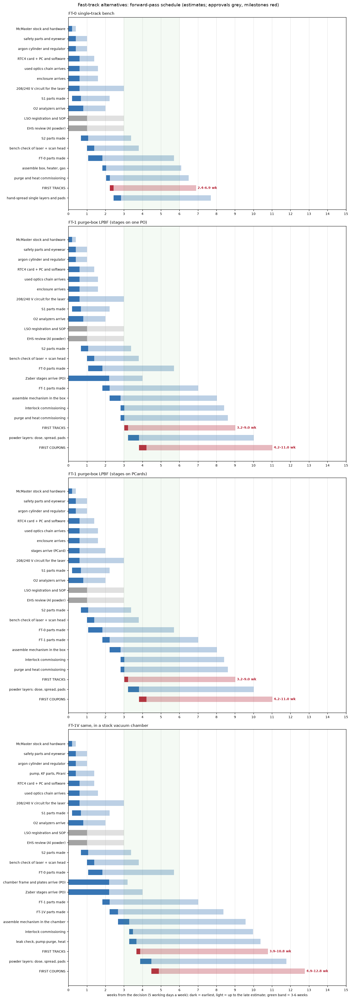

# Fast-track alternatives: a working desktop LPBF in 3–6 weeks

For [issue #260](https://github.com/vertical-cloud-lab/digital-alloy-lab/issues/260), 2026-11-26. Sterling asked on PR 266
for "alternative designs that could simplify the process and lead to a working product in a shorter lead time (e.g., 3-6
weeks from start to finish)". This note compares those alternatives, recommends one, and gives its parts, costs and
schedule. It is stacked on PR 266's design and reuses its numbers. Nothing here has been bought, built, quoted by a
person, or reviewed by BYU's Laser Safety Officer (LSO) or EHS.

"Start" here means the day the decision is made and the orders go out. "Finish" means the first multi-layer test coupons
in an Al alloy: the smallest result that shows a working LPBF machine.

| File | What it is |
|---|---|
| [`README.md`](README.md) | this note |
| [`parts.csv`](parts.csv) | the parts for FT-0, FT-1 and FT-1V, with price, condition, availability as read, source and fetch time |
| [`live-reads-2026-11-26.csv`](live-reads-2026-11-26.csv) | every listing and vendor page read today through the lab Pi (BYU network), including the ones eBay refused |
| [`fast_track.py`](fast_track.py) | purge, argon, heat, optics and powder sizing; costs from `parts.csv`; the forward-pass schedule and Gantt chart |
| [`out/`](out/) | the script's tables (`summary.md`, `schedule.csv`, `purge.csv`, `build.csv`, `optics.csv`) |
| [`img/gantt.png`](img/gantt.png) | the schedules |
| [`../edison/ft-fast-track-review/`](../edison/ft-fast-track-review/) | Edison `LITERATURE_HIGH` review of minimal LPBF builds (query, answer, references, trajectory) |

## Short answer

- **PR 266's design can't reach 6 weeks.** Bought new, the IPG laser alone takes 12–15 weeks to arrive. With the laser,
  scan head and card bought used, fabrication sets the date: about 10–11.5 weeks to an assembled machine
  ([`lead-times.md`](../robot-build/lead-times.md)). The 287 shop hours, the outside honing of the build module (3–6
  weeks, unquoted) and two safety switches with 19–27 week lead times are the long poles.
- **The recommended fast-track machine is FT-1, a "purge box" LPBF:** a small LPBF built almost entirely from things that
  ship within days.
  - **Optics:** a used IPG 400 W single-mode laser, a used SCANLAB hurrySCAN 25, a used f = 254 mm lens and a used RTC5
    card. All four were still listed today, on US sellers with returns, for about $5.9k–6.6k together.
  - **Enclosure:** a stock 304 stainless NEMA 4X box laid on its back, so its hinged door is the lid with the laser
    window in it. Argon flows through it; there is no vacuum.
  - **Powder bed:** two stock Zaber stages (1–5 day lead time): a vertical stage lowers a Ø40 mm heated plate in a
    heated aluminium well, and a linear stage moves a small gravity-fed hopper with the blade, as Heriot-Watt's rig did.
  - **Custom parts:** about 12 simple parts, 25–40 shop hours. No honing, no vacuum seals, no 4th axis.
  - **Cost:** **$20.3k–29.7k** in parts and shop time, against $70.5k–154.1k for PR 266's BOM.
  - **Time:** **first tracks at 2.2–4.4 weeks and first coupons at 3.2–6.4 weeks** if the two stages go on separate
    vendors' PCard orders; 4.2–8.0 weeks if they share one purchase order.
- **FT-0 is FT-1's first half:** the same optics, box and heated plate without the stages, spread by hand with a film
  applicator. It lays single tracks and single-layer pads at **1.6–4.2 weeks for $13.1k–22.2k**, and it is worth doing
  even if FT-1 follows, because it checks the used laser chain inside its return windows.
- **What FT-1 gives up**, all of which can come back later:
  - O₂ of 100–1000 ppm by flow purge, against PR 266's 1–10 ppm by pump-purge. EOS M 290 work on Al uses a 1000 ppm
    threshold and small commercial machines purge to 1000–3000 ppm (PR 266 §2.3), and PR 266's own review found O₂
    matters less than the powder's water ([`vacuum-and-purge.md`](../vacuum-and-purge.md)).
    FT-1V, the same machine in a stock vacuum cube, keeps pump-purge for $10.6k–11.6k more and 1–2 weeks longer than
    FT-1 on PCards.
  - One Ø40 mm plate instead of Ø25/50/75 modules; builds up to 15 mm.
  - No VLM tray fit, no robot features, no recirculating gas loop (argon runs once through, about 2–3 builds a
    cylinder), no coaxial monitoring.
- **What it keeps:** the physics PR 266 chose. A CW single-mode fibre laser at 1070 nm with a galvo and f-theta (76 µm
  spot), argon, a 200 °C plate, a few tens of grams of powder per build, hardwired interlocks and Python control.
- **The parts are not the long pole any more; approvals are.** Registering a Class 4 laser with the LSO and an EHS look at
  aluminium powder have no published turnaround at BYU. FT-1 is built as a Class 1 enclosure (the beam is enclosed from
  the fibre to the plate) to make that review simple, and both requests should go out on day 0.
- **Two routes need no building and cost a phone call:** BYU's own metal-AM lab runs aluminium on a Concept Laser M2
  ([`safety.md`](../safety.md)); a reduced-build-volume insert there is how many groups screen alloys with little powder.
  And outside builds (a service bureau's reduced-volume machine, or the University of Utah's Aconity MIDI) can cover a
  specific alloy. Neither gives us our own machine or in-situ data.
- **Everything FT-1 buys carries into PR 266's machine:** the laser chain, the RTC5, the stages, the heater control, the O₂
  analyzer and the safety relay. FT-1's box then becomes the spreadability rig of PR 266's phase 0.



*Working days from the decision; dark bars are the early estimate and light bars run to the late one. Grey: approvals
whose length at BYU is unknown (assumed 1–3 weeks). Red: milestones. Every duration and its basis is in
[`out/schedule.csv`](out/schedule.csv).*

## 1. What sets the schedule of PR 266's design

| Long pole | Time | Source |
|---|---|---|
| IPG YLR-500-U3-SM-AC, new | 10–12 weeks after the order, plus BYU's PO (10–14 days) and freight: 12–15 weeks | [IPG quote](../quotes/ipg-ylr-500-u3-sm-ac.md), [`lead-times.md`](../robot-build/lead-times.md) |
| IDEC HS6B guard switch (S2) and Omron K8DT relay (H2), as chosen | 27 weeks; out of stock until 2027-03-03 | `lead-times.md` §2 |
| 57 machined parts | 287.3 h with a 4th axis (CAM 132 h, setups 99 h); 134 BYU hours on the recommended hybrid | [`manufacturing-route.md`](../robot-build/manufacturing-route.md) |
| Build module: turn, weld, bore, honing sent out | 3–6 weeks, unquoted | `manufacturing-route.md` |
| Used majors + swapped switches + outsourcing split | assembled at 10.3–11.5 weeks; fabrication sets it | `lead-times.md` §1 |
| LSO registration, EHS dust hazard analysis, a 208–240 V circuit | unknown | [`safety.md`](../safety.md) |

The parts that make the machine slow come from requirements a first machine doesn't need:

| PR 266 requirement | What it forces | FT-1 |
|---|---|---|
| Pump-purge to 1–10 ppm O₂ | a vacuum-rated machined chamber, 29 glands, a scroll pump, a Pirani gauge, vacuum feedthroughs, a sealed rod exit | flow purge to 100–1000 ppm in a stock box; add the vacuum later (FT-1V, or PR 266) |
| Heated build modules Ø25/50/75 on a sealed piston | honed bores, hot sliding seals, clearances that close as the plate heats, zero-point clamps | one Ø40 mm plate in a well heated to the same temperature, so the clearance doesn't change |
| Fits a VLM tray (≤ 695 mm) | low-profile layout, folded Z, 12U rack, dock, UPS | a bench machine |
| Robot-tended | drawbar, grip blocks, liners, AprilTags, pneumatic door | Python control of every axis now; robot features later |
| Recirculating gas at 140–200 L/min | a sealed blower (none found), plenums, a HEPA housing in the loop | once-through cross-flow from the cylinder, ~27 L/min |
| Class 1 guard around the whole machine | T-slot guard, sliding guard door, guard lock | the stainless box and a beam tube are the enclosure |

## 2. The alternatives

| | Alternative | Parts + shop time | First tracks | First coupons | O₂ | Heated plate | Main risk | Verdict |
|---|---|---|---|---|---|---|---|---|
| A | PR 266's design, fast-tracked (used majors, swapped switches, outsourcing split) | $70k–76k at spec with used majors (`lead-times.md`) | ~11.3–13.5 wk | ~12–15 wk | 1–10 ppm | Ø25/50/75 modules | honing, 134+ BYU hours | the long-term machine, not a 6-week one |
| **FT-0** | **Single-track bench**: used laser chain over a heated plate in a stainless box, hand-spread layers | **$13.1k–22.2k** | **1.6–4.2 wk** | single layers and pads only | 100–1000 ppm (flow) | Ø40, 200 °C | the used laser's condition | **do first** |
| **FT-1** | **Purge-box LPBF**: FT-0 plus a heated well, a piston stage and a hopper-blade stage | **$20.3k–29.7k** | **2.2–4.4 wk** (PCard stages) / 3.2–6.0 wk (one PO) | **3.2–6.4 wk** / 4.2–8.0 wk | 100–1000 ppm (flow) | Ø40 well, 200 °C | approvals; hopper flow with fine Al | **recommended** |
| FT-1V | FT-1 in a stock vacuum cube with a pump-purge kit | $31.0k–41.3k | 3.4–6.4 wk | 4.4–8.4 wk | < 100 ppm in 2–3 cycles | Ø40 well, 200 °C | stages and grease under vacuum; two POs | if O₂ below 100 ppm is required from day 1 |
| E | Laser engraver as the base (PR 266 §1b) | $7.5k–9.5k for a 200 W MOPA engraver | – | – | – | add-on | pulsed only: Monport's GT 200W has no CW or quasi-CW mode, and its board is closed (Sterling's 2026-11-19 update) | no: with a CW laser swapped in it becomes FT-0 with marking-grade optics |
| F | Buy a commercial desktop unit (AO Metal A30, Xact XM200C, ...) | $59k–130k (PR 266 §2.2) | vendor lead time + PO and any bid steps | – | ≤ 1000–3000 ppm typical | none listed on the desktop units | lead times not published; no heated plate | the go/no-go fallback, not a 6-week route |
| G | Reduced-build-volume insert in BYU's Concept Laser M2 | an insert, ~$1k–5k (estimate) | 2–6 wk (estimate; depends on that lab) | same | the M2's | check whether the M2 has one | the lab's willingness, warranty and schedule | ask this week |
| H | Outside builds (service bureau with a reduced build volume; the University of Utah's Aconity MIDI, ~1 kg fill) | per build | 1–3 wk per build (estimate) | same | theirs | theirs | 0.25–1 kg of powder per alloy; no in-situ data | only for one specific alloy |

A's weeks are `lead-times.md`'s 10.3–11.5 weeks to an assembled machine plus 1–2 weeks of commissioning (estimate). FT-0,
FT-1 and FT-1V come from `fast_track.py`. E, F, G and H are not costed in detail.

## 3. FT-1 in detail

### 3.1 Layout

```
                 IPG YLR-400-SM (on the bench or a cart) ── fibre ──┐
                                                                  collimator
                                                                     │
                     T-slot frame ──── hurrySCAN 25 + LINOS f = 254 mm
                                                     │ beam tube (enclosed, interlocked)
   ┌──────────── lid = the box's hinged door, Ø50.8 mm fused-silica window + cover slide ───────────┐
   │   argon in ▶ slot nozzle  ▼ beam (window ~160 mm above the bed)                     exhaust ▶ │── HEPA ── check valve ── building exhaust
   │   [hopper+blade on the Zaber X-LSQ150B, under a sheet shield] ──▶ spreads left to right       │
   │                ┌─────── well block, 200 °C, Ø40 bore ───────┐   overflow cup                   │
   │                │   heated plate + substrate disc, 200 °C    │                                  │
   │  deck plate    └── Macor standoffs ──┘    │ rod             └── Macor standoffs                │
   └────────────────────────────────────────── O-ring gland ──────────── 16 x 12 x 8 in 304 box ────┘
                                               │                                  fan on the outside
                                    Zaber X-VSR20A (outside, under the box)
```

- **The box** is a 16 × 12 × 8 in 304 stainless NEMA 4X enclosure with a continuous hinge and clamps (Saginaw
  SCE-16128CHNFSS class; the 12 × 10 × 6 in model read today at $442.14). It lies on its back, so the door is a
  hinged lid. Its foam gasket is replaced with an FKM or silicone cord. Holes: the window, two gas bulkheads, the O₂
  sample line, IP68 cable glands, and the rod gland. Check the inside against Zaber's drawing of the X-LSQ150B before
  ordering the size.
- **The beam path is enclosed from the fibre to the plate:** collimator, scan head, lens, a tube from the lens to the
  window ring, the window, the box. With the lid shut there is no open beam, so the machine is Class 1 by construction.
- **The window** (Edmund 38-990, Ø50.8 × 9.53 mm fused silica, 1064 nm V-coat) sits in an O-ring ring clamp in the lid,
  about 160 mm above the bed. A cover slide below it takes the spatter. At a 5 mm collimated beam the beam is 3.2 mm
  across there: 5.1 kW/cm² at 400 W (`fast_track.py`).

### 3.2 The laser chain, used

| Item | Listing (read 2026-11-26 through the lab Pi) | Price | Returns | Delivery to Provo |
|---|---|---|---|---|
| IPG YLR-400-SM-EOS, 400 W single-mode CW | [eBay 287712672728](https://www.ebay.com/itm/287712672728), OCO Industrial, El Paso TX | $2,099.99 or Best Offer + LTL freight ($300–600, estimate) | "Free returns" | freight, "Check the item description" |
| SCANLAB hurrySCAN 25, "for 1064nm up to 1500W w/ Optics", "Removed from a working system" | [eBay 358291508540](https://www.ebay.com/itm/358291508540), Leander TX | $1,286.29 or Best Offer | "Returns accepted" | "Estimated between Sat, Nov 28 and Wed, Dec 2" |
| SCANLAB RTC5 PCIe with 3D option | [eBay 358030746607](https://www.ebay.com/itm/358030746607), Leander TX, "LAST ITEM AVAILABLE" | $1,499.99 or Best Offer | not shown | "Estimated between Mon, Nov 30 and Thu, Dec 3" |
| LINOS F-Theta-Ronar f = 254 mm, 1064 nm | [eBay 298724791756](https://www.ebay.com/itm/298724791756) | $539.99 or Best Offer | "Free shipping and returns"; 30-day warranty | "Estimated between Mon, Nov 30 and Thu, Dec 3" |
| Backup laser: IPG YLR-200-SM-EOS, "Refurbished by the original Manufacturer" | [eBay 257041174571](https://www.ebay.com/itm/257041174571) | $2,450.00 | "Returns accepted" | not shown |

- **Each of these is under BYU's $3,500 PCard limit** ([finserve.byu.edu](https://finserve.byu.edu/paying-for-goods-and-services)),
  so none waits for a purchase order. The scan head and RTC5 sellers share a location; together they come to about
  $2.8k. Whether a PCard may be used on eBay was not checked.
- **Check each on arrival, inside its return window:**
  1. the laser's interface: an EOS unit may carry EOS-specific settings. Find the analog power input (0–10 V), the
     modulation or gate input, the hardware interlock loop and the guide laser, from IPG's YLR user guide;
  2. its hours, fault log and cooling (forced air or water), and its mains supply (probably 200–240 V single phase;
     check the label, and ask for a circuit on day 0 if the room has none);
  3. whether the fibre ends in a collimator, and its beam diameter. IPG's standard beams are 5 mm (76 µm spot at
     f = 254 mm) and 7.5 mm (51 µm). A used IPG collimator was listed at $495 on 2026-11-20;
  4. output power against setpoint, with a calorimetric check: Thorlabs' LB2L/M 500 W water-cooled dump, a flowmeter
     and two thermocouples (power = flow × heat capacity × temperature rise);
  5. the scan head's mirrors and coatings (it is rated to 1500 W at 1064 nm), its ±15 V supply and its XY2-100 link,
     driven by the RTC5 with the guide laser only.
- **RTC5 software** (the RTC5 DLL and correXion) comes from SCANLAB's download portal after registration. The RTC5's
  correction file for this head and lens has to be made with correXion and a burned grid.
- **The new alternatives are slower or dearer:** Thorlabs' QS20XY-Y1 galvo is "Available: Today" at $5,893.56 but needs
  a PO; a new SCANLAB head and RTC6 are quote-only.

### 3.3 The powder bed

- **A heated well, not a honed bore.** The plate (Ø39.8 mm 6061, with two 50 W cartridge heaters and a thermocouple)
  rides in a Ø40.00 mm bore in a 6061 block. The block has its own two heaters and is held at the plate's temperature.
  Same alloy at the same temperature means the 0.1 mm radial clearance doesn't change when the machine heats up, which
  is what forced PR 266's honing and clearance study ([`preheat-and-plates.md`](../preheat-and-plates.md)). A fibreglass
  rope in a groove round the plate keeps powder out of the gap. Heat both together on start-up.
- **Thermal break:** the block and the plate stand on Macor standoffs; the rod is thin-wall 304 tube.
- **The piston stage is outside the box,** under the floor: a Zaber X-VSR20A (20 mm travel, 0.095 µm microstep, 100 N).
  The rod enters through a lightly greased O-ring gland. With the box at +5–10 mbar of argon, that gland only has to
  stop gas, not hold vacuum. 20 mm of travel gives 15 mm builds and room to lift the plate for removal.
- **The recoater is a moving hopper with the blade on it,** on a Zaber X-LSQ150B (150 mm, 1.4 kg, rated 0–50 °C) inside
  the box under a stainless shield. Heriot-Watt's open-architecture rig moved its gravity-fed powder reservoir together
  with its spreader on one lead-screw axis ([Bidare et al. 2017](https://doi.org/10.1016/j.addma.2017.06.007), via a
  search snippet of its accepted manuscript), and reached > 99 % density on a ~30 × 30 mm bed (PR 266 §2.1). The hopper
  holds ~30 cm³ and feeds through a slot with a small vibration motor. Blades: HSS by default, a silicone cord as
  Heriot-Watt found best.
- **The sequence per layer:** scan, return the hopper-blade over the scanned layer, lower the plate one layer, spread
  forward into an overflow cup past the well. A compliant blade copes with raised edges on the return.
- **The substrate disc** (Ø39.8 × 6 mm 6061, three countersunk M3 screws outside a Ø30 mm build area) lifts out with the
  coupons after a build. Make several.

**Powder:** a 10 mm build on Ø40 mm takes about 30 g of AlSi10Mg at a 1.8× dose, and a 15 mm build about 45 g
(`fast_track.py`, using `budgets.py`'s factors). A 10 mm build is 333 layers and about 1.2–1.8 h.

### 3.4 Gas: flow purge and a once-through cross-flow

| O₂ target | Volume changes (perfect mixing) | Ideal time at 20 L/min | Expected (2–5× for dead space and porous powder) | Argon |
|---|---:|---:|---:|---:|
| 1000 ppm | 5.3 | 5.7 min | 11–28 min | 0.23–0.57 m³ |
| 500 ppm | 6.0 | 6.4 min | 13–32 min | 0.26–0.64 m³ |
| 100 ppm | 7.6 | 8.1 min | 16–41 min | 0.32–0.81 m³ |

- **Box gas volume:** ~21 L (25.2 L less ~4 L of internals).
- **The floor is set by leaks and permeation, not the purge.** The box runs at +5–10 mbar behind a check valve, so gaps
  leak outward. Gaskets still let oxygen through. The used trace O₂ analyzer (Alpha Omega Series 3000, $650, "Returns
  accepted", read today) gives the real number on the first purge. If it stalls above ~500 ppm, swap the gasket first,
  then consider FT-1V.
- **Cross-flow:** a 45 × 4 mm slot nozzle at 2.5 m/s, ~27 L/min, a few mm above the bed, across the plate to an outlet
  on the far side. The exhaust goes through a HEPA housing (McMaster 5169K72 + 9179K14) and a check valve to the
  building exhaust. **Treat the filter as a fire hazard** (PR 266 §3.7): condensate can ignite on contact with air.
- **Argon use:** about 2.7–5.3 m³ per 10–15 mm build including the purge, so about 2–3.5 builds per size-300 cylinder,
  roughly $30–170 of argon a build (estimate). PR 266's recirculating loop is the fix once builds are routine.
- **Water matters more than O₂ for Al** ([`vacuum-and-purge.md`](../vacuum-and-purge.md)): dry the powder in a vacuum
  oven and load it dry. Heating the plate drives water off the powder into the gas, which the once-through flow carries
  away.

### 3.5 Heat

| | Value |
|---|---|
| Heater load at 200 °C (well block + plate, convection, radiation, standoffs) | ~56 W |
| Installed heaters | 4 × 50 W (McMaster 3714N36, 24 V), margin 3.6× |
| Laser heat absorbed, averaged over a layer (400 W, 30 % of the plate scanned, absorptivity 0.3–0.6) | 46–91 W |
| Box air rise, still air | 32–46 K, so ~71 °C: **over the stages' 50 °C rating** |
| Box air rise with a fan blowing on the box | 9–14 K, ~39 °C |

- **Put a fan on the box.** A 120 mm fan on the outside of the box (or a water-cooled deck) keeps the stages in their
  rating.
- **Dense layers will push the plate above 200 °C,** as PR 266 found for its modules ([`heat.md`](../heat.md)): the laser
  can bring more heat than the heaters' load, so the controller just switches off. Scan less of the plate per layer,
  add an interlayer dwell, or log the plate temperature as a screening variable.
- **An independent limit** (DwyerOmega CN708, 6 in stock at Digi-Key on 2026-11-25) opens a contactor on the heater
  supply if the plate passes its setpoint, separately from the PID.

### 3.6 Control and software

- **One Windows PC** holds the RTC5 and runs the supervisor in Python:
  - the RTC5 DLL through `ctypes`: lists of jumps and marks with laser delays, analog power on the RTC5's laser port;
  - `zaber-motion` for both stages (daisy-chained over RS-232);
  - layer hatching with an open-source slicer such as PySLM, or simple hatches of cubes and tracks;
  - a Raspberry Pi 5 with a relay board for the argon valve and the hopper vibrator, and logging of O₂ and temperatures.
- **The heater PID and limit run on their own,** so a PC crash can't overheat the plate.
- **Backup scan controller:** an XY2-100 driver on a Teensy (OPAL, or DTU's open controller, PR 266 §3.6) if the RTC5
  or its software disappoints.

### 3.7 Safety

- **Class 1 by construction.** The interlocks are two coded non-contact switches on the lid, one on the beam tube, an
  E-stop and a key switch. They run into a safety relay (Omron G9SE-201 class), whose outputs open the laser's hardware
  interlock loop. Software can only request emission. An emission lamp sits on the frame.
- **No viewing window at first.** A camera looks through the lid instead. A laser viewing panel (Thorlabs LW1P1/M) can
  be added later.
- **Alignment and service are Class 4:** a written SOP, the guide laser for alignment, Thorlabs LG1 glasses (confirm
  their OD at 1070 nm with the LSO), and a controlled area.
- **Aluminium powder** (PR 266 §3.7, NFPA 484):
  - a Class D extinguisher (McMaster 6435T23);
  - the box and stages bonded to ground;
  - powder loaded in a glovebox;
  - the HEPA element bagged out under argon;
  - a respirator when the lid is opened after a build;
  - a small powder inventory.
- **Argon:** a room O₂-deficiency monitor (Macurco OX-6) and the exhaust to the building exhaust.
- **Ask the LSO and EHS on day 0.** BYU's laser-safety pages need a BYU login; BYU's metal-AM lab already runs a Class 4
  machine on aluminium, so its SOPs and dust hazard analysis are the closest template.

### 3.8 Parts and cost

From [`parts.csv`](parts.csv) (`python fast_track.py`):

| Group | FT-0 | FT-1 | FT-1V |
|---|---:|---:|---:|
| Laser and optics (used) | $4.7k–6.4k | $4.7k–6.4k | $4.7k–6.4k |
| Scan control and computing | $1.7k–2.9k | $1.7k–2.9k | $1.7k–2.9k |
| Motion | $0.2k–0.6k | $6.3k–6.4k | $6.3k–6.4k |
| Enclosure or chamber | $0.8k–1.4k | $0.8k–1.4k | $11.1k–12.4k |
| Heated plate | $0.6k–1.0k | $0.7k–1.1k | $0.7k–1.1k |
| Gas and O₂ | $1.6k–2.1k | $1.6k–2.1k | $1.6k–2.1k |
| Safety | $2.7k–3.5k | $2.7k–3.5k | $2.7k–3.5k |
| Stock and shop time | $1.0k–1.6k | $2.0k–3.2k | $2.3k–3.7k |
| Glovebox (if the lab has none free) | $0–2.7k | $0–2.7k | $0–2.7k |
| **Total** | **$13.1k–22.2k** | **$20.3k–29.7k** | **$31.0k–41.3k** |

- **Purchase orders.** FT-1 needs one only if both Zaber stages go on one order ($6,238). Buying the piston stage from
  Thorlabs instead (MTS50/M-Z8 + KDC101, $2,179.18, both "Available: Today") keeps every order under $3,500. Check
  Thorlabs' vertical load rating against the O-ring drag first. FT-1V adds a PO to Ideal Vacuum (~$9.3k).
- **Prices read today** are in [`live-reads-2026-11-26.csv`](live-reads-2026-11-26.csv). eBay refused 7 of the 14 used
  pages it was asked for today; those rows keep their 2026-11-20 or 2026-11-25 reads.

### 3.9 What has to be made (FT-1)

About 12 parts, all 2.5D, from McMaster stock that arrives in 1–2 days:
1. the deck plate (10 mm 6061, drilled; waterjet or SendCutSend if the mill is busy);
2. the window ring clamp and retaining ring;
3. the well block (80 × 80 × 40 mm, Ø40.00 bore, four heater holes, a thermocouple hole);
4. the heater plate (two heater holes, a thermocouple hole, a rope groove);
5. substrate discs (turned from 1-3/4 in. bar, several);
6. the piston rod and its stage bracket;
7. the rod's O-ring gland plate;
8. the hopper (bent 304 sheet), blade clamp and carriage arm;
9. the scan-head adapter plate and the collimator mount;
10. the beam tube and its flange;
11. the slot nozzle;
12. the stage shield (bent sheet).

That is 25–40 shop hours (estimate), or one machinist for a week. Nothing needs a 4th axis, a long tool, honing or
welding.

### 3.10 Day 0 and the weeks after

- **Day 0:**
  - order the laser chain, the O₂ analyzer and the stages;
  - order the McMaster, Digi-Key, Thorlabs and Edmund items and the box;
  - book an argon cylinder;
  - send the LSO the layout and interlock list, and send EHS the powder plan;
  - check the room's power for the laser.
- **Week 1:** parts start, the laser chain arrives. Check it with the guide laser and the RTC5 as soon as the LSO allows.
- **Weeks 2–3:** the stages arrive; assemble; purge and heat to 200 °C while logging O₂; commission the interlocks. First
  tracks on bare 6061 plate, then on powder.
- **Weeks 3–6:** dose and spread; single-layer pads; then cubes 5–10 mm tall in AlSi10Mg first, then the alloys to
  screen.

## 4. What carries over to PR 266's machine

| FT-1 part | In PR 266's machine |
|---|---|
| Used YLR-400-SM, hurrySCAN 25, RTC5, f = 254 mm lens | L1, L5, C1, L6 (PR 266 drew f = 160 mm for the VLM height; f = 254 mm is its README's first choice) |
| Zaber stages | a bench spreadability rig, or the recoater axis |
| Heater PID, limit controller, SSR, thermocouples | H2 |
| Safety relay, switches, E-stop, key, glasses, extinguisher, room O₂ monitor | S1–S8 |
| Trace O₂ analyzer | G6 |
| The box, well and hopper-blade | PR 266's phase 0 spreadability rig, in the glovebox |

FT-1's results answer PR 266's open questions on real powder: whether a moving hopper feeds our Al powders, the dose
factor, the O₂ a flow purge reaches, what the plate's temperature does under dense scanning, and which collimator
spot works.

## 5. Risks, and how to find out early

| Risk | Check | Fallback |
|---|---|---|
| The used laser is faulty or EOS-locked | interface, hours, power check on arrival, inside "Free returns" | the YLR-200-SM-EOS backup; the new IPG (12–15 weeks) |
| The RTC5 or its software won't run with this head | guide-laser test in week 1; correXion grid | a Teensy XY2-100 controller (OPAL / DTU) |
| LSO or EHS approval takes longer than 3 weeks | ask on day 0 with the Class 1 layout | FT-0's bench work waits; mechanics go on |
| The flow purge stalls above ~500 ppm | O₂ log on the first purge | better gasket; FT-1V's vacuum cube |
| Fine Al powder won't feed from the moving hopper | test the hopper on the bench with the real powder in week 1–2 | a second vertical stage as a supply piston (one more Zaber X-VSR20A) |
| Box air above the stages' 50 °C | thermocouple in the box during the first heat-up | fan, water-cooled deck, lower scan fill |
| No 208–240 V circuit where the machine goes | read the laser's label on day 0 | a Physical Facilities work order, or a portable step-up transformer if the LSO and electricians allow |

## 6. Decisions for Sterling

1. FT-0 then FT-1, or straight to FT-1V if below 100 ppm O₂ is required from the start?
2. Is a purge-only O₂ of 100–1000 ppm acceptable for the first coupons? EOS M 290 work on Al uses a 1000 ppm threshold.
3. Buy the used laser chain now? It is returnable, about $5.9k–6.6k, and every route uses it, including PR 266's.
4. Who asks BYU's metal-AM lab about a reduced-build-volume insert for its Concept Laser M2?
5. Ø40 mm plate and 15 mm builds: enough for the first coupons?
