# CFD of FT-1's gas: the cross-flow over the plate and the purge from air to argon

For [issue #260](https://github.com/vertical-cloud-lab/digital-alloy-lab/issues/260), PR 294 rounds 2 (2026-11-27, CAD v1) and 3 (2026-11-28, CAD v2).
OpenFOAM v2406 (Docker image `opencfd/openfoam-run:2406`) on the gas inside the CadQuery model of FT-1
([`../../../cad/ft_model.py`](../../../cad/ft_model.py), `build("FT-1")`: the 16 × 12 × 8 in. box, the deck cassette, the
plate at the start of a build, the hopper at its right park; and `build("FT-1V")`, §3). Scripts: [`../../cfd/`](../../cfd/). Numbers:
[`cfd.json`](cfd.json). Nothing here has been checked against a measurement.

# Round 3 (2026-11-28): CAD v2, leaks, FT-1V's purge, heat

For PR 294 round 3. The main cases re-run on the current model (CAD v2), plus what round 2 left out: the O₂ that
leaks in, FT-1V's purge, and heat. Same OpenFOAM image and scripts; new: [`o2_budget.py`](../../cfd/o2_budget.py)
(0-D leak budget and pump-purge), `make_case.py --kind leak` and `--kind heat`. Numbers: [`cfd.json`](cfd.json) (v2
runs are the entries named `v2-…`; `leak`) and [`o2_budget.json`](o2_budget.json). The runner was shared by ~8 jobs
(load average 9–14 on 4 cores), so runs were kept short; what that cost is stated with each. Nothing here has been
checked against a measurement.

## Short answer (round 3)

- **The cross-flow is unchanged on v2.** k-ω SST: 2.50 m/s 3 mm over the build area (v1 2.57), 0.055 Pa mean bed
  shear (0.053), 94–99 % of the fume from 0.5–3 mm caught or held at the collector, half of what rises above the jet
  caught, escaped fume passing the cover slide at 103 mm (89), 87 Pa (88). Nothing to change.
- **The low-diffuser, high-vent purge is a little slower on v2: 3.1 / ≈ 4.9 min to 1000 / 100 ppm** (box average;
  v1 2.6 / ≈ 5.0; well mixed 6.4 / 9.1). The Saginaw's dished door and rim lip hold 1.2 L above the highest a wall
  vent can go, and the last third of the O₂ waits there. **Put the vent through the door,** at its top.
- **Leaks set the floor the exhaust reads at a few ppm, if the lid is seated and the box is at +5–10 mbar** (0-D,
  estimates): argon 5.0 gives 2 ppm, permeation through the silicone sponge gasket 0.1–0.5 ppm at 27 L/min, the
  X-LSM100B's trapped air up to ~2.4 ppm in the first hour; the worst gap under the gasket (≈ 3 µm, Péclet ≈ 1)
  along the whole seam adds 2.9 ppm. Larger gaps blow argon out too fast for O₂ to diffuse back. At a 2 L/min dwell
  the same sources give 9–48 ppm; with the vent open (no overpressure) a 30 µm gap along the seam would hold the
  purge at ~60 ppm.
- **With the cross-flow on, O₂ that leaks in at the lid stays in the box, not over the plate** (CFD, R3.5): 1 mm over
  the build area it is about a tenth of what the exhaust analyzer reads (a hundredth at the plate's centre), while
  the box holds 5–10× the exhaust's value. The exhaust reading is the conservative number for the process.
- **FT-1V's cube purges faster than the box, but the pump-purge is still the way to purge it** (CFD and 0-D, R3.6):
  with the same low diffuser and high vent at 20 L/min, 2.1 / ≈ 3.5 min to 1000 / 100 ppm (box average; exhaust
  2.4 / ≈ 3.7 min), against the box's 3.1 / ≈ 4.9 min. The last air again waits above the vent, under the top
  plate. Two pump cycles to 1 mbar reach the argon's own 2 ppm in 5.0 min with 45 L of argon (0-D); the flow purge
  needs ≈ 75 L for 100 ppm.

### R3.1 The model, ported to CAD v2

[`geom.py`](../../cfd/geom.py) now builds the gas from the current `cad/ft_model.py` (CAD v2, round 2's model with the g3
gantry, which is outside the box). What changed in the gas, v1 → v2:

| | v1 (round 2's runs) | v2 (round 3) |
|---|---|---|
| enclosure | a plain 406.4 × 304.8 × 203.2 mm box to the rim | the Saginaw SCE-16EL1208SSLP: 402.6 × 301.0 mm inside, 199.4 mm to its 22 mm rim lip; above that the poured gasket's inner face (369.7 × 271.4 mm) and the door's dish (389.9 × 291.6 mm) up to the door's inner face, 210.8 mm above the floor |
| deck | 250 × 250 mm | 245 × 245 mm, with its four clamps on the panel studs |
| recoater | an X-LSQ075B-sized block at y = 95.5 mm | the X-LSM100B (239.2 × 45 × 21 mm) at y = 82 mm under its MK-12 shield (one block, the shield's envelope), the motor end and controller box as the vendor's boxes |
| window stack | on the plate's axis, Ø40 holder bore, slide 129 mm over the bed | at y = −11 mm (box) with the Ø44 holder, slide 130 mm over the bed; in the cube a Ø64 drop tube at y = −16 mm, slide 130 mm over the bed (v1: 221 mm) |
| lid | — | the hinges and the latch inside the dish |
| gas volume (meshed) | 23.19 L (cube 21.9 L) | 23.88 L (cube 22.22 L); `ft_checks`: 24.04 / 22.64 L |
| purge ports (assumed) | 40 × 40 mm diffuser low on the left wall, 40 × 20 mm vent high on the right wall, 3 mm under the rim | the same, the vent's top 3 mm under the rim lip (the highest a wall fitting can go; the 1.2 L above the lip is the door's dish); in the cube 15 mm in from the plates, clear of the frame's bars |

The monitoring ports (the camera port in the door, the light ports in the left and front walls) are bores with a
window ring outside: recesses of 1–3 cm³ in the walls, left out. The gas bulkheads' bores, the heater and stage cables,
and the box-air thermocouple are left out too (geom.py's docstring lists every simplification). The purge diffuser and
vent are still not in the CAD model (parts.csv G9); as in round 2 they are this CFD's assumption.

### R3.2 The cross-flow on v2

k-ω SST, steady, on the v2 mesh (245,939 cells; 3 prism layers on the bed, 94 % coverage; max skewness 6.5 on 9
faces, "Failed 1 mesh checks" as in v1; 77 s to mesh). 600 iterations: the probe speeds over the plate were steady to
3–4 digits from iteration ~100 (std over the last 20 %: 0.3 mm/s at 1 and 3 mm), while the box circulation kept
moving (final initial residuals 1 × 10⁻³ for Ux and Uz, 8 × 10⁻⁴ for p, against v1's 3–6 × 10⁻⁴ at 904 iterations).

| | v1, k-ω SST (§1) | v2, k-ω SST |
|---|---|---|
| speed 1 / 3 / 5 mm over the Ø30 build area, mean, m/s | 1.62 / 2.57 / 1.62 | 1.69 / 2.50 / 1.55 |
| spread at 3 mm (std/mean) | 4 % | 5 % |
| bed shear, Ø30 build area: mean / max, Pa | 0.053 / 0.067 | 0.055 / 0.071 |
| Ø40 plate: mean / max, Pa; area over 0.053 Pa | 0.049 / 0.100; 43 % | 0.050 / 0.083; 48 % |
| tracers 0.5–3 mm into the collector (held under its lower lip) | 99 % (1 %) | 94 % (6 %) |
| tracers from 0.5 mm into the collector | 95 % | 64 % |
| tracers 4–15 mm: into the collector / escaped to the box | 49 % / 31 % | 50 % / 28 % |
| escaped tracers: median closest approach to the slide | 89 mm | 103 mm |
| tracers within 30 mm of the slide | 1 % | 1 % |
| gas speed 2 mm under the slide, mean | 0.9 mm/s | 3.8 mm/s |
| jet flow at y = 25 mm, forward / back | 41.6 / 2.3 L/min | 42.4 / 1.7 L/min |
| pressure drop, nozzle channel to collector port | 88 Pa | 87 Pa |
| y⁺ on the plate, mean / max | 0.82 / 1.19 | 0.83 / 1.08 |

- **The jet over the plate is round 2's** (the slot, the collector and the bed round them did not change): 2.50 m/s
  3 mm up, 0.055 Pa mean bed shear over the build area, at the bottom of the 63 µm pick-up band as before, 87 Pa.
- **Fume released 0.5–3 mm up is all caught or held:** 94 % into the collector, 6 % in the slow vortex under its lower
  lip, none into the box. The lip's share grew (1 → 6 %, all of it from 0.5 mm): that vortex is the least converged
  part of the jet in both runs (v1's FT-1V run gave 5 % there), so read 94–99 % as the range.
- **Fume above the jet behaves as before:** half of what rises 4–15 mm is caught, 28 % reaches the box, and it passes
  the cover slide no closer than 103 mm (median); 1 % comes within 30 mm. The slide is now at y = −11 mm and 130 mm up;
  the gas under it moves at 4 mm/s.

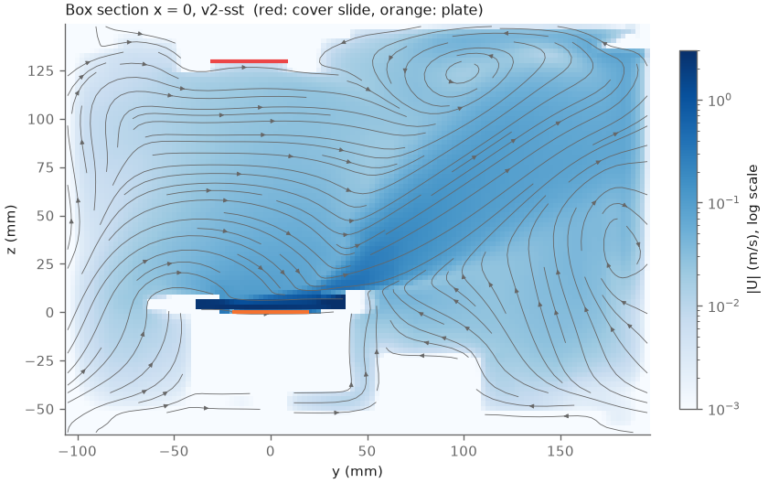

*v2, the x = 0 section, k-ω SST, log speed scale. As in v1, the jet's surplus leaves over the collector and
circulates through the box at 1–100 mm/s. Red: the cover slide (y = −11 mm); orange: the plate.*

### R3.3 The buoyant purge on v2: low diffuser, high vent

As round 2's best case (§2.2): nozzle off, 20 L/min of argon in through a 40 × 40 mm diffuser low on the left wall, out
through a 40 × 20 mm vent high on the right wall at the back (outflow only), rhoReactingBuoyantFoam from air at rest,
on the coarse purge mesh (35,374 cells; max skewness 15.7 on 28 faces). 3.5 min of purge (444 s on two shared cores),
then the run's own exponential tail for 100 ppm.

| | v1 (§2.2, 5 min run) | v2 (3.5 min run) |
|---|---|---|
| gas volume | 23.19 L | 23.88 L |
| box average to 1000 / 100 ppm | 2.6 / (≈ 5.0) min | 3.1 / (≈ 4.9) min |
| exhaust (the analyzer on the vent line) | 2.8 / 4.7 min | 3.4 / (≈ 4.9) min |
| 1 mm over the plate | 1.4 / 3.5 min | 1.5 / 2.5 min |
| well mixed, same flow and volume | 6.2 / 8.9 min | 6.4 / 9.1 min |
| O₂ at 3.5 min: box / exhaust / plate / under the slide | – | 620 / 851 / 46 / 168 ppm |

- **Argon still fills the box from the floor up:** 1000 ppm in 3.1 min and ≈ 4.9 min to 100 ppm (box average), against
  6.4 / 9.1 min well mixed. The plate is under 100 ppm after 2.5 min.
- **But v2's box keeps its last air in the door.** The vent's top can be no higher than the body's rim lip, 11 mm
  under the door's inner face. Above it, the dished door, the gasket band and the lip hold 1.23 L (5 % of the gas),
  which the vent drains only by mixing: at 2, 3 and 3.5 min that layer is at 36,500, 7,400 and 3,700 ppm against a box
  average of 5,100, 1,100 and 610 ppm, and holds a third of the box's O₂. That is most of the 0.5 min v2 loses to v1
  in reaching 1000 ppm.
- **So vent through the door, not the wall:** a bulkhead at the door's highest point (it is the top of the box) drains
  that layer as the wall vent drained v1's. Not run; with v1's numbers as a guide it should recover the 0.5 min.

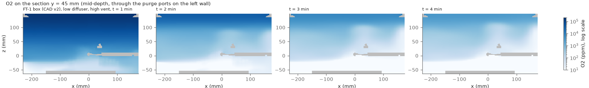

*O₂ on the y = 45 mm section (through the diffuser) at 1, 2, 3 and 3.5 min, log scale: argon (white) fills from the
floor; the last air is under the door.*

### R3.4 Leaks: what sets the real O₂ floor (0-D, estimates)

[`../../cfd/o2_budget.py`](../../cfd/o2_budget.py) ([`o2_budget.json`](o2_budget.json)). A well-mixed balance at steady
state: x_O₂ = x_O₂,argon + (O₂ that gets in) / (argon flow). Each input is an estimate or a datasheet value, marked
below; none is measured on this box.

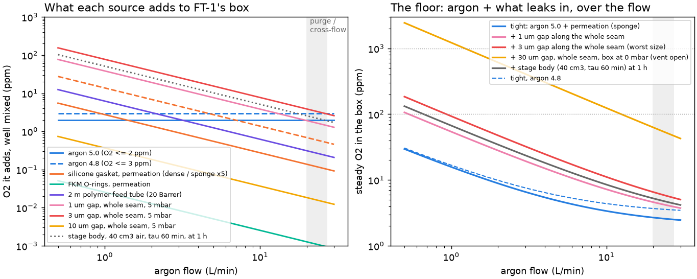

*Left: what each source adds, over the argon flow. Right: the steady O₂ in the box for a few leak cases. Grey band:
the purge's 20 L/min and the cross-flow's 27 L/min.*

| Source | O₂ in (mL/min) | adds at 27 L/min (ppm) | at 2 L/min (ppm) | basis |
|---|---|---|---|---|
| argon 5.0 itself | | 2 | 2 | O₂ ≤ 2 ppm, H₂O ≤ 3 ppm (Linde, Messer datasheets) |
| argon 4.8 itself | | 3 (3–4) | 3 (3–4) | O₂ 3–4 ppm, H₂O 3–5 ppm, by supplier |
| lid gasket, permeation, dense silicone (600 Barrer) | 2.8 × 10⁻³ | 0.10 | 1.4 | [Robb 1968](https://doi.org/10.1111/j.1749-6632.1968.tb20277.x); PDMS ~800 Barrer at 35 °C in [Merkel et al. 2000](https://doi.org/10.1002/(SICI)1099-0488(20000201)38:3<415::AID-POLB8>3.0.CO;2-Z) |
| lid gasket, permeation, sponge (5× dense, estimate) | 1.4 × 10⁻² | 0.51 | 6.9 | 1.28 m seam, 3 mm compressed height, 8 mm across |
| FKM O-rings (rod gland, window, ports, glands, bulkheads) | 2.6 × 10⁻⁵ | 0.001 | 0.013 | Parker's formula, F = 1.7 × 10⁻⁸ (round 1's `seals.py`) |
| 2 m of polymer feed tube, 1/4 in. (1–20 Barrer) | 0.3–6.2 × 10⁻³ | 0.01–0.23 | 0.2–3.1 | estimate; stainless or copper tube adds none |
| lid gap, 3 µm along the whole seam, +5 mbar (the worst gap size) | 7.8 × 10⁻² | 2.9 | 39 | back-diffusion against the outflow, below |
| air in the hopper's powder, after 5 / 10 min of purge | 3.2 × 10⁻² / 5 × 10⁻⁴ | (1.6 / 0.03 at 20 L/min) | | 13.5 cm³ of air in ~30 cm³ of powder, τ = 74 s |
| air in the X-LSM100B's body (10–40 cm³, τ 5–60 min), 1 h in | 0–6.5 × 10⁻² | 0–2.4 | 0–33 | estimate: the stage is not sealed or vacuum-rated |
| water through the silicone gasket (dense, 50 % RH) | (H₂O) 1.1 × 10⁻² | (0.4 ppm H₂O) | (5.4) | 36,000 Barrer (Robb 1968) |

**Gaps under the lid gasket.** A gap of height h across the 8 mm gasket land carries argon out at the box's
overpressure ΔP; O₂ can only get in by diffusing against that flow. For a slit (plane Poiseuille), the outflow speed
is u = h²ΔP/(12 μ L) and the Péclet number Pe = uL/D = h²ΔP/(12 μ D), independent of the land's width. The 1-D
advection-diffusion solution gives O₂ in = x_air · Q_gap / (e^Pe − 1), which tends to the pure-diffusion value
x_air D w h / L as ΔP → 0. Along the whole 1.28 m seam:

| gap h | at +5 mbar: outflow, Péclet, O₂ in | at 0 mbar (vent open): O₂ in |
|---|---|---|
| 1 µm | 0.018 mL/min, 0.09, 0.039 mL/min | 0.040 mL/min |
| 3 µm | 0.48 mL/min, 0.83, 0.078 mL/min | 0.12 mL/min |
| 10 µm | 17.7 mL/min, 9.2, 4 × 10⁻⁴ mL/min | 0.40 mL/min |
| 30 µm | 479 mL/min, 83, nothing | 1.2 mL/min |

- **At +5 mbar a gap lets O₂ in only if it is about 1–5 µm.** Smaller gaps pass little of anything; larger ones blow
  argon out fast enough (Pe > 10) that no O₂ diffuses back. The worst size, 3.1 µm (Pe ≈ 0.87), along the whole seam
  adds 2.9 ppm at 27 L/min and 39 ppm at 2 L/min. A 20 mm defect of the same size adds 1/64 of that.
- **With the vent open the box sits only a few Pa over the room,** and every gap lets O₂ diffuse in: a 30 µm gap
  along the whole seam adds 63 ppm at 20 L/min, which would be the purge's floor. Seat the lid before the purge and
  close the vent when it ends, so the check valve holds +5–10 mbar.
- **Buoyancy is small against that.** Argon is 0.46 kg/m³ heavier than air: across the box's 0.2 m that is 0.9 Pa,
  against the check valve's 500–1000 Pa.

**The floor during a build**, well mixed, argon 5.0 (table: `o2_budget.json`, `box_floor_table`):

| case | 1 L/min | 2 | 5 | 10 | 20 | 27 L/min |
|---|---|---|---|---|---|---|
| tight: argon + permeation (sponge gasket, FKM) | 16 | 8.9 | 4.8 | 3.4 | 2.7 | 2.5 |
| tight, dense silicone gasket | 4.8 | 3.4 | 2.6 | 2.3 | 2.1 | 2.1 |
| + 1 µm gap along the whole seam, +5 mbar | 54 | 28 | 13 | 7.2 | 4.6 | 3.9 |
| + 3 µm gap along the whole seam, +5 mbar (worst) | 93 | 48 | 20 | 11 | 6.6 | 5.4 |
| + 3 µm, 20 mm defect, +5 mbar | 17 | 9.5 | 5.0 | 3.5 | 2.8 | 2.6 |
| + 30 µm along the whole seam, 0 mbar (vent open) | 1,220 | 613 | 246 | 124 | 63 | 47 |
| + stage body (40 cm³ of air, τ 60 min), 1 h in | 67 | 35 | 15 | 8.5 | 5.3 | 4.4 |
| argon 4.8 instead of 5.0 | +1 | +1 | +1 | +1 | +1 | +1 |

- **At the cross-flow's 27 L/min the box sits at 2–6 ppm O₂,** set by the argon (2 ppm for 5.0) plus a few ppm from
  the gasket and the stage, if the lid is seated and the box is held at +5 mbar. That is two orders under the
  100 ppm the study works to.
- **At low flow it is the leaks that count:** at 2 L/min (a dwell), 9–48 ppm. Keep ≥ 10 L/min through a build, or
  expect the analyzer to read tens of ppm.
- **Water** comes in the same way but more of it: 0.4–2 ppm H₂O through the gasket at 27 L/min, ≤ 3 ppm from argon
  5.0, and far more from the powder (round 1: 150–300 ppm by mass in the powder, `../../../../vacuum-and-purge.md`).


### R3.5 Where O₂ that leaks in goes, with the cross-flow on (CFD)

On the v2 k-ω SST cross-flow (27 L/min, R3.2): two scalars carried by the solved flow, each with a constant source in
cells along the lid seam (the gasket's inner face, 139–143 mm over the bed, 6 mm deep): `sAll` along the whole 1.28 m
seam (a lid not quite seated), `sLoc` along 20 mm of it at the front over the plate (a hair or a grain under the
gasket). Diffusivity 2 × 10⁻⁵ m²/s plus the turbulence's ν_t/0.7 (OpenFOAM's `scalarTransport` function object, run
on with simpleFoam). The problem is linear, so results are ratios to the exhaust's flow-weighted value: what the
analyzer on the exhaust reads, and what the well-mixed balance of R3.4 gives (1 mL/min of O₂ in is 37 ppm there).

**Not converged in amplitude.** The function object advanced the scalar by about 1 s of flow time per iteration
whatever the time step was set to, so in 140 iterations the exhaust carried only 41 % (`sAll`) and 35 % (`sLoc`) of
the source, still rising 18–22 % over the last fifth of the run. The box's gas exchanges with the jet slowly (below),
so it takes minutes of flow time to fill. The ratios below had settled to within ~20 % over the last half of the run
(the box average over the exhaust fell from ~8 to 6.4 as the exhaust caught up); read them to one figure.

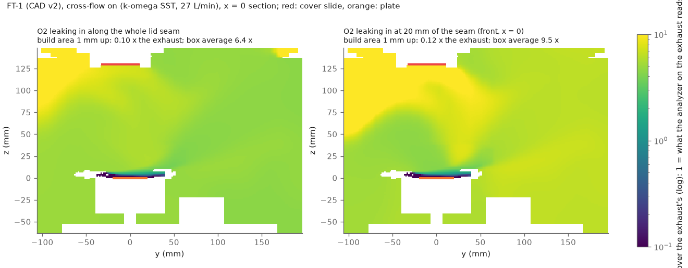

*Leaked O₂ over its exhaust value on the x = 0 section, log scale: the box fills to 5–10× the exhaust's value, the jet
over the plate (dark) stays clean. Left: the whole seam; right: 20 mm of it at the front.*

| leaked O₂, over its value at the exhaust | whole seam (`sAll`) | 20 mm at the front (`sLoc`) |
|---|---|---|
| 1 mm over the Ø30 build area: mean (max) | 0.10 (0.45) | 0.12 (0.44) |
| 1 mm over the plate's centre (probe) | ~0.01 | ~0.01 |
| 3 mm over the build area: mean (max) | 0.26 (0.45) | 0.26 (0.47) |
| 5 mm over the build area: mean | 1.6 | 1.5 |
| box average | 6.4 | 9.5 |
| bed to 30 mm up, whole box | 5.2 | 6.4 |
| 30 mm up to the rim lip | 6.6 | 10 |
| above the lip (the door's dish, by the seam) | 17 | 27 |
| 2 mm under the cover slide | 7.4 | 20 |

- **The cross-flow keeps the plate's gas close to the argon's purity.** 1 mm over the build area the leaked O₂ is
  about a tenth of what the exhaust analyzer reads (a hundredth at the plate's centre, up to half at the edges of the
  build area, where the jet's side vortices bring box gas down), a quarter at 3 mm, and 1.5× at 5 mm, in the jet's
  upper shear layer, which entrains box gas.
- **The box holds 5–10 times what the exhaust reads.** With the cross-flow on the box exchanges with the jet at only
  ~3 L/min (round 2 found the same, §2.1), so O₂ from a wall leak builds up in it, most of all in the door's dish next
  to the seam (17–27×) and, for a leak at the front, under the cover slide (20×).
- **For the 0-D floor (R3.4)** the tables give what the exhaust analyzer reads. With the worst lid gap (3 µm along the
  whole seam, +2.9 ppm at the exhaust at 27 L/min) the box would hold ~20 ppm of leaked O₂ and the gas 1 mm over the
  build area ~0.3 ppm, on top of the argon's 2 ppm, which comes in through the nozzle and is everywhere.
- **The analyzer on the collector's exhaust under-reads the box during a build** (by 5–10× for O₂ that leaks in at
  the walls) and over-reads the plate (by ~10×). For the box, sample under the lid; for the process, the exhaust is
  the conservative number.

### R3.6 FT-1V's purge: the cube, low diffuser, high vent (CFD), against the pump-purge (0-D)

As R3.3, on FT-1V's cube (CAD v2: 289.6 mm inside, 22.22 L of gas): nozzle off, 20 L/min of argon in through a
40 × 40 mm diffuser low on the left plate (its bottom 15 mm over the floor), out through a 40 × 20 mm vent high on the
right plate at the back (its top 15 mm under the top plate, clear of the frame's bars; outflow only),
rhoReactingBuoyantFoam from air at rest, on the coarse purge mesh (34,681 cells; max skewness 4.6 on 26 faces, "Failed
1 mesh checks" as in the box). 3.5 min of purge (1,009 steps, 328 s on two shared cores), then the run's own
exponential tail for 100 ppm. The diffuser and vent are this CFD's assumption, as in the box. FT-1V is meant to be
pump-purged (§3); this is the flow purge, set against the 0-D pump-purge of
[`o2_budget.py`](../../cfd/o2_budget.py) (`cube_pump_purge` in [`o2_budget.json`](o2_budget.json)).

| | FT-1 box (R3.3) | FT-1V cube |
|---|---|---|
| gas volume | 23.88 L | 22.22 L |
| box average to 1000 / 100 ppm | 3.1 / (≈ 4.9) min | 2.1 / (≈ 3.5) min |
| exhaust (the analyzer on the vent line) | 3.4 / (≈ 4.9) min | 2.4 / (≈ 3.7) min |
| 1 mm over the plate | 1.5 / 2.5 min | 1.0 / 1.5 min |
| well mixed, same flow and volume | 6.4 / 9.1 min | 5.9 / 8.5 min |
| argon used to 1000 ppm (box average), in gas volumes | 2.6 | 1.9 |
| O₂ at 3.5 min: box / exhaust / plate / under the slide | 620 / 851 / 46 / 168 ppm | 107 / 149 / 2 / 10 ppm |
| gas above the vent's top: volume; O₂ at 2 / 3 / 3.5 min | 1.38 L; 35,800 / 7,200 / 3,600 ppm | 0.95 L; 14,300 / 1,700 / 780 ppm |
| that layer's share of all the O₂, 1.5–3.5 min | 34–41 % | 32–48 % |

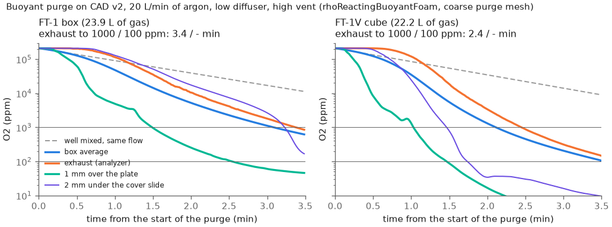

*O₂ against time, CAD v2, 20 L/min, low diffuser and high vent. Left: FT-1's box (R3.3); right: FT-1V's cube. Grey
dashes: well mixed. The exhaust's 100 ppm is past the end of both runs (the table's values in brackets are the runs'
own exponential tails).*

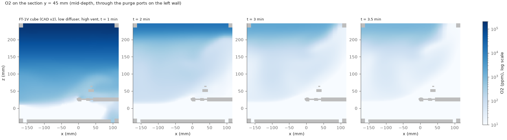

*O₂ on the cube's y = 45 mm section (through the diffuser) at 1, 2, 3 and 3.5 min, log scale: argon (white) fills from
the floor; the last air is in the layer under the top plate, above the vent.*

- **The cube purges faster than the box: 2.1 / ≈ 3.5 min to 1000 / 100 ppm** (box average), against the box's 3.1 /
  ≈ 4.9 min, and 5.9 / 8.5 min well mixed. The exhaust reads 1000 ppm at 2.4 min and 100 ppm at ≈ 3.7 min; the plate
  is under 100 ppm after 1.5 min and the gas under the cover slide after 1.7 min. It takes 1.9 gas volumes of argon
  to reach 1000 ppm, against 2.6 in the box. Argon fills the cube from the floor up, as in the box; the run does not
  isolate why the cube does better (it is 290 mm tall against the box's 211 mm of gas, and its top is flat where the
  box has the door's dish).
- **The last air waits above the vent, as in the box.** The vent's top is 15 mm under the top plate, and the 0.95 L
  above it (4 % of the gas) holds a third to a half of the cube's O₂ from 1.5 min on: 780 ppm at 3.5 min, against a
  105 ppm average. A vent through the top plate would drain it, as R3.3 found for the box's door. Not run.
- **The pump-purge is still the better way to purge FT-1V** (0-D, estimates: the McMaster 4396K21 pump, 3 cfm, through
  1 m of KF-25 hose; backfill at the regulator's 33 L/min; argon 5.0):

| FT-1V, from air | flow purge, 20 L/min (CFD) | pump-purge (0-D) |
|---|---|---|
| to ~1000 ppm | 2.4 min at the exhaust, 49 L of argon | 1 cycle to 1 mbar: 2.5 min, 22 L, 207 ppm |
| to ~100 ppm | ≈ 3.7 min at the exhaust, ≈ 75 L | 1 cycle to 0.5 mbar: 2.7 min, 22 L, 105 ppm; to 0.1 mbar: 3.3 min, 22 L, 23 ppm |
| to the argon's own ~2 ppm | ≈ 13 ppm at 5.0 min (the run's tail, extrapolated), 100 L | 2 cycles to 1 mbar: 5.0 min, 45 L, 2.3 ppm |

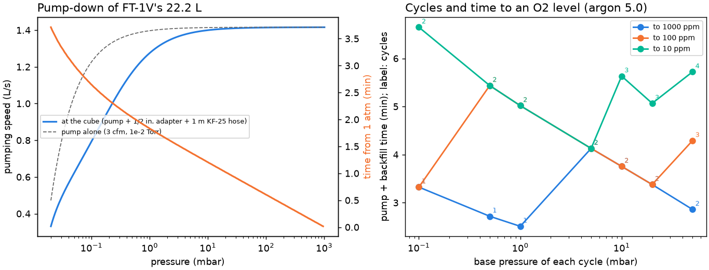

*0-D pump-purge of the cube ([`o2_budget.py`](../../cfd/o2_budget.py)). Left: pumping speed at the cube and the time
to pump down from 1 atm. Right: pump plus backfill time to 1000, 100 and 10 ppm against each cycle's base pressure
(labels: cycles).*

- So two pump cycles to 1 mbar reach the argon's floor in 5.0 min with less than half the argon the flow purge needs
  for 100 ppm. The flow purge is the fallback if the pump is not in use: ≈ 3.7 min to 100 ppm at 20 L/min, ≈ 75 L.
- The pump-purge numbers assume the cube holds vacuum to the acceptance rate of rise (1 × 10⁻³ mbar/min) and that
  the backfill mixes. Neither is checked here.

# Round 2 (2026-11-27): the CAD v1 model

Everything from here to the end ran on round 1's CAD model (v1: the box as a plain 406.4 × 304.8 × 203.2 mm inside, a
250 mm deck, an X-LSQ075B-sized recoater block at y = 95.5 mm, the window stack on the plate's axis with a Ø40 slide
holder; in FT-1V the slide 221 mm above the bed). Round 3 re-ran the main cases on CAD v2 (above).

## Short answer (v1)

- **Cross-flow (FT-1, isothermal): it works as drawn.** The slot jet crosses the Ø30 build area at 2.6–2.7 m/s (3 mm
  up) and carries 96–99 % of the fume released 0.5–3 mm over the bed into the collector. Its shear on the powder over
  the build area, 0.03–0.05 Pa on average, is at or under the lowest pick-up threshold for 63 µm AlSi10Mg (0.053 Pa)
  and half the 20 µm one; the coarsest grains may roll along the plate's sides (0.10 Pa). Fume that rises above the jet
  (4–15 mm) is only half caught and drifts round the box, passing the cover slide 80–90 mm away. 88 Pa from the nozzle
  to the collector's port. No change needed. In FT-1V's cube the jet over the plate is the same (k-ω SST: 2.49 m/s,
  0.055 Pa, 95 % captured, 87 Pa) and escaped fume passes the slide further away (154 mm against 89 mm).
- **Purge: through the nozzle alone, as drawn, it is slow; a low diffuser and a high vent make it fast.** Through the
  nozzle the box takes 33–50 min to 1000 ppm and 47–71 min to 100 ppm (no buoyancy; two meshes), past the study's
  expected 13–31 / 18–45 min, and the analyzer on the collector's exhaust reads about 4× under the box. With 20 L/min
  of argon in through a diffuser near the floor and out a vent under the lid, the argon fills the box from the bottom
  and pushes the air out: 2.6 / ≈ 5.0 min to 1000 / 100 ppm (box average, with buoyancy), against 6.2 / 8.9 min
  for perfect mixing. A high diffuser with the same vent mixes instead (≈ 4.7 / 6.8 min); a high diffuser with a
  low vent leaves the air on top (≈ 8.8 / 12.6 min, with the vent reading a third under the box).
- **What to change:** add a diffuser low on one wall and a vent at the top of the opposite wall (two bulkheads, a ball
  valve on the vent), sample the analyzer from the vent line, purge with the nozzle off, then close the vent and start
  the cross-flow. Purge before heating the plate. Every run here is isothermal and leak-free, with no air or water in
  the powder, so the O₂ the real box reaches is set by its leaks (study §3.4), not by these times.

## 1. The cross-flow over the plate (v1)

Slot nozzle MK-11 (45 × 4 mm, its bottom edge 2 mm above the bed) at 27 L/min (2.5 m/s mean in the slot,
Re = ρUh/μ = 730 on the 4 mm height), along +Y over the Ø40 plate into the exhaust collector 54 mm downstream (50 × 6 mm
opening, 2–8 mm above the bed), out through a 10 × 6 mm port into the exhaust hose. The box has no other opening, so
the collector takes exactly what the nozzle gives. The jet is laminar at the slot and its shear layers roll up within
the 54 mm, so neither model is exact: the steady laminar run and the k-ω SST run bracket it.


*|U| and streamlines in the x = 0 plane. The nozzle (left) and the collector (right) in grey; orange, the Ø40 plate.*

| | laminar, steady | k-ω SST, steady | FT-1V cube, k-ω SST (§3) |
|---|---|---|---|
| speed 1 mm over the Ø30 build area: mean (min-max), m/s | 1.30 (0.79-1.60) | 1.62 (1.34-1.77) | 1.67 (1.49-1.79) |
| speed 3 mm over the Ø30 build area: mean (min-max), m/s | 2.73 (2.64-2.80) | 2.57 (2.38-2.68) | 2.49 (2.26-2.65) |
| speed 5 mm over the Ø30 build area: mean (min-max), m/s | 1.60 (1.19-2.00) | 1.62 (1.45-1.79) | 1.57 (1.41-1.74) |
| spread 1 mm (std/mean) | 12 % | 5 % | 4 % |
| spread 3 mm (std/mean) | 2 % | 4 % | 5 % |
| spread 5 mm (std/mean) | 11 % | 6 % | 6 % |
| bed shear, Ø30 build area: mean / max, Pa | 0.032 / 0.047 | 0.053 / 0.067 | 0.055 / 0.070 |
| Ø30 build area: area over 0.053 Pa (63 µm, low cohesion) | 0 % | 54 % | 60 % |
| bed shear, Ø40 plate: mean / max, Pa | 0.033 / 0.100 | 0.049 / 0.100 | 0.051 / 0.082 |
| Ø40 plate: area over 0.053 Pa (63 µm, low cohesion) | 8 % | 43 % | 50 % |
| bed shear, spread strip beside the plate: mean / max, Pa | 0.019 / 0.097 | 0.025 / 0.108 | 0.021 / 0.093 |
| spread strip beside the plate: area over 0.053 Pa (63 µm, low cohesion) | 10 % | 17 % | 13 % |
| bed shear, whole block top: mean / max, Pa | 0.020 / 0.148 | 0.026 / 0.129 | 0.026 / 0.137 |
| whole block top: area over 0.053 Pa (63 µm, low cohesion) | 9 % | 21 % | 21 % |
| tracers 0.5-3 mm: into the collector | 96 % | 99 % | 95 % |
| tracers 0.5-3 mm: held under the collector's lower lip | 4 % | 1 % | 5 % |
| tracers 0.5-3 mm: escaped to the box | 0 % | 0 % | 0 % |
| tracers 0.5 mm: into the collector | 76 % | 95 % | 71 % |
| tracers 4-15 mm (above the jet): into the collector | 65 % | 49 % | 49 % |
| tracers 4-15 mm: escaped to the box | 23 % | 31 % | 30 % |
| escaped tracers: median closest approach to the slide, mm | 80 | 89 | 154 |
| tracers within 30 mm of the slide | 0 % | 1 % | 1 % |
| gas speed 2 mm under the slide: mean, mm/s | 3.3 | 0.9 | 0.2 |
| jet flow at y = 25 mm, forward / back, L/min | 34.3 / 7.7 | 41.6 / 2.3 | 42.2 / 1.5 |
| outlet flow, L/min | 27.0 | 27.0 | 27.0 |
| pressure drop, nozzle channel inlet to collector port, Pa | 88 | 88 | 87 |
| box (under the slide) above the collector port, Pa | 86 | 87 | 85 |
| y+ on the plate, mean / max | - | 0.82 / 1.19 | 0.85 / 1.09 |
| cells | 237,541 | 237,541 | 233,287 |
| iterations or time steps; final initial residual Ux / Uz / p | 2000; 2e-02 / 5e-02 / 9e-03 | 904; 5e-04 / 6e-04 / 3e-04 | 800; 1e-03 / 2e-03 / 9e-04 |

- **Speed over the build area.** The jet core, 3 mm up, crosses the Ø30 build area at 2.6–2.7 m/s with a 2–4 % spread
  (std/mean). 1 mm up it runs at 1.3–1.6 m/s, and 5 mm up at 1.6 m/s. Nothing over the build area flows backwards.
  The study's "2.5 m/s over the plate" holds for the core; the layer next to the powder sees about half of it.
- **Powder pick-up.** Shao & Lu's (2000) threshold for loose spheres
  (u\*ₜ = √(A_N (ρₚ/ρ · g d + γ/(ρ d))), A_N = 0.0123, γ = 1.65–5 × 10⁻⁴ N/m; AlSi10Mg 2670 kg/m³ in argon at
  1.65 kg/m³; [doi:10.1029/2000JD900304](https://doi.org/10.1029/2000JD900304); the same threshold PR 266 used in
  [`gas-flow.md`](../../../../gas-flow.md) §3.4) gives τₜ = ρ u\*ₜ²:

  | Particle | γ = 1.65 × 10⁻⁴ N/m | 3 × 10⁻⁴ | 5 × 10⁻⁴ |
  |---|---|---|---|
  | 63 µm | 0.053 Pa | 0.079 Pa | 0.118 Pa |
  | 40 µm | 0.064 Pa | 0.105 Pa | 0.167 Pa |
  | 20 µm | 0.108 Pa | 0.191 Pa | 0.314 Pa |

  γ was fitted to natural dust in air, not to Al powder in dry argon, so the threshold is uncertain by about 2× either
  way, and it holds for a smooth layer: a ridge left by the blade, or spatter lying on top, goes first.
  - Over the Ø30 build area the shear is 0.032 Pa (laminar) to 0.053 Pa (SST) on average, 0.047–0.067 Pa at most: at
    or below the bottom of the 63 µm band, and half the 20 µm band's lowest value.
  - The highest shear on the plate, 0.10 Pa in both runs, is along its two sides (x ≈ ±20 mm), under the vortices
    at the jet's edges. That is inside the 63 µm band: the coarsest loose particles there may roll.
  - The highest on the block top, 0.13–0.15 Pa, is at the corners of the collector's opening (x ≈ ±25, y ≈ +27),
    outside the plate.
- **Where the fume goes.** Tracers (they follow the gas: condensate and fume, not spatter) released 0.5–3 mm over
  the build area go straight into the collector: 96 % (laminar) and 99 % (SST), in 15 ms. The rest, all from 0.5 mm,
  end in a slow vortex under the collector's 2 mm lower lip. None reach the box.
- **A plume that rises above the jet is only half caught.** Of tracers released 4–15 mm over the build area, 49–65 %
  enter the collector (all from 4 mm, 19–46 % from 15 mm), 23–31 % leave into the box, and 12–20 % circulate in the
  slow eddies above the jet. The tracers carry no buoyancy, so a hot plume would rise further than shown.
- **The window stays clear of it in these runs.** The tracers that reach the box pass the cover slide no closer than
  80–89 mm (median); 1 % or fewer come within 30 mm of it. The gas 2 mm under the slide moves at 1–3 mm/s.
- **Why some gas escapes.** The jet entrains box gas on its way: 34–42 L/min reach the collector's face, which takes
  27. The rest, 7–12 L/min, goes over and round the collector and comes back as a slow circulation through the whole
  box (figure below). That circulation is what carries any fume that leaves the jet.
- **Pressure drop: 88 Pa** from the nozzle channel's inlet to the end of the collector's port, in both runs. Almost all
  of it is in the 10 × 6 mm port (7.5 m/s): the box sits 86–87 Pa above the port end. The hose, the HEPA and the check
  valve beyond it are not modelled; the check valve's cracking pressure sets the box's +5–10 mbar.

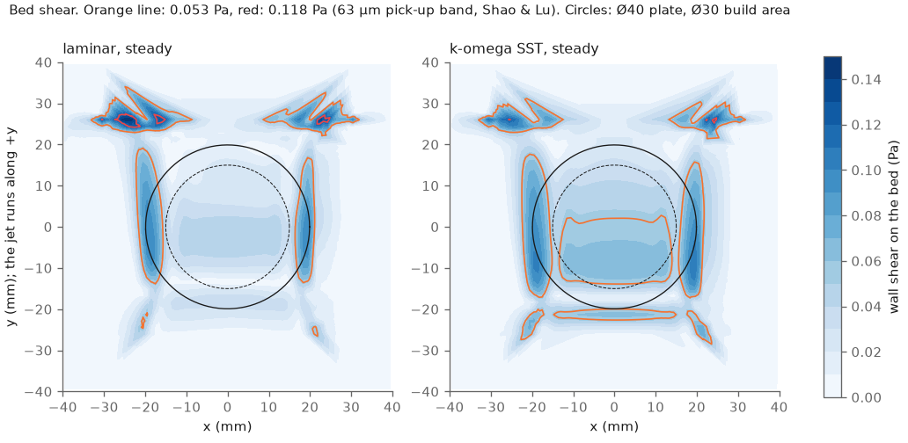

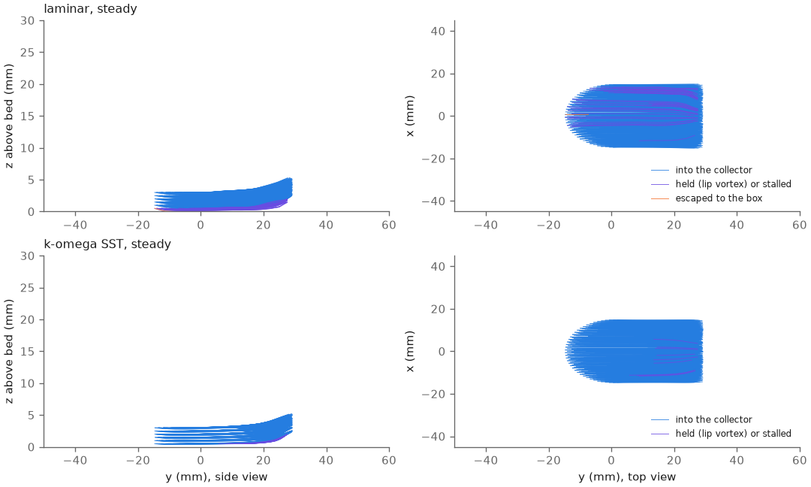

*Tracers from 0.5–3 mm over the build area, every third shown. Blue: into the collector; violet: held under the
collector's lower lip.*


*The whole box in the x = 0 plane, log speed scale. The jet's surplus leaves over the collector and circulates through the
box at 1–100 mm/s.*

No variant of the slot or the collector was run. The as-drawn pair clears the plume from the bed (96–99 % of
tracers) and stays at or under the lowest pick-up threshold over the build area, so the cheap changes set up for a
poor result (a 0–12 mm collector opening, a 10 L/min purge bleed during the build) were left unrun to give the CPU to
the purge.

## 2. The purge from air to argon (v1)

The meshed box holds 23.19 L of gas (the model's 23.5 L, §4). Every run purges at 20 L/min, so the well-mixed ideal
is 6.2 min to 1000 ppm and 8.9 min to 100 ppm (the study's 6.3 / 9.0 min for 23.5 L; study §3.4 expects 13–31 /
18–45 min). The CAD model has two openings only, the nozzle's feed and the collector's exhaust. The purge diffuser
(40 × 40 mm, a sintered or mesh diffuser on a bulkhead, left wall, mid-depth; low: 3–43 mm above the floor, high:
3–43 mm under the rim) and the vents (40 × 20 mm, right wall, at the back; high: 3–23 mm under the rim, low: 3–23 mm
above the floor) are this study's assumptions. "Exhaust" is the gas leaving through the run's outlet, flow-weighted:
what an analyzer on the exhaust line reads. "Plate" is a probe 1 mm over the centre of the plate. No run has leaks,
outgassing or air in the powder, so these are the purge's own limits (§4).

### 2.1 Without buoyancy

Steady laminar flow at the purge's flows (simpleFoam, 32,743 cells), then O₂ carried on that frozen flow as a passive
scalar for 60 min (scalarTransportFoam). Argon is given air's density here: these runs show where the gas goes, not
how argon settles under air.

| Config, no buoyancy | in (L/min) | out | box average: 1000 / 100 ppm (min) | exhaust (analyzer) | plate | box decay rate (1/min; well mixed 0.86) | box volume where the flow is under 3 mm/s |
|---|---|---|---|---|---|---|---|
| A (as drawn) | nozzle 20 | collector port | 33.2 / 47.5 | 22.8 / 37.0 | 6.1 / 20.4 | 0.16 | 5 % |
| B | nozzle 5, low diffuser 15 | collector port | 12.2 / 17.6 | 10.6 / 16.0 | 0.1 / 8.8 | 0.43 | 28 % |
| C | nozzle 5, high diffuser 15 | collector port | 8.0 / 11.5 | 7.6 / 11.1 | 2.7 / 6.1 | 0.66 | 10 % |
| D | nozzle 5, low diffuser 15 | high vent | 6.1 / 8.8 | 6.2 / 8.8 | 1.5 / 4.1 | 0.87 | 12 % |
| A on the 237k-cell mesh (20 min run) | nozzle 20 | collector port | (≈ 50) / (≈ 71) | (≈ 30) / (≈ 52) | 5.8 / (≈ 27) | 0.11 | 23 % |
| well mixed, same flow and volume | 20 | | 6.2 / 8.9 | | | 0.86 | |

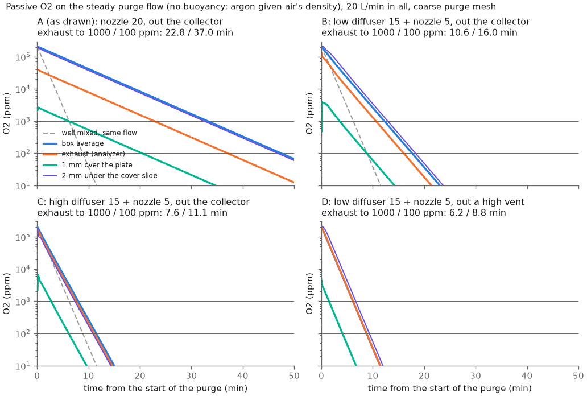

- **As drawn (A), purging through the nozzle alone is slow: 33 min to 1000 ppm and 47 min to 100 ppm** (box average),
  5× the ideal and at or past the top of the study's range. The jet goes straight into the collector; the rest of the
  box is renewed only by what the jet entrains and spills over the collector (7–12 L/min at the build's 27 L/min,
  §1), which empties it at 0.16 per minute, as if 3.7 of the 20 L/min went through the box. On the 237k-cell
  cross-flow mesh, which resolves the jet, it is slower still: 0.107 per minute, ≈ 50 / 71 min (extrapolated from a
  20 min run). The coarse purge mesh is optimistic for A; B–D, whose box flow comes from the diffuser, were run on it
  only.
- **In A the analyzer on the collector's exhaust reads low.** It sees mostly the nozzle's fresh argon, about 4× under
  the box average, and reaches 1000 ppm 10 min before the box does.
- **A separate diffuser does most of the work.** With 15 L/min through a diffuser and 5 through the nozzle, the box
  reaches 100 ppm in 17.6 min (low diffuser, out the collector), 11.5 min (high diffuser, out the collector) and 8.8 min
  (low diffuser, out a high vent: the well-mixed ideal).
- **The plate sees argon first:** 1 mm over the build area the O₂ is under 1000 ppm within 0.1–6 min in every config,
  because the nozzle's argon runs over it.
- **The pocket above the cover slide** (about 23.5 cm³ between the slide and the window, not meshed) exchanges with the
  box only by diffusion through the 1 mm gap round the slide holder: D·A/L ≈ 13 mL/min, a time constant of about 2 min
  (estimate). It lags the box by ~2 min and, at 9 min, still holds ~1600 ppm, which is under 2 ppm of the box average.
  It does not set the purge time.

### 2.2 With buoyancy

Argon (39.95 g/mol) is 1.38× as dense as air (28.96 g/mol). Fed slowly (20 L/min through a 40 × 40 mm diffuser is
0.21 m/s) it runs along the floor and fills the box from the bottom up, pushing the air ahead of it, as long as the
air has a way out above it. Each run below has the nozzle off and all 20 L/min through one diffuser, from air at rest,
on the same mesh with the same settings; only the diffuser and the vent move.

| Run, with buoyancy | in (L/min) | out | box average: 1000 / 100 ppm (min) | exhaust (analyzer) | plate | O₂ at the end: box / exhaust / plate / under the slide (ppm) |
|---|---|---|---|---|---|---|
| Low diffuser, high vent | low diffuser 20 | high vent | 2.6 / (≈ 5) | 2.8 / 4.7 | 1.4 / 3.5 | 102 / 82 / 49 / 121 at 5.0 min |
| High diffuser, high vent | high diffuser 20 | high vent | (≈ 5) / (≈ 7) | (≈ 5) / (≈ 7) | (≈ 4) / (≈ 5) | 6913 / 8992 / 3256 / 11537 at 3.0 min |
| High diffuser, low vent | high diffuser 20 | low vent | (≈ 9) / (≈ 13) | (≈ 8) / (≈ 11) | (≈ 9) / (≈ 14) | 32434 / 21927 / 24189 / 57048 at 3.0 min |
| Low diffuser, high vent, first run (Courant 15; air flowed back in at the vent from ~2.5 min) | low diffuser 20 | high vent | 2.6 / (≈ 5) | not valid | 1.4 / 3.4 | 196 / – / 84 / 229 at 4.1 min |
| well mixed, same flow and volume | 20 | | 6.2 / 8.9 | | | |

"(≈ x)": not reached in the run; extrapolated from the run's own exponential decay over its last 20 %. "> x": not
reached and not decaying.

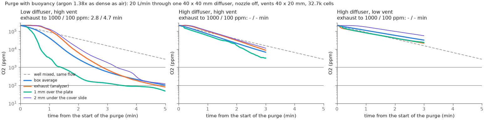

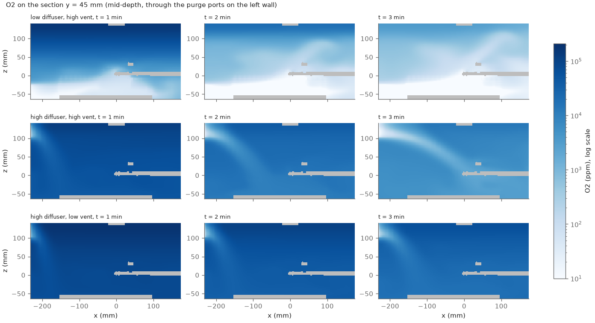

*O₂ on a vertical section through the diffusers (y = 45 mm, mid-depth), log scale: white is argon under 10 ppm, dark
blue is air; grey is solid (the deck cassette, the stage, the window stack). The diffusers are on the left wall in this
plane; the vents are on the right wall, 90–130 mm behind it.*

- **Low diffuser, high vent: the argon displaces the air.** It spreads over the floor and rises as a layer: at 2 min
  the bottom 40 mm of the box holds about 120 ppm and the top 40 mm about 1.2 % O₂ (figure). The box average reaches
  1000 ppm in 2.6 min and 102 ppm at the end of the 5 min run (≈ 5.0 min to 100 ppm), 2.4× and 1.8× faster than well
  mixed, after 2.2 and 4.3 box volumes of argon. 1 mm over the plate the O₂ is under 1000 ppm after 1.4 min and under
  100 ppm after 3.5 min. The vent reads above the box average while the air layer drains through it (1000 ppm at
  2.8 min) and slightly below it at the end (100 ppm at 4.7 min; 82 against 102 ppm at 5 min): the last O₂, ~450 ppm,
  sits under the lid at the far end from the vent, above the diffuser. A vent in the middle of the lid, or one at each
  end, would shorten that tail (not run).
- **High diffuser, high vent: the argon falls and mixes.** The plume from the diffuser stirs the box on its way to the
  floor, so the box is only mildly layered (the top 40 mm holds about 1.5× the average, 2–2.5× the bottom 40 mm). Because the vent still takes
  the worst gas it purges about a quarter faster than well mixed: 6,900 ppm at 3 min, ≈ 4.7 / 6.8 min to 1000 /
  100 ppm.
- **High diffuser, low vent: the air stays on top.** The plume falls through the air to the floor and the low vent
  drains the argon that pools there; the air above leaves only as fast as the plume entrains it. At 3 min the box is twice as bad
  as well mixed (32,400 against 15,800 ppm), ≈ 8.8 / 12.6 min to 1000 / 100 ppm. Under the slide it is still
  57,000 ppm (27 % air), while the vent reads a third under the box average (21,900 ppm): an analyzer on a low exhaust
  reads better than the box.
- **The first low-inlet run** (Courant 15, the vent letting air back in) gave the same box average as the second
  (Courant 30, outflow-only vent) to within 3 % up to 1.5 min. From ~2.5 min the air flowing back in at its vent held
  its exhaust near 2,800 ppm, so only its box average and plate are used (§4).

### 2.3 Where the purge inlet and the exhaust go

1. **The exhaust at the top.** Air is the lighter gas: the last of it collects under the lid and leaves only through an
   opening above it. Put a vent at the highest point of the box, on the wall away from the diffuser (or through the
   lid), with its bore as close under the lid as the fitting allows: a 3/8–1/2 in. bulkhead and a ball valve, teed into
   the exhaust line ahead of the HEPA housing and the check valve. Sample the analyzer from this line during the purge;
   it then reads the last air to leave, not fresh argon.
2. **The purge inlet low, through a diffuser.** About 40 × 40 mm of sintered metal or mesh (0.2 m/s at 20 L/min), just
   above the floor on the far wall, so the argon spreads along the floor instead of jetting. Low in and high out took
   2.6 / ≈ 5.0 min to 1000 / 100 ppm (box average), against ≈ 4.7 / 6.8 min with the same vent and a high inlet,
   and 6.2 / 8.9 min well mixed.
3. **Purge with the nozzle off, then switch.** 20 L/min through the diffuser with the vent open until the analyzer
   reads the target; then close the vent and run the cross-flow, which leaves through the collector and holds the box
   above the room behind the check valve. Through the nozzle alone (as drawn) the purge takes 33–50 min to 1000 ppm
   (no buoyancy, two meshes, §2.1).
4. **Purge before heating the plate,** or expect times nearer the well-mixed ones: a 200 °C plate drives a plume of a
   few cm/s that stirs the layers (not modelled).

The collector's port, the as-drawn exhaust, sits 2–8 mm above the deck and 65–70 mm above the floor: for the purge it
is a low exhaust. Purging out through it leaves the air above it to be stirred out, as in the high-diffuser, low-vent
run, with the analyzer on that line reading low. (A buoyant run through the port itself was not affordable, §4.)

## 3. FT-1V (v1)

The same deck cassette in the Ideal Vacuum cube (289.6 mm inside; `geom.py --state FT-1V`: 21.9 L of gas, the cube
frame's edge bars included, the bed 21 mm higher than in the box, the cover slide 221 mm above the bed against FT-1's
129 mm), k-ω SST only, the third column of the table in §1. Mesh as FT-1's: 233,287 cells (217,673 hex), max
non-orthogonality 65.0°, max skewness 6.4 (32 faces, "Failed 1 mesh checks"), max aspect ratio 22.4. 800 iterations
(10 min on 2 cores); the probe speeds are steady to 3 digits from iteration ~100, final initial residuals 1–2 × 10⁻³.

- **The jet over the plate is FT-1's.** 2.49 m/s 3 mm over the build area (2.57 in the box), bed shear over the build
  area 0.055 / 0.070 Pa mean / max (0.053 / 0.067), 95 % of the tracers from 0.5–3 mm into the collector (99 %; the
  rest held under the collector's lower lip), 87 Pa (88). The slot, the collector and the bed round them are the same
  parts at the same spacing; the enclosure and the routing of the feed and exhaust pipes changed.
- **Escaped fume stays further from the window.** The same 30 % of the tracers from 4–15 mm escape into the cube, but
  they pass the cover slide no closer than 154 mm (median), against 89 mm in the box, and the gas 2 mm under the slide
  moves at 0.2 mm/s.
- Not run for FT-1V: the laminar bracket and a purge (FT-1V pump-purges).

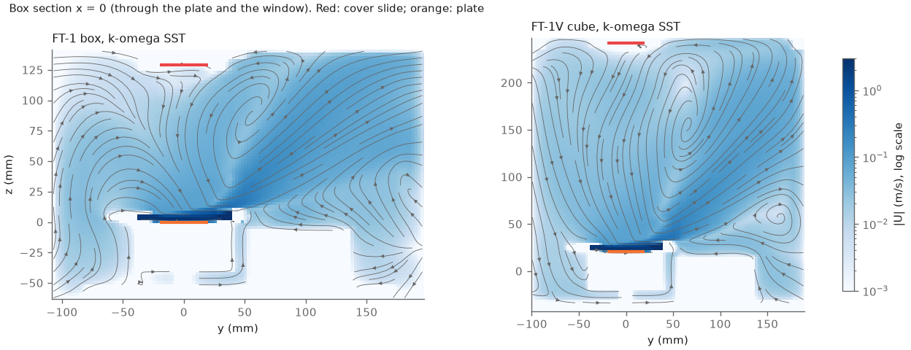

*The x = 0 section through the plate and the window in FT-1's box (left) and FT-1V's cube (right), k-ω SST, log speed
scale. In both, the jet's surplus leaves over the collector and circulates slowly through the whole enclosure.*

```bash
$PY $D/geom.py --state FT-1V --out /tmp/ft-cfd/geom/ft1v
$PY $D/make_case.py --geom /tmp/ft-cfd/geom/ft1v --kind cross --model sst --iters 800 --out /tmp/ft-cfd/ft1v-sst
# residualControl as cross-sst: p 2e-5, U and (k|omega) 2e-6 (set in system/fvSolution)
MEM=3g /tmp/tools/capmem 3 bash $D/run_case.sh /tmp/ft-cfd/ft1v-sst mesh solve
/tmp/tools/capmem 3 $PY $D/post.py cross /tmp/ft-cfd/ft1v-sst --name ft1v-sst
$PY $D/post.py figures --name ft1v --cases "FT-1 box, k-omega SST=/tmp/ft-cfd/cross-sst" "FT-1V cube, k-omega SST=/tmp/ft-cfd/ft1v-sst"
```

## 4. Method (v1)

### Geometry

[`geom.py`](../../cfd/geom.py) builds the solids that bound the gas from `ft_model.build("FT-1", pz=0, hx=37.5)` (the
plate at the start of a build, the hopper at its right park) and `ft_model.P`, fuses them, sorts the faces into named
regions (inlet, outlet, bed, slide, nozzle, collector, hopper, blade, block, deck, recoater, pipes, window) and writes one
STL. The enclosure's inside (406.4 × 304.8 × 203.2 mm, from the floor to the rim, as `ft_checks.py` counts it) is the
background mesh. Re-running `geom.py` on a changed model moves the case with it. Simplifications, all within the parts'
own envelopes unless stated:

- the plate stack fills the Ø40 bore (the 0.1 mm gap round the plate is not meshed); the overflow slot through the well
  block is a 7 × 44 × 39 mm blind pocket (the cup under it and the 1 mm gap between them are closed);
- the deck's rod hole and its pocket for the overflow cup are filled; the well-block heaters' 2 mm stubs are left out;
- the recoater stage, its carriage and the 1 mm sheet shield are one block, the shield's outer envelope;
- the hopper is solid (full of powder); the silicone cord and its clamp are one 4 × 46 × 12 mm block on the bed;
- the window stack under the lid (clamp ring, cover-slide holder, slide) is one solid, with the holder's Ø40 bore open
  below the slide. The ~23.5 cm³ pocket above the slide is not meshed (see §2.1);
- **the nozzle and the collector have no internals in the model (MK-11).** Here the nozzle gets a straight 45 × 4 mm
  channel, 11 mm long, with a uniform inflow at its back face; the collector gets a plenum behind its 50 × 6 mm opening
  and a 10 × 6 mm port (60 mm², about a 3/8 in. hose bore) whose end is the outlet. Both are assumptions;
- the purge ports (§2) are not in the model either: 40 × 40 mm diffuser faces on the left wall at mid-depth (low:
  3–43 mm above the floor; high: 3–43 mm below the rim) and 40 × 20 mm vents on the right wall at the back.

Meshed gas volume: 23.19 L, against the model's 23.5 L (`cad/out/checks.md`); the difference is the filled hopper,
shield envelope, cup and window pocket.

### Mesh

| | cross-flow mesh | purge mesh |
|---|---|---|
| background (blockMesh) | 51 × 25 × 51 cells, 7.97 × 12.19 × 3.98 mm | 32 × 16 × 32 cells, 12.7 × 19.05 × 6.35 mm |
| refinement (snappyHexMesh) | level 3, 1.0 × 1.5 × 0.5 mm, in the jet box (x ±30.5, y −39 to +40.5, z −2 to +11 mm) and on the nozzle, collector, bed and blade; level 2 within ±50 mm of the well and on the slide | level 3 on the nozzle and collector only; level 1 elsewhere |
| prism layers | 3 on the bed, 0.51 mm in all (first ~0.13 mm), 97 % coverage | none |
| cells | 237,541 (221,706 hex, 14,147 polyhedra) | 32,743 |
| checkMesh | max non-orthogonality 70.3° (1 face over 70°), max skewness 6.75 (4 faces), max aspect ratio 26.8; "Failed 1 mesh checks" (the skewness) | max non-orthogonality 64.9°, max skewness 19.0 (3 faces) |
| meshing time | 70 s | 30 s |

The 4 mm slot has 8 cells across its height; the bed's first cell is ~0.13 mm thick. y⁺ on the plate (SST) is
0.8 on average and 1.2 at most, so the SST run resolves the wall without wall functions there.

### Solvers, boundary conditions, convergence

- **Gas:** argon at 25 °C and ~+7 mbar, ρ = 1.65 kg/m³, μ = 22.6 µPa·s (as PR 266's runs). Isothermal: the plate's
  200 °C and the laser are not in any run.
- **Cross-flow:** simpleFoam (SIMPLEC), linearUpwind for U, 2 MPI ranks. Nozzle channel inlet: 27 L/min, uniform
  (`flowRateInletVelocity`); collector port end: p = 0; walls no-slip; purge ports closed. SST: inlet turbulence 5 %,
  mixing length 0.28 mm.
  - **Laminar: the residuals stop falling** at 2 × 10⁻² (Ux), 5 × 10⁻² (Uz), 9 × 10⁻³ (p) after ~500 iterations, because
    the jet's upper shear layer and the box circulation are unsteady. Over the last 400 of 2000 iterations the speed
    1 mm and 3 mm above the plate centre varies by ±1.8 % and ±1.4 % (std), and 5 mm up by ±18 %. The laminar numbers
    are a snapshot of a flow that moves; a time-averaged transient run was set up (`make_case.py --transient`) but not
    run for lack of CPU time.
  - **SST** converges: residuals 3–6 × 10⁻⁴ at 904 iterations, probe speeds constant to 4 digits from iteration 300.
- **Tracers:** streamlines integrated (RK2, 0.15 mm steps) through U resampled onto a 0.5 × 0.5 × 0.25 mm grid round the
  jet, then (1 mm steps) on a 2.5 mm grid over the box. 2,730 seeds on six heights 0.5–3 mm over the Ø30 build area and
  1,020 on five heights 4–15 mm. "Into the collector": reached its plenum. "Escaped": left the 90 × 95 × 30 mm region
  round the jet. Otherwise held or circulating (speed < 0.1 mm/s, or 600 mm of path without either).
- **Bed shear:** OpenFOAM's `wallShearStress` on the bed (the block top and the plate), × ρ.
- **Purge flows** (simpleFoam, laminar, 32,743 cells, 2 ranks, 2–4 min each): final initial residuals 4 × 10⁻⁴ (A,
  800 iterations; the 20 L/min jet is unsteady, as in §1), 3 × 10⁻⁵ (C, 800) and 1 × 10⁻⁷ (B at 378 iterations, D at
  800). The 237k-cell flow for the mesh check is the 1000-iteration steady run of config A on the cross-flow mesh.
- **Passive O₂** (scalarTransportFoam): Δt = 2 s, the upwind matrix with an explicit limitedLinear01 correction
  (`deferredCorrection`), PBiCGStab to 10⁻⁹, about 20 iterations a step; 2.5–4 min a run on the purge mesh, 11 min for
  20 min of purge on the 237k-cell mesh. The fully implicit limitedLinear01 matrix needed 100–1000 iterations a step at
  the jet's Courant numbers (~1000 at Δt = 2 s).
- **Buoyant runs:** inlets are pure argon at 25 °C; the vent holds p = p₀ (101,325 + 700 Pa) and lets gas out only.
  Δt settled at 0.10–0.13 s (Courant 30); a 3 min run took 1,355 steps and 10–20 min on two shared cores.

### Purge runs: what physics each includes

| Run | Solver | Includes | Leaves out |
|---|---|---|---|
| purge flow | simpleFoam, laminar, steady, 800 iterations, purge mesh | the steady velocity field at the purge's flows, in argon | gravity and the air/argon density difference; unsteadiness |
| passive O₂ | scalarTransportFoam on that frozen flow, Δt = 2 s (implicit Euler; upwind matrix with an explicit limitedLinear01 correction), 60 min (20 min on the 237k-cell mesh) | O₂ (as a fraction of air's, T = x_O₂/0.2095) carried by the flow and diffusing at D = 2.0 × 10⁻⁵ m²/s (O₂ in Ar, 25 °C, 1 atm) | buoyancy: argon is treated as having air's density, so a low and a high inlet differ only by where the gas goes |
| buoyant | rhoReactingBuoyantFoam: O₂, N₂, Ar, no reactions, isothermal 25 °C, laminar; PIMPLE (2 outer, 2 pressure correctors), Δt ≤ 0.25 s at Courant ≤ 15 (the first low-inlet run: Δt settled at 0.044 s, set by 0.1 m/s gravity currents in the fine cells round the collector) or ≤ 30 (the other three: Δt 0.10–0.14 s); 5 min (low in), 3 min (top in) or 4.1 min (first run) of purge, from air at rest | gravity and the real mixture density (ideal gas: air 1.19, argon 1.65 kg/m³), so argon can pool under air and displace it | the nozzle (off: all 20 L/min goes through the diffuser) and the collector's port as the exhaust (its 60 mm² at 20 L/min is 5.6 m/s, which would force Δt ≈ 6 ms), so the buoyant runs exhaust through 40 × 20 mm vents; heat; species diffuse with Sc = 1 (D = ν ≈ 1.4 × 10⁻⁵ m²/s, 30 % under the real value) |

In every run the walls are tight: no leaks, no permeation through the gasket, no outgassing, no water, no O₂ in the
argon, and no air held in the powder or in the stage's body. The O₂ these runs reach is the purge's own limit, below
what the analyzer will read on the real box. The purge ports and their sizes are this study's assumptions, not the
model's (§4, geometry). The steady purge flows were computed laminar and without buoyancy; at 15–20 L/min the box's
own gas moves at mm/s to cm/s, so a 1–2 K temperature difference in the room would move it as much (not modelled).


### What was not done (round 2; round 3 did some of it, above)

- **A time-averaged laminar run** of the cross-flow (pimpleFoam with `fieldAverage`, set up as
  `make_case.py --transient` and `run_case.sh <case> map <steady case> pimple`): not run, for lack of CPU time on a
  runner shared by seven jobs (load average 7–12 on 4 cores during these runs).
- **FT-1V's cube** (case 3): k-ω SST only, no laminar bracket and no purge (§3).
- **Heat:** the 200 °C plate and block, the laser plume's buoyancy and the box's own convection are not in any run.
  A hot plate drives a rising plume of its own (a few cm/s), the same order as the box circulation; it would lift fume
  above the jet and carry the purge's last O₂ round the box.
- **Spatter** (50–150 µm, ballistic) was not tracked; tracers stand for fume and condensate only.
- **Mesh independence** was checked only for the passive purge (config A on the purge mesh and on the cross-flow
  mesh, §2.1). The cross-flow ran on one mesh (237,541 cells; 8 cells across the slot); the buoyant runs on the
  32,743-cell purge mesh only, whose 6.35 mm cells smear the argon/air interface.
- **The as-drawn exhaust in a buoyant run.** No buoyant run exhausts through the collector's port: at 20 L/min its
  10 × 6 mm bore runs at 5.6 m/s, which would hold the time step to ~6 ms. The buoyant runs use the 40 × 20 mm vents,
  with the nozzle off.
- **Long buoyant runs.** They cover 3–5 min of purge (5–27 min each on two shared cores); levels reached later are
  extrapolated from each run's own exponential tail and marked "≈". No buoyant run has the nozzle on, or a vent in
  the middle of the lid.
- **The first low-inlet buoyant run** let air flow back in at the top of its vent (velocity `pressureInletOutletVelocity`
  with a uniform static pressure: the 0.3 Pa hydrostatic head across a 20 mm vent beat the ~0.15 Pa that drives the
  outflow). Its exhaust reading after 2.5 min is that artifact and is not used; the later runs' exhaust is outflow-only,
  like the check valve on the real line.
- **The nozzle's and collector's internals** (MK-11) are assumed (§4); a real plenum and flow straightener change the
  slot's exit profile, and the port size sets the collector's pressure drop.
- **Leaks and permeation** set the real O₂ floor (study §3.4); none are modelled.


## Re-run (v1)

```bash
D=desktop-lpbf/fast-track/analysis/cfd; PY=/tmp/venv/bin/python
$PY $D/geom.py --state FT-1 --out /tmp/ft-cfd/geom/ft1
$PY $D/make_case.py --geom /tmp/ft-cfd/geom/ft1 --kind cross --model laminar --out /tmp/ft-cfd/cross-lam
/tmp/tools/capmem 4 bash $D/run_case.sh /tmp/ft-cfd/cross-lam mesh solve        # ~70 s mesh, ~15 min solve (2 cores)
$PY $D/make_case.py --geom /tmp/ft-cfd/geom/ft1 --kind cross --model sst --iters 1000 --out /tmp/ft-cfd/cross-sst
/tmp/tools/capmem 4 bash $D/run_case.sh /tmp/ft-cfd/cross-sst copymesh /tmp/ft-cfd/cross-lam solve
/tmp/tools/capmem 3 $PY $D/post.py cross /tmp/ft-cfd/cross-lam --name laminar     # and --name sst
$PY $D/post.py figures --name cross --cases "laminar, steady=/tmp/ft-cfd/cross-lam" "k-omega SST, steady=/tmp/ft-cfd/cross-sst"
# purge: steady flows on the coarse purge mesh, then O2 as a passive scalar on each (configs A-D)
$PY $D/make_case.py --geom /tmp/ft-cfd/geom/ft1 --res coarse --profile purge --kind purge --iters 800 \
    --nozzle-lpm 5 --purge-lpm 15 --inlet purge_low --outlet vent_high --out /tmp/ft-cfd/pc-D      # A-D: see the table in §2
MEM=1g /tmp/tools/capmem 1 bash $D/run_case.sh /tmp/ft-cfd/pmesh mesh   # pmesh: any case written with --res coarse --profile purge
MEM=1g /tmp/tools/capmem 1 bash $D/run_case.sh /tmp/ft-cfd/pc-D copymesh /tmp/ft-cfd/pmesh solve
$PY $D/make_case.py --geom /tmp/ft-cfd/geom/ft1 --res coarse --profile purge --kind scalar --t-end 3600 --t-write 300 \
    --dt 2 --nozzle-lpm 5 --purge-lpm 15 --inlet purge_low --outlet vent_high --out /tmp/ft-cfd/sc-D
MEM=1g /tmp/tools/capmem 1 bash $D/run_case.sh /tmp/ft-cfd/sc-D scalar /tmp/ft-cfd/pc-D
$PY $D/post.py purge /tmp/ft-cfd/sc-D --name scalar-D
# 237k-cell mesh check of config A: the same with --res medium on purge-A (copymesh /tmp/ft-cfd/cross-lam), --t-end 1200
# purge with buoyancy (argon displacing air), nozzle off, 20 L/min through one diffuser; HH and HL: --inlet purge_high,
# --outlet vent_high / vent_low, --t-end 180
$PY $D/make_case.py --geom /tmp/ft-cfd/geom/ft1 --res coarse --profile purge --kind buoyant --nozzle-lpm 0 --purge-lpm 20 \
    --inlet purge_low --outlet vent_high --t-end 300 --t-write 60 --max-co 30 --out /tmp/ft-cfd/buoy-LH
MEM=1g /tmp/tools/capmem 1 bash $D/run_case.sh /tmp/ft-cfd/buoy-LH copymesh /tmp/ft-cfd/pmesh buoyant   # 10-30 min, 2 cores
$PY $D/post.py purge /tmp/ft-cfd/buoy-LH --name buoyant-LH
$PY $D/post.py purgefigs --name purge_buoyant.png --tmax 5 --cases "buoyant-LH=..." "buoyant-HH=..." "buoyant-HL=..."
$PY $D/post.py snaps --name purge_sections.png --times 60 120 180 --cases "label=/tmp/ft-cfd/buoy-LH=O2" ...
$PY $D/post.py tables
```

`capmem` drops the docker group, so `run_case.sh` calls `sudo -n docker run`. Cases and resampled fields stay under
`/tmp`; nothing from a case directory is committed.
