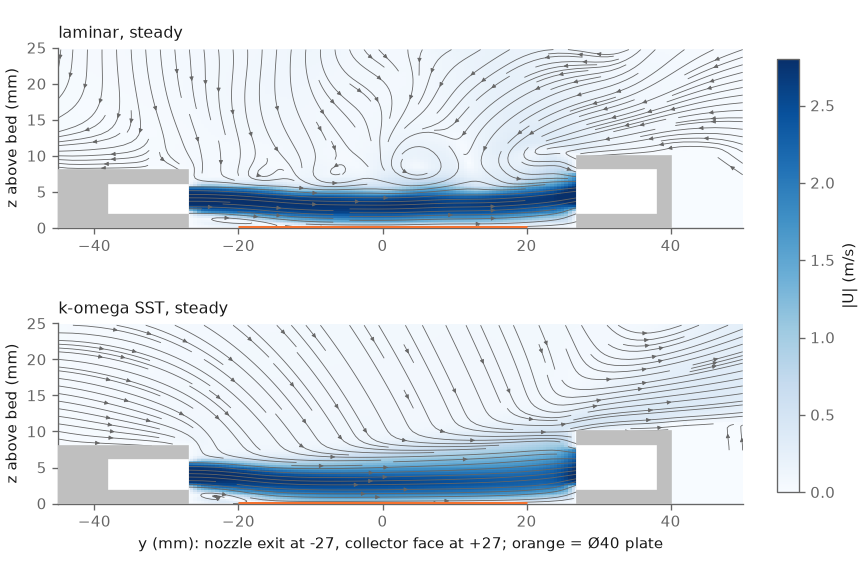
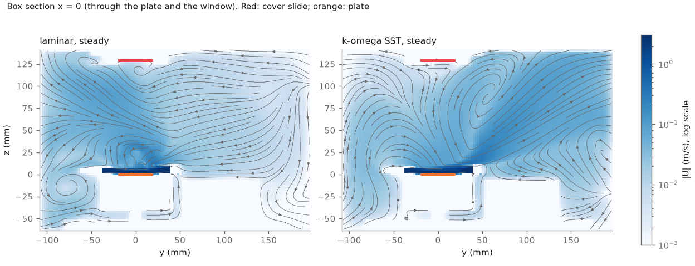

# CFD of FT-1's gas: the cross-flow over the plate and the purge from air to argon

For [issue #260](https://github.com/vertical-cloud-lab/digital-alloy-lab/issues/260), PR 294 round 2, 2026-11-27.
OpenFOAM v2406 (Docker image `opencfd/openfoam-run:2406`) on the gas inside the CadQuery model of FT-1
([`../../../cad/ft_model.py`](../../../cad/ft_model.py), `build("FT-1")`: the 16 × 12 × 8 in. box, the deck cassette, the
plate at the start of a build, the hopper at its right park). Scripts: [`../../cfd/`](../../cfd/). Numbers:
[`cfd.json`](cfd.json). Nothing here has been checked against a measurement.

## Short answer

__SHORT__

## 1. The cross-flow over the plate

Slot nozzle MK-11 (45 × 4 mm, its bottom edge 2 mm above the bed) at 27 L/min (2.5 m/s mean in the slot,
Re = ρUh/μ = 730 on the 4 mm height), along +Y over the Ø40 plate into the exhaust collector 54 mm downstream (50 × 6 mm
opening, 2–8 mm above the bed), out through a 10 × 6 mm port into the exhaust hose. The box has no other opening, so
the collector takes exactly what the nozzle gives. The jet is laminar at the slot and its shear layers roll up within
the 54 mm, so neither model is exact: the steady laminar run and the k-ω SST run bracket it.



*|U| and streamlines in the x = 0 plane. The nozzle (left) and the collector (right) in grey; orange, the Ø40 plate.*

| | laminar, steady | k-ω SST, steady |
|---|---|---|
__TABLE1__

- **Speed over the build area.** The jet core, 3 mm up, crosses the Ø30 build area at 2.6–2.7 m/s with a 2–4 % spread
  (std/mean). 1 mm up it runs at 1.3–1.6 m/s, and 5 mm up at 1.6 m/s. Nothing over the build area flows backwards.
  The study's "2.5 m/s over the plate" holds for the core; the layer next to the powder sees about half of it.
- **Powder pick-up.** Shao & Lu's (2000) threshold for loose spheres
  (u\*ₜ = √(A_N (ρₚ/ρ · g d + γ/(ρ d))), A_N = 0.0123, γ = 1.65–5 × 10⁻⁴ N/m; AlSi10Mg 2670 kg/m³ in argon at
  1.65 kg/m³; [doi:10.1029/2000JD900304](https://doi.org/10.1029/2000JD900304); the same threshold PR 266 used in
  [`gas-flow.md`](../../../../gas-flow.md) §3.4) gives τₜ = ρ u\*ₜ²:

  | Particle | γ = 1.65 × 10⁻⁴ N/m | 3 × 10⁻⁴ | 5 × 10⁻⁴ |
  |---|---|---|---|
  | 63 µm | 0.053 Pa | 0.079 Pa | 0.118 Pa |
  | 40 µm | 0.064 Pa | 0.105 Pa | 0.167 Pa |
  | 20 µm | 0.108 Pa | 0.191 Pa | 0.314 Pa |

  γ was fitted to natural dust in air, not to Al powder in dry argon, so the threshold is uncertain by about 2× either
  way, and it holds for a smooth layer: a ridge left by the blade, or spatter lying on top, goes first.
  - Over the Ø30 build area the shear is 0.032 Pa (laminar) to 0.053 Pa (SST) on average, 0.047–0.067 Pa at most: at
    or below the bottom of the 63 µm band, and half the 20 µm band's lowest value.
  - The highest shear on the plate, 0.10 Pa in both runs, is along its two sides (x ≈ ±20 mm), under the vortices
    at the jet's edges. That is inside the 63 µm band: the coarsest loose particles there may roll.
  - The highest on the block top, 0.13–0.15 Pa, is at the corners of the collector's opening (x ≈ ±25, y ≈ +27),
    outside the plate.
- **Where the fume goes.** Tracers (they follow the gas: condensate and fume, not spatter) released 0.5–3 mm over
  the build area go straight into the collector: 96 % (laminar) and 99 % (SST), in 15 ms. The rest, all from 0.5 mm,
  end in a slow vortex under the collector's 2 mm lower lip. None reach the box.
- **A plume that rises above the jet is only half caught.** Of tracers released 4–15 mm over the build area, 49–65 %
  enter the collector (all from 4 mm, 19–46 % from 15 mm), 23–31 % leave into the box, and 12–20 % circulate in the
  slow eddies above the jet. The tracers carry no buoyancy, so a hot plume would rise further than shown.
- **The window stays clear of it in these runs.** The tracers that reach the box pass the cover slide no closer than
  80–89 mm (median); 1 % or fewer come within 30 mm of it. The gas 2 mm under the slide moves at 1–3 mm/s.
- **Why some gas escapes.** The jet entrains box gas on its way: 34–42 L/min reach the collector's face, which takes
  27. The rest, 7–12 L/min, goes over and round the collector and comes back as a slow circulation through the whole
  box (figure below). That circulation is what carries any fume that leaves the jet.
- **Pressure drop: 88 Pa** from the nozzle channel's inlet to the end of the collector's port, in both runs. Almost all
  of it is in the 10 × 6 mm port (7.5 m/s): the box sits 86–87 Pa above the port end. The hose, the HEPA and the check
  valve beyond it are not modelled; the check valve's cracking pressure sets the box's +5–10 mbar.


*Tracers from 0.5–3 mm over the build area, every third shown. Blue: into the collector; violet: held under the
collector's lower lip.*



*The whole box in the x = 0 plane, log speed scale. The jet's surplus leaves over the collector and circulates through the
box at 1–100 mm/s.*

No variant of the slot or the collector was run. The as-drawn pair clears the plume from the bed (96–99 % of
tracers) and stays at or under the lowest pick-up threshold over the build area, so the cheap changes set up for a
poor result (a 0–12 mm collector opening, a 10 L/min purge bleed during the build) were left unrun to give the CPU to
the purge.

## 2. The purge from air to argon

__PURGE__

## 3. FT-1V

__FT1V__

## 4. Method

### Geometry

[`geom.py`](../../cfd/geom.py) builds the solids that bound the gas from `ft_model.build("FT-1", pz=0, hx=37.5)` (the
plate at the start of a build, the hopper at its right park) and `ft_model.P`, fuses them, sorts the faces into named
regions (inlet, outlet, bed, slide, nozzle, collector, hopper, blade, block, deck, recoater, pipes, window) and writes one
STL. The enclosure's inside (406.4 × 304.8 × 203.2 mm, from the floor to the rim, as `ft_checks.py` counts it) is the
background mesh. Re-running `geom.py` on a changed model moves the case with it. Simplifications, all within the parts'
own envelopes unless stated:

- the plate stack fills the Ø40 bore (the 0.1 mm gap round the plate is not meshed); the overflow slot through the well
  block is a 7 × 44 × 39 mm blind pocket (the cup under it and the 1 mm gap between them are closed);
- the deck's rod hole and its pocket for the overflow cup are filled; the well-block heaters' 2 mm stubs are left out;
- the recoater stage, its carriage and the 1 mm sheet shield are one block, the shield's outer envelope;
- the hopper is solid (full of powder); the silicone cord and its clamp are one 4 × 46 × 12 mm block on the bed;
- the window stack under the lid (clamp ring, cover-slide holder, slide) is one solid, with the holder's Ø40 bore open
  below the slide. The ~22 cm³ pocket above the slide is not meshed (see §2);
- **the nozzle and the collector have no internals in the model (MK-11).** Here the nozzle gets a straight 45 × 4 mm
  channel, 11 mm long, with a uniform inflow at its back face; the collector gets a plenum behind its 50 × 6 mm opening
  and a 10 × 6 mm port (60 mm², about a 3/8 in. hose bore) whose end is the outlet. Both are assumptions;
- the purge ports (§2) are not in the model either: 40 × 40 mm diffuser faces on the left wall at mid-depth (low:
  3–43 mm above the floor; high: 3–43 mm below the rim) and 40 × 20 mm vents on the right wall at the back.

Meshed gas volume: 23.19 L, against the model's 23.5 L (`cad/out/checks.md`); the difference is the filled hopper,
shield envelope, cup and window pocket.

### Mesh

| | cross-flow mesh | purge mesh |
|---|---|---|
| background (blockMesh) | 51 × 25 × 51 cells, 7.97 × 12.19 × 3.98 mm | 32 × 16 × 32 cells, 12.7 × 19.05 × 6.35 mm |
| refinement (snappyHexMesh) | level 3, 1.0 × 1.5 × 0.5 mm, in the jet box (x ±30.5, y −39 to +40.5, z −2 to +11 mm) and on the nozzle, collector, bed and blade; level 2 within ±50 mm of the well and on the slide | level 3 on the nozzle and collector only; level 1 elsewhere |
| prism layers | 3 on the bed, 0.51 mm in all (first ~0.13 mm), 97 % coverage | none |
| cells | 237,541 (221,706 hex, 14,147 polyhedra) | 32,743 |
| checkMesh | max non-orthogonality 70.3° (1 face over 70°), max skewness 6.75 (4 faces), max aspect ratio 26.8; "Failed 1 mesh checks" (the skewness) | max non-orthogonality 64.9°, max skewness 19.0 (3 faces) |
| meshing time | 70 s | 30 s |

The 4 mm slot has 8 cells across its height; the bed's first cell is ~0.13 mm thick. y⁺ on the plate (SST) is
0.8 on average and 1.2 at most, so the SST run resolves the wall without wall functions there.

### Solvers, boundary conditions, convergence

- **Gas:** argon at 25 °C and ~+7 mbar, ρ = 1.65 kg/m³, μ = 22.6 µPa·s (as PR 266's runs). Isothermal: the plate's
  200 °C and the laser are not in any run.
- **Cross-flow:** simpleFoam (SIMPLEC), linearUpwind for U, 2 MPI ranks. Nozzle channel inlet: 27 L/min, uniform
  (`flowRateInletVelocity`); collector port end: p = 0; walls no-slip; purge ports closed. SST: inlet turbulence 5 %,
  mixing length 0.28 mm.
  - **Laminar: the residuals stop falling** at 2 × 10⁻² (Ux), 5 × 10⁻² (Uz), 9 × 10⁻³ (p) after ~500 iterations, because
    the jet's upper shear layer and the box circulation are unsteady. Over the last 400 of 2000 iterations the speed
    1 mm and 3 mm above the plate centre varies by ±1.8 % and ±1.4 % (std), and 5 mm up by ±18 %. The laminar numbers
    are a snapshot of a flow that moves; a time-averaged transient run was set up (`make_case.py --transient`) but not
    run for lack of CPU time.
  - **SST** converges: residuals 3–6 × 10⁻⁴ at 904 iterations, probe speeds constant to 4 digits from iteration 300.
- **Tracers:** streamlines integrated (RK2, 0.15 mm steps) through U resampled onto a 0.5 × 0.5 × 0.25 mm grid round the
  jet, then (1 mm steps) on a 2.5 mm grid over the box. 2,730 seeds on six heights 0.5–3 mm over the Ø30 build area and
  1,020 on five heights 4–15 mm. "Into the collector": reached its plenum. "Escaped": left the 90 × 95 × 30 mm region
  round the jet. Otherwise held or circulating (speed < 0.1 mm/s, or 600 mm of path without either).
- **Bed shear:** OpenFOAM's `wallShearStress` on the bed (the block top and the plate), × ρ.

### Purge runs: what physics each includes

| Run | Solver | Includes | Leaves out |
|---|---|---|---|
| purge flow | simpleFoam, laminar, steady, 800 iterations, purge mesh | the steady velocity field at the purge's flows, in argon | gravity and the air/argon density difference; unsteadiness |
| passive O₂ | scalarTransportFoam on that frozen flow, Δt = 2 s (implicit Euler, limitedLinear01), 60 min | O₂ (as a fraction of air's, T = x_O₂/0.2095) carried by the flow and diffusing at D = 2.0 × 10⁻⁵ m²/s (O₂ in Ar, 25 °C, 1 atm) | buoyancy: argon is treated as having air's density, so a low and a high inlet differ only by where the gas goes |
| buoyant | rhoReactingBuoyantFoam: O₂, N₂, Ar, no reactions, isothermal 25 °C, laminar; PIMPLE (2 outer, 2 pressure correctors), Δt ≤ 0.25 s at Courant ≤ 15 (low in, high out: Δt settled at 0.044 s, set by 0.1 m/s gravity currents in the fine cells round the collector) or ≤ 30 (the two top-inlet runs); 5 min (low in) or 3 min (top in) of purge, from air at rest | gravity and the real mixture density (ideal gas: air 1.19, argon 1.65 kg/m³), so argon can pool under air and displace it | the nozzle (off: all 20 L/min goes through the diffuser) and the collector's port as the exhaust (its 60 mm² at 20 L/min is 5.6 m/s, which would force Δt ≈ 6 ms), so the buoyant runs exhaust through 40 × 20 mm vents; heat; species diffuse with Sc = 1 (D = ν ≈ 1.4 × 10⁻⁵ m²/s, 30 % under the real value) |

In every run the walls are tight: no leaks, no permeation through the gasket, no outgassing, no water, no O₂ in the
argon, and no air held in the powder or in the stage's body. The O₂ these runs reach is the purge's own limit, below
what the analyzer will read on the real box. The purge ports and their sizes are this study's assumptions, not the
model's (§4, geometry). The steady purge flows were computed laminar and without buoyancy; at 15–20 L/min the box's
own gas moves at mm/s to cm/s, so a 1–2 K temperature difference in the room would move it as much (not modelled).


### What was not done

- **A time-averaged laminar run** of the cross-flow (pimpleFoam with `fieldAverage`, set up as
  `make_case.py --transient` and `run_case.sh <case> map <steady case> pimple`): not run, for lack of CPU time on a
  runner shared by seven jobs (load average 7–12 on 4 cores during these runs).
- **FT-1V's cube** (case 3): the geometry exports (`geom.py --state FT-1V`: 21.9 L of gas, the cube frame's edge bars
  included) but no case was run.
- **Heat:** the 200 °C plate and block, the laser plume's buoyancy and the box's own convection are not in any run.
  A hot plate drives a rising plume of its own (a few cm/s), the same order as the box circulation; it would lift fume
  above the jet and carry the purge's last O₂ round the box.
- **Spatter** (50–150 µm, ballistic) was not tracked; tracers stand for fume and condensate only.
- **Mesh independence** was checked only for the purge (config A on both meshes). The cross-flow ran on one mesh
  (237,541 cells; 8 cells across the slot).
- **The nozzle's and collector's internals** (MK-11) are assumed (§4); a real plenum and flow straightener change the
  slot's exit profile, and the port size sets the collector's pressure drop.
- **Leaks and permeation** set the real O₂ floor (study §3.4); none are modelled.


## Re-run

```bash
D=desktop-lpbf/fast-track/analysis/cfd; PY=/tmp/venv/bin/python
$PY $D/geom.py --state FT-1 --out /tmp/ft-cfd/geom/ft1
$PY $D/make_case.py --geom /tmp/ft-cfd/geom/ft1 --kind cross --model laminar --out /tmp/ft-cfd/cross-lam
/tmp/tools/capmem 4 bash $D/run_case.sh /tmp/ft-cfd/cross-lam mesh solve        # ~70 s mesh, ~15 min solve (2 cores)
$PY $D/make_case.py --geom /tmp/ft-cfd/geom/ft1 --kind cross --model sst --iters 1000 --out /tmp/ft-cfd/cross-sst
/tmp/tools/capmem 4 bash $D/run_case.sh /tmp/ft-cfd/cross-sst copymesh /tmp/ft-cfd/cross-lam solve
/tmp/tools/capmem 3 $PY $D/post.py cross /tmp/ft-cfd/cross-lam --name laminar     # and --name sst
$PY $D/post.py figures --name cross --cases "laminar, steady=/tmp/ft-cfd/cross-lam" "k-omega SST, steady=/tmp/ft-cfd/cross-sst"
# purge: steady flows on the coarse purge mesh, then O2 as a passive scalar on each (configs A-D)
$PY $D/make_case.py --geom /tmp/ft-cfd/geom/ft1 --res coarse --profile purge --kind purge --iters 800 \
    --nozzle-lpm 5 --purge-lpm 15 --inlet purge_low --outlet vent_high --out /tmp/ft-cfd/pc-D      # A-D: see the table in §2
/tmp/tools/capmem 4 bash $D/run_case.sh /tmp/ft-cfd/pmesh mesh                       # the purge mesh (pmesh = pc-A's case)
/tmp/tools/capmem 4 bash $D/run_case.sh /tmp/ft-cfd/pc-D copymesh /tmp/ft-cfd/pmesh solve
$PY $D/make_case.py --geom /tmp/ft-cfd/geom/ft1 --res coarse --profile purge --kind scalar --t-end 3600 --t-write 300 \
    --dt 2 --nozzle-lpm 5 --purge-lpm 15 --inlet purge_low --outlet vent_high --out /tmp/ft-cfd/sc-D
/tmp/tools/capmem 4 bash $D/run_case.sh /tmp/ft-cfd/sc-D scalar /tmp/ft-cfd/pc-D
$PY $D/post.py purge /tmp/ft-cfd/sc-D --name scalar-D
# purge with buoyancy (argon displacing air), nozzle off, 20 L/min through one diffuser
$PY $D/make_case.py --geom /tmp/ft-cfd/geom/ft1 --res coarse --profile purge --kind buoyant --nozzle-lpm 0 --purge-lpm 20 \
    --inlet purge_low --outlet vent_high --t-end 300 --t-write 60 --max-co 15 --out /tmp/ft-cfd/buoy-D
/tmp/tools/capmem 4 bash $D/run_case.sh /tmp/ft-cfd/buoy-D copymesh /tmp/ft-cfd/pmesh buoyant   # ~1 h on 2 shared cores
$PY $D/post.py purge /tmp/ft-cfd/buoy-D --name buoyant-low-in-high-out
$PY $D/post.py tables
```

`capmem` drops the docker group, so `run_case.sh` calls `sudo -n docker run`. Cases and resampled fields stay under
`/tmp`; nothing from a case directory is committed.
