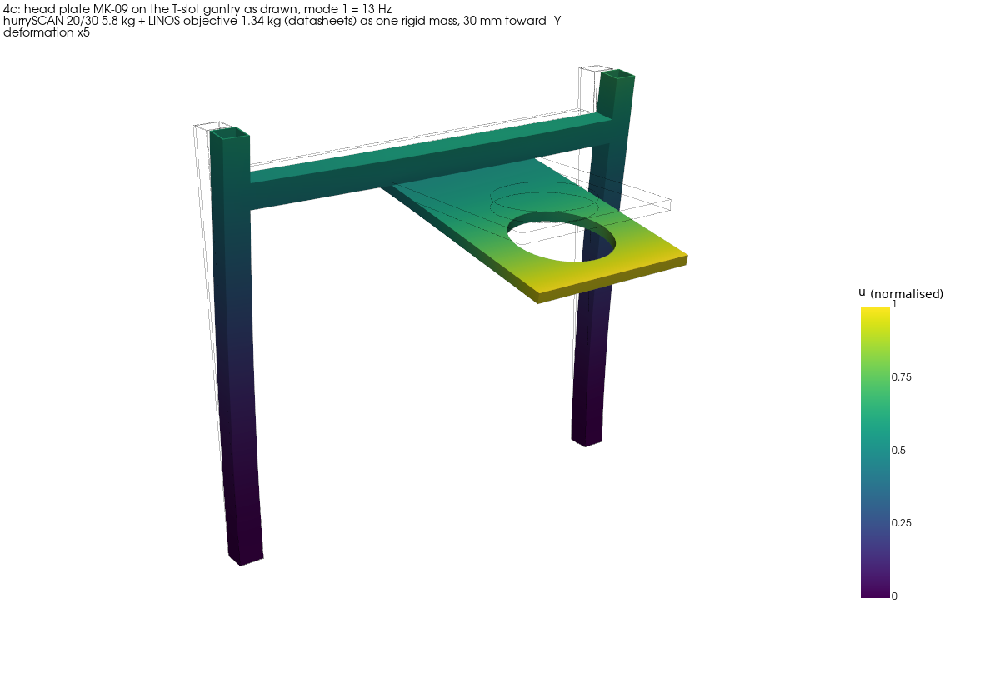

## Structure (case 4): box lid, cube top plate and window, scan-head plate and gantry, piston rod

The thermal cases (1-3: the heated cassette at 200 °C, warm-up, the laser's heat during a build) are in
[`thermal.md`](thermal.md).

### Short answer

- **Box lid (4a): it seals at +10 mbar and at a +50 mbar fault with either gasket, and the 14 ga lid does not yield, but the solid FKM cord is the wrong gasket.** Squeezing a Ø3 mm 75A FKM cord by 22 % round the 1,406 mm gasket line takes 4.0 kN: about 616 N on each front clamp, 547 N on each side clamp and 1,455 N on the hinge, and the lid's middle then sits 224 µm higher than its clamped edges before any pressure. A closed-cell silicone sponge strip (ASTM D1056 2A2, like the box's own foam) needs 536 N in all and stays at ≥ 0.67 mm of its 0.75 mm squeeze at +50 mbar. **Change: keep a soft sponge or hollow-bulb silicone gasket, not a solid cord**, and add a relief valve set below +50 mbar if the purge line has none.
- **Cube top plate and window (4b): pass by a wide margin.** The 22.9 mm blank bored for the window ring deflects 21-35 µm at 1 atm (bolted to simply supported), peak 8.1 MPa: safety factor 34 on yield. The Ø50.8 x 9.53 mm window on its O-ring peaks at 0.71 MPa (Roark simply supported 0.74): factor 74 on Corning 7980's abraded modulus of rupture and 9.8 on a 6.9 MPa (1000 psi) design stress.
- **Head plate on the gantry (4c): too soft as drawn.** With the datasheet head and objective (5.8 + 1.34 kg, moved 30 mm toward -Y on a plate 30 mm longer), its first three modes are 13, 23, 29 Hz, against PR 266's 100 Hz goal (60 Hz minimum); the first is the head nodding about the cross-beam. Gravity tilts the head 4.03 mrad, which puts the spot 1,108 µm off at the bed: a fixed offset that the scanner's correction file absorbs, unlike the low modes. Stiffer frames: two diagonal braces and a 30 x 60 cross-beam, 23, 34, 72 Hz; a front cross-beam on two more posts, 30, 42, 100 Hz; four posts with a diagonal per side and two knee braces at the back, 51, 70, 124 Hz; that frame with 45 mm posts, 79, 85, 138 Hz. Only that frame with 45 mm posts clears the 60 Hz minimum; none reaches the 100 Hz goal. **Change: four 45 mm posts, a front cross-beam under the plate, a diagonal on each side and two knee braces at the back** (all outside the box; the front posts stand 20-50 mm in front of the front rail, on a foot bracket). These are upper bounds (equivalent tubes, bonded joints, the head rigid on the plate), so real frequencies will be lower: tap-test the built frame. The CAD model is being redrawn with the head hung from a bracket on its entrance face, which will be softer still; re-run 4c on it.
- **Piston rod (4d): passes as a column and laterally; the stage's direction of load is the open point.** Euler buckling (fixed-free, 200 °C) is 103 kN in the box and 51 kN in the cube, against < 60 N. A 5 N blade drag moves the substrate top 9 µm (box) and 18 µm (cube), inside the 100 µm clearance. The two greased O-rings' friction (estimate 8-25 N running, up to 42 N at breakout) is 3-17 times the plate stack's 2.4 N weight, so the X-VSR20A has to pull the rod down every layer: 7-45 N in the box and 20-58 N in the cube, where the vacuum adds 12.8 N. Pushing, the worst case is 50 N of its 100 N. **Check that the X-VSR20A takes a pulling load** (its datasheet gives a centred load); if not, use one O-ring at about 10 % squeeze, a PTFE lip seal, or a return spring.
- **Thorlabs MTS50/M-Z8 (the PCard route, 4.5 kg = 44 N vertical):** with the gland as drawn (two O-rings at 15 %) it is not acceptable in FT-1 (up to 33 N running, 50 N at breakout) and not acceptable in FT-1V, where pulling the rod down against the vacuum takes up to 41 N running (92 % of 44 N) and 58 N at breakout. With one O-ring at 10 % it is acceptable in FT-1 and acceptable in FT-1V (worst 27 N, 61 %), pull-down included: its leadscrew drives both ways. One O-ring gives up the second seal, so check the leak in FT-1V. At 2.4-3 mm/s a 30 µm layer step is instant and the 20 mm lift for removal takes 7-8 s. The X-VSR20A carries every case with either seal (worst 58 N of 100 N) if it can pull.

### 4a FT-1 box lid on its gasket

The lid as drawn (14 ga 304, 1.9 mm, 416 x 315 mm with a 15 mm skirt and the Ø53 mm window bore), bonded to the window stack (inner clamp ring, window ring and retaining flange, 6061) and to a spring bed on the drawn gasket's 7.9 mm wide footprint: a 10 mm layer with ν = 0 whose stiffness per length is the cord's secant stiffness at its squeeze (on the drawn 1 mm layer the squeeze would be a 66 % strain, too large for NLGEOM's linear material). The four clamps pull the skirt's lower edge down by the squeeze over 24 mm each; the hinge is a pin line at its height along the back face. Pressure acts on the 1,147 cm² inside the gasket (116 N at +10 mbar, 582 N at +50 mbar, with the window's load on its retaining flange).

| | Solid FKM cord Ø3 mm, 75A, 22 % (0.66 mm) | Silicone sponge 3 x 7.9 mm, 2A2, 25 % (0.75 mm) |
|---|---|---|
| Force to close (Lindley / ASTM D1056 CFD) | 2.85 N/mm, 4,006 N | 0.38 N/mm, 536 N |
| Clamp loads when closed: front, side, hinge | 616 N, 547 N, 1,455 N | 90 N, 78 N, 197 N |
| Clamp loads at +50 mbar (linear): front, side, hinge | 673 N, 606 N, 1,678 N | 176 N, 156 N, 432 N |
| Least gasket compression: closed / +10 mbar / +50 mbar linear / +50 mbar NLGEOM | 0.561 / 0.559 / 0.506 / 0.517 mm | 0.735 / 0.722 / 0.662 / 0.667 mm |
| Gasket length open (compression < 0) at +50 mbar | 0 mm | 0 mm |
| Window seat height, closed → +10 mbar → +50 mbar NLGEOM | -436 → -298 → 209 µm | -718 → -576 → -38 µm |
| Lid's highest point at +50 mbar: linear / NLGEOM | 477 / 419 µm | 209 / 172 µm |
| Peak von Mises in the lid away from the clamps and hinge: closed / +10 / +50 mbar NLGEOM | 60 / 60 / 69 MPa | 9 / 14 / 60 MPa |
| Peak von Mises at a clamp patch's end (singular in this model), +50 mbar linear | 204 MPa (99.5 %: 91) | 125 MPa (99.5 %: 58) |
| Safety factor on 304's 215 MPa yield, away from the clamps, +50 mbar NLGEOM | 3.1 | 3.6 |

- **Mesh check:** one quadratic tetrahedron through the 1.9 mm sheet (hmax 7 mm, 60,742 nodes): a clamped 400 x 300 x 1.9 mm 304 plate at 1 kPa on the same mesh size deflects 131.2 µm against Timoshenko's 132.0 µm (ratio 0.994).
- **Linear vs NLGEOM:** at +50 mbar the lid's middle moves about half its thickness, so membrane action matters: NLGEOM gives a smaller bulge, more gasket compression and lower stress than the linear run. At +10 mbar the linear run is enough.
- **Gasket model:** the band is bonded to the lid and stiff in compression and tension. That is valid only while it stays compressed everywhere, which it does in every step here (no open length).
- **Clamp loads:** no load rating for the box's clamps was found. They are made for a foam gasket, so the 0.55-0.62 kN each (1.5 kN on the hinge) that the FKM cord needs is probably beyond them; with the sponge each clamp carries about 0.1 kN. The clamps are modelled as rigid, so a real clamp that gives a little loses some of the squeeze.
- **Stress at the clamps:** the clamp patches are 24 x 2 mm areas of prescribed displacement, so the peak at their ends is a singularity of the model, not a number to design to. Away from them the sheet stays below a third of its yield.

### 4b FT-1V: cube top plate and window at 1 atm

| | Bolted (z fixed on the land outside the frame opening) | Simply supported (z fixed on a 4 mm band at the opening's edge) |
|---|---|---|
| Largest deflection | 21.3 µm | 34.9 µm |
| Deflection at the window bore | 17.2 µm | 29.1 µm |
| Peak von Mises (99.5 %) | 5.7 (4.2) MPa | 8.1 (5.6) MPa |
| Safety factor on 6061-T6 yield (276 MPa) | 48 | 34 |
| Roark, square plate 266 mm, 22.9 mm thick: deflection, stress | 8.3 µm, 4.2 MPa | 26.6 µm, 3.9 MPa |

Load: 1 atm on the outer face, and the window ring's 224 N spread round the bore. The FE plate is softer than Roark's uniform 22.9 mm plate because its edge band outside the boss is 15.3 mm thick. The frame opening (266 mm) is an estimate.

| Window Ø50.8 x 9.53 mm fused silica on its O-ring (support r = 23.7 mm) | Peak tensile stress | Deflection | SF on 52.4 MPa (abraded MOR) | SF on 6.9 MPa (1000 psi design) |
|---|---|---|---|---|
| FEA, simply supported on the O-ring circle, 1 atm (FT-1V) | 0.706 MPa | 0.46 µm | 74 | 9.8 |
| Roark simply supported, a = 23.7 mm | 0.743 MPa | 0.41 µm | 71 | 9.3 |
| Roark clamped, a = 23.7 mm | 0.470 MPa | 0.09 µm | 111 | 14.7 |
| Roark simply supported at the window's edge, a = 25.4 mm (upper bound) | 0.853 MPa | 0.54 µm | 61 | 8.1 |
| FT-1 box, +50 mbar (window pushed up against its flange) | 0.0348 MPa | – | – | 198 |

### 4c Scan-head plate MK-09 on the T-slot gantry

| Frame | Mode 1 | Mode 2 | Mode 3 | Gravity tilt of the head | Lens sag | Static spot offset at the bed | First mode > 60 Hz / > 100 Hz |
|---|---|---|---|---|---|---|---|
| as drawn: 30 mm cross-beam on two 30 mm uprights, plate cantilevered 265 mm | 13.2 Hz: head moves fore-aft (y) with pitch about the cross-beam axis (x) | 22.7 Hz: head moves sideways along the cross-beam (x) with yaw about z | 29.4 Hz: head moves up and down (z) with pitch about the cross-beam axis (x) | 4,034 µrad | 772 µm | 1,108 µm | no / no |
| + a diagonal brace per upright to the front rail, 30 x 60 cross-beam | 23.2 Hz: head moves up and down (z) with pitch about the cross-beam axis (x) | 34.1 Hz: head moves sideways along the cross-beam (x) with yaw about z | 72.4 Hz: head moves fore-aft (y) with yaw about z | 2,323 µrad | 422 µm | 835 µm | no / no |
| as drawn + a front cross-beam under the plate's front edge on two more posts | 30.4 Hz: head moves fore-aft (y) with pitch about the cross-beam axis (x) | 41.9 Hz: head moves sideways along the cross-beam (x) with roll about y | 99.8 Hz: head moves sideways along the cross-beam (x) with yaw about z | 25 µrad | 21 µm | 10 µm | no / no |
| four posts + a diagonal per side (front post's top to back post's base) + two knee braces at the back | 51.1 Hz: head moves sideways along the cross-beam (x) with roll about y | 69.8 Hz: head moves fore-aft (y) with pitch about the cross-beam axis (x) | 123.9 Hz: head moves up and down (z) with roll about y | 23 µrad | 17 µm | 8 µm | no / no |
| the same with 45 mm posts (I = 140,000 mm⁴, estimate) | 78.9 Hz: head moves sideways along the cross-beam (x) with yaw about z | 84.7 Hz: head moves fore-aft (y) with pitch about the cross-beam axis (x) | 137.6 Hz: head moves up and down (z) with roll about y | 26 µrad | 14 µm | 8 µm | yes / no |

- Masses (datasheets, the lead's update of 2026-11-27): SCANLAB's standard hurrySCAN 20/30 housing, 206.9 x 140 x 180 mm, 5.8 kg without objective, and the LINOS f = 254 mm objective, 1.34 kg; the head's bottom face sits on the lens flange 348.1 mm above the bed. One rigid body on the head's 206.9 x 140 mm footprint on the plate, centre of mass at (0, -30, 417) mm: the head's at mid-height of its housing, the lens's midway between the flange and its bottom (300 mm, estimate). The collimator, fibre and cables are left out.
- The head and lens sit 30 mm toward -Y (the back-reflection fix), so the plate is 30 mm longer than in the CAD model (y -120 to 175 mm), with the lens hole moved with the axis. The CAD model is being redrawn with the head hung from a bracket on its beam-entrance face; that bracket is not modelled here (the head is rigid on its footprint), so re-run 4c on the redrawn model.
- Four-post variants: the front beam is under the plate at y -135 to -105 mm, 10 mm clear of the lens housing and 5 mm clear of the head's front face; the front posts (y = -120) stand in front of the front support rail and need a foot bracket. Front knee braces were left out because the lid swings through that space.
- The head's operating range is 25 ± 10 °C (15-35 °C, SCANLAB); the thermal cases compare it with the box's air.
- Frame members: square tubes 30 x 30 x 1.80 mm with the second moment of a 30 mm 8-slot profile (27,000 mm⁴, catalogue-typical, estimate) and the density raised to the drawn profile's mass per length (387 mm², x1.91). The closed tube's torsion constant (40,336 mm⁴) is above a slotted profile's, and the joints are bonded, so these are upper bounds on stiffness: real corner brackets will give lower frequencies. The model's T-slot drawing itself is five unconnected pieces, so it can't be meshed as a load path.
- The static tilt is calibrated out by the scan head's correction grid; it matters only if it changes (heating, a knock). The modes matter because the floor, the recoater's moves and the hopper's vibration motor can drive them while the beam is on.

### 4d Piston rod MK-06 (analytic)

Rod: 1/2 in. x 0.035 in. 304 tube, A = 33.0 mm², I = 579 mm⁴. Free length = the visible rod less the 23 mm in the clamp; the heater plate is a rigid lever from the socket to the substrate top.

| | FT-1 box | FT-1V cube |
|---|---|---|
| Free length (clamp top to socket) | 50.6 mm | 71.6 mm |
| Euler load, fixed-free (K = 2), 20 °C / 200 °C | 108 / 103 kN | 54 / 51 kN |
| 1 N blade drag at the substrate top: shift, tilt | 1.8 µm, 28 µrad | 3.6 µm, 47 µrad |
| 5 N blade drag: shift, tilt, rise of the plate's edge | 8.9 µm, 141 µrad, 2.8 µm | 17.8 µm, 234 µrad, 4.7 µm |
| Thermal growth of the rod, 20 → 200 °C at the socket, linear to 30 °C at the clamp (estimate; the thermal FE has the real profile) | 108 µm | 143 µm |

| Axial load the stage must supply (low running friction to breakout) | Range |
|---|---|
| FT-1, lifting: push | 12 to 50 N |
| FT-1, lowering: pull (friction exceeds the weight) | 7 to 45 N |
| FT-1V, lifting: push (the vacuum helps; < 0 = hold back) | -1 to 37 N |
| FT-1V, lowering: pull (against the vacuum) | 20 to 58 N |

| Seal | Stage (rating) | FT-1: worst running / breakout | FT-1V: worst running / breakout | FT-1 | FT-1V |
|---|---|---|---|---|---|
| two O-rings at 15 % (as drawn) | X-VSR20A (100 N) | 33 / 50 N (33 / 50 %) | 41 / 58 N (41 / 58 %) | yes | yes |
| two O-rings at 15 % (as drawn) | MTS50/M-Z8 (44 N) | 33 / 50 N (74 / 113 %) | 41 / 58 N (92 / 130 %) | only while friction stays at running levels | only while friction stays at running levels |
| one O-ring at 10 % | X-VSR20A (100 N) | 14 / 19 N (14 / 19 %) | 22 / 27 N (22 / 27 %) | yes | yes |
| one O-ring at 10 % | MTS50/M-Z8 (44 N) | 14 / 19 N (32 / 43 %) | 22 / 27 N (50 / 61 %) | yes | yes |

- Worst case = the larger of lifting and lowering. In FT-1V the worst case is always the pull-down against the vacuum. Running = friction coefficient 0.3 and 5 N of rope drag; breakout = 0.5 (estimates).
- Thorlabs MTS50/M-Z8 catalogue page and 2016 MTS50-Z8E datasheet: 4.5 kg vertical, 12 kg horizontal, 2.4-3 mm/s; a leadscrew carriage, so it drives both ways (its vertical rating taken as the limit both ways). Zaber X-VSR20A datasheet: 100 N (direction of the rating not stated).

- Plate stack: substrate 20 g, heater plate 84 g, heaters 10 g, rod 22 g (cube 27 g), clamp 51 g, rope 0.6 g, plus 15 g of leads and a 45 g build (estimates): 2.42 N.
- Two O-rings, 2.62 mm section (AS568-110/-111 class), 70A FKM, greased: Lindley's contact force at 10/15/20 % squeeze is 23, 42, 66 N per O-ring round the rod; friction = 0.1-0.3 of it running and 0.5 at breakout (estimates). Parker's method (fc x Lp + fh x Ap) needs its Fig. 5-10/5-11 values, which were not read. Measure the drag on the bench before choosing the seal.
- Vacuum in FT-1V: 1 atm on the rod's Ø12.7 mm section = 12.8 N upward (the rod's lower end is plugged). Rope wiper drag 1-5 N (estimate).
- The rod grows about 0.1 mm as the plate heats, 3-4 layers of 30 µm: set the plate's zero height at temperature.
- Not included: the stage's own tilt stiffness (not published), the gland's centring of the rod (which helps), and side loads from the blade on the plate's rim.

### Method and assumptions (case 4)

- **Script:** `desktop-lpbf/fast-track/analysis/fea/ft_struct.py` (cases `4a_check 4a 4b 4c 4d`). Geometry from `cad/ft_model.py` (`build('FT-1')`, `build('FT-1V')`, `P`, `levels()`), exported as BREP, meshed by gmsh 4.15 (quadratic tetrahedra, straight-sided), solved by CalculiX 2.21 (SPOOLES; NLGEOM for the lid at +50 mbar), read from the .frd/.dat. Bodies of different materials are fragmented into one conformal mesh and bonded where they touch. Meshes: lid 61k nodes, cube plate 34k, window 18k, gantry 51k-141k (the larger gantry variants' modal solves exceed the usual 60k-node SPOOLES limit; peak 2.7 GB). Images: `render_fea.py` from PR 266.
- **Materials:** 6061-T6: E 68.9 GPa, ν 0.33, yield 276 MPa (ASM / MatWeb). 304 annealed sheet: E 193 GPa, ν 0.29, yield 215 MPa (ASTM A240 minimum 205 MPa); at 200 °C E = 184 GPa (ASME BPVC II-D, Table TM-1). Fused silica: Corning 7980 data sheet, E 72.7 GPa, ν 0.16, modulus of rupture 52.4 MPa abraded; the 1000 psi (6.9 MPa) design stress is the usual allowable for glass windows under steady pressure.
- **Formulas:** circular plates, Roark's Formulas for Stress and Strain (Young & Budynas, 7th ed., Table 11.2, uniform load, simply supported and fixed edges); rectangular and square plates, Timoshenko & Woinowsky-Krieger, Theory of Plates and Shells, Tables 8 and 35; Euler buckling P = π²EI/(KL)²; O-ring and cord force, Lindley (1967) with E from Shore hardness (Gent 1958), as in PR 266's `seals.py` and `fea.py` case 1f; sponge, ASTM D1056 grade 2A2 (5-9 psi at 25 % deflection).
- **Estimates:** hurrySCAN 25 and lens masses; the T-slot's second moment; the cube's frame opening (266 mm); the gasket's size and squeeze; O-ring section, hardness, squeeze and friction coefficients; the rope's drag.
- **Not done:** fasteners and welds, the clamps' and hinge's own stiffness, contact at the gasket (it stays compressed, so the bonded spring bed holds), thermal stress in the lid, window and plate, fatigue over purge cycles, the X-VSR20A's tilt stiffness, the head's own rotary inertia (frequencies a few % high).

