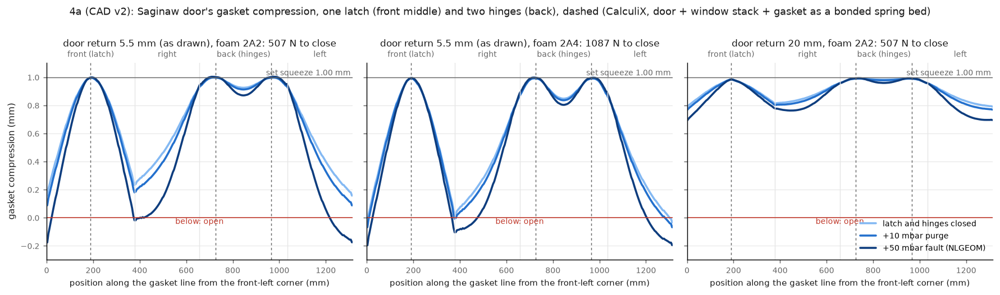
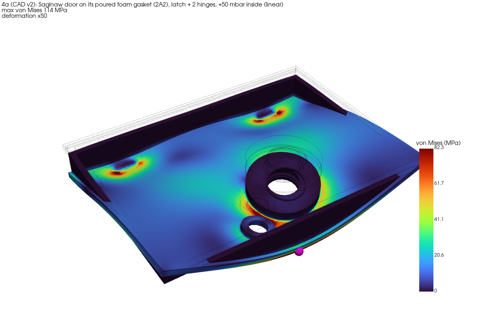
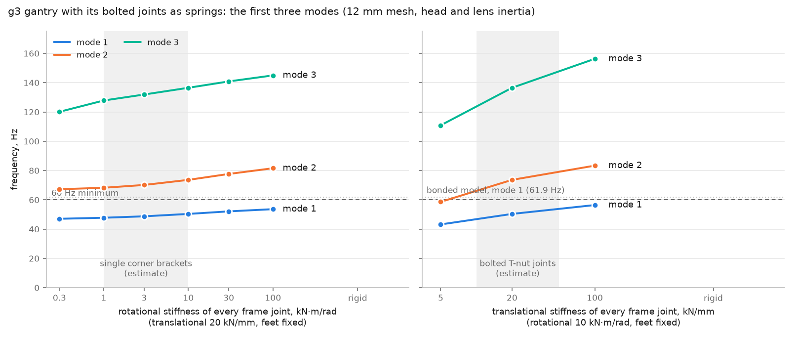
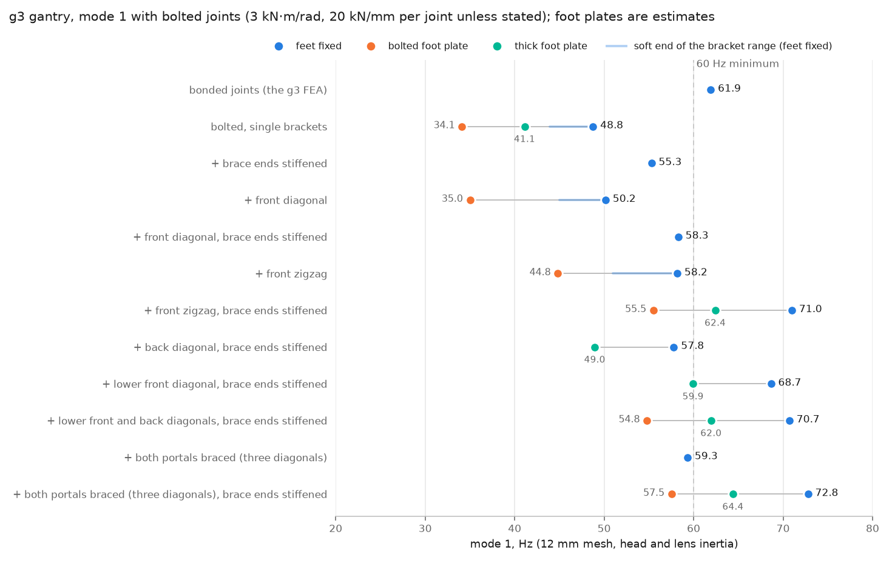
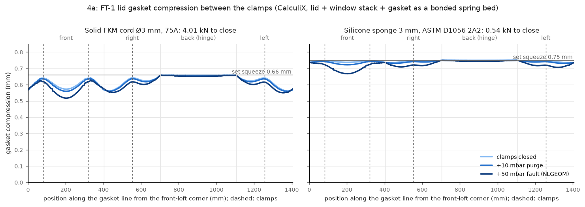

## Structure (case 4): box lid, cube top plate and window, scan-head plate and gantry, piston rod

The thermal cases (1-3: the heated cassette at 200 °C, warm-up, the laser's heat during a build) are in
[`thermal.md`](thermal.md).

### Round 3 (2026-11-28): 4a, 4b and 4d on CAD v2, and the gantry's bolted joints

Rounds 1-2 ran 4a, 4b and 4d on the round-1 model (v1, model `d117ba8`); only 4c used CAD v2. This round runs all
three on CAD v2 (the current `cad/ft_model.py`, model `e3853cf`), with the same method, and compares them with v1. The
gantry (4c, the g3 frame) gets compliant bolted joints, the head's rotary inertia and a mesh check. The v1 results
are kept further down, labelled v1.

What v2 changed for these cases:

- **4a:** the lid is now the Saginaw SCE-16EL1208SSLP's own door: 0.075 in. (1.905 mm) 304, 393.7 x 295.4 mm, a
  dished panel whose return is drawn 5.5 mm deep. It sits on the box's poured-in-place gasket (8 x 4 mm, 4 mm in
  from the door's edge, a 1,314 mm line). One quarter-turn latch at the middle of the front edge and two concealed
  hinges at the back hold it, all inside the gasket line. v1 had a custom 14 ga lid with a 15 mm skirt on four
  clamps and a hinge line. The window stack moved to (0, -11), and the door has a second bore (Ø28) for the layer
  camera's port ring (MK-19) at (-70, -55).
- **4b:** the cube top plate (MK-13) has the 53 mm window bore at (0, -21) and a tilted Ø26 camera bore at
  (-100, -50) under the camera port ring. The light ports are in the cube's door and left plate, not the top plate.
- **4d:** the heater plate (MK-04) is 24 mm (was 28), the rod (MK-06) has a potted vacuum-epoxy plug in its lower
  end and three lead notches at its top, and the rod-end block (MK-15) replaces the rod clamp. It grips the rod's
  bottom 22 mm.

#### Short answer (v2)

- **Box door (4a): as drawn, it does not hold the gasket at a +50 mbar fault, and only just at +10 mbar.** Between
  one latch and two hinges, the 1.9 mm door with a 5.5 mm return bows up at both front corners. The foam gasket
  (ASTM D1056 2A2 grade, 25 % squeeze) takes 507 N to close. Closed, the corners keep only 0.16 mm of the 1.0 mm
  squeeze, and 0.09 mm at +10 mbar; the line starts to open at about +22 mbar. At +50 mbar (NLGEOM) 155 mm of it is
  open: about 120 mm round the front-left corner (the side with the camera bore) and 35 mm at the front-right
  corner. A stiffer foam (2A4) opens 20 mm as soon as the door is latched. v1's lid on four clamps kept ≥ 0.67 mm of
  0.75 mm at +50 mbar. **A deeper door return or two more clamps fix it** (+50 mbar, linear): a 10 mm return keeps
  ≥ 0.18 mm, 15 mm ≥ 0.51 mm, 20 mm ≥ 0.68 mm; the drawn door with a clamp over the gasket 47 mm in from each front
  corner keeps ≥ 0.54 mm, at about 90 N per clamp closed and 140 N at +50 mbar. **Change: measure the delivered
  door's return** (the CAD draws an envelope, and the maker's render shows a deeper one). If it is under about 15 mm,
  add the two front clamps (toggle clamps on the body's front wall); either way set the purge's relief below
  +20 mbar. The door's stress peaks at 112 MPa (+50 mbar, NLGEOM) at its return next to the latch: safety factor 1.9
  on 304's 215 MPa yield (v1: 3.6).
- **Cube top plate and window (4b): still pass by a wide margin.** Moving the window bore to (0, -21) and adding
  the camera bore change little: 20-33 µm and 8.6 MPa at 1 atm (bolted to simply supported), against v1's 21-35 µm
  and 8.1 MPa. The peak moved to the camera bore's edge. Safety factor 32 on yield (v1: 34). The window ring's seat
  tilts 0.18-0.26 mrad, which shifts the beam under 1 µm. The window is the same part on the same seat: 0.71 MPa,
  factor 74 on the abraded modulus of rupture and 9.8 on 6.9 MPa (unchanged).
- **Piston rod (4d): passes; the column and bending numbers move 1-15 % from v1.** The free length grows to 54.6 mm (box) and
  75.6 mm (cube), against 50.6 and 71.6 mm. Euler buckling at 200 °C drops to 88 kN and 46 kN (v1: 103 and 51 kN),
  still over 800 times the load. A 5 N blade drag moves the substrate's top 9.0 µm and 18.0 µm (v1: 8.9 and 17.8).
  The lead notches leave 76 % of the rod's section, over 1 mm of free length: 2.2 MPa there under 5 N. The stage
  now lifts 4.2 N, not 2.4 N, because the rod-end block (234 g) is heavier than v1's clamp (51 g). The O-ring drag is
  unchanged (same gland): 8-25 N running and 42 N at breakout for two O-rings at 15 %. The X-VSR20A's worst case is
  56 N of its 100 N (v1: 58 N). The MTS50/M-Z8 verdicts are unchanged: two O-rings at 15 % are fine only while
  friction stays at running levels (78-88 % of 44 N), and one O-ring at 10 % is fine (≤ 57 %).
- **Gantry (4c) with bolted joints: under the 60 Hz minimum as drawn. Two more diagonals, stiffer brace ends and
  stiff feet bring it back.** With each joint a single T-slot bracket (estimated 1-10 kN·m/rad and 10-50 kN/mm),
  mode 1 drops from 61.9 Hz (bonded) to 43.9-54.4 Hz with the feet fixed, and to 34.1 Hz with the feet on a bolted
  plate (41.1 Hz on a thick plate; both estimates). Of the joints, the 12 brace ends matter most; the feet matter
  more. **Change: a diagonal low in the front portal (from the left post's foot to the right post at z 140) and one
  in the back portal over the box, a second bracket or a doweled end plate at all 16 brace ends, and a thick plate
  under each foot:** 62.0 Hz (70.7 Hz with the feet fixed). A third diagonal higher in the front portal adds about
  2 Hz (64.4 Hz) but crosses the door's front gap. Then tap-test the built frame (procedure below).

#### 4a on v2: the Saginaw door on its poured gasket

Same method as v1: the door, the window stack (inner clamp ring, window ring, retaining flange) and the camera port
ring are bonded together and to a 10 mm spring bed on the drawn gasket's footprint, whose stiffness per length is the
foam's at its squeeze (25 % of 4 mm, estimate). The bed's bottom is fixed in z. The latch pulls a Ø25 mm patch of the
door down by the squeeze; each hinge holds its 40 x 15 mm leaf on the door's inner face in x and y and pulls it down
by the squeeze. Pressure acts on the 989 cm² inside the gasket (101 N at +10 mbar, 503 N at +50 mbar; v1 had
1,147 cm²). The gasket maker's data were not found, so two ASTM D1056 grades bracket the poured foam: 2A2
(5-9 psi at 25 %, taken as 7 psi) and 2A4 (13-17 psi, taken as 15 psi). The maker's render of this enclosure shows a
door with a deeper formed return than the CAD envelope's 5.5 mm, so a 20 mm return was run as well.

| | v1: 14 ga lid, 4 clamps + hinge line, sponge 3 x 7.9 mm (2A2) | **v2 as drawn: 5.5 mm return, foam 2A2** | v2 as drawn, foam 2A4 | v2, 20 mm return, foam 2A2 |
|---|---|---|---|---|
| Force to close at the full squeeze | 536 N | **507 N** | 1,087 N | 507 N |
| Latch / hinge loads, closed | clamps 90, 78 N, hinge 197 N | **129 / 111, 114 N** | 216 / 212, 217 N | 215 / 123, 124 N |
| Latch / hinge loads at +50 mbar (NLGEOM) | clamps 176, 156 N, hinge 432 N (linear) | **307 / 210, 225 N** | 375 / 295, 312 N | 419 / 223, 237 N |
| Least gasket compression: closed / +10 mbar / +50 mbar linear / +50 mbar NLGEOM (of the set squeeze) | 0.735 / 0.722 / 0.662 / 0.667 mm (of 0.75) | **0.157 / 0.088 / -0.192 / -0.176 mm** (of 1.0) | -0.033 / -0.068 / -0.210 / -0.197 mm | 0.791 / 0.769 / 0.683 / 0.695 mm |
| Gasket line open (compression < 0): closed / +10 / +50 mbar NLGEOM | 0 / 0 / 0 mm | **0 / 0 / 155 mm** | 20 / 55 / 245 mm | 0 / 0 / 0 mm |
| Where it opens at +50 mbar | – | 120 mm round the front-left corner, 35 mm at the front-right | 135 mm front-left, 110 mm front-right | – |
| Window seat height, closed → +10 → +50 mbar NLGEOM | -718 → -576 → -38 µm | -969 → -922 → -734 µm | -959 → -913 → -730 µm | -989 → -947 → -776 µm |
| Peak von Mises in the lid more than 30 mm from the latch, hinges or clamps, +50 mbar NLGEOM | 60 MPa | **112 MPa** (the return next to the latch; 96 MPa on the panel at the window ring's edge) | 128 MPa | 69 MPa |
| Safety factor on 304's 215 MPa yield | 3.6 | **1.9** | 1.7 | 3.1 |

Door return and extra clamps, foam 2A2 (linear; struct.json `4a_extra`):

| Door | Least compression: closed / +10 mbar / +50 mbar (of 1.0 mm) | Length under half the squeeze at +50 mbar | Latch / hinge / extra clamp loads at +50 mbar |
|---|---|---|---|
| 5.5 mm return, as drawn | 0.157 / 0.088 / -0.192 mm (open 180 mm) | – | 316 / 221, 237 N |
| 10 mm return | 0.440 / 0.388 / 0.180 mm | 420 mm | 368 / 229, 245 N |
| 15 mm return | 0.669 / 0.637 / 0.506 mm | 0 mm | 415 / 235, 250 N |
| 20 mm return | 0.791 / 0.769 / 0.683 mm | 0 mm | 441 / 238, 253 N |
| 5.5 mm return + a clamp over the gasket 47 mm in from each front corner (Ø25 pads) | 0.720 / 0.684 / 0.541 mm | 0 mm | 195 / 223, 234 / 142, 134 N |

- **Why it opens:** the gasket's reaction acts round the edge, and the door is held at three points inside that line,
  so the edges between them bow up. The front corners are 190 mm from the latch along the edge. A 1.9 mm sheet with a
  5.5 mm return is too soft to carry the foam's 0.39 N/mm (2A2) that far. A 20 mm return makes the edge (a 30 mm
  strip of panel with its return) about 24 times stiffer in bending, and the whole line then stays at ≥ 70 % of its
  squeeze. The front-left corner opens first because the camera bore softens that quarter of the panel.
- **The supports are idealised:** the latch and hinges pull their patches down by exactly the squeeze. A real latch
  has some play, and a formed door may also bottom on the body's rim, which would help. The peak stress at the return
  next to the latch comes from that idealised patch. It drops to 61 MPa (closed) and 96 MPa (+50 mbar) 50 mm away.
- **Left out, as in v1:** the cover-slide holder (now open to Ø44) hangs under the inner clamp ring and carries no
  pressure load; the layer camera (MON1) on its post, the window-stack screws and the latch's own body are not
  modelled (the stack is bonded).
- **Mesh check:** the plate check of v1 repeated at the door's 1.905 mm gauge: a clamped 400 x 300 mm plate at 1 kPa
  deflects 130.2 µm against Timoshenko's 131.0 µm (ratio 0.994). The door model has 53k nodes (58k with the 20 mm return).

#### 4b on v2: the cube top plate and window at 1 atm

| | v1, bolted | **v2, bolted** | v1, simply supported | **v2, simply supported** |
|---|---|---|---|---|
| Largest deflection | 21.3 µm | **19.9 µm** | 34.9 µm | **32.8 µm** |
| Deflection at the window bore | 17.2 µm | **14.0 µm** | 29.1 µm | **24.7 µm** |
| Tilt of the window ring's seat (about x, y) | – | 184, 61 µrad | – | 262, 92 µrad |
| Deflection at the camera bore | – | 5.7 µm | – | 11.2 µm |
| Peak von Mises (99.5 %) | 5.7 (4.2) MPa | **5.9 (4.1) MPa** | 8.1 (5.6) MPa | **8.6 (5.3) MPa**, at the camera bore's edge |
| Safety factor on 6061-T6 yield (276 MPa) | 48 | **47** | 34 | **32** |

Load: 1 atm on the outer face, the window ring's 224 N round its bore (r 26.5-50 mm) and the camera port ring's
54 N round its bore (r 15-22 mm). The supports and the estimated 266 mm frame opening are as in v1. The window
(Ø50.8 x 9.53 mm fused silica on its O-ring) is unchanged: 0.706 MPa peak, 0.46 µm, factor 74 on 52.4 MPa and 9.8 on
6.9 MPa. The cube's door and left plate are the same 22.9 mm blank with one tilted Ø24 light-port bore each, smaller
than the top plate's two bores, so the top plate bounds them (not run).

#### 4d on v2: the piston rod

| | v1 box | **v2 box** | v1 cube | **v2 cube** |
|---|---|---|---|---|
| Free length (rod-end block's top to the heater plate) | 50.6 mm | **54.6 mm** | 71.6 mm | **75.6 mm** |
| Lever, plate's underside to the substrate's top | 34 mm | **30 mm** | 34 mm | **30 mm** |
| Euler load, fixed-free, 20 °C / 200 °C | 108 / 103 kN | **92 / 88 kN** | 54 / 51 kN | **48 / 46 kN** |
| 5 N blade drag: shift, tilt | 8.9 µm, 141 µrad | **9.0 µm, 147 µrad** | 17.8 µm, 234 µrad | **18.0 µm, 240 µrad** |
| Bending stress under 5 N drag: at the block / at the lead notches | – | 4.6 / 2.2 MPa | – | 5.8 / 2.2 MPa |
| Thermal growth, 20 → 200 °C (estimate) | 108 µm | **115 µm** | 143 µm | **149 µm** |
| Weight the stage lifts (plate stack, rod, rod-end block, 45 g build) | 2.42 N | **4.21 N** | 2.48 N | **4.27 N** |

| Axial load on the stage, worst case (running / breakout) | v1 | **v2** |
|---|---|---|
| X-VSR20A (100 N), two O-rings at 15 %, FT-1 / FT-1V | 33 / 50 N, 41 / 58 N | **35 / 51 N, 39 / 56 N**: yes |
| MTS50/M-Z8 (44 N), two O-rings at 15 %, FT-1 / FT-1V | 74 / 113 %, 92 / 130 % | **78 / 116 %, 88 / 126 %**: only while friction stays at running levels |
| MTS50/M-Z8, one O-ring at 10 %, FT-1 / FT-1V | 32 / 43 %, 50 / 61 % | **36 / 47 %, 46 / 57 %**: yes |

- The lead notches (three 3 mm slots through the wall at the rod's top, 1 mm of them below the plate) leave 75 % of
  the section's area and second moment, where the bending moment is smallest. They don't change the column or the
  lateral numbers.
- The potted plug (2.5 g, estimate) closes the rod's lower end, as v1 assumed: 1 atm on the Ø12.7 mm section is still
  12.8 N upward in FT-1V.
- The heavier rod-end block helps the pull-down: lowering in FT-1 now needs 5-43 N (v1: 7-45 N). Lifting needs
  14-51 N (v1: 12-50 N).

#### 4c on g3 with bolted joints (round 3)

**What was run** (`ft_joints.py`; struct-joints.json; 8 runs of the first round-3 attempt were recovered from its
run log, frequencies only). The bonded g3 model fuses every member into one mesh, so
each joint is as stiff as solid metal. Here each member is meshed on its own: 4 posts, 2 cross-beams, 6 braces and
the two head-mount assemblies, each bonded inside itself (14 groups, 97k nodes, 12 mm mesh). Where two members touch,
each side's nodes are tied to a rigid patch, and the two patches are joined by three translational springs (kt,
per joint) and three rotational springs (kr, per joint). That is 20 joints: 4 beam-to-post, 12 brace ends and 4
head-mount-to-beam. The post feet are fixed, as in the bonded model, or rigid patches on springs to the bench. The
head and lens are one rigid body on both support plates, with their rotary inertia (a uniform box and cylinder,
estimate). Each ccx run took 25-90 s.

**Checks.**

- Mesh: the bonded model on the 12 mm mesh gives 62.02 / 100.57 / 179.69 Hz, against 62.0 / 100.6 / 179.4 Hz on
  the g3 FEA's 10 mm mesh.
- Head inertia: 61.91 / 100.31 / 171.81 Hz, so -0.2 %, -0.3 % and -4.4 % on modes 1-3. All runs below include it.
- Rigid springs: 64.61 / 103.34 / 176.41 Hz. The rigid patches stiffen the frame 4 % over bonded; that run is the
  sweep's stiff end.

**What joint stiffness is realistic (estimates, not measured).**

- **Translational, 10-50 kN/mm per joint.** Huth's fastener-flexibility formula (H. Huth, 1986, ASTM STP 927,
  pp. 221-250) gives about 46 kN/mm for one M6 bolt in single shear through a 4 mm bracket leg into a 2.5 mm slot
  lip (aluminium, steel bolt). A corner bracket puts one such bolt into each member, in series: 23 kN/mm. A joint has
  one or two brackets: 23-46 kN/mm. The slot lips bending under the T-nut add compliance, so 10-50 kN/mm.
- **Rotational, 1-10 kN·m/rad per joint.** The same bolt stiffness on a 15-20 mm lever from a 30-series bracket's
  heel gives 5-9 kN·m/rad, less the cast bracket's own bending.
- **Published check.** Güler and Karagülle (2016, Lat. Am. J. Solids Struct. 13, 1499-1514,
  [DOI 10.1590/1679-78252755](https://doi.org/10.1590/1679-78252755)) tap-tested three Bosch Rexroth profile frames. Beam models with each connector as an elastic solid (in effect
  bonded) ran 0-16 % above the measured frequencies (43.7 against 38.9 Hz, 50.6 against 43.5 Hz, for example). Here
  the single-bracket range puts mode 1 12-29 % under the bonded model, the same direction and a little more.
- **The bench.** The back posts stand on the T-slot base rails and the front posts on 6 mm L foot brackets; neither
  is in the FE. The feet were run fixed, on a bolted foot plate (30 kN·m/rad and 50 kN/mm per foot, estimate), on a
  thick plate (100 kN·m/rad, 100 kN/mm), and on the same springs as one bracket.

| Joints, per joint (kr, kt) | Feet | Modes 1 / 2 / 3 | Mode 1 vs bonded |
|---|---|---|---:|
| Bonded (the g3 model, 12 mm mesh) | fixed | 61.9 / 100.3 / 171.8 Hz | – |
| Rigid springs | fixed | 64.6 / 103.3 / 176.4 Hz | +4 % |
| Single brackets, stiff end (10 kN·m/rad, 50 kN/mm) | fixed | 54.4 / 80.1 / 149.8 Hz | -12 % |
| **Single brackets, middle (3 kN·m/rad, 20 kN/mm)** | fixed | **48.8 / 70.2 / 131.9 Hz** | **-21 %** |
| Single brackets, soft end (1 kN·m/rad, 10 kN/mm) | fixed | 43.9 / 62.1 / 115.2 Hz | -29 % |
| Middle | thick plate (100 kN·m/rad, 100 kN/mm) | 41.1 / 64.4 / 117.3 Hz | -34 % |
| Middle | bolted plate (30 kN·m/rad, 50 kN/mm) | 34.1 / 59.4 / 105.2 Hz | -45 % |
| Middle | one bracket's springs (3 kN·m/rad, 20 kN/mm) | 25.4 / 50.7 / 88.2 Hz | -59 % |

**Which joints matter** (middle joints, feet fixed, one change at a time; mode 1 48.8 Hz before):

| Change | Mode 1 |
|---|---:|
| The 12 brace ends to 100 kN·m/rad and 100 kN/mm | 55.3 Hz (+6.5) |
| The 12 brace ends rigid | 57.4 Hz (+8.6) |
| The 12 brace ends to 100 kN/mm only | 53.0 Hz (+4.2) |
| The 4 head-mount joints to 100 kN·m/rad and 100 kN/mm | 50.7 Hz (+1.9) |
| The 4 beam-to-post joints to 100 kN·m/rad | 49.7 Hz (+0.9) |
| Brace ends and beam-to-post joints to 100 kN·m/rad and 100 kN/mm | 56.4 Hz (+7.6) |
| Every joint to 100 kN/mm | 54.8 Hz (+6.0) |
| Every joint's kr 0.3 / 1 / 3 / 10 / 30 / 100 kN·m/rad / rigid (kt 20 kN/mm) | 47.1 / 47.8 / 48.8 / 50.4 / 52.1 / 53.6 / 55.0 Hz |
| Every joint's kt 5 / 20 / 50 / 100 kN/mm / rigid (kr 10 kN·m/rad) | 43.2 / 50.4 / 54.4 / 56.5 / 59.4 Hz |

- **Mode 1 is the same shape in every run whose mode shapes were kept:** the frame sways along the beams (x) and the
  head yaws, with the largest motion at a front post's top, as in the bonded model. (With both portals braced and
  stiff brace ends it moves to the head mount's front corner.) Mode 2 is fore-aft (y).
- **The translational stiffness matters more than the rotational.** The braces carry the frame's racking as axial
  force through their end joints, so the 12 brace ends matter most. The beam-to-post and head-mount joints matter
  little.
- **The bench matters most of all.** The front posts are 751 mm tall, from the bench to above the beams, and in x
  only the front beam and two short knee braces at their tops hold them. On a bolted foot plate, mode 1 drops from
  48.8 to 34.1 Hz.

**Options to get back over 60 Hz** (`ft_joints.py variant <name>`; the added braces are 30-series members on the
drawn posts' axes, with the same joints as the rest). None is drawn in the CAD yet.

| Option: what the CAD would add | Feet fixed: modes 1 / 2 | Bolted foot plate (30 kN·m/rad, 50 kN/mm) | Thick foot plate (100 kN·m/rad, 100 kN/mm) |
|---|---|---|---|
| As drawn (single brackets, middle) | 48.8 / 70.2 Hz (soft end 43.9 / 62.1) | 34.1 / 59.4 Hz | 41.1 / 64.4 Hz |
| Brace ends stiffened: a second bracket, or an end plate with a dowel, at each of the 12 brace ends (100 kN·m/rad and 100 kN/mm each, estimate) | 55.3 / 77.7 Hz | – | – |
| Front diagonal: one brace across the front portal, left post at z 160 to right post at z 285 (about 490 mm between the posts), 2 end brackets | 50.2 / 70.1 Hz (soft end 45.0 / 62.0) | 35.0 / 59.4 Hz | – |
| Front diagonal, brace ends stiffened | 58.3 / 78.0 Hz | – | – |
| Front zigzag: the front diagonal plus a lower one from the left post's foot (z -240) to the right post at z 140 (about 590 mm), 4 end brackets | 58.2 / 70.2 Hz (soft end 51.0 / 62.0) | 44.8 / 59.5 Hz | – |
| Front zigzag, all 16 brace ends stiffened | 71.0 / 78.4 Hz (mode 3 150.7) | 55.5 / 65.3 Hz | 62.4 / 71.2 Hz (mode 3 134.3; 60.8 Hz with the other joints at the soft end) |
| Both portals braced: the front zigzag plus a back diagonal over the box, left post at z 185 to right post at z 275 (about 480 mm); 3 braces, 6 end brackets | 59.3 / 70.1 Hz | – | – |
| Both portals braced, all 18 brace ends stiffened | 72.8 / 79.1 Hz (mode 3 151.9) | 57.5 / 64.9 Hz | 64.4 / 71.1 Hz (62.7 Hz with the other joints at the soft end) |
| Back diagonal only, all 14 brace ends stiffened | 57.8 / 77.9 Hz | – | 49.0 / 70.5 Hz |
| Lower front diagonal only, all 14 brace ends stiffened | 68.7 / 77.9 Hz | – | 59.9 / 70.9 Hz |
| **Lower front diagonal and back diagonal, all 16 brace ends stiffened** (the door's front gap stays clear) | **70.7 / 78.4 Hz** (mode 3 150.4) | 54.8 / 64.7 Hz | **62.0 / 70.7 Hz** (mode 3 132.5; 60.1 Hz with the other joints at the soft end) |

- **What clears 60 Hz: a low diagonal in the front portal, stiffened brace ends and stiff feet, together.** The
  lower front diagonal and the back diagonal, with all 16 brace ends stiffened, give 70.7 Hz with the feet fixed and
  62.0 Hz on a thick foot plate (60.1 Hz with the other joints at the soft end of the range), but 54.8 Hz on a plain
  bolted plate. Adding the upper front diagonal (both portals braced) gives 72.8, 64.4 and 57.5 Hz. No single change
  does it: the front zigzag alone 58.2 Hz, the brace ends alone 55.3 Hz, the back diagonal with stiffened ends 57.8 Hz.
- **The door's front gap.** The upper front diagonal (z 160-285) runs across the gap the open door leaves at the
  front, where hands and the spreader bar go in. Leaving it out costs about 2 Hz (above). The lower front diagonal
  stays under z 155, and under the box's top (z 139) across the box's width; the back diagonal runs over the box. The
  lower front diagonal alone, with stiffened ends, just misses on the thick plate: 68.7 and 59.9 Hz.
- **Why the low front diagonal matters most.** The front posts stand 751 mm from the bench. One diagonal across their
  middle (z 160-285) adds 1.4 Hz. The lower one starts at the left post's foot, so the portal's sway goes into the
  foot as axial force instead of bending the post down to its foot: with stiffened ends, 68.7 Hz against 55.3 Hz
  without it (feet fixed).
- **Why the brace ends.** On single brackets the braces give away much of what they add: the front zigzag goes from
  58.2 to 71.0 Hz when its 16 brace ends are stiffened.
- **On a plain bolted plate, mode 2 (fore-aft) sits at 59.4-59.5 Hz** in every option with single-bracket brace ends.
  The side diagonals carry it, and stiffening their ends lifts it to 65 Hz.
- **Cost in parts (estimate; the CAD would have to add them).** For the lower front and back diagonals: two 30-series
  braces (about 590 and 480 mm between the posts) with 4 end brackets. A second bracket, or a doweled end plate, at
  all 16 brace ends (16 brackets, 32 T-nuts and screws). A 12-15 mm plate under each front post, bolted to the bench
  with 4 screws, in place of the 6 mm L feet, and each back post bolted to its base rail through an end plate. The
  upper front diagonal, if wanted, is one more 490 mm brace and 2 stiffened ends.
- **What the CAD must check.**
  - The front diagonals run 29 mm in front of the box's front face. The upper one passes 60-70 mm over the latch;
    the lower one passes 60 mm under MON3's light. The latch stays reachable between them.
  - The back diagonal passes 30 mm over the door at the box's left edge, next to the hinges: check the door's 24°
    swing. Its right end grazes the back-right knee brace's lower end (one node within 0.05 mm in the mesh), so end
    it 15-20 mm lower.
  - Route the process fibre around the new braces.
- **The bench is not in the FE.** The base rails under the back posts are bolted T-slot too, and the plate values are
  estimates. The tap test below measures the whole.

#### Tap test for the built frame

What it checks: the frame's first modes with the head on it, against the 60 Hz minimum (100 Hz goal) and the FE
above. Needs: a rubber or nylon mallet (or a screwdriver's plastic handle), and a phone with phyphox
(free; "Acceleration (without g)", which records the three axes) or a small accelerometer logged at ≥ 400 Hz.
Phones sample at about 100-500 Hz: check the rate in phyphox first, because it must be at least twice the highest
mode you want to see (≥ 200 Hz for 100 Hz).

1. **Build state.** The frame bolted to the bench as it will run, every joint tightened, the head and lens (or a
   7.1 kg dummy on the head's footprint) on the mount, cables dressed as in use, the box in place. Note anything
   left off, and how the feet are fixed to the bench.
2. **Sensor.** Clamp or tape the phone flat and tight on the head's top face, its long side along x (the beams).
   A loose phone rattles and adds its own peaks. Repeat with the phone on the front-left post's top, where the FE
   puts mode 1's largest motion.
3. **Taps.** Five taps per direction, about 3 s apart so each ring dies away. Hit firmly, but don't lean on the
   frame.
   - Mode 1, sideways (x): hit the front-left post's top along the beams.
   - Mode 2, fore-aft (y): hit the side of the head's far-side support plate, or a post's top, along y.
   - Mode 3: hit the front beam next to the head, downward.
4. **Read the first mode.** Export the record (CSV) and take the spectrum of each tap's ring: 1-2 s from the
   tap, a Hann window, frequency resolution ≤ 1 Hz (phyphox's own spectrum view is fine for a first look).
   Mode 1 is the lowest clear peak above about 20 Hz in the x-axis spectrum after an x tap, at the same frequency
   on the post and on the head and within ±1 Hz from tap to tap. Peaks that appear in every axis whatever you hit
   are usually the phone or the bench.
5. **Pass line:** mode 1 ≥ 60 Hz. The FE gives 62.0 Hz with bonded joints, an upper bound;
   with single-bracket joints it gives 43.9-54.4 Hz with the feet fixed, and 34.1-41.1 Hz on a bolted or
   thick foot plate, for the g3 frame as drawn. With a low front diagonal, a back diagonal and stiffened
   brace ends: 70.7 Hz with the feet fixed and 62.0 Hz on a thick plate. A frame as drawn that rings at
   35-55 Hz behaves as the FE says.
6. **If it fails,** look at which direction rings and stiffen that first.
   In the FE, mode 1 is always the frame swaying along the beams (x), largest at a front post's top. In the
   order the FE gains: a second bracket at each brace end (+6.5 Hz as drawn), the low front diagonal
   (+13.4 Hz more), then the feet (a bolted plate to a thick one: +7 Hz as drawn). If a phone on a post's
   foot or on the base rail shows the same peak as on the head, the feet or the bench are the limit: fix them
   first. Fore-aft (mode 2) is 59.4 Hz on a bolted plate as drawn; if y rings lowest, stiffen the side
   diagonals' ends.
7. **Record** the date, the build state, the sensor and its rate, the five peak frequencies per direction and a
   spectrum image, and add them to this file next to the FE.

### Short answer (rounds 1-2: 4a, 4b and 4d on the round-1 model, v1)

- **Box lid (4a): it seals at +10 mbar and at a +50 mbar fault with either gasket, and the 14 ga lid does not yield, but the solid FKM cord is the wrong gasket.** Squeezing a Ø3 mm 75A FKM cord by 22 % round the 1,406 mm gasket line takes 4.0 kN: about 616 N on each front clamp, 547 N on each side clamp and 1,455 N on the hinge, and the lid's middle then sits 224 µm higher than its clamped edges before any pressure. A closed-cell silicone sponge strip (ASTM D1056 2A2, like the box's own foam) needs 536 N in all and stays at ≥ 0.67 mm of its 0.75 mm squeeze at +50 mbar. **Change: keep a soft sponge or hollow-bulb silicone gasket, not a solid cord**, and add a relief valve set below +50 mbar if the purge line has none.
- **Cube top plate and window (4b): pass by a wide margin.** The 22.9 mm blank bored for the window ring deflects 21-35 µm at 1 atm (bolted to simply supported), peak 8.1 MPa: safety factor 34 on yield. The Ø50.8 x 9.53 mm window on its O-ring peaks at 0.71 MPa (Roark simply supported 0.74): factor 74 on Corning 7980's abraded modulus of rupture and 9.8 on a 6.9 MPa (1000 psi) design stress.
- **Head plate on the gantry (4c): too soft as drawn.** With the datasheet head and objective (5.8 + 1.34 kg, moved 30 mm toward -Y on a plate 30 mm longer), its first three modes are 13, 23, 29 Hz, against PR 266's 100 Hz goal (60 Hz minimum); the first is the head nodding about the cross-beam. Gravity tilts the head 4.03 mrad, which puts the spot 1,108 µm off at the bed: a fixed offset that the scanner's correction file absorbs, unlike the low modes. Stiffer frames: two diagonal braces and a 30 x 60 cross-beam, 23, 34, 72 Hz; a front cross-beam on two more posts, 30, 42, 100 Hz; four posts with a diagonal per side and two knee braces at the back, 51, 70, 124 Hz; that frame with 45 mm posts, 79, 85, 138 Hz. Only that frame with 45 mm posts clears the 60 Hz minimum; none reaches the 100 Hz goal. **Change: four 45 mm posts, a front cross-beam under the plate, a diagonal on each side and two knee braces at the back** (all outside the box; the front posts stand 20-50 mm in front of the front rail, on a foot bracket). These are upper bounds (equivalent tubes, bonded joints, the head rigid on the plate), so real frequencies will be lower: tap-test the built frame. The CAD model is being redrawn with the head hung from a bracket on its entrance face, which will be softer still; re-run 4c on it.
- **Piston rod (4d): passes as a column and laterally; the stage's direction of load is the open point.** Euler buckling (fixed-free, 200 °C) is 103 kN in the box and 51 kN in the cube, against < 60 N. A 5 N blade drag moves the substrate top 9 µm (box) and 18 µm (cube), inside the 100 µm clearance. The two greased O-rings' friction (estimate 8-25 N running, up to 42 N at breakout) is 3-17 times the plate stack's 2.4 N weight, so the X-VSR20A has to pull the rod down every layer: 7-45 N in the box and 20-58 N in the cube, where the vacuum adds 12.8 N. Pushing, the worst case is 50 N of its 100 N. **Check that the X-VSR20A takes a pulling load** (its datasheet gives a centred load); if not, use one O-ring at about 10 % squeeze, a PTFE lip seal, or a return spring.
- **Thorlabs MTS50/M-Z8 (the PCard route, 4.5 kg = 44 N vertical):** with the gland as drawn (two O-rings at 15 %) it is not acceptable in FT-1 (up to 33 N running, 50 N at breakout) and not acceptable in FT-1V, where pulling the rod down against the vacuum takes up to 41 N running (92 % of 44 N) and 58 N at breakout. With one O-ring at 10 % it is acceptable in FT-1 and acceptable in FT-1V (worst 27 N, 61 %), pull-down included: its leadscrew drives both ways. One O-ring gives up the second seal, so check the leak in FT-1V. At 2.4-3 mm/s a 30 µm layer step is instant and the 20 mm lift for removal takes 7-8 s. The X-VSR20A carries every case with either seal (worst 58 N of 100 N) if it can pull.

### 4a FT-1 box lid on its gasket (v1: round-1 model)

The lid as drawn (14 ga 304, 1.9 mm, 416 x 315 mm with a 15 mm skirt and the Ø53 mm window bore), bonded to the window stack (inner clamp ring, window ring and retaining flange, 6061) and to a spring bed on the drawn gasket's 7.9 mm wide footprint: a 10 mm layer with ν = 0 whose stiffness per length is the cord's secant stiffness at its squeeze (on the drawn 1 mm layer the squeeze would be a 66 % strain, too large for NLGEOM's linear material). The four clamps pull the skirt's lower edge down by the squeeze over 24 mm each; the hinge is a pin line at its height along the back face. Pressure acts on the 1,147 cm² inside the gasket (116 N at +10 mbar, 582 N at +50 mbar, with the window's load on its retaining flange).

| | Solid FKM cord Ø3 mm, 75A, 22 % (0.66 mm) | Silicone sponge 3 x 7.9 mm, 2A2, 25 % (0.75 mm) |
|---|---|---|
| Force to close (Lindley / ASTM D1056 CFD) | 2.85 N/mm, 4,006 N | 0.38 N/mm, 536 N |
| Clamp loads when closed: front, side, hinge | 616 N, 547 N, 1,455 N | 90 N, 78 N, 197 N |
| Clamp loads at +50 mbar (linear): front, side, hinge | 673 N, 606 N, 1,678 N | 176 N, 156 N, 432 N |
| Least gasket compression: closed / +10 mbar / +50 mbar linear / +50 mbar NLGEOM | 0.561 / 0.559 / 0.506 / 0.517 mm | 0.735 / 0.722 / 0.662 / 0.667 mm |
| Gasket length open (compression < 0) at +50 mbar | 0 mm | 0 mm |
| Window seat height, closed → +10 mbar → +50 mbar NLGEOM | -436 → -298 → 209 µm | -718 → -576 → -38 µm |
| Lid's highest point at +50 mbar: linear / NLGEOM | 477 / 419 µm | 209 / 172 µm |
| Peak von Mises in the lid away from the clamps and hinge: closed / +10 / +50 mbar NLGEOM | 60 / 60 / 69 MPa | 9 / 14 / 60 MPa |
| Peak von Mises at a clamp patch's end (singular in this model), +50 mbar linear | 204 MPa (99.5 %: 91) | 125 MPa (99.5 %: 58) |
| Safety factor on 304's 215 MPa yield, away from the clamps, +50 mbar NLGEOM | 3.1 | 3.6 |

- **Mesh check:** one quadratic tetrahedron through the 1.9 mm sheet (hmax 7 mm, 60,742 nodes): a clamped 400 x 300 x 1.9 mm 304 plate at 1 kPa on the same mesh size deflects 131.2 µm against Timoshenko's 132.0 µm (ratio 0.994).
- **Linear vs NLGEOM:** at +50 mbar the lid's middle moves about half its thickness, so membrane action matters: NLGEOM gives a smaller bulge, more gasket compression and lower stress than the linear run. At +10 mbar the linear run is enough.
- **Gasket model:** the band is bonded to the lid and stiff in compression and tension. That is valid only while it stays compressed everywhere, which it does in every step here (no open length).
- **Clamp loads:** no load rating for the box's clamps was found. They are made for a foam gasket, so the 0.55-0.62 kN each (1.5 kN on the hinge) that the FKM cord needs is probably beyond them; with the sponge each clamp carries about 0.1 kN. The clamps are modelled as rigid, so a real clamp that gives a little loses some of the squeeze.
- **Stress at the clamps:** the clamp patches are 24 x 2 mm areas of prescribed displacement, so the peak at their ends is a singularity of the model, not a number to design to. Away from them the sheet stays below a third of its yield.

### 4b FT-1V: cube top plate and window at 1 atm (v1: round-1 model)

| | Bolted (z fixed on the land outside the frame opening) | Simply supported (z fixed on a 4 mm band at the opening's edge) |
|---|---|---|
| Largest deflection | 21.3 µm | 34.9 µm |
| Deflection at the window bore | 17.2 µm | 29.1 µm |
| Peak von Mises (99.5 %) | 5.7 (4.2) MPa | 8.1 (5.6) MPa |
| Safety factor on 6061-T6 yield (276 MPa) | 48 | 34 |
| Roark, square plate 266 mm, 22.9 mm thick: deflection, stress | 8.3 µm, 4.2 MPa | 26.6 µm, 3.9 MPa |

Load: 1 atm on the outer face, and the window ring's 224 N spread round the bore. The FE plate is softer than Roark's uniform 22.9 mm plate because its edge band outside the boss is 15.3 mm thick. The frame opening (266 mm) is an estimate.

| Window Ø50.8 x 9.53 mm fused silica on its O-ring (support r = 23.7 mm) | Peak tensile stress | Deflection | SF on 52.4 MPa (abraded MOR) | SF on 6.9 MPa (1000 psi design) |
|---|---|---|---|---|
| FEA, simply supported on the O-ring circle, 1 atm (FT-1V) | 0.706 MPa | 0.46 µm | 74 | 9.8 |
| Roark simply supported, a = 23.7 mm | 0.743 MPa | 0.41 µm | 71 | 9.3 |
| Roark clamped, a = 23.7 mm | 0.470 MPa | 0.09 µm | 111 | 14.7 |
| Roark simply supported at the window's edge, a = 25.4 mm (upper bound) | 0.853 MPa | 0.54 µm | 61 | 8.1 |
| FT-1 box, +50 mbar (window pushed up against its flange) | 0.0348 MPa | – | – | 198 |

### 4c Scan-head plate MK-09 on the T-slot gantry (round 1: equivalent frames on v1; addendum: CAD v2's frame, bonded joints)

| Frame | Mode 1 | Mode 2 | Mode 3 | Gravity tilt of the head | Lens sag | Static spot offset at the bed | First mode > 60 Hz / > 100 Hz |
|---|---|---|---|---|---|---|---|
| as drawn: 30 mm cross-beam on two 30 mm uprights, plate cantilevered 265 mm | 13.2 Hz: head moves fore-aft (y) with pitch about the cross-beam axis (x) | 22.7 Hz: head moves sideways along the cross-beam (x) with yaw about z | 29.4 Hz: head moves up and down (z) with pitch about the cross-beam axis (x) | 4,034 µrad | 772 µm | 1,108 µm | no / no |
| + a diagonal brace per upright to the front rail, 30 x 60 cross-beam | 23.2 Hz: head moves up and down (z) with pitch about the cross-beam axis (x) | 34.1 Hz: head moves sideways along the cross-beam (x) with yaw about z | 72.4 Hz: head moves fore-aft (y) with yaw about z | 2,323 µrad | 422 µm | 835 µm | no / no |
| as drawn + a front cross-beam under the plate's front edge on two more posts | 30.4 Hz: head moves fore-aft (y) with pitch about the cross-beam axis (x) | 41.9 Hz: head moves sideways along the cross-beam (x) with roll about y | 99.8 Hz: head moves sideways along the cross-beam (x) with yaw about z | 25 µrad | 21 µm | 10 µm | no / no |
| four posts + a diagonal per side (front post's top to back post's base) + two knee braces at the back | 51.1 Hz: head moves sideways along the cross-beam (x) with roll about y | 69.8 Hz: head moves fore-aft (y) with pitch about the cross-beam axis (x) | 123.9 Hz: head moves up and down (z) with roll about y | 23 µrad | 17 µm | 8 µm | no / no |
| the same with 45 mm posts (I = 140,000 mm⁴, estimate) | 78.9 Hz: head moves sideways along the cross-beam (x) with yaw about z | 84.7 Hz: head moves fore-aft (y) with pitch about the cross-beam axis (x) | 137.6 Hz: head moves up and down (z) with roll about y | 26 µrad | 14 µm | 8 µm | yes / no |

- Masses (datasheets, the lead's update of 2026-11-27): SCANLAB's standard hurrySCAN 20/30 housing, 206.9 x 140 x 180 mm, 5.8 kg without objective, and the LINOS f = 254 mm objective, 1.34 kg; the head's bottom face sits on the lens flange 348.1 mm above the bed. One rigid body on the head's 206.9 x 140 mm footprint on the plate, centre of mass at (0, -30, 417) mm: the head's at mid-height of its housing, the lens's midway between the flange and its bottom (300 mm, estimate). The collimator, fibre and cables are left out.
- The head and lens sit 30 mm toward -Y (the back-reflection fix), so the plate is 30 mm longer than in the CAD model (y -120 to 175 mm), with the lens hole moved with the axis. The CAD model is being redrawn with the head hung from a bracket on its beam-entrance face; that bracket is not modelled here (the head is rigid on its footprint), so re-run 4c on the redrawn model.
- Four-post variants: the front beam is under the plate at y -135 to -105 mm, 10 mm clear of the lens housing and 5 mm clear of the head's front face; the front posts (y = -120) stand in front of the front support rail and need a foot bracket. Front knee braces were left out because the lid swings through that space.
- The head's operating range is 25 ± 10 °C (15-35 °C, SCANLAB); the thermal cases compare it with the box's air.
- Frame members: square tubes 30 x 30 x 1.80 mm with the second moment of a 30 mm 8-slot profile (27,000 mm⁴, catalogue-typical, estimate) and the density raised to the drawn profile's mass per length (387 mm², x1.91). The closed tube's torsion constant (40,336 mm⁴) is above a slotted profile's, and the joints are bonded, so these are upper bounds on stiffness: real corner brackets will give lower frequencies. The model's T-slot drawing itself is five unconnected pieces, so it can't be meshed as a load path.
- The static tilt is calibrated out by the scan head's correction grid; it matters only if it changes (heating, a knock). The modes matter because the floor, the recoater's moves and the hopper's vibration motor can drive them while the beam is on.

#### 4c addendum: the frame as CAD v2 now draws it (2026-11-27, model 1974dc5)

The model now draws the gantry as four 45 mm posts with 30 mm front and back cross-beams, a diagonal per side
(front post's top to the back post's foot) and two knee braces at the back. The head hangs by its entrance face from a
12 mm flange plate (MK-09) that spans between the two beams, with two angle brackets at each end. The same method was
run on that geometry (`ft_struct.py 4c_model`, 175k nodes, ccx 25 + 49 s; struct.json `4c.variants.model_four_post`):
posts and beams are equivalent tubes at the drawn positions, braces are round tubes on the drawn axes run into the
members they meet, and the flange plate and brackets are as drawn. The head (5.8 kg) and lens (1.34 kg) are one rigid
mass on the flange face under the head's footprint, and the base rails are rigid.

| | First three modes | Gravity tilt of the head (x, y, z) | Lens displacement | Beam offset at the bed |
|---|---|---:|---:|---:|
| Four posts, braced, 45 mm posts, head on a horizontal plate (upper bound above) | 78.9 / 84.7 / 137.6 Hz | 16, −20, −2 µrad | 1, 0, −14 µm | 7, 5 µm |
| **As drawn: head hung from the flange plate** | **43.1 / 59.7 / 67.2 Hz** | 112, 253, −5 µrad | −35, 12, −46 µm | −111, 45 µm |
| **With the fixes, `P['gantry'] = 'four_post_braced_front'`** (37e2698; front knee braces, top flange on both beams, three gussets) | **50.0 / 66.9 / 93.5 Hz** | 36, 143, −7 µrad | −24, 2, −25 µm | −66, 13 µm |
| **Gussets moved under the head, `'four_post_braced_front_g2'`** (d3df7ca; three 8 mm gussets at y −100.6, −15, 15 down to the flange's bottom edge) | **49.8 / 66.8 / 92.7 Hz** | 38, 147, −7 µrad | −24, 2, −26 µm | −68, 13 µm |
| **Head's far side supported too, `'four_post_braced_front_g3'`** (2964961; 10 mm plate on the head's +x face between both beams, with angle brackets; 10 mm mesh) | **62.0 / 100.6 / 179.4 Hz** | 6, −14, −1 µrad | 3, −1, −5 µm | 7, 0.5 µm |

- **The frame as drawn is below the 60 Hz minimum** (and the 100 Hz target), at about half the upper bound.
  - Mode 1 (43 Hz) is the front portal racking sideways along the beams, with the head yawing. The largest motion is
    at the front-right post's top, and the front portal has no brace in x.
  - Mode 2 (60 Hz) is fore-aft, with the largest motion at the back-left post's top.
  - Mode 3 (67 Hz) is the head nodding on the flange plate (vertical motion with pitch about y).
- **Gravity pitches the head 253 µrad about y**, 13 times the plate-mounted variant, because the head's centre of mass
  sits ~95 mm out from the 12 mm flange. As a static offset (111 µm at the bed) it is calibrated out with the scan
  field. The same compliance sets mode 3.
- **To bring it to the upper bound:** knee braces or a diagonal in the front portal, as at the back, for mode 1; and a
  stiffer head mount in pitch, for mode 3 and the tilt. That means gussets from the flange to the beams, a deeper
  flange, or a second support under the head's far end. Not run.
- **With the fixes drawn (37e2698, `four_post_braced_front`; 193k nodes, ccx 38 + 65 s): 50.0 / 66.9 / 93.5 Hz,
  still under 60 Hz.**
  - Gravity pitch drops to 143 µrad (the lens sags 25 µm), and the frame no longer racks.
  - Modes 1 and 2 are now the head swinging on the flange plate's free lower part (below the beams, z 353-423),
    with the largest motion at its bottom edge, at the front corner (y −136) in mode 1. Mode 3 is the head nodding
    (pitch about y).
  - Two of the three gussets (y 35-45 and 85-95) sit behind the head's footprint (y −131 to 25). The head's front
    two-thirds has none.
  - Next step, not run: gussets under the head's footprint (e.g. at y ≈ −120, −55 and 15), run down to the
    flange's bottom edge, or a stiffener along that edge.
- **Moving the gussets under the head (d3df7ca, `four_post_braced_front_g2`; 194k nodes, ccx 29 + 58 s) changes
  nothing: 49.8 / 66.8 / 92.7 Hz, pitch 147 µrad.**
  - The largest motion is still at the flange plate's bottom edge, and the head still yaws about z.
  - So the gussets are not the limit. The head's centre of mass sits ~95 mm out from a plate that is held only
    near its top: by the top flange, and by the brackets at the beams' height.
  - What should help, not run: support the head's far side as well, with a second bracket or strap from the beams
    to the head's opposite face. That turns the cantilever into a body held on two sides. A tie from the flange
    plate's bottom edge to the posts would also help.
- **With the head's far side on its own plate (2964961, `four_post_braced_front_g3`): 62.0 / 100.6 / 179.4 Hz,
  just over the 60 Hz minimum (100 Hz target), and pitch down to 14 µrad.**
  - The head is now held on both faces: one rigid body on both plates.
  - Mode 1 is the frame again, with the largest motion at the front-left post's top. The head mount is no longer
    the limit.
  - Run on a 10 mm mesh (145k nodes, ccx 20 + 41 s): at 8 mm the modal step needed more than the 4 GB cap.
    Gravity agrees between the two meshes (pitch 14.2 against 14.0 µrad).
- The joints are bonded and the base is rigid, so the real frame (bolted T-slot joints) will be softer than these
  numbers. Round 3 ran the bolted joints and the feet: see "4c on g3 with bolted joints (round 3)" above.

### 4d Piston rod MK-06 (analytic; v1: round-1 model)

Rod: 1/2 in. x 0.035 in. 304 tube, A = 33.0 mm², I = 579 mm⁴. Free length = the visible rod less the 23 mm in the clamp; the heater plate is a rigid lever from the socket to the substrate top.

| | FT-1 box | FT-1V cube |
|---|---|---|
| Free length (clamp top to socket) | 50.6 mm | 71.6 mm |
| Euler load, fixed-free (K = 2), 20 °C / 200 °C | 108 / 103 kN | 54 / 51 kN |
| 1 N blade drag at the substrate top: shift, tilt | 1.8 µm, 28 µrad | 3.6 µm, 47 µrad |
| 5 N blade drag: shift, tilt, rise of the plate's edge | 8.9 µm, 141 µrad, 2.8 µm | 17.8 µm, 234 µrad, 4.7 µm |
| Thermal growth of the rod, 20 → 200 °C at the socket, linear to 30 °C at the clamp (estimate; the thermal FE has the real profile) | 108 µm | 143 µm |

| Axial load the stage must supply (low running friction to breakout) | Range |
|---|---|
| FT-1, lifting: push | 12 to 50 N |
| FT-1, lowering: pull (friction exceeds the weight) | 7 to 45 N |
| FT-1V, lifting: push (the vacuum helps; < 0 = hold back) | -1 to 37 N |
| FT-1V, lowering: pull (against the vacuum) | 20 to 58 N |

| Seal | Stage (rating) | FT-1: worst running / breakout | FT-1V: worst running / breakout | FT-1 | FT-1V |
|---|---|---|---|---|---|
| two O-rings at 15 % (as drawn) | X-VSR20A (100 N) | 33 / 50 N (33 / 50 %) | 41 / 58 N (41 / 58 %) | yes | yes |
| two O-rings at 15 % (as drawn) | MTS50/M-Z8 (44 N) | 33 / 50 N (74 / 113 %) | 41 / 58 N (92 / 130 %) | only while friction stays at running levels | only while friction stays at running levels |
| one O-ring at 10 % | X-VSR20A (100 N) | 14 / 19 N (14 / 19 %) | 22 / 27 N (22 / 27 %) | yes | yes |
| one O-ring at 10 % | MTS50/M-Z8 (44 N) | 14 / 19 N (32 / 43 %) | 22 / 27 N (50 / 61 %) | yes | yes |

- Worst case = the larger of lifting and lowering. In FT-1V the worst case is always the pull-down against the vacuum. Running = friction coefficient 0.3 and 5 N of rope drag; breakout = 0.5 (estimates).
- Thorlabs MTS50/M-Z8 catalogue page and 2016 MTS50-Z8E datasheet: 4.5 kg vertical, 12 kg horizontal, 2.4-3 mm/s; a leadscrew carriage, so it drives both ways (its vertical rating taken as the limit both ways). Zaber X-VSR20A datasheet: 100 N (direction of the rating not stated).

- Plate stack: substrate 20 g, heater plate 84 g, heaters 10 g, rod 22 g (cube 27 g), clamp 51 g, rope 0.6 g, plus 15 g of leads and a 45 g build (estimates): 2.42 N.
- Two O-rings, 2.62 mm section (AS568-110/-111 class), 70A FKM, greased: Lindley's contact force at 10/15/20 % squeeze is 23, 42, 66 N per O-ring round the rod; friction = 0.1-0.3 of it running and 0.5 at breakout (estimates). Parker's method (fc x Lp + fh x Ap) needs its Fig. 5-10/5-11 values, which were not read. Measure the drag on the bench before choosing the seal.
- Vacuum in FT-1V: 1 atm on the rod's Ø12.7 mm section = 12.8 N upward (the rod's lower end is plugged). Rope wiper drag 1-5 N (estimate).
- The rod grows about 0.1 mm as the plate heats, 3-4 layers of 30 µm: set the plate's zero height at temperature.
- Not included: the stage's own tilt stiffness (not published), the gland's centring of the rod (which helps), and side loads from the blade on the plate's rim.

### Method and assumptions (case 4, rounds 1-2)

- **Script:** `desktop-lpbf/fast-track/analysis/fea/ft_struct.py` (cases `4a_check 4a 4b 4c 4d`). Geometry from `cad/ft_model.py` (`build('FT-1')`, `build('FT-1V')`, `P`, `levels()`), exported as BREP, meshed by gmsh 4.15 (quadratic tetrahedra, straight-sided), solved by CalculiX 2.21 (SPOOLES; NLGEOM for the lid at +50 mbar), read from the .frd/.dat. Bodies of different materials are fragmented into one conformal mesh and bonded where they touch. Meshes: lid 61k nodes, cube plate 34k, window 18k, gantry 51k-141k (the larger gantry variants' modal solves exceed the usual 60k-node SPOOLES limit; peak 2.7 GB). Images: `render_fea.py` from PR 266.
- **Materials:** 6061-T6: E 68.9 GPa, ν 0.33, yield 276 MPa (ASM / MatWeb). 304 annealed sheet: E 193 GPa, ν 0.29, yield 215 MPa (ASTM A240 minimum 205 MPa); at 200 °C E = 184 GPa (ASME BPVC II-D, Table TM-1). Fused silica: Corning 7980 data sheet, E 72.7 GPa, ν 0.16, modulus of rupture 52.4 MPa abraded; the 1000 psi (6.9 MPa) design stress is the usual allowable for glass windows under steady pressure.
- **Formulas:** circular plates, Roark's Formulas for Stress and Strain (Young & Budynas, 7th ed., Table 11.2, uniform load, simply supported and fixed edges); rectangular and square plates, Timoshenko & Woinowsky-Krieger, Theory of Plates and Shells, Tables 8 and 35; Euler buckling P = π²EI/(KL)²; O-ring and cord force, Lindley (1967) with E from Shore hardness (Gent 1958), as in PR 266's `seals.py` and `fea.py` case 1f; sponge, ASTM D1056 grade 2A2 (5-9 psi at 25 % deflection).
- **Estimates:** hurrySCAN 25 and lens masses; the T-slot's second moment; the cube's frame opening (266 mm); the gasket's size and squeeze; O-ring section, hardness, squeeze and friction coefficients; the rope's drag.
- **Not done:** fasteners and welds, the clamps' and hinge's own stiffness, contact at the gasket (it stays compressed, so the bonded spring bed holds), thermal stress in the lid, window and plate, fatigue over purge cycles, the X-VSR20A's tilt stiffness, the head's own rotary inertia (frequencies a few % high).

