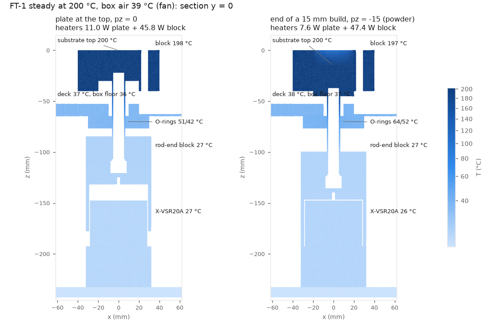
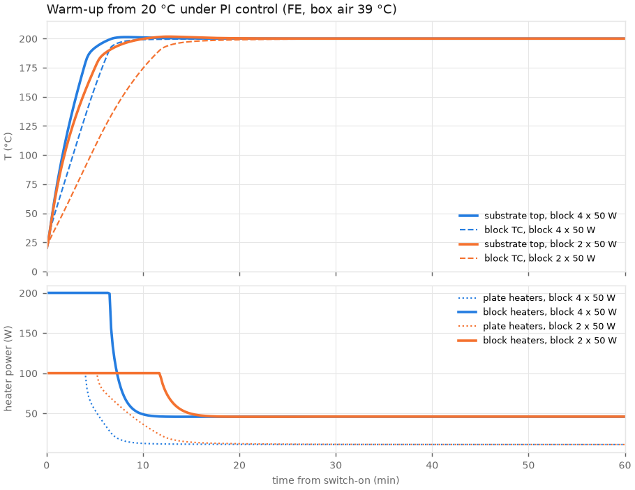
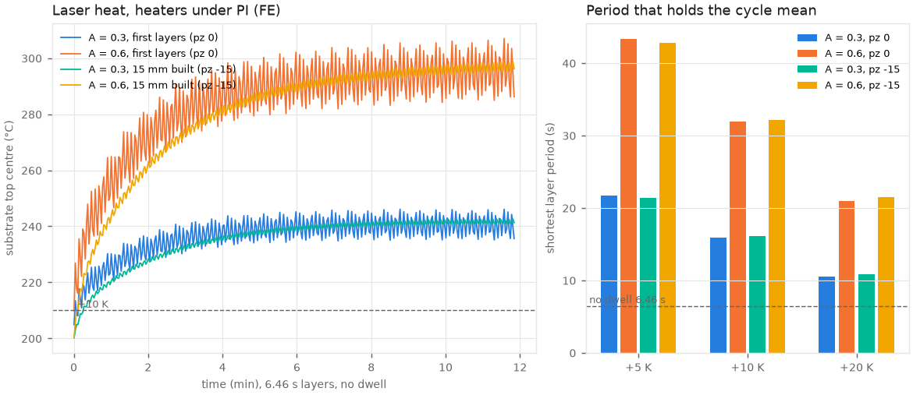

## Thermal (cases 1-3): the heated cassette at 200 °C, warm-up, and the laser's heat during a build

Finite-element heat transfer of the FT-1 cassette in the box, on the CAD v2 model (commit e6efa1c: the X-VSR20A,
X-LSM100B and rod-end block drawn from the makers' STEP numbers, four Ø6 x 20 mm block heaters). Script:
[`../../fea/ft_thermal.py`](../../fea/ft_thermal.py); numbers: [`thermal.json`](thermal.json). The structural cases
(4a-4d) are in [`struct.md`](struct.md).

### Short answer

- **Heater power (case 1).** Holding the substrate top centre and the well-block thermocouple at 200 °C takes
  **11.0 W in the plate and 45.8 W in the block** with the fan (box air 39 °C), 9.0 + 35.9 W in still air (71 °C).
  The 56.8 W total matches the study's ~56 W. Two 50 W plate heaters are 9 times what the plate needs at steady
  state. The block needs 46 W, inside 2 x 50 W but with little left for warm-up; the 4 x 50 W drawn in CAD v2 halve
  the block's warm-up time (case 2).
- **Uniformity.** The Ø30 mm build area is within 0.22 K (0.26 K over the whole Ø39.8 disc). The plate thermocouple
  reads 1.7 K above the substrate top, so the plate loop's set point should be ~201.7 °C for a 200 °C substrate.
- **Bought parts.** The X-VSR20A platform sits at 26.7 °C (27.9 °C in still air) and the rod-end block at 26.8 °C:
  inside the stage's 0-50 °C rating. The rod carries 2.6 W out of the plate but only 0.55 W reaches the rod-end
  block. **The X-LSM100B recoater stage takes the box air's temperature**: 37 °C mean, 39 °C max with the fan, but
  59 °C mean and 71 °C max in still air, above its 50 °C rating. The fan (or the supervisor's 45 °C box-air hold) is
  needed for the recoater, not for the piston stage. The gland O-rings run at 51/42 °C (upper/lower) with the fan,
  65/55 °C in still air and 64/52 °C at the end of a 15 mm build: fine for FKM (and for nitrile).
- **The 0.1 mm plate-bore gap does not bind.** At 200 °C the plate is 2.5-5 K warmer than the bore wall, which
  closes the radial gap by 0.9-1.7 µm. It would take the plate running ~210 K above the block to close it. The worst
  cases modelled: −38 µm during warm-up with 2 x 50 W in the block (plate up to 80 K ahead of the block), −52 µm with
  90 W of laser heat absorbed and the heaters off.
- **Warm-up (case 2).** From 20 °C, under PI at full power: substrate at 199 °C after **6.5 min** with 4 x 50 W in
  the block (9.5 min with 2 x 50 W); block TC at 199 °C after 9.7 min (20 min with 2 x 50 W); overshoot 1.3-1.7 K
  at the substrate, 2.4 K at the block. The substrate is within ±1 K after 9.8 min (15.4 min with 2 x 50 W); the block does not overshoot. The X-VSR20A platform takes ~85 min to come within 0.5 K of its steady 26.7 °C (mostly the room warming it from 20 °C), and drifts by 1.1 K after the first hour, ~1 µm of its lift.
- **Laser heat (case 3).** The plate stack passes heat to the block at **0.83 W/K** across the gap (0.69 W/K at
  the end of a 15 mm build, when 5 mm of the plate is below the block), close to the 0.9 W/K estimate. The
  substrate top only sees **0.67 W/K**, because the substrate-to-plate contact (2,000 W/m²K, an estimate) adds
  0.4 K/W in series. The first ~11 W of laser heat only replace the plate heater, which switches off. With no dwell
  (6.46 s layers) and the heaters off, the substrate top climbs **+40 K at A = 0.3** (35 W absorbed) and **+106 K at
  A = 0.6** (69 W; the block's own heater also switches off and the block rises to 216 °C). It gets most of the way
  there in 30-50 layers (3-5 min).
- **What that means for the build time.** To keep the substrate within +10 K of 200 °C, a layer has to take
  **16 s at A = 0.3 to 32 s at A = 0.6**: 1.5-3.0 h for 10 mm, 2.2-4.4 h for 15 mm. A +20 K band needs 10.5-21 s.
  The FE confirms the lead's re-run of the control worker's lumped dwell study at G = 0.67 W/K
  ([`control/out/dwell-study-fe.csv`](../../../control/out/dwell-study-fe.csv), commit 49d835a) to within ~10 %
  (below). On the bare substrate each layer swings the top centre by 11 K (A = 0.3) to 22 K (A = 0.6). This is the
  substrate's surface heating next to the scanned footprints during each 3 s exposure, and no dwell removes it (a
  graphite foil under the substrate takes off 1 K). So the band is better applied to the cycle mean or the plate TC.
  With 15 mm of coupons built, the swing drops to 2-4 K.
- **What helps most.** Run the block 20 K below the plate during the build and lower the plate's own set point so its heater stays off. The FE then allows 26.7 W absorbed at +10 K instead of 14.0 W: 8.4 s (A = 0.3) to 16.8 s (A = 0.6) a layer, 1.2-2.3 h for 15 mm, matching the lumped study's block −20 K rows. With the plate loop left at its normal set point the gain is smaller (21.9 W), because the heater keeps fighting the cooler block. A graphite foil under the substrate gains 16 %, and more cross-flow is no use. A bigger lever, estimated but not run: a solid aluminium rod into a water-cooled rod-end block, a deliberate ~44 W leak that the plate heater covers at idle and the laser displaces during a build.

### Case 1: steady at 200 °C

Heaters controlled so that the substrate top centre and the well-block TC (8 mm below the block top, where CAD v2
draws it) sit at 200 °C. 55.7k nodes (58.1k with the powder), 63-97 s a case.

| Case | Box air | Plate heaters | Block heaters | Ø30 area range | Plate TC | X-VSR20A platform | Rod-end block | O-rings upper / lower | Deck | Box floor mean / max | X-LSM100B mean / max | Gap change |
|---|---:|---:|---:|---:|---:|---:|---:|---:|---:|---:|---:|---:|
| FT-1, pz 0, fan | 39 °C | 11.0 W | 45.8 W | 0.22 K | 201.7 °C | 26.7 °C | 26.8 °C | 51 / 42 °C | 36.5-37.0 °C | 35.7 / 37.8 °C | 37.0 / 39.0 °C | −0.9 to −1.7 µm |
| FT-1, pz 0, still air | 71 °C | 9.0 W | 35.9 W | 0.18 K | 201.4 °C | 27.9 °C | 28.1 °C | 65 / 55 °C | 56.5-57.2 °C | 54.7 / 56.6 °C | **58.9 / 71.0 °C** | −0.6 to −1.3 µm |
| FT-1, pz −15, 15 mm of powder, fan | 39 °C | 7.6 W | 47.4 W | 0.13 K | 200.3 °C | 26.5 °C | 26.6 °C | 64 / 52 °C | 37.6-38.3 °C | 36.7 / 40.4 °C | 38.0 / 39.0 °C | −0.6 to −1.0 µm |
| FT-1V, pz 0, fan (cube air) | 36 °C | 10.9 W | 46.8 W | 0.22 K | 201.8 °C | 26.1 °C | 26.2 °C | 40 / 35 °C | 33.4-33.7 °C | 33.2 / 33.3 °C (cube plate) | 33.8 / 36.0 °C | −0.8 to −1.7 µm |

Where the heat goes (FT-1, pz 0, fan; W, from the FE's face fluxes):

| Path | W |
|---|---:|
| Plate stack → block, across the 0.1 mm gap and the rope | 3.2 |
| Plate stack → rod (of which 0.55 W reaches the rod-end block, 1.0 W the gland, 0.8 W leaves the rod's surface in the box) | 2.6 |
| Plate stack → box: substrate top under the cross-flow 3.9, heater plate underside 1.3 | 5.3 |
| Block → box air (convection and radiation from its faces) | 35.3 |
| Block → nozzle and collector (bolted on its top), then to the box air | 11.1 |
| Block → Macor standoffs → deck; deck → box floor | 2.6; 2.5 |
| Total out (= heaters in) | 56.8 |

*Section at y = 0 (square-root colour scale). The cassette sits at 195-202 °C. The standoffs, rod and gland take the
temperature down to 27 °C at the rod-end block and the X-VSR20A.*

The gap is the one radial joint that matters. The plate (Ø39.80) and the bore (Ø40.00) are the same alloy. At 200 °C
the plate's cross-section averages 2.5-5 K above the block's (the plate heaters run inside it, and the block's TC
point is cooler than its bore wall near the top), so the plate grows 1-2 µm more in radius than the bore. The change
is α(R_bore ΔT_block − R_plate ΔT_plate) with the cross-section means at each height (free-disc plane stress), 6061
α = 23.6 × 10⁻⁶/K. The gap closes only if the plate runs ~210 K above the block (0.1 mm / (23.6 × 10⁻⁶ × 19.9 mm)).

The scan head is outside the box. It hangs above the lid in room air (25 °C), with its bottom face ~200 mm above the
lid. The lid sits at about 30 °C with the fan and ~42 °C in still air (estimate: halfway-ish between the box air and
the room, by the inside and outside film coefficients; the lid is not in the FE). Radiation from the lid adds under
0.5 W to the head's bottom face. So the head's 15-35 °C operating range is set by the room, not by the box.

### Case 2: warm-up from 20 °C

All parts start at 20 °C, the box air is at its steady 39 °C (fan) from switch-on, the room at 25 °C. Heaters at
full power under the control worker's PI settings (`control/ftctl/config.py`: plate 0.06 of full power per K,
Ti 150 s; block 0.10 per K, Ti 400 s), on the plate TC (set point 201.7 °C, which puts the substrate at 200 °C) and
the block TC. Implicit Euler, 2 s steps for 1.5 h, then 10 s, to 4 h. 35.7k nodes.

| | Block 4 x 50 W (CAD v2) | Block 2 x 50 W (study) |
|---|---:|---:|
| Substrate top at 190 / 199 °C | 4.7 / 6.5 min | 6.5 / 9.5 min |
| Substrate overshoot; within ±1 K for good after | 1.3 K; 9.8 min | 1.7 K; 15.4 min |
| Block TC at 199 °C (no overshoot) | 9.7 min | 20.0 min |
| Heaters at full power until: plate / block | 4.0 / 6.5 min | 5.4 / 11.9 min |
| Plate stack ahead of the block, at most | 62 K | 80 K |
| Plate-bore gap change, at most (of 0.1 mm) | −29 µm | −38 µm |
| Heater energy in the first hour | 301 kJ (84 Wh) | 293 kJ (81 Wh) |
| Upper gland O-ring at 15 min / 30 min / 4 h | 42 / 45 / 51 °C | 42 / 45 / 51 °C |
| X-VSR20A platform at 1 h / 1.5 h / 4 h; within 0.5 K of steady after | 25.6 / 26.3 / 26.8 °C; 84 min | 25.7 / 26.3 / 26.8 °C; 86 min |

The plate loop backs off as soon as its TC is within ~17 K of the set point (0.06 of full power per K), so the
plate reaches temperature first and then waits on the block. The block is the slow part: 468 J/K against 46 W of
losses at 200 °C. With 2 x 50 W it has only ~54 W to spare for heating, so 4 x 50 W halves its time. The control
worker's 45 min heat-up timeout has 2-4 times margin. The plate runs up to 62-80 K ahead of the block, which closes
the 0.1 mm gap by up to 38 µm: no binding.

### Case 3: the laser's heat during a build

The process worker's first-coupon program (`process/README.md` §3-4, `process/out/heat_input.csv`): 746 J
delivered a layer over 3.01 s of laser-on time in a 6.46 s period, into five coupons (A, B, C 10 x 10 mm, d and e
5 x 5 mm), split by their layer-1 energies (208, 175, 257, 53, 53 J). Absorbed share A = 0.3 and 0.6, i.e. 35 and
69 W averaged over the layer. The heat goes in as a uniform flux over the coupon footprints while the laser is on;
the melt pool is not resolved. Two stages of the build:

- **pz 0** (first layers): the heat lands on the substrate's top face.
- **pz −15** (15 mm built): the coupons are solid AlSi10Mg columns from the substrate to the powder plane in a
  powder bed, and the heat lands on their tops.

The heaters are under PI, the plate on its TC and the block on its TC.

**Conductances and heat capacities** (FE, heater-off states; 35.7k / 38.6k nodes):

| Quantity | pz 0 | pz −15 (15 mm built) | Lumped dwell model (control worker) |
|---|---:|---:|---:|
| Plate stack → block, gap + rope (flow / (plate mean − bore wall)) | **0.83 W/K** | 0.69 W/K | 0.9 W/K (estimate) |
| Rod, plate → down the rod (to the gland, floor and rod-end block) | 0.015 W/K | 0.018 W/K | in 0.03 W/K |
| Substrate top → box (2.5 m/s cross-flow + radiation), at 200 °C | 3.9 W (0.024 W/K) | (coupon and powder tops) | in 0.03 W/K |
| Effective conductance seen at the substrate top centre (slope of excess vs absorbed power) | **0.67 W/K** | 0.64 W/K | - |
| Same, seen at the plate TC | 0.90 W/K | 0.82 W/K | - |
| Plate heater power at 200 °C (the laser heat it absorbs before it switches off) | 11.0 W | 10.2 W | ~5 W (0.03 W/K x 165 K) |
| Heat capacity, substrate + heater plate | 85 J/K (18 + 67) | 85 J/K + 29 J/K coupons and powder | 105 J/K (28 mm plate) |
| Rise per layer if the plate stack were one lump (A = 0.3 / 0.6) | 2.6 / 5.3 K | 2.0 / 3.9 K | 2.1 / 4.3 K |

**No dwell, heaters off once the laser takes over** (6.46 s layers):

| | A = 0.3 (34.6 W absorbed) | A = 0.6 (69.3 W absorbed) |
|---|---:|---:|
| Substrate top centre, steady excess over 200 °C, pz 0 / pz −15 | +40 K / +42 K | +106 K / +109 K |
| Same after 110 layers (12 min), peak, pz 0 / pz −15 | +46 K / +43 K | +107 K / +99 K (still climbing) |
| Swing within a layer, substrate top centre, pz 0 / pz −15 | 11 K / 1.8 K | 22 K / 3.7 K |
| Swing within a layer at the plate TC, pz 0 | 0.4 K | 0.8 K |
| Plate heater off after / block heater | 8.5 s / held at 24 W | 3.5 s / off, block TC to 216 °C (steady) |
| Coupon tops, steady, pz −15 (hottest point of the build area) | 258 °C at 35 W | 341 °C at 69 W |
| Plate-bore gap change, steady | −18 µm | −40 µm |

*Left: substrate top centre over the first 110 layers with no dwell, heaters under PI. Right: shortest layer period
that holds the substrate's cycle mean within the band (FE).*

**Shortest layer period** (FE). The cycle mean is the steady state at the mean absorbed power (FE sweep at 5-90 W,
interpolated). A peak criterion adds half the FE swing within a layer. Build hours are 333 layers (10 mm) and 500
layers (15 mm) of 30 µm.

| Band over 200 °C | What is held | A = 0.3 | A = 0.6 | 10 mm | 15 mm |
|---|---|---:|---:|---:|---:|
| +5 K | substrate top, cycle mean | 21.7 s | 43.3 s | 2.0-4.0 h | 3.0-6.0 h |
| +10 K | substrate top, cycle mean | 15.9 s | 31.9 s | 1.5-3.0 h | 2.2-4.4 h |
| +20 K | substrate top, cycle mean | 10.5 s | 21.0 s | 1.0-1.9 h | 1.5-2.9 h |
| +10 K | substrate top, peak, 15 mm built | 16.8 s | 35.4 s | 1.6-3.3 h | 2.3-4.9 h |
| +10 K | substrate top, peak, bare substrate | 22.9 s | not reachable (22 K swing) | - | - |
| +10 K | plate TC, peak (what the dwell rule reads) | 11.0 s | 22.3 s | 1.0-2.1 h | 1.5-3.1 h |

**Check on the lumped dwell study.** The lead's re-run at G = 0.67 W/K ([`dwell-study-fe.csv`](../../../control/out/dwell-study-fe.csv))
lets 12.6 W (A = 0.3) and 13.2 W (A = 0.6) of mean absorbed heat into the plate for a +10 K band on its peak: 17.8 s
and 33.9 s a layer. The FE's substrate peak at pz −15 allows 13.3 W and 12.6 W (16.8 s and 35.4 s); its cycle mean
at pz 0 allows 14.0 W. The lumped model's no-dwell plateau, (P − 0.03 W/K x 165 K) / (0.67 + 0.03) W/K, is +42 K at
A = 0.3, against the FE's +40 K (pz 0) and +42 K (pz −15). At A = 0.6 the lumped model gives +92 K with the block
held at 200 °C; the FE gives +106 K, because the plate pushes ~56 W into the block, more than the block's own 46 W of
losses, so the block heater switches off and the block rises 16 K. So the dwell study's numbers at 0.67 W/K stand,
with two corrections:
1. On the bare substrate the top swings 5 times more per layer than a 105 J/K lump (11-22 K against 2-4 K).
2. With the block at its set point, a no-dwell build at A ≳ 0.55 also drives the block over its set point.

**What changes the answer** (FE at pz 0, steady sweeps with the change, and 12 layers at A = 0.3 for the swing):

| Change | Allowed mean absorbed heat, +10 K | Layer period A = 0.3 / 0.6 | 10 mm | 15 mm |
|---|---:|---:|---:|---:|
| As designed: block at 200 °C, plate loop on its TC | 14.0 W | 15.9 / 31.9 s | 1.5-3.0 h | 2.2-4.4 h |
| Block 20 K below the plate during the build, plate loop on its TC | 21.9 W | 10.2 / 20.4 s | 0.9-1.9 h | 1.4-2.8 h |
| Block 20 K below, plate set point lowered so its heater stays off | **26.7 W** | **8.4 / 16.8 s** | 0.8-1.6 h | 1.2-2.3 h |
| Graphite foil under the substrate (contact 10,000 instead of 2,000 W/m²K, estimate) | 16.3 W | 13.7 / 27.5 s | 1.3-2.5 h | 1.9-3.8 h |

The block offset is the lever, but it only works if the plate's own set point comes down with it. With the plate
loop still holding its TC at 201.7 °C, the plate heater keeps running against the block's extra pull: 17 W at 10 W
absorbed. On top of that, the laser's heat enters at the top and leaves the substrate ~0.3 K/W above the TC. The
heater-off row is the lumped study's case: at +5 K the FE allows 23.4 W, the lumped study 22.5 W
([`dwell-study-fe.csv`](../../../control/out/dwell-study-fe.csv), block −20 K: 1.38-2.73 h for 15 mm). The swing
within a layer barely changes: 11.1 K at A = 0.3 with the block 20 K down, 9.9 K with the graphite foil. It is the
substrate's surface heating next to the footprints during each 3 s exposure; a semi-infinite-body estimate gives
~20 K under the footprints at A = 0.3. A 20 K block offset moves the plate-bore gap by αR x 20 K = 9 µm, well inside
0.1 mm. More cross-flow is no use: the substrate top loses only 0.024 W/K.

Not run in the FE (estimate): a deliberate leak through the rod. A solid 6061 rod (Ø12.7 mm, ~85 mm from the socket
to the rod-end block, ~0.25 W/K) into a water-cooled rod-end block would draw ~44 W from the plate at 200 °C. The
plate heater makes that up at idle (55 W of its 100 W), and the laser displaces it during a build, so a +10 K band
would take ~55 W absorbed: close to a no-dwell build at A ≤ 0.5. The cost: a water circuit at the stage, the gland
O-rings at ~120 °C (FKM is rated to 200 °C), and a rod whose length follows the plate's temperature.

### FT-1V

The cube case (cassette 21 mm higher on the 22.9 mm cube floor plate, cube air 36 °C with the fan per
`cad/out/checks.md`) needs 10.9 W + 46.8 W, nearly the FT-1 numbers. The cube's aluminium floor plate spreads the
heat: deck 33.4-33.7 °C, cube plate 33.2-33.3 °C, platform 26.1 °C, O-rings 40/35 °C. The cassette's thermal
behaviour, and so case 3, carries over unchanged. Still air in the cube was not run.

### Method

- **Geometry** comes from `cad/ft_model.py` `build("FT-1" | "FT-1V", pz)` (CAD v2, e6efa1c), so the script re-runs
  on a changed model. Bodies: substrate, heater plate, rope wiper, well block, Macor standoffs, deck, box floor (or
  the cube's bottom plate), rod, gland, rod-end block, the X-VSR20A's platform and fixed body, the bracket plate and
  riser, the X-LSM100B, nozzle and collector; plus the powder, and the coupons in it, at pz −15. gmsh cannot mesh
  the X-VSR20A's fused fixed body (PLC error at its 2.5 mm core corner round), so that part is drawn from the same
  `ft_vendor.VSR` numbers with square corners. Each body is meshed on its own (gmsh, linear tetrahedra):
  55.7k nodes / 200k tets for the steady cases, 35.7-38.6k nodes for the transients. The steady heater powers agree
  between the two meshes: 11.03 + 45.83 W against 11.01 + 45.78 W.
- **Joints between bodies** come from casting rays along each boundary face's normal:
  - faces closer than 0.06 mm get a contact conductance;
  - gas gaps up to 6 mm get argon conduction k/(g + 2 × 2.8 λ) plus grey-body radiation;
  - other faces lose heat by natural convection (by orientation) and radiation to the box air (inside) or the room
    (outside). The faces under the slot's cross-flow get a laminar flat-plate coefficient, combined with natural
    convection.
  - On coaxial faces the gap is the design value: 0.1 mm plate-bore, 0.1 mm rod-gland, and contact for the rod in
    its clamp and socket. The reason: the faceted meshes of a Ø40 bore sag by up to 0.06 mm between nodes, as much
    as the gap. Before this fix the ray-cast gap read as contact in places and gave 1.0 W/K (3.9 W/K on a coarse
    mesh) instead of 0.83 W/K.
- **Solver.** Own P1 finite elements (scipy sparse LU): conduction, lumped heat capacity, and the convection and
  radiation coefficients iterated (Picard). The two heater powers are extra unknowns at steady state, or PI loops in
  the transients (implicit Euler, explicit controller update, coefficients refreshed when the field moves by more
  than 3 K). CalculiX is not used for the whole model for two reasons: its gap conductance needs mechanical contact
  elements, and it has no heater controller. Instead **ccx 2.21 checks the solver** on the well block alone (same
  C3D4 mesh, *HEAT TRANSFER steady, *DFLUX BF in the heater elements, *FILM and *RADIATE on every face):
  the node temperatures agree within **0.0005 K** (7,843 nodes, 34,399 elements, 356 heater elements, 8,846 faces with film and radiation; ccx 1.6 s).
- **Runs** (4 cores shared with six other jobs, under `/tmp/tools/capmem 3`): steady 4 cases 4.9 min (peak RSS
  under 1.75 GB), laser 2 stages 19.6 min (1.35 GB), warm-up 2 cases 13.6 min (1.13 GB), sensitivity 5.4 min (1.17 GB), ccx check 11 s.

### Assumptions and sources

| Input | Value | Source |
|---|---|---|
| 6061-T6 | k 167 W/mK, ρ 2,700 kg/m³, c 896 J/kgK | ASM Handbook vol. 2 / MatWeb (k ~175 at 200 °C, not used) |
| 304 | k 16.2 W/mK, ρ 8,000, c 500 | Incropera Table A.1 (14.9 at 300 K, 16.6 at 400 K) |
| Macor | k 1.46 W/mK, ρ 2,520, c 790 | Corning Macor datasheet |
| Fibreglass rope | k 0.05 W/mK | estimate (glass-fibre insulation 0.04-0.06) |
| AlSi10Mg powder bed in argon | k 0.15 W/mK, ρ 1,350 | estimate (0.1-0.3 published, ~50 % packing) |
| As-built AlSi10Mg (coupons) | k 120 W/mK | estimate (100-150 W/mK published) |
| X-VSR20A, X-LSM100B bodies | aluminium, density cut to 40 % | estimate (hollow bodies) |
| Argon, 1 atm | k = 0.0177 (T/300 K)^0.79 W/mK, μ = 22.7 (T/300 K)^0.8 µPa s | NIST WebBook (Lemmon and Jacobsen 2004), fits 300-500 K |
| Contact conductance | 2,000 W/m²K default (substrate-plate, nozzle-block, clamps); 1,000 standoff ends; 200 deck-floor and rope; 500 powder; 50,000 coupon-substrate | estimates for dry joints in argon; the substrate-plate value matters (case 3) |
| Emissivity | 6061 0.10, substrate 0.30, 304 0.30, box floor 0.20, Macor and rope 0.90, stages 0.85, powder 0.40 | estimates (machined, blasted, anodised surfaces) |
| Natural convection | Churchill-Chu (vertical), 0.54/0.15 Ra^n (hot face up), 0.27 Ra^0.25 (hot face down), in argon | Incropera eqs 9.26-9.32 |
| Cross-flow on the block and substrate top | Nu_x = 0.332 Re_x^0.5 Pr^(1/3), x from the slot at y = −27 mm, 2.5 m/s | Incropera eq. 7.23; slot speed from the study |
| Box air | 39 °C with the fan, 71 °C without; cube 36/61 °C | study (`fast_track.py` heat()), `cad/out/checks.md` |
| Room; riser to bench | 25 °C; 50 W/m²K on the bracket plate's underside | study (T_AMB); estimate |
| Heaters | plate 2 x 50 W Ø6 x 20 mm at r 11.5 mm; block 4 x 50 W Ø6 x 20 mm from the −x face | CAD v2; lead, 2026-11-27 |
| PI settings | plate 0.06 of full power per K, Ti 150 s; block 0.10 per K, Ti 400 s | `control/ftctl/config.py` (simulated controllers) |
| Laser heat | 746 J delivered a layer, 3.01 s on, 6.46 s period, coupon split 208/175/257/53/53 J | `process/README.md` §4, `process/out/heat_input.csv` |

### Not done, and what is uncertain

- **The substrate-plate contact conductance is an estimate** (2,000 W/m²K), and it sets both the 0.4 K/W in series
  with the gap and the per-layer swing on the bare substrate. A graphite foil (10,000 W/m²K) changes the allowed heat by 16 % and the swing by 1 K, so the conclusions do not hang on this value.
- The box air is prescribed (from the study's heat balance), not solved. The lid, walls, window and scan head are
  not in the FE; the head check above is a hand estimate.
- No melt pool and no moving spot: the laser's heat is spread over the coupon footprints for the laser-on time. The
  coupon tops at pz −15 run 16-33 K above the substrate at 35-69 W (k = 120 W/mK assumed); a coupon's own
  temperature history is not resolved.
- Thermal growth of the plate stack and rod moves the substrate surface. This is an estimate, not from the FE: 6061
  over 30 mm plus 304 over ~85 mm at half the plate's rise gives ~1.4 µm per K of plate temperature. So the +40 K
  climb of a no-dwell build at A = 0.3 lifts the surface by ~58 µm over its first 30-50 layers, and a ±10 K band
  moves it by ±14 µm against a 30 µm layer.
- The warm-up assumes the box air is at 39 °C from switch-on. FT-1V in still air was not run.
- The PI settings are the control worker's simulated ones. The real SOLO controllers autotune.
